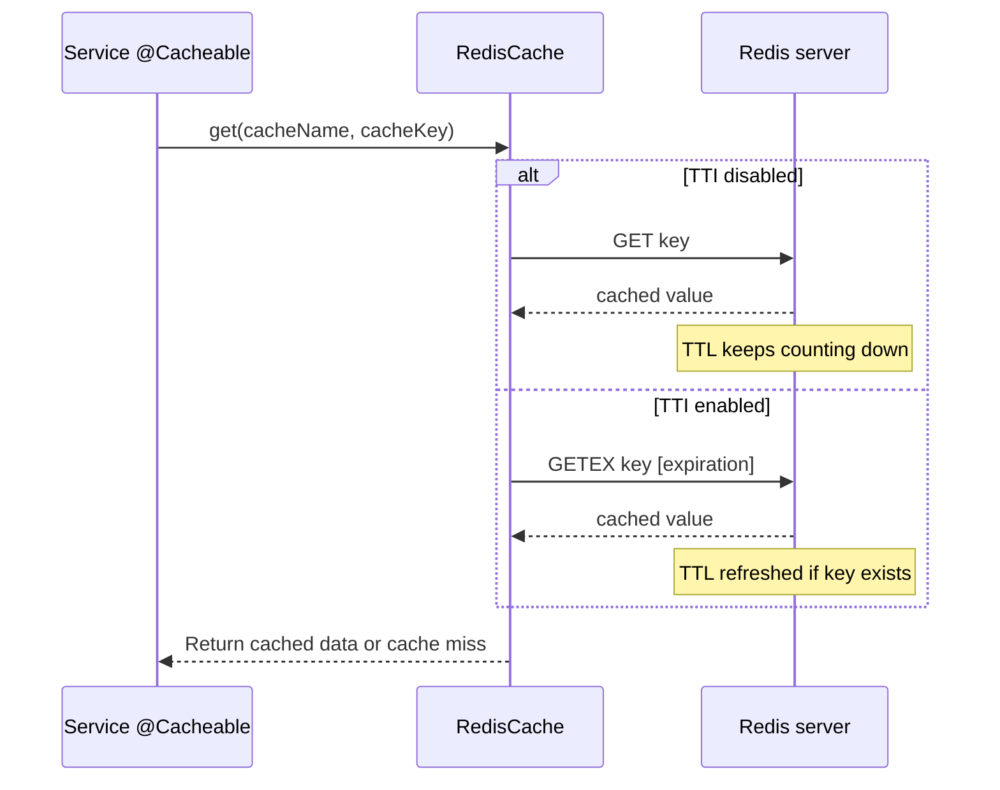

# TTL and Time-to-Idle: Version Support Requirements in Spring Data Redis

## 1. TTL and time-to-idle solve two different problems

**Spring Cache** is an abstraction providing operations to store, read, and remove cached data. With Spring Data Redis, `RedisCacheManager` and `RedisCache` use Redis to store entries.

A cache entry can expire under two common policies:

- **Time to live (TTL)**: an entry expires after a fixed duration from the most recent write or TTL refresh. Ordinary reads do not alter the deadline.
- **Time to idle (TTI)**: an entry expires if left unaccessed for a period. Each valid read renews the expiration window, creating *sliding expiration*.

Example with the same 10-minute configuration:

```text
Standard TTL:
10:00  Cache PUT product:42     -> expected expiration 10:10
10:04  Cache GET product:42     -> still expected expiration 10:10
10:08  Cache GET product:42     -> still expected expiration 10:10
10:10  Redis may delete expired key

TTI:
10:00  Cache PUT product:42     -> expected expiration 10:10
10:04  Cache GET product:42     -> extended to 10:14
10:08  Cache GET product:42     -> extended to 10:18
10:18  With no new accesses, key becomes eligible for expiration
```

The timestamps above represent logical lifetimes. Redis can delete keys via active expiration or lazily on access, so expiration notifications or key counts do not necessarily update on the exact millisecond of the deadline.

Redis has supported **key-level TTL** for a long time. However, Redis does not have a server-wide setting to "refresh TTL whenever any key is read." Achieving TTI requires the application layer or a specific Redis command to **read and extend expiration atomically**.

That is why both the **Spring Data Redis version** and the **Redis server version** matter when enabling TTI in Spring Cache.

## 2. Version matrix: when is TTI available in Redis Cache?

Spring Data Redis added TTI emulation support to `RedisCache` starting in **Spring Data Redis 3.2** via `RedisCacheConfiguration.enableTimeToIdle()`.

This mechanism uses the Redis **`GETEX`** command, introduced in **Redis 6.2**: reading the value and updating the key's expiration in a single command.

| Component | Version / condition | Standard TTL | TTI via `enableTimeToIdle()` |
| --- | --- | --- | --- |
| Spring Data Redis 3.1.x and earlier | Lacks `enableTimeToIdle()` API for Redis Cache | Yes | No built-in support via this API |
| Spring Data Redis 3.2 and later | Provides `enableTimeToIdle()` API | Yes | Yes, if Redis supports `GETEX` |
| Redis server prior to 6.2 | Lacks `GETEX` | Yes | Cannot use `GETEX` mechanism required by Spring Data Redis 3.2+ |
| Redis server 6.2 and later | Supports `GETEX` | Yes | Supported when paired with compatible Spring Data Redis |
| Spring Boot managing Spring Data Redis 3.2+ via BOM | Depends on actual resolved dependencies | Yes | Can configure TTI if Redis server meets requirement |

**The two minimum prerequisites for built-in TTI** are:

1. Spring Data Redis with `RedisCacheConfiguration.enableTimeToIdle()`: 3.2+.
2. Redis server with `GETEX`: 6.2+.

Additionally, the client, any Redis proxy, or Redis-compatible managed service must allow `GETEX`, connections must route to a writable node, and Redis ACLs must permit executing that command.

### How does Spring Boot factor in?

Spring Boot normally manages Spring Data versions through dependency management. Common release alignments:

| Spring Boot | Typical bundled Spring Data Redis via BOM | Conclusion for TTI |
| --- | --- | --- |
| Spring Boot 3.1.x | Spring Data Redis 3.1.x | Lacks `enableTimeToIdle()` |
| Spring Boot 3.2.x | Spring Data Redis 3.2.x | Has TTI API; requires Redis 6.2+ |
| Spring Boot 3.3.x | Spring Data Redis 3.3.x | Has TTI API; requires Redis 6.2+ |
| Newer Boot lines using Spring Data Redis 3.2+ | Determined by actual dependency | Usable if server supports `GETEX` |

This table assumes default BOM-managed dependency versions with no manual `spring-data-redis` overrides. Projects can override dependencies; **the actual version on the runtime classpath** determines whether the API exists.

Do not conclude "upgrading Spring Boot guarantees TTI works" if Redis is still 6.0/6.1 or behind a proxy lacking `GETEX`. Conversely, having a newer Redis server with `GETEX` does not make an older Spring Data Redis library emit `GETEX` on `@Cacheable` reads.

## 3. Technical mechanics: how do `GET` and `GETEX` differ?

### Standard TTL: `GET` only reads the value

For a cache entry with a 600-second TTL:

```redis
SET catalog::sku-42 "{...cached-value...}" EX 600
TTL catalog::sku-42
GET catalog::sku-42
TTL catalog::sku-42
```

After `GET`, TTL continues counting down as time passes. Cache hits do not extend the deadline.

`GET` is processed by Redis as a read-only command. Simply fetching the value does not touch the key's expiration metadata.

### TTI emulated via `GETEX`

Redis syntax:

```redis
GETEX catalog::sku-42 EX 600
```

This command:

1. Retrieves the current value of the key.
2. Simultaneously resets the key's expiration to 600 seconds from command execution.

When the key exists, the returned value matches `GET`, while TTL is refreshed. When the key does not exist, it returns nil and nothing is extended.

Redis also supports options on `GETEX` such as `PX` for milliseconds; Spring Data Redis encodes the expiration matching the configured duration.

Spring Cache flow when TTI is enabled:



With `GETEX`, "read and reset TTL" executes inside **one atomic Redis command**. Splitting `GET` and `EXPIRE` into two separate client calls risks the key expiring, changing, or disappearing in between, creating race conditions.

**Spring Data Redis calls this *TTI emulation*** because Redis has no server-wide toggle making every read from any client reset TTL. Only read paths issuing `GETEX` reset the idle timer.

## 4. Configuring TTL via `RedisCacheConfiguration`

Basic TTL configuration with Spring Data Redis Cache:

```java
import java.time.Duration;
import org.springframework.cache.CacheManager;
import org.springframework.context.annotation.Bean;
import org.springframework.context.annotation.Configuration;
import org.springframework.cache.annotation.EnableCaching;
import org.springframework.data.redis.cache.RedisCacheConfiguration;
import org.springframework.data.redis.cache.RedisCacheManager;
import org.springframework.data.redis.connection.RedisConnectionFactory;

@Configuration
@EnableCaching
public class CacheConfiguration {

    @Bean
    public CacheManager cacheManager(
            RedisConnectionFactory connectionFactory) {

        RedisCacheConfiguration defaults =
                RedisCacheConfiguration.defaultCacheConfig()
                        .entryTtl(Duration.ofMinutes(10));

        return RedisCacheManager.builder(connectionFactory)
                .cacheDefaults(defaults)
                .build();
    }
}
```

This is **standard TTL**: entries are written with roughly a 10-minute lifetime; reads do not actively extend it. Spring Data Redis uses Redis `SET` with expiration when writing entries.

Example service:

```java
import org.springframework.cache.annotation.Cacheable;
import org.springframework.stereotype.Service;

@Service
public class CatalogService {

    @Cacheable(cacheNames = "catalog", key = "#sku")
    public ProductView findProduct(String sku) {
        return loadProductFromDatabase(sku);
    }

    private ProductView loadProductFromDatabase(String sku) {
        // Example: query database and construct return object.
        throw new UnsupportedOperationException("Implement per application");
    }
}
```

Assuming `catalog` uses a 10-minute lifetime:

- First call with no entry: method executes, and the result is cached with TTL.
- Subsequent calls while entry exists: Spring Cache returns the cached value; TTL keeps counting down.
- After entry expires: the next access triggers a cache miss and recomputes the data.

A Spring Boot property configuration is also common:

```yaml
spring:
  cache:
    type: redis
    redis:
      time-to-live: 10m
      cache-null-values: false
```

`spring.cache.redis.time-to-live` configures **TTL** for the auto-configured Redis cache; it **does not turn cache hits into TTI**. Enable time-to-idle explicitly on the Redis Cache configuration if sliding expiration is needed.

Do not declare a custom `CacheManager` bean while expecting all `spring.cache.redis.*` properties to continue applying unchanged via auto-configuration. When defining your own bean, explicitly configure TTLs, key prefixes, and serializers as needed.

## 5. Enabling time-to-idle in Spring Data Redis 3.2+

With Spring Data Redis 3.2+ and Redis 6.2+, configure:

```java
@Configuration
@EnableCaching
public class CacheConfiguration {

    @Bean
    public CacheManager cacheManager(
            RedisConnectionFactory connectionFactory) {

        RedisCacheConfiguration defaults =
                RedisCacheConfiguration.defaultCacheConfig()
                        .entryTtl(Duration.ofMinutes(10))
                        .enableTimeToIdle();

        return RedisCacheManager.builder(connectionFactory)
                .cacheDefaults(defaults)
                .build();
    }
}
```

The two calls serve two purposes:

- `entryTtl(Duration.ofMinutes(10))` defines the expiration window for entries.
- `enableTimeToIdle()` causes reads via `RedisCache` to issue `GETEX` and reset this window.

When `@Cacheable` hits, reading through Spring Cache updates the key's TTL. On a cache miss, the method runs and the new value is written with expiration. This extends TTL on cache hits without affecting TTLs of unrelated Redis keys outside that cache.

### Different settings per cache

You can give product caches 10-minute TTI while keeping exchange rates on a 1-minute standard TTL:

```java
@Bean
public CacheManager cacheManager(RedisConnectionFactory factory) {
    RedisCacheConfiguration base =
            RedisCacheConfiguration.defaultCacheConfig();

    RedisCacheConfiguration catalogTti =
            base.entryTtl(Duration.ofMinutes(10))
                .enableTimeToIdle();

    RedisCacheConfiguration exchangeRateTtl =
            base.entryTtl(Duration.ofMinutes(1));
                // Do not call enableTimeToIdle()

    return RedisCacheManager.builder(factory)
            .withCacheConfiguration("catalog", catalogTti)
            .withCacheConfiguration("exchangeRate", exchangeRateTtl)
            .cacheDefaults(base.entryTtl(Duration.ofMinutes(5)))
            .build();
}
```

Because `RedisCacheConfiguration` is immutable under its builder style, creating `catalogTti` does not enable TTI on `exchangeRateTtl`.

When configuring multiple caches, make sure `@Cacheable(cacheNames = "...")` matches registered names. Otherwise a cache falls back to default settings differently than intended.

### TTI is only meaningful when a positive TTL exists

If cache entries are written **with no expiration** (infinite lifetime), there is no "10-minute idle window" to refresh. For TTI to be meaningful, configure a positive expiration duration.

Do not assume `enableTimeToIdle()` invents a TTL on its own regardless of configuration. Combine it with `entryTtl(...)` or a version-supported TTL computation mechanism.

## 6. TTI only applies to read paths that refresh TTL

This is the single most important limitation.

Suppose `catalog::sku-42` is stored by `RedisCache` with a 10-minute expiration:

| Access path | Refreshes TTI by default when `enableTimeToIdle()` is on? | Explanation |
| --- | --- | --- |
| `@Cacheable` cache hit via `RedisCacheManager` | Yes | Spring Cache invokes `RedisCache` read path using `GETEX`. |
| `cacheManager.getCache("catalog").get("sku-42")` | Yes | Accesses through the same Redis Cache abstraction. |
| `StringRedisTemplate.opsForValue().get(key)` | No | Issues ordinary Redis `GET`, ignoring Redis Cache TTI policy. |
| `redis-cli GET catalog::sku-42` | No | Redis `GET` never resets expiration. |
| External client calling `GET` | No | The server has no concept of a "TTI cache." |
| Client issuing valid `GETEX key EX 600` | Yes, via `GETEX` command | Extends expiration directly in Redis, even outside Spring Cache. |
| `TTL key` / `PTTL key` | No | Only inspects remaining lifetime. |

**A cache with multiple read paths achieves consistent TTI only if every read path meant to refresh TTL actually uses the TTI mechanism.** If part of the system reads via `RedisCache` and another reads via `GET`, the latter reads do not count as activity toward expiration.

This frequently happens when a system:

- Mixes `@Cacheable` with controllers querying Redis directly.
- Shares a namespace across microservices written with different libraries.
- Uses CLI tools or workers reading cache entries directly.
- Reads cached keys from read replicas using `GET` while refreshing caches on the primary.

Do not conflate these access styles. If TTI is a business requirement, formalize access paths and ensure every client representing "activity" uses `GETEX`.

### TTI in Spring Cache is not Redis Repository TTL

Spring Data Redis also includes Redis Repository with `@RedisHash(timeToLive = ...)` and `@TimeToLive`. That governs **entity** and Hash expiration managed by repositories, separate from Redis Cache storage.

Enabling `RedisCacheConfiguration.enableTimeToIdle()` does not automatically extend the TTL of an entity read via `CrudRepository.findById(...)`. Never assume every Redis read in the application inherits `CacheManager`'s TTI behavior.

## 7. When the Redis server does not support `GETEX`

An application compiled against Spring Data Redis 3.2+ can still fail at runtime if the Redis server is 6.0 or 6.1.

Example:

```text
Spring Data Redis 3.2+: enableTimeToIdle()
Redis server 6.0: GETEX does not exist

On cache hit:
  Spring Data Redis attempts to execute GETEX.
  Redis returns unknown command / command unsupported error.
  The application may throw RedisSystemException or
  a corresponding DataAccessException.
```

The exact exception depends on the driver, configuration, and Spring Data Redis exception translator. Consequently, do not assume errors appear at startup. It is on a cache hit that the read path actually triggers `GETEX`.

### Compatibility options

**Option 1: use standard TTL only.** Omit `enableTimeToIdle()` and keep `entryTtl(Duration)`. Works with older Redis servers supporting basic expiration commands.

**Option 2: upgrade Redis server to 6.2+ or a Redis-compatible service confirmed to support `GETEX`.** Also verify ACLs, routing, and drivers.

**Option 3: build a custom "read and extend" path on older servers.** For instance, a Lua script reading and calling `EXPIRE` when the key exists:

```lua
-- KEYS[1]: key to read
-- ARGV[1]: TTL in seconds, positive integer
local value = redis.call('GET', KEYS[1])
if value then
    redis.call('EXPIRE', KEYS[1], tonumber(ARGV[1]))
end
return value
```

This script emulates read-and-extend on older Redis servers and avoids the race window between `GET` and `EXPIRE` because Lua executes atomically in Redis. However, this is a **custom workaround**, not Spring Cache's `enableTimeToIdle()` on older versions. Integrating it into `RedisCache` or call paths requires separate implementation and testing. The script must also validate TTL, avoid accidentally extending shared keys, and align serializers.

Never replace `GETEX` with separate `GET` followed by `EXPIRE` Java calls assuming atomic equivalence; keys can expire or be modified by another writer in between.

## 8. Redis ACL permissions and read replicas: `GETEX` is not a pure read

Although it returns a value, `GETEX` **modifies key expiration metadata**. Hence it behaves like a write command in Redis.

### ACL permissions

An account granted only `GET` can read standard TTL caches, yet enabling TTI requires permission to execute `GETEX` on the corresponding cache namespace.

Example principle:

```text
Allow only required commands:
+get +set +getex +del +expire ...

Restrict keys:
~catalog::*
```

This is a permission sketch, not a complete ACL configuration file. Account for commands actually issued during cache puts/gets/evicts, serialization, batch strategies, and cache clears. Do not grant `+@all` or full administrative privileges just to get `GETEX` working.

### Routing to replicas

Redis read replicas normally reject commands modifying data or expiration such as `GETEX`. If the client uses `readFrom(REPLICA)` or connects to a read-only endpoint, TTI lookups can fail because the command carries a side effect.

Therefore ensure:

- TTI cache lookups route `GETEX` to the primary or a writable endpoint.
- ACLs allow `GETEX` at the target.
- Drivers, proxies, and cluster routing do not route `GETEX` to replicas merely because its name starts with "get."
- Costs of writing TTL metadata, replication, and persistence are factored into real traffic budgets.

Systems relying heavily on replicas for massive read traffic should evaluate carefully before enabling TTI on every cache. Updating TTL on every cache hit can shift heavy load onto the primary.

## 9. Performance and expiration behaviors to weigh

Comparison:

| Property | Standard TTL | TTI emulated via `GETEX` |
| --- | --- | --- |
| Cache hit command | `GET` | `GETEX` with expiration |
| Refreshes TTL on read | No | Yes |
| Can extend lifetime indefinitely under continuous access | No, absent other writes/renewals | Yes |
| Redis command has side effect on read | No | Yes |
| Suitable for read-only replicas | Possible, depending on replication topology | Usually no, since `GETEX` mutates expiration |
| Impact on write/replication load | None added by cache hits | Can rise due to frequent TTL updates |
| Risk of serving stale data long under hot reads | Bounded by written TTL | Yes, unless paired with invalidation or max lifetime |

### Hot caches can live indefinitely

With a 10-minute TTL, a key read once per minute may **never expire because it never stays idle for 10 minutes**. That is TTI working as intended.

If source data can change and the application relies solely on expiration to refresh the cache, TTI can let stale data survive indefinitely. Common remedies:

- Pair with `@CacheEvict` or invalidation events when data changes.
- Enforce an *absolute maximum age* via extra metadata or key versioning, independent of idle timeout.
- Use fixed TTL instead of TTI if periodic forced cache refreshes are the primary goal.
- Enable TTI only on caches whose semantics truly match, such as expensive rarely changing computations or session-like data with dedicated rules.

Do not enable TTI simply to reduce cache misses: it fundamentally alters the data's lifetime contract.

### Resource overhead

`GETEX` remains a single-key operation, yet updates expiration metadata. For extremely hot caches, every hit generates a metadata write affecting replication and AOF (depending on Redis persistence settings).

Measure at least:

- Cache hit/miss rates before and after enabling TTI.
- `GET`/`GETEX` call counts via `INFO commandstats` on Redis.
- CPU, latency, memory, network, replication backlog, and primary load.
- Active key count, eviction rates, actual lifetimes, and data staleness.
- Whether traffic shifts off read-only endpoints onto primaries.

TTI can cut cache misses by keeping hot keys alive longer, yet does not always improve overall system performance.

## 10. Dynamic TTLs and `TtlFunction` in Spring Data Redis 3.2+

Beyond fixed `entryTtl(Duration)`, Spring Data Redis 3.2 introduced `RedisCacheWriter.TtlFunction` to calculate entry lifetimes from relevant data:

```java
RedisCacheConfiguration configuration =
        RedisCacheConfiguration.defaultCacheConfig()
                .entryTtl((key, value) -> Duration.ofMinutes(5));
```

This snippet uses a lambda returning a constant 5 minutes to show the API signature. Real implementations compute dynamic TTLs from keys or values at write time.

With **TTI**, the application must know how long to extend on reads. When TTL is computed from the value at write time, a read path does not necessarily share the same context before `GETEX` runs. Verify exact semantics of your Spring Data Redis version and how `TtlFunction` is invoked on TTI read paths.

Do not assume "value-based TTL computed on write" automatically preserves the exact same formula across every subsequent renewal. When predictable TTI is needed, fixed per-cache TTLs are easier to reason about; if combining dynamic TTLs with TTI, write integration tests verifying post-hit lifetimes across different values.

Moreover, dynamic TTL alone does not enforce "absolute expiration at a fixed deadline": a `GETEX` call can refresh idle lifetimes past a maximum ceiling without additional constraints.

## 11. Method-level Spring Cache configuration

Consider three methods sharing a Redis Cache:

```java
@Service
public class ProductService {

    @Cacheable(cacheNames = "catalog", key = "#sku")
    public ProductView findBySku(String sku) {
        return loadFromSource(sku);
    }

    @CachePut(cacheNames = "catalog", key = "#result.sku")
    public ProductView refresh(ProductView request) {
        return updateAndReturn(request);
    }

    @CacheEvict(cacheNames = "catalog", key = "#sku")
    public void invalidate(String sku) {
        invalidateSourceIfNeeded(sku);
    }

    // Helper methods below illustrate business logic.
}
```

Behavior when `catalog` has TTI enabled:

- `@Cacheable` on cache hit: reads via the TTI path and resets expiration.
- `@Cacheable` on cache miss: runs method and stores value with configured TTL.
- `@CachePut`: always executes method and updates cache; writing resets lifetime per configuration.
- `@CacheEvict`: deletes cache entry; no TTL extension occurs.
- Calls bypassing the Spring caching proxy or failing caching conditions never touch the cache and do not reset the idle timer.

**Spring Cache features apply only when calls pass through the cache interceptor.** Self-invocation across methods in the same class bypasses the proxy under normal AOP mode, causing `@Cacheable` not to hit as expected.

### Watch out for operations outside Spring Cache

If code directly calls:

```java
stringRedisTemplate.opsForValue().get("catalog::sku-42");
```

it executes a plain Redis `GET`. `RedisCacheConfiguration` TTI does not intercept this call to turn it into `GETEX`.

To actively read and extend a Redis key outside Spring Cache in supported API versions, consider:

```java
String value = stringRedisTemplate.opsForValue()
        .getAndExpire("catalog::sku-42", Duration.ofMinutes(10));
```

`ValueOperations.getAndExpire(...)` reads and resets expiration together. When touching keys owned by Spring Cache, ensure serializers and key encodings match; avoid reading/writing the same key directly unless you control the exact value format `CacheManager` uses.

## 12. Verifying in a test environment

The hands-on goal is confirming **TTL with vs. without TTI**, Redis version compatibility, and that cache reads update expiration.

### Prerequisites

- Spring Data Redis 3.2+.
- Redis server 6.2+; Redis 7.x works well for testing.
- `spring-boot-starter-cache` and `spring-boot-starter-data-redis` if using Spring Boot.
- `RedisCacheManager` bean configured with fixed `entryTtl(Duration.ofSeconds(30))`.
- Two test caches with distinct namespaces: `demoTtl` without TTI; `demoTti` with `enableTimeToIdle()`.

Using 30 seconds makes behavior easy to observe. Avoid relying on exact millisecond sleep precision: expiration granularity and task scheduling can skew readings by a second or two.

### Case A: standard TTL only

1. Write an entry into `demoTtl` via `Cache.put(...)`.
2. Check Redis `TTL demoTtl::key1`.
3. Read again via `cache.get("key1")` after waiting several seconds.
4. Check `TTL` again.

Example:

```text
Right after PUT:  TTL ≈ 30
After 8 seconds:  TTL ≈ 22
Right after GET:  TTL still ≈ 22
```

### Case B: TTI enabled

1. Write an entry into `demoTti`.
2. After about 8 seconds, read via `Cache.get(...)`.
3. Check TTL immediately after the read.

```text
Right after PUT:  TTL ≈ 30
After 8 seconds:  TTL ≈ 22
Right after GET:  TTL ≈ 30
```

You can observe via Redis CLI:

```redis
TTL demoTti::key1
PTTL demoTti::key1
```

Note: **do not run `redis-cli GET` expecting an access that refreshes TTI**. Redis CLI `GET` does not refresh; reads must go through `RedisCache.get(...)` or an explicit `GETEX` command.

### Case C: direct read without renewal

Keep the TTI configuration, then read via:

```redis
GET demoTti::key1
TTL demoTti::key1
```

TTL keeps counting down. Switch to:

```redis
GETEX demoTti::key1 EX 30
TTL demoTti::key1
```

The `GETEX` read refreshes TTL, assuming the key still exists and Redis accepts the command.

### Case D: version incompatibility

In a test environment running Redis **prior to 6.2**, enable `enableTimeToIdle()` and trigger a cache hit. Record the driver/server error; the TTL-only configuration continues working normally. Never run this test against production Redis, as it breaks cache reads.

### Case E: verifying proxy/caching behavior

Call the same `@Cacheable` method repeatedly through a Spring bean proxy and watch TTL, then compare with self-invocation or a call bypassing the caching interceptor. This separates Redis configuration errors from cases where no cache hit occurred at all.

## 13. Common mistakes when configuring TTI

| Symptom | Possible cause | Remediation |
| --- | --- | --- |
| Java fails to compile `enableTimeToIdle()` | Spring Data Redis older than 3.2 or dependency override | Check actual resolved dependency; upgrade library or stick to TTL |
| Redis returns `ERR unknown command 'GETEX'` on cache hit | Redis older than 6.2 or unsupported compatible service | Upgrade Redis/endpoint or disable TTI |
| `NOPERM` on cache read | Redis ACL lacks `GETEX` permission or key pattern | Grant required commands and key namespace |
| `READONLY` error from Redis | `GETEX` routed to replica/read-only endpoint | Route TTI cache traffic to primary |
| TTL not refreshed despite enabling TTI | Read via direct `GET`; wrong cache name; bypassed Spring Cache; key already expired | Verify cache instance and executed Redis command |
| Entries never expire | Data accessed continuously, resetting idle timer | Decide whether max lifetime or invalidation is needed |
| Cache never expires even when idle | Configured TTL non-positive / no expiration set | Configure a positive TTL for the cache |
| Latency or primary load rises after enabling TTI | Frequent cache hits emit `GETEX` writes | Inspect commandstats, hit rate, CPU, replication; enable selectively |
| Post-hit TTL unexpected with dynamic TTL | Per-entry TTL calculation and read-time renewal differ from assumptions | Test `TtlFunction` behavior on your exact library version |
| Running Redis 7 yet TTI does not trigger | Older Spring Data Redis or `enableTimeToIdle()` omitted | Verify library, config, and issued Redis commands together |

In applications using multiple `CacheManager` beans, verify which bean serves the `@Cacheable` annotation. Even if one bean enables TTI, another bean configured for standard TTL will not renew expiration.

## 14. Upgrade and migration guidelines

### From Spring Data Redis 3.1 to 3.2+

When upgrading the library:

1. Check actual Redis server and driver versions, especially for managed Redis and proxies.
2. Keep existing TTL settings; enable `enableTimeToIdle()` only for caches genuinely requiring sliding expiration.
3. Verify ACLs and routing because `GETEX` carries write-like side effects.
4. Test cache hit, cache miss, expiration, and TTL values via Redis CLI in a test environment.
5. Monitor changes in entry longevity, `GETEX` command volume, primary load, and stale data rates.

**Upgrading the library does not turn TTI on automatically.** You must explicitly call `enableTimeToIdle()` in the active `RedisCacheConfiguration`.

### Migrating from TTL to TTI

Existing keys retain their previously stored TTLs. Once an application version with TTI deploys, subsequent cache hits issuing `GETEX` can extend surviving keys; already-expired keys are not resurrected merely by enabling the feature.

During rolling deployments across instances:

- New instances with TTI reset TTL on cache hits.
- Old instances using `GET` do not reset TTL.
- Actual expiration depends on which instance serves each read.

Account for this mixed-version rollout window. TTI cannot stay uniform unless all consumers of the same namespace adhere to the policy.

### Reverting from TTI back to TTL

When removing `enableTimeToIdle()`:

- Subsequent reads stop refreshing TTL.
- Existing keys keep whatever expiration was set on their last write or `GETEX`.
- There is no automatic "bulk reset deadlines back to initial TTL."

You do not need to flush all of Redis when toggling configurations. If changing namespaces or performing bulk invalidations, plan separately for memory, data, and Redis load impacts.

## 15. Deciding between TTL and TTI

| Requirement | Choose TTL | Choose TTI |
| --- | --- | --- |
| Force cached data to recompute within a bounded time after write | Appropriate | Insufficient if cache is accessed continuously |
| Retain hot items, evict items unaccessed for a while | Possible, but less exact | Appropriate |
| Multiple clients reading directly with `GET` | Easy to keep consistent | Requires aligning every read path |
| Redis older than 6.2 | Supported | Built-in TTI via `GETEX` unavailable |
| Spring Data Redis older than 3.2 | Supported | `enableTimeToIdle()` unavailable |
| Wanting to read from read-only replicas | Better suited | Must adjust routing since `GETEX` mutates expiration |
| Needing strict absolute max age on sessions/tokens | Fixed TTL works | Must add absolute deadline alongside idle timeout |
| Extremely high hit rate with primary near capacity | Lower cost on read-only path | Measure TTL-update overhead per hit |

In systems requiring both **no more than 10 minutes idle** and **never older than 24 hours**, TTI alone is insufficient. Store an absolute expiration timestamp or separate metadata and stop extending past that ceiling. Never substitute cache TTI for security session mechanisms requiring strict absolute expiration.

## 16. Self-check questions

1. Why does calling `GET` after caching with a 10-minute TTL leave the TTL unchanged, while `GETEX ... EX 600` extends it?
2. What are the minimum **Spring Data Redis** and **Redis server** version requirements to use `enableTimeToIdle()`?
3. Can a Spring Boot 3.2 application compile a TTI configuration against Redis 6.0? When would an error occur?
4. Why might a `@Cacheable` hit extend TTL while `StringRedisTemplate.opsForValue().get(...)` does not?
5. With TTI enabled, why does the Redis user need `GETEX` permissions and why are read-only replicas unsuitable?
6. If a cache entry is read every minute with a 10-minute TTI, will it refresh from the database after 10 minutes? What else is needed to bound staleness?
7. How does running mixed application versions during a TTL-to-TTI transition cause divergent key expirations?
8. What distinct roles do `entryTtl(Duration)`, `entryTtl(TtlFunction)`, and `enableTimeToIdle()` play?

**Remember:** standard TTL relies solely on Redis key expiration. Built-in TTI in **Spring Data Redis Cache starting in version 3.2** is emulated via **Redis `GETEX` (Redis 6.2+)**, so only reads executing that renewal mechanism reset deadlines. Using it properly requires aligning library version, server version, ACLs, routing to primaries, and every cache access path.

## References

- [Spring Data Redis — Redis Cache](https://docs.spring.io/spring-data/redis/reference/redis/redis-cache.html): Redis Cache configuration, TTL, TTI, `enableTimeToIdle()`, and `GETEX` requirements.
- [Spring Data Redis — RedisCacheConfiguration API](https://docs.spring.io/spring-data/redis/reference/api/java/org/springframework/data/redis/cache/RedisCacheConfiguration.html): `entryTtl(...)`, `enableTimeToIdle()`, and cache options.
- [Spring Data Redis — RedisCacheWriter.TtlFunction API](https://docs.spring.io/spring-data/redis/reference/api/java/org/springframework/data/redis/cache/RedisCacheWriter.TtlFunction.html): contract for per-entry TTL calculation.
- [Redis — GETEX](https://redis.io/docs/latest/commands/getex/): syntax, supported versions, and read-plus-expiration semantics.
- [Redis — EXPIRE](https://redis.io/docs/latest/commands/expire/): managing Redis key TTLs.
- [Spring Framework — Cache Abstraction](https://docs.spring.io/spring-framework/reference/integration/cache.html): `@Cacheable`, `@CachePut`, `@CacheEvict`, and proxy invocation requirements.
