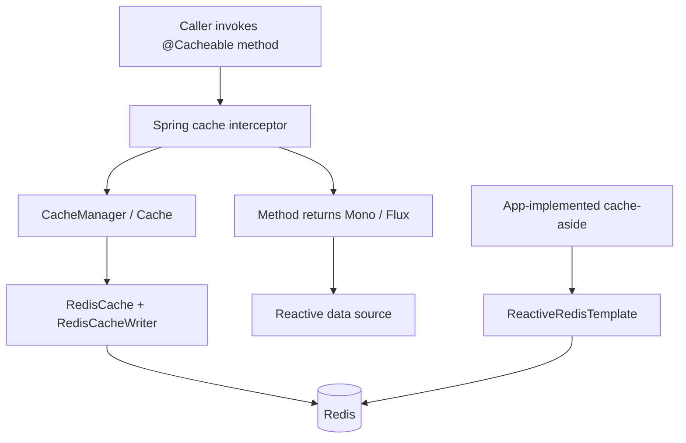
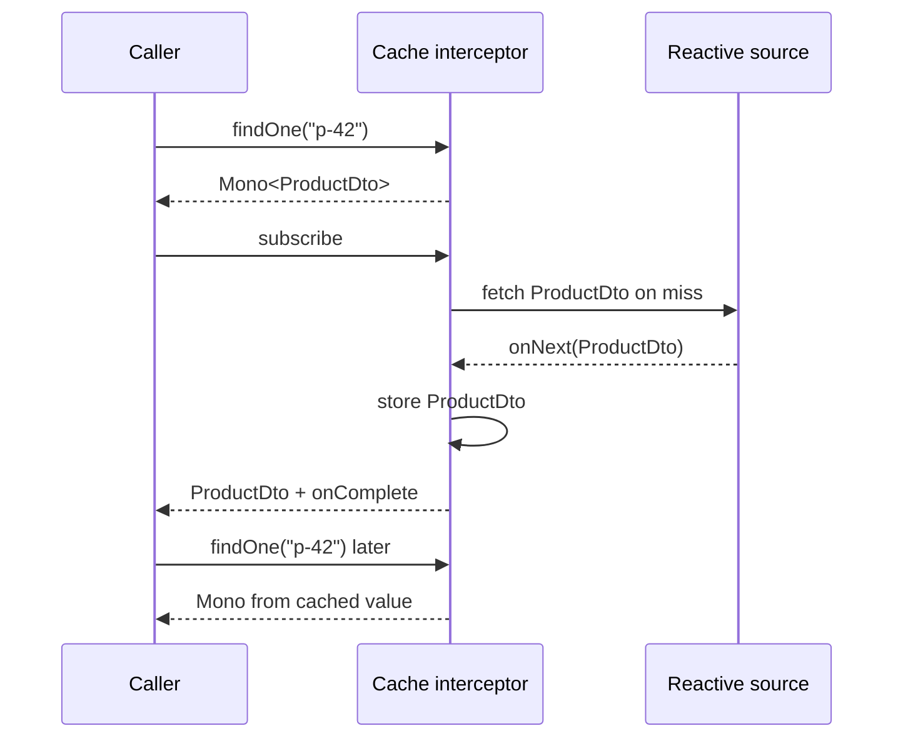
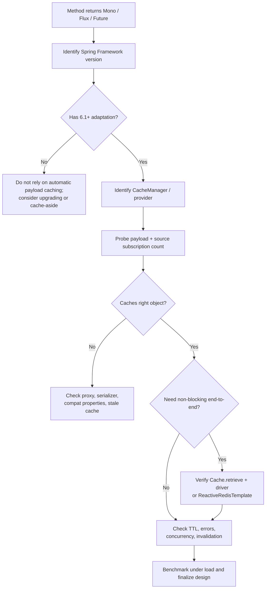

# Testing Reactive Return-Type Caching Behavior Across Spring Versions

## 1. The problem to verify

Suppose a Spring WebFlux application uses `@Cacheable` to cache products in Redis:

```java
@Cacheable(cacheNames = "products", key = "#p0")
public Mono<ProductDto> findProduct(String id) {
    return productRepository.findById(id).map(this::toDto);
}
```

The question is not only whether Redis stores a key, but **what object Spring actually stored**. For a method returning `Mono<ProductDto>`, two distinct behaviors exist:

- Caching the **`Mono` Publisher** itself. If the Publisher is cold, re-subscribing to it can still re-run the source query despite a Java-level cache hit.
- Caching **the `ProductDto` value emitted by the Publisher**. Subsequent cache hits adapt that value back into `Mono<ProductDto>`, allowing the source to be skipped.

This distinction is central to the change introduced in **Spring Framework 6.1**. Starting in that release, Spring Cache natively adapts `Mono`, `Flux`, and `CompletableFuture`. Nevertheless, **caching the right payload** and **non-blocking Redis access** are two separate requirements that must be verified independently.

Lesson objectives:

1. Distinguish caching behavior across Spring Framework versions before and after 6.1.
2. Understand exactly what `@Cacheable` stores when a method returns `Mono`, `Flux`, or `CompletableFuture`.
3. Inspect `RedisCacheManager`, serializers, and Spring Data Redis's `Cache.retrieve(...)` API.
4. Design tests for cache hits/misses, subscriptions, TTLs, errors, empty values, and concurrency.
5. Choose between Spring Cache annotations and `ReactiveRedisTemplate` based on streaming/backpressure needs.

## 2. Three layers in a reactive application using Redis

| Component | Representative API | Responsibility |
|---|---|---|
| Spring Cache | `@Cacheable`, `@CachePut`, `@CacheEvict`, `CacheManager` | Intercepts calls via Spring AOP, generates keys, checks cache, and stores method results |
| Spring Data Redis Cache | `RedisCacheManager`, `RedisCache`, `RedisCacheWriter` | Provides a Redis-backed cache for the Spring Cache abstraction |
| Spring Data Redis reactive | `ReactiveRedisTemplate`, `ReactiveRedisOperations` | Sends Redis operations via the Reactor API for building custom asynchronous access flows |



**Note:** Having Spring WebFlux on the classpath does not turn every `RedisCache` into a reactive cache. An application can use `ReactiveRedisTemplate` for dedicated tasks while `@Cacheable` continues using `RedisCacheManager` under its own contract.

Therefore, answer two independent questions:

- **What gets cached?** A Publisher wrapper, a single `T` object, or a `List<T>`?
- **How is the cache accessed?** Synchronously, asynchronously via `CompletableFuture`, or purely via Reactor Redis operations?

## 3. Key version milestones

| Version | Caching mechanism for reactive types | What to verify |
|---|---|---|
| Spring Framework 6.0 and earlier | Cache abstraction does not automatically unwrap Publishers to emitted values via the new mechanism | May cache `Mono`/`Flux` directly; Redis serialization and cold subscriptions easily misbehave |
| Spring Framework **6.1+** | Supports caching completed value of `CompletableFuture`; emitted value of `Mono`; collected list of `Flux` | Verify actual stored object, source re-subscription count, and cache provider |
| Spring Framework **6.1.3+** | Provides a system property to restore treating Publishers as normal values in certain cases | Check compatibility flag if behavior still matches 6.0 |
| Spring Data Redis **3.2+** | Provides async retrieval API on `RedisCacheWriter` | Does the writer/driver actually return true for `supportsAsyncRetrieve()`? |

Common Spring Boot release lines:

| Spring Boot | Typical bundled Spring Framework |
|---|---|
| 3.0–3.1 | 6.0.x |
| 3.2–3.3 | 6.1.x |
| 3.4–3.5 | 6.2.x |
| 4.x | 7.x |

This mapping reflects standard release trains; applications using BOM overrides or internal libraries may resolve different versions. Final conclusions must rely on **the resolved runtime dependencies**.

### 3.1. How to verify exact versions

In Java:

```java
import org.springframework.core.SpringVersion;
import org.springframework.boot.SpringBootVersion;

System.out.println("Framework: " + SpringVersion.getVersion());
System.out.println("Boot: " + SpringBootVersion.getVersion());
```

For Gradle projects:

```text
./gradlew dependencyInsight --dependency spring-context --configuration runtimeClasspath
./gradlew dependencyInsight --dependency spring-data-redis --configuration runtimeClasspath
```

With Maven, run `mvn dependency:tree` to inspect equivalent versions. These tools verify **actual versions** rather than relying on stale documentation.

## 4. How does Spring Framework 6.1 handle `Mono<T>`?

Consider:

```java
@Cacheable(cacheNames = "catalog:one", key = "#p0")
public Mono<ProductDto> findOne(String id) {
    return gateway.fetchProduct(id);
}
```

On a cache miss, the method returns a Publisher; Spring writes to the cache once the Publisher emits `ProductDto` under 6.1+ adaptation. On a cache hit, Spring returns a `Mono<ProductDto>` reconstructed from the cached value.



Conceptually, the cached entry looks like:

```text
cacheName = catalog:one
key       = p-42
value     = ProductDto(id="p-42", name="Keyboard")
```

This differs from caching the `Mono` itself. A `Mono` may merely describe work to execute upon subscription; storing the wrapper itself does not stop subsequent subscriptions from hitting the backend.

### 4.1. Distinguishing method invocation from source execution

```java
public Mono<ProductDto> fetchProduct(String id) {
    return Mono.defer(() -> {
        System.out.println("Backend request for " + id);
        return Mono.just(new ProductDto(id, "Keyboard"));
    });
}
```

Calling `fetchProduct("p-42")` **only creates a Publisher**. Work inside `Mono.defer` runs upon subscription. Therefore, tests must use `StepVerifier` or subscribe through completion rather than merely calling the method and timing Publisher construction.

A flawed measurement simply counts Java method calls. In Spring Framework 6.0, caching the wrapper could keep the Java method from running again while the cold Publisher still executes backend I/O on every subscription.

### 4.2. When the Publisher emits nothing

`Mono.empty()` differs from `Mono.just(value)`: no business object is emitted. Null/empty caching behavior depends on the provider, cache configuration, and version. If business requirements call for **negative caching** (caching not-found), write a dedicated test verifying exact behavior instead of guessing.

Similarly, `Mono.error(...)` is an error completion and should never be treated as a successful cached business result. After an error, verify that subsequent calls can retry the source normally.

## 5. `Flux<T>`: from a stream of elements to a cached list

Consider:

```java
@Cacheable(cacheNames = "catalog:categories", key = "#p0")
public Flux<ProductDto> findByCategory(String category) {
    return gateway.findByCategory(category);
}
```

Starting in Spring Framework 6.1, elements emitted by a `Flux` are **collected into a `List<T>`**, and that list is cached once the Publisher completes. On a cache hit, Spring returns a `Flux<T>` replaying elements from the cached `List`.

```text
Flux: Product A -> Product B -> Product C -> complete
                              |
                              v
Cached value: List[Product A, Product B, Product C]
                              |
                              v
Cache hit: Flux<ProductDto> replayed from List
```

Preserving a `Flux` return type for callers **does not mean the cache streams items individually**.

### 5.1. Streaming and backpressure limitations

If a `Flux` is an infinite stream, it never finishes to produce a complete list for caching. If a `Flux` emits millions of items, buffering into a `List` spikes memory, latency, and Redis payload size while defeating streaming benefits.

Continuous event streams, long cursors, windows, or fine-grained backpressure should cache **individual items, pages, or windows** using a specialized mechanism rather than `@Cacheable` over an entire `Flux`.

### 5.2. What type does `unless` see?

When using `@Cacheable` on a `Flux` under Spring 6.1+, `unless` evaluates `#result` as the **collected `List`**, not the `Flux` object.

Example skipping empty lists:

```java
@Cacheable(
    cacheNames = "catalog:categories",
    key = "#p0",
    unless = "#result == null || #result.isEmpty()"
)
public Flux<ProductDto> findByCategory(String category) {
    return gateway.findByCategory(category);
}
```

Do not copy an expression written for `List` into a Spring 6.0 app assuming identical results. The cached value-type contract is precisely what needs verifying during upgrades.

## 6. `CompletableFuture<T>` is adapted too

```java
@Cacheable(cacheNames = "profiles", key = "#p0")
public CompletableFuture<ProfileDto> findProfile(String userId) {
    return profileGateway.loadAsync(userId);
}
```

Starting in Spring 6.1, the cache abstraction can store **`ProfileDto`** once the future completes successfully, then return an adapted future on hits. Never treat receiving an incomplete future as proof the value has been written to cache.

| Method return type | Cached business object | Returned method type |
|---|---|---|
| `Mono<T>` | `T` upon successful emission | `Mono<T>` |
| `Flux<T>` | `List<T>` upon completion | `Flux<T>` |
| `CompletableFuture<T>` | `T` upon successful completion | `CompletableFuture<T>` |

With futures or reactive Publishers, errors, empty signals, and cancellations must be tested separately per provider/configuration. Standard behavior is never to turn exceptions into successful cached values.

## 7. Configuring Spring Cache for testing

Example dependencies for a Spring Boot 3.x application:

```groovy
dependencies {
    implementation 'org.springframework.boot:spring-boot-starter-cache'
    implementation 'org.springframework.boot:spring-boot-starter-data-redis'
    implementation 'org.springframework.boot:spring-boot-starter-webflux'
}
```

Enable cache annotations:

```java
import org.springframework.cache.annotation.EnableCaching;
import org.springframework.context.annotation.Configuration;

@Configuration
@EnableCaching
public class CacheConfig {
}
```

Local Redis configuration for practice:

```yaml
spring:
  cache:
    type: redis
  data:
    redis:
      host: localhost
      port: 6379
```

This is an illustrative environment. Real systems may use managed Redis, TLS, Sentinel, or Cluster with dedicated connection policies.

### 7.1. Checking which CacheManager is active

```java
import org.springframework.cache.CacheManager;
import org.springframework.stereotype.Component;

@Component
public class CacheInspector {

    public CacheInspector(CacheManager cacheManager) {
        System.out.println(
            "CacheManager = " + cacheManager.getClass().getName()
        );
    }
}
```

If you see `ConcurrentMapCacheManager`, caching lives in JVM memory rather than Redis. A test passing against an in-memory cache **proves nothing about Redis serializers, connections, or TTLs**.

### 7.2. Remember Spring AOP proxies

Cache annotations normally apply only when public methods are called **through a Spring proxy**. Example:

```java
@Service
public class ProductService {

    public Mono<ProductDto> search(String id) {
        // Self-invocation; internal calls bypass default cache advice.
        return findOne(id);
    }

    @Cacheable(cacheNames = "products", key = "#p0")
    public Mono<ProductDto> findOne(String id) {
        return gateway.fetchProduct(id);
    }
}
```

When `search()` calls `this.findOne()` on the same object, the default cache proxy does not intercept that internal call. When testing, invoke cached methods via **a Spring-injected bean from another class**, not `new ProductService()` and not self-invocation.

## 8. Configuring Redis Cache with TTL

Example configuring a `RedisCacheManager` with a 10-minute default TTL:

```java
import java.time.Duration;
import org.springframework.context.annotation.Bean;
import org.springframework.context.annotation.Configuration;
import org.springframework.data.redis.cache.RedisCacheConfiguration;
import org.springframework.data.redis.cache.RedisCacheManager;
import org.springframework.data.redis.connection.RedisConnectionFactory;

@Configuration
public class RedisCacheConfig {

    @Bean
    RedisCacheManager cacheManager(RedisConnectionFactory connectionFactory) {
        RedisCacheConfiguration defaults =
            RedisCacheConfiguration.defaultCacheConfig()
                .entryTtl(Duration.ofMinutes(10));

        return RedisCacheManager.builder(connectionFactory)
            .cacheDefaults(defaults)
            .build();
    }
}
```

Common defaults in Spring Data Redis Cache:

| Property | Default |
|---|---|
| Entry TTL | No expiration unless configured |
| Redis key prefix | Cache name, typically formatted `cacheName::key` |
| Key serializer | `StringRedisSerializer` |
| Value serializer | `JdkSerializationRedisSerializer` |
| `RedisCacheWriter` | Non-locking writer |

When using the JDK serializer, DTOs must support Java serialization. For example:

```java
import java.io.Serializable;

public record ProductDto(String id, String name) implements Serializable {
    private static final long serialVersionUID = 1L;
}
```

In production systems, you can pick a different serializer and version formats carefully; pay special attention to old cached entries already in Redis from earlier versions. Do not run `GET` on JDK-serialized values expecting readable JSON.

**Redis Cache entries are not Redis Repository entities.** Redis Cache typically stores serialized values under keys like `products::p-42`. Redis Repository `@RedisHash("products")` uses its own keyspace, Hash structures, and possible secondary indexes.

## 9. Writing probes based on actual source subscriptions

A useful test measures **how many times the source actually ran**, not just how many times the Java method was invoked.

```java
import java.util.concurrent.atomic.AtomicInteger;
import org.springframework.cache.annotation.Cacheable;
import org.springframework.stereotype.Service;
import reactor.core.publisher.Mono;

@Service
public class ProductProbeService {

    private final AtomicInteger sourceSubscriptions = new AtomicInteger();

    @Cacheable(cacheNames = "probe:products", key = "#p0")
    public Mono<ProductDto> find(String id) {
        return Mono.defer(() -> {
            int revision = sourceSubscriptions.incrementAndGet();
            return Mono.just(
                new ProductDto(id, "Version-" + revision)
            );
        });
    }

    public int sourceSubscriptions() {
        return sourceSubscriptions.get();
    }
}
```

Invoke through the Spring-injected bean:

```java
ProductDto first = probe.find("p-42").block();
ProductDto second = probe.find("p-42").block();

System.out.println(first);
System.out.println(second);
System.out.println(probe.sourceSubscriptions());
```

With Spring Framework 6.1+ and a compatible cache provider, expect:

```text
first  = ProductDto[id=p-42, name=Version-1]
second = ProductDto[id=p-42, name=Version-1]
sourceSubscriptions = 1
```

This assumes the cache entry was initially absent and **the first call finished including the cache put** before the second call began. Testing concurrency requires a separate test.

In Spring 6.0, if a provider caches a cold `Mono` wrapper, the method might not be called again yet `sourceSubscriptions` still increments on re-subscription. With a Redis serializer, caching a Publisher can fail upfront due to non-serializability. Never generalize a single failure into a rule across all cache providers.

### 9.1. Inspecting the actual object stored in cache

```java
import org.springframework.cache.Cache;
import org.springframework.cache.CacheManager;

Cache cache = cacheManager.getCache("probe:products");
if (cache == null) {
    throw new IllegalStateException("Missing cache");
}

Cache.ValueWrapper wrapper = cache.get("p-42");
Object cached = wrapper == null ? null : wrapper.get();

System.out.println(
    cached == null ? "CACHE_MISS" : cached.getClass().getName()
);
```

In Spring 6.1+, once the Publisher completes and stores the entry, the value should be a business object matching `ProductDto`. In Redis directly, the payload is serialized bytes; to inspect the Java class, read through the right `CacheManager` or serializer.

Do not merely assert that `service.find(...)` returns a `Mono`: the Java return type was `Mono` in both old and new versions. Verify **cache contents**, **backend execution count**, and **data retrieval**.

## 10. Illustrative integration test

A JUnit test using a Spring context can verify the new adaptation:

```java
import static org.assertj.core.api.Assertions.assertThat;

import org.junit.jupiter.api.Test;
import org.springframework.beans.factory.annotation.Autowired;
import org.springframework.boot.test.context.SpringBootTest;
import org.springframework.cache.Cache;
import org.springframework.cache.CacheManager;

@SpringBootTest
class ReactiveCacheBehaviorTest {

    @Autowired
    private ProductProbeService probe;

    @Autowired
    private CacheManager cacheManager;

    @Test
    void cachesMonoPayloadAfterCompletion() {
        Cache cache = cacheManager.getCache("probe:products");
        assertThat(cache).isNotNull();

        String id = "behavior-check-p-42";
        cache.evict(id);
        int before = probe.sourceSubscriptions();

        ProductDto first = probe.find(id).block();
        ProductDto second = probe.find(id).block();

        assertThat(first).isEqualTo(second);
        assertThat(probe.sourceSubscriptions() - before).isEqualTo(1);

        Cache.ValueWrapper stored = cache.get(id);
        assertThat(stored).isNotNull();
        assertThat(stored.get()).isInstanceOf(ProductDto.class);
    }
}
```

This example is a **behavioral test template**. Running against real `RedisCache` requires a dedicated test Redis instance, compatible serializer, and explicit `CacheManager` config. `block()` is fine here to synchronize test assertions; never call `block()` on production WebFlux request threads.

### 10.1. Separating Framework tests from Redis tests

To isolate just the Framework's reactive return-type handling first, test with an in-memory cache:

```java
import org.springframework.cache.CacheManager;
import org.springframework.cache.annotation.EnableCaching;
import org.springframework.cache.concurrent.ConcurrentMapCacheManager;
import org.springframework.context.annotation.Bean;
import org.springframework.context.annotation.Configuration;

@Configuration
@EnableCaching
class MemoryCacheTestConfig {

    @Bean
    CacheManager cacheManager() {
        return new ConcurrentMapCacheManager("probe:products");
    }
}
```

Then run the same probe against `RedisCacheManager` to test Redis connectivity, serialization, and TTLs. Keep these as **two separate test contexts** rather than placing both cache managers into one context without explicit selection.

## 11. Verifying that `Flux<T>` actually caches a list

```java
import java.util.concurrent.atomic.AtomicInteger;
import org.springframework.cache.annotation.Cacheable;
import org.springframework.stereotype.Service;
import reactor.core.publisher.Flux;

@Service
public class ProductListProbeService {

    private final AtomicInteger sourceSubscriptions = new AtomicInteger();

    @Cacheable(cacheNames = "probe:product-lists", key = "#p0")
    public Flux<ProductDto> byCategory(String category) {
        return Flux.defer(() -> {
            int revision = sourceSubscriptions.incrementAndGet();
            return Flux.just(
                new ProductDto("p-1", category + "-" + revision),
                new ProductDto("p-2", category + "-" + revision)
            );
        });
    }

    public int sourceSubscriptions() {
        return sourceSubscriptions.get();
    }
}
```

Test:

```java
List<ProductDto> first = service.byCategory("keyboard")
    .collectList()
    .block();

List<ProductDto> second = service.byCategory("keyboard")
    .collectList()
    .block();
```

In Spring Framework 6.1+, after the first miss completes emission, the second call returns the same list without re-running the source. The cached payload is `List<ProductDto>`, not a `Flux<ProductDto>`.

Edge cases requiring dedicated tests include `Flux.empty()`, `Flux.error(...)`, infinite streams, huge streams, and caller cancellation before source completion.

## 12. Asynchronous cache retrieval: `Cache.retrieve`

Spring Framework 6.1 supports `CompletableFuture`-based cache APIs, yet the Redis cache writer must also support them.

Spring Data Redis 3.2+ defines the API:

```java
boolean supportsAsyncRetrieve();
CompletableFuture<byte[]> retrieve(String cacheName, byte[] key);
```

In `RedisCacheWriter`, `supportsAsyncRetrieve()` **returns false by default** unless the implementation supports it. Support depends on the Redis driver and connection configuration. Seeing `retrieve` in Javadoc does not prove your active writer executes asynchronously.

### 12.1. Checking writer capability on Spring Data Redis 3.3

```java
import org.springframework.cache.Cache;
import org.springframework.cache.CacheManager;
import org.springframework.data.redis.cache.RedisCache;

Cache cache = cacheManager.getCache("probe:products");

if (cache instanceof RedisCache redisCache) {
    boolean supported = redisCache.getNativeCache()
        .supportsAsyncRetrieve();
    System.out.println("Async retrieve supported: " + supported);
}
```

Exact API details can vary by version; this illustrates the Spring Data Redis 3.3 contract.

If `supported = false`, calling:

```java
Cache cache = cacheManager.getCache("probe:products");
CompletableFuture<Cache.ValueWrapper> future =
    cache.retrieve("p-42");
```

may throw `UnsupportedOperationException`. Never assume `RedisCache.retrieve(...)` works across every provider or driver.

### 12.2. Reactive adaptation and non-blocking Redis I/O are separate concerns

Even when `@Cacheable` caches `ProductDto` properly in Spring 6.1+, the Redis lookup path may still issue synchronous calls depending on the cache provider and which API cache advice invokes. Therefore:

- Returning `Mono<T>` from a method **does not automatically guarantee** cache hits avoid blocking the event loop.
- Supporting `Cache.retrieve(...)` is a prerequisite in scenarios needing async retrieval, especially with `sync=true`.
- Verify latency, execution threads, Redis driver, and behavior when Redis slows down or disconnects.

If strict end-to-end non-blocking I/O is required, consider building cache-aside directly with `ReactiveRedisTemplate` or `ReactiveRedisOperations` and testing with Reactor.

## 13. `sync=true` is not a distributed lock guarantee

Spring Cache provides the option:

```java
@Cacheable(cacheNames = "products", key = "#p0", sync = true)
public Mono<ProductDto> findOne(String id) {
    return gateway.fetchProduct(id);
}
```

`sync=true` aims to coordinate concurrent cache misses on the same key so multiple callers do not recompute the value. For async types, the cache provider must support future-based retrieval.

**Do not assume** `sync=true` guarantees every instance in a cluster loads the source only once. Semantics depend on the provider. `RedisCacheWriter` has distinct locking and non-locking strategies, and Redis cache locking can apply per cache rather than per entry.

Before enabling `sync=true`, verify:

1. Whether the provider implements `Cache.retrieve(key, valueLoader)`.
2. Whether two concurrent callers for the same key actually trigger only one source subscription within the expected scope.
3. Whether thread blocking or `UnsupportedOperationException` occurs.
4. Whether subsequent requests can recover and retry after a source failure.

### 13.1. Comparison with Caffeine async

With Caffeine as the cache provider, Spring Framework supports async cache mode:

```java
import org.springframework.cache.CacheManager;
import org.springframework.cache.caffeine.CaffeineCacheManager;
import org.springframework.context.annotation.Bean;

@Bean
CacheManager caffeineCacheManager() {
    CaffeineCacheManager manager = new CaffeineCacheManager();
    manager.setAsyncCacheMode(true);
    return manager;
}
```

Caffeine supporting async retrieval **does not imply `RedisCacheWriter` supports it too**. Testing an in-memory provider and testing Redis are two separate proofs.

## 14. Checking real TTL, Redis keys, and serializers

Using cache `products` with key `p-42` and the default Redis key prefix, the key looks like:

```text
products::p-42
```

Once the Publisher emits its result and the cache entry is written, inspect test Redis:

```redis
TYPE products::p-42
EXISTS products::p-42
TTL products::p-42
PTTL products::p-42
```

With a 10-minute TTL, `TTL` right after write should be near 600 seconds and tick down over time:

- `TTL >= 0`: remaining lifetime.
- `TTL = -1`: key exists with no TTL.
- `TTL = -2`: key does not exist.

Redis Cache normally stores values as serialized String key/values, so `TYPE` is typically `string`. **Do not run `HGETALL` as if it were a Redis Repository `@RedisHash` entity.**

If Redis uses JDK serialization, `GET` returns binary bytes; to check the Java object type, inspect via Spring Cache's `cache.get(key)`.

### 14.1. Common errors during version upgrades

| Symptom | Possible cause |
|---|---|
| `NotSerializableException` | Cached object is not serializable; on older versions it may be the Reactor wrapper |
| `ClassCastException` after upgrade | Old cache entry stores a different type from the new version's payload |
| `SerializationException` | Old byte format differs from current serializer |
| Key missing in Redis | Using in-memory cache, Publisher never subscribed, or cache put hasn't finished |
| Cache hit still queries source | Cached cold Publisher, key mismatch, expired TTL, or cache proxy skipped |
| Cache returns another tenant's data | Key omits result-determining factors like tenant/user/locale |

When changing caching semantics from wrappers to payloads or changing serializers, consider bumping cache names/prefixes, purging old namespaces cleanly, or rebuilding from source data. Caches are not canonical data sources.

## 15. Backward-compatibility flag in Spring 6.1.3+

Since Spring Framework 6.1.3, a **JVM system property** lets you disable Reactive Streams Publisher handling in the cache interceptor:

```text
-Dspring.cache.ignore-reactivestreams=true
```

When set, the Framework treats `Mono`/`Flux` as ordinary return objects matching Spring 6.0 behavior. This is a **narrow compatibility escape hatch**; Spring documentation discourages it for general use. Specific applications intentionally caching already-hot `Mono.cache()`/`Flux.cache()` Publishers may rely on it.

If an application upgrades to 6.1 yet tests show wrappers are still cached, check:

- Actual resolved Spring Framework version.
- Whether the backward-compatibility system property is set at startup.
- Whether a custom `CacheInterceptor` / `CacheManager` alters default behavior.
- Whether stale entries remain from the prior version.

This is a **system property**, not a configuration property on `RedisCacheConfiguration`. The public constant in Javadoc is `CacheAspectSupport.IGNORE_REACTIVESTREAMS_PROPERTY_NAME`.

## 16. `@CachePut` and `@CacheEvict` with reactive types

This applies beyond `@Cacheable`. In versions supporting reactive adaptation:

### 16.1. `@CachePut`

```java
@CachePut(cacheNames = "products", key = "#p0")
public Mono<ProductDto> update(String id, UpdateRequest request) {
    return productRepository.update(id, request).map(this::toDto);
}
```

`@CachePut` executes the method and writes the new value to cache when emitted. Do not add `@Cacheable` to the same method when the goal is updating cache after processing.

### 16.2. `@CacheEvict`

```java
@CacheEvict(cacheNames = "products", key = "#p0")
public Mono<Void> remove(String id) {
    return productRepository.deleteById(id);
}
```

With post-invocation eviction (the default), eviction timing ties to reactive completion. With `beforeInvocation = true`, eviction happens before running the method. The two policies behave differently if deletion fails; choose according to business rules.

For `Flux` with result-dependent expressions, collecting into a `List` increases memory usage just like `@Cacheable`.

## 17. Cache keys must include every factor determining output

Especially in WebFlux, results may depend on Reactor Context:

```java
@Cacheable(cacheNames = "prices", key = "#p0")
public Mono<PriceDto> priceFor(String productId) {
    return Mono.deferContextual(context ->
        priceGateway.find(
            context.get("tenantId"),
            productId
        )
    );
}
```

If different tenants have different prices or permissions for the same `productId`, keying solely by `productId` leaks data across tenants. Because cache hits skip the source, backend permission checks are bypassed too.

A clearer approach passes tenant as an explicit parameter:

```java
@Cacheable(cacheNames = "prices", key = "#p0 + ':' + #p1")
public Mono<PriceDto> priceFor(String tenantId, String productId) {
    return priceGateway.find(tenantId, productId);
}
```

Do not assume Spring Cache automatically extracts values from Reactor Context into cache keys. This is a **correctness and data-isolation** requirement, not merely performance.

## 18. When end-to-end non-blocking is required: reactive cache-aside

When explicit Reactor Redis operations are needed, use `ReactiveRedisOperations<String, ProductDto>` instead of Spring Cache annotations. The example below assumes a serializer configured to read/write `ProductDto`:

```java
import java.time.Duration;

import org.springframework.data.redis.core.ReactiveRedisOperations;
import org.springframework.stereotype.Service;

import reactor.core.publisher.Mono;

@Service
public class ReactiveProductCache {

    private final ReactiveRedisOperations<String, ProductDto> redis;
    private final ProductGateway gateway;

    public ReactiveProductCache(
            ReactiveRedisOperations<String, ProductDto> redis,
            ProductGateway gateway) {
        this.redis = redis;
        this.gateway = gateway;
    }

    public Mono<ProductDto> find(String id) {
        String key = "catalog:product:" + id;

        return redis.opsForValue()
            .get(key)
            .switchIfEmpty(Mono.defer(() ->
                gateway.fetchProduct(id)
                    .flatMap(value ->
                        redis.opsForValue()
                            .set(key, value, Duration.ofMinutes(5))
                            .thenReturn(value)
                    )
            ));
    }
}
```

Flow:

```text
GET cache via ReactiveRedisOperations
   ├── HIT  -> return ProductDto
   └── MISS -> fetch source via Mono
               -> SET cache with TTL
               -> return ProductDto
```

This example uses Spring Data Redis's genuine reactive API, normally requiring a reactive Lettuce connection. It **does not automatically prevent cache stampedes** on concurrent misses, does not cache `Mono.empty()`, and does not guarantee atomicity between source data and Redis. Production code needs timeouts, error handling, fail-open/fail-closed policies, and invalidation.

Selection guide:

| Requirement | Commonly appropriate choice |
|---|---|
| Simple `Mono<T>` cached by parameters | `@Cacheable` on Spring 6.1+ with verified provider |
| Finite, small `Flux<T>` | `@Cacheable` if caching a full `List` is acceptable |
| Long/infinite streams or per-item caching | `ReactiveRedisTemplate` / `ReactiveRedisOperations` |
| Proving non-blocking Redis I/O | Verify real `Cache.retrieve` support or use reactive cache-aside |
| Controlling concurrent misses/idempotency | Test provider, `sync=true`, or dedicated coordination |

## 19. Compatibility test matrix when upgrading

When upgrading Spring Framework, run the same test suite before and after the upgrade:

| Case | How to observe | What to verify |
|---|---|---|
| `Mono.just(value)` | `Cache.get` after completion | Business value cached vs. Publisher |
| `Mono.defer(...)` | Count source subscriptions | Cache hit skips backend |
| `Mono.empty()` | Call same key multiple times | Negative caching behavior |
| `Mono.error(...)` | Retry after error | Exceptions never cached as success |
| `Flux.just(a,b)` | Inspect `Cache.get` value | Stores `List<T>` and preserves order |
| `Flux.empty()` | Inspect empty value | Not confused with cache miss |
| `Flux.never()` | Bound test duration | Nothing expected cached before completion |
| Concurrent callers for same key | Subscribe concurrently | Check for duplicate source loads |
| `sync=true` | Inspect provider capability | Whether `retrieve` is supported without error |
| Redis restart | Read same key again | Cache miss falls back to source |
| TTL expiration | Read after deadline | Reloads data and writes fresh entry |
| Slow Redis | Measure threads/latency | Cache path does not block event loop |
| Serializer/key prefix change | Read old cache entries | No type or deserialization failures |

### 19.1. Measuring blocking beyond the return type

To assess how Redis I/O affects WebFlux:

1. Identify the real `CacheManager`.
2. Check `supportsAsyncRetrieve()` and `Cache.retrieve(...)` support.
3. Measure cache hit/miss latencies when Redis responds slowly.
4. Inspect execution threads and event-loop behavior; use blocking-detection tools in tests if available.
5. Measure p95/p99 latency under concurrent requests on the same key or during Redis errors.

A method returning `Mono` that calls Redis synchronously **can still block**. Tests must inspect execution behavior rather than stopping at annotations and return types.

## 20. Common reasoning fallacies

### "Every Spring Boot 3.x version caches Mono the same way"

No. Boot 3.1 and 3.2 ship two different Framework lines: 6.0 and 6.1. Only resolved runtime versions govern behavior.

### "Caching Mono means the backend never runs again"

If a cold Publisher wrapper itself is cached, re-subscribing still executes the source. Measure actual subscriptions.

### "Flux is cached event by event"

Not under default `@Cacheable` in Spring 6.1+: items are collected into a `List` on completion.

### "Having RedisCache.retrieve guarantees non-blocking"

Async retrieval support depends on the implementation and driver; `supportsAsyncRetrieve()` may return false by default.

### "`sync=true` always guarantees a single load cluster-wide"

Annotations make no such guarantee. Inspect provider semantics, locking behavior, and real contention.

### "Not seeing the Redis key right after calling the method means caching is broken"

The Publisher may not have been subscribed to or completed yet. Tests must await completion.

### "Having ReactiveRedisTemplate makes @Cacheable use it automatically"

No. Spring Cache and reactive Redis APIs are separate mechanisms. Creating a template does not replace `RedisCacheManager`.

### "Cache keys only need ID; tenant/role are handled in the backend"

Cache hits can bypass the backend completely, so keys must encode every factor affecting output and access scope.

### "Upgrading Framework automatically converts old Redis entries"

No. Serialized entries from prior versions may have incompatible types or formats. Plan cache purges, prefix changes, or data rebuilds.

## 21. Overall verification workflow



The central lesson when testing reactive caching is **separating data-caching semantics from Redis access mechanics**. Spring Framework 6.1 adapts caching to store values emitted by `Mono`/`Flux`; that alone does not eliminate risks from serializers, TTLs, proxies, concurrent misses, blocking I/O, or Reactor Context dependencies. Verify each layer with repeatable probes before concluding a WebFlux application caches accurately and runs fully asynchronously.

## References

- [Spring Framework — Declarative Annotation-based Caching](https://docs.spring.io/spring-framework/reference/integration/cache/annotations.html), section *Caching with CompletableFuture and Reactive Return Types*.
- [Spring Framework 6.1.3 — CacheAspectSupport API](https://docs.spring.io/spring-framework/docs/6.1.3/javadoc-api/org/springframework/cache/interceptor/CacheAspectSupport.html), backward-compatibility system property.
- [Spring Framework 6.1 — CaffeineCacheManager API](https://docs.spring.io/spring-framework/docs/6.1.12/javadoc-api/org/springframework/cache/caffeine/CaffeineCacheManager.html), async cache mode.
- [Spring Data Redis — Redis Cache](https://docs.spring.io/spring-data/redis/reference/redis/redis-cache.html), cache manager, TTL, prefixes, and serializers.
- [Spring Data Redis 3.3.7 — RedisCache API](https://docs.spring.io/spring-data/redis/docs/3.3.7/api/org/springframework/data/redis/cache/RedisCache.html), `retrieve`.
- [Spring Data Redis 3.3.7 — RedisCacheWriter API](https://docs.spring.io/spring-data/redis/docs/3.3.7/api/org/springframework/data/redis/cache/RedisCacheWriter.html), `supportsAsyncRetrieve()`.
- [Spring Data Redis — Reactive Redis Support](https://docs.spring.io/spring-data/redis/reference/redis/reactive.html).
- [Spring Boot — Caching](https://docs.spring.io/spring-boot/reference/io/caching.html).
