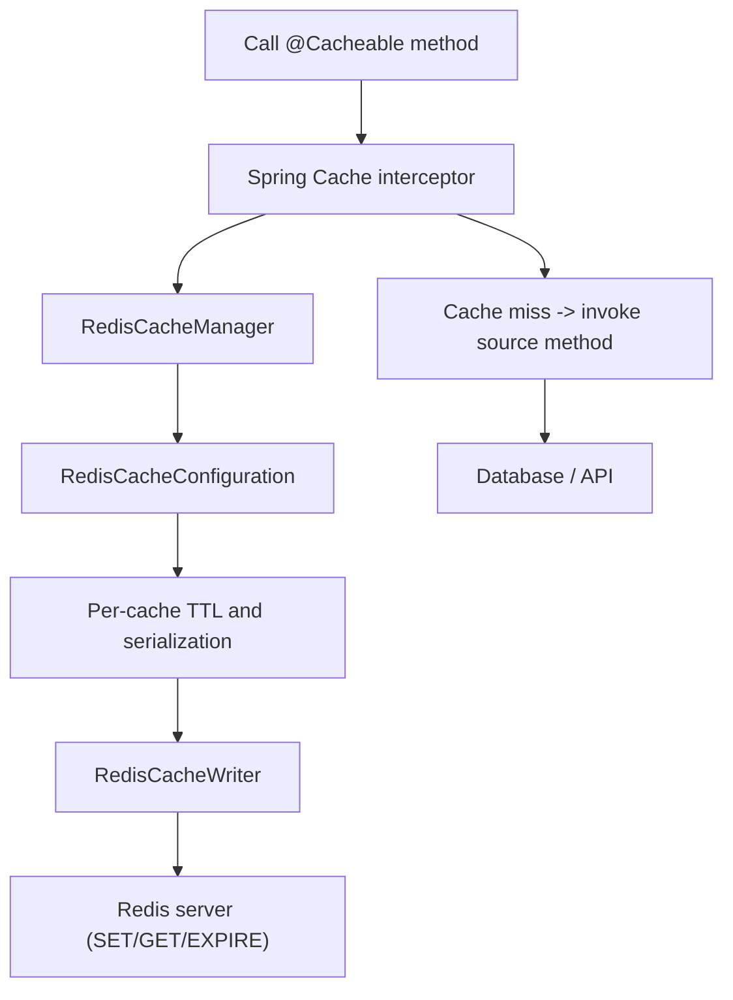

# Choosing TTL Based on Freshness Requirements and Update Frequency

> **Module:** Spring Data Redis  
> **Chapter:** Cache Strategies  
> **Focus:** How to determine cache Time To Live (TTL) based on the business's acceptable data staleness (*freshness/staleness*), source data change cadence, read frequency, reload cost, and ability to synchronize the cache on updates.

## 1. Why should TTL not be chosen by gut feeling?

Suppose a Spring Boot application uses Redis to cache several kinds of data:

- A list of provinces/cities that almost never changes.
- Product details updated a few times per day.
- Promotional prices changing by campaign.
- Inventory written continuously as many customers place orders concurrently.
- View-count statistics updated multiple times per second.

If a 30-minute TTL is assigned to all of them, the outcomes vary dramatically:

- Regional or static reference data gets re-read from the source too often without clear benefit.
- Product info may stay fresh enough for a showcase page, yet risk being wrong right after a description edit.
- Promotional prices or stock levels may display stale values for far longer than business rules allow.
- Rapidly changing counters may be stale almost all the time.

Therefore, the right question is not simply **"How many times per day does this data update?"** but:

1. **What is the maximum staleness users can tolerate?**
2. **At what frequency and pattern does the source data change?**
3. **When a cache miss occurs, how expensive is reading the source?**
4. **Is there a way to proactively delete or update the cache when source data changes?**
5. **If stale data is served, is the consequence merely poor UX or a business correctness bug?**

TTL is a tool for balancing **freshness** and **performance**; it does not replace mechanisms that enforce data correctness.

## 2. Understanding that TTL and freshness are two different concepts

### 2.1. TTL of a cache entry

TTL (*Time To Live*) is the duration Redis allows a key to keep existing before expiring over time. For example:

```redis
SET cache:product:101 '{"name":"Desk"}' EX 300
TTL cache:product:101
```

`EX 300` sets a 300-second limit, i.e., 5 minutes. Unless deleted or overwritten earlier, Redis considers the key expired after this interval.

Results of the `TTL` command:

- Positive number: seconds remaining until expiration.
- `-1`: the key exists without a TTL.
- `-2`: the key no longer exists.

A key can disappear **before its TTL expires** due to Redis eviction under memory pressure, application delete commands, restarts, or other data changes. TTL only governs the expiration rule; it does not guarantee a key will be retained for at least that duration.

### 2.2. Freshness: does the cached data still reflect the real source?

Suppose a product price record in the database:

```text
10:00:00  Source price: 100,000
10:00:01  Spring caches result in Redis with a 10-minute TTL
10:02:00  Source price changes to 90,000
10:05:00  Customer reads cache: still sees 100,000
10:10:01  Cache has expired; next read loads the new price
```

The key is still **valid by TTL** at 10:05, yet **already stale relative to the source data** since 10:02. That is the difference between:

- **TTL validity:** the key has not reached the end of its lifetime.
- **Data freshness:** whether the value reflects the latest update from the source.
- **Business validity:** whether the value is still permissible for a specific business flow.

A stale price may be acceptable on a product discovery page, yet **must not be used to decide the final checkout payment amount**. Two flows consuming the same data may require different policies.

### 2.3. How is *staleness* measured?

One way to express it:

```text
staleness_age = current_time - timestamp_of_source_data
                reflected_in_cache
```

However, there are multiple practical ways to measure it:

- **Entry age:** how long since the cache entry was created.
- **Age since source update:** how long since the source changed without the cache reflecting it.
- **Version lag:** cache is at version N while the source is already at version N+1.
- **Value delta:** cache returns 100 while source is 105; important for calculations/metrics.
- **Stale read rate:** percentage of reads returning a value different from the source state at read time.

For a business system, a requirement like "data fresh within 30 seconds" must be defined clearly: is that maximum staleness, 95th-percentile sync lag, or an acceptable stale-read ratio? Each definition leads to a different TTL choice.

## 3. Three foundational factors for determining TTL

### 3.1. Freshness requirement

This is usually the **most important** constraint. For example:

| Data | Acceptable business staleness | Consequence for choosing TTL |
|---|---|---|
| Country list used in forms | Hours or a day | Long TTL is usually reasonable |
| Infrequently changed articles/descriptions | Minutes to hours | Medium or long TTL, paired with invalidation |
| Displayed promotional price | Seconds to tens of seconds depending on SLA | Short TTL or event-driven cache update/delete |
| Approximate displayed inventory | Can tolerate a short, disclosed delay | Very short cache; re-verify when placing order |
| Account balance used to authorize transfers | Zero tolerance for deciding on stale data | Read authoritative source and ensure consistency; do not rely on cache TTL |

These values are **design examples**, not industry-standard TTLs. Business rules and service SLAs determine actual thresholds.

If there is a hard constraint "must not be older than 60 seconds," a fixed TTL placed on an accurately fetched source snapshot should not exceed 60 seconds when no other mechanism exists. Leave headroom for fetch latency, replication, network, and clock skew if the freshness model requires it.

If data **must always be accurate the instant the source changes**, picking a 1-second TTL still does not create a strong guarantee: an update can happen right after the cache is written. In that case, change the design—for example, verify at the source of truth or use appropriate version/transaction controls.

### 3.2. Source data update frequency (*write/change rate*)

The same 30-minute TTL means different things for two kinds of data:

- Key A changes once per month: the probability of cache mismatch during a short window is quite low.
- Key B changes 100 times per minute: right after the cache is written, the value is very likely already outdated.

However, **an average rate is not enough**. Look at:

- Whether changes happen evenly over time or arrive in bursts, e.g., price updates at 00:00.
- Whether each change affects the entire dataset or only a subset of keys.
- Peak periods such as flash sales or rush-hour bookings.
- Whether rates are measured per key or only total table writes.
- Whether updates can be detected to invalidate the cache.

For example, 10,000 updates/day on a products table does not mean **each product** changes 10,000 times/day. TTL must be considered at the corresponding key granularity, data group, or business segment.

### 3.3. Read frequency and reload cost (*read rate / miss cost*)

Shorter TTLs cause entries to expire sooner, increasing cache misses and source calls. Miss costs include:

- Database query or computation time.
- Network requests to external APIs.
- Application/source CPU and rate limits.
- Concurrent load when thousands of keys expire close together.
- Risk of database overload if Redis is temporarily unavailable.

For example, with the same 60-second TTL:

- A key read 100 times/second yields many cache hits between two loads.
- A key read once every 5 minutes will very likely expire before the next access, giving little caching benefit.

This shows you must combine **read frequency** and **update frequency**, rather than picking a TTL based solely on total HTTP requests across the whole application.

## 4. Understanding the TTL–source change relationship with a simple model

This is a model to aid reasoning, not a formula replacing production measurement.

### 4.1. Probability that the source changes within a TTL window

Assume updates to a key follow an independent Poisson process with average rate `λ` updates per unit of time. The probability of **at least one change** during interval `T` is:

\[
P(\text{at least one update in } T) = 1 - e^{-\lambda T}
\]

In this formula, `λ` and `T` must share the same unit (e.g., `λ` in updates/hour and `T` in hours).

For example, a value changes on average **4 times/day**, i.e., every 6 hours, and the cache retains it for at most 30 minutes:

\[
\lambda T = 4 \times \frac{0.5}{24} \approx 0.0833
\]

\[
P(\text{an update occurs in a 30-minute window})
\approx 1-e^{-0.0833}\approx 8\%
\]

With a 5-minute TTL under the same assumption:

\[
\lambda T = 4 \times \frac{5}{24\times 60}\approx 0.0139
\]

\[
P(\text{an update occurs in a 5-minute window})\approx 1.4\%
\]

This is the probability of **an update occurring during the entry's lifetime window**, **not** directly the probability that a request returns stale data. The stale read rate also depends on request timing, invalidation behavior, when the cache was populated, and access distribution.

The Poisson assumption usually does not fit scheduled updates (e.g., prices changing at 00:00) or burst updates (flash sales). When schedules exist, synchronizing invalidation or capping TTL so it does not cross the known change time is more reliable.

### 4.2. Deriving TTL from a target change probability

If at most probability `p` of an update during the cache retention interval is acceptable under the model above, solve:

\[
T \leq \frac{-\ln(1-p)}{\lambda}
\]

For example, target `p=5\%`, average updates `2 times/hour`:

\[
T \leq \frac{-\ln(0.95)}{2} \text{ hours} \approx 1.54\text{ minutes}
\]

This is a **statistical reference threshold**. If the business requires data to be no older than 10 seconds, the 10-second cap overrides the 1.54-minute threshold. If updates cluster into brief windows, another strategy is needed.

### 4.3. Estimating cache hits from read cadence

Assume read requests for a key follow a Poisson process at rate `r` requests/second, a fixed TTL of `T` seconds is set **only on cache miss and data load**, not refreshed on cache hits, with no early eviction or invalidation.

The expected number of hits between two loads is approximately `rT`. The long-run miss ratio can be estimated as:

\[
\text{miss ratio} \approx \frac{1}{1+rT}
\]

For example, `r = 1` request/second and `T = 60` seconds:

\[
\text{miss ratio} \approx \frac{1}{61} \approx 1.6\%
\]

But for a cold key with `r = 1/300` requests/second (read once every 5 minutes on average) and a 30-second TTL:

\[
\text{miss ratio} \approx \frac{1}{1 + 30/300}\approx 90.9\%
\]

Hence **short TTLs for every key** can make caching ineffective for cold keys. This formula is a simplified heuristic; factors like traffic bursts, concurrent requests, Redis eviction, or TTI will change real-world results.

### 4.4. Two goals that can conflict

For the same key:

- Increasing `T`: typically increases cache hits and lowers source load, but raises stale-value risk.
- Decreasing `T`: typically reduces staleness duration, but increases reload frequency.
- Adding event-driven invalidation: lets you keep a longer TTL for high hits while cutting update lag if events are reliable.
- Adding proactive refresh: reduces cache misses after expiration, but increases background refresh cost and requires handling source failures.

Do not hunt for a "single ideal TTL" while overlooking these trade-offs.

## 5. Practical workflow for choosing TTL

### Step 1. Classify data by stale-read impact

First determine whether the business uses the data for:

1. **Informational display:** brief discrepancies are acceptable.
2. **Recommendations/prioritization:** discrepancies may degrade UX or effectiveness.
3. **Critical business decisions:** discrepancies can cause financial loss, wrong authorization, overselling, or compliance violations.

For category 3, separate the critical decision path to read the **source of truth or an atomic check mechanism**; caching should only support display or pre-processing where appropriate.

### Step 2. Lock down the freshness budget

Write requirements explicitly, for example:

```text
Catalog:
  Content changes may lag by at most 1 hour.

Price on product page:
  95% of updates displayed within 20 seconds;
  price at checkout must be confirmed from the source of truth.

Displayed inventory:
  May lag by up to a few seconds;
  do not use cached result to deduct stock.
```

Each requirement leads to a different strategy:

- **Hard bound:** TTL and read/write mechanics must enforce the bound even when events delay or fail.
- **Probabilistic SLO (95%, 99%):** can combine statistics, metrics, and invalidation.
- **Best effort:** can use a longer TTL if staleness cost is low and performance matters.

Without a freshness budget, whoever picks the TTL won't know whether to optimize for less staleness or fewer cache misses.

### Step 3. Measure update frequency **per key group**

Collect:

- How many times a key's data changes per day/hour.
- `p50`/`p95`/`p99` interval between two changes.
- Whether updates are scheduled or event-driven.
- Percentage of keys unchanged over a day/week.
- Time from source commit until the system emits an event/invalidation.
- Replication lag if the cache reads from a replica or is rebuilt from a read replica.

Do not take a system-wide average write rate and apply it to every key if "hot keys" and "cold keys" behave very differently.

### Step 4. Measure read cadence and miss cost

Track:

- Requests/second per cache name, and per key group if possible.
- Cache hit/miss ratio across time windows.
- Mean and `p95`/`p99` method latency on cache miss.
- CPU and connection pool usage of the source database/API.
- Load spikes right after cache clearing or mass TTL expiration.
- Entry size, Redis memory, `expired_keys`, and `evicted_keys`.

If a source query costs 500 ms while a cache hit takes a few ms, caching is very valuable. Conversely, a tiny, rarely read, cheap-to-query key may not need caching at all.

### Step 5. Define the synchronization strategy on updates

If you control all write paths, you can:

- Proactively **evict** the entry when the database updates successfully.
- Update the cache with the new value via `@CachePut` or write-through.
- Emit invalidation events from the data-owning system.
- Use outbox/CDC or a retried sync mechanism if updates arrive from multiple systems.

When invalidation is reliable, TTL can be longer and act as a **safety net** when an event is delayed or lost. When invalidation is absent and freshness must be tight, TTL must be chosen much more conservatively.

### Step 6. Pick an initial TTL and re-measure

Use the freshness budget as the upper bound, then evaluate:

- Does increasing TTL save significant source load?
- Does that TTL cause stale reads beyond the threshold?
- Are Redis RAM and the eviction policy sufficient?
- Are keys expiring in mass bursts at the same time?
- Should caches be split into multiple groups by volatility?

TTL is a configuration to **measure – observe – tune**, not a constant fixed across every service forever.

## 6. Suggested TTL matrix by data characteristics

The table below is only a starting point for discussion; it does not replace business SLAs or production metrics.

| Data group | Change pattern | Typically acceptable staleness | Starting TTL to test | Complementary mechanism |
|---|---|---|---|---|
| Country codes, stable reference catalogs | Monthly/quarterly | Hours or days | 6–24 hours | Evict when publishing a new catalog version |
| Rarely changed display config | A few times/day | A few minutes | 5–30 minutes | Post-commit invalidation |
| Product details | Admin-driven, a few times/day | A few minutes | 5–15 minutes | `@CacheEvict`/event on product edit |
| Promotional price for display | Campaign-driven or bursty | Seconds to minutes | 10–60 seconds | Update event, verify real price at checkout |
| Approximate displayed inventory | Many times/minute | Seconds | 1–10 seconds if cached | Read authoritative source when confirming order |
| Dashboard statistics | Batch or continuous | Depends on dashboard | 15 seconds–5 minutes | Scheduled refresh, store timestamp |
| Heavy search results | Follows catalog changes | A few minutes | 1–10 minutes | Version index or invalidate on new index |
| Access permissions in security decisions | Can change anytime | Usually very strict | No single TTL suffices as guarantee | Check authoritative source/version per security model |

These numbers are not "default best practices". If a cache serves authorization, balances, payments, or high-impact decisions, the architecture must satisfy business consistency; TTL does not substitute for state verification.

### 6.1. Two items of the same kind may still need different TTLs

For example:

- Product A is a showcase item whose price and stock barely change.
- Product B is in a flash sale where price and stock change every minute.

If both sit in a `products` cache with a 15-minute TTL, B can stay stale too long. You can:

1. Split cache names: `productDetails`, `flashSaleOffers`, `inventoryView`.
2. Choose different TTLs per cache or per entry if the framework supports it.
3. Invalidate keys when records in each group change.
4. Avoid storing one cached aggregate with all fields having different freshness budgets if they can be separated.

Splitting data by volatility is often more important than picking a very small global TTL.

## 7. Fixed TTL, per-entry TTL, and Time To Idle (TTI)

### 7.1. Fixed TTL from write time

With a fixed 10-minute TTL:

```text
10:00  Cache miss -> write key, TTL=10 minutes
10:04  Cache hit  -> ~6 minutes TTL left
10:09  Cache hit  -> ~1 minute TTL left
10:10  Cache expires
10:11  Next read misses -> refresh from source
```

Accessing the cache does not automatically reset TTL in this default model.

Advantages:

- Simple, easy to predict entry age bounds.
- Reduces the risk of a stale entry living forever due to frequent reads.
- Easy to reason about freshness budgets when cache is populated only from trusted sources.

Disadvantages:

- Very hot keys still expire on schedule and can trigger many concurrent cache misses.
- Entry age does not necessarily reflect when the source changed.
- Keys created together can expire together.

### 7.2. Dynamic TTL by key, value, or data group

In many systems, the TTL of a VIP product and a preview record are not the same. TTL can be determined by:

- Cache name.
- Data type.
- Predicted volatility.
- Campaign end time.
- Entity value/metadata.
- Per-endpoint SLA requirements.

When data groups are known in advance, configuring by **cache name** is usually simpler, more stable, and easier to observe than overly complex dynamic policies.

In supported Spring Data Redis versions, `RedisCacheConfiguration.entryTtl(RedisCacheWriter.TtlFunction)` supports key/value-dependent TTLs. Check the API for your project version (TTL function support was introduced in Spring Data Redis 3.2).

**Design point:** dynamic TTL must have clear min/max bounds and rules. Never compute TTL from a field that could be missing or altered in a way that keeps sensitive cached data alive too long.

### 7.3. TTI: extending on access

*Time To Idle (TTI)* is the maximum duration **without access** before an entry expires.

Example 10-minute TTI:

```text
10:00  Create cache
10:09  Read cache -> renew lifetime by 10 minutes
10:18  Read cache -> renew by 10 minutes
10:27  Read cache -> renew by 10 minutes
...
```

If a key is read continuously, it can survive for a very long time even if the source changes. Therefore, **pure TTI is unsuitable when a hard upper bound on staleness is required**.

Spring Data Redis can emulate TTI via `RedisCacheConfiguration.enableTimeToIdle()` and Redis `GETEX` in supported versions; Redis `GETEX` requires Redis 6.2 or later. Every code path reading the key must adhere to the same TTL-extension semantics; if some places read via ordinary `RedisTemplate`/`GET`, TTI behavior may become inconsistent.

When you need both long-lived hot caches and a fixed maximum staleness bound, design an independent **hard TTL**, version checks, or complementary refresh/invalidation. Do not use TTI as a substitute for a freshness policy.

## 8. Where TTL lives in Spring Data Redis and Spring Cache

In a Spring Boot application using Redis as the cache backend:



There are three separate configuration layers:

1. **Spring Cache abstraction:** decides when to read/write/delete cache based on `@Cacheable`, `@CachePut`, `@CacheEvict`.
2. **Spring Data Redis Cache:** decides TTL, key prefix, serialization, and Redis communication via `RedisCacheManager` and `RedisCacheConfiguration`.
3. **Redis server:** decides expiration, `maxmemory-policy`, memory, replication, and persistence.

You cannot simply add `@Cacheable` and assume the annotation picks a TTL on its own. `@Cacheable` has no standard `ttl` attribute. TTL is applied by the cache provider and corresponding RedisCache configuration.

### 8.1. Configuring default TTL in Spring Boot

Example `application.yml`:

```yaml
spring:
  data:
    redis:
      host: localhost
      port: 6379
      timeout: 2s

  cache:
    type: redis
    cache-names:
      - productDetails
      - categories
      - inventoryView
    redis:
      time-to-live: 5m
      cache-null-values: false
      use-key-prefix: true
```

In a Spring Boot project with the Spring Cache/Redis starters and `@EnableCaching`, `spring.cache.redis.time-to-live` sets the **default TTL** for cache entries managed by the auto-configured `RedisCacheManager`.

This setting:

- Does not automatically apply TTL to keys created via plain `StringRedisTemplate` or `RedisTemplate`.
- Does not set TTL for Redis Repository entities annotated with `@RedisHash`.
- Does not alter the Redis server's `maxmemory` or eviction policy.
- Does not automatically update the cache when the database changes.
- Does not configure distinct TTLs per cache name on its own.

If the application defines its own custom `RedisCacheManager` bean, inspect the actual Java configuration because Spring Boot's Redis cache properties may not be merged automatically into your custom bean.

### 8.2. Configuring TTL per cache

Spring Data Redis example:

```java
import java.time.Duration;
import java.util.Map;

import org.springframework.cache.annotation.EnableCaching;
import org.springframework.context.annotation.Bean;
import org.springframework.context.annotation.Configuration;
import org.springframework.data.redis.cache.RedisCacheConfiguration;
import org.springframework.data.redis.cache.RedisCacheManager;
import org.springframework.data.redis.connection.RedisConnectionFactory;

@Configuration
@EnableCaching
public class RedisCachingConfiguration {

    @Bean
    public RedisCacheManager cacheManager(
            RedisConnectionFactory connectionFactory) {

        RedisCacheConfiguration defaults =
                RedisCacheConfiguration.defaultCacheConfig()
                        .entryTtl(Duration.ofMinutes(5))
                        .disableCachingNullValues();

        RedisCacheConfiguration productDetails =
                defaults.entryTtl(Duration.ofMinutes(10));

        RedisCacheConfiguration categories =
                defaults.entryTtl(Duration.ofHours(12));

        RedisCacheConfiguration inventoryView =
                defaults.entryTtl(Duration.ofSeconds(5));

        return RedisCacheManager.builder(connectionFactory)
                .cacheDefaults(defaults)
                .withInitialCacheConfigurations(Map.of(
                        "productDetails", productDetails,
                        "categories", categories,
                        "inventoryView", inventoryView))
                .build();
    }
}
```

Configuration breakdown:

| Cache name | TTL | Rationale |
|---|---|---|
| `productDetails` | 10 minutes | Details change less often than inventory |
| `categories` | 12 hours | Categories update infrequently |
| `inventoryView` | 5 seconds | Approximate display, does not decide stock deduction |
| Other caches using defaults | 5 minutes | Fallback default |

These are only **illustrative starting TTLs**; production must choose based on each data type's freshness budget and update frequency.

### 8.3. Using annotations in a service

```java
import org.springframework.cache.annotation.CacheEvict;
import org.springframework.cache.annotation.CachePut;
import org.springframework.cache.annotation.Cacheable;
import org.springframework.stereotype.Service;

@Service
public class CatalogService {

    private final ProductRepository repository;

    public CatalogService(ProductRepository repository) {
        this.repository = repository;
    }

    @Cacheable(cacheNames = "productDetails", key = "#id",
               unless = "#result == null")
    public Product findProduct(long id) {
        return repository.findById(id).orElse(null);
    }

    @CachePut(cacheNames = "productDetails", key = "#result.id")
    public Product updateProduct(long id, String name) {
        Product product = repository.findById(id).orElseThrow();
        product.setName(name);
        return repository.save(product);
    }

    @CacheEvict(cacheNames = "productDetails", key = "#id")
    public void deleteProduct(long id) {
        repository.deleteById(id);
    }
}
```

`Product` and `ProductRepository` are application domain types illustrated to demonstrate the cache lifecycle.

- `@Cacheable`: on a hit, the method is usually not invoked; on a miss, the method runs and the result may be stored.
- `@CachePut`: the method always runs, then updates the cache with the return value.
- `@CacheEvict`: deletes the entry; the next read reloads from the source.
- TTL is applied by `RedisCacheConfiguration` when the entry is written.
- If the service calls itself internally via `this.findProduct(...)` in the same bean, the call can bypass the Spring AOP proxy so the annotation does not execute as expected.

### 8.4. Per-entry TTL in supported versions

When TTL needs to depend on key characteristics rather than only cache name, `TtlFunction` can be used if your project's Spring Data Redis version supports it:

```java
import java.time.Duration;
import org.springframework.data.redis.cache.RedisCacheConfiguration;
import org.springframework.data.redis.cache.RedisCacheWriter;

RedisCacheWriter.TtlFunction policy = (key, value) -> {
    String k = String.valueOf(key);

    if (k.startsWith("fast:")) {
        return Duration.ofSeconds(10);
    }

    return Duration.ofMinutes(5);
};

RedisCacheConfiguration dynamicTtl =
        RedisCacheConfiguration.defaultCacheConfig()
                .entryTtl(policy);
```

This snippet illustrates configuration for versions supporting `RedisCacheWriter.TtlFunction` (Spring Data Redis 3.2+). It can be attached to a specific cache name in `withInitialCacheConfigurations(...)`. In a real application, verify the actual key representation before checking prefixes, because SpEL keys, `SimpleKey`, and Spring conversions may produce a key type different from what you assumed.

**Do not use dynamic TTL to hide missing invalidation.** Freshness must be governed by explicit requirements, especially for keys whose values can change abruptly right after the cache is written.

## 9. RedisTemplate: setting TTL for manually managed caches

Without using the Spring Cache abstraction, an application can implement cache-aside directly via `StringRedisTemplate`:

```java
import java.time.Duration;

import org.springframework.data.redis.core.StringRedisTemplate;
import org.springframework.stereotype.Service;

@Service
public class ExchangeRateCache {

    private static final Duration TTL = Duration.ofMinutes(2);

    private final StringRedisTemplate redis;
    private final ExchangeRateClient rateClient;

    public ExchangeRateCache(
            StringRedisTemplate redis,
            ExchangeRateClient rateClient) {
        this.redis = redis;
        this.rateClient = rateClient;
    }

    public String getRate(String pair) {
        String key = "fx:rate:" + pair;
        String cached = redis.opsForValue().get(key);

        if (cached != null) {
            return cached;
        }

        String fresh = rateClient.fetch(pair);
        redis.opsForValue().set(key, fresh, TTL);
        return fresh;
    }
}
```

`ExchangeRateClient` is an application interface/domain service.

This style makes "read first, load source on miss, then write Redis with TTL" explicit, though it does not yet handle multiple requests missing concurrently and hitting the source together (cache stampede). If Redis GET/SET fails, the code also lacks fallback/retry. In larger systems, the Spring Cache abstraction helps standardize logic, while `RedisTemplate` fits when specialized Redis commands are needed.

Be careful to avoid writing:

```java
redis.opsForValue().set(key, fresh);
redis.expire(key, TTL);
```

whenever `set(key, fresh, TTL)` can set TTL in one operation. Two separate commands leave a gap: if the connection drops after `SET`, the key may be left without the intended TTL.

## 10. TTL and invalidation: two complementary tools

### 10.1. Using TTL alone

```text
Read -> cache miss -> read database -> cache TTL=10 minutes
Source changes after 2 minutes
Cache continues returning old result until expiration
```

Advantage: simple, no need to track every write point.

Disadvantage: maximum update lag can be roughly the TTL, or even longer if the cache loads from a lagging source. The shorter the TTL, the higher the source load typically becomes.

### 10.2. Proactively deleting cache when the source changes

```text
Read -> cache miss -> cache TTL=30 minutes
Source changes -> delete corresponding cache entry
Next read -> cache miss -> load fresh data
```

Advantage: can keep a long TTL for high cache hits while reflecting updates quickly.

Disadvantage: every write path must notify or delete the right key. If an event is lost, the key can stay stale until its TTL expires. Thus TTL still limits the lifetime of a cache entry whose invalidation was missed.

### 10.3. Updating cache after writes

`@CachePut` or a `SET` after source commit can write the new version to Redis. This is helpful when the application already knows the new value, but write ordering and races must be considered:

```text
Worker A: loads old version v1
Worker B: updates database to v2 and writes cache v2
Worker A: stores v1 into cache after B wrote v2
Result: cache is overwritten backward to v1
```

To protect freshness under concurrent writers, apply versioned keys, version checks on write, appropriate locking, or a post-commit invalidation model. Never assume `@CachePut` alone guarantees all Redis writes arrive in database commit order.

### 10.4. Mind the database commit boundary

Example:

```java
@Transactional
@CacheEvict(cacheNames = "productDetails", key = "#id")
public void updateProduct(long id, String title) {
    // Update database
}
```

Merely placing `@Transactional` next to `@CacheEvict` **does not guarantee** eviction always occurs after the database commits; advice ordering can differ. If stronger consistency is needed, consider:

- `RedisCacheManager.builder(...).transactionAware()` where appropriate;
- transaction synchronization running invalidation after commit;
- transactional outbox/events with retries when cross-service reliability is required.

No mechanism turns Redis Cache and a database into a single ACID transaction with one annotation alone. TTL still serves as insurance when invalidation is delayed or fails to arrive.

## 11. TTL and known update schedules

Not every update source is random. For example, a promotional campaign starts at 12:00 and ends at 14:00.

If a cache entry is created at 11:58 with a 30-minute TTL, at 12:00 it may still display the pre-promotion price. With a clear update schedule, a better strategy is:

1. **Cap TTL so it does not cross the next known change boundary**.
2. Invalidate/prewarm keys when the campaign starts or ends.
3. Read the authoritative price at transaction confirmation.
4. Include the campaign version in the key to avoid using snapshots from a prior campaign.

Example TTL rule:

```text
ttl = min(
    ttl_from_freshness_budget,
    duration_until_next_scheduled_change
)
```

If 90 seconds remain until a price change, a default 15-minute TTL no longer makes sense. When only a few seconds remain, consider skipping caching or using a versioned cache rather than churning ultra-short-lived entries.

With absolute timestamps, align timezones, clocks, and the time source across nodes. A few seconds of drift around a campaign boundary can have major business impact.

## 12. Choosing TTL per key or per cache region?

### 12.1. TTL per cache name

Suitable when all keys in a region share the same characteristics:

```text
cacheName: "categories"       -> 12 hours
cacheName: "productDetails"   -> 10 minutes
cacheName: "inventoryView"    -> 5 seconds
```

Advantages:

- Easy to configure, observe, and explain.
- Consistent policy per data group.
- Simple to set via `RedisCacheConfiguration.entryTtl(...)`.
- Helps operations see key origins and expected staleness clearly.

### 12.2. TTL per entry

Suitable when a single cache holds both hot and cold keys or keys with widely varying volatility.

For example:

- Flash-sale product price: 10 seconds.
- Regular product price: 2 minutes.
- Long-term contract price: 1 hour.

To configure per-entry TTL, use `TtlFunction` with supporting Spring Data Redis versions or a custom cache layer. However, beware of **the freshness of the TTL-computing policy itself**. If metadata classifying the price type changes while Redis uses stale logic, an entry might receive too long a TTL.

If computing TTL by read frequency, also be careful: hot keys are usually more worth caching, yet hot keys are not necessarily **allowed to stay stale longer**. Business criticality remains the primary constraint.

### 12.3. When to split caches instead of using dynamic TTL?

If two groups differ in serializer, ownership, access permissions, freshness, and invalidation, splitting cache names or namespaces is usually clearer.

For example:

```text
productDetails::123        TTL 10 minutes
productPrices::123         TTL 30 seconds
productInventoryView::123  TTL 5 seconds
```

When price changes, only `productPrices::123` needs invalidation. If everything is bundled in `products::123`, a small stock change can force reloading descriptions, images, and categories even though those fields barely change.

## 13. Techniques against cache stampede and mass expiration

### 13.1. Cache stampede when a hot key expires

Suppose key `productDetails::101` receives 1,000 requests/second. If its TTL expires at 12:00:00, many requests can simultaneously miss and query the database before the first request refills the cache.

```text
12:00:00 -> key expired
    |---- Request A -> database
    |---- Request B -> database
    |---- Request C -> database
    |---- ...
    \---- Request N -> database
```

Spring Cache offers `@Cacheable(sync = true)` in some implementations to coordinate cache loading, though the guarantee level depends on the cache provider and must not be assumed to act as a reliable distributed lock across all instances.

Complementary measures:

- Coalesce concurrent requests per key at the application layer.
- Prewarm or proactively refresh hot keys.
- Keep timeouts, connection pools, and concurrency bounded to protect the database.
- Use proper distributed coordination if a single cluster-wide loader is needed.
- Consider stale-while-revalidate when business rules allow it.

### 13.2. TTL jitter to prevent cache avalanche

If 100,000 keys are loaded together with the same 10-minute TTL, they can expire at the same time. One way to smooth peak load is giving TTLs a **small offset**:

```text
Target TTL: ~5 minutes
Per-key TTL: 4 minutes 30 seconds to 5 minutes
```

Jitter can be key-derived or bounded random. Pay special attention: if the hard freshness budget is 5 minutes, **do not let additive jitter exceed 5 minutes**.

Example for Spring Data Redis supporting `TtlFunction`:

```java
RedisCacheWriter.TtlFunction ttlWithJitter = (key, value) -> {
    int offset = Math.floorMod(String.valueOf(key).hashCode(), 31);
    return Duration.ofSeconds(270 + offset); // 270..300 seconds
};
```

Here each entry's TTL sits in the 270–300 second range. Hashing the key yields a consistent offset when multiple instances handle the same key. Under real traffic, whether expirations spread smoothly also depends on entry creation time and key distribution. Specific offsets must fit the freshness budget.

### 13.3. Proactive refresh and stale-while-revalidate

For very hot keys, you can proactively refresh **before TTL expires**:

```text
t=0       Cache created, hard TTL = 10 minutes
t=8 min   Run background refresh (if source is available)
t=8:05    Write new version to cache
t=10      No simultaneous miss spike from old key expiration
```

If source updates are slow or fail, **stale-while-revalidate (SWR)** can be applied: serve the old data during a bounded "stale window" while a worker loads fresh data.

Key points:

- Standard Spring `@Cacheable` + `RedisCacheManager` **does not automatically implement full SWR** with just a TTL.
- SWR requires logic to track fresh/stale boundaries, trigger refreshes, lock or coalesce requests, and handle fallbacks.
- SWR **intentionally increases serving of stale data**; unsuitable for data requiring strict accuracy.
- If refresh does not succeed before the hard deadline, decide whether to return an error, read the source directly, or keep serving stale per business policy.

## 14. TTL does not guarantee data is retained for that long

Redis has two independent mechanisms:

- **Expiration:** removes a key when its TTL elapses.
- **Eviction:** removes keys earlier if Redis faces memory pressure and policy permits.

Example server configuration:

```conf
maxmemory 1gb
maxmemory-policy allkeys-lru
```

A cache entry with a 12-hour TTL can still be evicted after a few minutes because `allkeys-lru` prioritizes freeing memory. Therefore:

- Increasing TTL does not necessarily raise hit ratio if Redis is evicting heavily.
- Longer TTLs can expand the working set and add memory pressure.
- When `evicted_keys` climbs high, evaluate capacity or policy before raising TTL.
- With `volatile-*`, only keys with a TTL are eviction candidates; if many keys lack TTLs, Redis can run out of candidates and return OOM on writes.
- `noeviction` does not keep cache "error-free"; when full, Redis may reject write commands.

TTL is a **time lifecycle** factor; `maxmemory-policy` is a **RAM management** factor. Both must be accounted for in a caching strategy.

## 15. Observing TTL effectiveness in production

### 15.1. Metrics needed at both layers

**At the Spring application/cache abstraction:**

- Cache hits/misses by cache name and key group.
- Count of source method invocations caused by cache misses.
- Latency of hits and misses.
- Stale response rate measured by comparing versions/timestamps.
- Cache puts/evicts and failed invalidation events.
- Refresh runs, refresh failures, and lock timeouts.
- Source database/API load during mass expirations.

**At Redis:**

- `keyspace_hits` / `keyspace_misses`.
- `expired_keys` / `evicted_keys`.
- `used_memory`, `maxmemory`, `used_memory_rss`.
- Latency and command throughput.
- Connection timeout/error rate.
- Remaining TTL distribution of sampled keys.

### 15.2. Useful Redis commands

```bash
redis-cli INFO stats
redis-cli INFO memory
redis-cli INFO keyspace

redis-cli TTL 'productDetails::101'
redis-cli PTTL 'inventoryView::101'

redis-cli CONFIG GET maxmemory
redis-cli CONFIG GET maxmemory-policy
```

Some managed Redis providers restrict `CONFIG GET`. In that case check server settings through the provider's control plane.

`PTTL` returns milliseconds; `TTL` returns seconds. `-1` indicates no expiry; `-2` indicates the key does not exist. In a `RedisCache` environment with custom serializers, the physical Redis key name may differ from the readable string in examples.

**Do not use `KEYS *` or scan the entire keyspace continuously** just to inspect TTLs in production. Collect application-side metrics, Redis monitoring, and bounded `SCAN` sampling when needed.

### 15.3. Distinguishing TTL misses from memory misses

If increasing TTL from 5 minutes to 30 minutes does not raise the hit ratio:

- Keys may simply not be accessed again within 30 minutes.
- Redis may be evicting keys early due to insufficient RAM.
- Keys may be generated inconsistently or vary per request.
- Invalidation may be firing too frequently.
- Multiple cache names or Redis serializers/prefixes may be mismatched.
- The source data itself may be updating so often that entries are deleted repeatedly.

Measure `expired_keys` and `evicted_keys`, hits/misses per cache name, and actual entry lifetimes before concluding a longer TTL doesn't help.

### 15.4. Experimenting with TTL changes by group

A meaningful experiment:

1. Pick one cache name with clear behavior.
2. Measure the baseline: hit ratio, source QPS, P95 latency, stale read rate, Redis memory.
3. Pick two TTL configurations fitting the freshness budget.
4. Roll out in a controlled manner/evaluate under comparable load.
5. Track both staleness and performance.
6. Finalize the new TTL only if all targets are met.

Do not treat hit ratio as the sole goal: very long TTLs easily boost hits while silently raising stale data rates.

## 16. Implementation patterns for tighter freshness control than TTL alone

### 16.1. Versioned cache keys

Instead of using only:

```text
productDetails::101
```

include a version:

```text
productDetails:v17::101
```

After source data changes, the version increments and new reads use the new key. Old-version entries expire naturally via TTL. This is helpful when a reliable, efficient way to obtain the version exists.

**Note:** If determining the version on every request requires an expensive database call, caching benefits may shrink significantly. Versions must also be consistent across instances, not just an in-memory variable inside a single pod.

### 16.2. Invalidation via domain events

For example, when the product service updates a price:

```text
Database commits product price v18
    -> Publish ProductPriceChanged(id=101, version=18)
    -> Cache consumer invalidates productPrices::101
    -> Next read reloads v18
```

If messages travel through a queue/outbox with retries, invalidation reliability improves over fire-and-forget. You still must design for out-of-order or duplicate event processing.

When all updates flow through a data-owning service, pairing post-commit invalidation with a fallback TTL can be far more effective than setting tiny TTLs on every key.

### 16.3. Scheduled refresh aligned with source publication times

If dashboard figures only update after an ETL batch finishes, caches can be invalidated or prewarmed on **batch completion milestones** rather than an arbitrary TTL. Keep a long TTL as a safety buffer; still detect incomplete ETL runs to avoid labeling old data as "fresh."

### 16.4. When stale data cannot be used

For decisions requiring strict consistency:

- Read/verify at the source of truth before committing.
- Use transactions, optimistic locking, or atomic updates suited to the storage engine.
- Do not decide solely from a Redis snapshot.
- Caching can speed up UI rendering while re-verifying at the critical action.

A 1-second TTL **does not guarantee correctness** at the instant another transaction updates the source.

## 17. Common TTL selection pitfalls

### 17.1. Setting TTL equal to average update period

A source updates once per hour on average, yet may change 10 times in 1 minute during peak traffic. A 30-minute TTL based on "once an hour" will be inappropriate during peak periods. Inspect **distribution**, bursts, and update schedules.

### 17.2. Using excessively long TTLs to chase 100% cache hits

A high hit ratio where stale data causes users to act on wrong info is not a success. Measure both stale read rate and business impact.

### 17.3. Using ultra-short TTLs for every key

A 1-second TTL across millions of keys can overload Redis/the cache layer and the database without meaningful benefit for static data. Group keys by freshness needs.

### 17.4. Assuming TTI always keeps data fresher

TTI extends on every access; very hot keys can survive indefinitely. For an entry created once after which the source changed, TTI can **prolong serving stale data** without a hard TTL/invalidation.

### 17.5. Assuming `@CacheEvict` always runs after commit

Spring AOP/transaction interactions can cause eviction timing to differ from expectations. Configure explicit after-commit handling when consistency requires it.

### 17.6. Assuming changing RedisTemplate's serializer changes RedisCache TTL

`RedisTemplate`, `RedisCacheManager`, and Redis Repositories have separate configurations. A cache name's TTL belongs to `RedisCacheConfiguration`; changing a `StringRedisTemplate` bean does not change CacheManager settings.

### 17.7. Picking one cache TTL per entity and using it for every decision

A product price key may be valid for display, yet insufficient as proof for billing. Cache policies must attach to the **use case**, not merely the entity name.

### 17.8. Unconditionally extending TTL on cache hits

Without verifying source versions, a continuously read key can live indefinitely. Distinguish TTI from maximum freshness bounds.

### 17.9. Lowering TTL to fix eviction errors

If Redis evicts keys because RAM is too small, lowering TTL may shrink the working set yet increase misses. Evaluate memory, working set, and `maxmemory-policy`; not every problem is solved by TTL.

### 17.10. Ignoring scheduled update times

With promotional prices starting at 12:00, a key written at 11:59 with a 1-hour TTL can serve the old price past activation time. Cap TTL against the deadline or invalidate on the schedule event.

## 18. End-to-end design scenarios

### Scenario A — Category information

- Source updates a few times per month.
- Customers tolerate updates lagging by a few hours.
- Very read-heavy, cheap source query.

**Initial proposal:** cache `categories` with a 6–24 hour TTL; invalidate when importing a new category version; use version in the prefix for major rollouts.

Goal: cut unnecessary reads without noticeable UX impact.

### Scenario B — Product details

- Descriptions change a few times/day.
- Display page tolerates a few minutes of staleness.
- Read QPS is many times higher than write QPS.

**Initial proposal:** 5–15 minute TTL; invalidate after admin updates; separate `productDetails` and `productPrices` caches if freshness differs.

Goal: good hit ratio while bounding how long stale descriptions are served.

### Scenario C — Flash sale prices

- Prices change on schedule and may change abruptly.
- Users must see new prices relatively fast.
- Checkout price must be exact.

**Initial proposal:** display cache of 10–30 seconds or versioned price, invalidate/prewarm on schedule and events; verify price at checkout against source of truth.

Goal: ensure business correctness even with minor UI delay.

### Scenario D — Inventory

- Stock can change every second.
- Heavy read volume during peak hours.
- Must never oversell.

**Initial proposal:** cache approximate display for a few seconds if needed; all confirmation and stock deduction operations use authoritative transactions/protocols at the business source.

Goal: Redis eases display load without causing incorrect inventory decisions.

### Scenario E — Batch-updated reports

- ETL runs every 30 minutes.
- Users accept data lagging by the batch schedule.
- Recomputing reports is very expensive.

**Initial proposal:** cache for 30 minutes or longer tied to batch version; invalidate and prewarm when a new batch finishes; display `lastUpdatedAt` so users know when the data was aggregated.

Goal: avoid mid-cycle cache churn when no new data exists and avoid mislabeling old data as "fresh" if a batch fails.

## 19. Frequently asked questions

**Q1. Is there an always-correct formula to pick TTL?**

No. Probabilistic models help estimate, yet freshness SLAs, stale-data consequences, update patterns, and source load remain decisive. Choose TTLs by group, measure, then adjust.

**Q2. If a key updates every 10 minutes, must its TTL be under 10 minutes?**

There is no absolute rule. If data is proactively invalidated on updates, TTL can be longer as a fallback. If there is no invalidation and staleness must stay under 30 seconds, a 10-minute TTL is too long.

**Q3. Does a long TTL always increase hit ratio?**

No. Redis may evict keys early; cold keys may rarely be re-accessed; cache names/keys may shift; or invalidation may fire frequently.

**Q4. Can Spring Cache TTL be set directly on `@Cacheable`?**

Standard Spring Cache annotations have no `ttl` attribute. With a Redis backend, configure TTL in `RedisCacheConfiguration`, Spring Boot properties, or an appropriate entry TTL policy.

**Q5. Should TTI be used when data must stay fresh within 5 minutes?**

Not if using TTI alone on continuously read entries: the lifetime can keep extending forever. Hard TTL or invalidation/version checks are needed to cap maximum staleness.

**Q6. Can different TTLs be applied per cache name?**

Yes. `RedisCacheManager` accepts per-cache-name configurations via `withInitialCacheConfigurations(...)`.

**Q7. Can different TTLs be applied per key inside the same cache?**

Yes in Spring Data Redis versions supporting `RedisCacheWriter.TtlFunction` (3.2+), or via a custom cache mechanism; check your version's API and enforce sensible TTL bounds.

**Q8. If cache is deleted on updates, is TTL still needed?**

Usually yes. TTL acts as insurance if invalidation is delayed or lost, controls stale-key lifetime, and cleans up unused entries.

**Q9. When a Redis key's TTL expires, does Spring automatically re-run the source method to refresh it?**

Not merely because the Redis key expired. The method runs again when **a request passes through the Spring cache proxy and hits a cache miss**, or when the application explicitly runs a refresh job.

**Q10. Does TTL keep the cache always synchronized with the database?**

No. TTL only bounds an entry's lifetime. Faster, more reliable synchronization requires invalidation, cache updates, versioning, or reading the source of truth when needed.

## 20. Takeaways for TTL design

You can maintain a short decision table for each cache name:

| Question | What to specify |
|---|---|
| What is the cached data? | E.g., `productPrices`, `categories` |
| Where is the source of truth? | Database, another service, batch data |
| Per-key update frequency? | Average and p95/p99, whether bursts occur |
| Maximum acceptable staleness? | Hard limit or probabilistic SLO |
| Read frequency and miss cost? | QPS/key, latency, source load |
| Planned TTL? | Value, rationale, cache/key scope |
| Invalidation on update? | Who emits, after commit, how retried |
| What if Redis fails/evicts? | Fallback, source protection |
| Which metrics verify it? | Hit/miss, stale reads, DB QPS, memory |
| When to revisit TTL? | Traffic growth, schema/SLA changes, new campaigns |

In Spring Data Redis, place TTLs inside a readable, controllable `RedisCacheManager` configuration, separate cache names with distinct freshness budgets, and invalidate on the write path appropriately. When absolute freshness is required for a business decision, cache must never be the final source of confirmation.

## References

- Spring Data Redis — [Redis Cache](https://docs.spring.io/spring-data/redis/reference/redis/redis-cache.html): per-cache TTL, TTL functions, time-to-idle, serializers, and statistics.
- Spring Framework — [Cache Abstraction](https://docs.spring.io/spring-framework/reference/integration/cache.html): `@Cacheable`, `@CachePut`, `@CacheEvict`, key generation, and cache semantics.
- Spring Boot — [Caching](https://docs.spring.io/spring-boot/reference/io/caching.html): Redis cache auto-configuration and `spring.cache.redis.time-to-live`.
- Redis — [EXPIRE](https://redis.io/docs/latest/commands/expire/): single-key expiration, `TTL`, `PTTL`.
- Redis — [GETEX](https://redis.io/docs/latest/commands/getex/): read and update expiration in a single command.
- Redis — [Key eviction](https://redis.io/docs/latest/reference/eviction/): `maxmemory`, expired/evicted keys, memory behavior.
