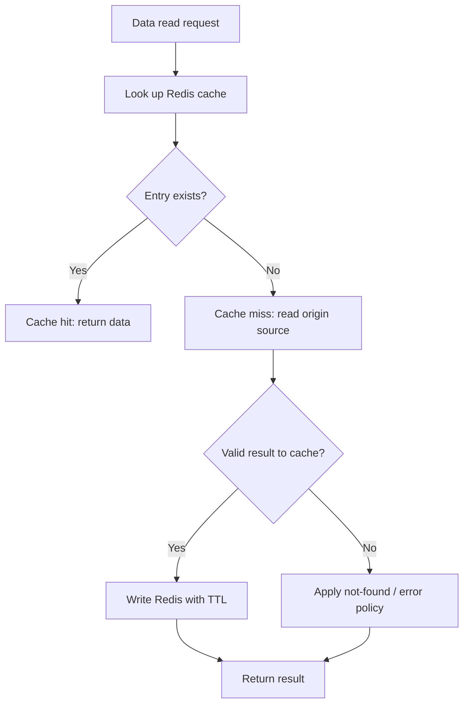
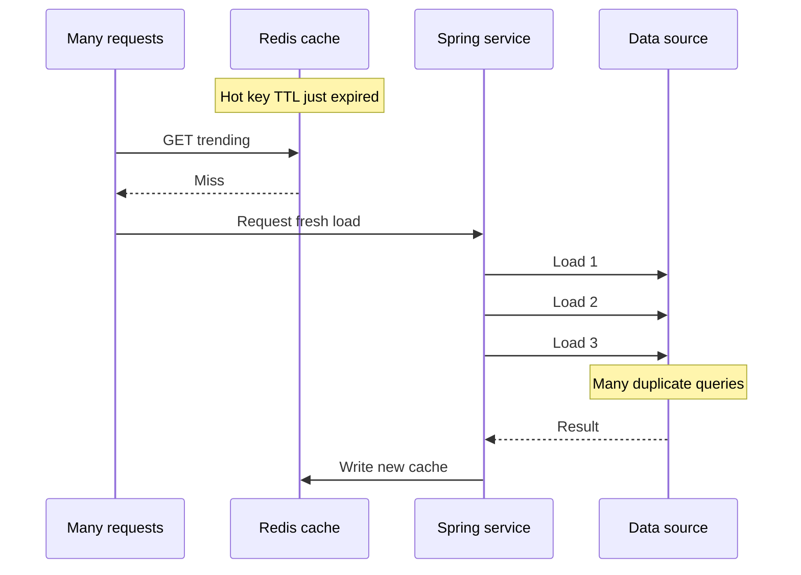
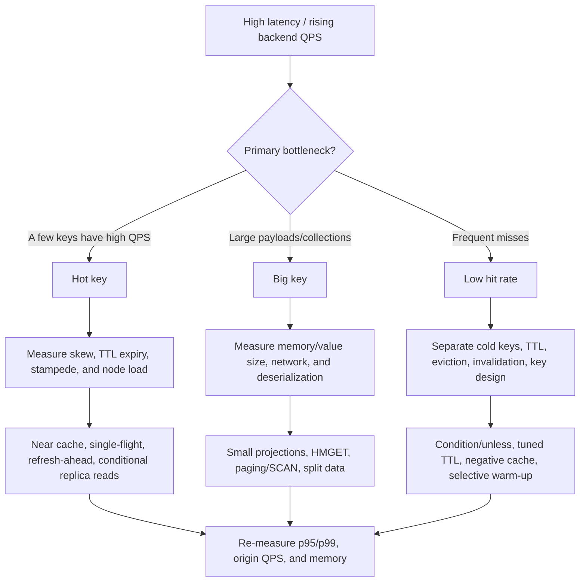

# Handling Hot Keys, Big Keys, and Low Cache Hit Rates in Spring Data Redis

## 1. Three problems often confused with one another

Redis is widely used as a cache because key lookups are fast and in-memory data operations have low latency. However, adding servers or slapping on `@Cacheable` does not automatically fix every bottleneck. In practice, three phenomena must be distinguished:

- **Hot key:** one key or a very small set of keys receives a disproportionately high share of accesses. Even if the value is small, concentrated request volume can overload a Redis node, the network, or the backend itself when the key expires.
- **Big key / large value:** a key holds a large payload or a collection with huge numbers of elements. A single read, serialization, network transfer, or deletion can consume significant resources.
- **Low cache hit rate:** the application frequently fails to find entries in the cache and still has to call the underlying data source. The cache consumes resources while saving very little read cost.

These three issues can appear alone or together. For example, a 5 MB profile JSON read thousands of times per second is both a **big key** and a **hot key**. Conversely, one million keys queried once each produce a very low hit rate even though no key is hot or big.

| Phenomenon | Main symptom | What needs optimization |
|---|---|---|
| Hot key | Request volume concentrates on one key; latency climbs on one node | Load distribution, cutting redundant reads of the same key, stampede prevention |
| Big key | Large payloads, heavy read/write commands, rising network and memory | Data size, access granularity, serialization approach |
| Low hit rate | Frequent misses, backend still takes heavy reads, many cold keys | Selecting cache-worthy data, TTLs, key design, warm-up, and eviction |

All three belong to **caching strategy**: to solve them properly, measure traffic volume and access shape before tweaking Spring code or Redis parameters.

## 2. Spring Cache and RedisTemplate models

In a Spring Boot application there are two common ways to use Redis:

1. **Spring Cache abstraction:** `@Cacheable`, `@CachePut`, `@CacheEvict`, `CacheManager`, where `RedisCacheManager` stores cache entries in Redis.
2. **Templates:** `StringRedisTemplate`, `RedisTemplate`, or `ReactiveRedisTemplate` for direct control over keys, data structures, TTLs, and individual Redis commands.

Spring Cache example:

```java
@Cacheable(cacheNames = "productSummary", key = "#p0")
public ProductSummary getSummary(String productId) {
    return productRepository.loadSummary(productId);
}
```

On a cache hit, Spring can return data from Redis without calling `productRepository`. On a cache miss, Spring invokes the method and then stores the result per cache configuration and serializer. Concurrency consistency and miss calculation depend on the `Cache` implementation and options used.

Template example:

```java
String cacheKey = "cache:product:summary:" + productId;
String payload = stringRedisTemplate.opsForValue().get(cacheKey);
```

Templates provide direct control over keys and commands, while the application takes responsibility for cache-aside, serialization, invalidation, TTLs, stampede avoidance, and error handling. If both approaches touch the same data area, align keyspaces and serializers; Spring Cache keys may include prefixes such as `productSummary::P100`, different from keys built manually with a Template.

### Lifecycle of a cache miss



When an ultra-hot key expires, many requests can enter the **read origin source** step simultaneously. This is the *cache stampede* or *thundering herd* problem—frequently accompanying hot keys, though not identical to a hot key itself.

## 3. Measure before proposing solutions

### 3.1. Application-tier hit rate

A common expression:

\[
\text{Hit rate} = \frac{\text{cache hits}}{\text{cache hits} + \text{cache misses}} \times 100\%
\]

In this measurement, a **cache hit** is a cache read returning a valid entry and a **cache miss** is a lookup finding no entry. Requests intentionally skipping the cache (`condition=false`, bypass on error, or cache disabled) should be tracked separately rather than lumped into misses by default.

Hypothetical example: over five minutes, the `productSummary` region logs 80,000 hits and 20,000 misses:

\[
\text{Hit rate} = \frac{80,000}{80,000+20,000}=80\%
\]

However, 80% alone does not declare a cache good or bad. If the 20% misses hit a very expensive database query, the backend can still overload. Conversely, a 40% hit rate is still valuable when every hit saves an expensive remote call and the cached footprint is small.

Also measure:

- **Origin QPS:** requests actually reaching the source database/API after passing through the cache.
- **Percentile latency:** p50, p95, p99 of cache lookups, deserialization, origin loads, and overall requests.
- **Misses by cause:** never cached, TTL expired, evicted under memory pressure, invalidated, or intentionally uncached.
- **Access distribution:** which keys or key groups drive most traffic; avoid logging verbatim sensitive keys.
- **Memory:** key count, value sizes, fragmentation, evictions, network output, and Redis CPU.
- **Error/timeout rate:** a slow Redis can force fallback to the backend and depress observed hit rates.

A single global hit rate can mask individual cache regions. For instance, `homePage` hits 99% while `searchQuery` sits at 2%; decisions must be tailored per data kind.

### 3.2. Redis server metrics differ from Spring Cache hit rates

Redis reports counters such as `keyspace_hits` and `keyspace_misses` in `INFO stats`. They describe key lookups across the **entire Redis instance**, including consumers unrelated to Spring Cache.

```redis
INFO stats
INFO memory
INFO commandstats
SLOWLOG GET 20
LATENCY LATEST
```

Because Redis may store sessions, queues, counters, and caches for multiple apps, never treat server-level `keyspace_hits / (keyspace_hits + keyspace_misses)` as the hit rate of a single `@Cacheable` method. Measure **application cache hits/misses per cache name** when supported by your backend/metrics binder, or instrument adapters with explicit definitions.

`INFO stats` also includes `evicted_keys` and `expired_keys`. Rising `evicted_keys` suggests `maxmemory` is causing cache churn. By contrast, rising `expired_keys` is not automatically an error: TTL causes keys to expire by design.

### 3.3. Finding big keys and high-traffic keys

In an environment with appropriate access and an operational plan:

```redis
TYPE cache:product:P100
MEMORY USAGE cache:product:P100
STRLEN cache:product:P100
HLEN cache:product:P100
SCARD cache:product:tags:P100
ZCARD leaderboard:daily
```

Only run commands matching the **actual data type**. `MEMORY USAGE` reports an estimated memory footprint for the key; for large collections, element sampling and measurement cost affect results. Never run heavy measurement commands repeatedly on a production hot key.

`redis-cli --bigkeys` can assist key-size investigations by scanning the keyspace. It still generates scan load and does not replace per-value-type memory analysis; restrict when and how often it runs. `SCAN` is preferred over `KEYS *` for batched traversal, yet **`SCAN` is not free** and does not produce a consistent snapshot if the keyspace mutates mid-scan.

Not every Redis version has identical hot-key sampling tools. `redis-cli --hotkeys` in supported environments relies on LFU metadata and requires a compatible eviction policy. When Redis-side evidence is unavailable, instrument at the application layer to count **by key group or hashed/sampled key**, avoiding distinct metric labels for millions of keys.

## 4. Hot keys: causes and consequences

### 4.1. Characteristics of a hot key

For example, an endpoint returning a list of trending events:

```text
cache:homepage:trending -> one small payload
  1,000 requests/second across multiple app instances
```

Even if the payload is just a few KB, a single key can become a traffic focal point. In Redis Cluster, a key maps to **one hash slot** owned by one node; adding more shards does not split a single key across multiple keys. Thus read/write throughput for a hot key can bottleneck on the slot's owner node, network, or driver.

Two common hot patterns exist:

- **Read-hot:** a key read massively while data changes infrequently or in batches.
- **Write-hot:** a key updated continuously (e.g., global counters, leaderboards, or shared state). For a counter, `INCR` is atomic in Redis, yet every command still hits the same key/node.

Hot keys can also elevate p99 latency, connection pool queuing, network bandwidth, and application-side deserialization/copying overhead, even when each individual command is fast.

### 4.2. Hot key + short TTL causes cache stampedes

Suppose 50 application instances all read `homepage:trending`. When its TTL expires, many instances see a miss at once and query the data source. If the source computes a heavy aggregation query, one miss wave can trigger dozens or hundreds of duplicate computations.



Increasing TTL from 10 seconds to 60 seconds cuts expiration frequency, yet does not eliminate concurrency during the miss itself. Choose tools based on consistency and latency requirements.

## 5. Offloading hot keys with read strategies

### 5.1. Near cache / short-lived local cache

For rarely changing, heavily read data, a small in-instance cache (such as Caffeine) can sit in front of Redis:

```text
HTTP request
    |
    v
Local cache in Spring instance (TTL 1–3 seconds)
    |
    +-- hit --> return data, no Redis call
    |
    +-- miss --> Redis cache
                     |
                     +-- miss --> Origin
```

If 100 requests on one instance read the hot key within one second, most can be served from local memory instead of Redis. However, the system now holds **multiple copies of the value** with independent lifetimes. You must accept brief staleness or build proper invalidation.

For permissions, balances, transaction state, or strict read-after-write needs, local caching may be unsuitable. Redis Pub/Sub can broadcast invalidation notices, yet Pub/Sub messages are **not durable**: disconnected instances miss events. If exact invalidation is mandatory, use version/checkpoint mechanisms or self-bounding TTLs.

### 5.2. Sharing a single load across requests (single-flight)

Some cache libraries or in-app synchronization utilities can **coalesce requests waiting on the same key** so an instance calls the origin only once on a miss.

Spring Cache offers an option:

```java
@Cacheable(
    cacheNames = "homepageTrending",
    key = "'v1'",
    sync = true
)
public TrendingView loadTrending() {
    return trendingRepository.calculateTrending();
}
```

`sync=true` asks the cache provider to synchronize computation for the same key **if the implementation supports it**. In Spring Cache, `sync=true` has limitations such as allowing only one cache name per operation and disallowing `unless`. It **does not guarantee a cluster-wide distributed lock across app instances**. With multiple Spring instances, verify empirically whether your RedisCache/driver performs cross-instance coalescing.

Another option is per-key local single-flight, capping waiting requests and sharing one `Future`/result. This limits fan-out per instance without stopping other instances from missing simultaneously. Never hold a single global mutex across all keys, as unrelated cache misses would block one another.

### 5.3. Refresh-ahead and stale-while-revalidate

For data tolerating slight staleness, store additional **logical deadlines**:

```text
Cached payload:
  value           = precomputed leaderboard
  refreshAfter    = timestamp to start background refresh
  serveStaleUntil = final timestamp allowed to serve stale data
```

Workflow:

1. Before `refreshAfter`, return cache normally.
2. Past `refreshAfter`, keep returning the old version while only one worker refreshes.
3. On successful load, swap in the new version with rules preventing stale overwrites.
4. On failed load, serve stale only up to `serveStaleUntil`.
5. Past the max stale limit, apply the SLA's error or mandatory read policy.

This is **an architectural pattern**, not something turned on automatically by `@Cacheable`. You must design storage of both timestamps, refresh ownership, error handling, and concurrent updates.

If data requires instant accuracy (e.g., total paid amount), never casually apply stale-while-revalidate. Reserve it for reference data, recommendations, dashboards, or aggregated lists with defined staleness budgets.

### 5.4. Replica reads only when replication lag is acceptable

In Redis deployments with replicas, part of read traffic can route to replicas when supported by driver and read settings—for example, Lettuce read preferences. This can scale read capacity, yet replication is typically **asynchronous**, so replicas may return stale data.

Points to evaluate:

- Must read-after-write see updated values immediately?
- How long can cache updates and invalidations lag behind on replicas?
- During failover, how do topology and latency behave?
- Does the driver actually route `GET` per the intended policy?

Replicas do not fix hot **write keys**, nor replace proper payload sizing, TTLs, or stampede defenses.

## 6. TTL jitter: preventing many keys from expiring together

When tens of thousands of keys are written during a single deploy or batch import with an identical 300-second TTL, they can expire together in a very narrow window. That triggers an **expiration burst**, spiking cache misses and origin QPS.

**TTL jitter** adds a bounded random offset to TTL:

\[
TTL_{effective}=TTL_{base}+U(0,J)
\]

With `TTL_base = 300s`, `J = 60s`, keys receive TTLs from 300 to 360 seconds, spreading out expiration times.

### 6.1. StringRedisTemplate example with TTL jitter

```java
package com.example.cache;

import java.time.Duration;
import java.util.concurrent.ThreadLocalRandom;
import org.springframework.data.redis.core.StringRedisTemplate;
import org.springframework.stereotype.Service;

@Service
public class JitteredStringCache {

    private static final long BASE_TTL_SECONDS = 300;
    private static final long MAX_JITTER_SECONDS = 60;

    private final StringRedisTemplate redis;

    public JitteredStringCache(StringRedisTemplate redis) {
        this.redis = redis;
    }

    public void put(String productId, String serializedSummary) {
        if (productId == null || productId.isBlank()) {
            throw new IllegalArgumentException("productId is required");
        }
        if (serializedSummary == null) {
            throw new IllegalArgumentException("payload is required");
        }

        long ttlSeconds = BASE_TTL_SECONDS
                + ThreadLocalRandom.current()
                        .nextLong(MAX_JITTER_SECONDS + 1);

        String key = "cache:summary:v1:" + productId;

        redis.opsForValue().set(
                key,
                serializedSummary,
                Duration.ofSeconds(ttlSeconds)
        );
    }

    public String get(String productId) {
        return redis.opsForValue().get(
                "cache:summary:v1:" + productId
        );
    }
}
```

`opsForValue().set(key, value, Duration)` sends value and TTL in **one Redis command** as supported by the template, avoiding the risk of writing the value and failing to run a separate `EXPIRE`.

This example uses a dedicated namespace managed by `StringRedisTemplate`. Never mix `cache:summary:v1:` with a `RedisCacheManager` region without aligning formats and serializers.

### 6.2. Does TTL jitter solve a single hot key?

**Not completely.** Jitter excels when **many keys** share synchronized expirations. A **single hot key** can still generate thousands of misses when it expires, even if that moment shifts randomly. For a lone hot key, combine single-flight, refresh-ahead, local caching, or another read strategy.

Spring Cache with `RedisCacheConfiguration.entryTtl(Duration)` typically sets a fixed TTL per cache region. Some Spring Data Redis versions support dynamic TTL via `RedisCacheWriter.TtlFunction`; if per-write jitter is needed in Spring Cache, check the API and version your project uses. Do not assume the `Template` Java example above applies automatically to `@Cacheable` entries.

## 7. Hot write keys: when a counter or collection is updated too heavily

For example, `metrics:views:total` receives `INCR` on every request. `INCR` is atomic, yet all writes still land on the same key and slot.

One approach is a **sharded counter**:

```text
metrics:views:total:shard:0
metrics:views:total:shard:1
metrics:views:total:shard:2
metrics:views:total:shard:3
...
```

Each writer selects a shard via a stable rule or load distribution and calls `INCR`. When a total is needed, read and sum the shards.

Trade-offs:

- Spreading updates across keys/slots relieves hot spots.
- The total is no longer a single global atomic read; reading across shards can observe a skewed point-in-time snapshot.
- Increases key count, read/aggregation cost, and requires a plan to change shard counts.
- In Redis Cluster, hash slot distribution must be intentional. If every shard shares **the same hash tag**, they still land in one slot and fail to distribute load across nodes.

This pattern suits metrics tolerating brief point-in-time skew. Never apply it casually to financial balances, inventory requiring strict consistency, or invariants demanding a single counter.

## 8. Big keys: why large data slows down the cache

A key can be large in two ways:

1. **A very large single value**: e.g., a multi-MB JSON string or a blob serialized into a String.
2. **A collection with huge element counts**: a Redis Hash, List, Set, or Sorted Set holding hundreds of thousands or millions of members.

There is no universal MB or element threshold defining "big" across all deployments. A 200 KB payload may be huge for an endpoint at 10,000 requests/second, while a rarely accessed 5 MB payload may be tolerable in an internal tool.

Common problems:

- **Network:** reading the entire value every time consumes bandwidth and creates tail latency.
- **Serialization/deserialization:** parsing huge JSON/objects burns Java CPU and heap allocations.
- **Redis command cost:** commands scanning or dumping whole collections process massive amounts of data.
- **Eviction granularity:** evicting one large key wipes the whole structure, potentially triggering a heavy reload.
- **Mutation/copy:** updating one field inside a JSON blob forces rewriting the entire String.
- **Replication/persistence:** writing big payloads increases sync traffic and operational impact depending on configuration.

### 8.1. Do not read an entire collection when only part is needed

Suppose a Redis Hash stores a multi-field profile. If an API only needs `name` and `status`, instead of:

```java
Map<Object, Object> all =
        stringRedisTemplate.opsForHash()
                .entries("profile:42");
```

read only the required fields:

```java
Object name = stringRedisTemplate.opsForHash()
        .get("profile:42", "name");

Object status = stringRedisTemplate.opsForHash()
        .get("profile:42", "status");
```

Two field reads still incur two round-trips; where API and version allow, use `multiGet` to fetch multiple fields:

```java
List<Object> fields = stringRedisTemplate.opsForHash()
        .multiGet(
                "profile:42",
                List.of("name", "status")
        );
```

This corresponds to Redis `HMGET profile:42 name status`, returning far less data than `HGETALL` when the Hash has many fields.

For long lists, avoid:

```redis
LRANGE activity:42 0 -1
SMEMBERS huge:set
ZRANGE leaderboard 0 -1 WITHSCORES
HGETALL giant:hash
```

Full-collection reads can generate massive payloads. When the application only needs the first page, use ranges:

```redis
LRANGE activity:42 0 99
ZRANGE leaderboard 0 99 WITHSCORES
```

Note that `LRANGE` uses element indices, while `ZRANGE` has rank/score variants depending on syntax. Choose pagination aligned with how the data is ordered.

### 8.2. Scanning collections in batches

When iterating a large Hash/Set/Sorted Set is truly needed, Redis provides `HSCAN`, `SSCAN`, and `ZSCAN` for cursor-based traversal. In Spring Data Redis, `HashOperations.scan(..., ScanOptions)` supports this:

```java
import java.util.Map;
import org.springframework.data.redis.core.Cursor;
import org.springframework.data.redis.core.ScanOptions;

try (Cursor<Map.Entry<Object, Object>> cursor =
        stringRedisTemplate.opsForHash().scan(
                "profile:large:42",
                ScanOptions.scanOptions().count(200).build()
        )) {

    while (cursor.hasNext()) {
        Map.Entry<Object, Object> entry = cursor.next();
        // Process each entry; avoid buffering everything in RAM.
    }
}
```

`COUNT 200` is a **per-iteration work hint**, not a guarantee of exactly 200 elements per response. `SCAN` may yield duplicates, and if the collection changes mid-iteration, results do not form a transactional snapshot. Operations requiring an exact single pass need consistency/versioning designs or a suitable data source.

Do not use `SCAN` merely to "replace" frequent business queries by field; it still traverses the structure. For multi-criteria queries, consider secondary indices, search engines, or an appropriate database.

### 8.3. Splitting data by access pattern

Instead of storing one giant JSON with rarely needed fields:

```text
product:42 -> JSON with description, images, reviews, stock, price, metadata...
```

split data by unit of access:

```text
product:42:summary    -> few fields used on listing pages
product:42:details    -> info for detail page
product:42:stock      -> stock status, separate TTL/source
product:42:reviews:0  -> first page of reviews
product:42:reviews:1  -> next page of reviews
```

Benefits include smaller payloads for common requests and separate TTLs and invalidation per data group. Trade-offs: more keys, more lookups, harder cross-part consistency updates, and potential desync between pieces. Split only when read/write patterns show most requests don't need the whole blob.

When large values change rarely, payload compression can be considered, provided you measure compression/decompression CPU vs. bandwidth savings. Compression does not fix still having to fetch and parse the whole payload, nor does it fit every serializer.

## 9. Low cache hit rates: diagnose causes before increasing TTL

Low hit rates stem from many root causes.

| Cause | Symptom | Resolution direction |
|---|---|---|
| **High cardinality:** keys are nearly always new | Many single-use keys, few repeated misses | Skip caching this request type, or cache at a different layer |
| **TTL too short** relative to access cycle | Keys expire right before the next access | Measure reuse intervals, adjust TTL and invalidation |
| **Eviction from low memory** | `evicted_keys` rises, cache churn | Measure working set, limit cache pollution, size memory/policy |
| **Unstable keys** | Same data generates different keys per request | Normalize params/keys/versions/locales deliberately |
| **Serializer/namespace mismatch** | Entry written under one prefix or byte layout, read under another | Align serializers and keyspaces |
| **Excessive cache clearing** | Every minor write triggers `allEntries=true` or region wipes | Evict per key, split regions if appropriate |
| **Cold starts/deploys** | Hit rate drops periodically on restarts or flushes | Selective warm-up, keep shared cache, avoid unnecessary flushes |
| **Not-found misses** | Many non-existent IDs queried | Short-lived negative caching or invalid-request filtering |
| **Loads skipped from caching** | `unless` often rejects or values fail serialization | Fix caching policy rather than blindly raising TTL |
| **Redis timeouts and fallbacks** | Redis errors rise alongside origin QPS | Fix connectivity, pools, latency, overload |

### 9.1. High cardinality cannot be fixed by adding infinite memory

For example, a search API receiving arbitrary user queries:

```text
GET /search?q=red+shoes&sort=price&page=1
GET /search?q=blue+shoes&sort=price&page=2
GET /search?q=some-new-query-834&page=1
...
```

If cache keys embed the full query string and most queries appear once, raising TTL to one day fills Redis with countless cold results—and can evict genuinely hot entries from memory.

Solutions include caching only popular or repeated queries, setting size/TTL caps for search regions, or caching a higher-reuse layer (such as product metadata by ID). For multi-criteria search, a dedicated search engine/index matters more than caching random query results.

### 9.2. Consistent cache key design

For data varying by tenant/locale/version:

```text
cache:product:summary:v2:tenant-17:vi:P100
```

Keys must distinguish variants producing **different values**, while excluding fields that vary without changing the result (request timestamps, trace IDs, nonces). Putting a request ID into the cache key drives hit rate near 0% for otherwise reusable data.

Conversely, omitting tenant or permissions when responses depend on tenant/user risks **data leaks** via cache hits. Never trade correctness and authorization isolation for a higher hit rate.

## 10. Filtering uncacheable calls with Spring Cache `condition`/`unless`

In Spring Cache, `condition` decides whether to involve the cache **before the method runs**. `unless` decides not to cache a result after the method runs.

Example:

```java
package com.example.catalog;

import org.springframework.cache.annotation.Cacheable;
import org.springframework.stereotype.Service;

@Service
public class ProductQueryService {

    private final ProductReader productReader;

    public ProductQueryService(ProductReader productReader) {
        this.productReader = productReader;
    }

    @Cacheable(
        cacheNames = "productSummary",
        key = "#p0",
        condition = "#p0 != null && #p1",
        unless = "#result == null"
    )
    public ProductSummary getSummary(String productId, boolean cacheEligible) {
        return productReader.loadSummary(productId);
    }
}
```

`ProductReader` and `ProductSummary` are application-defined types. The `cacheEligible` flag can be computed by the caller according to business rules (e.g., popular product segments), aligned with system policy: use `condition` to control **cost/cache value**, not to skip validation or authorization.

- `#p0`: `productId` parameter.
- `#p1`: boolean `cacheEligible` parameter.
- `condition=false`: skips both cache lookup and cache write for that call.
- `unless="#result == null"`: skips storing a missing result after the method ran on a cache miss.

`unless` does not filter an entry on a cache hit; it only vetoes caching a freshly computed result. When a product is updated, rely on proper eviction/versioning/TTL rather than expecting `unless` to detect stale entries.

### 10.1. Enabling Redis caching in Spring Boot

Dependencies:

```groovy
dependencies {
    implementation 'org.springframework.boot:spring-boot-starter-cache'
    implementation 'org.springframework.boot:spring-boot-starter-data-redis'
}
```

Sample configuration:

```yaml
spring:
  cache:
    type: redis
  data:
    redis:
      host: localhost
      port: 6379
```

Enable Spring Cache annotations:

```java
import org.springframework.cache.annotation.EnableCaching;
import org.springframework.context.annotation.Configuration;

@Configuration
@EnableCaching
public class CacheInfrastructureConfiguration {
}
```

With matching auto-configuration, Spring Boot provides `RedisCacheManager`. `@Cacheable` must be invoked through a Spring proxy/interceptor; **self-invocation** within the same bean bypasses caching.

### 10.2. Using distinct TTLs per cache region

A region for hot data can have a different TTL from a region for one-off lookups:

```java
package com.example.catalog;

import java.time.Duration;
import org.springframework.boot.autoconfigure.cache.RedisCacheManagerBuilderCustomizer;
import org.springframework.context.annotation.Bean;
import org.springframework.context.annotation.Configuration;
import org.springframework.data.redis.cache.RedisCacheConfiguration;

@Configuration
public class ProductCacheConfiguration {

    @Bean
    public RedisCacheManagerBuilderCustomizer customizeRedisCaches() {
        return builder -> builder
            .withCacheConfiguration(
                "productSummary",
                RedisCacheConfiguration.defaultCacheConfig()
                    .entryTtl(Duration.ofMinutes(5))
                    .disableCachingNullValues()
            )
            .withCacheConfiguration(
                "productNotFound",
                RedisCacheConfiguration.defaultCacheConfig()
                    .entryTtl(Duration.ofSeconds(15))
            );
    }
}
```

`productSummary` does not store `null` values; `productNotFound` has a shorter TTL and allows caching `null` by default unless Spring Data Redis configuration is changed elsewhere. These are **regions with separate policies**; the application must intentionally route data into the right region. Declaring two regions alone does not automatically route hits vs. misses based on return values.

If the project already defines a custom `RedisCacheManager` bean, merge settings into the active manager rather than assuming Boot's customizer configures a separate manager.

## 11. Caching not-found when misses dominate

When many requests query non-existent IDs, every miss hits the database. A short-lived "not found" entry (negative cache) can cut load.

However, distinguish:

- **True not found:** data source returns a valid absence result.
- **Data source error:** timeout, connection failure, dependency unavailable.
- **Unauthorized:** caller lacks access to the data.

Never convert an upstream error into `null` and cache it as "not-found". For data that could be created shortly, negative caches need short TTLs and eviction on create/update to avoid serving stale "does not exist" after creation.

Spring Data Redis can store logical `null` using a cache-abstraction marker, though Redis itself has no dedicated "Java null" value type. `RedisCacheConfiguration.disableCachingNullValues()` rejects storing null at the backend; `unless="#result == null"` suppresses writes at the annotation layer. Keep these two settings consistent.

### 11.1. Probabilistic filters for keys that definitely do not exist

Under heavy missing-key workloads, a Bloom filter synced with the valid ID set can filter out queries **guaranteed not to be in the set** before hitting the backend. It can produce *false positives* (saying an ID might exist when it doesn't), yet must never produce *false negatives* if updated and synced properly.

The risk lies in **filter completeness and freshness**. If a new ID is created before the filter updates, the app can reject an existing record. Thus filters do not suit every problem and require update, rebuild, and fallback plans. They also do not replace authorization, and carry their own memory and recovery costs.

## 12. Cache-aside with RedisTemplate: controlling TTL and the write path

A simple cache-aside service:

```java
package com.example.catalog;

import java.time.Duration;
import java.util.function.Supplier;
import org.springframework.data.redis.core.StringRedisTemplate;
import org.springframework.stereotype.Service;

@Service
public class ProductTextCache {

    private final StringRedisTemplate redis;

    public ProductTextCache(StringRedisTemplate redis) {
        this.redis = redis;
    }

    public String getOrLoad(
            String productId,
            Supplier<String> loadSerializedSummary) {

        String key = "cache:product:text:v1:" + productId;
        String cached = redis.opsForValue().get(key);

        if (cached != null) {
            return cached;
        }

        String loaded = loadSerializedSummary.get();
        if (loaded != null) {
            redis.opsForValue().set(
                    key,
                    loaded,
                    Duration.ofMinutes(5)
            );
        }

        return loaded;
    }

    public void evict(String productId) {
        redis.delete("cache:product:text:v1:" + productId);
    }
}
```

This snippet is intentionally concise to highlight the flow:

1. Read cache by key.
2. On hit, return value.
3. On miss, invoke loader.
4. Write new value with TTL and return result.

It **does not yet prevent cache stampedes**: two requests can miss together and both call `loadSerializedSummary`. If they load two different versions, the last write may store the older one. For concurrently updated data, design versioning, compare-and-set, single-flight, writer ownership, or appropriate eviction.

Never pass a supplier with non-idempotent side effects assuming it runs only once; cache misses and retries can invoke the loader multiple times.

## 13. Strategies when Redis is overloaded or unavailable

A cache is an optimization layer; in many systems, authoritative data remains in the database or origin API. When Redis slows down or fails, the application must avoid turning every request into a flood hitting the origin.

Measures:

- **Bounded timeouts:** avoid blocking requests indefinitely when Redis is unresponsive.
- **Circuit breakers/bulkheads:** when Redis errors climb, cap how many requests probe cache or fall back to the origin together.
- **Rate limiting and request coalescing:** limit reloads per hot key instead of shifting the bottleneck to the database.
- **Controlled stale serving:** if business permits, serve stale copies within bounds.
- **Feature degradation:** return partial info, safe defaults, or temporary notices when the origin cannot absorb full load.
- **Post-recovery warm-up:** prioritize heavily read keys instead of reloading the entire cache all at once.

Never catch every `RedisConnectionFailureException` and send unlimited requests straight to the database. When Redis goes down, doing so can bring down the database as well (*cascading failure*).

If Redis is the **primary data store** rather than a rebuildable cache, falling back to a database is not an option. Recovery rules must follow wherever the system's authoritative data lives.

## 14. Cache warming and cache pollution

**Cache warming** proactively loads a set of data before or right as traffic arrives. It helps when hot keys are fairly stable—such as product categories, public configs, or regional top items.

Sensible operational workflow:

1. Identify high-request, high-value keys from observability data.
2. Warm only a small set of keys with high reuse probability.
3. Bound concurrency/rate during loading to protect the source.
4. Stagger refresh times and use proper TTLs or versions.
5. Measure after warm-up: hit rate, origin QPS, Redis memory, and latency.

Never automatically warm millions of records; doing so floods Redis with cold data, evicts hot keys from memory, and hammers the source. That is **cache pollution**, which can actually lower hit rates despite holding more entries.

Similarly, an eviction policy like `allkeys-lru` or `allkeys-lfu` (if configured) is a capacity-management tool, not a substitute for choosing cache-worthy keys. Redis eviction policy is an operational choice that also affects non-cache keys sharing the instance; never change it casually on servers holding sessions, queues, or primary data.

## 15. Combined scenario: product catalog with hot keys, big keys, and low hit rate

Suppose a store has three endpoints:

| Endpoint | Pattern | Problem |
|---|---|---|
| `GET /homepage/trending` | Massive requests reading one aggregated result | Read-hot key and stampede on TTL expiry |
| `GET /products/{id}/details` | Some product JSONs are huge with reviews and history | Big values, heavy bandwidth and deserialization |
| `GET /search?q=...` | Diverse query strings, few repeated queries | Low hit rate, cache pollution |

Each needs a different solution.

### 15.1. Homepage trending

- Cache the aggregated result under an explicit key/region.
- Set a TTL matching acceptable staleness.
- Under high fan-out, consider a brief local cache to cut Redis QPS.
- Use refresh-ahead or single-flight to avoid concurrent origin computation.
- Monitor hot-key QPS, p95/p99, and recomputation count.

If the list must update second-by-second, evaluate compute cost and source of truth; never set a long TTL just to achieve a pretty hit rate.

### 15.2. Product details

- Separate a small `summary` for product lists from large `details` for detail pages.
- Read only needed parts; paginate reviews by ID/cursor.
- Consider compression if network is the bottleneck and CPU has headroom.
- Prices, stock, and descriptions may warrant separate TTLs and invalidation.
- Avoid serializing whole object graphs with unneeded relationships.

### 15.3. Search queries

- Measure repeat frequency per normalized query.
- Cache only popular queries or reusable supporting datasets.
- Skip caching overly specific queries where cache cost outweighs benefit.
- Use a dedicated search engine/index for complex queries; cache does not replace a query planner/index.
- Track hit rate separately for `searchQuery` instead of blending it with high-hit `homepageTrending`.

## 16. Symptom-driven troubleshooting workflow



A concrete investigation sequence:

1. **Pinpoint where latency sits:** Redis network, Redis processing, Java deserialization, origin query, or request queue.
2. **Break down access by cache region and operation:** never start with a single global hit rate.
3. **Measure traffic safely per key/key group:** check skew and TTL expiration timing.
4. **Inspect payload and collection sizes:** find operations reading entire big keys.
5. **Cross-check Redis evictions and memory pressure:** see whether the cache is evicting its own hot keys.
6. **Propose small, measurable changes:** TTL jitter, payload limits, cache eligibility, short local cache, or single-flight.
7. **Re-verify data correctness:** stale window, invalidation, authorization, key versions, and consistency.
8. **Measure under realistic load:** backend QPS, p95/p99, Redis memory, entry counts, update lag, and error rate.

### Solution selection matrix

| Measure | Hot key | Big key | Low hit | Key trade-off |
|---|---|---|---|---|
| Local near cache | Cuts Redis QPS for read-hot | Does not shrink origin payload | Raises local hits if reused often | Staleness, per-instance RAM, invalidation |
| Single-flight | Cuts origin load on concurrent misses | Does not shrink value bytes | Cuts repeated costly misses | Locking/coordination and timeouts |
| TTL jitter | Cuts synchronized multi-key expirations | No | Can smooth miss bursts | Does not fix a single hot key |
| Refresh-ahead/SWR | Helpful for read-hot | Not directly | Keeps hits during refresh | Stale budget and refresh ownership |
| Replica reads | Offloads primary read traffic | Still transfers payload | Does not raise hits by itself | Replication lag |
| Sharded counter | Spreads write-hot load | No | No | Non-atomic total read, complexity |
| Split keys/projections | Can cut bytes read on hot path | Very helpful | Can raise reuse of smaller pieces | More keys and consistency overhead |
| Eligibility `condition` | Depends on workload | Can skip overly heavy values | Prevents cache pollution | Needs selection rules |
| Negative caching | Cuts repeated missing lookups | No | Improves hits for not-found | Staleness when new data appears |
| Selective warm-up | Cuts misses on hot keys | Needs size limits | Raises hits when hot keys are known | Loads cold data, load spikes |
| More Redis memory | Can reduce evictions | Fits larger keys | Raises hits if working set exceeded RAM | Cost and can mask bad design |

## 17. Common misconceptions

**"Redis is fast so a single hot key can't become a bottleneck."** A single key still routes to one slot/node in Redis Cluster. QPS, network, serialization, and TTL expirations can turn it into a load hotspot.

**"Higher cache hit rate always means a faster application."** Hit rate must be weighed alongside latency, value size, origin cost, and error rate. A large cached entry costing heavy CPU to deserialize every read can still slow endpoints down.

**"Raising TTL always fixes cache misses."** Longer TTLs can boost reuse, yet increase staleness and retain cold data longer. If most keys are queried once, long TTLs barely help.

**"TTL jitter prevents all cache stampedes."** Jitter stops many keys from expiring together. When one hot key expires, many requests can still miss simultaneously.

**"`@Cacheable(sync=true)` creates a distributed lock protecting every instance."** Spring Cache only asks the provider to synchronize computation; cluster-wide distributed locking is not guaranteed by default.

**"Just adding Redis Cluster nodes splits hot-key load."** One key/slot is never automatically split across nodes. You must change key modeling, read paths, or distribution strategy when truly needed.

**"`SCAN` has zero cost and returns a complete snapshot."** `SCAN` runs incrementally yet still consumes resources, can emit duplicates, and is affected by concurrent mutations.

**"One big JSON can serve every API without issue."** Huge payloads increase bandwidth, parse time, and allocations. Design projections/fields per actual use case.

**"Caching null is always good for boosting hits."** Negative caching helps only when absence is trustworthy and brief staleness is acceptable; never cache infrastructure failures as "not found".

**"A one-time full data warm-up solves cold starts."** Warming too many cold keys triggers heavier evictions and overloads the source.

## 18. Conclusion

Effectively handling **hot keys, big keys, and low cache hit rates** in Spring Data Redis starts by separating the three problems and measuring each with dedicated metrics. For hot keys, focus on cutting duplicate accesses, distributing read load sensibly, and controlling stampedes. For big keys, shrink transferred/serialized payloads and load only what is needed. For low hit rates, pinpoint why keys aren't reused, choose appropriate TTLs and eviction policies, and cache only queries that truly benefit.

`RedisTemplate` gives direct control over commands and TTLs; `RedisCacheManager` alongside `@Cacheable`, `condition`, and `unless` configures Spring-level cache policies. Whichever API you choose, a sound strategy balances **latency, origin load, Redis memory, data freshness, and failure resilience**. No single TTL parameter or annotation replaces designing around real access patterns.
