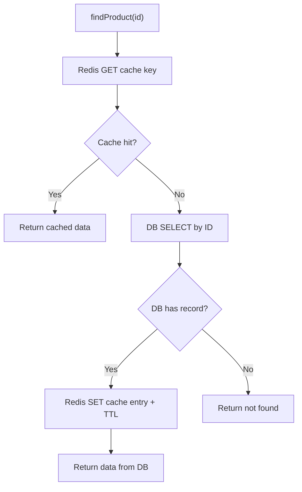
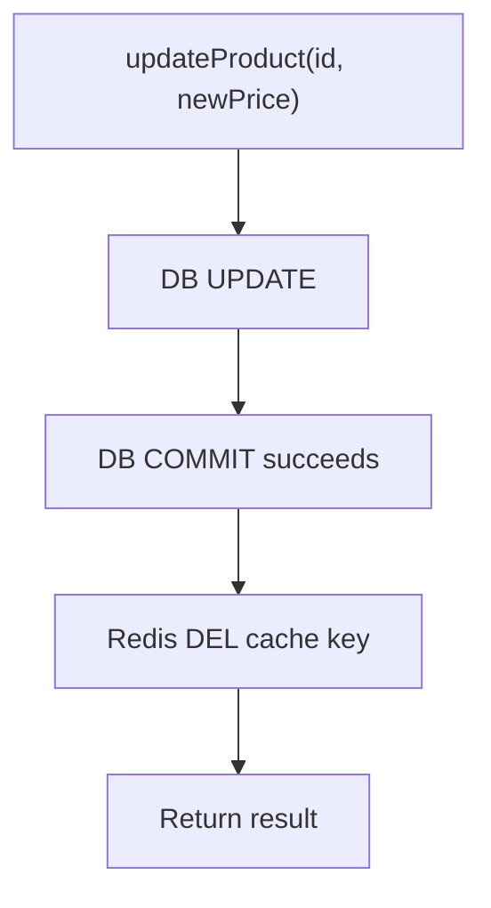
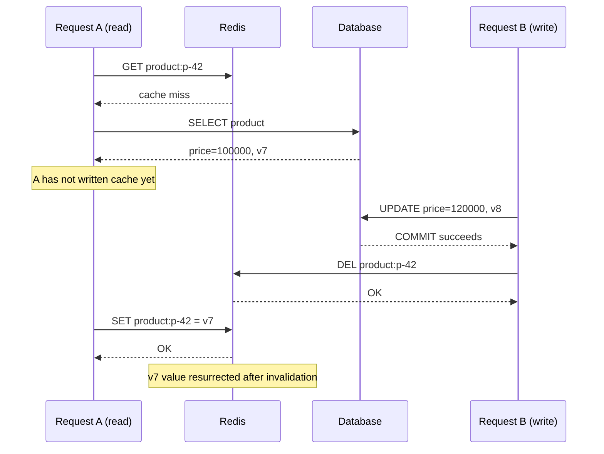
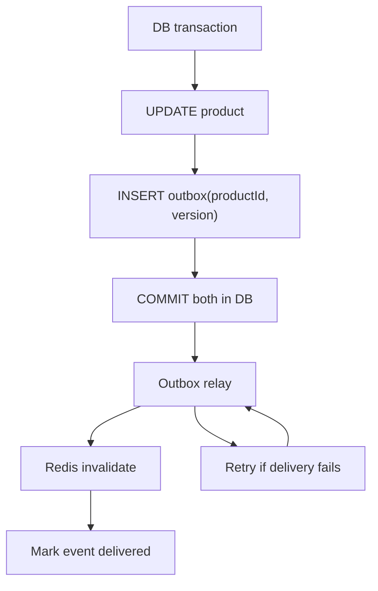

# Race Conditions Between Cache Reads, Data Writes, and Cache Deletions in Spring Data Redis

In the **cache-aside** strategy, an application typically reads Redis first, querying the database (abbreviated DB) only on a cache miss; after updating the DB, the application deletes the cache so the next read loads the fresh value. The recipe looks simple:

```text
Read:   cache GET -> miss -> DB SELECT -> cache SET
Write:  DB UPDATE -> cache DEL
```

However, between `GET`, `SELECT`, `UPDATE`, `SET`, and `DEL` there are windows during which other requests can interleave. When multiple requests or multiple instances access the same record concurrently, **correct ordering within each individual request does not guarantee a correct outcome for the whole system**. A read request can capture an old DB snapshot and write it back into the cache after a write request has already deleted the cache. This is a classic race condition.

This lesson focuses on three operations—**cache read, source data write, and cache deletion**—in the context of Spring Cache and Spring Data Redis. We will walk through concrete execution schedules, analyze failure modes, examine limitations of `@Cacheable`/`@CacheEvict`/`@CachePut` and `@Transactional`, and review strategies ranging from TTLs and post-commit invalidation to version fencing and outbox.

## 1. Model and terminology

Suppose an e-commerce system stores product prices in PostgreSQL and uses Redis to speed up reads:

```text
Database:
    Product(id = "p-42", priceCents = 100_000, version = 7)

Redis cache:
    cache:product:p-42 -> { priceCents: 100000, version: 7 }
```

Then a request updates the price to `120_000` and increments the DB version to `8`.

Relevant terms:

| Concept | Meaning |
|---|---|
| **Source of truth** | Authoritative data store; PostgreSQL in this example |
| **Cache entry** | Cached copy used to speed up reads, not the original data source |
| **Cache hit** | Redis holds an entry considered valid by the cache policy |
| **Cache miss** | Redis lacks an entry; the app must read the source and may populate the cache |
| **Cache fill / populate** | Writing data freshly read from the DB into the cache after a miss |
| **Invalidation / eviction** | Invalidating an entry, usually via `DEL` or `Cache.evict(...)` |
| **Stale value** | A cached value not reflecting the source version required by business rules |
| **Race condition** | Outcome depends on the interleaving order of concurrent operations |
| **Version** | Monotonically increasing DB record version used to compare newer vs. older data |

Here, `version` serves only to explain change ordering. Not every system has a version column; without one, detecting a stale cache fill is even harder.

### 1.1. Two typical execution paths

Cache-aside read path:



Write DB then delete cache path:



This is the target model. In a real application, the order of `COMMIT` and `DEL` must be designed explicitly; placing a cache annotation next to `@Transactional` alone does not guarantee that order.

### 1.2. A cache hit does not guarantee absolute data accuracy

Redis only knows an entry exists and has not expired. Redis does not compare cache entries against DB state. A successful `GET` means data is **present in the cache**, not that it is the latest DB version.

Every strategy must define its consistency requirements:

- **Tolerates a few seconds of stale data:** ordinary caching with short TTLs and invalidation may fit.
- **Reads must reflect changes right after a write finishes:** stronger constraints are required, or bypassing cache on certain flows.
- **Old values must never decide payments, permissions, or stock deduction:** critical decisions must be verified via atomic/transactional operations at the authoritative system.

No single Redis Cache setting delivers strong consistency between DB and Redis across every scenario.

## 2. The worst race: a cache miss reads old DB state, then fills cache after deletion

This is **stale cache resurrection**: an entry that was invalidated gets recreated with old data.

Initially:

```text
DB version = 7, price = 100000
Cache = missing
```

Two requests execute concurrently:

| Time | Request A: read product | Request B: update product |
|---|---|---|
| T1 | `GET cache` → miss | |
| T2 | `SELECT DB` → reads version 7 | |
| T3 | Pauses before writing Redis | |
| T4 | | `UPDATE DB` to version 8 |
| T5 | | `COMMIT` succeeds |
| T6 | | `DEL cache` |
| T7 | `SET cache = version 7` | |
| T8 | | Request B finishes |
| T9 | Request C calls `GET` → cache hit version 7 | |



The issue is not Redis executing commands out of order. Redis properly ran `DEL` before `SET`. **The root cause is that Request A held stale DB data in memory**, then performed the cache fill too late.

If the cache TTL is 30 minutes, the stale value can be served for up to that entire duration, or until another invalidation occurs. With no TTL, the stale entry can linger indefinitely per cache policy.

**Conclusion:** even the `DB COMMIT -> DEL cache` strategy does not strictly prevent stale caches when concurrent read misses occur.

## 3. Deleting cache before writing DB: a window for reloading stale values

A commonly suggested order is:

```text
Redis DEL -> DB UPDATE -> DB COMMIT
```

This order carries an obvious risk:

| Time | Request A: update | Request B: read |
|---|---|---|
| T1 | `DEL cache` | |
| T2 | | `GET cache` → miss |
| T3 | | `SELECT DB` → version 7 |
| T4 | | `SET cache = version 7` |
| T5 | `UPDATE DB` → version 8 | |
| T6 | `COMMIT` | |

Result: the DB is now version 8 while Redis holds version 7. Unless another deletion occurs, the cache was rebuilt from stale data.

Even if the update request throws an exception after deleting cache yet before updating the DB, although source data remains untouched, eviction caused unnecessary cache misses and potential load spikes.

Therefore, in standard cache-aside, **prefer invalidating after the DB change has committed** rather than evicting before starting the write. That is a major improvement, yet as section 2 showed, still insufficient for absolute consistency.

## 4. Writing DB then deleting cache: stale-read windows and lost invalidation

The order:

```text
DB UPDATE -> DB COMMIT -> Redis DEL
```

is easier to reason about. Still, between commit and delete, the cache holds the older version:

```text
T1  DB COMMIT version 8
T2  Another request GET cache version 7 -> stale cache hit
T3  Redis DEL cache
T4  Next request GET -> miss -> loads version 8
```

This is a **stale-read window bounded by invalidation latency**, assuming deletion succeeds. In many content-serving systems, such a brief window is acceptable. In flows requiring immediate visibility of new state, it violates requirements.

Another failure is riskier:

```text
DB COMMIT version 8 -> application crashes -> Redis DEL never sent
```

The DB holds new data while Redis retains the old cache. Both systems are not inside an automatic distributed transaction. Failure handling between DB commit and invalidation must be designed explicitly, not handled with a bare `try/catch` that logs and moves on.

**A successful API call does not guarantee atomic updates to both DB and Redis.** If the app returns success after DB commit yet before cache deletion, other clients can still read stale data.

## 5. Two concurrent write requests can also corrupt the cache

Reads are not the only source of races. Consider two requests updating the same product concurrently when the app uses a **write-through style via `@CachePut`**:

```text
Request A: DB updates to v8; prepares PUT cache v8
Request B: DB updates to v9; PUT cache v9
Request A: PUT cache v8 arrives later
```

Timeline:

| Time | Request A | Request B |
|---|---|---|
| T1 | DB writes version 8 | |
| T2 | Pauses before cache put | |
| T3 | | DB writes version 9 |
| T4 | | `SET cache v9` |
| T5 | `SET cache v8` | |

If both DB writes are valid and version 9 is the true latest version, Redis now holds version 8. `cache.put` does not enforce "write only if version is greater than current cache" by default.

With `@CacheEvict`, ordering between two requests also creates cache misses and varying stale windows, even though `DEL` itself does not write back stale payloads. If both `@CachePut` and `@CacheEvict` exist across multiple write paths, establish which path owns the cache update policy.

Two design questions emerge from this example:

1. **Can we obtain the source data's version order?** Database `@Version` or a monotonically increasing revision is very helpful.
2. **Does the cache reject writing an older version?** Without that check, a late-completing request overwrites newer cache state.

Never use application server clocks for absolute write ordering across instances; clock skew and response timing do not guarantee DB commit order.

## 6. A simple Spring Cache example and the races inside it

Spring Data Redis integrates with Spring Cache via `RedisCacheManager`. Under standard cache setup, an application might look like:

```java
package com.example.catalog;

import org.springframework.cache.annotation.CacheEvict;
import org.springframework.cache.annotation.Cacheable;
import org.springframework.stereotype.Service;
import org.springframework.transaction.annotation.Transactional;

@Service
public class ProductService {

    private final ProductRepository repository;

    public ProductService(ProductRepository repository) {
        this.repository = repository;
    }

    @Cacheable(cacheNames = "productById", key = "#id")
    @Transactional(readOnly = true)
    public ProductDto findById(String id) {
        ProductEntity product = repository.findById(id)
                .orElseThrow();
        return new ProductDto(
                product.getId(),
                product.getPriceCents());
    }

    @CacheEvict(cacheNames = "productById", key = "#id")
    @Transactional
    public void updatePrice(String id, long priceCents) {
        ProductEntity product = repository.findById(id)
                .orElseThrow();
        product.setPriceCents(priceCents);
        repository.save(product);
    }
}
```

`ProductRepository`, `ProductEntity`, and `ProductDto` are sample data-layer and model types; the example centers on cache annotations. Here:

- `@Cacheable` checks the cache first and calls the real method only on a miss.
- `@CacheEvict` by default runs eviction **after the method executes normally**, unlike `beforeInvocation = true`.
- `@Transactional` participates in database transaction management.

**What must not be assumed:** "`@CacheEvict` runs after the method body finishes" **does not automatically mean "runs after DB commit"**. Both cache advice and transaction advice rely on interception/proxies; actual timing depends on advice ordering and transaction config. If eviction runs before commit, a concurrent reader hits the scenario in section 3.

Even when advice ordering ensures eviction after DB commit, the stale-fill race in section 2 remains.

### 6.1. `@CachePut` is not an automatic fix

Example:

```java
@CachePut(cacheNames = "productById", key = "#result.id")
@Transactional
public ProductDto update(ProductDto input) {
    return writeToDatabase(input);
}
```

`@CachePut` forces the real method to run and updates the cache with its return value. It can shorten cache-miss windows and avoid DB reloads on the happy path, yet **does not make the two systems commit atomically**, nor stop a request holding an older version from finishing after a newer one.

If `#result` can be null, you must also handle the key expression and null-caching policy carefully. For order-sensitive data, cache puts must be paired with version-aware checks or proper synchronization boundaries.

## 7. Do not confuse database transactions with Redis transactions

Suppose a service is written as:

```java
@Transactional
public void updatePrice(...) {
    repository.save(...);
    redisTemplate.delete(...);
}
```

A standard `@Transactional` annotation is backed by the relational database's transaction manager. It does not turn `repository.save(...)` and `redisTemplate.delete(...)` into a single ACID transaction spanning PostgreSQL and Redis.

Even with `RedisTemplate` transaction support enabled or using `MULTI/EXEC`, cross-system issues remain: Redis transactions and DB transactions are two separate scopes. One side can commit while the other fails.

A quick reference table:

| Mechanism | Primary guarantee | Does not automatically guarantee |
|---|---|---|
| `@Transactional` with DB transaction manager | Transaction on the corresponding DB | Atomic commit together with Redis |
| Redis `MULTI/EXEC` | Executes queued Redis commands sequentially without interleaving other clients | DB-style rollback or joint DB+Redis transaction |
| Redis Lua script | Checks/updates Redis in one atomic server-side execution | Including DB transactions inside the script |
| `@CacheEvict` | Triggers cache entry deletion per interceptor rules | Blocking stale cache fills from other requests |
| TTL | Caps max lifetime of a newly written entry if expired as configured | Data never being stale before TTL expires |
| Outbox | Persists invalidation intent durably with the DB transaction | Immediate strong cache consistency under async delivery |

Thus, the requirement "if DB commits, the cache has no old version" must be solved as a **protocol between data source and cache**, not by stacking annotations.

## 8. Post-commit eviction via `@TransactionalEventListener`

A common improvement is emitting an event during the DB update and deleting Redis **only after the DB transaction commits successfully**.

### 8.1. Product-changed event

```java
package com.example.catalog;

public record ProductChangedEvent(String productId) {}
```

### 8.2. Service writing DB and publishing event

```java
package com.example.catalog;

import org.springframework.context.ApplicationEventPublisher;
import org.springframework.stereotype.Service;
import org.springframework.transaction.annotation.Transactional;

@Service
public class ProductCommandService {

    private final ProductRepository repository;
    private final ApplicationEventPublisher publisher;

    public ProductCommandService(
            ProductRepository repository,
            ApplicationEventPublisher publisher) {
        this.repository = repository;
        this.publisher = publisher;
    }

    @Transactional
    public void changePrice(String id, long priceCents) {
        if (priceCents < 0) {
            throw new IllegalArgumentException("Negative price");
        }

        ProductEntity product = repository.findById(id)
                .orElseThrow();

        product.setPriceCents(priceCents);
        repository.save(product);

        // Event is published while the transaction is open;
        // the listener below waits until AFTER_COMMIT.
        publisher.publishEvent(new ProductChangedEvent(id));
    }
}
```

### 8.3. Post-commit cache deletion listener

```java
package com.example.catalog;

import org.springframework.cache.Cache;
import org.springframework.cache.CacheManager;
import org.springframework.stereotype.Component;
import org.springframework.transaction.event.TransactionPhase;
import org.springframework.transaction.event.TransactionalEventListener;

@Component
public class ProductCacheInvalidator {

    private final CacheManager cacheManager;

    public ProductCacheInvalidator(CacheManager cacheManager) {
        this.cacheManager = cacheManager;
    }

    @TransactionalEventListener(
            phase = TransactionPhase.AFTER_COMMIT)
    public void invalidate(ProductChangedEvent event) {
        Cache cache = cacheManager.getCache("productById");
        if (cache == null) {
            throw new IllegalStateException(
                    "Missing cache: productById");
        }
        cache.evict(event.productId());
    }
}
```

In this flow:

1. DB is updated inside the transaction.
2. Service publishes `ProductChangedEvent`.
3. If DB **rolls back**, the `AFTER_COMMIT` listener is not invoked for that failed commit.
4. When DB **commits successfully**, the listener calls `Cache.evict(id)`.

The strength is avoiding deleting cache before new data becomes visible through the DB transaction.

### 8.4. Limitations of post-commit listeners

This solution **is not an absolute consistency guarantee**, because:

- The application can still crash after DB commit yet before or during listener execution.
- Redis can suffer a network failure right at eviction time.
- A read request that captured an older version can still write the cache back **after** the listener evicts.
- Standard listeners run inside the current process; they do not automatically provide a durable retry queue across restarts.
- `@TransactionalEventListener` by default requires an active transaction context. Publishing outside a transaction skips the listener unless `fallbackExecution` is enabled by design; enabling fallback must be weighed carefully because it alters semantics.

Hence, post-commit listeners work well as an improvement for **commit–evict ordering**. When reliable invalidation delivery is needed, add an outbox; when stale fills must be blocked, add version checks or read–write synchronization.

## 9. Transaction-aware cache managers and their limits

Spring Data Redis can configure `RedisCacheManager` to support transaction awareness:

```java
import org.springframework.data.redis.cache.RedisCacheManager;

RedisCacheManager manager = RedisCacheManager
        .builder(redisConnectionFactory)
        .cacheDefaults(redisCacheConfiguration)
        .transactionAware()
        .build();
```

When a Spring transaction is active and transaction awareness is enabled, supported cache operations like `put`, `evict`, or `clear` can be **deferred until after a successful commit**.

This helps avoid prematurely deleting or writing cache before the DB transaction commits. However:

- It does not combine DB and Redis into an atomic distributed transaction.
- If the process crashes after DB commit before cache actions finish, invalidation can still be lost.
- It does not prevent stale fills from readers that loaded old DB state before commit.
- Never assume every API variant—such as operations needing immediate return values—defers identically; verify contracts for `putIfAbsent`, `evictIfPresent`, and your framework version.
- If the app has multiple `CacheManager` beans or custom interceptors, verify which manager handles the annotations.

This is a **mechanism for timing cache operations**, not proof that all race conditions disappear.

## 10. Double delete: why "deleting twice" only lowers probability

A technique sometimes proposed is:

```text
DEL cache
UPDATE DB
COMMIT DB
sleep a few hundred milliseconds
DEL cache again
```

The idea: the second deletion cleans up old entries that a reader might have populated into cache during the DB update.

However, this technique **offers no correctness guarantee across all execution schedules**:

```text
T1   Request A cache miss, SELECT DB -> version 7
T2   Request A stalls for 2 seconds before cache SET
T3   Request B DEL cache (1st time)
T4   Request B UPDATE + COMMIT version 8
T5   Request B sleeps 200 ms then DEL cache (2nd time)
T6   Request A wakes up, SET cache version 7
```

The stale cache still resurrects. No fixed sleep duration can cover arbitrary delays from GC pauses, OS scheduling, network stalls, or slow DB reads.

Furthermore:

- Sleeping on the write path increases request latency.
- The second deletion itself can fail.
- Under two concurrent writers, interleaving gets even more complex.
- Repeated deletions raise Redis load and cache miss rates.

Double delete may be used as a **stale-probability reducer** when its limits are understood, yet must never be described as a consistency-guaranteeing solution.

## 11. TTL: a safety net to bound staleness

In Spring Data Redis Cache, TTL can be configured via:

```java
import java.time.Duration;
import org.springframework.data.redis.cache.RedisCacheConfiguration;

RedisCacheConfiguration config =
        RedisCacheConfiguration.defaultCacheConfig()
                .entryTtl(Duration.ofMinutes(2));
```

When an old cache entry is written back after invalidation, TTL expires it automatically after a period. This **bounds the maximum time a stale entry survives** assuming no further extensions or overwrites prolong it.

Yet TTL does not guarantee:

- Every cache hit within those 2 minutes is fresh.
- A read miss cannot write back an old snapshot.
- Responses produced before cache expiration remain valid when the client acts on them.
- Caches expire at an exact instant observable instantaneously across all loads/clusters.

TTL should be chosen based on the business's **staleness budget**. Slowly changing product info can use longer TTLs; sessions, permissions, quotas, or stock need stricter policies.

### 11.1. TTL is not invalidation

A TTL-only system accepts that the cache can remain stale until expiration. A system using both TTL and invalidation typically shortens post-update staleness, while still needing plans for invalidation failures and the races above.

### 11.2. TTL for null caches

Caching "not found" results shares the same risk: Request A reads the DB seeing no product, then prepares to write a negative cache; Request B creates the product and evicts; Request A writes "does not exist" after eviction.

Thus, **negative caches also require versioning/invalidation**, not only non-null DTOs. If using negative caching, choose short TTLs and update rules matching creation frequency.

## 12. What problem does `@Cacheable(sync = true)` address?

Spring Cache supports:

```java
@Cacheable(
        cacheNames = "productById",
        key = "#id",
        sync = true)
public ProductDto findById(String id) {
    return loadFromDatabase(id);
}
```

`sync = true` asks the cache provider to synchronize value computation for **the same key** when multiple threads miss concurrently, limiting redundant calls to the data source. This helps mitigate **cache stampedes**.

However, distinguish carefully:

| Problem | Does `sync = true` solve it automatically? |
|---|---|
| Multiple requests missing and loading DB redundantly | Can assist depending on cache provider capabilities |
| A DB update committing while another request loads cache | Not guaranteed automatically |
| A request that read an older version before invalidation | Does not automatically discard the stale snapshot |
| Multiple instances across machines needing a shared lock | Cannot be inferred from the annotation alone |
| Atomic DB commit and Redis DEL | No |

Spring Data Redis provides locking and non-locking `RedisCacheWriter` modes. Yet those locks govern cache-writer operation semantics with their own scope; **they are not a transaction lock spanning `DB SELECT`, `DB UPDATE`, `DB COMMIT`, and cache eviction**.

Hence, never assume adding `sync = true` or switching to a locking cache writer eliminates the section 2 race.

## 13. Per-key synchronization locks: useful, but scope must be right

One approach forces **read miss -> DB load -> cache fill** and **DB update -> commit -> invalidate** not to interleave on the same ID.

Within one JVM, you could imagine a per-key mutex:

```text
lock(productId)
    readMiss:
        if cache miss -> DB SELECT -> Redis SET

lock(productId)
    write:
        DB UPDATE -> COMMIT -> Redis DEL
unlock(productId)
```

If every operation passes through the same mutex and the lock stays held until after commit, schedules become far less likely to resurrect stale caches. However:

- An in-JVM `synchronized` or `ReentrantLock` **synchronizes threads within one instance only**, not across pods/services.
- A Redis distributed lock needs owner tokens, TTLs, safe release mechanics, and rules when a lock expires before work finishes.
- On lock timeout, a stalled worker can still write (stale writer). The system needs fencing tokens or source/target version checks for protection.
- Every writer, including background jobs and other services, must follow the protocol; a writer bypassing the lock breaks guarantees.
- Holding locks across DB transactions increases latency and contention risk.

Locks are a coordination tool; they do not fix discrepancies caused by dropped connections, post-commit failures, or non-compliant writers.

## 14. Preventing stale cache fills with versioned data

A stronger approach than timing alone is **comparing data versions**. First, the DB must maintain a version updated **in the same transaction** as the record, with a reliable per-ID ordering relation.

JPA example:

```java
import jakarta.persistence.Entity;
import jakarta.persistence.Id;
import jakarta.persistence.Version;

@Entity
public class ProductEntity {
    @Id
    private String id;

    @Version
    private long version;

    private long priceCents;

    // constructors, getters, setters...
}
```

`@Version` gives JPA optimistic locking on properly managed entities. It guards one class of DB-level races, yet **does not automatically inform Redis cache of the current version**. That version must travel with the cache payload and feed conditional cache-write logic.

### 14.1. Monotonic cache write principle

Instead of:

```text
SET cacheKey = candidateValue
```

letting any request overwrite blindly, enforce the rule:

```text
Accept candidate only if
    candidateVersion >= currentCacheVersion
and candidateVersion >= minimumAllowedVersion
```

If another request already populated cache version 9, a request holding version 8 cannot overwrite backward. Once an invalidation announces the DB is at least version 9, a request holding version 8 is blocked from writing even if the current cache entry was deleted.

That second requirement leads to **version fences** or **generation markers**.

### 14.2. Why comparing only against the version currently in cache is insufficient

Consider:

```text
A: reads DB version 7, pauses
B: commits DB version 8, DEL cache
A: sees cache currently has no entry
A: SET version 7
```

Comparing only against the version currently sitting in cache sees **an empty cache** when A writes, so A is still allowed to write version 7. We need a record saying "invalidated up to version 8" stored independently of the cache payload.

### 14.3. Two Redis keys in the same hash slot

An advanced design uses:

```text
product:{p-42}:cached    -> Redis Hash storing version + payload
product:{p-42}:floor     -> Redis String storing minimum allowed version
```

Both keys share the hash tag `{p-42}`, allowing a Lua script on Redis Cluster to check and update them atomically within **one slot**.

This is **a custom cache built with `RedisTemplate`**, not Spring Cache Redis's default String format. Never take a script written for this Hash layout and mix it directly with `@Cacheable` without building a matching custom cache adapter.

## 15. Lua example: rejecting cache writes if the DB snapshot is already stale

The cache-write script accepts:

- `KEYS[1]`: product cache Hash.
- `KEYS[2]`: floor version key.
- `ARGV[1]`: candidate version returned by DB.
- `ARGV[2]`: JSON payload serialized per stable schema.
- `ARGV[3]`: TTL in seconds, positive integer.

```lua
-- KEYS[1] = product:{id}:cached (Redis Hash)
-- KEYS[2] = product:{id}:floor  (Redis String)
-- ARGV[1] = candidateVersion
-- ARGV[2] = payloadJson
-- ARGV[3] = ttlSeconds

local candidateVersion = tonumber(ARGV[1])
local ttl = tonumber(ARGV[3])

if not candidateVersion or not ttl or ttl <= 0 then
    return redis.error_reply('invalid version or ttl')
end

local floor = tonumber(redis.call('GET', KEYS[2]) or '-1')
local cachedVersion = tonumber(
    redis.call('HGET', KEYS[1], 'version') or '-1')

if not floor or not cachedVersion then
    return redis.error_reply('invalid cached version metadata')
end

if candidateVersion < floor then
    return 0 -- Reader holds a snapshot already invalidated.
end

if candidateVersion < cachedVersion then
    return 0 -- Cache already has a newer version.
end

redis.call('HSET', KEYS[1],
    'version', ARGV[1],
    'payload', ARGV[2])
redis.call('EXPIRE', KEYS[1], ttl)
return 1
```

The script returns `1` when accepting the cache fill and `0` when rejecting it. A rejected request must not assume "the cache now holds what I just wrote"; the caller can re-read cache, reload from DB, or return data for the current request depending on freshness policy.

### 15.1. Post-commit invalidation script

When the DB commits a new version, e.g., version `8`, atomically raise the floor and remove the old cache:

```lua
-- KEYS[1] = product:{id}:cached
-- KEYS[2] = product:{id}:floor
-- ARGV[1] = committedVersion

local committedVersion = tonumber(ARGV[1])
if not committedVersion then
    return redis.error_reply('invalid committed version')
end

local oldFloor = tonumber(redis.call('GET', KEYS[2]) or '-1')
if not oldFloor then
    return redis.error_reply('invalid floor metadata')
end

if committedVersion > oldFloor then
    redis.call('SET', KEYS[2], ARGV[1])
end

local cachedVersion = tonumber(
    redis.call('HGET', KEYS[1], 'version') or '-1')
if not cachedVersion then
    return redis.error_reply('invalid cache metadata')
end

if cachedVersion < committedVersion then
    redis.call('DEL', KEYS[1])
end

return 1
```

When A read version 7, B committed version 8, and the invalidation script ran before A filled:

```text
floor = 8
A attempts cache fill version 7
7 < floor 8 -> reject
```

If A filled version 7 **before** invalidation, B's invalidation script deletes version 7. If version 9 is already cached, a late invalidation for version 8 will not delete version 9.

### 15.2. Constraints and limitations of version fencing

This advanced design carries several non-negotiable conditions:

1. **DB version must be trustworthy.** Updates to the same ID must yield revisions increasing in commit order, or an equivalent ordering guarantee. Never use arbitrary machine timestamps instead of versions when strict ordering is needed.
2. **All cache fills and invalidations must go through this protocol.** Any manual `SET`/`DEL` bypassing Lua can break guarantees.
3. **Floor keys need an appropriate lifecycle.** If a floor expires while a very slow reader can still write, stale fills can reappear. Keeping floors forever consumes memory; retention must exceed max in-flight request lifetime and align with version allocation rules.
4. **Commit notifications must reach Redis.** If the DB commits version 8 yet the invalidation event is lost, the floor stays at 7; the script cannot know the DB moved to 8. Outbox/retries improve event delivery.
5. **A window exists before Redis receives invalidation.** Between DB commit and floor advancement, stale cache reads can still happen. Fencing blocks stale fills once Redis learns of the new version; it does not combine DB+Redis into one transaction.
6. **TTLs, key types, and serializers must stay consistent.** E.g., Redis Hash for cache and Redis String for floor; cache reads must use that exact schema.
7. **Deleted records must be handled.** On DB delete, emit a sufficiently new tombstone/version so old requests cannot resurrect deleted records. If IDs can be reused, use appropriate versions/generations.
8. **Large version numbers.** Lua's `tonumber` has precision limits; never assume every 64-bit integer compares identically as a Lua number across all environments. Enforce suitable version bounds or controlled comparison.
9. **Runtime script errors do not roll back.** Validate types and risky inputs before writing; checking only a few fields does not guarantee safety against corrupted Redis metadata.

Version fencing improves correctness under contention, yet must be treated as **a dedicated cache protocol**, not merely "an extra Lua snippet" bolted onto annotation caching.

## 16. Calling version-checking Lua scripts from Spring Data Redis

Spring Data Redis provides `RedisScript<T>` and `StringRedisTemplate.execute(...)`. When using the custom Hash/floor cache above, define the script as a bean:

```java
import org.springframework.context.annotation.Bean;
import org.springframework.context.annotation.Configuration;
import org.springframework.data.redis.core.script.DefaultRedisScript;
import org.springframework.data.redis.core.script.RedisScript;

@Configuration
public class VersionedCacheScriptConfig {

    @Bean
    RedisScript<Long> cacheFillScript() {
        DefaultRedisScript<Long> script = new DefaultRedisScript<>();
        script.setScriptText("""
                local candidate = tonumber(ARGV[1])
                local ttl = tonumber(ARGV[3])
                if not candidate or not ttl or ttl <= 0 then
                    return redis.error_reply('invalid argument')
                end
                local floor = tonumber(
                    redis.call('GET', KEYS[2]) or '-1')
                local current = tonumber(
                    redis.call('HGET', KEYS[1], 'version') or '-1')
                if not floor or not current then
                    return redis.error_reply('invalid metadata')
                end
                if candidate < floor or candidate < current then
                    return 0
                end
                redis.call('HSET', KEYS[1],
                    'version', ARGV[1], 'payload', ARGV[2])
                redis.call('EXPIRE', KEYS[1], ttl)
                return 1
                """);
        script.setResultType(Long.class);
        return script;
    }
}
```

Invoking the script:

```java
import java.time.Duration;
import java.util.List;

import org.springframework.data.redis.core.StringRedisTemplate;
import org.springframework.data.redis.core.script.RedisScript;

public class VersionedProductCacheWriter {

    private final StringRedisTemplate redis;
    private final RedisScript<Long> cacheFillScript;

    public VersionedProductCacheWriter(
            StringRedisTemplate redis,
            RedisScript<Long> cacheFillScript) {
        this.redis = redis;
        this.cacheFillScript = cacheFillScript;
    }

    public boolean tryFill(
            String productId,
            long version,
            String payloadJson,
            Duration ttl) {

        if (productId == null
                || !productId.matches("[A-Za-z0-9_-]+")) {
            throw new IllegalArgumentException("Invalid productId");
        }
        if (version < 0 || ttl.isZero() || ttl.isNegative()) {
            throw new IllegalArgumentException("Invalid version or TTL");
        }

        String tag = "{product-" + productId + "}";
        String cacheKey = "product:" + tag + ":cached";
        String floorKey = "product:" + tag + ":floor";

        Long applied = redis.execute(
                cacheFillScript,
                List.of(cacheKey, floorKey),
                Long.toString(version),
                payloadJson,
                Long.toString(ttl.getSeconds()));

        return Long.valueOf(1L).equals(applied);
    }
}
```

In this example, `KEYS[1]` and `KEYS[2]` share a hash tag so the script satisfies Redis Cluster multi-key constraints. JSON payloads are strings serialized by the app per the chosen schema; the lesson does not assume `StringRedisTemplate` converts DTOs to JSON automatically.

This example covers **only the cache-fill path**. A full system also needs the matching post-commit invalidation script, cache reads and JSON decoding, floor retention design, miss vs. tombstone differentiation, and enforcement across every write path. It does not drop in for default `RedisCacheManager`.

## 17. Durable invalidation with transactional outbox

`@TransactionalEventListener(AFTER_COMMIT)` orders eviction timing cleanly, yet in-process events can still be lost if the app crashes. **Transactional outbox** addresses part of the notification durability problem:

1. Inside the same DB transaction, update the product and insert a row into an `outbox_event` table.
2. DB commit atomically saves both the new data and invalidation intent.
3. A worker/relay polls unprocessed outbox rows and dispatches cache-deletion requests.
4. Once processed successfully, the worker marks or deletes the event per policy.
5. If the worker crashes, the event stays in the DB for retry.



Outbox turns "a crash after commit loses invalidation" into "a durable event exists to retry". Still:

- Events are normally delivered **at-least-once**; eviction must be idempotent.
- Events can arrive late while requests continue reading old cache entries.
- Events for the same ID can arrive out of order across parallel relays/workers; versions help detect older events.
- A read miss that grabbed an older snapshot can still fill cache after eviction unless fencing exists.
- Workers need monitoring for backlog, retries, dead letters, and lag behind commit time.

Thus, outbox primarily solves **reliable delivery**. To stop stale fills, pair it with version markers or another cache pattern.

## 18. Cache-aside, write-through, write-behind: different races

| Strategy | Typical write path | Races needing special attention |
|---|---|---|
| Cache-aside + invalidate | DB write → evict cache | Old read miss fills after evict; lost invalidation |
| Cache-aside + cache put | DB write → update cache | Slow older writer overwrites newer writer |
| Read-through | Cache/provider loads on miss | Loader running concurrently with writer/invalidation |
| Write-through | Write cache and source via fixed protocol | No cross-system atomicity if two stores are independent |
| Write-behind / write-back | Write cache/queue first, update DB later | Queue data loss, reading unsynced source, reordering, retries |

Write-behind can boost throughput yet places Redis/the cache on the authoritative write path; it requires durability, recovery, and write-ordering designs wholly different from cache-aside. Never adopt it solely to dodge a race if the business cannot tolerate delayed source persistence.

For most CRUD apps with a DB as primary data store, **cache-aside + post-commit invalidate + TTL + reliable delivery** is a pragmatic baseline. When tighter guarantees are needed, add version fences, locks, or route critical queries to the authoritative data source.

## 19. Replica lag and transaction isolation can bring stale caches back

Even when eviction executes cleanly, reloading the cache is not guaranteed to read the latest DB state if:

- The application reads from a **read replica** lagging behind the primary.
- A read transaction sees an older snapshot under DB isolation rules.
- The backing data source is an eventually consistent service.
- Another cache loader already held an object read before commit.

Example:

```text
T1 DB primary commits v8
T2 Redis DEL after commit
T3 Reader cache miss
T4 Reader SELECTs from read replica still at v7
T5 Reader SETs cache v7
T6 Replica receives v8 afterward
```

Here there is no listener ordering bug: the loader genuinely read version 7 from a lagging read source. You must define **consistency of the DB read path used to fill caches**. For read-after-write needs, read the primary, pin requests to a consistent source, or use version fences rejecting older snapshots once a newer commit version is announced.

If the app caches entire entities read inside a long-running snapshot transaction, a short TTL only bounds how long the written Redis value survives; it does not make the initial snapshot fresh.

## 20. Multiple cache tiers make invalidation harder

Some applications layer:

```text
Request
   |
   v
Local in-memory cache (Caffeine)
   |
   v
Distributed cache (Redis)
   |
   v
Database
```

Suppose a write request deletes Redis while instance A still holds version 7 in local memory. Instance B misses Redis and loads version 8, while instance A keeps returning version 7 from heap.

Therefore, **deleting Redis does not automatically delete every cache layer**.

With two-tier caching, you must:

- Define check and population order across tiers.
- Configure a dedicated TTL for the local cache.
- Broadcast invalidation to instances if required.
- Never assume Redis Pub/Sub is a durable log capable of replay after disconnects.
- Define versions/sequences if out-of-order events can arrive.
- Verify whether update paths invalidate both Redis and local caches.

A multi-tier system can use events to shrink staleness windows, yet still needs fallback policies when instances miss events (restarts, network partitions, queue backlogs).

## 21. Confusing physical Redis keys with logical Spring Cache keys

Given:

```java
@Cacheable(cacheNames = "productById", key = "#id")
public ProductDto findById(String id) { ... }
```

Redis Cache may generate a physical key formatted like:

```text
productById::p-42
```

or add application/version namespaces per `RedisCacheConfiguration`.

This matters greatly when writing manual invalidation:

```java
// Cannot be assumed right for Spring Cache:
stringRedisTemplate.delete("p-42");
```

If the physical key is `productById::p-42`, the call above **does not delete the target cache entry**. Symptoms look like a race, yet the real bug is targeting the wrong key.

To stay consistent with the Cache abstraction, use:

```java
Cache cache = cacheManager.getCache("productById");
if (cache != null) {
    cache.evict("p-42");
}
```

Or use `@CacheEvict(cacheNames = "productById", key = "#id")` when execution timing fits.

If designing caches manually with `RedisTemplate`, keep key builders, prefixes, serializers, and TTLs consistent. Never mix `@Cacheable` with manual Redis commands on the same namespace without an explicit physical-key contract.

## 22. Redis Cluster and multi-key atomic operations

In Redis Cluster, Lua scripts touching multiple keys require all keys to sit in **the same hash slot**. For example, version-fenced caching:

```text
product:{p-42}:cached
product:{p-42}:floor
```

Both keys share hash tag `{p-42}`, routing them to the same slot. You cannot run an atomic Redis script with a cache key on node A and a version marker on node B.

Across many products, use per-aggregate tags rather than one static tag for all data:

```text
product:{p-42}:cached
product:{p-43}:cached
```

This distributes keys cleanly. Putting every product in the same slot creates a hot slot, undermining Redis Cluster scaling.

Lua can execute **atomic checks/updates within a Redis slot**, yet cannot access PostgreSQL transactions. Committing the DB and notifying Redis remains a cross-system problem.

## 23. Decision matrix by consistency requirement

| Requirement | Commonly suitable approach | Limitation |
|---|---|---|
| Data can be a few minutes stale | TTL, basic cache-aside | Stale during TTL window |
| Want prompt updates after DB commit | Post-commit eviction | Stale-fill race and failure gap remain |
| Must not lose invalidation on process crash | Transactional outbox + retry | Events may arrive with lag |
| Must block stale-version cache fills after events | Version fence + Lua | Requires DB versions, metadata, and universal writer compliance |
| Want to limit concurrent loaders per key | `@Cacheable(sync=true)` or suitable single-flight | Does not synchronize with writers/commits |
| Want strong read-after-write on critical flows | Read primary DB or authoritative read mechanism | Trades latency for freshness |
| Want DB and cache synced like one transaction | Re-architect or use a single transactional store | Spring Cache + Redis do not provide distributed ACID |
| Want atomic writes across multiple Redis keys | Lua / Redis transactions in same slot per needs | Does not span DB or multiple cluster slots |

**Design recommendation:** start by writing down the required consistency level and acceptable failure scope. Pick mechanisms afterward, rather than piling on locks, Lua, outbox, and double deletes by guesswork.

## 24. Testing concurrency: control execution schedules explicitly

Race conditions rarely surface in manual endpoint clicks. A strong approach uses barriers/latches to pause requests at exact moments.

### 24.1. Stale-fill scenario

Pseudocode:

```text
DB = version 7
Cache = missing

Thread A:
    GET cache -> miss
    SELECT DB -> version 7
    signal "oldSnapshotRead"
    await "writerEvicted"
    SET cache -> version 7

Thread B:
    await "oldSnapshotRead"
    UPDATE DB -> version 8
    COMMIT
    DEL cache
    signal "writerEvicted"

Assert:
    DB version == 8
    Cache version == 7
```

This outcome can happen in basic cache-aside, and should not happen once version fencing is implemented.

### 24.2. Pre-commit deletion scenario

```text
Thread B:
    DEL cache
    signal "evicted"
    await "readerFilled"
    UPDATE DB -> version 8
    COMMIT

Thread A:
    await "evicted"
    GET cache -> miss
    SELECT DB -> version 7
    SET cache version 7
    signal "readerFilled"
```

This pattern demonstrates why pre-commit eviction can populate stale cache data.

### 24.3. Verification scenario after adding a fence

With version fencing:

```text
Reader read DB version 7
Writer commits DB version 8
Invalidation script sets floor = 8
Reader attempts to fill version 7

Expected: cache fill script returns 0; cache rejects version 7.
```

Beyond concurrency tests, add failure scenarios:

- Redis unavailable at DB commit time.
- Outbox event delivered twice.
- Two invalidation events for one ID arriving out of order.
- Reader paused longer than TTL.
- One instance holding stale local cache.
- DB read replica lagging behind primary.
- Deleting an entity then recreating the same ID.
- App restarting after commit yet before eviction.

These scenarios distinguish probabilistic stale reduction from real version/ownership enforcement.

## 25. Monitoring and investigating stale caches in production

A high cache hit ratio does not prove cached data is accurate. When debugging races, what helps most is knowing **which read path populated which entry, at what time, and with which version**.

Signals to observe:

| Signal | Why it helps |
|---|---|
| Cache key and cache name | Verify exact namespace/invalidation target |
| Operation ID / correlation ID | Correlate reads, writes, events, and retries |
| DB row version at read time | Shows the snapshot the loader fetched |
| DB committed version of write | Shows source mutation order |
| Cache version at GET and before SET | Spots overwrites of newer data |
| Time from DB commit → Redis evict | Measures event-lag stale window |
| Outbox backlog and retry count | Surfaces invalidations not yet reaching Redis |
| Remaining cache TTL | Shows how long a stale entry can survive |
| Cache fills rejected by version fence | Measures real slow-reader/race frequency |
| Concurrent cache misses per key | Detects stampedes |

Never log sensitive payloads or full personal records merely to debug races. Keys, IDs, and versions also require appropriate access protections.

### 25.1. Inspecting Redis with CLI

For caches using string keys:

```redis
TYPE productById::p-42
TTL productById::p-42
PTTL productById::p-42
GET productById::p-42
```

If `RedisCacheManager` uses binary serializers, `GET` output may not be human-readable; use matching deserialization tools. For the custom Hash layout in the version-fencing section:

```redis
HGETALL product:{p-42}:cached
GET product:{p-42}:floor
TTL product:{p-42}:cached
```

Never assume Spring Cache Redis stores entities as Hashes: the Redis Cache abstraction normally stores **one Redis String value per cache entry**. The Hash example here applies strictly to custom versioned caching.

## 26. Common reasoning mistakes

### Mistake 1: "DB updated and cache DEL ran, so stale data is impossible"

False: an in-flight read that loaded an old DB snapshot can run `SET` after `DEL`.

### Mistake 2: "`@CacheEvict` after a method means after DB commit"

Not guaranteed by default: cache and transaction interceptors have configurable ordering. Even after commit, stale-fill races remain.

### Mistake 3: "Just sleep and run a second DEL"

Double delete reduces likelihood yet cannot stop a reader paused longer than the sleep interval.

### Mistake 4: "Short TTL guarantees fresh data"

TTL only bounds entry retention per policy; before expiration, cache entries can still be stale.

### Mistake 5: "`@Cacheable(sync = true)` puts DB reads and Redis puts in one transaction with writers"

False: synchronizing cache loads does not cover DB commits or writers in other services.

### Mistake 6: "A simple distributed lock solves everything"

Locks have TTLs and ownership; tasks outliving a lock can still write. Fencing, universal participation, and cross-system failures must still be handled.

### Mistake 7: "`@CachePut` is always fresher than DEL"

No: a request holding an older version can write late. Version-aware cache writes or clean invalidation strategies are needed.

### Mistake 8: "`CacheManager` and `RedisTemplate` automatically share the same physical key"

No: Redis Cache adds prefixes, key conversions, and serializers. Deleting `"p-42"` does not clear `productById::p-42`.

### Mistake 9: "Redis transactions make DB and cache atomic"

Redis `MULTI/EXEC` or Lua only spans Redis. It never commits atomically with the DB.

### Mistake 10: "Publishing over Pub/Sub guarantees cache deletion"

Redis Pub/Sub is not a durable outbox. Disconnected subscribers miss events; durability requires retries/replay.

### Mistake 11: "Redis primary has new data, so all subsequent cache fills are fresh"

If a loader queries a lagging DB replica, an old snapshot, or a local cache, it can still populate stale data.

### Mistake 12: "If the Lua script returned success, DB and Redis are consistent"

Lua sees only Redis keys and passed arguments. It cannot verify whether a DB transaction actually committed without a proper versioning/delivery protocol.

## 27. Practice exercises

### Exercise 1 — Draw an execution schedule causing stale cache resurrection

Initially DB has price `100`, cache miss. A reader loads price `100` from DB and pauses. A writer commits price `120` and evicts the cache. The reader resumes and runs `SET 100`. Draw a sequence diagram and explain why a successful `DEL` is still insufficient.

### Exercise 2 — Compare two eviction orders

Compare:

```text
A. DEL cache -> UPDATE DB -> COMMIT
B. UPDATE DB -> COMMIT -> DEL cache
```

For each, give a schedule that produces a stale value. Explain why approach B is generally preferable yet still not airtight.

### Exercise 3 — Build a post-commit event listener

Create `ProductChangedEvent`, publish it inside a `@Transactional` service, and handle it with `@TransactionalEventListener(phase = AFTER_COMMIT)` to evict `productById` via `CacheManager`. Then explain what happens if the app crashes after commit before the callback runs.

### Exercise 4 — Demonstrate the limit of double delete

Pick a second-delete delay of 200 ms. Simulate a reader paused for 500 ms after reading old DB state. Trace the exact order letting the reader write stale data **after both deletions**.

### Exercise 5 — Design a version fence

DB record is at version `11`. Reader A holds snapshot version `10`. Writer B commits version `11` and sets floor = `11`. Define the cache-fill check required to reject A even when the cache entry is currently empty.

### Exercise 6 — Outbox and out-of-order events

A record updates from version 11 → 12 → 13. Two invalidation events arrive in order `13` then `12`. Design handling rules so event 12 neither deletes a version-13 cache entry nor lowers the floor back to 12.

### Exercise 7 — Evaluate staleness budgets

For a product catalog page, SLA allows up to 60 seconds of stale cache data. For an inventory deduction endpoint, overselling must never occur. Propose two distinct read paths and explain why both must not share one cache policy simply because both handle product data.

## 28. Summary

Race conditions across **cache reads, DB writes, and cache deletions** arise because commands spanning multiple requests and multiple systems **share no single atomic boundary**. Two core takeaways:

1. **Post-commit eviction beats pre-commit eviction, yet is not enough.** A reader may have already loaded old data and write the cache after the writer evicted; or invalidation can be lost after DB commit.
2. **Strong guarantees require an explicit protocol.** TTL bounds data age; outbox ensures invalidation intent can retry; version fences reject stale snapshots; locks require expiry and fencing handling; critical operations may need to query the authoritative data source directly.

With Spring Data Redis, distinguish **logical cache keys** from **physical Redis keys**, understand cache advice timing relative to database transactions, and never treat `@Cacheable`, `@CacheEvict`, `@CachePut`, or Redis Lua as automatic distributed transactions.

### References

- [Spring Framework — Cache Abstraction](https://docs.spring.io/spring-framework/reference/integration/cache.html)
- [Spring Framework — Transaction-bound Events](https://docs.spring.io/spring-framework/reference/data-access/transaction/event.html)
- [Spring Data Redis — Redis Cache](https://docs.spring.io/spring-data/redis/reference/redis/redis-cache.html)
- [Spring Data Redis — Redis Transactions](https://docs.spring.io/spring-data/redis/reference/redis/transactions.html)
- [Spring Data Redis — Scripting](https://docs.spring.io/spring-data/redis/reference/redis/scripting.html)
- [Redis — Transactions](https://redis.io/docs/latest/develop/using-commands/transactions/)
- [Redis — EVAL](https://redis.io/docs/latest/commands/eval/)
- [Redis — EXPIRE](https://redis.io/docs/latest/commands/expire/)
- [Redis — Cache patterns](https://redis.io/learn/howtos/solutions/caching-architecture)
