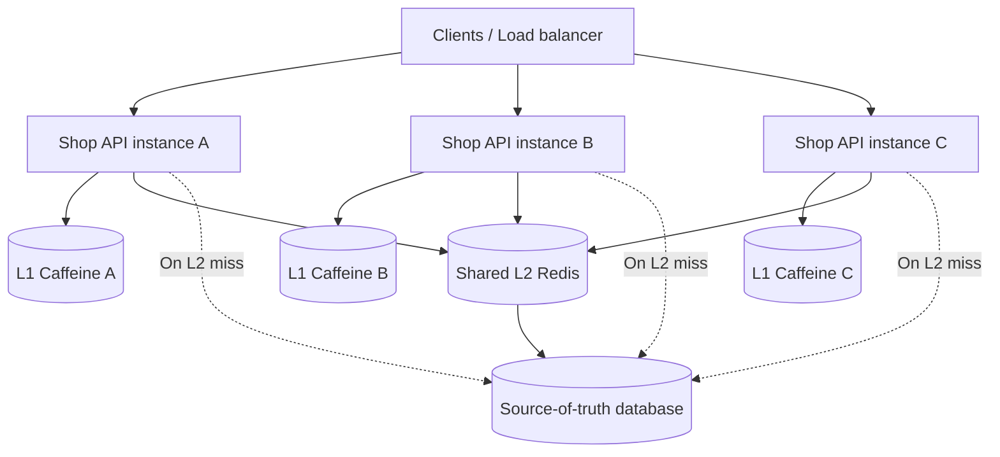
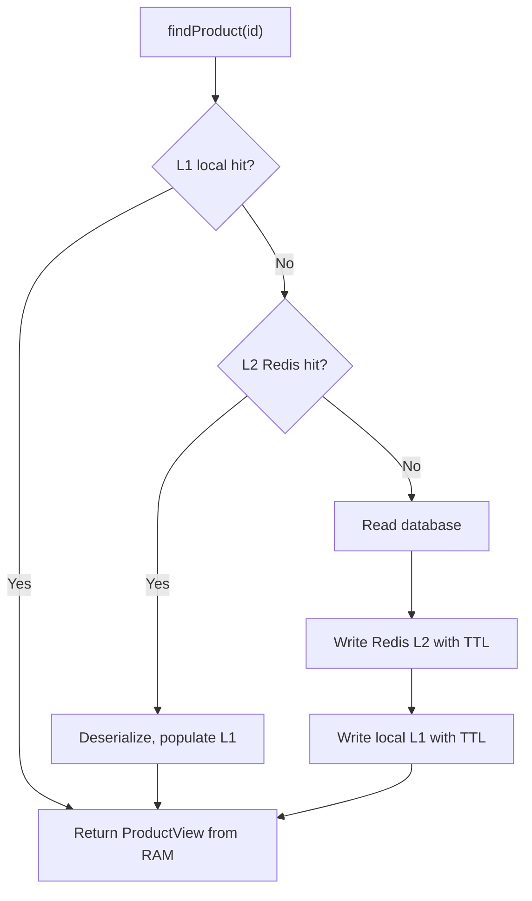
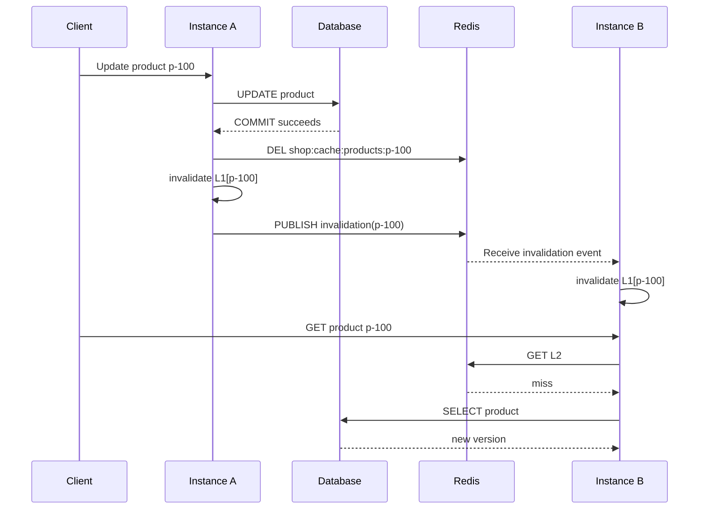

# Coordinating Local Caches with Redis and Invalidating Across Replicas

A Spring Boot application often runs multiple replicas (instances) behind a load balancer. Each instance has its own heap memory, while all instances share Redis and the business database. To lower read latency, you can combine an **L1 local cache** (such as Caffeine in the JVM) with a **shared L2 cache** (Redis via Spring Data Redis).

This architecture keeps most hot reads off the network, yet raises a critical question: **when one instance changes data, how do other instances learn that their L1 copies are stale?** A shared Redis cannot automatically evict objects sitting in each JVM's private memory. You must design an *invalidation* flow, recovery for missed events, and bounds on how long data can remain stale.

This lesson focuses on L1/L2 coordination strategies in Spring Data Redis, with a cache-aside implementation using Caffeine and Redis Pub/Sub, read/write race scenarios, and choosing the right consistency level.

## 1. Two-tier cache model

Consider a product-reading service running three instances:



Here:

| Tier | Location | Characteristics | When is data lost? |
| --- | --- | --- | --- |
| **L1 — local cache** | Each JVM's heap/memory | Very fast access, zero network hops; **each instance has independent contents** | When instance restarts, entry is evicted, or TTL expires |
| **L2 — Redis cache** | Shared Redis Server/Cluster | Instances read a shared cache store; incurs network RTT and serialization | When entry TTL expires, is deleted, evicted, or Redis loses data per config |
| **Data source** | Database or business service | Determines authoritative truth | Depends on source system transactions and durability |

L1 and L2 normally store only rebuildable data. Never treat local caches or Redis caches as the sole place holding order records, permissions, or balances requiring strict accuracy.

**Two key rules:** a hit in L1 does not imply Redis still holds that value; conversely, an updated Redis does not mean every JVM has dropped its stale L1 entry.

## 2. Cache-aside read flow: L1 → L2 → data source

The easiest pattern to control is **cache-aside** (lazy loading). When a request looks up a product by ID:

1. Read **L1** on the current instance. If present, return immediately.
2. On L1 miss, read **L2 Redis**. If present, decode, optionally populate L1, and return.
3. If L2 also misses, read the **database**.
4. Put the result into Redis with an L2 TTL, and put it into L1 with a shorter local TTL.
5. Return the result to the caller.



Example initial TTL choices for a product catalog:

| Tier | Illustrative TTL | Goal |
| --- | --- | --- |
| L1 Caffeine | 20 seconds | Leverage local access while bounding stale lifetime on missed events |
| L2 Redis | 5 minutes | Reduce database queries across instances |
| Database | No cache TTL | Store authoritative business records |

These are **illustrative parameters**, not a fixed formula. For rapidly changing data or strict freshness needs, L1 TTL may be only a few seconds. For nearly immutable data, TTL can be longer. Setting L1 TTL shorter than L2 is common to bound RAM staleness, yet **a short L1 TTL does not fix stale Redis data** if L2 invalidation failed.

### 2.1. Why store data as a DTO?

A `ProductView` used for caching should hold only fields actually needed by the read API—such as ID, name, price, and `version`. Never cache raw JPA entities attached to a persistence context or containing lazy proxies; serialization/deserialization and schema changes break easily.

An immutable DTO/record makes caching cleaner:

```java
package com.example.shop.cache;

public record ProductView(
        String id,
        String name,
        long priceCents,
        long version) {
}
```

`version` is a business version incremented whenever the product changes, not a TTL. It helps detect late invalidation events or stop older records from overwriting newer ones.

## 3. The problem when L1 and Redis exist without invalidation broadcast

Suppose both instances A and B have already read `product:p-100`:

```text
Time          Instance A           Redis              Instance B
---------     ----------           -----              ----------
T0            L1[p-100] = v1       p-100 = v1         L1[p-100] = v1
T1            Updates DB -> v2     p-100 = v1         L1[p-100] = v1
T2            Deletes Redis cache  p-100: missing     L1[p-100] = v1
T3            L1 A cleared         p-100: missing     Returns v1 from L1 B
T4            B's L1 TTL expires   Reads DB/L2 -> v2  B finally sees v2
```

Deleting a Redis key **only removes data in Redis**. Instance B continues serving the stale copy from local memory until its entry expires, gets evicted, or receives an invalidation signal.

Therefore, for instances to react promptly, after updating the source and deleting Redis cache, the application can broadcast an **invalidation event** so every instance drops its corresponding L1 entry.

## 4. Designing the write and invalidation flow

When the database is the source of truth for product data, a baseline workflow is:

1. Write changes to the database inside a business transaction.
2. Only after the database **commits successfully**, delete the matching cache entry in Redis.
3. Delete the L1 entry on the instance handling the request.
4. Emit an invalidation event containing cache name and key to other instances.
5. Each receiving instance removes the matching entry from its own L1.
6. The next request hits a miss and loads fresh data.



This diagram shows **coordination intent**, not an atomic transaction across the database, Redis, and JVM memories. A short window still exists between commit and instances receiving the event. If publishing fails, is missed, or an in-flight read runs concurrently, stale data can appear briefly.

**Never invalidate before database commit** and consider the job done. Another request can miss cache, read old uncommitted data, and repopulate the cache; if the transaction later rolls back, an invalidation event was also sent unnecessarily. With Spring transactions, `@TransactionalEventListener(phase = AFTER_COMMIT)` provides a basic post-commit hook.

## 5. Choosing an invalidation broadcast mechanism across instances

Three common options:

| Mechanism | How it works | Benefits | Limitations |
| --- | --- | --- | --- |
| **Redis Pub/Sub** | Publish `cache-key-invalidated` to a channel; all subscribed instances receive it | Easy to implement, low latency, fits best-effort caching | **Does not persist events**; offline/disconnected instances miss them |
| **Redis Streams / event log** | Write events to a stream; instances read from their own offset/cursor | Stores events for replay after reconnect | Must manage offsets, retention, duplicates, and fan-out |
| **Version/generation or source check** | Compare against latest version before serving/writing cache | Detects stale data even if events arrive out of order | Adds metadata/read overhead; needs a reliable version source |

Some Redis client libraries offer *client-side caching* backed by server-assisted invalidation (`CLIENT TRACKING`) where client and Redis server versions support it. However, **never assume Spring Data Redis + Caffeine enables that automatically**. When building a custom two-tier cache, implement the invalidation flow explicitly.

### 5.1. When does Redis Pub/Sub fit?

It fits when the cache is purely an accelerator, brief stale responses are acceptable, and TTL acts as a safety net.

Pub/Sub delivers messages only to **subscribers connected at publish time**. There is no durable queue or default replay. A successful `PUBLISH` does not prove **every instance received and cleared L1**; it only shows Redis accepted the publish and may report server-side subscriber count, not per-JVM processing acknowledgments.

### 5.2. Using Redis Streams when missed events must be recovered

Redis Streams persist events so consumers can resume reading from an ID/offset. However, for **broadcasting invalidations to all instances**, do not put every instance into **a single consumer group expecting every instance to see every event**: within one group, messages are distributed across consumers.

You can give each instance or broadcast receiver group its own cursor, or use a dedicated event distribution mechanism. You must manage retention, persistent offsets, deduplication, instance ID allocation, and consumer creation/cleanup during autoscaling. When an instance returns after events were already trimmed from the stream, a full sync or L1 flush is still needed.

If invalidation notices have business significance requiring guaranteed emission after commit, pairing a **database transactional outbox** with a worker forwarding events to a stream/broker is far more reliable than publishing Pub/Sub directly after commit.

## 6. Preparing Spring Boot, Caffeine, and Redis

This example uses Spring Boot 3.x with `StringRedisTemplate`, Caffeine, and Jackson JSON. `StringRedisTemplate` stores JSON strings in Redis so key conventions and serialization are easy to inspect.

```groovy
// build.gradle
dependencies {
    implementation 'org.springframework.boot:spring-boot-starter-data-redis'
    implementation 'com.github.ben-manes.caffeine:caffeine'
    implementation 'com.fasterxml.jackson.core:jackson-databind'
}
```

Sample Redis connection:

```yaml
# application.yml
spring:
  data:
    redis:
      host: localhost
      port: 6379
```

The example assumes an application database-access component already exists. To keep the lesson focused on caching strategy, it is represented by an interface:

```java
package com.example.shop.cache;

public interface ProductSource {
    // Load current DTO from the source database; throw if absent.
    ProductView loadRequired(String id);

    // Update source data; adapter implemented at persistence layer.
    void rename(String id, String newName);
}
```

The application must implement `ProductSource` using its repository/JDBC/JPA layer. Redis never replaces writing to this data source.

## 7. Two-tier read service example: L1 Caffeine + L2 Redis

```java
package com.example.shop.cache;

import com.fasterxml.jackson.core.JsonProcessingException;
import com.fasterxml.jackson.databind.ObjectMapper;
import com.github.benmanes.caffeine.cache.Cache;
import com.github.benmanes.caffeine.cache.Caffeine;
import java.time.Duration;
import org.springframework.data.redis.core.StringRedisTemplate;
import org.springframework.stereotype.Service;

@Service
public class ProductCacheService {

    public static final String INVALIDATION_CHANNEL =
            "shop:events:cache:products:invalidate";

    private static final Duration L1_TTL = Duration.ofSeconds(20);
    private static final Duration L2_TTL = Duration.ofMinutes(5);

    private final Cache<String, ProductView> local;
    private final StringRedisTemplate redis;
    private final ProductSource source;
    private final ObjectMapper json;

    public ProductCacheService(
            StringRedisTemplate redis,
            ProductSource source,
            ObjectMapper json) {
        this.redis = redis;
        this.source = source;
        this.json = json;
        this.local = Caffeine.newBuilder()
                .maximumSize(10_000)
                .expireAfterWrite(L1_TTL)
                .build();
    }

    public ProductView find(String id) {
        if (id == null || id.isBlank()) {
            throw new IllegalArgumentException("id must not be blank");
        }

        // L1: read local memory of current instance.
        ProductView inMemory = local.getIfPresent(id);
        if (inMemory != null) {
            return inMemory;
        }

        // L2: shared cache across instances.
        String cachedJson = redis.opsForValue().get(redisKey(id));
        if (cachedJson != null) {
            ProductView fromRedis = decode(cachedJson);
            local.put(id, fromRedis);
            return fromRedis;
        }

        // L2 miss: read true data source then populate caches.
        ProductView fromSource = source.loadRequired(id);
        redis.opsForValue().set(redisKey(id), encode(fromSource), L2_TTL);
        local.put(id, fromSource);
        return fromSource;
    }

    public void invalidateLocal(String id) {
        local.invalidate(id);
    }

    public void invalidateAllLocal() {
        local.invalidateAll();
    }

    // Call only after the source-update transaction has committed.
    public void invalidateAfterCommit(String id) {
        // Do not rely on the subscriber to clear this instance's own L1.
        local.invalidate(id);

        // Delete shared copy before notifying other instances' L1.
        redis.delete(redisKey(id));
        redis.convertAndSend(INVALIDATION_CHANNEL, id);
    }

    private static String redisKey(String id) {
        return "shop:cache:products:" + id;
    }

    private String encode(ProductView value) {
        try {
            return json.writeValueAsString(value);
        } catch (JsonProcessingException e) {
            throw new IllegalStateException("Cannot encode ProductView", e);
        }
    }

    private ProductView decode(String value) {
        try {
            return json.readValue(value, ProductView.class);
        } catch (JsonProcessingException e) {
            throw new IllegalStateException("Invalid cached ProductView JSON", e);
        }
    }
}
```

`find()` executes strictly in order L1 → L2 → database. Data reloads after misses; `invalidateAfterCommit` clears both the writer instance's L1 and shared L2 before broadcasting the notice.

**Intentional limitations of this example:**

- This is a **best-effort** cache-aside implementation without atomic snapshots under concurrent reads and writes. A request loading old data can still write it back after another request invalidated.
- Cache stampedes are not handled yet: multiple concurrent requests missing the same ID can call `ProductSource.loadRequired` together. In-JVM single-flight can be added, though it does not coordinate across instances.
- `StringRedisTemplate` and `ObjectMapper` must share compatible formats/versions across all instances; when changing DTO schemas, establish payload versioning or migration rules.
- The code assumes Redis is reachable. When Redis goes down, `find` and `invalidateAfterCommit` can throw; fallback policies to the database and invalidation error reporting must be designed for real applications.
- `invalidateAfterCommit` is not a transaction spanning database, Redis, and Pub/Sub. If Redis delete succeeds yet publish fails, other instances can retain stale L1 entries until TTL expires or reconciliation runs.

## 8. Subscribing to invalidations with `RedisMessageListenerContainer`

Each Spring Boot instance registers a `RedisMessageListenerContainer` listening on the same channel. When instance A publishes a product ID, all subscribed instances receive the message and evict that ID from their L1.

```java
package com.example.shop.cache;

import java.nio.charset.StandardCharsets;
import org.springframework.context.annotation.Bean;
import org.springframework.context.annotation.Configuration;
import org.springframework.data.redis.connection.RedisConnectionFactory;
import org.springframework.data.redis.listener.ChannelTopic;
import org.springframework.data.redis.listener.RedisMessageListenerContainer;

@Configuration
public class ProductInvalidationConfiguration {

    @Bean
    public RedisMessageListenerContainer productInvalidationContainer(
            RedisConnectionFactory connectionFactory,
            ProductCacheService cacheService) {

        RedisMessageListenerContainer container =
                new RedisMessageListenerContainer();
        container.setConnectionFactory(connectionFactory);

        container.addMessageListener((message, pattern) -> {
            String productId = new String(
                    message.getBody(), StandardCharsets.UTF_8);
            cacheService.invalidateLocal(productId);
        }, new ChannelTopic(ProductCacheService.INVALIDATION_CHANNEL));

        return container;
    }
}
```

`RedisMessageListenerContainer` manages subscriptions and dispatches messages to the callback. Caffeine's `Cache.invalidate(id)` is thread-safe when invoked from listener threads in the JVM. When the publishing instance receives its own ID back, invalidating L1 again is idempotent.

**Startup and reconnect note:** instances receive only events published **after their subscription is active**. When Redis reconnects, the container re-establishes the subscription, yet events published while disconnected **are not automatically replayed**. To avoid keeping stale local caches after a prolonged disconnect, clear all of L1 upon confirming reconnection or use a separate reconciliation/replay path; never treat subscription recovery as proof data is synchronized.

In this example, the payload carries only the ID for clarity. In larger systems, events should include namespace, cache name, ID, version/generation, and event ID to distinguish tenants, services, and duplicates.

## 9. Invalidate only after source data commits

When updating via Spring transactions, publish a **domain event** inside the transaction and listen at `AFTER_COMMIT`:

```java
package com.example.shop.cache;

public record ProductChanged(String productId) {
}
```

```java
package com.example.shop.cache;

import org.springframework.context.ApplicationEventPublisher;
import org.springframework.stereotype.Service;
import org.springframework.transaction.annotation.Transactional;

@Service
public class ProductCommandService {

    private final ProductSource source;
    private final ApplicationEventPublisher events;

    public ProductCommandService(
            ProductSource source,
            ApplicationEventPublisher events) {
        this.source = source;
        this.events = events;
    }

    @Transactional
    public void renameProduct(String id, String newName) {
        source.rename(id, newName);
        events.publishEvent(new ProductChanged(id));
    }
}
```

```java
package com.example.shop.cache;

import org.springframework.stereotype.Component;
import org.springframework.transaction.event.TransactionPhase;
import org.springframework.transaction.event.TransactionalEventListener;

@Component
public class ProductChangedHandler {

    private final ProductCacheService cache;

    public ProductChangedHandler(ProductCacheService cache) {
        this.cache = cache;
    }

    @TransactionalEventListener(phase = TransactionPhase.AFTER_COMMIT)
    public void afterCommit(ProductChanged event) {
        cache.invalidateAfterCommit(event.productId());
    }
}
```

This assumes a **transaction manager** exists for the source database and `ProductSource.rename` executes within that transaction. Without an active Spring transaction, `@TransactionalEventListener` by default will not invoke `AFTER_COMMIT`; verify your application's transaction boundaries carefully.

Why emit after commit? If the database update fails or rolls back, there is no new version to invalidate. If emitted before commit, another request can reload the old value from the database and re-cache it.

However, `AFTER_COMMIT` does not guarantee durable Redis event emission:

- The database commits **before** the handler calls Redis. If the JVM dies or Redis fails right then, invalidation may not occur.
- If `redis.delete` succeeds yet `convertAndSend` fails, L2 is empty while other instances still hold stale L1 entries.
- A post-commit exception cannot "roll back" the completed database transaction. Logging/monitoring and controlled retry policies are needed, without returning misleading status to clients implying source data was not updated.

When data requires reliable invalidation, record an **outbox event in the same database transaction**, then have a worker publish/retry and mark delivery complete. Pub/Sub still risks missed subscribers; full recovery requires durable event logs, version checks, or flushing L1 after reconnect.

## 10. Race condition: invalidation ran, yet stale data gets cached again

Even when every instance receives the event, an **in-flight request** can repopulate stale data after invalidation.

Example:

```text
T0  Instance B: L1 miss, L2 miss; starts SELECT product version 7
T1  Instance A: UPDATE product -> version 8, COMMIT
T2  Instance A: DEL Redis cache, publish INVALIDATE(product)
T3  Instance B: receives INVALIDATE, clears L1 (currently empty)
T4  Instance B: SELECT from T0 returns version 7
T5  Instance B: SET Redis = version 7, PUT L1 = version 7
T6  New request sees stale data again despite invalidation
```

This is **stale repopulation**. Changing `PUBLISH` alone or shortening TTL cannot eliminate this race completely.

### 10.1. Approaches to reduce or block stale repopulation

**Monotonically increasing versions:** store `version` in the DTO and increment on every business update. When writing back to cache, prevent older versions from overwriting newer ones using an **atomic compare-and-set** in Redis (e.g., a Lua script checking version before `SET`). Checking via separate `GET` then `SET` commands still has a race; an atomic boundary is required.

**Generation/epoch keys:** maintain a generation per group or ID, incremented when data changes. Readers include generation in the cache key (`products:p-100:g42`) or validate generation at load start and completion. If generation changed, do not write the result into the active namespace used by current readers. When using generations, align generation update timing with database commits.

**Guarding L1 fills:** if an instance receives invalidation while a request is loading data, that request must not blindly insert old-generation data into L1 after the event. Use a local token/generation with synchronized check-and-write per key; merely checking a token once before `local.put` without synchronizing the write point still leaves a race window.

**Source-versioned read-through:** when a reliable version exists and strict freshness is needed, readers compare cached version against the source before returning. This adds a round-trip and diminishes caching gains.

**Short TTLs and periodic refreshes:** does not eliminate the race, yet bounds how long bad data lingers in best-effort systems, provided L2 is also cleaned or verified properly.

No simple "Pub/Sub + `local.invalidate(id)`" design guarantees linearizable reads after updates across all instances when the database, Redis, and local heap are three independent systems.

## 11. Late, duplicate, or out-of-order events

Suppose a product updates from version 10 to 11 then 12, yet the version 11 event arrives after version 12 due to network delays or multiple publishers.

If events carry only IDs, L1 deletion is always idempotent, and deleting twice merely causes an extra cache miss. However, if events carry **payloads to update caches directly**, out-of-order handling can overwrite version 12 backward with version 11.

Therefore:

- For **invalidation-only**, consumers should delete by ID and tolerate duplicate events.
- For **update-in-place**, consumers must compare `version`/`generation` and accept only newer versions. Never use JVM clock timestamps for absolute ordering if clocks can drift.
- Include an event ID for retries/deduplication when using streams or at-least-once brokers.
- For multi-tenant caches, keys and events must include tenant or namespace; never broadcast raw IDs that accidentally affect different tenants.

Example JSON payload with explicit semantics:

```json
{
  "eventId": "evt-9f3b",
  "cache": "products",
  "tenant": "shop-a",
  "id": "p-100",
  "version": 12,
  "operation": "INVALIDATE"
}
```

The earlier Pub/Sub code sent only the ID; adopting the schema above requires updating serializer, publisher, and listener to encode/decode JSON and verify namespaces.

## 12. Cache stampedes: many requests missing simultaneously

After an invalidation, many requests across instances can query the database concurrently:

```text
            DEL Redis p-100
                 |
     +-----------+-----------+
     |           |           |
Instance A   Instance B   Instance C
L1 miss      L1 miss      L1 miss
L2 miss      L2 miss      L2 miss
DB SELECT    DB SELECT    DB SELECT
```

Mitigations:

1. **In-JVM single-flight:** coalesce concurrent loads for the same key via Caffeine's `Cache.get(key, mappingFunction)` or a `CompletableFuture` map. Solves within a single instance only.
2. **Distributed loading coordination:** one instance loads while others wait with a timeout; needs lock tokens, TTLs, error handling, and fallbacks. Do not mistake a simple lock for a cure-all against stale data.
3. **TTL jitter:** add random variance so entries do not expire in synchronized waves.
4. **Controlled prewarming or proactive refresh:** for hot keys, reload cleanly after updates or before TTL expires.
5. **Rate limiting/fallbacks:** protect the database if Redis fails or all caches miss simultaneously.

When adopting single-flight, separate **load synchronization** from **invalidation consistency**. A coalesced load can still load an old version if it started before an update transaction committed.

## 13. Why `CompositeCacheManager` does not automatically create a two-tier cache

Spring Cache provides `CompositeCacheManager`, which tries multiple `CacheManager` instances in sequence. People often mistake this for "on L1 miss, query L2 and populate L1".

In reality, `CompositeCacheManager` primarily picks a `Cache` **by cache name** from the first manager that provides that name. Once a cache is chosen, Spring does not automatically orchestrate an L1-then-L2 read algorithm per entry.

For example:

```java
new CompositeCacheManager(caffeineCacheManager, redisCacheManager);
```

If the Caffeine manager returns a cache named `products`, cache calls for `products` go to that Caffeine cache; there is no guarantee that a miss in Caffeine automatically falls through to Redis.

Likewise, `@Cacheable(cacheNames = {"localProducts", "redisProducts"})` does not replace cross-instance invalidation, write ordering, and miss coordination under an explicit two-tier contract.

If you want to keep using Spring Cache annotations directly, you can implement **a custom `Cache` coordinating L1/L2** and expose it through a custom `CacheManager`. That implementation must conform to the full `Cache` contract across `get`, `put`, `putIfAbsent`, `evict`, `clear`, `get(key, Callable)`, TTLs, serialization, and invalidation events. For simpler setups, an explicit cache-aside service like the example above is easier to understand and control.

`@Cacheable(sync = true)` asks the provider to synchronize value computation on misses, yet never infer that it creates cluster-wide single-flight across instances or automatically invalidates other JVMs' local caches.

## 14. Can Redis Keyspace Notifications replace business events?

Redis can emit events like `del` or `expired` via **keyspace notifications** when enabled on the server. However:

- Keyspace notifications use Pub/Sub and provide no durable history for replay.
- Subscribers miss events while disconnected.
- A database update that failed to delete Redis emits no Redis key-deletion event.
- Redis-level events carry only keys and command types—no `version` and no business meaning like "product price changed".
- Notifications are not enabled by default; depending on managed Redis environments, `CONFIG` permissions for `notify-keyspace-events` may be restricted.

Hence, when the source of truth is a database, **application-emitted post-commit invalidation events** are usually much clearer. Keyspace notifications suit specialized cases, not reliable business change events.

## 15. Handling restarts, reconnects, and Redis loss

### 15.1. Instance restart

L1 wipes cleanly on restart because it resides in JVM RAM. On startup, instances miss L1 and reload from L2 or the database. This is helpful: new instances never carry stale heap entries from a previous run.

### 15.2. Listener disconnects and reconnects

While a subscriber misses Pub/Sub messages, invalidations can be lost. Upon reconnecting, the instance can still hold stale entries if the JVM never restarted. Options:

- **Invalidate all of L1** when connection monitoring detects a subscription interruption, then reload cleanly.
- Use **short L1 TTLs** to cap data age in RAM.
- Compare **generation/version** with Redis or the data source on freshness-critical paths.
- Switch to a durable event log when exact recovery of missed changes is required.

Never rely solely on a "subscription reconnected" message; it does not tell you which keys changed during the outage.

### 15.3. Redis unavailable

Define **fail-open vs. fail-closed** rules explicitly:

| Scenario | Strategy to consider |
| --- | --- |
| Catalog pages insensitive to brief staleness | Allow database fallback on Redis errors; bound load |
| Price/inventory data needing exact decisions | Bypass untrusted caches, read true source, or reject if source is unreachable |
| Cannot delete L2 after DB commit | Log failed invalidation and retry via queue/outbox; L2 TTL acts as fallback |
| Cannot publish event after commit | Treat other L1s as potentially stale; trigger version/reconciliation checks if present |

The sample Java service above **does not yet implement fallback branches**. Fallbacks must align with SLAs and data rules—especially avoiding DB query storms if thousands of requests hit Redis errors simultaneously.

## 16. TTL, eviction, and local memory

Caffeine needs not just TTLs, but **entry/memory limits**. An instance configured with `maximumSize(10_000)` holds up to roughly that entry count, though actual heap footprint varies with object sizes and overhead. In large apps, monitor memory pressure and consider weight-based eviction when value sizes vary widely.

Additional considerations:

- `expireAfterWrite`: entries expire a fixed time after insertion into L1; frequent reads **do not extend** this TTL.
- `expireAfterAccess`: expiration resets on each access; hot data stays longer, so avoid using it alone when freshness must be bounded from write time.
- `refreshAfterWrite`: can serve stale data during async refresh depending on usage; consider versions and races when the source updates.
- Redis `SET` with expiration lets L2 drop entries automatically by TTL. Invalidation is still needed for updates sooner than TTL expiration.
- If Redis L2 still holds stale data due to a missed deletion, L1 expiring simply causes L1 to reload **the same stale data from Redis**.

Therefore, **L1 TTL = 20 seconds does not mean data can never be older than 20 seconds**. That holds only if L2/the source is already updated or version verification is in place.

## 17. Choosing invalidation scope: single key, key group, or whole cache

| Scope | Example | Pros | Cons |
| --- | --- | --- | --- |
| **By ID** | `products:p-100` | Minimal misses and minimal Redis/DB load | Must know exact affected keys |
| **By group** | All products in a category | Useful when one update affects many queries | Requires reverse index from category to cache keys |
| **By cache name** | `products:*` | Simple for bulk changes or schema migrations | Causes widespread misses; bulk Redis deletes can be heavy |
| **By generation** | Increment `products:generation` | Avoids deleting millions of keys at once | Old keys occupy Redis until TTL/cleanup; needs synced generation reads |

For search results, alongside `products:p-100` there may be `products:search:...`, `category:...`, or summary caches. Deleting only the ID cache is **insufficient** when search lists still display old items. Design dependency maps, group invalidation, short TTLs, or generations accordingly.

**Never run `KEYS products:*` casually on a large Redis instance to wipe a cache mid-request**. If prefix scanning/deletion is needed, use batched `SCAN` in background jobs with load limits. Even then, `SCAN` does not provide a snapshot atomic with concurrent writers; generation/version keys are usually cleaner for controlled namespace switches.

## 18. Key conventions, serialization, and data partitioning

Establish consistent conventions across all instances:

```text
<environment>:<service>:cache:<cache-name>:<tenant>:<id>

prod:shop:cache:products:tenant-a:p-100
prod:shop:cache:products:tenant-b:p-100
```

Invalidation events must carry that same namespace:

```text
channel = prod:shop:events:cache:products:invalidate
payload = { tenant: "tenant-a", id: "p-100", version: 12 }
```

Never merge keys across tenants just because IDs collide. When running multiple app versions side-by-side with different cache schemas, version the format or namespace—e.g., `shop:v2:cache:products:...`—to avoid deserialization failures. Instances sharing Redis L2 must align on serializers, prefixes, TTL policies, and invalidation rules.

Do not place sensitive data into channels or payloads just because Redis Pub/Sub is internal; pub/sub permissions and log/monitoring access must follow system security policies.

## 19. Observing effectiveness and consistency

A two-tier model must measure both performance and invalidation health:

| Metric | What to know |
| --- | --- |
| `cache_l1_hits`, `cache_l1_misses` | How many requests are served directly inside the JVM? |
| `cache_l2_hits`, `cache_l2_misses` | How many database queries does Redis save? |
| `cache_source_loads` | Actual database calls when both tiers miss |
| `cache_invalidations_published` | How many invalidation events were attempted? |
| `cache_invalidations_received` | How many notices did each instance receive? |
| `cache_invalidation_failures` | Failures during Redis deletion or publish |
| `cache_l1_evictions` | Entries evicted by TTL or size cap |
| `cache_stale_version_detected` | How often was a cache version lower than the source detected? |
| `redis_command_latency` | Redis latency and request impact |
| `cache_reconnect_flushes` | How often L1 had to be flushed after subscription breaks |

Never judge system health by hit rate alone. A sky-high L1 hit rate can hide high stale-read rates if invalidation is broken. When the DB has versions, sample a tiny percentage of requests to compare cached versions against the source and estimate real staleness.

Track **elapsed time from database commit until instances drop L1** if strict freshness SLAs exist. Redis Pub/Sub gives no per-instance processing acks; exact measurement requires subscriber instrumentation or an explicit protocol.

## 20. Choosing a strategy by business requirements

| Requirement level | Architectural suggestion |
| --- | --- |
| Rarely changing data, tens of seconds stale okay | Short-TTL Caffeine L1 + longer-TTL Redis L2; Pub/Sub invalidation for faster updates |
| Frequently changing data, multiple instances | ID-based invalidation, monitor event lag, version checks, guard against stale repopulation |
| Missed events are unacceptable | Replayable event log/Streams, dedicated offsets per receiver group, flush/reconcile on reconnect |
| Multiple caches depend on one object | Dependency mapping or group generations for complete invalidation |
| Absolute real-time accuracy at decision points | Read/write through authoritative source with transaction/version guarantees; never treat L1/L2 as source of truth |
| High traffic with stampede risk | Local single-flight, bounded load coordination, TTL jitter, and source rate controls |

A pragmatic rollout starts with cache-aside, short L1, shared L2, ID-based invalidation, and clear metrics. When missed events or stale reads breach limits, add version checks and durable/replayable events rather than blindly lengthening cache lifetimes.

## 21. Practice scenarios

### Scenario A: Updating a product when all three instances hold it in L1

```text
1. A updates p-100 in database, commits version 12.
2. A deletes Redis cache for p-100 and A's L1.
3. A publishes invalidate p-100 event.
4. B and C receive the event and clear their respective L1s.
5. Requests to B/C miss and load version 12 from Redis or database.
```

If B and C are subscribed and no stale in-flight load races, the fresh version appears once reloaded. This is the intended behavior of a best-effort architecture.

### Scenario B: Instance C loses its Pub/Sub connection

```text
1. C holds L1[p-100] = version 11.
2. C loses Redis subscription yet keeps serving requests from L1.
3. A updates to version 12, deletes L2, and publishes Pub/Sub.
4. B receives the event; C misses it.
5. C keeps returning version 11 until L1 TTL expires or L1 is flushed.
```

When C reconnects, Pub/Sub does not replay the missed event. Unless C's L1 TTL has expired, you need a policy to flush L1 on reconnect or compare generations. Once C reloads from L2, if Redis deletion succeeded it fetches version 12; if L2 deletion also failed, L1 TTL alone cannot guarantee freshness.

### Scenario C: Concurrent loads during an update

```text
1. B starts reading version 11 from database.
2. A commits version 12 and invalidates.
3. B finishes reading version 11 and writes it back into Redis/L1.
4. A subsequent request sees version 11.
```

To prevent this in high-reliability systems, combine monotonic versions, generation checks at cache fill time, and conditional atomic Redis updates. Pub/Sub is merely an invalidation nudge, not a lock blocking read requests.

### Scenario D: Redis goes down during thousands of cache misses

If every instance falls back straight to the database unbounded, DB load can spike catastrophically. Apply rate limits, short timeouts, circuit breakers, single-flight, and explicit error or allowed-stale policies. Never assume "on Redis error, just hit DB" is safe under heavy load.

## 22. Takeaways

Combining **Caffeine L1** and **Redis L2** reduces network hops and shares caches across multiple Spring Boot instances. The standard read path is **L1 → Redis → database**; the standard write path is **database commit → delete Redis L2 → invalidate L1 across instances**.

Redis Pub/Sub is convenient for early invalidation signals yet **is non-durable and provides no replay**. A disconnected instance can still serve stale data from RAM. Short L1 TTLs and reconnect flushes limit exposure, while versions/generations and durable event logs suit stricter consistency needs.

Crucially, an emitted invalidation can still be **overwritten with stale data** by an in-flight load. Protect critical paths against stale repopulation and keep the database as the source of truth. Finally, `CompositeCacheManager` does not automatically turn two cache managers into a per-key L1/L2 hierarchy; explicit coordination logic or a custom `Cache` implementation is required.

### References

- [Spring Data Redis — Redis Pub/Sub](https://docs.spring.io/spring-data/redis/reference/redis/pubsub.html): `RedisMessageListenerContainer` and publish/subscribe mechanics.
- [Spring Data Redis — Redis Cache](https://docs.spring.io/spring-data/redis/reference/redis/redis-cache.html): `RedisCacheManager`, TTLs, and cache operations.
- [Spring Framework — Cache Abstraction](https://docs.spring.io/spring-framework/reference/integration/cache.html): `CacheManager`, `@Cacheable`, and cache contracts.
- [Caffeine — Wiki](https://github.com/ben-manes/caffeine/wiki): eviction policies, TTLs, and in-JVM cache synchronization.
- [Redis — Pub/Sub](https://redis.io/docs/latest/develop/pubsub/): message delivery semantics, at-most-once nature, and offline client limits.
- [Redis — Streams](https://redis.io/docs/latest/develop/data-types/streams/): event persistence, consumer groups, offsets, and replay.
- [Redis — Client-side caching](https://redis.io/docs/latest/develop/reference/client-side-caching/): server-assisted invalidation for tracking-capable clients.
