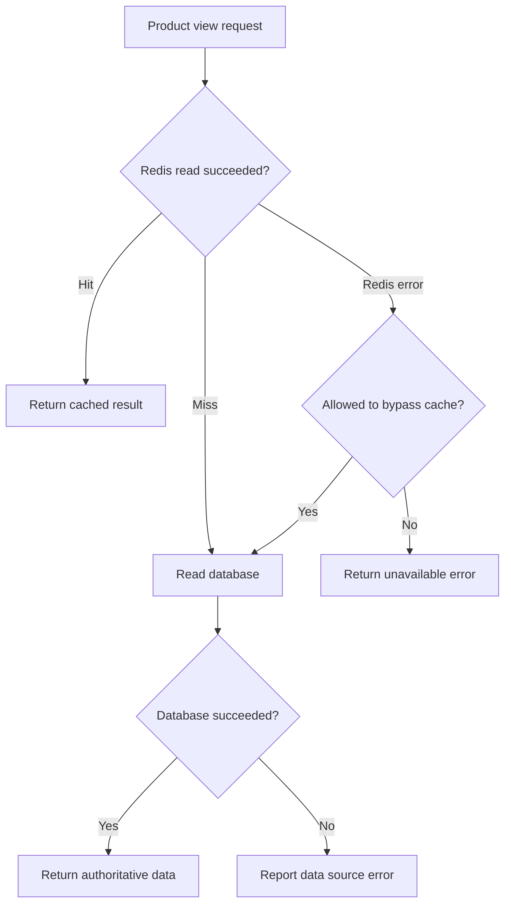
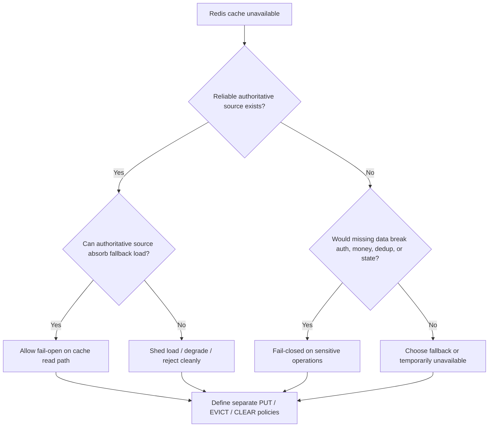

# Choosing Fail-Open vs. Fail-Closed by Business Impact in Spring Data Redis

## 1. When Redis Cache fails, what should the application do?

A Spring Boot application using Redis to offload a database typically has this read flow:

```text
HTTP request
    |
    v
Service (@Cacheable)
    |
    +--> Redis cache hit  --> Return result
    |
    +--> Redis cache miss --> Read primary data source
                              |
                              +--> Store result in Redis
                              |
                              +--> Return result
```

When Redis is healthy, those two paths are straightforward. Yet when Redis **disconnects, times out, rejects commands, or exhausts resources**, you must decide whether the business operation should proceed.

There are two fundamental strategies:

- **Fail-open:** when the cache layer fails, the application ignores the cache error within defined bounds and takes a reliable fallback business path—such as reading product data straight from the primary database.
- **Fail-closed:** if a mandatory condition cannot be verified via a trustworthy source, the application rejects or pauses the operation instead of guessing that it is allowed.

In caching systems, **fail-open does not mean "open all access permissions"**. It means a failure of the **cache accelerator** does not block an operation that the application can still complete safely via the authoritative data source. Conversely, fail-closed does not have to bring down the whole application; only operations lacking safety preconditions should be rejected.

The decision hinges on **the business impact of missing data, stale data, or failed cache operations**. Never apply a single policy across every cache in the system.

## 2. Distinguishing cache errors from cache misses

Redis returns a *cache miss* when no valid key is found—because the key doesn't exist or its TTL expired. That is normal operation.

A cache error is when a Redis access operation fails due to a technical fault:

```text
Cache miss:
  GET product:1001 -> no value
  Application loads data from primary source

Cache error:
  GET product:1001 -> timeout / connection refused / Redis error
  Application must decide fail-open or fail-closed
```

A standard `@Cacheable` handles cache misses by executing the source method and optionally storing the result. When an exception occurs during a cache operation, behavior depends on Spring Cache's error handling.

By default, Spring Cache uses `SimpleCacheErrorHandler`, which normally **rethrows exceptions** from `get`, `put`, `evict`, and `clear`. That can propagate Redis errors straight up the HTTP request thread even while the primary database is healthy.

You can customize behavior with `CacheErrorHandler` to decide which operations may bypass cache errors and which must raise errors.

### Three cases to distinguish

| State | Cache outcome | Typically desired action |
|---|---|---|
| Hit | Valid matching data present | Use cached data per consistency policy |
| Miss | No entry present | Run primary source reader, optionally populate cache |
| Error | Cannot read/write/delete entry due to technical fault | Apply fail-open or fail-closed policy per business impact |

An ignored Redis error on the **read path** can be treated almost like a cache miss: the primary source serves the request. By contrast, an ignored Redis error on the **delete path** can leave stale data behind, creating a completely different risk.

## 3. Choosing policy by data semantics

Do not ask "Is Redis important?" in the abstract. Instead ask:

1. Does Redis store a **rebuildable copy** or **unique state** needed for business decisions?
2. If the cache cannot be read, is there a trustworthy primary source to query?
3. If cache deletion fails, what harm results from users seeing **stale data**?
4. If cache is bypassed, can the primary source handle the resulting traffic spike?
5. If permission, quota, or deduplication data is unavailable, can the app proceed safely?
6. Are there re-verification, retry, invalidation, or state-recovery mechanisms once Redis returns?

Examples:

| Data kind | On Redis read error | Usually suitable policy | Critical condition |
|---|---|---|---|
| Display-only product catalog | Read directly from authoritative database/API | Fail-open | Authoritative source healthy and load-protected |
| Avatars, content recommendations | Use defaults or omit optional section | Fail-open | Missing recommendations cause no business harm |
| Lag-tolerant dashboard metrics | Read primary source or show temporary state | Depends on criticality | Label data when it may be stale |
| Final checkout price | Re-verify price from authoritative source | Fail-open on cache; fail-closed if price cannot be verified | Never finalize payment using unverified cached prices |
| Permissions or locked account state | Verify against authoritative auth source | Fail-closed if unverifiable | Never default to allow when cache fails |
| Rate-limit counters for sensitive actions | Pause or switch to fallback limiter | Usually fail-closed | Depends on threat model and rejection cost |
| Payment idempotency locks | Do not proceed without idempotency guarantee | Fail-closed or switch to durable store with unique constraint | Redis locks/counters do not replace durable transaction state |
| Temporary cart with recoverable backing | Read source state if available | Architecture-dependent | Never lose unsaved user changes |
| Display-only shipping status cache | Query origin API or temporarily show unavailable | Bounded fail-open | Never turn display placeholders into final business decisions |

This is a **classification guide**, not rigid law. Two caches both called "product cache"—one for catalog browsing and one for checkout pricing—have vastly different requirements.

## 4. Identify the source of truth before choosing fail-open

Suppose a relational database is the source of truth for product details:



Fail-open makes sense when:

- Redis is solely a speed-enhancing copy.
- The cached method has **no side effects**, such as catalog reads.
- Querying the authoritative source is reliable enough to supply correct results.
- Load limits prevent overwhelming the database when every request bypasses Redis.

If the application has no other source because Redis is **the sole store** for sessions or processing state, swallowing Redis errors cannot manufacture trustworthy data. Then "fail-open" breaks correctness, and affected operations must fail-closed or use a designed backup store.

### Separating two decision layers

Many systems need **fail-open at the cache** yet **fail-closed at business logic**.

Checkout API example:

```text
Redis price cache fails
    -> Bypass cache, read latest price from authoritative source (fail-open on cache).
    -> If authoritative source returns a valid price, proceed.
    -> If final price cannot be verified, stop checkout (fail-closed on business logic).
```

Thus, the two policies do not contradict each other across an end-to-end flow; each layer applies its own criteria.

## 5. Where does Spring Cache handle errors?

With Spring Data Redis, the Spring Cache abstraction connects to Redis through these components:

```text
@Cacheable / @CachePut / @CacheEvict
           |
           v
Spring Cache interceptor
           |
           v
CacheManager (e.g. RedisCacheManager)
           |
           v
Cache (e.g. RedisCache)
           |
           v
RedisCacheWriter
           |
           v
RedisConnectionFactory / Redis driver
           |
           v
Redis
```

Spring Framework defines `CacheErrorHandler` so applications handle errors thrown during cache operations executed by the interceptor:

```java
void handleCacheGetError(
        RuntimeException exception,
        Cache cache,
        Object key
);

void handleCachePutError(
        RuntimeException exception,
        Cache cache,
        Object key,
        Object value
);

void handleCacheEvictError(
        RuntimeException exception,
        Cache cache,
        Object key
);

void handleCacheClearError(
        RuntimeException exception,
        Cache cache
);
```

These four callbacks matter because fail-open should not behave identically across every operation type.

| Callback | Where the error happened | What happens if the error is ignored? |
|---|---|---|
| `handleCacheGetError` | Reading entry | Cache treated as absent; source method executes |
| `handleCachePutError` | Writing entry after computation or `@CachePut` | Business result can still return, though uncached |
| `handleCacheEvictError` | Deleting one entry | Old entry may persist, causing stale reads |
| `handleCacheClearError` | Clearing whole cache | Many old entries may persist; unknown partial clear if mid-failure |

The **default behavior** of `SimpleCacheErrorHandler` rethrows exceptions. To fail-open selectively, define a custom handler and suppress only errors permitted by business rules.

`CacheErrorHandler` applies primarily to cache operations routed through the **Spring Cache abstraction**. Errors from direct `RedisTemplate` calls, bean initialization, cache key generation, serialization outside callback boundaries, or specialized APIs follow separate paths. Never treat this handler as a global shield for every Redis interaction.

## 6. Configuring `CacheErrorHandler` by cache name and operation type

Consider two cache regions with distinct roles:

- `productView`: display-only product data, reloadable from the database. On cache read/write errors, allow **fail-open**.
- `accessDecision`: authorization decision data. On cache errors, obey security rules and **never allow silently**. The example below lets the exception propagate so the service or API returns an appropriate error.

**Eviction and clearing** are handled conservatively: the handler propagates errors because ignoring failed invalidation lets users keep receiving old data after the primary source changed.

### 6.1. Implementing the handler

**File: `PolicyAwareCacheErrorHandler.java`**

```java
package com.example.cache;

import org.slf4j.Logger;
import org.slf4j.LoggerFactory;
import org.springframework.cache.Cache;
import org.springframework.cache.interceptor.CacheErrorHandler;

public final class PolicyAwareCacheErrorHandler
        implements CacheErrorHandler {

    private static final Logger log =
            LoggerFactory.getLogger(PolicyAwareCacheErrorHandler.class);

    private boolean isOptionalReadCache(Cache cache) {
        return "productView".equals(cache.getName());
    }

    @Override
    public void handleCacheGetError(
            RuntimeException exception,
            Cache cache,
            Object key
    ) {
        if (isOptionalReadCache(cache)) {
            log.warn(
                    "Cache read unavailable; bypassing cache={}",
                    cache.getName(),
                    exception
            );
            return; // Spring Cache can execute the source method.
        }

        throw exception; // Never suppress errors on sensitive caches.
    }

    @Override
    public void handleCachePutError(
            RuntimeException exception,
            Cache cache,
            Object key,
            Object value
    ) {
        if (isOptionalReadCache(cache)) {
            log.warn(
                    "Cache write failed; response remains uncached, cache={}",
                    cache.getName(),
                    exception
            );
            return; // Computed business result can still be returned.
        }

        throw exception;
    }

    @Override
    public void handleCacheEvictError(
            RuntimeException exception,
            Cache cache,
            Object key
    ) {
        log.error(
                "Cache invalidation failed for cache={}",
                cache.getName(),
                exception
        );
        throw exception;
    }

    @Override
    public void handleCacheClearError(
            RuntimeException exception,
            Cache cache
    ) {
        log.error(
                "Cache clear failed for cache={}",
                cache.getName(),
                exception
        );
        throw exception;
    }
}
```

This handler **deliberately refuses to swallow evict/clear errors**, even for `productView`. Why: a failed read falls back to fresh source data, whereas a failed deletion leaves an old value behind so subsequent requests serve stale data.

Still, rethrowing evict errors **does not mean the prior business change was rolled back**. Section 10 explains why.

### 6.2. Registering with Spring Cache

**File: `CacheFailurePolicyConfig.java`**

```java
package com.example.cache;

import org.springframework.cache.annotation.CachingConfigurer;
import org.springframework.cache.annotation.EnableCaching;
import org.springframework.cache.interceptor.CacheErrorHandler;
import org.springframework.context.annotation.Configuration;

@Configuration
@EnableCaching
public class CacheFailurePolicyConfig implements CachingConfigurer {

    @Override
    public CacheErrorHandler errorHandler() {
        return new PolicyAwareCacheErrorHandler();
    }
}
```

`CachingConfigurer#errorHandler()` supplies the handler used by Spring's cache annotation infrastructure. If the project already has a `CachingConfigurer`, merge settings there to prevent conflicting configuration sources.

In Spring Boot with `spring-boot-starter-cache` and `spring-boot-starter-data-redis`, ensure the app uses the intended `CacheManager` and Redis-backed cache regions. `CacheErrorHandler` is a general Spring Cache mechanism; even though this example uses Redis, it also receives errors from any other cache types managed by the same interceptor. Classify by cache name, operation type, or explicit configuration rather than assuming every `Cache` is Redis.

**Note:** Returning from a custom callback to suppress an exception is a policy choice. Not every exception should be swallowed: serializer bugs, schema mismatches, broken key generators, or corrupted entries are programming/data faults that should surface early. Production handlers should narrow suppression to permitted causes; this example focuses on business-driven fail-open/fail-closed routing.

## 7. Safe fail-open example with `@Cacheable`

Suppose there is a gateway reading products from the database:

```java
package com.example.catalog;

public interface ProductGateway {
    ProductView loadBySku(String sku);
}
```

Data type:

```java
package com.example.catalog;

public record ProductView(
        String sku,
        String name,
        long priceInCents
) {
}
```

Service:

**`ProductQueryService.java`**

```java
package com.example.catalog;

import org.springframework.cache.annotation.Cacheable;
import org.springframework.stereotype.Service;

@Service
public class ProductQueryService {

    private final ProductGateway productGateway;

    public ProductQueryService(ProductGateway productGateway) {
        this.productGateway = productGateway;
    }

    @Cacheable(cacheNames = "productView", key = "#p0")
    public ProductView findBySku(String sku) {
        return productGateway.loadBySku(sku);
    }
}
```

`ProductGateway` is an illustrative abstraction; applications supply an implementation querying their authoritative database/API.

Execution flow:

1. Spring Cache looks up the `sku` key in `productView`.
2. On hit, returns cached data.
3. On miss, calls `ProductGateway.loadBySku` and attempts to populate cache.
4. If Redis `GET` fails and the handler picks fail-open, Spring Cache proceeds as if the cache returned nothing: it calls the source method.
5. If the database read succeeds yet writing to Redis fails, `handleCachePutError` suppresses the error for this cache; the user still receives the product.

This is sensible behavior for **display-only data** when the primary source can serve requests.

### Bounded fail-open

If Redis disconnects completely, where 1,000 requests previously produced 900 cache hits, now all 1,000 hit the database. Even though the handler bypassed cache errors, the primary source can still overload.

Therefore pair fail-open with load protection:

- Cap concurrent requests hitting the primary source.
- Configure sensible Redis timeouts instead of hanging every request for seconds.
- Use circuit breakers or temporary Redis bypass when errors repeat.
- Enforce rate limits, bulkheads, and degraded results if the primary source cannot absorb the load.
- Monitor cache hits, misses, errors, and rising database query load.

**Ignoring exceptions does not make a system resilient to Redis outages on its own.**

## 8. Fail-closed for authorization data and risk control

Consider an API viewing customer account info. Redis may cache an `ALLOW`/`DENY` decision to cut calls to the authorization service.

A common bug:

```java
try {
    return permissionsCache.get(userId);
} catch (RuntimeException ex) {
    return true; // DANGEROUS: Redis failure defaults to allow.
}
```

This is **fail-open in a security layer**, creating a vulnerability: when the system cannot verify whether the user has permission, it permits access anyway.

Safer approach:

```text
Authorization cache error
    |
    +--> Is authoritative auth source available?
    |        |
    |        +--> Yes: verify permission at authoritative source
    |        |        |
    |        |        +--> Allowed: proceed
    |        |        +--> Denied: block
    |        |
    |        +--> No: deny/pause sensitive action
    |
    +--> Record incident, never default to ALLOW
```

With `@Cacheable(cacheNames = "accessDecision")` and the earlier handler, read errors are rethrown. The service layer or dedicated authorization component must define how to verify at the authoritative source or return a transient failure. Never treat `CacheErrorHandler` as a complete access-control boundary.

### Example service verifying against authoritative source

```java
package com.example.security;

import org.springframework.stereotype.Service;

@Service
public class ProtectedActionService {

    private final AuthorizationSource authorizationSource;

    public ProtectedActionService(
            AuthorizationSource authorizationSource
    ) {
        this.authorizationSource = authorizationSource;
    }

    public void execute(String userId, String resourceId) {
        boolean allowed =
                authorizationSource.canModify(userId, resourceId);

        if (!allowed) {
            throw new SecurityException("Access denied");
        }

        performAuthorizedChange(resourceId);
    }

    private void performAuthorizedChange(String resourceId) {
        // Execute authorized operation.
    }
}
```

`AuthorizationSource` represents a trustworthy authorization system, not a built-in Spring class. In practice, if that source cannot return a trustworthy decision, fail the operation closed. This example highlights **never deciding to allow based on a cache error**.

**Distinguishing HTTP status codes:** a user explicitly determined to lack permission receives `403 Forbidden`. When the system cannot verify due to an authorization backend failure, `503 Service Unavailable` often describes the transient outage better than `403`. Either way, sensitive actions must never run without verified authorization.

## 9. GET, PUT, EVICT, and CLEAR errors carry different risks

Policy by cache name alone is insufficient. Evaluate **the failing operation phase**.

### 9.1. GET: cache read failed

If an accessible primary source exists, suppressing GET errors and reading the source is reasonable. It affects latency and load, yet rarely corrupts data.

For sensitive data, never guess a default when cache reads fail. Fetch a decision from the trusted source; if unavailable, block the action.

### 9.2. PUT: cache write failed

With `@Cacheable`:

```text
Cache miss / suppressed GET error
    -> Run source reader method
    -> Receive result
    -> Redis PUT fails
    -> If fail-open permitted: return result, uncached
```

Ignoring write errors is usually acceptable here because the cache is a **rebuildable copy**.

With `@CachePut`, the business method always executes per annotation semantics; caching afterward can fail. If the business update already succeeded yet cache put failed, returning an error to the client can trigger client retries that repeat the business mutation. Account for idempotency and method semantics.

### 9.3. EVICT: failing to remove stale data

Suppose the cache holds a product priced at 100,000 VND. The database changes the price to 120,000 VND. If Redis eviction fails, the cache can keep returning 100,000 VND.

```text
Database: 120,000
Redis cache: 100,000 (not deleted)
Client: receives stale data from cache
```

For low-risk display data, accepting staleness for one TTL window may be okay. For checkout, permissions, or account lock states, it can cause severe errors.

Thus, **evict/clear error policies** require dedicated design—usually stricter than GET/PUT policies.

### 9.4. CLEAR: clearing an entire cache region failed

`Cache.clear()` or `@CacheEvict(allEntries = true)` can issue multiple Redis commands to locate and delete keys. A mid-way error can leave the region **partially cleared**, neither intact nor fully empty.

Never assume an exception from `clear` proves "no keys were deleted" or "the cache is now empty". `KEYS`/`SCAN` strategies in `RedisCacheWriter` have their own scanning behavior and limits; on large Redis keyspaces, clearing is not an atomic transaction.

## 10. Be careful with `@CacheEvict`: throwing an error does not guarantee business rollback

A simple snippet:

```java
@CacheEvict(cacheNames = "productView", key = "#p0")
public void changeProduct(String sku, ProductUpdate update) {
    productRepository.update(sku, update);
}
```

By default, `@CacheEvict` runs **after the method completes successfully**. If the database already updated and Redis eviction fails, this happens:

```text
1. Database update succeeds.
2. Spring Cache tries to delete old entry.
3. Redis times out.
4. CacheErrorHandler throws exception.
5. Client gets an error, yet the database may already have changed.
6. Redis cache may still hold stale data.
```

Crucial point: **"failing closed on evict" by throwing an exception does not guarantee rolling back the preceding business operation**. Even if the method has `@Transactional`, outcome depends on cache vs. transaction interceptor ordering, transaction manager type, actual commit timing, and rollback capabilities of involved resources.

If the client retries a write request after receiving that error, non-idempotent endpoints can execute duplicate mutations.

### Does `beforeInvocation = true` solve it?

`@CacheEvict(beforeInvocation = true)` requests eviction **before** invoking the method:

```java
@CacheEvict(
        cacheNames = "productView",
        key = "#p0",
        beforeInvocation = true
)
public void changeProduct(String sku, ProductUpdate update) {
    productRepository.update(sku, update);
}
```

If Redis fails and the handler throws, the business method has not run yet. Still, this option has downsides:

- If cache deletion succeeds yet the database update fails, the old entry is gone; usually just causes a cache miss, at extra cost.
- If a read arrives between eviction and database commit, it can reload stale data back into cache.
- Pre-invocation eviction does not create an atomic transaction across Redis and the database.

Therefore, toggling `beforeInvocation` adjusts only **when evict is called**, not data consistency design.

## 11. Maintaining consistency when invalidation fails

When Redis serves strictly as a database cache, choose among these designs based on requirements.

### 11.1. Tolerate temporary staleness bounded by TTL

For low-risk catalog display, short staleness—such as 1–5 minutes—may be acceptable. If eviction fails, the cache expires by TTL and reloads.

**Condition:** staleness bounds must be agreed upon by business owners. Short TTLs also raise primary source load from frequent misses.

### 11.2. Post-commit invalidation with retries

For authoritative data changes:

```text
Database transaction succeeds
     |
     v
Cache invalidation requested
     |
     +--> Succeeds: done
     |
     +--> Fails: persist state for retry
                       |
                       v
                 Retry with backoff
```

Avoid merely logging errors and dropping invalidation requests. If **no invalidation may be lost**, an in-memory notification is not durable enough.

### 11.3. Transactional outbox

When business state lives in SQL and cache deletion must **eventually execute even if Redis is currently failing**, insert an outbox event in the same SQL transaction as the data change.

Example:

```text
SQL transaction:
  UPDATE products SET price = ... WHERE sku = ...
  INSERT INTO outbox(type, entity_id) VALUES ('PRODUCT_CHANGED', sku)
  COMMIT

Post-commit worker:
  Read outbox
  -> Delete matching Redis cache key
  -> Mark processed
  -> Retry if Redis fails
```

This is recoverable *eventual consistency*. It does not make Redis update atomically at SQL commit time, yet prevents permanently losing invalidations due to transient Redis outages.

### 11.4. Key versions or epochs

For broad caches or generation switches, embed the source data version in the cache key:

```text
productView:v1:SKU-1001
productView:v2:SKU-1001
```

When version advances, new requests read the new namespace while old keys age out via TTL. Ensure every instance obtains the active version from a trustworthy source, or old versions can still be served.

When the requirement is "never return an old price at checkout," force checkout to read prices from the authoritative source; swapping catalog cache keys does not replace that final verification step.

## 12. Configuring Redis Cache alongside error policies

A basic Spring Boot configuration can include these starters:

**Gradle:**

```kotlin
dependencies {
    implementation("org.springframework.boot:spring-boot-starter-cache")
    implementation("org.springframework.boot:spring-boot-starter-data-redis")
}
```

Example Redis connection settings:

```yaml
spring:
  data:
    redis:
      host: localhost
      port: 6379
      timeout: 300ms
      connect-timeout: 300ms
```

These timeouts are **illustrative only**; tune actual values from network latency, Redis response times, and request timeout budgets. Excessively long timeouts force every fail-open request to stall on Redis before hitting the database; overly short ones turn normal jitter into spurious failures.

Example `CacheManager` for `productView`:

```java
package com.example.cache;

import java.time.Duration;

import org.springframework.cache.annotation.EnableCaching;
import org.springframework.context.annotation.Bean;
import org.springframework.context.annotation.Configuration;
import org.springframework.data.redis.cache.RedisCacheConfiguration;
import org.springframework.data.redis.cache.RedisCacheManager;
import org.springframework.data.redis.connection.RedisConnectionFactory;

@Configuration
@EnableCaching
public class RedisCacheConfig {

    @Bean
    public RedisCacheManager cacheManager(
            RedisConnectionFactory connectionFactory
    ) {
        RedisCacheConfiguration config =
                RedisCacheConfiguration.defaultCacheConfig()
                        .entryTtl(Duration.ofMinutes(5))
                        .computePrefixWith(
                                cacheName -> "shop:v1:" + cacheName + "::"
                        )
                        .disableCachingNullValues();

        return RedisCacheManager.builder(connectionFactory)
                .cacheDefaults(config)
                .build();
    }
}
```

Here:

- `entryTtl` bounds how long display data can stay stale.
- Prefix isolates data regions so cache deletions stay cleanly scoped.
- `disableCachingNullValues()` is a modeling choice; it does not prevent all missing-data bugs by itself.
- `CacheErrorHandler` controls how cache errors are handled; `RedisCacheConfiguration` controls TTL, prefixes, and serialization. They solve distinct concerns.

If the project already defines `RedisCacheManager` or `CachingConfigurer`, integrate policies into the existing beans to avoid duplicate beans or annotations binding to the wrong `CacheManager`.

### Note on failed caches and the primary source

`CacheManager` is not a circuit breaker; it does not rate-limit database queries when Redis goes down. Safe fail-open at scale requires primary-source protection at the service or infrastructure layer.

## 13. Classifying technical errors before ignoring them

Not every `RuntimeException` from the cache layer deserves to be swallowed.

Common root causes:

| Error group | Examples | Action to consider |
|---|---|---|
| Transient availability errors | Timeouts, disconnects, Redis failover | May fail-open for optional caches; alert and shed load |
| Redis permission rejections | Wrong ACLs, auth failure | Investigate config/credentials; never mask indefinitely |
| Serializer/schema mismatch | Cannot decode old entries | May need migration, invalidating bad keys, or model updates |
| Wrong Redis key type | `WRONGTYPE` from another service overwriting keys | Fix keyspace partitioning; don't just ignore |
| Resource exhaustion | Redis maxmemory, write rejections | Consider allowing source reads while skips fail writes; monitor memory |
| Application misconfiguration | Wrong bean, cache name, or key generator | Surface clear errors; handler is not a substitute for fixing bugs |
| Redis Cluster node moves | Redirects, failover, stale topology | Proper driver config and retries; bound wait times |

In the sample code, the handler for `productView` suppressed all `RuntimeException`s on `GET` and `PUT` to illustrate per-cache fail-open. **In production**, inspect exception types and severity—for instance, ignoring only permitted availability exceptions while alerting loudly on mapping/serialization faults.

Never log raw key objects or values if they may contain sensitive data. Logging cache name, operation type, exception class, duration, and correlation ID is usually enough for observability.

## 14. Protecting the database when Redis goes down

A Redis outage can trigger a *cache stampede*: many concurrent requests lose cache hits and slam the primary source simultaneously.

Example:

```text
Normal:
  10,000 req/s -> Redis hits 9,500 -> Database serves only 500

When Redis fails:
  10,000 req/s -> Redis unresponsive -> Database may receive 10,000
```

These numbers illustrate the load shift. If the database was sized for 500 req/s, unbounded "fail-open" can turn a Redis outage into a total system outage.

Load-protection measures:

**Concurrency limits (*bulkheads*).** Allow only a bounded number of concurrent primary-source queries; remaining requests get fast transient errors or controlled degradation.

**Rate limiting and backpressure.** Shield services from abnormal surges. Mandatory workflows can queue instead of firing unbounded concurrent queries.

**Circuit breakers.** After an error threshold, temporarily stop calling Redis so requests do not wait on timeouts. Once Redis recovers, allow probe calls and close the circuit.

**Coalescing and single-flight.** For hot keys, limit concurrent database loads when source data can be shared across waiters.

**Business-level fallbacks.** Product recommendations can temporarily vanish; catalogs can display minimal details; checkout must never skip price or permission checks.

**Note:** `@Cacheable(sync = true)` synchronizes cache loading where supported, yet calling `Cache.get(key, Callable)` follows its own execution path. Never assume the sample `get/put` handler covers every behavior of `sync = true` or replaces load controls. If using special modes, align policies and error handling with the actual APIs.

## 15. Fail-open/fail-closed for features often confused with caches

Redis is frequently used for **non-cache roles**: locks, rate limiters, idempotency keys, session stores, queues, or workflow state. When Redis fails, these have very different consequences from `@Cacheable`.

### 15.1. Rate limiting

If Redis tracks request counters protecting public APIs, ignoring counter errors can invite spam or DDoS. For lower-risk endpoints, fall back to a local gateway/instance limiter to keep service up.

Choose policies per endpoint:

```text
Public page reads:
  Redis limiter fails -> local gateway limiter / fallback load shedding

Password attempts, OTPs, sensitive payments:
  Redis limiter fails -> block execution without trustworthy rate control
```

Never call a rate-limit counter an "optional cache" and fail-open like a catalog cache.

### 15.2. Distributed locks

When a job holds a Redis lock to stop two workers from running concurrently, Redis failures leave the app unsure whether it holds exclusive ownership.

Without guaranteed exclusivity, halt the protected job or rely on alternatives like fencing tokens, unique constraints, or durable state. Ignoring lock errors and running anyway causes duplicate writes or data corruption.

### 15.3. Sessions and login state

If Redis is the sole session store, losing Redis breaks verification of active sessions. Never grant access just because a session couldn't be read. Require re-authentication or return a temporary error.

If the system uses self-verifying tokens independent of Redis sessions, behavior differs—yet token revocation lists, permissions, and logout policies must still be checked before continuing.

### 15.4. Idempotency for critical transactions

Idempotency tokens ensure a payment or booking command is not processed twice. If Redis checks tokens and disconnects, bypassing the check risks duplicate execution.

Here, fail-closed is usually appropriate unless a durable alternative exists—such as a unique constraint or transactional state inside the primary database.

## 16. Designing policies by risk level and operation

Build a clear decision matrix directly inside your application's architecture documentation:

| Cache/feature group | GET error | PUT error | EVICT/CLEAR error | Conditions to proceed |
|---|---|---|---|---|
| `productView` (display) | Bypass cache, read DB | Bypass cache write | Alert; retry/invalidate or tolerate stale per TTL | DB healthy; stale data causes minimal harm |
| `recommendation` | Use fallback | Bypass | Log and ignore if staleness tolerable | Missing recommendations don't block main tasks |
| `checkoutPrice` | Read authoritative price | Do not depend on cache | Must ensure checkout re-reads authoritative price | Never finalize price from unverified cache |
| `accessDecision` | Fall back to auth source or deny | Does not affect authoritative decision | Must keep permission updates/revocations accurate | Never grant access if unverifiable |
| `fraudSignal` | Stop or engage backup controls | Do not ignore if signal mandatory | Never use stale analytics to waive risk | Organization risk policy |
| `analyticsWidget` | Fallback or mild error | Bypass | Can defer | Never use results for mandatory decisions |

**Never define policy as a single boolean `failOpen=true` applied across GET, PUT, and EVICT.** Within one cache, deletion failures can be far riskier than read failures.

If multiple services share Redis, align policies at the business-flow level rather than inside isolated service configs. For example, a price-reading service cannot assume cached prices are trustworthy if the price-updating service ignores invalidation errors.

## 17. Failing closed cleanly: deliberate errors without duplicate side effects

When rejecting an operation because required state cannot be verified, the application should:

1. Stop before irreversible side effects whenever possible.
2. Return an explicit error meaning **cannot process safely**, never pretending the action succeeded.
3. Keep client retries safe on transient faults without executing operations twice.
4. Emit logs, metrics, and alerts so operations know why requests were rejected.
5. If an operation already began, consult durable business state to determine outcomes before allowing retries.

When updating SQL and then evicting cache, Redis eviction failure can happen **after** SQL committed. If returning HTTP 500 causes the client to retry the entire mutation, the app needs an idempotency key or state check to detect prior completion. Throwing from `CacheErrorHandler` alone does not provide that.

### Distinguishing business blocks from masked faults

- **Blocking business actions:** missing true safety preconditions, e.g., unverifiable permissions.
- **Keeping cache out of the way:** authoritative source is safe, e.g., fetching product descriptions from the database.
- **Erroring after side effects:** dangerous state needing tracing/investigation—never casually call it "rolled back" or "no-op".

Separating these three cases drives clean API design, retries, and alerting.

## 18. A practical decision workflow

Whenever introducing a new cache, work backward from business impact to error handling:



After classifying, document concrete answers:

| Design question | Required output |
|---|---|
| Which business domain owns the cached data? | Cache name and business owner |
| Where is the authoritative data? | Trusted database/API/service |
| How long is staleness allowed? | TTL and staleness tolerance |
| What on Redis GET error? | Fallback or reject |
| What on Redis PUT error? | Surface error to user or not? |
| What on Redis EVICT/CLEAR error? | Retry, outbox, TTL, or fail-closed at write point |
| Where does traffic go during a full Redis outage? | Load limits, timeouts, circuit breakers |
| Is absolute correctness required? | Authoritative source / write verification rules |
| How is failover observed? | Metrics, logs, alerts, dashboards |

There is no right answer based solely on whether Redis runs standalone, Sentinel, or Cluster. Topology governs cache availability; business impact dictates fail-open vs. fail-closed.

## 19. Observing errors and testing degradation scenarios

A fail-open policy can make a system "appear healthy" while Redis fails continuously. Without monitoring, resilience turns into silent incident masking.

Useful metrics:

- Cache error counts by `cacheName` and operation `GET/PUT/EVICT/CLEAR`.
- Percentage of requests falling back to the database.
- Cache hit/miss ratios and authoritative source load latency.
- Requests rejected because mandatory preconditions couldn't be verified.
- Pending invalidation retries and backlog age.
- Circuit breaker trips, recovery times, and re-open counts.
- Database CPU, connection pools, and query latency during Redis incidents.

Never log full keys or values when they may contain tokens, emails, PII, or sensitive business fields. Tag by cache name, operation, error category, and trace ID.

### Functional test scenarios

Before production, verify these scenarios in a test environment:

**Scenario A — catalog cache disconnects:**

```text
Redis disconnected
GET productView:SKU-1 -> exception
CacheErrorHandler suppresses read error
ProductGateway reads database -> returns product
API returns valid data, metrics record fallback
```

**Scenario B — primary source also fails:**

```text
Redis GET fails
Handler suppresses
Authoritative database/API also times out
API returns controlled error
```

Fail-open caching never means ignoring primary source errors or fabricating dummy data.

**Scenario C — authorization data unverifiable:**

```text
Redis accessDecision fails
Authoritative auth source also unavailable
Application rejects protected action
```

**Scenario D — cache deletion fails after DB update:**

```text
SQL update committed
Redis EVICT times out
Logs and metrics record invalidation failure
Invalidation retry persisted/coordinated per design
Sensitive business path never finalizes from unverified entry
```

**Scenario E — prolonged Redis outage:**

```text
Repeated cache GET errors
Circuit breaker opens or bypass engages
Traffic to DB is rate-limited
Application continues safe subset of features
When Redis recovers, cache warms up in controlled fashion
```

During integration, ensure logging and observability clearly separate **normal cache misses** from **suppressed cache errors**; otherwise miss graphs disguise the true cause of spiking database load.

## 20. Common mistakes

| Mistake | Consequence | Fix |
|---|---|---|
| Applying fail-open to every cache | Can bypass mandatory permission/limit checks | Classify per business flow, cache, and operation |
| Returning `ALLOW` when Redis fails | Can grant unauthorized access | Check authoritative auth source or fail-closed |
| Suppressing every cache exception blindly | Hides serializer, schema, and config bugs | Classify causes; log and alert properly |
| Swallowing `EVICT` errors like `GET` errors | Stale data persists after source changes | Separate invalidation, TTL, and retry policies |
| Throwing from `@CacheEvict` assuming SQL rolls back | SQL may have committed before Redis eviction failed | Use post-commit/outbox and idempotency |
| Unbounded fallback load | Redis outage knocks over the database | Timeouts, circuit breakers, bulkheads, rate limits |
| Relying on Redis TTL to make every action safe | Cache can still be stale within TTL | Verify authoritative source at final decisions |
| Configuring `CacheErrorHandler` while services call `RedisTemplate` directly | Calls outside Spring Cache bypass the handler | Identify all access paths and handle each |
| Sharing one keyspace across mixed-risk data | Hard to enforce distinct policies or observe errors | Use explicit cache names and namespaces |
| Counting misses and errors identically in reports | Hides Redis outages | Track separate counters for errors and fallbacks |
| Dropping failed cache deletions | Stale data lives until TTL or longer | Persist retry state reliably when needed |
| Adding `@Cacheable` to methods with side effects | Cache hits skip executing the source method | Cache only pure read methods; separate writes |

## 21. Practice scenarios

**Scenario 1.** Redis disconnects while the catalog API can still read the database, and the data does not govern transaction approval. What should you choose?

**Analysis:** fail-open on cache reads is appropriate, paired with database query load limits and fallback-rate monitoring.

**Scenario 2.** Redis caches account-lock checks. Both Redis and the authoritative verification source are unreachable. Can this be treated as a harmless cache error?

**Analysis:** no. Account lock state is an access-control precondition. If it cannot be verified, sensitive actions must not proceed.

**Scenario 3.** Database price update succeeds, `@CacheEvict` runs after the method and fails. The handler rethrows the exception. Can you assert the database rolled back?

**Analysis:** no. Verify whether the transaction already committed and design retriable invalidation; never infer rollback from a cache exception alone.

**Scenario 4.** A service caches computed recommendations. Redis `PUT` fails, though computation succeeded. Should it return HTTP 500?

**Analysis:** typically no. If the computation is valid and cache is not authoritative, return the result and log/metric the cache write error.

**Scenario 5.** Redis holds counters blocking brute-force password guesses. Redis fails and the system skips rate-limit checks. Is that good cache fail-open?

**Analysis:** no. That is a security control. Either engage a trustworthy backup limiter or reject sensitive attempts while unguarded.

**Scenario 6.** The handler swallows all GET errors, and database queries jump from 200 to 8,000 per second. What happened?

**Analysis:** traffic previously absorbed by Redis flooded the primary source. Add fallback limits, timeouts, and circuit breakers/bulkheads.

**Scenario 7.** Redis GET errors are suppressed by the handler, yet another method calling `redisTemplate.opsForValue().get(...)` directly still throws exceptions. Why?

**Analysis:** `CacheErrorHandler` governs the Spring Cache abstraction path, not a global try/catch around direct `RedisTemplate` calls.

**Scenario 8.** One cache serves product display pages, and checkout reuses that same cache as its final price source. Should they share one fail-open policy?

**Analysis:** no. Display flows can fall back on Redis errors; checkout must verify prices at the authoritative source before committing transactions regardless of cache hits.

## 22. Key takeaways to apply

In Spring Data Redis, choosing fail-open or fail-closed must follow **the business role of the data and the consequences of each failure mode**, not merely whether Redis is labeled a cache.

- **Optional cache read fails:** fail-open via `CacheErrorHandler` and read the authoritative source.
- **Optional cache write fails:** return the valid business result uncached when permitted.
- **Cache deletion fails:** weigh stale-data risk; throwing an exception does not automatically roll back completed mutations.
- **Unverifiable security, idempotency, or financial decisions:** fail-closed at the decision point unless a trustworthy backup mechanism exists.
- **Broad Redis outage:** fail-open must pair with timeouts, monitoring, load caps, and recovery plans.
- **Data needing post-update consistency:** use TTLs matched to staleness bounds, retried invalidation, or outbox if invalidations must never be lost.

A strong design balances two principles: **never let an optional cache failure halt safe features**, yet **never let missing trustworthy data excuse risky operations**.

### References

- [Spring Framework — Cache Abstraction](https://docs.spring.io/spring-framework/reference/integration/cache.html)
- [Spring Framework — CacheErrorHandler API](https://docs.spring.io/spring-framework/docs/current/javadoc-api/org/springframework/cache/interceptor/CacheErrorHandler.html)
- [Spring Framework — CachingConfigurer API](https://docs.spring.io/spring-framework/docs/current/javadoc-api/org/springframework/cache/annotation/CachingConfigurer.html)
- [Spring Framework — Cache Annotations](https://docs.spring.io/spring-framework/reference/integration/cache/annotations.html)
- [Spring Data Redis — Redis Cache](https://docs.spring.io/spring-data/redis/reference/redis/redis-cache.html)
- [Spring Data Redis — RedisCacheManager API](https://docs.spring.io/spring-data/redis/reference/api/java/org/springframework/data/redis/cache/RedisCacheManager.html)
- [Redis — Key Expiration](https://redis.io/docs/latest/develop/use/keyspace/)
