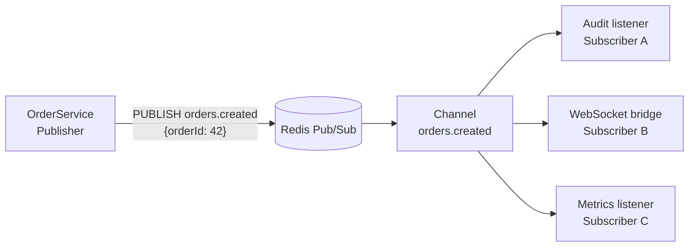
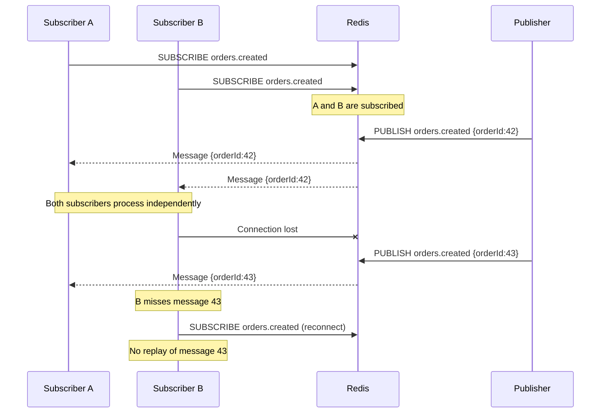

# Publisher, Channel, and Subscriber Model in Spring Data Redis Pub/Sub

## 1. What problem does Redis Pub/Sub solve?

**Publish/Subscribe (Pub/Sub)** is a topic-based message exchange model. A **publisher** component sends a message to a **channel**; Redis forwards that message to the **subscribers** registered to receive that channel at the time of publishing. The publisher does not need to know the address, count, or source code of the subscribers.

In a Spring Data Redis application, this model is suitable for broadcasting lightweight event signals, for example:

- A service publishes `orders.created` after creating an order, and monitoring or UI update components receive the notification.
- An instance notifies other instances that local configuration has just changed.
- A system broadcasts connection status, progress, or cache invalidation signals.
- A service emits real-time updates so online subscribers can react quickly.

Visual example:



In this example, **a single `PUBLISH` can be delivered to multiple subscribers**. Subscribers can live in the same application, on different instances, or in separate services.

One point to remember from the start: **Redis Pub/Sub is a live broadcast mechanism, not a durable queue**. If a subscriber is not connected when a message is published, Redis does not retain the message for that subscriber to receive later.

## 2. Three core roles

| Component | Responsibility | Example in Spring Data Redis |
| --- | --- | --- |
| **Publisher** | Creates the message payload and publishes it to a channel | `StringRedisTemplate.convertAndSend(channel, message)` |
| **Channel** | Logical topic name used to route messages to subscribers | `orders.created` or `inventory.changed` |
| **Subscriber** | Subscribes to a channel and processes received messages | `MessageListener` via `RedisMessageListenerContainer` |

### Publisher

The publisher creates the payload, selects the channel, and publishes the message using the Redis `PUBLISH` command:

```redis
PUBLISH orders.created "{\"orderId\":\"42\",\"eventType\":\"OrderCreated\"}"
```

Redis routes the message to subscribers currently subscribed to `orders.created`. The publisher does not need to call any subscriber method directly and does not need to know which subscribers are active.

One publisher can publish to multiple channels. Multiple publishers can also publish to the same channel.

### Channel

A channel is simply a **routing name** for messages, for example:

```text
orders.created
orders.cancelled
inventory.changed
notifications.user.42
```

A channel **is not a Redis key holding data**:

- You do not need to run `SET` or create a channel before publishing.
- You do not use `GET`, `EXPIRE`, or `TTL` to read or modify a channel.
- There is no TTL retaining messages by channel name in regular Pub/Sub.
- It does not automatically generate message history when a new subscriber subscribes.

A channel can still be used for `PUBLISH` when there are no subscribers. In that case, the message has no recipients and is discarded.

### Subscriber

A subscriber subscribes to receive one or more channels. Redis pushes messages to the subscriber when a publisher publishes, so the subscriber does not have to continuously call `GET` to poll.

A subscriber that is connected and subscribed to `orders.created` will receive messages published to this channel. A new subscriber connecting after the publish time **does not receive history**.

There is no "only one subscriber processes a message" constraint like a typical work queue model. If five independent subscribers subscribe to the same channel, Redis can deliver the same message to all five.

## 3. Timeline of a message

Suppose two subscribers A and B are both interested in `orders.created`:



This sequence illustrates two properties of Pub/Sub:

1. **Fan-out/broadcast:** messages are sent to interested subscribers.
2. **No retention for replay:** re-subscribing after a disconnect does not automatically retrieve missed messages.

This is the main difference compared to Redis Streams, where records are stored in a stream until deleted or trimmed by policy, and consumers can read by ID, use consumer groups, and use acknowledgment mechanisms.

## 4. Starting with Redis CLI to observe the model

You can observe Pub/Sub using two terminal windows connected to the **same Redis instance** in a test environment.

**Terminal A — subscriber:**

```redis
SUBSCRIBE demo:orders.created
```

This command puts the connection into message-receiving mode. When a publisher publishes, terminal A will see a response containing the channel and payload.

**Terminal B — publisher:**

```redis
PUBLISH demo:orders.created "Order 42 created"
```

Terminal A will receive a message such as:

```text
message
demo:orders.created
Order 42 created
```

If terminal A unsubscribes or loses its connection, and terminal B runs `PUBLISH` again, that message is not retained by Redis for terminal A to receive when it reconnects.

Try adding terminal C:

```redis
SUBSCRIBE demo:orders.created
```

Once both A and C are subscribed, a new `PUBLISH` can appear in both terminals. Increasing the number of subscribers does not turn messages into evenly divided tasks.

The integer result from `PUBLISH` represents **the number of client subscriptions counted by Redis as receiving the message**, not the number of successful business executions. In Redis Cluster, counting for regular Pub/Sub has node-scoped limitations, so you should not treat this value as a cluster-wide recipient guarantee.

## 5. Publisher in Spring Data Redis

Spring Data Redis provides `RedisTemplate.convertAndSend(String channel, Object message)`. When the message content is a string, `StringRedisTemplate` is simple and makes it easy to align formats between publisher and subscriber.

### 5.1. Example publisher sending a JSON message

Define the message contract:

```java
package com.example.messaging;

public record OrderCreatedEvent(
        String eventId,
        String orderId,
        String occurredAt,
        int schemaVersion
) {
}
```

Example event-publishing component:

```java
package com.example.messaging;

import java.time.Instant;
import java.util.UUID;

import com.fasterxml.jackson.core.JsonProcessingException;
import com.fasterxml.jackson.databind.ObjectMapper;
import org.springframework.data.redis.core.StringRedisTemplate;
import org.springframework.stereotype.Component;

@Component
public class OrderEventPublisher {

    public static final String CHANNEL = "orders.created";

    private final StringRedisTemplate redis;
    private final ObjectMapper json;

    public OrderEventPublisher(
            StringRedisTemplate redis,
            ObjectMapper json) {
        this.redis = redis;
        this.json = json;
    }

    public void publishCreated(String orderId) {
        OrderCreatedEvent event = new OrderCreatedEvent(
                UUID.randomUUID().toString(),
                orderId,
                Instant.now().toString(),
                1
        );

        try {
            String payload = json.writeValueAsString(event);
            Long subscribers = redis.convertAndSend(CHANNEL, payload);

            // subscribers is only a statistic from Redis at PUBLISH time.
            // It cannot be used to conclude that the event has finished processing.
        } catch (JsonProcessingException exception) {
            throw new IllegalStateException(
                    "Unable to serialize OrderCreatedEvent",
                    exception
            );
        }
    }
}
```

Here `ObjectMapper` turns the event into JSON text. `StringRedisTemplate` sends the text through Redis using a string serializer. This approach allows Java subscribers or clients in other languages to decode the same JSON contract.

With a sample message:

```json
{
  "eventId": "evt-001",
  "orderId": "42",
  "occurredAt": "2026-11-13T02:00:00Z",
  "schemaVersion": 1
}
```

Spring Boot typically provides `StringRedisTemplate` when Redis is configured appropriately. If a project only uses `RedisTemplate<String, Object>` with JDK serialization or another serializer, the payload may be in binary form that a subscriber expecting JSON cannot read directly. **Publisher and subscriber must agree on serialization.**

### 5.2. Meaning of the return value of `convertAndSend`

The `convertAndSend(...)` method returns a `Long` corresponding to the result of `PUBLISH`. Do not interpret:

- `0` as "Redis failed": it may simply mean there were no matching subscribers at the time of publishing.
- A positive number as "all handlers completed": Redis does not wait for subscriber business logic to finish.
- A positive number as "stored for retry": Pub/Sub does not store records waiting for subscribers to process.

If the business logic needs to know that a task has been executed, you must design an acknowledgment mechanism, processing state, or a durable event store at the application level.

## 6. Subscriber in Spring Data Redis

Spring Data Redis has two common building blocks:

- `MessageListener`: an interface that receives the message as bytes along with the channel.
- `RedisMessageListenerContainer`: manages Pub/Sub subscription connections, listeners, and message dispatching to them.

### 6.1. Writing a subscriber with `MessageListener`

```java
package com.example.messaging;

import java.nio.charset.StandardCharsets;

import com.fasterxml.jackson.databind.ObjectMapper;
import org.slf4j.Logger;
import org.slf4j.LoggerFactory;
import org.springframework.data.redis.connection.Message;
import org.springframework.data.redis.connection.MessageListener;
import org.springframework.stereotype.Component;

@Component
public class OrderCreatedListener implements MessageListener {

    private static final Logger log =
            LoggerFactory.getLogger(OrderCreatedListener.class);

    private final ObjectMapper json;

    public OrderCreatedListener(ObjectMapper json) {
        this.json = json;
    }

    @Override
    public void onMessage(Message message, byte[] pattern) {
        String channel = new String(
                message.getChannel(), StandardCharsets.UTF_8);
        String body = new String(
                message.getBody(), StandardCharsets.UTF_8);

        try {
            OrderCreatedEvent event =
                    json.readValue(body, OrderCreatedEvent.class);

            log.info("Received {}: eventId={}, orderId={}",
                    channel, event.eventId(), event.orderId());

            // Invoke short business processing without blocking the thread for too long.
        } catch (Exception exception) {
            log.warn("Cannot process message from channel {}",
                    channel, exception);
        }
    }
}
```

`message.getChannel()` and `message.getBody()` are byte arrays. In this example, they are converted to UTF-8 because the publisher uses `StringRedisTemplate`. If the system transmits Protobuf, Avro, or another binary serializer, the subscriber must decode using the agreed protocol.

The `pattern` argument contains pattern subscription information when the message arrives via `PSUBSCRIBE`; for a regular direct subscription it can be `null`. If you want to handle multiple channels or patterns in a single listener, check `message.getChannel()` to determine the actual channel name.

### 6.2. Registering a listener with `RedisMessageListenerContainer`

```java
package com.example.messaging;

import org.springframework.context.annotation.Bean;
import org.springframework.context.annotation.Configuration;
import org.springframework.data.redis.connection.RedisConnectionFactory;
import org.springframework.data.redis.listener.ChannelTopic;
import org.springframework.data.redis.listener.RedisMessageListenerContainer;

@Configuration
public class RedisSubscriberConfiguration {

    @Bean
    public RedisMessageListenerContainer redisMessageListenerContainer(
            RedisConnectionFactory connectionFactory,
            OrderCreatedListener orderCreatedListener) {

        RedisMessageListenerContainer container =
                new RedisMessageListenerContainer();

        container.setConnectionFactory(connectionFactory);
        container.addMessageListener(
                orderCreatedListener,
                new ChannelTopic(OrderEventPublisher.CHANNEL)
        );

        return container;
    }
}
```

`RedisMessageListenerContainer` is the component that manages the subscription lifecycle in a Spring application. When the bean/container is active, it subscribes to Redis, receives messages, and invokes `onMessage(...)` on the listener bound to the topic.

**You do not need to write your own loop calling `SUBSCRIBE` in a controller or a request thread.** A Pub/Sub connection is a long-lived connection and behaves differently from connections calling normal `GET`/`SET` commands. The container manages lifecycle, subscriptions, and callback dispatching.

### 6.3. Why not use `RedisConnection.subscribe(...)` directly in a service?

The low-level `RedisConnection.subscribe(...)` API can block the calling thread and put the connection into a message-receiving subscription state. That approach requires the application to manage threads, connections, errors, restarts, and unsubscriptions itself.

For standard Spring applications, `RedisMessageListenerContainer` is designed to handle this need. It can share a single Pub/Sub connection to manage multiple listeners and dispatch callbacks through an executor.

If a callback is slow to process, you need to consider worker threads and internal task queues; do not let one subscriber block the entire message-receiving pipeline.

## 7. Exact channel and pattern channel

Redis supports two forms of subscription:

- `SUBSCRIBE channel`: receives messages sent to the **exact channel name**.
- `PSUBSCRIBE pattern`: receives messages from channels whose names match a glob-style pattern.

Spring Data Redis maps these correspondingly:

| Redis | Spring Data Redis | Example |
| --- | --- | --- |
| `SUBSCRIBE orders.created` | `new ChannelTopic("orders.created")` | Receives only `orders.created` |
| `PSUBSCRIBE orders.*` | `new PatternTopic("orders.*")` | Receives `orders.created`, `orders.cancelled`, etc. |

Configuring a `PatternTopic`:

```java
container.addMessageListener(
        orderEventListener,
        new PatternTopic("orders.*")
);
```

When a publisher calls:

```redis
PUBLISH orders.created "created:42"
PUBLISH orders.cancelled "cancelled:43"
PUBLISH inventory.changed "sku-1"
```

A listener subscribed to `orders.*` receives the first two messages, but does not receive `inventory.changed`.

**A pattern is only a channel name filter, not an expression that inspects payload contents.** `orders.*` does not automatically filter JSON by `eventType`. If multiple message types share a pattern, the subscriber must identify the channel or event type before deserializing and processing.

You should control pattern scope: an overly broad pattern, such as `*`, can cause a subscriber to receive large volumes of unrelated data.

### Overlapping subscriber registrations

If the same Redis client subscribes directly to `orders.created` and simultaneously subscribes to the pattern `orders.*`, a message published to `orders.created` can generate multiple matching subscription notifications on that client. The listener needs to handle duplicates according to context, or avoid unnecessary overlapping subscriptions.

Do not rely on Pub/Sub to guarantee "each message reaches the application exactly once" in all cases.

## 8. How does one channel with multiple subscribers differ from a work queue?

This is an important architectural decision when deploying multiple instances.

Suppose three Spring Boot instances all have:

```java
new ChannelTopic("orders.created")
```

Each instance creates its own subscription to Redis. When a publisher publishes a message:

```text
                  PUBLISH orders.created
                           |
                          Redis
                   /        |        \
             Instance A Instance B Instance C
                 |          |          |
             handle A   handle B   handle C
```

**All three instances can receive the same message.** This is a *broadcast* model, not workload sharing.

If the handler is "refresh local cache", broadcasting may be right: every instance needs to invalidate its local cache.

If the handler is "send order confirmation email", broadcasting to three instances could send three emails unless there is a mechanism ensuring only one worker executes. For group-based work processing, consider a queue or stream with consumer groups, idempotency, and processing state.

| Question | Redis Pub/Sub | Work queue / Redis Streams consumer group |
| --- | --- | --- |
| When multiple subscribers listen | Each subscriber receives messages sent to its subscription | Work can be distributed among consumers in the group |
| Subscriber temporarily offline | Misses messages published while offline | Can read records retained according to stream policy |
| Processing acknowledgment | No built-in business ACK | Has acknowledgment / pending entries with consumer groups |
| Replaying old events | No history support | Can read by ID if records remain |
| Suitable use cases | Live signals, notifications, invalidation | Asynchronous processing requiring tracking and retry |

Not every message needs a durable broker; however, if business requirements cannot tolerate losing tasks, Pub/Sub alone is not enough.

## 9. Designing channels and message contracts

A system with multiple publishers and subscribers needs conventions to avoid mixing channel purposes.

### 9.1. Channel naming conventions

Examples:

```text
orders.created
orders.cancelled
catalog.price.changed
system.cache.invalidate
tenant.42.notifications
```

A useful channel name typically expresses the **domain** and **event type**, without necessarily packing every piece of business metadata into it. Keep names stable, easy to filter with patterns, and avoid accidentally putting sensitive information in channel names.

Two common ways to split channels:

1. **By event type**: `orders.created`, `orders.cancelled`. Subscribers subscribe to the exact types they need.
2. **By event group**: `orders.events` with an `eventType` field in the payload. Subscribers must filter types from the content.

The first approach makes routing explicit; the second reduces the number of channels to know about but increases schema-handling responsibility at the subscriber.

### 9.2. Message envelope

Instead of publishing free-form strings like `"42"`, you can define a message envelope:

```json
{
  "eventId": "c5060f1e-2c73-4c16-9dea-22eb99e926db",
  "eventType": "OrderCreated",
  "schemaVersion": 1,
  "occurredAt": "2026-11-13T02:00:00Z",
  "source": "order-service",
  "data": {
    "orderId": "42",
    "status": "CREATED"
  }
}
```

Field meanings:

| Field | Purpose |
| --- | --- |
| `eventId` | Identifies the message for logging, tracing, and reducing duplicate processing at the application level |
| `eventType` | Helps subscribers branch business logic |
| `schemaVersion` | Supports evolving payload structure across versions |
| `occurredAt` | Timestamp when the publisher created the event; not when the subscriber finished processing |
| `source` | Identifies the publishing component |
| `data` | Required business payload |

Pub/Sub does not automatically provide metadata such as `eventId` or `schemaVersion`. If these fields are needed, the publisher must produce them and the subscriber must understand the contract.

### 9.3. Versioning and compatibility

When adding a field to JSON, older subscribers can continue working if their decoder ignores unknown fields. When renaming a field or changing a data type, you may need to:

- Put a new `schemaVersion` into the payload.
- Support converting between versions at the subscriber.
- Deploy compatible subscribers before the publisher starts emitting the new structure.
- Introduce a new versioned channel if the change cannot be made backward compatible.

Do not assume subscribers will upgrade simultaneously. In Pub/Sub, a deserialization error usually **permanently loses the chance to process that message** because there is no history to re-read.

## 10. When should a publisher emit an event?

Suppose the application writes an order to the database and publishes via Pub/Sub:

```java
@Transactional
public void createOrder(CreateOrderRequest request) {
    orderRepository.save(...);
    publisher.publishCreated(...);
}
```

The code above carries a risk: the publisher may send the message **before the database transaction commits**. A subscriber receives the message immediately and queries for the order, which might not yet be visible; if the database rolls back, the message has already been published.

If the application only needs a lightweight notification after the database commits, you can use a **Spring application event** and `@TransactionalEventListener(phase = AFTER_COMMIT)`:

```java
public record OrderCommitted(String orderId) {
}
```

```java
@Service
public class OrderService {

    private final OrderRepository orders;
    private final ApplicationEventPublisher events;

    public OrderService(
            OrderRepository orders,
            ApplicationEventPublisher events) {
        this.orders = orders;
        this.events = events;
    }

    @Transactional
    public void createOrder(CreateOrderRequest request) {
        Order order = orders.save(new Order(request.orderId()));
        events.publishEvent(new OrderCommitted(order.getId()));
    }
}
```

Listener that publishes to Pub/Sub after commit:

```java
@Component
public class AfterCommitOrderPublisher {

    private final OrderEventPublisher publisher;

    public AfterCommitOrderPublisher(OrderEventPublisher publisher) {
        this.publisher = publisher;
    }

    @TransactionalEventListener(phase =
            TransactionPhase.AFTER_COMMIT)
    public void onOrderCommitted(OrderCommitted event) {
        publisher.publishCreated(event.orderId());
    }
}
```

The annotation imports belong to Spring Framework; the entity/repository parts are illustrative and must be replaced with the actual application model.

This mechanism avoids publishing messages from rolled-back transactions on the normal path. **It still does not guarantee zero message loss**: the process could crash after the database commit but before `PUBLISH` succeeds.

If the event must be sent reliably, use a **transactional outbox**: write an outbox record in the same transaction as the database change; a worker reads the outbox, publishes the message, and tracks retries. If subscribers need redelivery/ACK after disconnects, the target should be Redis Streams or a suitable durable messaging system rather than Pub/Sub alone.

## 11. Delivery semantics: what is guaranteed and what is not?

Redis Pub/Sub operates with **at-most-once delivery** at the live broadcast service level: Redis does not store messages to replay after a subscriber misses them or a handler throws an error. That is not a guarantee that the application will always process each event only once.

| Situation | Possible outcome |
| --- | --- |
| Subscriber has not subscribed yet when publisher publishes | Does not receive that message |
| Subscriber is connected | Redis forwards the message to matching subscriptions |
| Subscriber loses network during publish | May miss the message |
| Handler throws an exception | Redis does not automatically redeliver to the handler |
| Handler is slow | Messages can accumulate in client/server buffers, increasing memory pressure or causing disconnects when limits are exceeded |
| Publisher resends the same business event | Subscriber may see two identical or equivalent messages |
| Overlapping channel and pattern subscriptions | One message may arrive through multiple subscriptions |
| Multiple instances subscribe together | Each instance may receive and process the same message |

Therefore, "at-most-once" should not be misunderstood as "each business action is only ever executed once": application retries, callbacks registered in two places, or multiple instances processing together can still cause duplicate effects at the business layer.

### Keep handlers short and handle errors explicitly

A `MessageListener` should:

1. Decode the payload according to the contract.
2. Validate `schemaVersion` and required information.
3. Run time-bounded logic or offload heavy work to an appropriate mechanism.
4. Record success/failure metrics and the `eventId` identifier.
5. Handle exceptions; do not expect Redis to automatically retry a received message.

If work can take many seconds or minutes or must complete reliably, executing it directly inside a Pub/Sub callback is less suitable than a controlled processing queue.

## 12. Message ordering and concurrency

Redis processes commands in the order the server receives them, and an active subscription connection receives notifications along the Pub/Sub stream. However, **business processing order at the subscriber can differ from arrival order** when:

- The listener dispatches messages to multiple threads in an executor.
- The handler offloads work to async tasks with varying execution times.
- Multiple publishers publish messages nearly concurrently without an application-defined total business order.
- A connection drops and messages are lost; the observed sequence is no longer complete.
- The system runs multiple nodes/instances with different processing speeds.

If business logic requires ordering per aggregate, you can include `aggregateId` and a sequence/version number in the event, then apply a version check during processing. Do not treat global callback ordering as a guard for critical state.

Redis Cluster also introduces its own considerations for broadcast scope and connections; regular Pub/Sub is not equivalent to a broker with per-partition/consumer-group ordering like Redis Streams or Kafka.

## 13. Topic patterns, multiple listeners, and resource limits

You can register multiple topics on the same container:

```java
@Bean
public RedisMessageListenerContainer redisMessageListenerContainer(
        RedisConnectionFactory factory,
        OrderCreatedListener orderListener,
        InventoryChangedListener inventoryListener) {

    RedisMessageListenerContainer container =
            new RedisMessageListenerContainer();
    container.setConnectionFactory(factory);

    container.addMessageListener(
            orderListener,
            new PatternTopic("orders.*")
    );
    container.addMessageListener(
            inventoryListener,
            new ChannelTopic("inventory.changed")
    );

    return container;
}
```

Here `InventoryChangedListener` is another `MessageListener` provided by the application. The container manages subscriptions and dispatches messages to both listeners.

### Executors and slow callbacks

`RedisMessageListenerContainer` has a task execution/listener dispatch mechanism. When configuring a thread pool, bound the thread count and queue appropriately for the load. A heavy listener can monopolize resources and slow down other listeners if they share an executor.

Illustrative configuration using a dedicated executor:

```java
@Bean
public RedisMessageListenerContainer redisMessageListenerContainer(
        RedisConnectionFactory factory,
        OrderCreatedListener listener,
        @Qualifier("redisListenerExecutor") Executor executor) {

    RedisMessageListenerContainer container =
            new RedisMessageListenerContainer();
    container.setConnectionFactory(factory);
    container.setTaskExecutor(executor);
    container.addMessageListener(listener,
            new ChannelTopic("orders.created"));
    return container;
}
```

You should declare `redisListenerExecutor` as an `Executor` bean with explicit sizing, queue capacity, and rejection policy. The example above only shows the executor hook; it does not magically make messages durable or always processed in order.

Under heavy traffic, having a subscriber make synchronous external service calls inside `onMessage(...)` can cause bottlenecks. Depending on requirements, offload long-running work to an internal queue/job with protective controls.

## 14. Redis ACLs, namespaces, and message security

Pub/Sub does not by itself guarantee that only authorized services can publish or receive messages. You must protect it with proper connections and Redis permissions.

Redis has ACL support for restricting **channel patterns**, allowing you to build policies so a publisher can send to `orders.*` while a subscriber only listens to `orders.*` or a specific channel. Redis supports permissions related to `PUBLISH`, `SUBSCRIBE`, `PSUBSCRIBE`, and channel patterns depending on the capabilities of the version in use.

Principles:

- Separate Redis identities for publishers and subscribers when their usage permissions differ.
- Grant only the required Pub/Sub command permissions instead of `@all`.
- Restrict allowed channels; do not treat channel names as secrets.
- Use TLS and appropriate network policies to avoid exposing Redis Pub/Sub to untrusted networks.
- Do not broadcast secret tokens, passwords, payment data, or sensitive information directly onto multi-subscriber channels.
- Consider separating channels or Redis instances if application groups have different data isolation requirements.

Example naming rules:

```text
orders.created       -> order domain, multiple related listeners
tenant.42.events     -> tenant 42 domain
system.cache.invalidate -> shared invalidation signal
```

A pattern like `tenant.*` can receive messages for multiple tenants; if a multi-tenant application requires strict isolation, do not rely solely on application-level pattern filtering. Apply ACLs, network/resource boundaries, and actual permission verification.

### Pub/Sub channels vs. Redis keyspace notification channels

Redis can emit system notifications such as `__keyevent@0__:expired` when keyspace notifications are enabled. Although they also travel over Pub/Sub, these are **notifications emitted by Redis about key changes**, not business channels that the application `PUBLISH`es itself.

Do not confuse them:

- `orders.created`: business event published by an application publisher.
- `__keyevent@0__:expired`: key expiration notification if Redis is configured to emit notifications.

Both share the limitation of losing messages when subscribers are offline. Do not use expiration notifications as a mandatory scheduled-job queue.

## 15. Redis Pub/Sub in Redis Cluster

With Redis Cluster, distinguish between regular Pub/Sub and **sharded Pub/Sub**:

- Regular Pub/Sub uses `PUBLISH`/`SUBSCRIBE`/`PSUBSCRIBE` and can propagate messages across the cluster. It fits a broadcast model, though it can generate substantial inter-node traffic under heavy fan-out.
- Redis 7.0 introduced sharded Pub/Sub with commands such as `SPUBLISH`/`SSUBSCRIBE`. Messages are routed by the shard channel's hash slot to reduce propagation scope.

The two models are not automatic drop-in replacements for each other. The Spring Data Redis examples using `RedisTemplate.convertAndSend(...)` and `RedisMessageListenerContainer` with `ChannelTopic` in this lesson refer to **regular Pub/Sub**. Do not assume it automatically calls `SPUBLISH` just because the backend is Redis Cluster.

If sharded Pub/Sub is required, you must verify that the specific API, driver, and Spring Data Redis version support the required commands/shard subscriptions. You need to explicitly design channel selection, connection configuration, and test in a real cluster.

## 16. Observation, testing, and diagnostics

### Testing one publisher and two subscribers

In a test Redis environment:

1. Start Redis and a Spring Boot instance with `RedisMessageListenerContainer`.
2. Subscribe another subscriber from `redis-cli SUBSCRIBE orders.created`.
3. Call `publisher.publishCreated("42")`.
4. Observe the Spring log and the `redis-cli` terminal: both online subscribers can receive the message.
5. Disconnect the CLI subscriber, publish another message, then reconnect: the message published while disconnected is not re-delivered.

These observations are enough to see the publisher/channel/subscriber model and the no-history limitation, without needing to delete data in Redis.

### Useful observation commands

```redis
PUBSUB CHANNELS
PUBSUB NUMSUB orders.created
```

`PUBSUB CHANNELS` lists channels that currently have subscribers according to Redis's view on the connected node. `PUBSUB NUMSUB` provides the subscription count for a specific channel. In Redis Cluster, observing on one node does not necessarily reflect the cluster-wide subscriber total; do not use these numbers as proof of business completion.

In the application, you should have metrics:

| Metric | Meaning |
| --- | --- |
| `pubsub_publish_total{channel}` | Number of times the publisher successfully called publish to Redis |
| `pubsub_receive_total{channel}` | Number of messages received by listeners |
| `pubsub_handle_success_total` | Number of messages processed successfully by application logic |
| `pubsub_handle_failure_total` | Number of messages that failed processing |
| Callback processing duration | Detects slow handlers and executor congestion risks |
| Connection/listener state | Detects when the application no longer holds subscriptions |
| Version/schema decode failure | Detects publisher/subscriber incompatibility |

These metric names are design suggestions; Redis and Spring Data Redis do not automatically emit all of these business metrics. If you care about the number of messages missed while a subscriber is offline, Pub/Sub itself has no history counter sufficient to calculate it accurately. You need a durable data source or reconciliation mechanism.

### Common issues

| Symptom | Possible cause | Approach |
| --- | --- | --- |
| Publisher sends but nobody receives | Subscriber not started, wrong channel, wrong Redis instance, listener disconnected | Verify subscription, host/port, channel name, and container lifecycle |
| `PUBLISH` returns `0` | No subscribers counted by Redis at publish time | Check online subscribers; do not treat `0` as a command error |
| Subscriber receives unreadable bytes | Mismatched serializer or encoding | Standardize on UTF-8 JSON/`StringRedisTemplate` or a binary schema |
| One message processed multiple times | Multiple instances, duplicate channel/pattern subscriptions, or duplicate publisher sends | Check topology, `eventId`, and idempotency requirements |
| Messages lost on restart | Pub/Sub does not store history | Use a durable mechanism if replay is needed |
| Slow handler or disconnects | Blocking callback, overloaded executor/buffers | Bound tasks, monitor load, and move heavy work to an appropriate queue |
| `NOPERM` | Redis user lacks Pub/Sub or channel ACL permissions | Check command/channel patterns and grant least privilege |
| Key expiration events not received | Confused custom channel with keyspace notifications, or Redis notifications disabled | Verify the right channel type and `notify-keyspace-events` config |
| Multiple subscribers but only one task should run | Using broadcast for a competing workload | Switch to a queue/Streams consumer group or add coordination |

## 17. When to choose Pub/Sub vs. another mechanism?

Choose Redis Pub/Sub when the goal is **instant notification to currently online subscribers**, and the system can tolerate losing messages in certain situations.

Typically suitable use cases:

- Invalidating local caches across instances, when caches still have a TTL or sync mechanism to self-heal drift.
- Real-time UI updates, where clients can call an API to fetch the latest snapshot after reconnecting.
- Observability signals or progress notifications that do not determine source-of-truth data.
- Auxiliary events that the system can reconcile from a more reliable data source.

If the business requires tasks to be processed, retried, have history, or have one worker in a group receive each job, consider:

- **Redis Streams** with consumer groups and appropriate record retention.
- **A message broker** such as RabbitMQ/Kafka matching the system's delivery guarantees and operational model.
- **Transactional outbox** if event publishing must be tied to a database write transaction.
- **Reconciliation jobs/schedulers** if actions must be guaranteed to run despite process or network interruptions.

No option automatically delivers "exactly once" at the business layer. Idempotency, state management, and failure design remain the application's responsibility.

## 18. Self-check questions

1. A publisher publishes to `orders.created` when no subscribers are online. Where does that message go? Can it be received when a subscriber connects later?
2. If three instances all subscribe to `ChannelTopic("orders.created")`, will a message be dispatched to one instance or broadcast to all three?
3. Why does a positive return value from `convertAndSend(...)` not prove that subscribers processed the business logic successfully?
4. How does `ChannelTopic("orders.created")` differ from `PatternTopic("orders.*")`?
5. Why can a publisher using JDK serialization and a subscriber reading UTF-8 JSON lead to errors?
6. Why do we need `RedisMessageListenerContainer` instead of calling low-level `SUBSCRIBE` in a request thread?
7. If the database rolls back after the publisher has already called `PUBLISH`, are subscribers automatically notified of the rollback? What does publishing after commit solve, and what guarantee is still missing?
8. When is Redis Streams / a consumer group more suitable than Redis Pub/Sub?
9. If a handler receives multiple messages and processes them concurrently, can it be assumed by default to complete in order?
10. What relationship do Redis channels and Redis keys have regarding `GET`, `SET`, and TTL?

**Takeaway:** In Spring Data Redis, the publisher uses `RedisTemplate.convertAndSend(...)` to publish payloads to a **channel**, while the subscriber registers with `RedisMessageListenerContainer` and receives via `MessageListener`. This model is **broadcast, immediate, and does not retain history**. To use it properly, define the message contract, subscription scope, serialization, error handling, and the delivery guarantees the business actually requires.

## References

- [Spring Data Redis — Pub/Sub Messaging](https://docs.spring.io/spring-data/redis/reference/redis/pubsub.html): `RedisTemplate.convertAndSend`, `MessageListener`, and `RedisMessageListenerContainer`.
- [Spring Data Redis — RedisMessageListenerContainer API](https://docs.spring.io/spring-data/redis/docs/current/api/org/springframework/data/redis/listener/RedisMessageListenerContainer.html): listener registration, topics, and container lifecycle.
- [Redis — Pub/Sub](https://redis.io/docs/latest/develop/pubsub/): broadcast behavior, pattern subscriptions, and delivery limitations.
- [Redis — PUBLISH](https://redis.io/docs/latest/commands/publish/): publish syntax and meaning of the return value.
- [Redis — Redis Streams](https://redis.io/docs/latest/develop/data-types/streams/): option with record retention and consumer groups when processing tracking is required.
