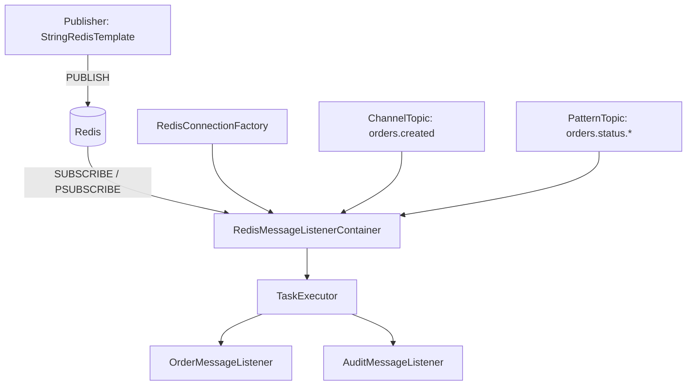
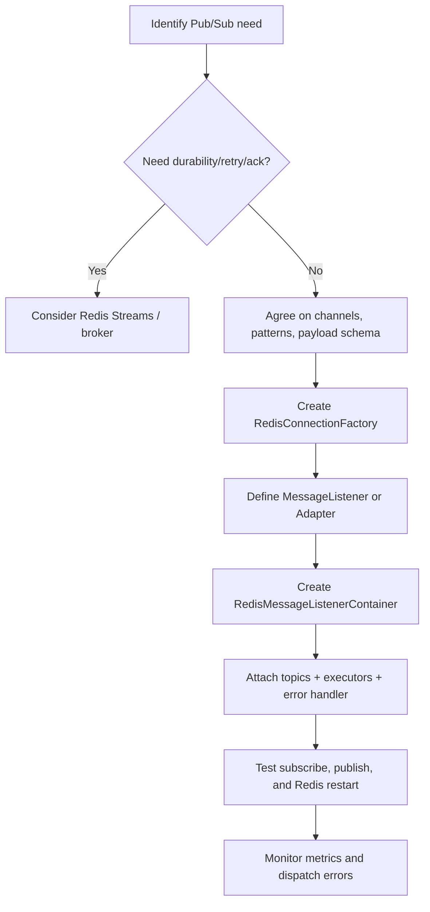

# Configuring RedisMessageListenerContainer in Spring Data Redis

## 1. What is RedisMessageListenerContainer used for?

Redis **Publish/Subscribe (Pub/Sub)** allows an application to send messages to a *channel*, while applications that are subscribed (*subscribe*) to that channel receive those messages. Publishers and subscribers do not need to call each other directly.

For example, an e-commerce application emits an event when an order is created:

```text
Order Service
    |
    | PUBLISH orders.created '{"orderId":"o-101"}'
    v
Redis Pub/Sub channel: orders.created
    |                                |
    v                                v
Notification Service          Analytics Service
  send notification              update metrics
```

In Spring Data Redis, `RedisMessageListenerContainer` is the component that manages **subscribing to Redis channels/patterns, receiving messages, and dispatching them to the application's `MessageListener` instances**. Instead of each listener opening and managing its own Redis connection waiting on `SUBSCRIBE`, the application declares a shared container and registers the needed listeners.

A typical configuration:

```java
RedisMessageListenerContainer container =
    new RedisMessageListenerContainer();

container.setConnectionFactory(redisConnectionFactory);
container.addMessageListener(
    orderCreatedListener,
    new ChannelTopic("orders.created")
);
```

When managed by Spring as a bean and started with the context lifecycle, the container receives channel messages and forwards them to the listener's `onMessage(...)` callback.

**Key point:** the container solves **subscription management and dispatching**; it does not turn Redis Pub/Sub into a durable message queue. Redis Pub/Sub does not retain messages for replay to new subscribers or subscribers that just disconnected.

After this lesson, you will be able to:

1. Configure `RedisConnectionFactory`, `RedisMessageListenerContainer`, and `MessageListener`.
2. Subscribe to specific channels with `ChannelTopic` and channel groups with `PatternTopic`.
3. Use `MessageListenerAdapter` when you do not want a business class to implement a Redis interface directly.
4. Distinguish subscription threads from message-processing threads and configure appropriate thread pools.
5. Understand the start/stop lifecycle, dynamic registration, disconnect recovery, and what to monitor.
6. Test end-to-end and understand limits around message loss, duplicate execution, or processing order.

## 2. Container architecture

Core components:

| Component | Role | Example |
|---|---|---|
| `RedisConnectionFactory` | Creates Redis connections matching application configuration | `LettuceConnectionFactory` |
| `RedisMessageListenerContainer` | Maintains subscriptions and dispatches messages to listeners | Bean configured in Spring context |
| `Topic` | Describes a channel or pattern of interest | `ChannelTopic`, `PatternTopic` |
| `MessageListener` | Receives Redis messages as bytes | `onMessage(Message, byte[])` |
| `MessageListenerAdapter` | Forwards messages to a POJO method | `handleMessage(String)` |
| `RedisTemplate` / `StringRedisTemplate` | Publishes messages to a channel | `convertAndSend(...)` |
| Task executor | Handles callback dispatch work | `ThreadPoolTaskExecutor` |
| Subscription executor | Dedicated to blocking subscription work | Separate executor, not for heavy business logic |



The container manages listening across multiple topics and can use **a shared subscription connection** rather than opening a separate Redis connection per listener. Within the same container, listeners can share a set of topics, or each listener can subscribe to different topics.

Unlike regular Redis connections, a connection in Pub/Sub mode is used to receive messages and requires an appropriate subscription thread. Therefore, **do not share a single small thread pool for both blocking subscriptions and heavy business processing**.

## 3. Preparing a Spring Boot application

### 3.1. Dependency

With Spring Boot 3.x:

```groovy
dependencies {
    implementation 'org.springframework.boot:spring-boot-starter-data-redis'
}
```

The starter typically includes Spring Data Redis and the Lettuce driver. If the application uses another driver/connection setup, verify that the driver supports Pub/Sub and is compatible with the configured factory.

### 3.2. Redis connection configuration

In `application.yml`:

```yaml
spring:
  data:
    redis:
      host: localhost
      port: 6379
      timeout: 3s
```

This is an unauthenticated local Redis suitable for demonstration. Production deployments require appropriate settings for passwords, TLS, Sentinel, Cluster, and secrets management.

When auto-configuration conditions are met, Spring Boot provides a `RedisConnectionFactory` bean and typically `StringRedisTemplate`. The container configuration simply injects them instead of manually creating sockets and encoding the Redis protocol.

## 4. Implementing `MessageListener` directly

Spring Data Redis's `MessageListener` interface has one callback:

```java
void onMessage(Message message, byte[] pattern);
```

Where:

- `message.getBody()`: message content as `byte[]`.
- `message.getChannel()`: actual channel name that emitted the message, as `byte[]`.
- `pattern`: associated subscription pattern when received via a pattern; can be `null` for direct channel subscriptions.

Example:

```java
package com.example.redis.pubsub;

import java.nio.charset.StandardCharsets;

import org.slf4j.Logger;
import org.slf4j.LoggerFactory;
import org.springframework.data.redis.connection.Message;
import org.springframework.data.redis.connection.MessageListener;
import org.springframework.stereotype.Component;

@Component
public class OrderEventListener implements MessageListener {

    private static final Logger log =
        LoggerFactory.getLogger(OrderEventListener.class);

    @Override
    public void onMessage(Message message, byte[] pattern) {
        String channel = new String(
            message.getChannel(), StandardCharsets.UTF_8
        );
        String payload = new String(
            message.getBody(), StandardCharsets.UTF_8
        );

        String subscribedPattern = pattern == null
            ? null
            : new String(pattern, StandardCharsets.UTF_8);

        log.info(
            "Redis event channel={}, pattern={}, payload={}",
            channel,
            subscribedPattern,
            payload
        );

        // Invoke business processing appropriate for the channel.
    }
}
```

This code assumes the publisher sends UTF-8 payloads. If the publisher uses Java serialization or another JSON/binary codec, calling `new String(bytes, UTF_8)` will not automatically decode the typed object. **Publisher and subscriber must agree on message format.**

Pub/Sub has no built-in acknowledgment mechanism. When the callback returns, Redis does not store a "message processed successfully" state; if the listener throws an error, Redis does not automatically re-publish that message.

## 5. Minimal container configuration as a Spring bean

```java
package com.example.redis.pubsub;

import org.springframework.context.annotation.Bean;
import org.springframework.context.annotation.Configuration;
import org.springframework.data.redis.connection.RedisConnectionFactory;
import org.springframework.data.redis.listener.ChannelTopic;
import org.springframework.data.redis.listener.RedisMessageListenerContainer;

@Configuration
public class RedisPubSubConfig {

    @Bean
    RedisMessageListenerContainer redisMessageListenerContainer(
            RedisConnectionFactory connectionFactory,
            OrderEventListener listener) {

        RedisMessageListenerContainer container =
            new RedisMessageListenerContainer();

        container.setConnectionFactory(connectionFactory);
        container.addMessageListener(
            listener,
            new ChannelTopic("orders.created")
        );

        return container;
    }
}
```

In this configuration:

1. `RedisConnectionFactory` is provided by Spring Boot.
2. `OrderEventListener` is a Spring component.
3. The container is registered as a bean and participates in the Spring lifecycle.
4. The listener is bound to the `orders.created` channel via `ChannelTopic`.
5. When the container is running and has subscribed successfully, messages on the channel are delivered to the callback.

You do not need to spawn a manual thread and call `redisConnection.subscribe(...)` inside a service. The container already provides subscription management, task execution, and recovery.

### 5.1. When does the container actually subscribe to the channel?

`addMessageListener(...)` declares the listening registration. The `RedisMessageListenerContainer` bean participates in Spring's initialization/start lifecycle; the container creates subscriptions when it starts. If no connection is available yet or Redis is temporarily interrupted, registration may not be complete immediately when the `@Bean` method returns.

**Therefore, publishing right after bean creation is not a reliable way to test that a subscriber is ready.** To test without race conditions, ensure an actual subscription is active before sending messages, rather than inferring readiness solely from bean existence.

## 6. Publishing messages with `StringRedisTemplate`

Spring Data Redis provides `convertAndSend(channel, message)` on `RedisTemplate`.

```java
package com.example.redis.pubsub;

import org.springframework.data.redis.core.StringRedisTemplate;
import org.springframework.stereotype.Service;

@Service
public class OrderEventPublisher {

    private final StringRedisTemplate redis;

    public OrderEventPublisher(StringRedisTemplate redis) {
        this.redis = redis;
    }

    public long publishOrderCreated(String orderId) {
        String payload = "{\"orderId\":\"" + orderId + "\"}";
        Long recipients = redis.convertAndSend(
            "orders.created",
            payload
        );
        return recipients == null ? 0L : recipients;
    }
}
```

This is a simplified example to illustrate channels and strings. In real applications, use a JSON serializer to encode payloads rather than concatenating unvalidated input directly into JSON.

`convertAndSend(...)` returns the number of subscribers Redis reports as receiving the message under `PUBLISH` command semantics. **This value does not prove a business handler finished processing**; nor is it a durable acknowledgment.

Example:

```java
long subscribedClients = publisher.publishOrderCreated("o-101");
```

If no subscribers are connected, the message can vanish immediately with no error on the publisher side. Redis Pub/Sub follows a **fire-and-forget** model; messages are not retained for services that have not started yet.

## 7. `ChannelTopic` and `PatternTopic`

The container supports subscribing to a specific channel or multiple channels by pattern.

### 7.1. `ChannelTopic`: exact subscription

```java
container.addMessageListener(
    orderEventListener,
    new ChannelTopic("orders.created")
);
```

The listener receives messages only for `orders.created` from this registration; `orders.deleted` is outside its scope.

### 7.2. `PatternTopic`: glob-style pattern subscription

```java
import org.springframework.data.redis.listener.PatternTopic;

container.addMessageListener(
    orderEventListener,
    new PatternTopic("orders.status.*")
);
```

This pattern can receive messages from:

```text
orders.status.created
orders.status.paid
orders.status.shipped
```

Redis performs matching using Pub/Sub pattern rules, not Java regex. `*` represents any sequence of characters; the syntax supports additional pattern characters per Redis Pub/Sub.

If a listener is registered with both `ChannelTopic("orders.status.paid")` and `PatternTopic("orders.status.*")`, a single publish can trigger **multiple deliveries corresponding to the matching subscriptions**. Do not assume each publish triggers only one callback when registrations overlap.

### 7.3. Registering multiple topics with one listener

```java
import java.util.List;
import org.springframework.data.redis.listener.ChannelTopic;
import org.springframework.data.redis.listener.PatternTopic;
import org.springframework.data.redis.listener.Topic;

List<Topic> topics = List.of(
    new ChannelTopic("orders.created"),
    new ChannelTopic("orders.cancelled"),
    new PatternTopic("orders.status.*")
);

container.addMessageListener(orderEventListener, topics);
```

Use a `Topic` collection to manage a group of listening targets sharing the same callback. If completely different processing is required, splitting into separate listeners is usually easier to follow.

## 8. `MessageListenerAdapter`: routing messages into a POJO

If a business class only wants a method that accepts a string, you can use `MessageListenerAdapter` instead of implementing `MessageListener` directly.

A plain handler:

```java
package com.example.redis.pubsub;

import org.slf4j.Logger;
import org.slf4j.LoggerFactory;
import org.springframework.stereotype.Component;

@Component
public class OrderCreatedHandler {

    private static final Logger log =
        LoggerFactory.getLogger(OrderCreatedHandler.class);

    public void handleMessage(String payload) {
        log.info("Received order-created payload: {}", payload);
        // Business logic.
    }
}
```

Adapter:

```java
import org.springframework.context.annotation.Bean;
import org.springframework.context.annotation.Configuration;
import org.springframework.data.redis.listener.adapter.MessageListenerAdapter;
import org.springframework.data.redis.serializer.StringRedisSerializer;

@Configuration
public class RedisListenerAdapterConfig {

    @Bean
    MessageListenerAdapter orderCreatedListenerAdapter(
            OrderCreatedHandler handler) {

        MessageListenerAdapter adapter =
            new MessageListenerAdapter(handler, "handleMessage");

        adapter.setSerializer(new StringRedisSerializer());
        return adapter;
    }
}
```

Registering the adapter on the container:

```java
container.addMessageListener(
    orderCreatedListenerAdapter,
    new ChannelTopic("orders.created")
);
```

The adapter receives byte messages from Redis, deserializes the body using the configured serializer, and invokes `handleMessage(String)`.

**Choose only one of the two registration approaches for the same purpose** if you do not want duplicate execution: either direct `OrderEventListener` or `MessageListenerAdapter`. Registering both on the same channel causes both handlers to be called.

### 8.1. When should you use an adapter?

| Direct `MessageListener` | `MessageListenerAdapter` |
|---|---|
| Needs to inspect channel, pattern, and raw bytes | Primarily needs the deserialized payload |
| Wants to dispatch multiple event types manually | Wants a simple business method |
| Suited for binary or custom protocols | Suited for standardized message converters/serializers |
| Code depends on Redis interface | POJO handler needs no awareness of Redis callbacks |

When multiple message schemas must be handled or channel metadata is needed, a direct listener is usually clearer. An adapter is convenient when payloads share a uniform format and the handler deals primarily with one message type.

## 9. Executor configuration: critical for production

`RedisMessageListenerContainer` has two distinct categories of work:

1. **Subscription:** keeping the connection listening on Redis Pub/Sub; connection and subscribe implementations may require a dedicated thread for blocking tasks.
2. **Dispatch:** delivering received messages to listener callbacks.

Spring Data Redis lets you configure them separately:

```java
container.setSubscriptionExecutor(subscriptionExecutor);
container.setTaskExecutor(dispatchExecutor);
```

With default executors, Spring may use `SimpleAsyncTaskExecutor`, which is not a thread pool with bounded queue capacity and concurrency like an explicitly configured `ThreadPoolTaskExecutor`. For systems receiving many messages, resource control should be actively considered.

### 9.1. Defining both executors

```java
package com.example.redis.pubsub;

import org.springframework.context.annotation.Bean;
import org.springframework.context.annotation.Configuration;
import org.springframework.scheduling.concurrent.ThreadPoolTaskExecutor;

@Configuration
public class RedisListenerExecutorConfig {

    @Bean("redisSubscriptionExecutor")
    ThreadPoolTaskExecutor redisSubscriptionExecutor() {
        ThreadPoolTaskExecutor executor = new ThreadPoolTaskExecutor();
        executor.setCorePoolSize(1);
        executor.setMaxPoolSize(1);
        executor.setQueueCapacity(10);
        executor.setThreadNamePrefix("redis-subscription-");
        return executor;
    }

    @Bean("redisMessageDispatchExecutor")
    ThreadPoolTaskExecutor redisMessageDispatchExecutor() {
        ThreadPoolTaskExecutor executor = new ThreadPoolTaskExecutor();
        executor.setCorePoolSize(4);
        executor.setMaxPoolSize(8);
        executor.setQueueCapacity(500);
        executor.setThreadNamePrefix("redis-message-");
        return executor;
    }
}
```

Spring manages the lifecycle of these executor beans. The numbers `1/4/8/500` are only **initial examples**, not optimal settings for every workload. Each container needs sufficient capacity for subscription and dispatch; as listener load grows, thread pools and queues must be sized based on real measurements.

### 9.2. Wiring the executors into the container

```java
package com.example.redis.pubsub;

import java.util.concurrent.Executor;

import org.slf4j.Logger;
import org.slf4j.LoggerFactory;
import org.springframework.beans.factory.annotation.Qualifier;
import org.springframework.context.annotation.Bean;
import org.springframework.context.annotation.Configuration;
import org.springframework.data.redis.connection.RedisConnectionFactory;
import org.springframework.data.redis.listener.ChannelTopic;
import org.springframework.data.redis.listener.PatternTopic;
import org.springframework.data.redis.listener.RedisMessageListenerContainer;

@Configuration
public class ProductionRedisPubSubConfig {

    private static final Logger log =
        LoggerFactory.getLogger(ProductionRedisPubSubConfig.class);

    @Bean
    RedisMessageListenerContainer redisMessageListenerContainer(
            RedisConnectionFactory connectionFactory,
            OrderEventListener listener,
            @Qualifier("redisSubscriptionExecutor")
            Executor subscriptionExecutor,
            @Qualifier("redisMessageDispatchExecutor")
            Executor dispatchExecutor) {

        RedisMessageListenerContainer container =
            new RedisMessageListenerContainer();

        container.setConnectionFactory(connectionFactory);
        container.setSubscriptionExecutor(subscriptionExecutor);
        container.setTaskExecutor(dispatchExecutor);

        container.addMessageListener(
            listener,
            new ChannelTopic("orders.created")
        );
        container.addMessageListener(
            listener,
            new PatternTopic("orders.status.*")
        );

        container.setRecoveryInterval(5_000L);
        container.setErrorHandler(error ->
            log.error("Redis message listener failed", error)
        );

        return container;
    }
}
```

This configuration is an **alternative** to the minimal container bean in section 5. An application should normally declare a single container bean for the corresponding name/topic group, or intentionally define multiple containers with distinct purposes. Do not copy both configurations creating two beans with the same name into the same context.

`setRecoveryInterval(5_000L)` configures the wait interval before subscription recovery attempts, in milliseconds. This is not a retry setting for failed business messages. `setErrorHandler(...)` handles/logs errors when the container dispatches listeners; it does not make Redis retain messages for replay.

### 9.3. A subscription thread should not run heavy business logic

Example of an inappropriate callback:

```java
@Override
public void onMessage(Message message, byte[] pattern) {
    callExternalPaymentApi();  // May block for a long time.
    generateLargeReport();     // May occupy CPU for a long time.
    Thread.sleep(30_000);      // Blocks the processing thread.
}
```

The snippet above illustrates an anti-pattern, not code to execute. Such callbacks tie up dispatch threads for long periods, increase latency, and fill up queues.

For time-consuming business tasks:

- Keep callbacks lightweight, validating and parsing payloads cleanly.
- Use an appropriately bounded executor/worker if the workflow tolerates non-durability.
- If messages **must be processed even if the service dies mid-flight**, move to a broker/queue with durability and acknowledgments rather than simply pushing onto an in-memory queue.
- Recognize upfront that processing multiple messages concurrently can affect ordering and consistency.

## 10. Message ordering and multiple listeners

Redis may emit messages in order on a single channel within the same Pub/Sub stream, but having the container **dispatch callbacks across multiple threads** can cause business work to finish **out of arrival order**.

Example:

```text
Publish:
  orders.status.o-101 = CREATED
  orders.status.o-101 = PAID
  orders.status.o-101 = SHIPPED

Concurrent dispatch:
  Worker 1 processes CREATED (slow)
  Worker 2 processes PAID    (fast)
  Worker 3 processes SHIPPED (fast)

Completion order could be:
  PAID -> SHIPPED -> CREATED
```

If business logic requires ordering by `orderId`, design key-level concurrency control, event versioning, or use a message stream/queue with suitable partitioning and ordering capabilities.

Reducing the processing pool to a single thread can preserve local processing order for one subscriber in certain cases, but does not solve system-wide ordering when:

- Multiple subscriber instances exist.
- Messages arrive from multiple publishers/channels.
- Reconnects occur and messages are missed.
- Handlers trigger additional asynchronous external work.

Redis Pub/Sub does not provide an "ordered event log with acknowledgments and replay" just by using the container.

## 11. How does Spring manage the container lifecycle?

`RedisMessageListenerContainer` participates in the Spring context lifecycle and supports starting, stopping, and destroying resources. When defined as a bean:

```java
@Bean
RedisMessageListenerContainer redisMessageListenerContainer(...) {
    // ...
    return container;
}
```

Spring typically starts the container during context refresh and stops it when the context closes. There is no need to manually create `new Thread(...)` to call `subscribe`. In a normal Spring Boot application, you also do not need to call `container.start()` manually inside the `@Bean` method.

### 11.1. Running container vs. ready to receive messages

You can check:

```java
boolean running = container.isRunning();
```

However, `running == true` is not conclusive proof that **every channel/pattern has successfully subscribed on the Redis server** at that exact instant. Connection establishment, network recovery, and subscription registration can have latency.

For startup workflows requiring zero missed initial events, plain Redis Pub/Sub cannot satisfy that requirement merely by checking `isRunning()`. You need verified readiness signaling or a durable event stream with replay.

### 11.2. Application shutdown and message loss

When the context closes, the container stops subscribing. Messages published while the service is down **are not retained by Redis for replay** when the container starts again. This is not a bug in Spring Data Redis; it is a fundamental characteristic of Redis Pub/Sub.

During rolling updates with multiple instances, subscription gaps can be reduced by keeping at least one subscriber running, but **you cannot conclude from that that every instance processes every message** or that every side effect executes exactly once.

## 12. Adding or removing listeners dynamically

The container supports managing subscriptions at runtime:

```java
container.addMessageListener(
    listener,
    new ChannelTopic("orders.created")
);
```

When no longer needed:

```java
container.removeMessageListener(
    listener,
    new ChannelTopic("orders.created")
);
```

There are overloads for operating on multiple topics or removing a listener from all registered topics.

### 12.1. When is dynamic registration needed?

- Toggling by feature flag.
- Temporarily pausing a non-critical consumer group.
- Subscribing to channels for tenants or business groups with explicit lifecycles.
- Separating temporary utility listeners from permanent listeners.

When using dynamic topics, track and remove listeners once they are no longer needed; avoid registering an unbounded number of user/session topics without ever unsubscribing.

### 12.2. Do not confuse removing a listener with "cancelling running work"

`removeMessageListener(...)` prevents future dispatches for that registration, but does not roll back callbacks already received or currently executing in the executor. Likewise, removing a listener does not undo side effects already performed.

For use cases requiring task cancellation or strong delivery guarantees, build a separate stateful job-processing model.

## 13. Auto-recovery after Redis failures

Redis can temporarily lose connectivity due to restarts, failovers, network issues, or connection limits. `RedisMessageListenerContainer` has subscription recovery support and allows configuring a backoff interval.

```java
container.setRecoveryInterval(5_000L);
```

Meaning:

1. The Pub/Sub connection drops or subscribing fails.
2. The container records the error and attempts to restore subscriptions according to its policy.
3. Once Redis becomes available again, the container can subscribe to the configured topics.
4. Messages published **during the subscription outage** are still not replayed automatically.

A common incident timeline:

```text
10:00:00  Container subscribes to orders.created
10:05:00  Redis connection drops
10:05:01  Publisher sends message A -> not received by this subscriber
10:05:03  Publisher sends message B -> not received by this subscriber
10:05:05  Container reconnects successfully
10:05:06  Publisher sends message C -> container can receive it
```

Recovery restores **future listening capability**, not A and B.

### 13.1. ErrorHandler is not a retry mechanism

`container.setErrorHandler(...)` is used to handle errors related to listener/dispatch execution. For example:

```java
container.setErrorHandler(ex ->
    log.error("Redis Pub/Sub callback error", ex)
);
```

This is a place for logging, metrics, or alerts; it does not create message retries and provides no ack/requeue. If a listener performs a side effect and then throws an exception, the container has no way to know which business actions already succeeded in order to safely retry.

### 13.2. Multiple instances do not turn Pub/Sub into a work-sharing queue

In regular Redis Pub/Sub, **every subscriber currently subscribed to a channel can receive the same message**:

```text
Publisher -> orders.created
                |
          +-----+------+
          |            |
       Instance A   Instance B
          |            |
       callback A   callback B
```

If a message means "send an email to the customer", both instances may send an email unless handlers implement idempotency or work ownership coordination.

Pub/Sub suits broadcasting signals, invalidations, or notifications that can tolerate loss by design. If the goal is **one worker per message, with retry/ack and no loss when consumers are offline**, Redis Streams with consumer groups or a message broker is a better fit.

## 14. Container connections and resources

### 14.1. Why use one container for multiple listeners?

If every business handler opened its own connection and called `SUBSCRIBE`, connection counts would grow linearly with listener counts, making lifecycle and reconnects hard to manage. `RedisMessageListenerContainer` lets you register multiple topics/listeners under centralized management, reducing boilerplate and connection overhead.

However, sharing a single container also means:

- A connection error can affect multiple topics in that container.
- A shared task executor can be starved by a hot workload.
- One overly slow or error-prone handler can impact message latency for other handlers.

When two subscription groups have very different operational requirements, you can split containers to isolate executors, recovery, and monitoring. Do not split containers merely because each channel needs a different handler class.

### 14.2. Queues and thread pools are finite buffers

Example dispatch configuration:

```java
executor.setCorePoolSize(4);
executor.setMaxPoolSize(8);
executor.setQueueCapacity(500);
```

There is no single batch size or thread count right for every system. If publishers emit faster than total processing capacity, the queue can fill up and tasks will be rejected per the rejection policy. With Redis Pub/Sub, rejected tasks **are not automatically retried by Redis**.

Measure messages/second, failed message count, queue depth, and dispatch latency. For workloads requiring guaranteed processing, switch the transport to a durable event store rather than simply enlarging JVM queues.

### 14.3. Do not serialize heavy work inside callbacks

If every message has large JSON payloads, parsing and making multiple synchronous service calls can dominate dispatch time. You can:

- Keep message schemas compact and explicitly versioned.
- Validate before running irreversible actions.
- Keep handlers fast and idempotent if messages may be sent multiple times by publishers or application logic.
- Move long-running work to a durable processing pipeline when retries are needed.

**Pub/Sub has no replay**, so handing messages off to a custom in-memory Java queue does not fulfill durability requirements.

## 15. Distinguishing Redis Pub/Sub from keyspace notifications

Redis can emit notifications when keys expire or change if **keyspace notifications** are enabled. This also uses Pub/Sub channels with special formats, distinct from business channels like `orders.created`.

For example, on Redis database 0:

```text
__keyevent@0__:expired
```

A `RedisMessageListenerContainer` can listen to this channel:

```java
container.addMessageListener(
    keyExpiredListener,
    new ChannelTopic("__keyevent@0__:expired")
);
```

However, the Redis server must enable the corresponding notifications, for instance for expired keyevents:

```redis
CONFIG SET notify-keyspace-events Ex
```

This is a Redis server option and may be restricted in managed Redis. Furthermore, expired notifications can arrive late or be lost while subscribers are offline; do not use them as an exact scheduler or guaranteed queue.

**Do not confuse:** `RedisMessageListenerContainer` is the general-purpose listening mechanism. Spring Data Redis Repository's `RedisKeyExpiredEvent` belongs to another framework mechanism that may use keyspace notifications and its own lifecycle. If an application subscribes to expired channels directly, clarify which handler owns cleanup to avoid duplicate processing.

## 16. Redis Cluster and Pub/Sub

Redis Cluster can make subscription topology behave differently from standalone Redis. With regular Pub/Sub, messages propagate via cluster Pub/Sub mechanisms, yet how the driver establishes connections, which node is subscribed to, and the effects of reconnect/failover must be tested in a real environment.

Do not assume:

- A subscriber connection stays pinned to one node forever.
- A Redis failover leaves zero message-loss window.
- All Pub/Sub modes (regular Pub/Sub and newer sharded Pub/Sub) use the same commands or container APIs.
- Channels have global processing order across multiple nodes and subscribers.

Redis 7 offers **sharded Pub/Sub** with `SSUBSCRIBE`/`SPUBLISH`. Traditional `RedisMessageListenerContainer` usage generally relies on `SUBSCRIBE`/`PSUBSCRIBE`; do not assume a `ChannelTopic` configuration automatically switches to sharded Pub/Sub.

If you need sharded Pub/Sub or custom routing, verify your specific driver and Spring Data Redis version rather than inferring behavior from the fact that Redis Cluster connections work.

## 17. Testing with redis-cli

The steps below help isolate publisher, Redis server, and container issues.

### Step 1: verify Redis is running

```redis
PING
```

Expected:

```text
PONG
```

### Step 2: open a manual subscriber

Terminal A:

```redis
SUBSCRIBE orders.created
```

Terminal B:

```redis
PUBLISH orders.created '{"orderId":"o-101"}'
```

Terminal A will receive the corresponding channel and payload if the subscription is active.

### Step 3: start Spring Boot with the configured container

Run the Spring application containing `OrderEventListener` and `RedisMessageListenerContainer`. Once the subscription is active, publish:

```redis
PUBLISH orders.created '{"orderId":"o-102"}'
```

Check `OrderEventListener` logs. If nothing appears:

1. Does Spring Boot's Redis config point to the right host/port/database/cluster?
2. Was the container bean created and did the Spring context start successfully?
3. Does the topic match `orders.created` exactly?
4. Was the listener subscribed before the publish time?
5. Are there connection, callback, or executor errors in the logs?
6. Do publisher and subscriber share the same payload format and serializer?

### Step 4: test patterns

Terminal A:

```redis
PSUBSCRIBE orders.status.*
```

Terminal B:

```redis
PUBLISH orders.status.paid '{"orderId":"o-102"}'
PUBLISH orders.status.shipped '{"orderId":"o-102"}'
```

The pattern subscriber receives the messages along with the actual channel name and matched pattern.

### Step 5: observe message loss

Exit the subscriber, publish a message, then re-subscribe. Messages sent while the subscriber was offline **will not reappear**. This is a crucial Pub/Sub characteristic test before choosing it for critical business flows.

## 18. A test listener with completion signaling

End-to-end tests should wait for results using a synchronization primitive with a timeout, rather than calling `Thread.sleep(...)` and hoping the message arrived.

A dedicated test listener can record messages:

```java
import java.nio.charset.StandardCharsets;
import java.util.concurrent.BlockingQueue;
import java.util.concurrent.LinkedBlockingQueue;
import java.util.concurrent.TimeUnit;

import org.springframework.data.redis.connection.Message;
import org.springframework.data.redis.connection.MessageListener;

public class RecordingMessageListener implements MessageListener {

    private final BlockingQueue<String> received =
        new LinkedBlockingQueue<>();

    @Override
    public void onMessage(Message message, byte[] pattern) {
        received.offer(
            new String(message.getBody(), StandardCharsets.UTF_8)
        );
    }

    public String awaitMessage(long seconds)
            throws InterruptedException {
        return received.poll(seconds, TimeUnit.SECONDS);
    }
}
```

In an integration test:

```java
import static org.assertj.core.api.Assertions.assertThat;

import java.util.UUID;

import org.junit.jupiter.api.Test;
import org.springframework.beans.factory.annotation.Autowired;
import org.springframework.boot.test.context.SpringBootTest;
import org.springframework.data.redis.core.StringRedisTemplate;
import org.springframework.data.redis.listener.ChannelTopic;
import org.springframework.data.redis.listener.RedisMessageListenerContainer;
import org.springframework.data.redis.listener.Topic;

@SpringBootTest
class RedisPubSubIntegrationTest {

    @Autowired
    RedisMessageListenerContainer container;

    @Autowired
    StringRedisTemplate redis;

    @Test
    void receivesMessageFromSubscribedChannel() throws Exception {
        String channel = "test:pubsub:" + UUID.randomUUID();
        Topic topic = new ChannelTopic(channel);
        RecordingMessageListener listener =
            new RecordingMessageListener();

        container.addMessageListener(listener, topic);
        try {
            String payload = "hello-" + UUID.randomUUID();
            redis.convertAndSend(channel, payload);

            String received = listener.awaitMessage(5);
            assertThat(received).isEqualTo(payload);
        } finally {
            container.removeMessageListener(listener, topic);
        }
    }
}
```

**Note on test stability:** `addMessageListener(...)` and the subscription becoming active on Redis are not always instantaneous. Thus, the test above can experience a race if it publishes right before Redis confirms the subscription. To make tests reliable, include a **step that waits for subscription readiness** before publishing (such as observing subscription readiness on test Redis or a readiness mechanism designed in the test harness); do not patch it with arbitrary `Thread.sleep` calls.

This example only shows how to structure a listener + timeout + cleanup in a test. It does not establish a readiness barrier and therefore **should not be considered strictly deterministic** if run verbatim in every CI environment.

When using Testcontainers, the Redis container must be started and the application's connection must point to the test Redis instance. Never run tests that publish, modify keyspace settings, or disrupt other subscribers against production Redis.

## 19. Logging, metrics, and security

### 19.1. Metrics to track

| Metric | Meaning |
|---|---|
| Connection/subscription recovery | How often Redis lost connectivity or failed over |
| Listener callback exceptions | Which messages cause application errors and how often |
| Message throughput | Publish rate and subscriber processing rate |
| Dispatch queue depth | Whether messages are piling up ahead of callbacks |
| Dispatch latency | Time from message receipt to processing completion |
| Task rejection | Whether the executor is rejecting callbacks under overload |
| Connected subscriber count | Whether enough instances are listening to required channels |

Useful Redis commands for observation:

```redis
PUBSUB CHANNELS
PUBSUB NUMSUB orders.created
PUBSUB NUMPAT
CLIENT LIST
```

Meanings:

- `PUBSUB CHANNELS` lists channels with matching subscribers from that node's perspective.
- `PUBSUB NUMSUB orders.created` reflects direct subscriptions to the channel, not necessarily pattern subscriptions as you might expect.
- `PUBSUB NUMPAT` reports the number of pattern subscriptions within Redis's reporting scope.
- `CLIENT LIST` helps diagnose connections, though it may contain sensitive operational details.

In Redis Cluster, output scope and Pub/Sub mode must be interpreted according to the exact version and topology; do not assume one node reports system-wide metrics.

### 19.2. Avoid logging entire sensitive payloads

If Pub/Sub carries user data, access tokens, or payment details, logging the entire `message.getBody()` can expose sensitive data. Instead:

- Log event type, version, correlation ID, and channel when sufficient for diagnostics.
- Limit payload size and validate format.
- Enforce Redis permissions with ACLs, network boundaries, and TLS as appropriate.
- Do not treat channel names as a security control: any client permitted to subscribe can receive messages if ACLs allow it.

Messages received via Pub/Sub are **external input to the processing pipeline**; validate schemas and avoid executing sensitive actions based solely on an unverified payload.

## 20. Comparison with Redis Streams and reactive listeners

| Criterion | `RedisMessageListenerContainer` + Pub/Sub | Redis Streams | Reactive Redis listener |
|---|---|---|---|
| Transport mechanism | Redis `PUBLISH` / `SUBSCRIBE` | `XADD` / `XREAD` / `XREADGROUP` | Flux receiving Pub/Sub via reactive API |
| Retain messages for later reading? | **No** | Yes, per retention policy |
| Replay when consumer is offline? | **No** | Can re-read from stream |
| Consumer group / acknowledgment | None in Pub/Sub | Consumer groups and `XACK` |
| Spring API | Standard listener callback | Stream listener or stream operations | Reactor `Flux` from reactive Pub/Sub |
| Suitable for | Short-lived signals, notifications, cache invalidation | Work requiring durability, replay, group processing | Apps needing a Reactor-based consumption API |

Spring Data Redis also provides `ReactiveRedisMessageListenerContainer` for Reactor pipelines when using a reactive-capable Redis connection factory. That is an alternative if the application wants to consume messages as a `Flux` and process them with Reactor operators; **using the reactive container does not give Redis Pub/Sub durability or replay**.

## 21. Common mistakes

### Mistake 1: Creating a `MessageListener` without registering it with the container

A Spring component implementing `MessageListener` does not automatically subscribe to Redis channels. You must have a container bean, a connection factory, and explicit topic registrations.

### Mistake 2: Confusing `ChannelTopic` with `PatternTopic`

`ChannelTopic("orders.*")` is treated as a literal channel name, not a pattern. To listen by pattern, use `PatternTopic("orders.*")`.

### Mistake 3: Publisher and subscriber using different serializers

One side sends UTF-8 strings while the other expects JDK-serialized objects or a different JSON schema, causing decoding failures. Align codecs and payload versions.

### Mistake 4: Treating a positive subscriber count from `PUBLISH` as business success

Subscriber counts are not handler acknowledgments. A listener might receive a message and then fail, or two instances might both run the handler.

### Mistake 5: Sharing one small thread pool for both blocking subscriptions and heavy work

Listening threads can occupy resources long-term. Separating the subscription executor and dispatch executor prevents direct contention between the two workloads.

### Mistake 6: Increasing the dispatch queue infinitely so messages are not dropped

Huge queues increase memory usage and latency; if the process dies, messages already received but still sitting in the JVM queue are lost anyway. For durability, choose suitable infrastructure.

### Mistake 7: Expecting container reconnect to redeliver earlier messages

The container can re-establish subscriptions, but Redis Pub/Sub **does not replay** messages published during the disconnect window.

### Mistake 8: Assuming all messages finish in order when multiple workers run concurrently

A multi-threaded task executor can complete callbacks out of arrival order. When per-entity ordering matters, use versioning or appropriate processing partitioning.

### Mistake 9: Using Pub/Sub to assign work once to a single worker

Multiple subscribers on the same channel can all receive the message. Pub/Sub is fan-out, not a competing-consumer queue by default.

### Mistake 10: Publishing immediately after creating the container and blaming listener code when tests fail

The container needs time to actually subscribe on Redis. Tests must use a readiness barrier rather than just checking bean creation or `isRunning()`.

## 22. Practical deployment configuration workflow

A recommended sequence:



For a typical Spring Data Redis application, the centerpiece bean is:

```java
@Bean
RedisMessageListenerContainer redisMessageListenerContainer(
        RedisConnectionFactory factory,
        MessageListener listener) {

    RedisMessageListenerContainer container =
        new RedisMessageListenerContainer();
    container.setConnectionFactory(factory);
    container.addMessageListener(
        listener,
        new ChannelTopic("orders.created")
    );
    return container;
}
```

From this basic configuration, you can add `PatternTopic`, adapters, dedicated executors, recovery intervals, and load-appropriate logging. Never lose sight of the core limitation: **`RedisMessageListenerContainer` manages receiving messages from Pub/Sub; it does not provide durability, replay, or processing acknowledgments.**

## References

- [Spring Data Redis Reference — Pub/Sub Messaging](https://docs.spring.io/spring-data/redis/reference/redis/pubsub.html)
- [Spring Data Redis Reference — Messaging](https://docs.spring.io/spring-data/redis/reference/redis/messaging.html)
- [Spring Data Redis — RedisMessageListenerContainer API](https://docs.spring.io/spring-data/redis/docs/current/api/org/springframework/data/redis/listener/RedisMessageListenerContainer.html)
- [Spring Data Redis — MessageListenerAdapter API](https://docs.spring.io/spring-data/redis/docs/current/api/org/springframework/data/redis/listener/adapter/MessageListenerAdapter.html)
- [Spring Data Redis — ChannelTopic API](https://docs.spring.io/spring-data/redis/docs/current/api/org/springframework/data/redis/listener/ChannelTopic.html)
- [Spring Data Redis — PatternTopic API](https://docs.spring.io/spring-data/redis/docs/current/api/org/springframework/data/redis/listener/PatternTopic.html)
- [Redis Documentation — Pub/Sub](https://redis.io/docs/latest/develop/pubsub/)
- [Redis Documentation — PUBLISH](https://redis.io/docs/latest/commands/publish/)
- [Redis Documentation — PSUBSCRIBE](https://redis.io/docs/latest/commands/psubscribe/)
- [Redis Documentation — Sharded Pub/Sub](https://redis.io/docs/latest/operate/oss_and_stack/reference/cluster-spec/#sharded-pubsub)
- [Redis Documentation — Streams](https://redis.io/docs/latest/develop/data-types/streams/)
