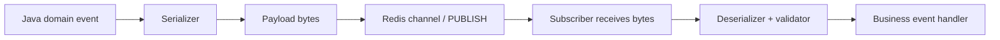

# Payload Serialization and Message Versioning in Redis Pub/Sub

> **Module:** Spring Data Redis  
> **Chapter:** Pub/Sub  
> **Topic:** Designing message formats, choosing serializers, defining data contracts, and evolving versions between publishers and subscribers in systems using Spring Data Redis.

## 1. Why does Pub/Sub need a clear message contract?

Redis Pub/Sub is a mechanism for publishing and receiving messages through **channels**. Publishers send data to a channel with `PUBLISH`, and subscribers registered on that channel can receive the message.

```redis
SUBSCRIBE catalog.product.price-changed
```

Another publisher sends:

```redis
PUBLISH catalog.product.price-changed "{\"productId\":\"p-101\",\"newPrice\":129000}"
```

At the protocol level, Redis **does not understand** `productId`, `newPrice`, Java classes, JSON schemas, or version names. It forwards the payload as bytes to subscribers. What "this byte sequence means" is agreed upon by **publisher and subscriber**.

In a small system, two services might both understand `"p-101|129000"`. However, when you need to:

- Change an object's structure without updating every service simultaneously.
- Rename a Java package/class in one application.
- Add new fields while still supporting consumers running older versions.
- Distinguish multiple event types traveling over the same channel.
- Support consumers written in Java, Node.js, or Python.
- Detect invalid payloads, missing fields, or incompatible messages.
- Trace a message from publisher to receiver.

…then **serialization** and **message versioning** become part of the API design between services.

An important lesson: Redis Pub/Sub is an **ephemeral delivery channel**, whereas JSON/Avro/Protobuf… are **data formats**. Choosing the right serializer does not turn Redis Pub/Sub into a durable queue with replay, retries, or acknowledgments.

### 1.1. Three boundaries in the transmission pipeline



There are three distinct concerns:

1. **Encoding:** converting application data into bytes and back.
2. **Schema agreement:** defining fields, data types, semantics, and validation rules.
3. **Version evolution:** allowing producers and consumers to deploy out of sync while still properly handling the messages they support.

Redis only transports data. Redis does not validate schemas or automatically upgrade messages from v1 to v2.

## 2. Understanding exactly what Redis Pub/Sub transmits

### 2.1. Channel and body are separate data

A Pub/Sub message has at least:

| Component | Meaning | Example |
|---|---|---|
| Channel | Target address name the publisher sends to | `catalog.product.price-changed` |
| Payload/body | Broadcast bytes | UTF-8 JSON or Protobuf bytes |
| Pattern (if subscriber registered a pattern) | Pattern matching the channel | `catalog.product.*` |

Redis Pub/Sub **does not automatically add** business metadata such as `eventId`, `schemaVersion`, `timestamp`, `correlationId`, or `aggregateVersion`. If you need them, put them in the **payload** or design metadata via an explicit convention.

Both channel name and body need consistent encoding. With `StringRedisTemplate`, typical usage treats channels/values as Strings serialized with `StringRedisSerializer` (UTF-8). With custom templates, serializers may differ.

### 2.2. Pub/Sub does not store messages

Key properties of **regular Redis Pub/Sub**:

- A subscriber only receives messages published while it is connected and subscribed to the matching channel/pattern.
- There are no offsets, message history, re-fetch mechanisms, or acknowledgments like in a durable message broker.
- If a subscriber is offline, messages published during that window are lost for that subscriber.
- `PUBLISH` does not wait for business handlers to succeed.
- No automatic transaction links a Pub/Sub event to the publisher's database commit.
- When a channel has multiple subscribers, all active subscribers can receive a copy of the message.
- Redis does not guarantee global ordering across channels, connections, publishers, and reconnects.

Redis describes regular Pub/Sub as having **at-most-once delivery semantics**. That is a limit of the **delivery system**, independent of how well designed the JSON schema is.

If you need to replay messages for new consumers, retain history, acknowledge processing, control retries, or recover missed events, consider **Redis Streams with consumer groups** or another durable message broker. You can still use the same schema and versioning style, while changing the delivery protocol.

## 3. What is a serializer and where does Spring Data Redis fit?

*Serialization* is the process:

```text
Java object -> bytes -> Redis Pub/Sub -> bytes -> Java object
```

*Deserialization* does the reverse. Both sides must agree on:

- Format: JSON, Protobuf, Avro, MessagePack, CBOR, plain text…
- Text encoding, usually UTF-8.
- Numeric types and currency representation.
- Date/time rules, timezone, and precision.
- Required fields, optional fields, and `null` values.
- Semantics of every field and version-change rules.
- How to handle unrecognized or invalid messages.

Spring Data Redis provides mechanisms to work with Redis bytes through `RedisSerializer`, `RedisTemplate`, `StringRedisTemplate`, `MessageListener`, and `MessageListenerAdapter`.

**There is no single serializer automatically applied across every API:**

- `RedisTemplate` has its own bean-level key/value/hash serializers.
- `StringRedisTemplate` normally uses String serializers.
- `MessageListenerAdapter` has a serializer for converting messages into receiving method arguments.
- `MessageListener` receives raw Redis `Message` directly and decides how to decode `message.getBody()`.
- `RedisCacheManager` and Redis Repositories have their own serialization/mapping rules and do not apply automatically to Pub/Sub.

Therefore, if a subscriber decodes bytes as JSON while the publisher actually sends a Java serialized object, the bug lies in the **serializer contract between the two sides**, even though both are connected to the same Redis server.

## 4. Comparing common serialization choices

| Format | Advantages | Limitations | When to consider |
|---|---|---|---|
| **UTF-8 plain text** | Simple, easy to inspect via CLI | Lacks structure, hard to extend with multiple fields | Simple signals like `"refresh"` or an ID |
| **JSON UTF-8** | Human-readable, cross-language, supports adding fields | Larger payloads than binary; needs validation and versioning | Domain events, microservices, and polyglot systems |
| **MessagePack/CBOR** | Binary, more compact than JSON in many cases | Harder to inspect directly; requires shared library/schema conventions | High-volume events wanting compact structure |
| **Protobuf** | Strongly typed contract, efficient encoding, schema evolution rules | Requires managing `.proto` files, generated code, and deprecated fields | Multi-service systems with formal contracts |
| **Avro** | Schema-based with reader/writer evolution model | Requires schema management, sometimes a schema registry | Event-driven platforms with centralized schema governance |
| **JDK serialization** | Convenient when both sides are Java | Tied to Java classes, hard across languages, untrusted deserialization risk | Not recommended as a Pub/Sub contract between independent services |
| **Custom raw byte protocol** | Can optimize specialized cases | Error-prone on format changes and lacks tooling | Specialized cases with explicit protocol specs |

**UTF-8 JSON with a schema envelope** is the most approachable and pragmatic choice for most Spring Data Redis Pub/Sub examples. For high-throughput, large-scale systems, Protobuf/Avro may fit better while still requiring producer/consumer upgrade procedures.

### 4.1. Why shouldn't you transmit Java objects "as-is"?

Suppose a publisher serializes directly:

```java
public class ProductPriceChanged {
    private String productId;
    private BigDecimal price;
}
```

After renaming a class or package, adding a field, or changing `serialVersionUID`, subscribers may no longer be able to deserialize older payloads. Using a serializer that accepts arbitrary class identifiers in untrusted payloads also introduces security risks.

A **message contract** should be independent of internal domain object details. For instance, a producer might use `PriceChangedEntity`, while the public message keeps the structure:

```json
{
  "eventType": "product.price.changed",
  "schemaVersion": 1,
  "payload": {
    "productId": "p-101",
    "price": 129000,
    "currency": "VND"
  }
}
```

Consumers do not need to know which Java class the producer uses. They only need to understand the contract.

## 5. Designing an envelope to manage versions and metadata

### 5.1. What is an envelope?

An *envelope* wraps the business data (*payload*). Every message should self-describe the event type and version required to decode it.

Example:

```json
{
  "envelopeVersion": 1,
  "eventType": "product.price.changed",
  "schemaVersion": 1,
  "eventId": "e76fc6e5-803c-4ac4-b6e7-a59f87a917a8",
  "occurredAt": "2026-11-13T03:20:00Z",
  "producer": "catalog-service",
  "payload": {
    "productId": "p-101",
    "aggregateVersion": 43,
    "price": 129000,
    "currency": "VND"
  }
}
```

Meaning of each field:

| Field | Role | Recommended rule |
|---|---|---|
| `envelopeVersion` | Version of the **outer wrapper structure** | Increment when changing how envelope metadata is interpreted |
| `eventType` | Distinguishes the event kind | Use a meaningful, stable business name |
| `schemaVersion` | Version of the **payload schema** for that event type | Define compatibility rules clearly |
| `eventId` | Identifies a single event emission | Stable format, supports logging and deduplication |
| `occurredAt` | Timestamp when the source event occurred | ISO-8601 UTC, avoiding timezone ambiguity |
| `producer` | Service that emitted the event | Useful for logs/diagnostics; do not treat as sole trust proof |
| `payload` | Business data | Must be validated against `schemaVersion` |
| `aggregateVersion` | Change version of the business entity | Separates data update order from schema version |

**`schemaVersion` is not `aggregateVersion`:**

- `schemaVersion = 1` means the consumer reads the payload using the v1 format.
- `aggregateVersion = 43` means the message describes the 43rd change (according to the source system), if the source system tracks versions that way.

Do not use `schemaVersion` to infer "this message is newer than that one." Use a dedicated sequence or aggregate version to detect late or out-of-order events.

### 5.2. Should version live in the channel or the body?

There are three approaches:

**Approach A — version in the payload/envelope:**

```text
channel: catalog.product.price-changed
body: { "schemaVersion": 1, ... }
```

Advantage: the same channel can carry multiple versions, and consumers inspect metadata. Suits independent producer/consumer deployments.

**Approach B — version in the channel:**

```text
catalog.product.price-changed.v1
catalog.product.price-changed.v2
```

Advantage: separates subscribers by version, useful for major changes or very different consumer groups. Drawback: requires managing multiple subscriptions and possibly dual publishing during transitions.

**Approach C — combining both:**

The channel indicates family/major version, while the envelope records the full schema version. Useful if you want to isolate breaking changes at the channel level while tracking metadata.

For applications starting with JSON, approach A is usually the simplest and clearest choice. Do not change channels just to add an optional field. Changing a channel is a **routing change**, distinct from a schema change.

## 6. Rules for backward-compatible schema evolution

A v1 message consumed by multiple services cannot be changed arbitrarily into any shape while expecting older consumers to keep running.

### 6.1. Changes that can typically stay backward compatible

Suppose v1:

```json
{
  "productId": "p-101",
  "aggregateVersion": 43,
  "price": 129000,
  "currency": "VND"
}
```

An evolution adds a `source` field:

```json
{
  "productId": "p-101",
  "aggregateVersion": 44,
  "price": 125000,
  "currency": "VND",
  "source": "FLASH_SALE"
}
```

**Adding an optional field** can remain compatible if:

- Older consumers are designed to **ignore unknown fields**, rather than failing on unknown fields.
- Newer consumers have a clear default when older producers have not sent `source`.
- The new field does not alter the meaning of existing fields.
- The event type's schema policy permits this change.

If an older consumer uses a strict deserializer that rejects unknown fields, even adding a field can break it. Hence "adding a field is backward compatible" **depends on the contract and how consumers actually parse data**.

To be safe, you can keep `schemaVersion = 1` for strictly compatible additions within the same schema family, provided rules are clear. If you bump `schemaVersion = 2` on every field addition, older consumers may reject all v2 messages even when the structure barely changed—requiring consumers to upgrade first.

### 6.2. Changes that typically cause breaking changes

| Change | Risk | Common handling |
|---|---|---|
| Removing a required field | Older consumers lack needed data | New schema version, transition period |
| Renaming `productId` to `sku` | Older consumers read a missing ID | Add new field temporarily, migrate, then retire old field |
| Changing `price` from number to free-form string | Deserialization/numeric logic may break | Keep numeric type or bump version |
| Changing `price` from VND to USD cents without renaming | Severe business miscalculation | New schema/event type, explicit unit rules |
| Changing `occurredAt` meaning from event time to delivery time | Consumers calculate timestamps wrong | New metadata field or new envelope version |
| Switching JSON to Protobuf on the same channel without signaling | JSON consumers fail to decode | New channel/format marker and planned rollout |
| Dropping support for an older `eventType` | Older consumers stop processing | Deprecation notice and dual-support window |

An easily overlooked point: **changing meaning while keeping the same data type is still a breaking change**. The number `129000` could mean 129,000 VND or 129,000 "cents"; two conflicting interpretations even though the JSON remains valid.

### 6.3. Compatibility matrix model

| Publisher emits | Consumer understands v1 | Consumer understands v1 and v2 | Consumer understands only v2 |
|---|---|---|---|
| Event v1 | Works | Works | Works only with a v1 adapter/converter |
| Event v2 adding compatible field, still declared v1 per contract | Works if unknown fields ignored | Works | Depends on implementation |
| Event v2 declaring `schemaVersion=2` | Rejected or controlled skip | Works | Works |
| Breaking Event v2 | Cannot be used directly | Works if a v2 handler exists | Works |

Having a consumer **skip unsupported messages** is a controlled error-handling option. With Redis Pub/Sub, skipping means data **loses its chance to be processed**; there is no backlog to reprocess after upgrading. Therefore, never roll out breaking changes while consumers that still need those events have not upgraded.

## 7. Spring Data Redis example: publisher sending a JSON envelope

This example uses **Java 17+, Spring Boot, and Spring Data Redis**, choosing a fixed channel, UTF-8 JSON, and an explicit envelope.

### 7.1. Basic dependencies

Gradle Kotlin DSL:

```kotlin
dependencies {
    implementation("org.springframework.boot:spring-boot-starter-data-redis")
    implementation("org.springframework.boot:spring-boot-starter-json")
}
```

Depending on the Spring Boot version, Jackson may already be a transitive dependency of web starters, though adding the JSON starter matching your Boot version expresses the payload serialization requirement explicitly. The Java snippets below assume a Jackson 2.x-compatible `ObjectMapper` configured by the application; use imports/APIs matching your project's Spring Boot and Jackson versions.

Simple Redis connection in `application.yml`:

```yaml
spring:
  data:
    redis:
      host: localhost
      port: 6379
      timeout: 2s
```

This connection configuration does not automatically enable Pub/Sub subscriptions. Subscriptions are declared via `RedisMessageListenerContainer` in the next section.

### 7.2. Defining an envelope independent of domain entities

Place each `public record` in its corresponding Java file:

```java
// File: EventEnvelope.java
import com.fasterxml.jackson.databind.JsonNode;

public record EventEnvelope(
        int envelopeVersion,
        String eventType,
        int schemaVersion,
        String eventId,
        String occurredAt,
        String producer,
        JsonNode payload
) {}
```

Payload v1:

```java
// File: ProductPriceChangedV1.java
import java.math.BigDecimal;
import com.fasterxml.jackson.annotation.JsonIgnoreProperties;

@JsonIgnoreProperties(ignoreUnknown = true)
public record ProductPriceChangedV1(
        String productId,
        long aggregateVersion,
        BigDecimal price,
        String currency
) {}
```

Payload v2 adds a new field:

```java
// File: ProductPriceChangedV2.java
import java.math.BigDecimal;
import com.fasterxml.jackson.annotation.JsonIgnoreProperties;

@JsonIgnoreProperties(ignoreUnknown = true)
public record ProductPriceChangedV2(
        String productId,
        long aggregateVersion,
        BigDecimal price,
        String currency,
        String source
) {}
```

With `@JsonIgnoreProperties(ignoreUnknown = true)`, consumers of these records can tolerate unknown fields. However, it does not guarantee that a **missing** field has a valid value; validation is still needed.

`BigDecimal` is better than `double` for monetary prices in many domains, though **units** and **currency** conventions are still required. For strict monetary systems, you may choose integer minor units paired with currency if the contract specifies it clearly.

### 7.3. Publisher using `StringRedisTemplate`

```java
import java.math.BigDecimal;
import java.time.Instant;
import java.util.UUID;

import com.fasterxml.jackson.core.JsonProcessingException;
import com.fasterxml.jackson.databind.ObjectMapper;
import org.springframework.data.redis.core.StringRedisTemplate;
import org.springframework.stereotype.Service;

@Service
public class PriceChangedPublisher {

    public static final String CHANNEL =
            "catalog.product.price-changed";
    public static final String EVENT_TYPE =
            "product.price.changed";

    private final StringRedisTemplate redis;
    private final ObjectMapper mapper;

    public PriceChangedPublisher(
            StringRedisTemplate redis, ObjectMapper mapper) {
        this.redis = redis;
        this.mapper = mapper;
    }

    public Long publishV1(String productId,
                          long aggregateVersion,
                          BigDecimal newPrice,
                          String currency) throws JsonProcessingException {

        ProductPriceChangedV1 payload = new ProductPriceChangedV1(
                productId, aggregateVersion, newPrice, currency);

        EventEnvelope event = new EventEnvelope(
                1,
                EVENT_TYPE,
                1,
                UUID.randomUUID().toString(),
                Instant.now().toString(),
                "catalog-service",
                mapper.valueToTree(payload));

        String json = mapper.writeValueAsString(event);

        return redis.convertAndSend(CHANNEL, json);
    }
}
```

In this example:

- `ObjectMapper` converts the record to a JSON string.
- `StringRedisTemplate` serializes the string into UTF-8 bytes to send `PUBLISH`.
- `eventType` and `schemaVersion` are set explicitly.
- `eventId` is generated per **logical event**; if retrying or dual-publishing the same event, preserve a stable `eventId` rather than generating a new `eventId` for the same business change.
- `occurredAt` uses ISO-8601 UTC via `Instant.now().toString()`.
- `redis.convertAndSend(...)` returns the subscriber count Redis reports as receiving the message, **not** confirmation that all consumers processed it successfully.

With other Java records or Jackson versions, appropriate `ObjectMapper` configuration may be needed. Storing `occurredAt` as an ISO-8601 string prevents the contract from depending on a specific library's default Java `Instant` serialization format.

### 7.4. Why not publish Java entities directly?

Avoid patterns like:

```java
redisTemplate.convertAndSend(CHANNEL, productEntity);
```

if services **have not standardized the serializer** for `productEntity`. A default `RedisTemplate` bean may use a different serialization format than `StringRedisTemplate`; even with the same channel name, a JSON subscriber may receive non-JSON bytes.

When choosing JSON as the contract, publishers should serialize explicitly or configure a dedicated template with a controlled JSON serializer. Do not rely on the default serializer of an unspecified bean.

## 8. Subscriber receiving messages and decoding by version

### 8.1. Using `MessageListener` to handle raw bytes directly

```java
import java.math.BigDecimal;
import java.nio.charset.StandardCharsets;
import java.time.Instant;

import com.fasterxml.jackson.databind.ObjectMapper;
import org.slf4j.Logger;
import org.slf4j.LoggerFactory;
import org.springframework.data.redis.connection.Message;
import org.springframework.data.redis.connection.MessageListener;
import org.springframework.stereotype.Component;

@Component
public class PriceChangedListener implements MessageListener {

    private static final Logger log =
            LoggerFactory.getLogger(PriceChangedListener.class);

    private static final int MAX_BYTES = 64 * 1024;

    private final ObjectMapper mapper;
    private final PriceProjection projection;

    public PriceChangedListener(
            ObjectMapper mapper, PriceProjection projection) {
        this.mapper = mapper;
        this.projection = projection;
    }

    @Override
    public void onMessage(Message message, byte[] pattern) {
        byte[] body = message.getBody();

        // Size limit is an application policy,
        // not a default Redis limit.
        if (body == null || body.length == 0 || body.length > MAX_BYTES) {
            log.warn("Reject empty or oversized price event");
            return;
        }

        try {
            String json = new String(body, StandardCharsets.UTF_8);
            EventEnvelope event =
                    mapper.readValue(json, EventEnvelope.class);

            if (event.envelopeVersion() != 1
                    || !PriceChangedPublisher.EVENT_TYPE
                            .equals(event.eventType())
                    || event.eventId() == null
                    || event.eventId().isBlank()
                    || event.payload() == null
                    || !event.payload().isObject()) {
                log.warn("Reject invalid price event envelope");
                return;
            }

            // Validate that the timestamp parses as UTC/ISO-8601.
            Instant.parse(event.occurredAt());

            switch (event.schemaVersion()) {
                case 1 -> handleV1(event);
                case 2 -> handleV2(event);
                default -> log.warn(
                        "Unsupported schemaVersion={} eventId={}",
                        event.schemaVersion(), event.eventId());
            }
        } catch (Exception ex) {
            // Log + metric; Redis Pub/Sub has no ack/nack mechanism
            // for Redis to automatically redeliver this message.
            log.warn("Cannot handle price-change message", ex);
        }
    }

    private void handleV1(EventEnvelope event) throws Exception {
        ProductPriceChangedV1 payload =
                mapper.treeToValue(
                        event.payload(), ProductPriceChangedV1.class);

        validate(payload.productId(),
                 payload.aggregateVersion(),
                 payload.price(),
                 payload.currency());

        projection.applyIfNewer(
                payload.productId(),
                payload.aggregateVersion(),
                payload.price(),
                payload.currency(),
                event.eventId());
    }

    private void handleV2(EventEnvelope event) throws Exception {
        ProductPriceChangedV2 payload =
                mapper.treeToValue(
                        event.payload(), ProductPriceChangedV2.class);

        validate(payload.productId(),
                 payload.aggregateVersion(),
                 payload.price(),
                 payload.currency());

        // source in v2 can be used to track update origin,
        // while the core projection still uses the stable fields.
        projection.applyIfNewer(
                payload.productId(),
                payload.aggregateVersion(),
                payload.price(),
                payload.currency(),
                event.eventId());
    }

    private static void validate(
            String productId, long aggregateVersion,
            BigDecimal price, String currency) {

        if (productId == null || productId.isBlank()
                || aggregateVersion <= 0
                || price == null || price.signum() < 0
                || currency == null || currency.isBlank()) {
            throw new IllegalArgumentException(
                    "Invalid product price event");
        }
    }
}
```

Business dependency illustrated by an interface:

```java
import java.math.BigDecimal;

public interface PriceProjection {

    // Implementation must guarantee atomic check-and-update of version.
    void applyIfNewer(String productId,
                      long aggregateVersion,
                      BigDecimal price,
                      String currency,
                      String eventId);
}
```

`PriceProjection` here is implemented by the application itself. It may write to a cache, update a read model, or persist to a projection table. `applyIfNewer` must perform the version comparison and update **atomically** in the appropriate data store; the method name alone does not confer atomicity.

The listener illustrates two crucial points:

- **Deserialize based on `schemaVersion`**, rather than guessing a Java class from the payload.
- **Validate data after deserialization**, because syntactically valid JSON does not mean a business-valid event.

Here an invalid message is logged and skipped. With Pub/Sub lacking ack/replay, if skipping is unacceptable, **move to a delivery infrastructure with proper durability and retries**, or add a reconciliation path that fetches authoritative state.

### 8.2. Registering the listener with `RedisMessageListenerContainer`

```java
import org.springframework.context.annotation.Bean;
import org.springframework.context.annotation.Configuration;
import org.springframework.data.redis.connection.RedisConnectionFactory;
import org.springframework.data.redis.listener.ChannelTopic;
import org.springframework.data.redis.listener.RedisMessageListenerContainer;

@Configuration
public class PriceEventsSubscriptionConfiguration {

    @Bean
    public RedisMessageListenerContainer priceEventsContainer(
            RedisConnectionFactory connectionFactory,
            PriceChangedListener listener) {

        RedisMessageListenerContainer container =
                new RedisMessageListenerContainer();
        container.setConnectionFactory(connectionFactory);
        container.addMessageListener(
                listener,
                new ChannelTopic(PriceChangedPublisher.CHANNEL));
        return container;
    }
}
```

When Spring manages the container bean, it manages subscription lifecycles. `ChannelTopic` subscribes to one specific channel. If you need to subscribe to multiple channels by pattern, use `PatternTopic` accordingly.

Operational notes:

- Subscriptions can experience brief interruptions due to Redis failovers, network issues, or topology changes. Reconnecting does not replay lost events.
- Listeners can be executed by the container's task executor. If callbacks are heavy or blocking, tune the executor or offload work; overly slow processing can build up client backlogs and memory usage.
- Use channel ACLs and environment-appropriate TLS/credentials; the container needs real subscribe permissions.
- One Spring instance can host multiple listeners; multiple instances subscribed to the same channel can all receive the event.

### 8.3. How should the example classes be structured?

An illustrative package layout:

```text
com.example.events
├── EventEnvelope.java
├── ProductPriceChangedV1.java
├── ProductPriceChangedV2.java
├── PriceChangedPublisher.java
├── PriceChangedListener.java
├── PriceEventsSubscriptionConfiguration.java
└── PriceProjection.java
```

This example separates classes for clarity of responsibility; imports and Java packages should fit your project. When producer and consumer are separate services, share only the **published contract** and do not force all domain entities across both services into the same Java artifact.

## 9. Using `MessageListenerAdapter`

Beyond implementing `MessageListener` directly, Spring Data Redis provides `MessageListenerAdapter` to translate messages into method calls on a delegate. The adapter uses a serializer to decode the payload into method arguments.

Example when messages are always JSON Strings and the service handles JSON itself:

```java
import org.springframework.context.annotation.Bean;
import org.springframework.context.annotation.Configuration;
import org.springframework.data.redis.listener.adapter.MessageListenerAdapter;
import org.springframework.data.redis.serializer.StringRedisSerializer;

@Configuration
public class PriceAdapterConfiguration {

    @Bean
    public MessageListenerAdapter priceMessageAdapter(
            PriceTextReceiver receiver) {

        MessageListenerAdapter adapter =
                new MessageListenerAdapter(receiver, "receive");
        adapter.setSerializer(new StringRedisSerializer());
        return adapter;
    }
}
```

Delegate:

```java
import org.springframework.stereotype.Component;

@Component
public class PriceTextReceiver {

    public void receive(String json) {
        // Parse envelope, validate eventType/schemaVersion,
        // validate payload, then invoke business handler.
    }
}
```

The adapter bean should be registered on a `RedisMessageListenerContainer` in place of the raw listener in an alternative subscription setup; **do not register both** if you only want each event processed once per application instance.

Differences:

- With `MessageListener`: the callback receives `byte[]`, and the application directly controls decoding and validation.
- With `MessageListenerAdapter`: the adapter calls its serializer first, so the configured serializer **must match the publisher**.
- If an incompatible default serializer is used by accident, converting the message into Java arguments can fail **before** the delegate method ever runs.

The examples in this lesson use a raw listener as the primary path to show the full schema-validation flow.

## 10. Upgrading from schema v1 to v2 without breaking consumers

Suppose the publisher wants to add a `source` field to the price event. Some consumers cannot upgrade on the same day.

### 10.1. Distinguishing "adding a field" from "bumping the version"

A common strategy:

- When **adding an optional, fully compatible field** and older consumers ignore unknown fields, you can keep the same contract version if your versioning rules allow it.
- When you want to explicitly signal a schema difference that consumers must understand as v2, increment `schemaVersion` from 1 to 2.
- When changing **business semantics** rather than just fields, consider a new event type or a new version with a transition window.

In the listener code above, the consumer already supports `schemaVersion = 1` and `2`. The producer can begin emitting v2:

```java
ProductPriceChangedV2 payload =
        new ProductPriceChangedV2(
                "p-101", 44L,
                new BigDecimal("125000"), "VND",
                "FLASH_SALE");

EventEnvelope event = new EventEnvelope(
        1,
        "product.price.changed",
        2,
        "c69cfde9-a257-4c36-96fd-4ab85f732618",
        "2026-11-13T04:00:00Z",
        "catalog-service",
        mapper.valueToTree(payload));

redis.convertAndSend(
        PriceChangedPublisher.CHANNEL,
        mapper.writeValueAsString(event));
```

This snippet lives inside a context with `mapper`/`redis` available, illustrating how to construct a v2 event; it is not a standalone class.

### 10.2. Producer and consumer rollout sequence

A safer rollout plan:

1. **Publish schema v2:** define new fields, types, and meanings. Specify whether v1 consumers may skip it or not.
2. **Expand consumers first:** deploy versions capable of reading **both v1 and v2** while keeping v1 logic active.
3. **Observe readiness:** verify critical consumers have upgraded, with telemetry tracking versions and decode errors.
4. **Switch the publisher:** emit v2 once all required subscribers support it.
5. **Maintain compatibility during the transition window:** older producers may still emit v1.
6. **Retire v1 when evidence shows it is unused:** rely on consumer inventory and usage metrics, not merely deployment dates.
7. **Handle rollbacks:** if the publisher reverts to v1, newer consumers must still understand v1.

With Pub/Sub, if a publisher emits v2 too early, v1 consumers can **permanently miss** v2 events they cannot understand. There is no backlog to reprocess once the consumer upgrades.

### 10.3. Dual publishing for breaking changes

Some changes cannot share a single contract. You can publish in parallel:

```text
catalog.product.price-changed.v1   -> payload v1
catalog.product.price-changed.v2   -> payload v2
```

However, dual publishing carries risks:

- A consumer accidentally subscribing to both channels can process **the same change twice**.
- Publishing v1 succeeds and publishing v2 fails: two consumer groups observe divergent states.
- Redis Pub/Sub does not guarantee atomic simultaneous delivery of both copies; there is no durable transaction spanning two channel publishes.
- Generating different `eventId`s for the same change makes deduplication harder.
- You must time-box dual publishing and set clear criteria for retiring v1.

If all consumers must reliably receive an exact event, plain dual Pub/Sub offers no delivery guarantee; consider an event log/queue with retries and idempotency.

## 11. Compatibility contract: how to define it for maintainability

A minimal contract document can specify:

```yaml
eventType: product.price.changed
channel: catalog.product.price-changed
envelopeVersion: 1
schemaVersion: 2
contentType: application/json
encoding: UTF-8

payload:
  productId:
    type: string
    required: true
    description: "Stable identifier of the product"
  aggregateVersion:
    type: integer
    required: true
    minimum: 1
    description: "Monotonically increasing version per product change"
  price:
    type: decimal
    required: true
    minimum: 0
    description: "Price in the currency unit"
  currency:
    type: string
    required: true
    description: "Currency code, e.g., VND"
  source:
    type: string
    required: false
    description: "Change origin; may be absent in older versions"
```

This is a **YAML specification for design documentation**, not a format enforced by Spring Data Redis. When multiple services participate, you can use JSON Schema, Protobuf schemas, Avro schemas, or a contract repository versioned in Git.

Beyond the schema, every event needs **semantic rules**:

- Is `productId` case-sensitive?
- Can `price` be negative or zero? Is the unit major or minor currency?
- Does `aggregateVersion` increment per product or globally?
- Is `occurredAt` the database commit time or the publisher send time?
- Is `source` a closed enum or an extensible string?
- Does the event represent a **committed fact** or merely a change request?
- When a consumer encounters an unknown field, should it ignore, warn, or reject?

Two JSON documents with identical fields and data types can still be semantically incompatible for business logic.

## 12. Decoupling event schemas from entity schemas

A common design mistake is publishing the database entity directly:

```java
// Anti-pattern to avoid when events are consumed by independent services:
redis.convertAndSend(channel, objectMapper.writeValueAsString(entity));
```

An entity can carry:

- Database-only fields.
- Lazy-loaded associations or complex object graphs.
- Personal or sensitive data that should not be broadcast.
- Class/field names that change during internal refactoring.
- Uncommitted temporary state.
- Values consumers do not need, yet become coupled to.

An **event DTO/contract** should contain only the fields needed by receivers and chosen deliberately. For example:

```text
Domain entity Product:
  id, name, description, internalCost, sellingPrice,
  supplierSecret, stock, updatedAt, auditFields ...

Public event product.price.changed:
  productId, aggregateVersion, price, currency, source
```

This separation allows changing the database schema without forcing every consumer to change. It also reduces the risk of leaking internal secrets onto Pub/Sub.

## 13. Handling unknown versions or deserialization errors

In event-driven code, error handling must be defined upfront. For example:

| Situation | Handling to consider | Limitation |
|---|---|---|
| Invalid UTF-8 bytes | Reject, record metrics/bounded logs | Pub/Sub does not redeliver automatically |
| Syntactically invalid JSON | Reject, log channel and error type | No built-in dead-letter queue |
| Missing `schemaVersion` | Reject or apply a documented compatibility default | Do not silently guess the format |
| `schemaVersion` higher than supported | Warn, record metric, avoid wrong casts | Event is skipped unless a catch-up path exists |
| Unknown `eventType` | Controlled skip or register new handler | Avoid invoking the wrong handler |
| Missing required field | Validate and reject | Valid JSON can still contain invalid data |
| `price` has invalid type/value | Reject, log with redaction | Do not coerce arbitrary strings into money |
| Already processed same `eventId` | Deduplicate if needed | Pub/Sub does not provide deduplication |
| `aggregateVersion` older than current state | Skip or reconcile | Requires atomic compare-and-update |
| Handler fails mid-execution | Log/metric and reconcile; consider durable queue | No Redis Pub/Sub ACK/NACK |

**Do not log raw payloads by default**, especially when personal data or secrets may be present. Log event type, schema version, event ID, byte size, and error code; log redacted payloads only in appropriate environments.

### 13.1. Should you default `schemaVersion` when missing?

If a legacy system used to send JSON without an envelope, you can write an adapter during migration:

```text
If schemaVersion is present -> decode using that schema.
If schemaVersion is absent but body matches legacy v0 ->
    decode using LegacyPriceChangedV0.
Otherwise -> reject.
```

You need **explicit legacy identification criteria**. Never assume an unversioned message is automatically v1 if doing so could cause fields to be misinterpreted.

### 13.2. Payload size and JSON depth limits

Subscribers can be attacked or fail on oversized or deeply nested payloads. Redis Pub/Sub does not enforce a business size limit tailored to your events. Applications should enforce byte limits, configure parser constraints in the JSON library, and bound batch/payload sizes per event type.

In the listener example, `MAX_BYTES = 64 * 1024` is an **illustrative application convention**, not a Redis protocol limit.

## 14. Event ordering and data versions vs. schema versions

Suppose a product is updated consecutively:

```text
Event A: productId=p-101, aggregateVersion=44, price=129000
Event B: productId=p-101, aggregateVersion=45, price=125000
```

With multiple publishers, network delays, or asynchronous consumer handlers, do not rely on `occurredAt` or global callback order to ensure B is always applied after A. A consumer receiving B first and then A could accidentally overwrite the newer price with the **older price**.

Use business versioning:

```text
storedVersion = 45
incomingVersion = 44

If incomingVersion <= storedVersion:
    Ignore stale/already-processed event
Else:
    Update price and version in a single atomic operation
```

**Atomic check-and-set is required** where the projection is stored. Reading the version with `GET` and then writing with `SET` across multiple workers still leaves a race condition.

Options:

- Transactions/optimistic locking in the source or read-model database.
- A Redis Lua script that checks and updates version/price atomically on the same Redis instance/slot.
- Redis `WATCH` + `MULTI`/`EXEC` with retries.
- An event log system with suitable partitioning/ordering semantics combined with idempotency.

Do not confuse:

- **`schemaVersion`:** structure of the event.
- **`aggregateVersion`:** update sequence of the product.
- **`eventId`:** identifier to detect the same logical event.
- **`occurredAt`:** time the event occurred; useful for monitoring, not a replacement for ordered versioning.

### 14.1. Event ID does not automatically give exactly-once

Publishers can attach `eventId` so consumers track processed events. However, to prevent duplicate side effects, checking `eventId` and recording the result must be coordinated via a transaction or atomic operation.

```text
Worker A: checks eventId not yet processed
Worker B: checks eventId not yet processed
Worker A: writes new price
Worker B: writes new price
```

If two workers process the same event without locking or atomicity, both can execute the side effect. Putting a UUID in the payload only provides **identifiability**, not guaranteed once-only execution.

Additionally, regular Redis Pub/Sub does not retry automatically; deduplication still helps when publishers dual-publish or retry, though it cannot recover lost messages.

## 15. Compatibility across multiple services and running versions

A production system can simultaneously run:

```text
catalog-service A  -> publisher v1
catalog-service B  -> publisher v2

pricing-view v1    -> subscriber understanding only schema v1
pricing-view v2    -> subscriber understanding v1 + v2

notification v2    -> subscriber understanding v1 + v2
analytics v1       -> subscriber understanding only v1
```

Rolling deployments across pods make mixed-version windows normal.

### 15.1. Contract-first prevents rollout failures

A sound workflow:

1. Publish schemas in a versioned repository or artifact.
2. Provide canonical JSON examples for active versions.
3. Document which changes are allowed without bumping the major version.
4. Identify the event owner, consumer list, and migration requirements.
5. Expand consumers before publishers emit a new version needing a new handler.
6. Monitor `eventVersion`/`schemaVersion` after rollout.
7. Remove v1 support code once no consumer or producer needs it.

Never require every team to deploy at the exact same instant as the sole safeguard: distributed environments have restarts, rollbacks, and overlapping deployments.

### 15.2. Shared contract library: benefits and risks

A library holding event DTOs and JSON schemas can prevent field-name typos across Java applications. However, if the shared library imports heavy domain code or releases tightly coupled with every service, it introduces coupling.

One way to organize:

```text
event-contracts/
  product-price-changed/
    v1.schema.json
    v1.example.json
    v2.schema.json
    v2.example.json
    README.md
```

Java consumers can generate or declare DTOs from those schemas; Node/Python consumers can use the same contract. The contract owner should maintain change history and supported versions.

### 15.3. Consumer-driven compatibility

Producers often do not know every implicit assumption consumers rely on. With multiple teams, contract tests can verify new events against the schemas consumers actually support—for instance, whether old consumers ignore new fields, whether `price` is still serialized as a number, and whether `occurredAt` remains ISO-8601 UTC.

This is development-lifecycle quality governance. It **does not replace runtime monitoring** because events can still be dropped over the network even when schemas are 100% valid.

## 16. JSON subtleties that easily cause versioning bugs

### 16.1. Distinguishing a missing field from a `null` field

These two payloads can have different semantics:

```json
{"productId":"p-101"}
```

```json
{"productId":"p-101","source":null}
```

Under some contracts, a **missing field** means "producer does not know the new field yet", while **`null`** means "change origin is unspecified". If business logic distinguishes the two states, schemas and DTOs/`JsonNode` must handle them explicitly.

### 16.2. Numbers and currency

Never send prices as floating-point numbers and assume every consumer rounds identically. For financial data:

- Use integers representing minor currency units or exact decimals.
- Attach `currency` and unit rules.
- Never change units without changing the field or version.
- Define rounding and decimal scale explicitly.

Example:

```json
{
  "priceMinor": 129000,
  "currency": "VND"
}
```

The meaning of `priceMinor` must follow ISO 4217 or application rules; for VND and certain other currencies, decimal places may differ.

### 16.3. Timestamps

Prefer unambiguous representations:

```json
{"occurredAt":"2026-11-13T03:20:00Z"}
```

Avoid:

```json
{"occurredAt":"13/11/2026 10:20"}
```

The second string lacks a timezone and depends on date formatting locale. If using epoch milliseconds, document the unit explicitly; epoch seconds and epoch milliseconds are both numbers yet differ by a factor of 1,000.

### 16.4. Evolvable enums

Suppose `source` originally has `"ADMIN"` and `"IMPORT"`, and later adds `"FLASH_SALE"`. Any consumer using a strict enum without a fallback can fail on the new value.

If extensibility is allowed, define an `UNKNOWN` state or fallback handling for unrecognized enum values. If not extensible, adding an enum value is a contract change requiring a planned rollout.

### 16.5. JSON polymorphic type metadata

Do not let JSON payloads dictate which Java class to instantiate via arbitrary type metadata (`@class` or equivalent) for externally received messages. A safer strategy is:

1. Check `eventType` against an allowlist.
2. Check `schemaVersion` against supported versions.
3. Map the payload to a DTO class chosen explicitly in code.
4. Validate the data.
5. Invoke the appropriate handler.

This keeps the deserialization surface bounded and avoids coupling the schema to Java package names.

## 17. Security when publishing/subscribing versioned data

### 17.1. Channels are not security boundaries by default

The channel name `catalog.product.price-changed` is only a routing convention. If Redis ACLs or the network allow an unauthorized client to subscribe, it can receive emitted events. You should:

- Use TLS when traffic crosses untrusted networks.
- Configure Redis ACLs to restrict `PUBLISH`/`SUBSCRIBE`/`PSUBSCRIBE` and allowed channel patterns.
- Isolate infrastructure or credentials across dev/staging/production.
- Omit secrets/PII if subscribers do not need them.
- Audit which services are permitted to publish to critical channels.

With Redis versions supporting ACL channel patterns, permissions can be scoped by channel prefix rather than granting access to all channels. Verify the specific ACL capabilities of your Redis engine/provider.

### 17.2. Payload validation is a trust boundary

Subscribers should treat every received message as untrusted input until:

- The format is valid and within size limits.
- Metadata is valid.
- `eventType` and `schemaVersion` are supported.
- The payload passes schema and business validation.
- When required, the publisher origin is verified at the infrastructure or message-authentication level.
- Side effects are executed idempotently or with version checks.

Simply parsing JSON into a record without validation can still feed corrupted data into projections or downstream services.

### 17.3. Changing serializers is not just a performance decision

Switching from JSON to native Java serialization or enabling unrestricted Jackson default typing increases deserialization risk. Conversely, switching to Protobuf/Avro does not eliminate the need for input validation. A rule of "deserialize only explicitly enumerated DTO types" is generally easier to operate and audit.

## 18. Monitoring versioning and message errors

Useful metrics:

| Metric | Suggested tags | Purpose |
|---|---|---|
| `pubsub_published_total` | `eventType`, `schemaVersion` | Shows which versions producers are emitting |
| `pubsub_received_total` | `eventType`, `schemaVersion` | Shows which versions consumers are receiving |
| `pubsub_decode_failed_total` | error reason, channel | Detects invalid JSON/serializer/schema |
| `pubsub_unsupported_version_total` | event type, version | Detects out-of-order rollouts |
| `pubsub_handler_failed_total` | handler type, error class | Identifies failing side effects |
| `pubsub_payload_bytes` | event type | Tracks payload sizes and overload risks |
| `pubsub_consumer_lag_hint` | event type | Approximated from `now - occurredAt`, not durable broker lag |
| `pubsub_subscribe_reconnect_total` | Redis endpoint/instance | Detects disconnects and event-loss risk |

Do not attach `eventId` or `productId` as metric labels because cardinality can explode. Those values belong in structured logs/traces subject to data protection policies.

**Note:** Total published/received counters are application-measured metrics; Redis Pub/Sub provides no reliable event history table to directly measure how many events were lost while a subscriber was offline.

### 18.1. Can `PUBLISH` return values serve as delivery confirmation?

No. For example:

```java
Long subscribers = redis.convertAndSend(channel, json);
```

This value reflects the number of subscribers Redis reported receiving the message per command semantics; it does **not** tell you:

- Whether the subscriber parsed the JSON successfully.
- Whether the handler updated the database or cache successfully.
- Whether the message was persisted durably.
- Whether exactly one consumer processed it.
- Whether all subscribers finished before the publisher moved on.

If business acknowledgments are required, design an explicit acknowledgment protocol with state storage, or use appropriate messaging infrastructure.

### 18.2. What should be logged when a consumer rejects a message?

A structured log might contain:

```json
{
  "level": "WARN",
  "channel": "catalog.product.price-changed",
  "eventType": "product.price.changed",
  "schemaVersion": 7,
  "eventId": "e76fc6e5-803c-4ac4-b6e7-a59f87a917a8",
  "errorCode": "UNSUPPORTED_SCHEMA_VERSION"
}
```

If the envelope fails to parse, log only the channel, byte size, and error category without logging the raw payload. Attaching a correlation ID or trace ID helps investigations, provided it is propagated consistently between producer and consumer for end-to-end tracing.

## 19. Redis Pub/Sub and Redis Streams: same schema, different reliability

| Criterion | Redis Pub/Sub | Redis Streams |
|---|---|---|
| Subscriber offline at publish time | Misses older messages | Can re-read entries still retained in the Stream |
| Message history storage | No | Yes, subject to retention policy |
| Acknowledgment | No | Consumer groups support `XACK` |
| Retry/reclaim | No built-in replay mechanism | Pending entries can be managed and reclaimed |
| Managing `schemaVersion` | Designed in payload by application | Also designed in fields/payload by application |
| New consumer processing past events | No | Can read from an available stream ID, subject to retention |
| Delivery model | Broadcast to online subscribers | Stream log, consumer groups, and dedicated read semantics |
| Use cases | Real-time notifications that can be missed | Events needing persistence and recovery/replay |

Moving to Streams **does not automatically fix** schema bugs, validation gaps, or consumer idempotency. However, Streams provides a stronger foundation when an event must not be lost simply because a subscriber restarted.

For price events used solely to **invalidate ephemeral caches**, Pub/Sub may be acceptable when paired with TTLs/fallbacks and an authoritative source. For **completed transactions**, **ledger postings**, or **mandatory order processing**, a durable messaging system with retries is generally more appropriate.

## 20. Testing the pipeline with Redis CLI

With a test Redis instance, one terminal subscribes:

```bash
redis-cli SUBSCRIBE catalog.product.price-changed
```

Another terminal publishes simple JSON:

```bash
redis-cli PUBLISH catalog.product.price-changed '{"envelopeVersion":1,"eventType":"product.price.changed","schemaVersion":1,"eventId":"demo-1","occurredAt":"2026-11-13T03:20:00Z","producer":"demo-cli","payload":{"productId":"p-101","aggregateVersion":1,"price":129000,"currency":"VND"}}'
```

In Linux/macOS shells, single quotes preserve the JSON string. In Windows PowerShell, quoting rules for native programs differ; use a file or an appropriate sending tool so quotes are not altered before reaching Redis CLI.

If the subscriber is subscribed properly, the CLI may display:

```text
message
catalog.product.price-changed
{"envelopeVersion":1,"eventType":"product.price.changed", ...}
```

The goal of this exercise is to observe Redis forwarding the **raw payload** across the channel. Whether Spring deserializes the JSON and the domain handler processes it properly still depends on serializers, `schemaVersion`, validation, and subscriber logic.

### 20.1. Testing the effect of an offline subscriber

1. Subscribe in one terminal.
2. Publish event A and confirm the terminal receives A.
3. Stop the subscriber.
4. Publish event B.
5. Re-open the subscriber.
6. Publish event C.

The newly opened subscriber can receive C, but **cannot re-read B**. B no longer exists in Pub/Sub even though its JSON was valid and carried an `eventId`.

### 20.2. Testing the effect of schema changes

1. Keep a consumer running that only supports `schemaVersion = 1`.
2. Publish a v1 message.
3. Publish a v2 message with `schemaVersion = 2`.
4. Observe the v1 consumer warning/skipping v2 according to its policy.
5. Deploy a consumer supporting both versions.
6. Publish both v1 and v2 to observe both handlers.

With Pub/Sub, upgrading consumers before producers matters far more than waiting for Redis to manage compatibility—Redis does not do that.

## 21. Common mistakes

### 21.1. Using default serializers without verification

The publisher uses `RedisTemplate` with one serializer, while the subscriber uses `StringRedisSerializer` and tries to parse JSON. Payloads may arrive as non-JSON binary bytes.

**Solution:** define an explicit serialization contract, such as UTF-8 JSON, and configure both ends to match the contract.

### 21.2. Missing version fields

The producer changes payload structure, leaving subscribers unable to tell how to decode it. Guessing schemas based on field presence easily leads to business bugs.

**Solution:** include `schemaVersion` and `eventType` in an envelope, or use versioned channels / a schema registry.

### 21.3. Renaming fields while keeping schemaVersion unchanged

Consumers may deserialize missing fields, fall back to null/defaults, and write incorrect data.

**Solution:** preserve compatibility or bump the version with a transition plan.

### 21.4. Assuming adding a field is always compatible

A strict consumer may reject unknown fields. A consumer using a strict enum may fail on a new value.

**Solution:** the contract must specify unknown-field handling and default values, not rely solely on JSON syntax.

### 21.5. Using Java class names as public event types

Changing packages or refactoring classes breaks all subscribers relying on `@class` or class names to deserialize.

**Solution:** use stable `eventType` identifiers independent of internal Java structure.

### 21.6. Using `schemaVersion` as an update sequence

Two events for the same product both have `schemaVersion = 1` yet represent two distinct price changes.

**Solution:** use `aggregateVersion`, a sequence number, or a separate ordering mechanism.

### 21.7. Assuming `eventId` provides exactly-once processing

A unique ID only identifies a logical event. It does not create a transaction spanning deduplication and side effects.

**Solution:** implement atomic idempotency/updates where needed.

### 21.8. Treating a positive `PUBLISH` return count as business success

Redis may report active subscribers while the handler still fails after receiving the message.

**Solution:** track consumer-side metrics and build a separate acknowledgment protocol if needed.

### 21.9. Assuming a restarted subscriber will re-read missed events

Redis Pub/Sub has no replay. Offline subscribers can lose every event emitted during their downtime.

**Solution:** use durable Streams/queues or reconcile state from the authoritative source.

### 21.10. Sending payloads containing object graphs or database entities

Receivers become coupled to internal schemas, sensitive data may leak, payloads grow large, and refactoring breaks consumers.

**Solution:** use minimal event DTOs with published, explicitly versioned schemas.

## 22. Self-check questions

**Question 1. Does Redis know which version a JSON payload belongs to?**

No. Redis Pub/Sub transports bytes; versions are metadata defined and checked by the application.

**Question 2. Why use `schemaVersion` if JSON already has field names?**

Because the same field can change meaning or type; some changes cannot be inferred safely merely by checking whether a field is present.

**Question 3. When can adding a new field avoid being a breaking change?**

When the field is optional, older consumers are specified and implemented to ignore unknown fields, newer consumers define sensible defaults, and existing field semantics do not change.

**Question 4. Why does `MessageListenerAdapter` require a matching serializer?**

Because the adapter converts bytes into Java arguments before calling the method. A mismatched serializer fails before business logic even runs.

**Question 5. Should JDK serialization be used as a contract between microservices?**

Usually no. It depends on Java classes and versions, hinders cross-language interoperability, and increases risks when handling untrusted input.

**Question 6. Can the same channel carry both v1 and v2?**

Yes, if the envelope includes version metadata and consumers are deployed to support it; for breaking changes, use a clear rollout plan.

**Question 7. Does adding `eventId` make Redis Pub/Sub replay events after an app restart?**

No. `eventId` is only metadata; Pub/Sub does not store event history.

**Question 8. Why do consumers need `aggregateVersion` if `occurredAt` already exists?**

Because timestamps can collide, suffer clock skew, and do not reflect transactional update order. An aggregate version from the authoritative source is more reliable for detecting stale updates.

**Question 9. If the producer emits v2 while a consumer only reads v1, can you fix it by waiting?**

No. In Pub/Sub, missed events are not retained. Upgrade consumers first or provide a reconciliation path from the authoritative source.

**Question 10. When should you switch from Redis Pub/Sub to Streams or another broker?**

When you require processing after restarts, retries, acknowledgments, history, recovery of missed events, or higher reliability than ephemeral Pub/Sub offers.

## 23. Design checklist for a Pub/Sub event

Before publishing a new event, answer:

1. **Event name and channel:** are they stable and easy to distinguish by event type?
2. **Format and encoding:** UTF-8 JSON or binary format, and is the serializer policy explicit?
3. **Envelope:** does it include `eventType`, `schemaVersion`, `eventId`, `occurredAt`, and producer?
4. **Payload schema:** does every field clearly define type, required/optional status, units, defaults, and meaning?
5. **Compatibility:** how do older consumers handle unknown fields and enum values?
6. **Versioning:** when do you bump `schemaVersion`, and when do you change the channel or `eventType`?
7. **Validation/security:** are size limits, types, allowlists, secrets, and personal data controlled?
8. **Ordering/idempotency:** are `aggregateVersion`, `eventId`, and atomic updates in place where needed?
9. **Rollout:** can consumers supporting v1/v2 be deployed before producers emit v2?
10. **Failure semantics:** if a subscriber is offline or a handler fails, is losing the event acceptable?
11. **Monitoring:** are metrics tracking decode failures, unsupported versions, handler failures, and reconnects?
12. **Authoritative source:** if events are lost, is there a way to reconcile state from a database or event log?

## 24. Summary

In Spring Data Redis Pub/Sub, **serialization is the contract turning objects into bytes**; **schema is the contract defining what those bytes mean**; and **versioning is the mechanism allowing that contract to evolve safely**. Redis does not understand or enforce these three concerns automatically.

An operable design uses **UTF-8 JSON**, an envelope containing `eventType`/`schemaVersion`/`eventId`/`occurredAt`, clean payload DTOs, and consumers dispatching by version with strict validation. When extending a schema, deploy consumers that accept the new version before publishers begin emitting it; for breaking changes, follow a migration plan and monitor un-upgraded consumers.

Finally, a message with a flawless schema can still be lost if a subscriber is offline, because **Redis Pub/Sub has no history or replay mechanism**. Business flows requiring reliable execution must add authoritative-source reconciliation or use Redis Streams, a message broker, or a durable event log.

## References

- Redis — [Pub/Sub](https://redis.io/docs/latest/develop/pubsub/): `PUBLISH`, `SUBSCRIBE`, at-most-once delivery, and limitations.
- Redis — [PUBLISH command](https://redis.io/docs/latest/commands/publish/): how messages are published and meaning of the returned subscriber count.
- Spring Data Redis — [Pub/Sub Messaging](https://docs.spring.io/spring-data/redis/reference/redis/pubsub.html): `RedisMessageListenerContainer`, `MessageListener`, `MessageListenerAdapter`, and subscriptions.
- Spring Data Redis — [Serializers](https://docs.spring.io/spring-data/redis/reference/redis/serializers.html): `RedisSerializer`, String, JSON, and safety notes.
- Redis — [Redis Streams](https://redis.io/docs/latest/develop/data-types/streams/): message logs, consumer groups, and stream processing.
- Spring Data Redis — [Redis Streams](https://docs.spring.io/spring-data/redis/reference/redis/redis-streams.html): Stream operations and listening to streams in Spring.
- JSON Schema — [Understanding JSON Schema](https://json-schema.org/understanding-json-schema/): describing JSON contracts and structural constraints.
