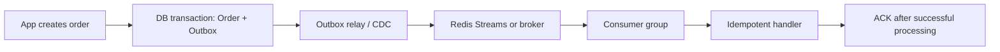
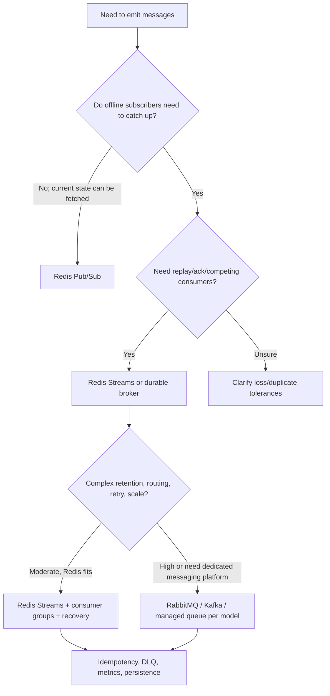
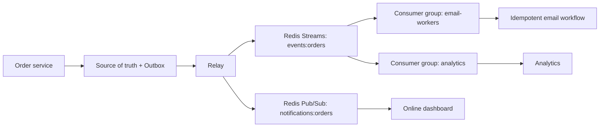

# Distinguishing Pub/Sub from Streams and Durable Queuing Systems in Spring Data Redis

## 1. All handle messaging, but not under the same contract

A Spring application can use Redis to broadcast events between instances, distribute background jobs, or retain an event log. Although all of them involve a "message", **Redis Pub/Sub**, **Redis Streams**, and **durable message brokers** solve different requirements.

Consider three needs:

- **Live notification:** "An open dashboard needs to know the leaderboard just changed." An absent client can fetch the current state upon reconnecting.
- **Jobs that must be processed:** "Every new order must receive a confirmation email; if a worker dies, the job must be reassigned."
- **Events requiring replay:** "A newly deployed analytics service needs to read events stored since yesterday."

The first scenario fits Pub/Sub if missing an event does not lose business data. The latter two require **message retention, processing progress tracking, and recovery**; Redis Streams or a dedicated queue/event-log system is usually more suitable.

> Core rule: **Pub/Sub pushes messages to online subscribers; Streams appends messages to a log for consumers to read by position; durable brokers provide queue/log mechanisms and operations per the specific system's model.**

Do not confuse "having multiple subscribers" with "each message will be processed at least once." Those are two separate requirements.

## 2. Overview of the three models

| Criterion | Redis Pub/Sub | Redis Streams | Dedicated broker/queue |
|---|---|---|---|
| Primary mechanism | Live channel broadcast | Log with IDs and per-stream order | Queue or distributed log per product |
| Retains messages for re-reading? | **No** | **Yes**, until trimmed/deleted/lost to storage failure | Usually has durable storage when configured appropriately |
| Offline subscriber/consumer | Misses messages sent while offline | Can re-read messages still retained | Can deliver after consumer reconnects, depending on config |
| Consumer acknowledgement | No | Yes with consumer groups: `XACK` | Usually has acknowledgement/offset/commit |
| Tracking unacknowledged messages | No | Pending Entries List (PEL) | Has dedicated mechanism, depending on broker |
| Historical replay | No | `XREAD` / reading by ID and retention | Depends on queue/log and retention |
| Fan-out | All connected subscribers receive | Multiple independent consumer groups or ungrouped reads | Exchanges/topics/subscriptions/consumer groups per system |
| Dividing work across workers | Not queue-like: all subscribers receive | One group distributes entries across consumers | Queues or consumer groups |
| Failures to handle | Disconnect -> lost messages | Pending, retry, duplicate, trim, persistence | Ack, retry, dead-letter, partition, and failure recovery |
| Full business exactly-once guarantee? | No | Not automatic | Not automatic; depends on processing and system |

This table is a guide; actual retention, ordering, and durability must be evaluated against the **version, topology, persistence, and configuration of each system**.

## 3. How does Redis Pub/Sub work?

### 3.1. Publish and subscribe

Redis Pub/Sub has two roles:

- **Publisher** uses `PUBLISH channel message` to emit a payload to a channel.
- **Subscriber** uses `SUBSCRIBE channel` or `PSUBSCRIBE pattern` to subscribe to messages published after the subscription takes effect.

Example using two terminals with Redis running on localhost.

**Terminal A — subscriber:**

```redis
SUBSCRIBE notifications:orders
```

**Terminal B — publisher:**

```redis
PUBLISH notifications:orders "order-42-created"
```

Terminal A receives messages while subscribed and its connection stays active. A channel can have multiple subscribers, and each online subscriber is sent the corresponding message by Redis.

If you stop the subscriber, the publisher emits two more messages, and then the subscriber reconnects, the subscriber **does not receive the two messages emitted while absent**. Redis maintains no Pub/Sub backlog.

### 3.2. Fan-out is not competing consumers

```text
                         PUBLISH orders.changed
                                 |
                                 v
                           Redis channel
                                 |
               +-----------------+-----------------+
               |                 |                 |
               v                 v                 v
          Subscriber A      Subscriber B      Subscriber C
             online            online            offline
               |                 |                 |
            Receives          Receives           Misses
```

In regular Pub/Sub, if both A and B subscribe, **both A and B receive** the message. Redis does not automatically pick "only one of the two workers processes the job." To assign a job to exactly one worker in a group, Pub/Sub provides no built-in groups, pending tracking, or acks like a work queue.

### 3.3. Delivery semantics of Pub/Sub

Redis Pub/Sub has delivery semantics close to **at-most-once**: a message is sent to present subscribers, and if a subscriber misses it or fails to process it, Redis performs no managed redelivery. There is no:

- Durable message ID for subscribers to re-read from a previous position.
- Ack confirming business execution.
- Pending list to find unfinished messages.
- Built-in dead-letter queue or retries for missed Pub/Sub messages.

The count returned by `PUBLISH` is the number of clients/subscribers counted by Redis, **not the number of successful business executions**. For example, `(integer) 2` does not mean two subscribers successfully committed to a database.

In Redis Cluster, regular Pub/Sub and sharded Pub/Sub have different routing traits; whether using `PUBLISH` or `SPUBLISH` in supported environments, Pub/Sub's lack of backlog retention remains important to remember.

## 4. Pub/Sub with Spring Data Redis

Spring Data Redis provides `RedisMessageListenerContainer` to manage subscriber connections and register `MessageListener` instances. On the publishing side, use `RedisTemplate.convertAndSend(...)` or `StringRedisTemplate.convertAndSend(...)`.

### 4.1. Dependency and sample connection

```groovy
dependencies {
    implementation 'org.springframework.boot:spring-boot-starter-data-redis'
}
```

```yaml
spring:
  data:
    redis:
      host: localhost
      port: 6379
```

### 4.2. Publisher using StringRedisTemplate

```java
package com.example.demo.messaging;

import org.springframework.data.redis.core.StringRedisTemplate;
import org.springframework.stereotype.Service;

@Service
public class OrderNotificationPublisher {

    private static final String CHANNEL = "notifications:orders";
    private final StringRedisTemplate redis;

    public OrderNotificationPublisher(StringRedisTemplate redis) {
        this.redis = redis;
    }

    public Long publishOrderChanged(String orderId) {
        // Return value is the subscriber count recorded by Redis,
        // NOT the number of consumers that completed business processing.
        return redis.convertAndSend(CHANNEL, orderId);
    }
}
```

In real applications, payloads should have a schema/version/event ID when shared across services; avoid broadcasting sensitive data on channels without access control and content protection.

### 4.3. Subscriber with RedisMessageListenerContainer

```java
package com.example.demo.messaging;

import java.nio.charset.StandardCharsets;
import org.springframework.context.annotation.Bean;
import org.springframework.context.annotation.Configuration;
import org.springframework.data.redis.connection.MessageListener;
import org.springframework.data.redis.connection.RedisConnectionFactory;
import org.springframework.data.redis.listener.ChannelTopic;
import org.springframework.data.redis.listener.RedisMessageListenerContainer;

@Configuration
public class PubSubConfiguration {

    @Bean
    public MessageListener orderNotificationListener() {
        return (message, pattern) -> {
            String orderId = new String(
                    message.getBody(),
                    StandardCharsets.UTF_8
            );

            // Illustration: delegate to appropriate application handling.
            System.out.println("Order changed: " + orderId);
        };
    }

    @Bean
    public RedisMessageListenerContainer orderNotificationContainer(
            RedisConnectionFactory connectionFactory,
            MessageListener orderNotificationListener) {

        RedisMessageListenerContainer container =
                new RedisMessageListenerContainer();

        container.setConnectionFactory(connectionFactory);
        container.addMessageListener(
                orderNotificationListener,
                new ChannelTopic("notifications:orders")
        );

        return container;
    }
}
```

The container manages the message-listener connection and its lifecycle when managed by Spring. This reduces manual subscribe boilerplate, yet **does not add Pub/Sub message retention while the application is offline**. Better reconnection cannot recover messages that were never persisted.

In production, avoid long-running jobs, slow API calls, or blocking the listener thread for too long. You can hand work off to a queue-bounded executor for short tasks; however, passing to an in-memory executor does not turn Pub/Sub into a durable job processor. If the process dies, in-memory tasks can still be lost.

### 4.4. When is Pub/Sub a reasonable choice?

Pub/Sub fits when **messages are hints about state**, while authoritative data can be looked up again:

- Invalidating local caches across instances, combined with TTLs/version checks to tolerate missed notices.
- Pushing real-time UI refresh signals when clients can call an API for a snapshot after reconnecting.
- Presence notifications or transient states where missing an event causes no serious harm.
- Emitting "new data available" signals so services read from a persistent store.

If losing one message loses a payment, omits a mandatory notification, drops an audit event, or skips a job, Pub/Sub **should not be the sole responsible channel**.

## 5. Redis Streams: ID-ordered log, retention, and replayability

Redis Streams is designed for event data ordered within a stream. Each entry carries an **ID** and a set of field–value pairs.

Appending an event:

```redis
XADD events:orders * eventId evt-100 orderId 42 type CREATED
```

Redis returns an ID formatted as `<milliseconds>-<sequence>`, for example:

```text
1763000000000-0
```

The number above is illustrative. Stream IDs locate entries and read entries in order. Never treat a stream ID as a system-wide transaction ID or proof of successful business processing.

Reading historical data by ID:

```redis
XRANGE events:orders - +
```

Reading after position `0-0`:

```redis
XREAD COUNT 10 STREAMS events:orders 0-0
```

Unlike Pub/Sub, entries still present in a Redis Stream can be re-read after a consumer restarts, provided the data has not been trimmed/deleted and persistence/failover conditions are satisfied.

### 5.1. Streams is not a Set or a Pub/Sub channel

Each `XADD` creates a new entry; Streams is an **append-oriented log**. It does not automatically mutate an older entry when business state changes. For instance, "OrderCreated", "OrderPaid", and "OrderCancelled" can be three separate events appended to the same stream.

Stream contents still need an application-designed schema:

```text
Stream: events:orders

ID ...-0 -> {eventId: evt-100, orderId: 42, type: CREATED}
ID ...-1 -> {eventId: evt-101, orderId: 42, type: PAID}
ID ...-2 -> {eventId: evt-102, orderId: 56, type: CREATED}
```

A new message can be read by multiple independent consumers at different offsets. An entry remaining in the stream **does not** mean every consumer has processed it.

### 5.2. Data retention and bounding growth

A stream grows unbounded if you only run `XADD`. You can bound it with `XTRIM` or trimming options on `XADD`:

```redis
XTRIM events:orders MAXLEN ~ 100000
```

The `~` allows approximate trimming for efficiency; do not assume exactly 100,000 entries always remain. History retention must be based on replay needs, processing speed, and capacity.

**Warning:** trimming/deleting entries while a consumer group still has unprocessed messages can remove the payload needed for replay. Pending metadata and stream contents must be managed together. If a work queue must retain data until all groups have finished processing, you cannot simply set a small `MAXLEN` and assume safety.

### 5.3. XREAD and XREADGROUP serve different needs

- `XREAD` reads entries from an offset supplied by the client; suited for consumers managing their own position or replay scenarios.
- `XREADGROUP` reads by **consumer group**; Redis tracks entry deliveries within the group and pending state until acknowledged.

Using `XREAD` provides no built-in acknowledgement or pending list. For application-level durability with `XREAD`, you must persist offsets yourself and handle crashes/replays. For work queues, consumer groups usually save significant effort.

## 6. Consumer groups: dividing work and tracking pending entries

### 6.1. Creating a group

Create a consumer group from the start of the stream:

```redis
XGROUP CREATE events:orders order-workers 0-0 MKSTREAM
```

Meaning:

- `events:orders` is the stream.
- `order-workers` is the group name.
- `0-0` allows the group to read existing historical entries as well.
- `MKSTREAM` creates an empty stream if the key does not exist yet.

If you only want the group to process **new messages from creation onward**, use `$` instead of `0-0`. This is a critical bootstrap decision; picking `$` can skip events written before the group was created.

Re-running `XGROUP CREATE` for an existing group can return `BUSYGROUP`. Application bootstrap logic must handle "already exists" specifically instead of treating every error identically.

### 6.2. Two workers in the same group competing for entries

Worker A:

```redis
XREADGROUP GROUP order-workers worker-a COUNT 10 BLOCK 2000 STREAMS events:orders >
```

Worker B:

```redis
XREADGROUP GROUP order-workers worker-b COUNT 10 BLOCK 2000 STREAMS events:orders >
```

The `>` symbol requests entries **never yet delivered to any consumer in the group**. Redis distributes entries among consumers in the group; in principle, a new entry is delivered to one consumer in the group per delivery.

```text
                 Stream events:orders
                    /          \
                   /            \
                Group order-workers
                 /             \
                /               \
           worker-a          worker-b
         handles A, C      handles B, D
```

If worker-a crashes after receiving A and before ACKing, entry A stays pending in the group. It **does not automatically turn back into a new entry for `>`**; a pending-recovery mechanism is needed. This differs from a queue with automatic broker-managed redelivery policies.

### 6.3. Acking after successful processing

The consumer finishes the task and acks the actual received ID:

```redis
XACK events:orders order-workers 1763000000000-0
```

`XACK` removes the entry from the group's **Pending Entries List**. It **does not delete the entry from the stream**. The entry may remain for other groups or consumers to read according to their mechanisms.

A worker rule of thumb:

1. Read entry.
2. Deserialize and validate payload.
3. Execute business side effects using an idempotent strategy.
4. Call `XACK` only after processing succeeds and is durably recorded as required.
5. If processing fails, keep pending and apply an appropriate retry/reclaim/dead-letter strategy.

Acking **before** processing can lose the chance to reassign work if the worker dies after acking. Acking **after** processing can produce duplicates if the worker succeeds and dies before acking. Therefore, **idempotency** is required.

### 6.4. What is the Pending Entries List?

When an entry is delivered by `XREADGROUP`, Redis tracks it as pending until the group receives `XACK`. Inspect it via:

```redis
XPENDING events:orders order-workers
```

To inspect details of pending entries across a range:

```redis
XPENDING events:orders order-workers - + 10
```

Details can include message ID, consumer owner, idle time, and delivery count. These fields help operations detect dead workers, stuck messages, or excessive retries.

However, **pending is not an automatic dead-letter queue**. It is Redis metadata. The application must decide when to retry, when to skip, when to move to an error stream, and who investigates.

## 7. Dead workers, reclaiming messages, and redelivery mechanisms

### 7.1. Crashing after receiving but before acking

Example:

```text
XREADGROUP -> receives event evt-100
       |
       v
Calls email API successfully
       |
       v
Process dies before XACK
       |
       v
Redis PEL still records event as pending
```

Upon recovery, the event can be redelivered for processing. If email-sending code does not check whether the event ID was already processed, the user can receive **two emails**.

That is why Redis Streams consumer groups are described as a foundation for **at-least-once processing when the application implements proper recovery**, not automatic "exactly-once." Without a worker reclaiming pending entries, an entry can sit un-reprocessed indefinitely.

### 7.2. XAUTOCLAIM for overdue pending entries

Redis versions supporting `XAUTOCLAIM` allow a consumer to claim ownership of pending entries that have been idle long enough:

```redis
XAUTOCLAIM events:orders order-workers worker-b 60000 0-0 COUNT 10
```

Meaning:

- `events:orders`: stream.
- `order-workers`: group.
- `worker-b`: new consumer taking ownership of entries.
- `60000`: only consider entries idle for at least 60,000 ms.
- `0-0`: starting cursor for scanning the PEL.
- `COUNT 10`: limit on entries requested per scan.

The response can include a cursor to continue scanning and the claimed messages; parse the exact response format of your Redis version. Do not set the idle threshold too short if normal workers can run a job longer than 60 seconds: the system will reclaim while the old worker is still running, causing concurrent duplicate execution.

Besides `XAUTOCLAIM`, `XCLAIM` targets specific IDs. Each mechanism has its own Redis version requirements and semantics; when choosing client APIs, check server and Spring Data Redis version support.

### 7.3. Consumer restarts do not refetch all pending entries via >

Suppose worker-a received entry E without acking, then restarted. If it only reads:

```redis
XREADGROUP GROUP order-workers worker-a STREAMS events:orders >
```

worker-a requests **new messages** for the group and will not automatically receive messages previously assigned to it.

One recovery approach is for the consumer to read its own pending entries using the appropriate ID, e.g.:

```redis
XREADGROUP GROUP order-workers worker-a STREAMS events:orders 0
```

When reading with a specific ID rather than `>` in consumer group mode, Redis can return pending entries **already assigned to this consumer** matching the command. Pending entries owned by other consumers must be claimed; you cannot simply switch consumer names and read `0`.

In real applications, you may need all three paths: reading new messages, draining a consumer's own pending entries after restart, and reclaiming overdue pending entries from dead consumers.

### 7.4. Retry, backoff, and dead-lettering

A job-processing system must answer:

- Is the failure a transient network error or a permanently invalid payload?
- How many retries maximum, and with what intervals?
- Should retryable and non-retryable errors be distinguished?
- How long before a previous consumer is considered dead so messages are claimed?
- Where should repeatedly failing messages go, and how are alerts raised?

You can use a separate stream, such as `events:orders:dead`, to record metadata for unprocessable messages. Yet Redis Streams **does not automatically provide a full DLQ setup for every group**; moving to a dead stream, acking the source entry, recording error reasons, and preventing loss/duplication across operations must be designed by the application, including across network disconnects.

When you need long delayed retries, priority queues, per-message TTLs, complex routing, and built-in DLQs, a dedicated broker can cut down custom implementation work.

## 8. Spring Data Redis Streams: producer and consumer

Spring Data Redis supports `StreamOperations` via `RedisTemplate.opsForStream()` and listener containers for consuming streams. Do not confuse these APIs with `RedisMessageListenerContainer` used for Pub/Sub.

### 8.1. Producer: appending a MapRecord

```java
package com.example.demo.messaging;

import java.util.Map;
import org.springframework.data.redis.connection.stream.MapRecord;
import org.springframework.data.redis.connection.stream.RecordId;
import org.springframework.data.redis.connection.stream.StreamRecords;
import org.springframework.data.redis.core.StringRedisTemplate;
import org.springframework.stereotype.Service;

@Service
public class OrderStreamPublisher {

    private static final String STREAM = "events:orders";
    private final StringRedisTemplate redis;

    public OrderStreamPublisher(StringRedisTemplate redis) {
        this.redis = redis;
    }

    public RecordId publishCreated(String eventId, String orderId) {
        MapRecord<String, String, String> record =
                StreamRecords.newRecord()
                        .in(STREAM)
                        .ofMap(Map.of(
                                "eventId", eventId,
                                "orderId", orderId,
                                "type", "CREATED"
                        ));

        return redis.opsForStream().add(record);
    }
}
```

The `RecordId` returned by Redis gives the entry's position in the stream. `eventId` is a **producer-generated business ID**, helpful for idempotency when events are retried or cross multiple systems. The two IDs serve different roles.

Using `StringRedisTemplate` assumes keys and fields/values are serialized as Strings. If the application uses another serializer, Redis CLI inspection and worker value mapping will differ.

### 8.2. Consumer group with StreamOperations

Assume group `order-workers` was already created with `XGROUP CREATE ... MKSTREAM`. A service can poll a batch:

```java
package com.example.demo.messaging;

import java.time.Duration;
import org.slf4j.Logger;
import org.slf4j.LoggerFactory;
import org.springframework.data.redis.connection.stream.Consumer;
import org.springframework.data.redis.connection.stream.ReadOffset;
import org.springframework.data.redis.connection.stream.StreamOffset;
import org.springframework.data.redis.core.StreamReadOptions;
import org.springframework.data.redis.core.StringRedisTemplate;
import org.springframework.stereotype.Service;

@Service
public class OrderStreamWorker {

    private static final Logger log =
            LoggerFactory.getLogger(OrderStreamWorker.class);

    private static final String STREAM = "events:orders";
    private static final String GROUP = "order-workers";

    private final StringRedisTemplate redis;
    private final OrderEventHandler handler;

    public OrderStreamWorker(
            StringRedisTemplate redis,
            OrderEventHandler handler) {
        this.redis = redis;
        this.handler = handler;
    }

    public void pollOnce(String consumerName) {
        var records = redis.opsForStream().read(
                Consumer.from(GROUP, consumerName),
                StreamReadOptions.empty()
                        .count(10)
                        .block(Duration.ofSeconds(2)),
                StreamOffset.create(
                        STREAM,
                        ReadOffset.lastConsumed()
                )
        );

        if (records == null || records.isEmpty()) {
            return;
        }

        for (var record : records) {
            try {
                var payload = record.getValue();
                String eventId = (String) payload.get("eventId");
                String orderId = (String) payload.get("orderId");

                handler.handle(eventId, orderId);

                // ACK after handler confirms successful processing.
                redis.opsForStream().acknowledge(
                        STREAM,
                        GROUP,
                        record.getId()
                );
            } catch (RuntimeException failure) {
                log.error(
                        "Order event remains pending: id={}",
                        record.getId(),
                        failure
                );
                // Do not ACK: separate pending recovery/retry is required.
            }
        }
    }

    public interface OrderEventHandler {
        void handle(String eventId, String orderId);
    }
}
```

In this example, `pollOnce(...)` is invoked by a runner/scheduler or worker loop; each consumer instance should have a **stable, distinct consumer name** within the group so pending tracking remains meaningful. If using `@Scheduled` across multiple instances, define concurrency, graceful shutdown, and consumerName selection rules.

Important:

- `ReadOffset.lastConsumed()` in consumer group mode reads new entries at the group's position, not all existing pending entries.
- `handler.handle(...)` must be idempotent because the same event can be redelivered after a crash/reclaim.
- `acknowledge(...)` is called **only after successful processing**.
- If the Redis ack fails after the handler already produced side effects, business state succeeded while the message remains pending; re-execution must be safe.
- Catching, logging, and leaving entries pending does not automatically create a retry scheduler. You must have a recovery worker or task monitoring `XPENDING` / `XAUTOCLAIM` to reprocess them.

For higher throughput, you can use `StreamMessageListenerContainer` to poll and dispatch messages by subscription, or `StreamReceiver` in reactive apps. The container manages lifecycle and polling, **without replacing ack, idempotency, or reclaim logic**.

### 8.3. Must you manage offsets manually when not using a group?

When using `XREAD` or a stream listener outside a consumer group, the client must manage the **last read offset**. If every startup uses the latest offset, messages written while the client was offline are skipped even though entries remain in the stream. For replay, persist offsets durably and start from the saved position.

In Spring Data Redis, `ReadOffset.latest()` and `ReadOffset.lastConsumed()` do not mean the same thing across every mode; choosing the wrong one can skip messages while polling. With consumer groups, use an offset strategy matching `XREADGROUP` alongside a separate pending-recovery flow.

## 9. Multiple consumer groups: fan-out with independent progress tracking

Redis Streams can deliver to **multiple groups**, each tracking its own progress and pending entries.

Example:

```redis
XGROUP CREATE events:orders email-workers 0-0
XGROUP CREATE events:orders analytics-workers 0-0
```

An "OrderCreated" event can be processed by:

- Group `email-workers`, where one email worker sends the email.
- Group `analytics-workers`, where one analytics worker updates analytics data.

Within each group, consumers divide work; **between two groups**, each group processes the same entry independently.

```text
                           events:orders
                          /             \
                         /               \
               email-workers         analytics-workers
                 /      \                 /      \
              email-a email-b        stats-a    stats-b
```

This combines **fan-out per group** with **competing consumers within a group**, unlike Pub/Sub where all connected channel subscribers receive messages without group offsets or acks.

Do not create a separate group per instance if the intent is **one message processed by only one instance in the worker pool**. Doing so makes every group read and process every event, duplicating the work.

## 10. Redis Streams durability must be configured and measured

### 10.1. Having stream entries does not guarantee 100% survival on power loss

Redis Streams stores entries in Redis data structures, yet survival across node/process failures depends on:

- Redis persistence: AOF, RDB, and fsync/snapshot policies.
- Replication, failover, and replica lag.
- Memory limits and eviction policies.
- Stream trimming/retention rules.
- Backups, restores, accidental deletions, and recovering group metadata too.

For instance, AOF with every-second fsync has a different data-loss window than fsync after every write; periodic RDB snapshots can lose writes since the latest snapshot during crashes. Asynchronous replicas may not have received new entries before a primary disconnects or fails over.

**Streams provides better retention/replay than Pub/Sub**, yet you should never claim "once XADD succeeds, no hardware failure can lose a message" without matching durability SLAs and configuration.

### 10.2. Retention must match the slowest processing rate

If producers write 10,000 entries per minute while a consumer group processes only 8,000, the backlog grows by ~2,000 entries/minute. A short `MAXLEN` drops entries before the group finishes processing them.

Minimum metrics you must know:

- `XADD` rate per stream.
- Average entry size and total stream memory.
- Consumption lag per group.
- Pending count and maximum idle time.
- Entry delivery/retry counts.
- Trim/delete rate.
- Whether pending messages have already lost payloads due to trimming.
- Failover events and replication lag/data-loss exposure.

Never choose retention solely based on available RAM; it is part of the contract between the producer and the slowest consumer group.

## 11. What is a dedicated durable queuing system?

Platforms like **RabbitMQ**, **Apache Kafka**, or managed queue services are built for messaging with distinct delivery, routing, consumer coordination, retention, and operational models.

Do not treat every "broker" as the same tool:

| Tool | Typical model | Best suited for |
|---|---|---|
| Redis Pub/Sub | Direct broadcast channel | Real-time signals that can be lost |
| Redis Streams | Stream log + groups/PEL | Event/work queues sized to Redis infrastructure, with replay and managed retries |
| RabbitMQ | Queues, exchanges, bindings, acknowledgements, routing | Work queues, task distribution, broker-level routing/TTL/DLQ |
| Apache Kafka | Partitioned log, offsets, and consumer groups | Event streaming, long retention, replay, high throughput, and data integration |
| Other managed queues | Provider queue contract, visibility timeout/ack, and DLQ | Reducing self-managed ops, subject to service SLAs/limits |

### 11.1. RabbitMQ and the work queue model

In RabbitMQ, producers typically publish to an exchange, which routes messages into queues via bindings. Consumers pull from queues and send acknowledgements after processing. If a consumer dies before acking, the broker can redeliver per policy; queues, message persistence, and publisher confirms must be configured properly for desired durability.

RabbitMQ also supports workflow features like routing keys, prefetch, dead-letter exchanges/queues, and retry policies; these cut down application-level boilerplate while still requiring idempotency and proper operations. Not every RabbitMQ message is durably persisted by default just because the broker has queues.

### 11.2. Kafka and the distributed event log model

Kafka stores events in **topic partitions**, letting consumer groups track offsets and replay within retention. It excels when multiple systems share an event log, at high data volumes, for stream processing, or when keeping history long enough to rebuild downstream views.

Ordering in Kafka is normally guaranteed **within a partition**, not one global order across all partitions. Kafka's consumer offset commits and transactional/idempotent producers offer specific guarantees, yet **external side effects outside Kafka** (e.g., writing PostgreSQL, sending emails) still require deduplication or suitable transactions. Never assume end-to-end "exactly once" across the entire business chain.

### 11.3. When to choose a dedicated broker instead of only Redis Streams

Consider switching to or adding a broker when:

- Messaging is business-critical with strict delivery/recovery SLAs.
- Complex queues/DLQs/retries/routing or first-class delayed/priority queues are needed.
- Event throughput and retention are huge, with many independent downstreams and long-term replay needs.
- The organization already operates dedicated messaging ops, security, and monitoring teams.
- You want to isolate queue resources from Redis serving caches/sessions/hot keys so one workload cannot disrupt another.
- Multi-region topologies, replicated logs, auditing/retention, and tailored durability guarantees are required.

Conversely, Redis Streams can be pragmatic when the app already uses Redis, scale fits cluster capacity, group count is moderate, retention is not overly long, and the engineering team accepts managing pending recovery, retries, and trimming.

## 12. Comparing delivery semantics through failure scenarios

| Scenario | Redis Pub/Sub | Redis Streams + group | Durable broker (properly configured) |
|---|---|---|---|
| Consumer offline when producer sends | Message not stored for that consumer | While entry remains in stream, group can read later | Queue/log can retain message for later delivery |
| Consumer dies before processing | No managed redelivery | Delivered entry remains pending; needs recover/claim | Usually redelivers/uncommitted offset per broker mechanism |
| Consumer finishes work then dies before ack | No ack | Entry may be reprocessed; needs idempotency | Message may be redelivered; needs idempotency |
| Producer sends successfully then loses reply | Hard to know which subscribers received | Unsure if `XADD` ran; event ID helps dedup | Unknown outcome possible; publisher confirms/idempotency help manage |
| Consumer wants to replay yesterday's data | Impossible from Pub/Sub | Possible if entries remain per retention/offset | Depends on queue/log type and retention |
| One consumer group needs to divide work | All subscribers receive | Use one consumer group | Use queue/consumer group |
| Two independent downstreams both need all events | Both subscribers must be online at publish | Two independent consumer groups | Topics/exchanges/subscriptions per design |
| Handler fails permanently | Message lost after delivery | Pending/retry/DLQ managed by app | Broker may support retries/DLQ with config |
| Entire Redis/broker node loses power | No backlog | Depends on Redis persistence and replication | Depends on broker durability/replication |

**At-most-once:** no duplicates in delivery, yet messages can be lost. **At-least-once:** no messages lost under specified guarantees, yet duplicates can be processed. **Business-level exactly-once:** requires defining boundaries and designing idempotency/transactions; it does not appear for free simply by swapping Pub/Sub for Streams.

## 13. Why can events still be lost or duplicated when using Streams?

### 13.1. Producer writes primary data then calls XADD

Example service:

```text
1. COMMIT order in PostgreSQL
2. XADD events:orders ...
```

If the process dies after step 1 and before step 2, the order exists in the database yet **there is no event**. Redis Streams cannot automatically provide atomicity across Redis and PostgreSQL.

If you flip the order:

```text
1. XADD events:orders ...
2. COMMIT order in PostgreSQL
```

The process can die after step 1; downstream receives an event for an uncommitted order.

When the source of truth lives in a transactional database, **transactional outbox** is a common pattern:



Putting the entity and outbox event inside the **same database transaction** ensures both records commit or roll back together at the source. The relay might resend an event if confirmation is lost, so consumers must still deduplicate by `eventId`. Outbox does not automatically yield once-only external email/API calls, yet it eliminates the "commit business data then lose event" window.

### 13.2. Consumer performs side effect then ACKs

Typical sequence:

```text
XREADGROUP receives evt-100
       |
       v
UPDATE database for event
       |
       v
Database COMMIT
       |
       X process dies
       |
       v
No XACK -> evt-100 stays pending
       |
       v
Another worker XAUTOCLAIMs and reprocesses
```

One approach is a dedup table or key holding `eventId` alongside the state update inside a transaction **of the target data store**:

```text
BEGIN DB transaction
  If eventId already processed -> skip side effect
  Else -> update entity and mark eventId as processed
COMMIT
XACK event on Redis
```

If the process dies before DB commit, a retry can run safely. If it dies after DB commit and before XACK, the next run sees `eventId` already processed and only needs to ack. This is at-least-once + idempotent consumer, not a distributed Redis–DB transaction.

If the side effect sends an email or calls a non-idempotent external service, use deduplication or a recoverable dispatch design. Simply writing "processed" to the database before calling email can mark success while the email was never sent, so design explicit status lifecycles.

## 14. Operating Redis Streams reliably

When choosing Streams for background jobs, adding `XADD` and `XREADGROUP` is not enough; you must also measure and alert.

### 14.1. Essential metrics

| Metric / signal | Meaning |
|---|---|
| `XADD` rate and acked message rate | Detects producers outpacing consumers |
| `XLEN` per stream | Current log length, not total unprocessed work |
| `XPENDING` per group | Number of unacked entries |
| Pending idle time p95/max | Detects stuck jobs or dead workers |
| Delivery/retry count | Detects poison messages or retry loops |
| Time from `XADD` to successful processing | End-to-end latency |
| Deserialization/handler error rate | Needs payload/schema or source fixes |
| Messages in dead-letter stream | Work requiring manual intervention |
| Memory, AOF/RDB health, replication lag | Health of Redis durability infrastructure |
| Trim rate and age of oldest entry | Whether retention covers slow consumers |

Inspect via CLI:

```redis
XINFO STREAM events:orders
XINFO GROUPS events:orders
XINFO CONSUMERS events:orders order-workers
XPENDING events:orders order-workers
XLEN events:orders
```

Never assume `XLEN=1000` means 1,000 unprocessed jobs; many entries may already be acked while still sitting in the log. Pending count also does not show the entire backlog **never yet delivered** to a group. Evaluate group progress, stream tail, and pending entries together.

### 14.2. Retention and consumer group lifecycle

When adding a new consumer group:

- Decide whether to read historical entries or only new messages.
- Pick the matching offset at group creation to avoid silently skipping messages.
- Ensure trimming does not delete history still needed by the new group.
- Define how long events stay after all groups finish, or archive elsewhere long-term.
- Define how to delete retired consumers/groups; abandoned pending entries complicate retention policies.

In long-lived systems, one single stream for all events is not always better than splitting by domain/throughput/retention. Design naming, schema versioning, field limits, and retention targets upfront.

### 14.3. Redis Cluster

Redis Cluster partitions keys by hash slot. Each stream key is a Redis key belonging to one slot; a hot stream concentrates traffic onto the node owning that slot. Adding more consumers does not automatically spread a single stream across multiple nodes.

If throughput exceeds one stream/node, you can shard across multiple streams by partition key, e.g., `events:orders:0` through `events:orders:15`, though then:

- You need logic routing events to partitions.
- You need consumer groups and workers per stream/partition.
- Ordering can only be designed per partition.
- Partition rebalancing and consistent ordering by `orderId` require planning.

Do not assume operations across multiple streams/keys can sit in one Redis transaction on Cluster; multi-key commands and scripts obey hash-slot constraints.

## 15. Problem-based decision matrix

| Problem | Initial suggestion | Why |
|---|---|---|
| Notify UI that state changed; client can refresh | Redis Pub/Sub | Real-time signal, loss-tolerant |
| Invalidate local cache with backup TTL | Redis Pub/Sub + TTL/version | Missed notices do not leave stale data forever |
| Send confirmation email per order | Streams group or broker queue | Needs retries, acks, replay, and idempotency |
| Background thumbnail/video processing | Streams or dedicated queue | Jobs must survive worker restarts |
| Long-term audit trail | Durable log (Kafka/database/audit store) | Retention, replay, compliance, and ops |
| Sync events to multiple downstreams | Multi-group Streams or Kafka/topic | Each downstream needs its own offset/progress |
| Multi-day high-throughput analytics stream | Kafka or suitable streaming platform | Retention, partitions, and data pipelines |
| Real-time presence/typing indicator | Redis Pub/Sub | Ephemeral events, no backlog needed |
| Scheduled/delayed retries, priority, complex DLQs | Dedicated broker | Avoids reinventing scheduling/retry logic |
| Simply signal new data landed in DB | Pub/Sub signal + DB read or stream depending on criticality | Primary store still governs recovery |
| Small infra, Redis already running, moderate load | Redis Streams if team can run pending/reclaim | Backlog/ack without deploying another broker |
| Payments where no event may be skipped | Outbox + stream/broker + idempotency | Protects boundary between DB commit and publish |

### Quick selection diagram



The right question is not "which technology is fastest?", but **"if a process crashes at any step, does the event survive and who is responsible for reprocessing it?"**

## 16. Combining Pub/Sub and Streams in one architecture

A system can use both in distinct roles:



In this model:

- **Streams** holds events for consumer groups to re-read, ack, retry, and inspect pending entries.
- **Pub/Sub** acts as a real-time notification channel for open screens/instances.
- **Database/outbox** captures business intent and enables recovery if publishing fails.
- Reconnecting UIs read snapshots or stored events rather than relying on Pub/Sub replay.

If the UI only needs to know "updates exist", you do not need to publish the full payload on both paths; Pub/Sub can carry just an ID/version so the UI refetches. Avoid sending sensitive data on broad channels and design event/version ordering so clients never apply stale updates.

## 17. Common misconceptions

**"Having subscribers on Pub/Sub means messages are guaranteed to be processed."** No. Redis only pushes messages to connected subscribers per Pub/Sub semantics. There is no business-logic ack.

**"Pub/Sub is a queue because multiple workers subscribe."** No. Workers subscribed to the same channel can all receive the same message; there is no automatic competing-consumer group.

**"Streams never lose data."** No. Retention, trimming, eviction, Redis persistence, replication, and failover all affect entry durability.

**"XACK deleted the event from the stream."** No. `XACK` clears the consumer group's pending state. Deleting/trimming entries is a separate operation.

**"Using > on restart re-reads unacked messages."** No. `>` fetches entries never yet delivered to the group. You need pending-reading or claiming logic.

**"Pending entries automatically transfer to another worker."** Not automatically. You must implement recovery/reclaiming with `XCLAIM`, `XAUTOCLAIM`, or equivalent.

**"One stream with multiple consumer names fans out to every downstream."** Within one consumer group, messages are split among consumers. For independent downstreams to receive every message, use separate groups.

**"RabbitMQ/Kafka guarantees once-only execution across all external APIs."** No. Broker acks/offsets and transactions have specific boundaries; side effects outside the broker require separate design.

**"Once XADD succeeds, data is definitely saved on disk/replicas."** Do not conclude that without knowing persistence/fsync/replication and failover policies.

**"Retrying always fixes errors."** Retrying an event can send an email twice or update a database twice. You need operation IDs/idempotency and error classification.

## 18. Conclusion

In Spring Data Redis, **Redis Pub/Sub** suits broadcasting real-time hints to online subscribers when message loss is tolerable. **Redis Streams** adds an ID-ordered log, replayability, consumer groups, pending tracking, and acknowledgements, fitting event processing or work queues when the application implements proper retention, recovery, and idempotency. **Durable brokers/queues** like RabbitMQ, Kafka, or managed messaging services become worthwhile when delivery, retry, routing, retention, scale, and operational needs grow more complex.

Neither Streams nor dedicated brokers automatically turn external side effects into once-only execution. A reliable design defines **the primary data store, transaction boundaries, ack timing, redelivery handling, duplicate protection, and retention limits**. Choosing the right tool means knowing what happens when a producer, consumer, or connection fails—not just how to send one message on the happy path.
