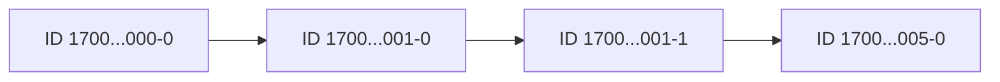
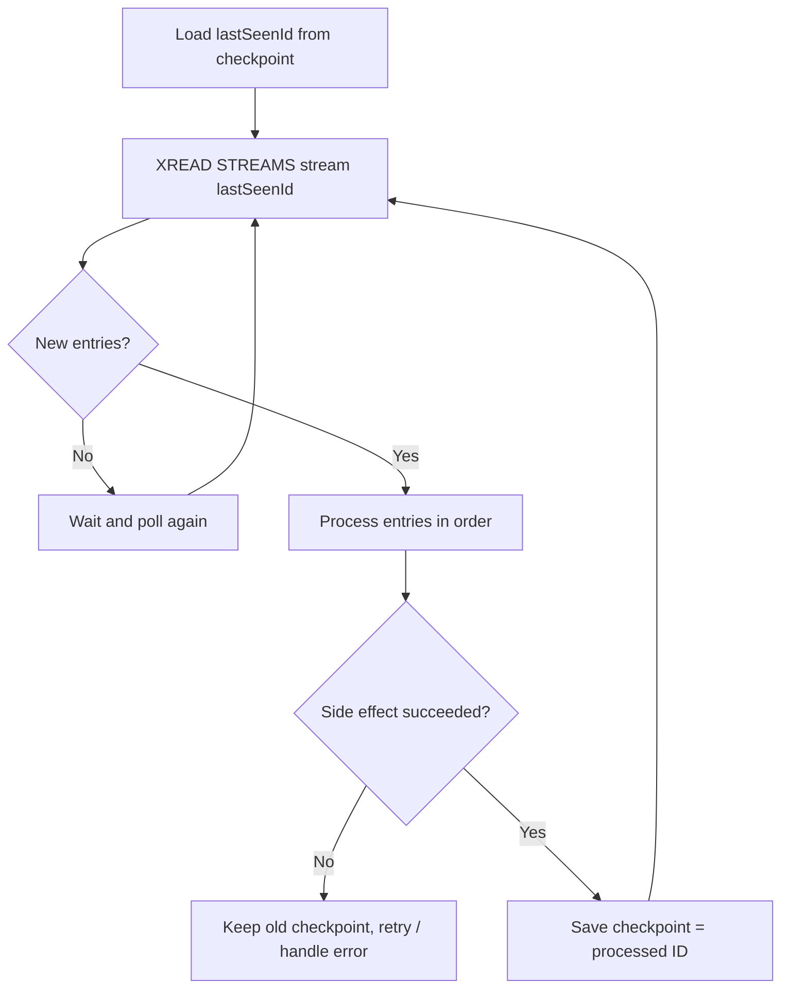
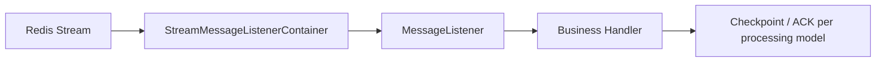
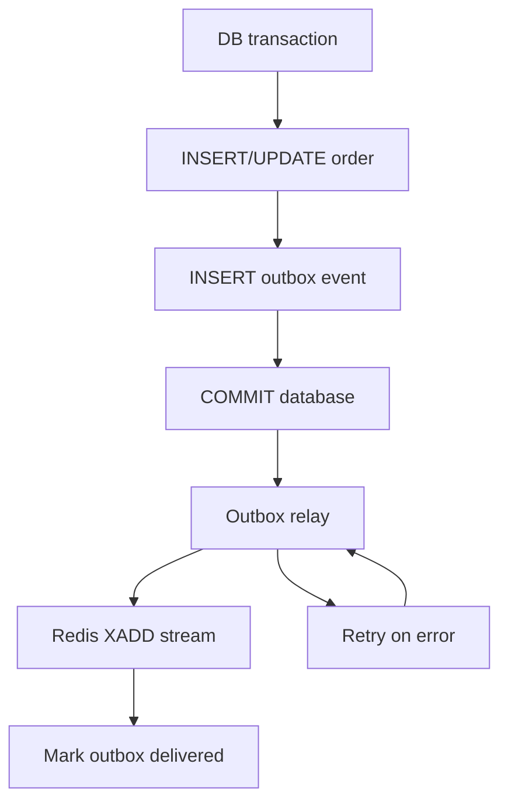

# Streams, Entry IDs, and the Event Log Model in Spring Data Redis

Redis Streams is a data type that allows applications to **append ordered event records and read them back by position**. In Spring Data Redis, it is particularly useful for connecting asynchronous processing components: a service publishing events, a worker reading new events, or a program that needs to resume processing from the last read record.

Unlike a Redis String that only holds a current value, a **Stream** holds multiple **entries**. Each entry has a **unique ID within the stream** and a set of fields and values. Entries are ordered by ID, so a consumer can say: “Read the events that come **after** this ID”.

For example, an order service publishes three events:

```text
Stream: orders:events

1700000000000-0  eventType=OrderCreated   orderId=42
1700000000001-0  eventType=OrderPaid      orderId=42
1700000000002-0  eventType=OrderShipped   orderId=42
```

If a worker has already processed up to ID `1700000000001-0`, it can continue from the part after that ID without scanning all Redis keys. This is the foundation of the **event log model**.

This lesson explains stream structure, how Redis generates and compares entry IDs, basic write/read commands, the difference between “continuing to read” and “reading from the beginning”, the producer–consumer model, history retention characteristics, and how to use Spring Data Redis to publish or read events. The final sections distinguish Redis Streams from Redis Pub/Sub, Redis Lists, message brokers, and event sourcing, while pointing out limitations regarding durability, ordering, and duplicate processing.

## 1. What Is a Stream?

A Redis Stream is a data structure that stores a **sequence of field–value records**, appended over time. At the application level, you can think of a stream as a log:

```text
orders:events
     |
     +-- entry ID A -> {eventType, orderId, occurredAt, ...}
     |
     +-- entry ID B -> {eventType, orderId, occurredAt, ...}
     |
     +-- entry ID C -> {eventType, orderId, occurredAt, ...}
     |
     +-- ...
```

Each time a producer appends an entry, Redis places it at a position with an ID greater than the previously created entries in the same stream. Consumers use IDs as checkpoints to find subsequent data.

Three terms to distinguish:

| Term | Meaning |
|---|---|
| **Stream key** | The Redis key name containing the entire stream, e.g., `orders:events` |
| **Entry / message / record** | A record inside the stream, consisting of an ID and field–value pairs |
| **Entry ID / RecordId** | The identifier and ordered position of an entry within **a stream** |

Example of an entry:

```text
stream key: orders:events
entry ID  : 1700000000000-0
fields:
    eventType = "OrderCreated"
    orderId   = "42"
    version   = "1"
    amount    = "125000"
```

**One Redis key holds many entries**, rather than creating a new key per event. A Stream supports appending entries, reading by ID range, reading new entries, and maintaining metadata related to consumer groups.

### 1.1. Why Is It Called an Event Log?

In the event log model, instead of keeping only the “current state”, the system records the events that have occurred:

```text
OrderCreated -> OrderPaid -> OrderShipped
```

Consumers can read in order, build summary tables, send notifications, or update a read model. If the events are still retained and the system has a way to determine an appropriate starting point, a consumer can also replay old data.

**An event log does not automatically mean a permanent audit log.** Redis Streams allows trimming and deleting entries; the ability to recover history depends on retention, persistence, and system design. Furthermore, an entry ID reflects the position of the event in the Redis Stream—it does not by itself guarantee business semantics or system-wide uniqueness.

## 2. Writing the First Entry with XADD

The basic command to add data to a Stream is `XADD`:

```redis
XADD orders:events * eventType OrderCreated orderId 42 amount 125000
```

Where:

- `orders:events` is the Redis Stream name.
- `*` asks Redis to auto-generate the ID.
- `eventType OrderCreated` is a field–value pair.
- `orderId 42` and `amount 125000` are other field–value pairs of the same entry.

Redis returns the ID of the newly added entry, for example:

```text
"1700000000000-0"
```

This is an **illustrative value**, not a fixed ID. In actual execution, Redis uses the timestamp and the current ID state of the stream to generate a valid ID.

Add a second entry:

```redis
XADD orders:events * eventType OrderPaid orderId 42 amount 125000
```

Add a third entry:

```redis
XADD orders:events * eventType OrderShipped orderId 42 trackingCode VN001
```

If the stream does not yet exist, `XADD` normally creates a new stream to hold the first record. After each addition, `XLEN` reports the number of entries currently remaining in the stream:

```redis
XLEN orders:events
```

If nothing has been deleted or trimmed and three entries were added, the count is `3`.

### 2.1. One Entry Has Multiple Fields

You should not treat each field as a separate message. The command:

```redis
XADD orders:events * eventType OrderPaid orderId 42 amount 125000
```

creates **one entry** containing three fields, not three entries. The entry ID identifies the entire record.

The fields and values in Redis are byte data; Spring Data Redis serializes and deserializes them based on the configured template or mapping. Redis does not automatically infer that `amount` is money, `orderId` is a UUID, or `eventType` is a Java enum.

### 2.2. Do You Need to Create the Stream First?

Usually not. `XADD` can create the stream key when it does not exist. However:

- If the key already exists with a **different data type** such as String/Hash, `XADD` will return a wrong-type error.
- If the stream is deleted or data is lost, a subsequent `XADD` can create a new stream with the same name, but old history is not automatically restored.
- In applications with consumer groups, creating the stream and creating the group have their own initialization order to watch out for.

## 3. What Parts Make Up an Entry ID?

A common Redis Stream ID has the form:

```text
<millisecondsTime>-<sequenceNumber>
```

For example:

```text
1700000000000-0
1700000000000-1
1700000000001-0
```

The part before the hyphen usually corresponds to the **time in milliseconds** in a Redis-generated ID; the part after is a **sequence number** to distinguish entries with the same timestamp part.

| ID | Milliseconds part | Sequence part | Meaning |
|---|---:|---:|---|
| `1700000000000-0` | `1700000000000` | `0` | An entry |
| `1700000000000-1` | `1700000000000` | `1` | Subsequent entry in the same millisecond |
| `1700000000001-0` | `1700000000001` | `0` | Entry in a larger millisecond part |

Redis compares IDs by the **numerical order** of the two components, not lexicographically:

```text
1700000000000-0
    <
1700000000000-1
    <
1700000000001-0
```

This format gives the stream a stable ordering and helps consumers store “which ID has been processed up to”.

### 3.1. Entry ID Is an Ordering Checkpoint, Not a Business Event ID

ID `1700000000000-0` can identify the record in `orders:events`. However, a business event may also need its own `eventId`:

```text
stream entry ID = 1700000000000-0
eventId         = evt-8b0e
orderId         = 42
eventType       = OrderPaid
```

Why separate the two?

- A business event might be re-sent by a producer due to a timeout; the retry may create a **new entry ID**.
- If the same event is sent to two streams, each stream has its own ID.
- When another system also emits events, the entry ID is not a global identifier for business reconciliation.
- An idempotent consumer usually needs to recognize the **eventId** or **operationId** in addition to the stream position.

An entry ID is suitable for **locating and resuming reading from a stream**; an event ID is suitable for **identifying a business event across retries or reprocessing**.

### 3.2. Is the ID the Exact Time the Event Actually Occurred?

Not necessarily. With `XADD ... *`, Redis uses the time information at write time, but:

1. The business event may have occurred before the producer sent it.
2. The producer may retry after several seconds or minutes.
3. The producer may explicitly supply an ID instead of letting Redis auto-generate it.
4. Redis must still maintain the rule of increasing IDs on the stream, even if the system clock changes.
5. A producer-supplied ID does not necessarily have an “occurrence” time matching the business clock.

Therefore, the payload should include a dedicated field such as `occurredAt` or `sourceTimestamp` when business processing needs to know the actual occurrence time.

```redis
XADD orders:events * eventType OrderPaid orderId 42 occurredAt 2026-11-13T03:00:00Z
```

**Do not establish business ordering across multiple sources using only the timestamp part in the Stream ID.** If causal ordering of an aggregate is required, design a business-level sequence/version.

## 4. Auto-Generated IDs and Client-Specified IDs

### 4.1. Using `*` in Most Cases

```redis
XADD demo:events * type A
XADD demo:events * type B
```

Redis generates IDs monotonically, freeing producers from managing sequences themselves.

Advantages:

- Reduces the risk of two producers choosing the same ID.
- Convenient when multiple instances write to the same stream.
- Redis preserves the ID ordering required by the stream.
- Easy to use with Spring Data Redis; the add operation typically returns a `RecordId`.

### 4.2. Explicitly Specifying an ID

Redis allows clients to specify an explicit ID when needed:

```redis
XADD demo:imported-events 1700000000000-0 type Imported
```

However, the new ID must be valid and **greater than the last ID recorded by the stream** according to Redis rules, not simply “not colliding with an existing entry”.

For example:

```text
Stream last recorded ID = 1700000000000-1
Client tries XADD ID    = 1700000000000-0
=> Invalid because the new ID is not greater than the previous ID.
```

ID `0-0` is used as the marker to read from the beginning, but it is not a normal entry ID that can be created with `XADD`. Some Redis versions also support partially auto-generated IDs; when using them, check your server version and specific semantics.

If the application has no special reason to assign IDs itself, let Redis generate them with `*`.

### 4.3. Do Not Equate Sequences with Message Counts

Between two consecutive IDs, there is no guarantee that the sequence difference equals the number of published events. A stream may have IDs:

```text
1700000000000-0
1700000000002-0
1700000000007-0
```

There are still only three entries. IDs are not contiguous array indices from `0` to `N-1`. After trimming or deleting entries, gaps become even more visible.

If you want to count remaining entries, use `XLEN`; if you want to count all-time business events, design a separate metric/counter rather than inferring it by subtracting IDs.

## 5. What Kind of Order Is Stream Order?

Within **one Redis Stream**, entries are ordered by ID. Commands such as `XRANGE` or `XREAD` use IDs to determine position.



However, distinguish between:

- **Append order into a single stream:** the ID position accepted by Redis.
- **Business event occurrence order:** depends on the producer, DB transaction, clock, retries, and originating system.
- **Consumer processing completion order:** may differ from append order when processing in parallel.
- **Order across multiple different streams:** there is no shared total order derived solely from each stream's IDs.

For example, producer A publishes `OrderCreated` and producer B publishes `OrderPaid` to the same stream. If B sends before A actually appends, Redis may assign an earlier ID to `OrderPaid`, even though business logic expects `OrderCreated` to come first.

If the domain requires strict ordering per `orderId`, you need a guarantee mechanism at the source such as an aggregate version, an ordered transactional outbox, or conditional processing. A stream cannot automatically infer dependencies between two events emitted out of order by producers.

## 6. Reading History with XRANGE

`XRANGE` reads entries within an ID range in ascending order:

```redis
XRANGE orders:events - +
```

Where:

- `-` is the lowest bound.
- `+` is the highest bound.
- The result consists of the entries still existing in the range.

Limiting the count:

```redis
XRANGE orders:events - + COUNT 10
```

A conceptual response looks like:

```text
1) 1700000000000-0
   eventType = OrderCreated
   orderId   = 42
2) 1700000000001-0
   eventType = OrderPaid
   orderId   = 42
3) 1700000000002-0
   eventType = OrderShipped
   orderId   = 42
```

Reading a narrower range:

```redis
XRANGE orders:events 1700000000001-0 1700000000002-0
```

The bounds of `XRANGE` are normally **inclusive**. Depending on supported Redis syntax, you can specify an exclusive bound with `(` when paginating so you do not repeat the last entry of the previous page.

### 6.1. Reading in Reverse with XREVRANGE

`XREVRANGE` reads in descending order, commonly used to fetch the newest events:

```redis
XREVRANGE orders:events + - COUNT 5
```

The parameter order of the range in `XREVRANGE` is **high end then low end**, unlike `XRANGE`. This pattern is useful for a “5 most recent activities” screen, but must not be confused with a continuous event subscription mechanism.

### 6.2. Read Bounded History, Do Not Load Everything

A stream can contain a very large number of entries. In applications:

- Use `COUNT` when querying page by page.
- Store the last page's ID checkpoint to fetch the next page.
- Consider retention: older entries may no longer exist.
- Do not run unbounded `XRANGE stream - +` in online APIs when the stream is large.

A command that reads the entire history can consume significant client memory and generate a large network response, even though the server processes each entry quickly.

## 7. Continuing to Read from an ID with XREAD

A major advantage of streams is that a consumer can keep a **last-seen ID**:

```text
Processed up to:
    lastSeenId = 1700000000001-0

Next read:
    only fetch entries with ID > lastSeenId
```

Command:

```redis
XREAD COUNT 10 STREAMS orders:events 1700000000001-0
```

`XREAD` with a specific ID returns entries whose ID is **greater than** the supplied ID. It does not return the entry whose ID equals the marker itself. This is an important difference from using `XRANGE` with inclusive bounds.

### 7.1. Reading from the Beginning with `0-0`

```redis
XREAD COUNT 100 STREAMS orders:events 0-0
```

Since valid entry IDs are greater than `0-0`, the command above fetches existing entries from the beginning of the stream up to the count limit.

After processing a batch, store the ID of the **last successfully processed entry** as the checkpoint:

```text
Batch 1: ID A, ID B, ID C
Checkpoint after successful processing: ID C

Batch 2:
    XREAD ... STREAMS orders:events C
    -> receives entries after C
```

Do not update the checkpoint before business side effects are committed; otherwise the consumer may skip messages after a crash.

### 7.2. `XREAD BLOCK`: Waiting for New Entries

If there are no new entries, the consumer can wait for a period of time:

```redis
XREAD COUNT 20 BLOCK 5000 STREAMS orders:events 1700000000001-0
```

`BLOCK 5000` uses milliseconds, meaning wait up to about 5 seconds for matching data. `BLOCK 0` means wait indefinitely until a message arrives or the connection is closed.

On timeout, `XREAD` may return nil instead of an array of entries. The consumer should treat that as **no data in this poll**, not a business error.

Notes:

- Blocking waits hold a connection during the wait period.
- You need to handle timeouts, reconnects, and controlled shutdown.
- Do not use infinite blocking directly inside an HTTP request thread.
- If a single read returns multiple entries, you still need to bound processing time and handle retries on error.

### 7.3. What Does the `$` Symbol Mean?

Redis allows:

```redis
XREAD BLOCK 5000 STREAMS orders:events $
```

`$` means using the **current last position** of the stream as the starting point and waiting only for entries **added afterwards**. It suits cases where a consumer **intentionally skips history** and only wants new events.

However, `$` is not suitable as a fixed checkpoint for every poll:

```text
Poll 1 uses $ and reads a new message.
During processing, another message arrives.
Poll 2 uses $ again:
    starts from the newest end,
    risking skipping the message that arrived between the two polls.
```

Therefore:

1. Only use `$` the **first time** when you want to start from “now” and accept skipping history.
2. After receiving entries, store and use the **last specific ID** for subsequent reads.
3. If recovery after restart is needed, persist the checkpoint instead of starting from `$` every time.

## 8. Example of a Consumer Maintaining a Checkpoint

A consumer can store its checkpoint in a DB or another suitably durable store:

```text
consumerName: accounting-projection
stream:       orders:events
lastSeenId:   1700000000001-0
```

Polling workflow:



Why must the checkpoint be durable?

- If it is only kept in a Java variable and the application restarts, the consumer does not know where it read up to.
- If it always restarts from `0-0`, it may reprocess the entire history.
- If it always starts from `$`, it may miss entries that arrived while the application was down.

### 8.1. Failure Window Between Processing and Saving the Checkpoint

Suppose a consumer does:

```text
1. Read event E
2. Write result data to DB
3. Crash before saving lastSeenId
```

After restart, the consumer reads E again because the checkpoint has not advanced. This is why message processing pipelines are typically designed for **at-least-once** delivery and side effects must be idempotent.

If done in reverse:

```text
1. Read event E
2. Save lastSeenId = E
3. Crash before writing business data
```

then E may be **skipped** on the next read because the checkpoint has already jumped past it.

A good approach is to put the projection update and the checkpoint update into the **same DB transaction** if they reside in the same transactional DB. When they cannot be committed together, an explicit idempotency protocol or compensating mechanism is needed.

## 9. How Do Redis Streams Differ from Redis Pub/Sub?

Redis Pub/Sub delivers messages to subscribers that are connected at publish time; it does not maintain a list of entries for subscribers to replay by ID through the Pub/Sub mechanism itself.

Redis Streams, by contrast, store entries until they are deleted or trimmed. Readers can read:

- From the beginning of retained history.
- From a specific ID.
- Only new entries.
- Through a consumer group with processing metadata.

| Aspect | Redis Pub/Sub | Redis Streams |
|---|---|---|
| Ordered entry IDs | Not in the stream model | Yes |
| Stores messages for replay | Not a Pub/Sub feature | Yes, within retention limits |
| Offline subscribers can catch up | Not with plain Pub/Sub | Yes, if entries still exist |
| Read from a saved checkpoint | Not via Pub/Sub offsets | Yes, using IDs |
| Consumer groups, pending, acknowledge | Not via Streams mechanics | Yes |
| Data durability | Does not retain Pub/Sub messages as history | Depends on Redis persistence/replication and retention |
| Typical use case | Real-time broadcast | Event log, processing queue, replay, streaming |

You should not conclude that Redis Streams automatically guarantees messages are “never lost”. **Being stored in a stream** and **durability across crashes/failover** are two separate concerns.

## 10. How Redis Streams Differ from Redis Lists

A Redis List is often used as a queue with push and pop operations such as `LPUSH`/`RPOP` or blocking variants. A popped element is normally no longer in the list at that position.

With Streams, `XREAD` **does not delete entries** after a consumer reads them. Multiple readers can read the same history, or a consumer group can distribute work and track processing status.

| Need | List | Streams |
|---|---|---|
| Simple queue | Often suitable | Also usable |
| Replay by ID | No Stream-like entry IDs | Yes |
| Retain history after reading | Not a pop-queue model | Yes, if not trimmed/deleted |
| Multiple independent consumer groups | Must build extra logic | Directly supported by consumer groups |
| Acknowledge and pending tracking | Must build extra logic | Has PEL and `XACK` mechanisms |
| Range reads by ID position | Not like Streams | Has `XRANGE`/`XREAD` |

If you only need a very simple queue with minimal semantics, a List may suffice. When you need event IDs, resume, replay, and consumer groups, Streams are often the more natural choice.

## 11. How Do Consumer Groups View a Stream?

The core focus of this lesson is Streams and entry IDs. However, to understand the event log model when multiple workers exist, you need to know that a **consumer group** is an additional reading-management layer, not a different entry type.

Suppose we have a stream:

```text
orders:events
   E1
   E2
   E3
   E4
```

Two independent groups:

```text
Group: billing-workers      -> accounting processing
Group: notification-workers -> sending notifications
```

Each group has its own read state. The billing group and the notification group can both receive the same events, because each group is serving a different processing purpose.

Within **the same group**, multiple consumers coordinate to share work; a new entry is normally delivered to one consumer in the group rather than independently broadcast to every consumer in that group.

### 11.1. Creating a Group with `XGROUP CREATE`

Create a group from the beginning of retained history:

```redis
XGROUP CREATE orders:events billing-workers 0-0 MKSTREAM
```

Meaning:

- `orders:events` is the stream.
- `billing-workers` is the group name.
- `0-0` specifies the starting point so the group can receive entries from history.
- `MKSTREAM` creates an empty stream if it does not already exist.

If you want the group to receive only entries added after the group is created, you can use `$` as the starting marker:

```redis
XGROUP CREATE orders:events notification-workers $ MKSTREAM
```

Deciding between `0-0` and `$` is a **business decision**. With `$`, events that already existed beforehand will not be delivered as new events via the newly created group's cursor.

### 11.2. `XREADGROUP` and the `>` Symbol

A consumer in a group reads new entries:

```redis
XREADGROUP GROUP billing-workers worker-1 COUNT 10 STREAMS orders:events >
```

`>` is a special symbol: it requests entries that **have not yet been delivered to any consumer in the group** via normal new-message reading.

Do not confuse:

- `XREAD STREAMS stream $`: reads entries arriving after the current tail (not part of a consumer group).
- `XREADGROUP GROUP group consumer STREAMS stream >`: receives new entries for the **group**, along with group delivery metadata.

Both syntaxes refer to “new”, but their checkpoint and pending mechanisms are different.

### 11.3. What Is the Pending Entries List?

When a consumer uses `XREADGROUP` to receive entries, the group can record entries that were delivered but not yet acknowledged in the **Pending Entries List (PEL)**.

After successful processing:

```redis
XACK orders:events billing-workers 1700000000001-0
```

`XACK` confirms that the entry was processed within **one group** and removes the corresponding pending metadata from the PEL; **it does not delete the entry from the stream**.

Therefore:

```text
Entry E:
    still in stream          Possibly still there
    still pending in group   Yes/no depending on whether XACK was called
```

Another consumer or another group can still read entry E via its respective mechanism as long as the entry has not been deleted or trimmed.

### 11.4. Consumer Crashes and Reprocessing

If a worker receives a message and crashes before `XACK`, the entry remains in the PEL. Tools such as `XPENDING`, `XCLAIM`, and `XAUTOCLAIM` serve to inspect/reclaim pending entries so another worker can take over processing.

This differs significantly from direct `XREAD`: the group mechanism helps manage work distribution and unacknowledged tracking, but it still requires the application to handle idempotency.

**Warning:** an entry that was trimmed/deleted may no longer have its payload even though its pending metadata once existed; do not configure retention too short when consumers can be slow or offline.

## 12. Adding Events from Spring Data Redis

Spring Data Redis provides `StreamOperations`, `MapRecord`, `StringRecord`, and `RecordId` for working with streams. Instead of writing `XADD` commands manually, applications can use `StringRedisTemplate`.

### 12.1. Configuration and Dependencies

In a Spring Boot application already using Redis, a typical dependency is:

```xml
<dependency>
    <groupId>org.springframework.boot</groupId>
    <artifactId>spring-boot-starter-data-redis</artifactId>
</dependency>
```

Example connection configuration:

```yaml
spring:
  data:
    redis:
      host: localhost
      port: 6379
```

This is the common configuration style for modern Spring Boot versions; property keys and auto-configuration mechanisms must match the actual project version. In production, configure authentication, TLS, timeouts, Redis Cluster/Sentinel, and secrets according to environment policy.

`StringRedisTemplate` fits the examples because both fields and values are strings:

```java
private final StringRedisTemplate redis;
```

If using `RedisTemplate<String, Object>` or a JSON serializer, the received data types and message schema may differ. Do not mix serializers across producers and consumers without a shared contract.

### 12.2. Producer Publishing Events with `StreamRecords`

```java
package com.example.orders.stream;

import java.time.Instant;
import java.util.LinkedHashMap;
import java.util.Map;
import java.util.UUID;

import org.springframework.data.redis.connection.stream.RecordId;
import org.springframework.data.redis.connection.stream.StringRecord;
import org.springframework.data.redis.connection.stream.StreamRecords;
import org.springframework.data.redis.core.StringRedisTemplate;
import org.springframework.stereotype.Service;

@Service
public class OrderEventPublisher {

    private static final String STREAM_KEY = "orders:events";

    private final StringRedisTemplate redis;

    public OrderEventPublisher(StringRedisTemplate redis) {
        this.redis = redis;
    }

    public String publishCreated(
            String orderId,
            long totalCents) {

        Map<String, String> fields = new LinkedHashMap<>();
        fields.put("eventId", UUID.randomUUID().toString());
        fields.put("eventType", "OrderCreated");
        fields.put("schemaVersion", "1");
        fields.put("orderId", orderId);
        fields.put("totalCents", Long.toString(totalCents));
        fields.put("occurredAt", Instant.now().toString());

        StringRecord record = StreamRecords.string(fields)
                .withStreamKey(STREAM_KEY);

        RecordId id = redis.opsForStream().add(record);
        if (id == null) {
            throw new IllegalStateException(
                    "Redis did not return a Stream RecordId");
        }

        // This ID is the entry's position in orders:events.
        return id.toString();
    }
}
```

The code above creates an entry with multiple fields, then receives the ID assigned by Redis. Example invocation:

```java
String streamId = publisher.publishCreated("42", 125_000);
System.out.println("Redis stream entry ID = " + streamId);
```

Distinctions:

- `eventId` generated by the application: identifies the business event.
- `RecordId` returned by Redis: locates the entry in the stream.
- `schemaVersion`: helps consumers know how to decode the payload when the schema evolves.
- `occurredAt`: time the producer recorded the business event, not an exact guarantee of append time.

If event publishing happens after a DB transaction, pay attention to the risk that the DB commits and then the Redis publish fails; a later section discusses the outbox pattern.

### 12.3. Adding `mapBacked` Records

Besides `StringRecord`, Spring Data Redis also supports map-backed records. Conceptual form:

```java
Map<String, String> payload = Map.of(
        "eventType", "OrderPaid",
        "orderId", "42");

RecordId id = redis.opsForStream().add(
        StreamRecords.mapBacked(payload)
                .withStreamKey("orders:events"));
```

When using map records, verify that the generic types and template serializers match the field/value data. When all data is strings, `StringRecord` makes the contract clearer.

## 13. Reading Streams with Spring Data Redis

To illustrate resuming from an ID, we read in a non-blocking batch and return records along with their IDs.

### 13.1. `ReadOffset` and `StreamOffset`

Spring Data Redis uses:

- `ReadOffset` to represent the **starting position for reading**.
- `StreamOffset` to bind that position to a **stream name**.
- `StreamReadOptions` to select the entry count and blocking mode.
- `MapRecord` to represent a map-shaped entry, providing `getId()` and `getValue()`.

Reading entries newer than an ID:

```java
StreamOffset.create(
        "orders:events",
        ReadOffset.from("1700000000001-0"))
```

Reading from the beginning:

```java
StreamOffset.create(
        "orders:events",
        ReadOffset.from("0-0"))
```

Conceptually, this corresponds to `XREAD STREAMS orders:events <lastId>`.

### 13.2. Example Service Reading a Batch

```java
package com.example.orders.stream;

import java.util.ArrayList;
import java.util.List;
import java.util.Map;

import org.springframework.data.redis.connection.stream.MapRecord;
import org.springframework.data.redis.connection.stream.ReadOffset;
import org.springframework.data.redis.connection.stream.StreamOffset;
import org.springframework.data.redis.connection.stream.StreamReadOptions;
import org.springframework.data.redis.core.StreamOperations;
import org.springframework.data.redis.core.StringRedisTemplate;
import org.springframework.stereotype.Service;

@Service
public class OrderEventReader {

    private static final String STREAM_KEY = "orders:events";

    private final StringRedisTemplate redis;

    public OrderEventReader(StringRedisTemplate redis) {
        this.redis = redis;
    }

    public List<StreamEvent> readAfter(String lastSeenId) {

        StreamOperations<String, String, String> operations =
                redis.opsForStream();

        List<MapRecord<String, String, String>> records =
                operations.read(
                        StreamReadOptions.empty().count(50),
                        StreamOffset.create(
                                STREAM_KEY,
                                ReadOffset.from(lastSeenId)));

        if (records == null || records.isEmpty()) {
            return List.of();
        }

        List<StreamEvent> events =
                new ArrayList<>(records.size());

        for (MapRecord<String, String, String> record : records) {
            events.add(new StreamEvent(
                    record.getId().toString(),
                    Map.copyOf(record.getValue())));
        }
        return events;
    }

    public record StreamEvent(
            String streamId,
            Map<String, String> fields
    ) {}
}
```

First call:

```java
List<OrderEventReader.StreamEvent> first =
        reader.readAfter("0-0");
```

For each record, process in ascending ID order and save the checkpoint after the side effect succeeds. For example:

```java
String checkpoint = loadCheckpoint(); // e.g., "0-0".

for (var event : reader.readAfter(checkpoint)) {
    handleBusinessEvent(event.fields());
    storeCheckpoint(event.streamId());
}
```

This snippet shows a **simple processing flow**. If `handleBusinessEvent` and `storeCheckpoint` write to two different systems, the application needs a mechanism to avoid duplicate processing or lost events as discussed in the checkpoint section. Do not treat two consecutive Java calls as a single transaction.

Additionally, `Map.copyOf` is only suitable when fields/values are non-null per the sample contract; if a serializer or data unexpectedly produces nulls, the application needs an explicit handling strategy.

### 13.3. Blocking Read in a Worker

Example read options with a wait timeout:

```java
StreamReadOptions options = StreamReadOptions.empty()
        .count(20)
        .block(Duration.ofSeconds(2));

List<MapRecord<String, String, String>> records =
        operations.read(
                options,
                StreamOffset.create(
                        "orders:events",
                        ReadOffset.from(lastSeenId)));
```

Remember to import `java.time.Duration`. When it times out with no data, the result may be `null` or an empty list depending on the API/driver; the caller should handle both. A worker loop needs mechanisms for stopping, reconnecting, backoff, and resource limits, rather than running an uncontrolled blocking loop inside an HTTP request.

## 14. `StreamMessageListenerContainer` for Continuous Event Delivery

Spring Data Redis also provides **`StreamMessageListenerContainer`** to poll and dispatch records to a listener. This is an application-level abstraction that reduces the need to manually write `while(true)` polling loops.

Model:



The container typically has configuration options such as poll timeout, executor, serializers, and listener type. It can read a stream directly or read via a consumer group depending on how the subscription is created.

Design notes:

- The listener must have its lifecycle and shutdown properly managed.
- With direct reads, understand how the container updates the read offset after each poll and how it behaves when the listener throws an error.
- With consumer groups, the decision of when to call `XACK` must be tied to the business processing outcome.
- Do not equate “the listener was invoked” with “the business side effect committed successfully”.
- If processing takes a long time, control concurrency and the number of pending entries.

In an introductory lesson on stream IDs, using `StreamOperations.read(...)` directly makes offsets and ordering clear; once you understand the fundamentals, using a listener container is a better way to structure long-lived workers.

## 15. Designing the Schema of an Event Record

Redis Streams allows arbitrary field–value pairs, but applications should standardize a clear enough schema for consumers to understand.

Example:

```text
eventId       = "evt-8b0e"
eventType     = "OrderPaid"
schemaVersion = "2"
aggregateType = "Order"
aggregateId   = "42"
aggregateVersion = "9"
occurredAt    = "2026-11-13T03:00:00Z"
traceId       = "tr-1cc5"
payload       = "{\"amountCents\":125000,\"currency\":\"VND\"}"
```

Meaning:

| Field | Role |
|---|---|
| `eventId` | Identifies the business event to prevent duplicate processing |
| `eventType` | Event type, e.g., `OrderCreated`, `OrderPaid` |
| `schemaVersion` | Payload contract version |
| `aggregateType` | Type of business object that produced the event |
| `aggregateId` | Business object ID |
| `aggregateVersion` | Order of events/changes for the same aggregate if guaranteed by the source |
| `occurredAt` | Timestamp when the business event occurred or was recorded |
| `traceId` | Supports cross-service distributed tracing |
| `payload` | Business data, e.g., a JSON string |

### 15.1. Separate Fields or a Single JSON Payload?

Two common approaches:

**Approach A — multiple Redis Stream fields:**

```redis
XADD orders:events * eventType OrderPaid orderId 42 amountCents 125000 currency VND
```

**Approach B — metadata and JSON payload:**

```redis
XADD orders:events * eventType OrderPaid schemaVersion 2 orderId 42 payload "{\"amountCents\":125000,\"currency\":\"VND\"}"
```

Multiple fields make it quick to inspect contents via Redis CLI; a JSON payload is convenient for managing nested object structures. The choice depends on versioning, serializers, consumer languages, observability, and how sensitive data is protected.

Redis Streams **does not enforce a schema**. A producer can write a record with missing fields and Redis will still accept it. Consumers need to validate, handle unknown versions, and never assume every entry is valid.

### 15.2. Events Should Describe What Happened

Example event names:

```text
OrderCreated
OrderPaid
OrderCancelled
```

indicate events that have already occurred. Names like `CreateOrderNow` or `SendEmailImmediately` are usually **commands** rather than events; the two message types have different lifecycles and processing semantics.

An event log is much more meaningful when events represent state confirmed by the data source, rather than a request that might still fail after being written to the stream.

## 16. An Event Log Does Not Equal Event Sourcing

Redis Streams can act as an event log for service integration, whereas **event sourcing** is a business storage model in which state is derived from a sequence of events as the source of truth.

| Question | Integration Event Log | Event Sourcing |
|---|---|---|
| What is the primary data source? | Usually a current-state DB | Usually an event store |
| Can old events be deleted by retention? | Usually yes | Requires very strict history preservation and snapshot policies |
| What are events used for? | Notifying changes, updating projections, async processing | Rebuilding aggregate/state, auditing changes |
| Is per-aggregate ordering required? | Depends on the consumer | Very important |
| Is long-term replay required? | Per integration goals | Usually core to the architecture |

If you use Streams only to push events from a DB:

```text
DB Order table = source of truth
Redis Stream   = event broadcast channel
```

then deleting/trimming old events can be acceptable once consumers no longer need to replay them. If you want to use Redis Streams as the **sole source to rebuild all accounts, orders, or payment history**, you must seriously evaluate persistence, backups, retention, transactions, schemas, and recovery before treating it as a sufficiently reliable event store.

## 17. Storage Limits and Retention

Streams can continue growing as producers keep calling `XADD`. Redis does not retain data infinitely without consuming RAM. A retention policy is required.

### 17.1. Limiting by Entry Count

You can append messages with an approximate limit:

```redis
XADD orders:events MAXLEN ~ 100000 * eventType OrderCreated orderId 42
```

Meaning: when adding an entry, Redis may trim old entries to keep the size **approximately** at a threshold. The `~` flag optimizes performance by not forcing Redis to stop at exactly 100,000 entries.

If an exact limit is required, Redis has an exact trimming syntax, though it can be more expensive in execution cost.

### 17.2. Trimming Explicitly with `XTRIM`

```redis
XTRIM orders:events MAXLEN ~ 100000
```

Another option is trimming by ID threshold:

```redis
XTRIM orders:events MINID ~ 1700000000000-0
```

Using `MINID` is based on an ID threshold, which is not necessarily exact history by business time; IDs are not an unconditionally reliable business timestamp.

### 17.3. `XDEL` Deletes Specific Entries

```redis
XDEL orders:events 1700000000001-0
```

`XDEL` deletes the specified entry. Reading again with `XRANGE`/`XREAD` will no longer show that entry as before; remaining IDs keep their order and are not renumbered to be contiguous.

### 17.4. Retention Can Break Replay Capability

Suppose a consumer stops for 7 days while the stream only keeps 1 day:

```text
Consumer checkpoint = ID A (7 days ago)
Stream currently holds ID X, Y, Z (last 1 day)
```

When the consumer calls `XREAD` from A, Redis only returns entries that are **still stored**; it cannot recreate entries that were trimmed. The consumer may see the next ID is X and continue, but **the events between A and X are lost** to that consumer.

Therefore, retention must be based on:

- Maximum acceptable consumer downtime.
- Processing latency and peak backlog.
- Replay requirements to rebuild projections.
- RAM/persistence resources.
- Recovery policies from the source system when messages have been trimmed.

Do not choose `MAXLEN` based solely on average daily event volume while ignoring traffic spikes.

## 18. `XINFO` and Stream Observability

Redis provides commands to inspect overall stream information:

```redis
XLEN orders:events
XINFO STREAM orders:events
XINFO GROUPS orders:events
```

`XINFO STREAM` reports metadata such as entry count, the first/last existing IDs, and state related to generated IDs (exact fields depend on Redis version).

`XINFO GROUPS` displays information about the stream's consumer groups such as pending counts and delivery state. To inspect a specific group:

```redis
XPENDING orders:events billing-workers
```

Useful operational metrics:

| Metric | Purpose |
|---|---|
| `XLEN` | Number of entries still present |
| Last-generated ID | Shows the latest ID generated by the stream |
| First-entry ID | Shows the start of retained history |
| Last-entry ID | Shows the end of retained history |
| Consumer group lag | Observes lag relative to the group's position, as supported by Redis |
| Pending count | Shows how many entries were delivered but not yet ACKed |
| Oldest pending idle time | Detects hung workers or overly slow side effects |
| `XADD` rate | Producer throughput |
| Processing/ACK rate | Consumer capacity |

Do not confuse **`XLEN`** with the total number of events ever written in history. After `XDEL` or `XTRIM`, the length decreases; the system still received more events than remain stored.

## 19. Durability: Redis Stores Streams, But They Are Not “Immortal”

Redis keeps data in memory and offers persistence modes such as RDB snapshots, AOF, replication, and failover. A successful `XADD` return means Redis accepted the operation per command semantics—**it does not automatically mean the event is persisted on disk and replicated to every replica**.

Some scenarios:

- The Redis process crashes before data is flushed according to persistence settings.
- The primary is lost before a replica receives the latest commands.
- Cluster failover promotes a replica that does not yet have the newest entries.
- The stream is trimmed by the retention policy.
- An operator or application code runs `DEL` on the stream key.
- Data is lost because persistence/backup configuration does not meet the business RPO/RTO.

Settings such as AOF, `appendfsync`, replica acknowledgment, and backups help improve durability properties, but must be evaluated in the real environment. There is no “zero event loss” guarantee that Spring Data Redis provides automatically just by choosing Streams.

If events carry important transaction outcomes, determine:

1. RPO: what is the maximum amount of data loss acceptable during an infrastructure failure?
2. RTO: how quickly must the system restore event publishing/reading?
3. Is per-aggregate ordering preservation required?
4. Can producer retries produce duplicates?
5. Should events also be stored in a more durable source?

## 20. DB Writes and `XADD` Are Not a Single Transaction

Suppose a service creates an order:

```java
@Transactional
public void createOrder(...) {
    orderRepository.save(order);
    orderEventPublisher.publishCreated(order.getId(), total);
}
```

The code above carries risk because the DB transaction and Redis `XADD` belong to **two separate systems**. Possible failure modes:

**Failure A — Redis receives the event, but the DB rolls back:**

```text
DB INSERT inside uncommitted transaction
Redis XADD OrderCreated succeeds
DB transaction rolls back
=> Consumer sees an event for an order that was never actually committed.
```

**Failure B — DB commits, but Redis `XADD` never runs:**

```text
DB COMMIT succeeds
Process crashes before XADD
=> Order exists, but consumers never receive the event.
```

**Failure C — ambiguous timeout:**

```text
Producer sends XADD
Redis appends and returns ID
Network drops before producer receives response
Producer retries XADD with a new auto-generated ID
=> One business event can have two entries in the stream.
```

None of these cases can be solved merely by `@Transactional` or by switching from `RedisTemplate` to Redis `StreamOperations`.

### 20.1. Transactional Outbox

A common architectural option:

1. Inside the **same DB transaction**, write the order change and write an `outbox_event` row.
2. The DB commits both the data and the intent to publish the event.
3. A relay reads the outbox and calls `XADD` to the Redis Stream.
4. The relay marks the outbox row as published after a successful write.
5. If the relay crashes, it can retry from the outbox.



The outbox prevents missing the intent to publish an event due to a process crash after DB commit. However, the relay can still publish duplicates if a timeout occurs before marking it delivered; **consumers still need idempotency**, typically based on `eventId`.

The outbox also needs an ordering policy when multiple events for the same aggregate are published concurrently; simply putting them into a stream will not fix business ordering that was already wrong upstream.

## 21. At-Most-Once, At-Least-Once, and Exactly-Once

Redis Streams stores messages and supports consumer groups, but **end-to-end exactly-once business processing** is not an automatic Redis default.

### 21.1. At-Most-Once

The consumer records the checkpoint/ACK before side effects complete. On a crash, an event may be skipped without being processed. The advantage is fewer duplicates; the disadvantage is the risk of losing processing.

### 21.2. At-Least-Once

The consumer completes side effects successfully and only then checkpoints/ACKs. If it crashes between those two steps, the event may be redelivered. Therefore, business logic must tolerate or deduplicate duplicates.

```text
Read E
    |
    v
Process E
    |
    v
Commit business side effect
    |
    v
ACK E / store checkpoint
```

### 21.3. Idempotent Consumer

Suppose a consumer receives a payment event:

```text
eventId = evt-8b0e
eventType = OrderPaid
orderId = 42
```

In the consumer's business DB, you can keep a `processed_event` table with a unique key on `eventId` and perform side effects **in the same DB transaction** as marking the event processed.

Idea:

```text
BEGIN DB TRANSACTION
    INSERT processed_event(eventId)
       -- has unique constraint; if already present, skip duplicate processing
    UPDATE accounting_projection ...
COMMIT
Only after commit: XACK/checkpoint
```

When the event is redelivered, the consumer sees that `eventId` was already processed and ACKs without duplicating side effects.

This is a way to approximate an “exactly once” effect at a **specific business destination**, not a guarantee that Redis will deliver the event only once.

## 22. Streams, Partitions, and Ordering When Scaling Consumers

A stream is a single Redis key. In Redis Cluster, a key belongs to one hash slot and is served by the node owning that slot. Commands on **one stream** have an entry order, though a very hot stream can concentrate traffic on a single node.

### 22.1. One Stream for All Events

```text
orders:events
    OrderCreated(orderId=42)
    OrderCreated(orderId=43)
    OrderPaid(orderId=42)
    ...
```

Advantages:

- A single event stream that is simple to manage.
- Ordered IDs within the same stream.
- A consumer group can distribute entries across multiple workers.

Limitations:

- `XADD`/`XREAD` traffic concentrates on one stream key/slot.
- Parallel consumer processing does not automatically preserve **completion** order per `orderId`.
- Retention applies across the shared set of entries.

### 22.2. Multiple Streams by Domain or Partition

```text
orders:events:0
orders:events:1
orders:events:2
orders:events:3
```

An application can choose a partition based on `orderId` so events for the same order go into the same stream. Each stream has its own ID order; **there is no total order across all partitions**.

If partitioning by hashing the aggregate ID, keep in mind:

- Producers for the same aggregate must consistently use the same routing rule.
- Changing the partition count can change an aggregate's placement without a migration strategy.
- Within the same partition, multiple workers processing in parallel can finish out of order even though entry IDs are ordered.
- Consumers must track checkpoints/consumer groups for each stream.

Streams work well at high scale when the partitioning scheme aligns with ordering needs and load distribution, rather than arbitrarily splitting one key name into many.

## 23. Stream IDs Do Not Guarantee Processing Order with Parallel Workers

Suppose:

```text
Entry E1 = orderId 42, version 8
Entry E2 = orderId 42, version 9

E1 has a smaller ID than E2.
```

Two workers may be assigned different messages and:

```text
Worker A receives E1, takes 3 seconds to process.
Worker B receives E2, takes 100 ms to process.
Worker B commits version 9.
Worker A commits version 8 later.
```

If the side effect is simply `SET projection = payload`, data can be overwritten backward to version 8.

Solutions are needed at the **consumer layer**:

- Process sequentially per aggregate when strict ordering is required.
- Or use compare-and-set/version checks to reject stale messages.
- Design idempotent and monotonic projections.
- Do not assume a larger ID means earlier messages have already finished processing.

For independent events, parallel processing can be very effective. For balances, inventory, or state machines, define ordering boundaries upfront.

## 24. Comparison Overview: Stream Entry ID vs. Kafka Offset

Both Redis Streams and event logs like Kafka use a marker to help consumers resume reading, but they should not be treated as identical.

| Criterion | Redis Stream ID | Kafka Offset (within a partition) |
|---|---|---|
| Common format | `milliseconds-sequence` | Increasing integer within a partition |
| Scope | One Redis stream | One topic partition |
| Can read from a specific marker | Yes | Yes |
| Has consumer groups | Yes | Yes, though distribution/commit mechanics differ |
| Entries/messages trimmed by retention | Possible | Possible per retention policy |
| Is the pointer a business event ID | No | No |
| Global order across all streams/partitions | No | No |
| Durability/replication mechanism | Per Redis | Per Kafka |

The purpose of the comparison is to understand **offsets/IDs used for positioning**, not to equate the operational or transactional guarantees of the two technologies.

## 25. A Good Event Log Model Needs a Defined Contract

Before introducing Redis Streams into a system, answer these questions:

### 25.1. What Does the Producer Write?

- Are events published **after business state has committed**?
- Is there a stable `eventId` for retries?
- Is there a `schemaVersion` and compatibility policy across versions?
- Does it contain sensitive data, credentials, or PII?
- Should state snapshots be recorded or only deltas?

### 25.2. What Does the Consumer Need?

- Read all events, or only events from registration time onward?
- Is replay needed to rebuild read models?
- Process in parallel or enforce per-aggregate ordering?
- When encountering an undecodable message, retry, quarantine, or dead-letter?
- Is duplicate processing safe?
- If entries were trimmed, is there another source to recover from?

### 25.3. How Long Does Operations Keep Data?

- Retention by entry count or by ID/time window?
- How long can a consumer be down?
- How much RAM and persistence capacity are needed?
- Are durable backups/audits needed separately from Redis?
- Are there dashboards for lag, pending count, throughput, and processing errors?

### 25.4. How Is Success Defined?

Do not measure only `XADD success`. Across a processing chain:

```text
DB change
  -> event persisted / outbox
  -> XADD
  -> XREADGROUP
  -> business side effect
  -> DB commit
  -> XACK
```

User-facing “success” depends on which stage must finish before the API responds. Distinguish **event accepted**, **published to stream**, **delivered to consumer**, and **side effect applied**.

## 26. Common Mistakes When Using Entry IDs

### Mistake 1: Using `$` for Every Poll

```redis
XREAD BLOCK 5000 STREAMS orders:events $
```

Starting from `$` every time can make the consumer miss events added between polls. Use the specific last-read ID instead.

### Mistake 2: Treating the ID as the Business Occurrence Time

The milliseconds part usually reflects the Redis-generated ID at append time, not a precise guarantee of `occurredAt`. Store business timestamps separately.

### Mistake 3: Treating the ID as a System-Wide `eventId`

The same event retried or copied to another stream can receive a different ID. Use a separate `eventId` for business deduplication.

### Mistake 4: Treating IDs as Contiguous Numbers

After trimming/deletion or clock changes, IDs can have large gaps. Do not calculate total event counts by subtracting IDs.

### Mistake 5: Using Inclusive `XRANGE` for the Next Page Without Avoiding Duplicates

If page 1 ends at ID E, calling `XRANGE stream E +` again returns E a second time. Use a valid exclusive bound or `XREAD` with the last-seen ID for continuous reading.

### Mistake 6: Saving the Checkpoint Before Processing Succeeds

On a crash, the message can be skipped permanently. Define transaction boundaries and idempotency properly.

### Mistake 7: Forgetting to ACK in a Consumer Group

Messages can accumulate in the PEL, creating hard-to-observe backlogs. Design the processing, ACK, and pending-reclaim lifecycle.

### Mistake 8: Thinking `XACK` Deletes the Entry from the Stream

`XACK` only confirms within the group. The entry remains stored until `XDEL`/`XTRIM`/stream deletion or another policy acts on it.

### Mistake 9: Trimming Before Slow Consumers Catch Up

Trimmed entries are not automatically restored by Redis when a consumer comes back. Retention must account for maximum lag and replay needs.

### Mistake 10: Treating Streams as an Unbounded Durable Event Store by Default

Redis persistence/failover and retention determine durability. Configure, back up, and evaluate data requirements properly.

### Mistake 11: Calling `XADD` Before DB Commit

Consumers can process an event whose DB transaction later rolls back. Establish ordering and cross-system patterns such as an outbox.

### Mistake 12: Retrying `XADD` After Timeout Without Deduplication

The server may have appended the entry without the client receiving the ID. Retrying with `*` can create a second entry. `eventId` and consumer idempotency help handle this.

### Mistake 13: Relying on IDs to Preserve Parallel Processing Order

Stream IDs indicate append position, not that two workers will finish side effects in order. Use aggregate versions or serial processing when needed.

### Mistake 14: Mixing Serializers Between Producer and Consumer

A producer using String fields/values and a consumer using an incompatible JSON/JDK serializer can misread types or fail deserialization. Document the stream schema and serializer.

### Mistake 15: Using a Single Hot Stream for All Workloads

One stream key lives in one Redis Cluster slot. If throughput is very high, consider partitioning by domain/aggregate, balancing ordering against load distribution.

## 27. Hands-On Exercises

### Exercise 1 — Create a Stream and Read History

Run:

```redis
XADD training:orders * eventType OrderCreated orderId 100
XADD training:orders * eventType OrderPaid orderId 100
XADD training:orders * eventType OrderShipped orderId 100
XLEN training:orders
XRANGE training:orders - + COUNT 10
```

Record the ID of each entry. Identify the stream name, entry count, fields of each entry, and the order returned by `XRANGE`.

### Exercise 2 — Resume Reading from an ID

Call `XRANGE training:orders - +` to get the ID of the second entry, say `B`. Then run:

```text
XREAD COUNT 10 STREAMS training:orders B
```

Replace `B` with the actual ID. Explain why the second entry does not appear, while the third entry can appear.

### Exercise 3 — Distinguish `0-0` and `$`

On a stream that already has three entries:

1. Call `XREAD ... STREAMS training:orders 0-0`.
2. Call `XREAD BLOCK 5000 STREAMS training:orders $`.
3. In another Redis CLI session, add a new entry with `XADD`.
4. Observe the responses.

Explain why the first command reads history while the second waits for messages created after it started.

### Exercise 4 — Write a Producer with Spring Data Redis

Create a service using `StringRedisTemplate` and `StreamRecords.string(...)` to publish a `CustomerRegistered` event containing `eventId`, `customerId`, `schemaVersion`, and `occurredAt`. Return the `RecordId` assigned by Redis.

Distinguish this ID from the `eventId` inside the payload.

### Exercise 5 — Write a Consumer Reading in Batches

Use `StreamOperations.read(...)`, `StreamReadOptions.count(20)`, and `ReadOffset.from(lastSeenId)` to read new entries. Save the checkpoint after processing each entry.

Simulate two crash scenarios: crashing **before** saving the checkpoint and crashing **after** saving the checkpoint but before writing the side effect. Propose ways to prevent duplicates and skipped messages.

### Exercise 6 — Test Retention

Create 20 entries and then try:

```redis
XTRIM training:orders MAXLEN 5
XLEN training:orders
XRANGE training:orders - +
```

Describe why the new first ID is greater than the old first ID and why a consumer checkpointed before the retention window cannot replay all trimmed entries.

### Exercise 7 — Create Two Consumer Groups

Create two groups:

```redis
XGROUP CREATE training:orders accounting 0-0 MKSTREAM
XGROUP CREATE training:orders analytics 0-0
```

Have each group read new entries:

```redis
XREADGROUP GROUP accounting worker-a COUNT 10 STREAMS training:orders >
XREADGROUP GROUP analytics worker-b COUNT 10 STREAMS training:orders >
```

Observe that each group maintains its own state, try `XACK` on one group, and inspect `XPENDING` to see that acknowledging does not remove entries from the stream.

### Exercise 8 — Design an Order Event Log

Propose a schema for `OrderCreated`, `OrderPaid`, and `OrderCancelled`. Requirements:

- Include `eventId` for deduplication.
- Include `aggregateId` and `aggregateVersion`.
- Include `schemaVersion` for payload upgrades.
- Include `occurredAt`.
- Define retention and a recovery plan when a consumer is offline for too long.

Explain when Redis Streams is suitable for service integration and when a durable event store is needed as the source of truth.

## 28. Key Takeaways

| Question | Answer |
|---|---|
| What is a stream key? | A Redis key holding multiple ordered entries |
| What does an entry contain? | A `RecordId` along with field–value pairs |
| Which command adds an entry? | `XADD` |
| How does Redis generate IDs? | Usually via `*`, returning an ID of form `milliseconds-sequence` |
| Is an entry ID a business event ID? | No; store a separate `eventId` if deduplication is needed |
| What reads history? | `XRANGE`, `XREVRANGE` |
| What reads after a processed ID? | `XREAD ... STREAMS key lastSeenId` |
| Does `XREAD` return the entry equal to `lastSeenId`? | No, it reads entries with IDs greater than the marker |
| What does `0-0` mean in read examples? | A marker to read from the beginning of retained history |
| What does `$` mean with `XREAD`? | Start from the current end to wait for new entries; do not reuse on every poll |
| Does reading an entry delete it? | No |
| Does `XACK` delete an entry? | No, it only acknowledges within the consumer group |
| Does a stream store events forever automatically? | No; it depends on retention, deletion, persistence, and failover |
| Is there a total order across multiple streams? | No |
| What does Spring Data Redis use to add/read? | `StreamOperations`, `StreamRecords`, `RecordId`, `StreamOffset`, `ReadOffset` |
| Are a DB write and `XADD` a single transaction? | Not automatically; consider a transactional outbox |

**In summary:** Redis Streams provides a **log of entries with ordered IDs within each stream**, enabling producers to append and consumers to read back from a specific checkpoint. In Spring Data Redis, `RecordId` is the bridge from an appended record to checkpoint/replay logic in Java. However, turning this flow into a reliable event-processing system requires the application to also define event identity, schemas, idempotency, acknowledgments, retention, cross-system transaction boundaries, and failure recovery strategies.

### References

- [Redis — Streams data type](https://redis.io/docs/latest/develop/data-types/streams/)
- [Redis — XADD](https://redis.io/docs/latest/commands/xadd/)
- [Redis — XRANGE](https://redis.io/docs/latest/commands/xrange/)
- [Redis — XREVRANGE](https://redis.io/docs/latest/commands/xrevrange/)
- [Redis — XREAD](https://redis.io/docs/latest/commands/xread/)
- [Redis — XREADGROUP](https://redis.io/docs/latest/commands/xreadgroup/)
- [Redis — XACK](https://redis.io/docs/latest/commands/xack/)
- [Redis — XTRIM](https://redis.io/docs/latest/commands/xtrim/)
- [Redis — XINFO STREAM](https://redis.io/docs/latest/commands/xinfo-stream/)
- [Spring Data Redis — Redis Streams](https://docs.spring.io/spring-data/redis/reference/redis/redis-streams.html)
- [Spring Data Redis — StreamOperations API](https://docs.spring.io/spring-data/redis/reference/api/java/org/springframework/data/redis/core/StreamOperations.html)
