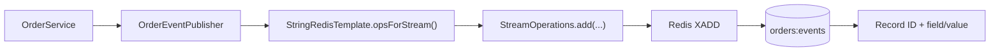
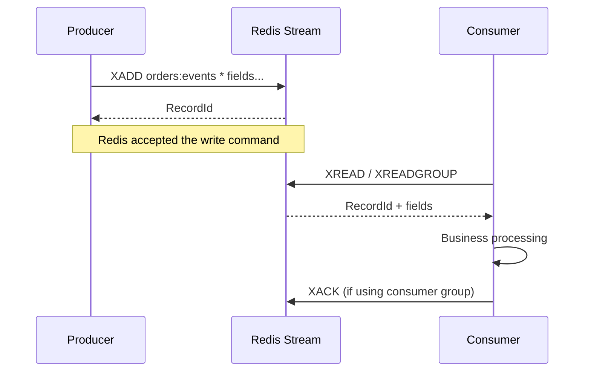
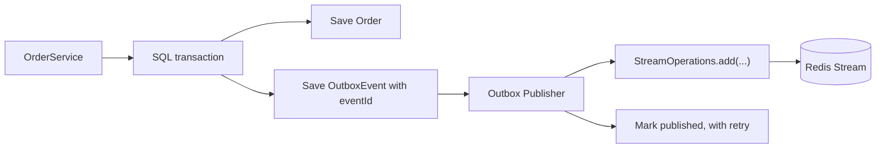

# Writing Records with `StreamOperations`

**Redis Streams** is a data type that stores a sequence of *records* in ascending ID order. In **Spring Data Redis**, `StreamOperations` provides the API to write records to a stream via the `add(...)` method, corresponding to the Redis **`XADD`** command. For example, when an order is created, the application can append an `OrderCreated` record to the `orders:events` stream for consumers to process later.

Unlike Redis Pub/Sub, records in a stream can still be read after the producer has written them, as long as they are retained in the stream. However, a successful write **does not mean** a consumer has read it, acknowledged processing, or completed a downstream business workflow. This lesson focuses on the **producer** side: building the payload, calling `StreamOperations.add(...)`, receiving the `RecordId`, and designing safe writes when multiple processes exist.

## 1. Structure of a Redis Stream Record

Each record in a Redis Stream has three easily observable components:

| Component | Example | Meaning |
| --- | --- | --- |
| **Stream key** | `orders:events` | Name of the stream holding the records |
| **Record ID** | `1730800000000-0` | Identifier generated by Redis or supplied by the client, determining order in the stream |
| **Field/value payload** | `type=OrderCreated`, `orderId=O-1001` | Field name and value pairs forming the record's content |

Example of writing directly with Redis CLI:

```redis
XADD orders:events * type OrderCreated orderId O-1001 amountMinor 250000
```

Redis returns an ID, for example:

```text
"1730800000000-0"
```

The `*` asks **Redis to auto-generate the ID**. This is the most common approach when the application simply wants to append a new record. Do not use the example ID above as a hardcoded ID in a running system.



A Stream is an **ordered log**. Writing with `XADD` appends a new record to the end of the stream; this operation is not a `SET` overwriting the value of a Redis string key. If the stream key does not yet exist, `XADD` normally creates the stream automatically. If the key already exists with a data type other than stream, Redis returns a `WRONGTYPE` error.

## 2. Setting Up Spring Boot and the Redis Connection

For a Spring Boot application using the synchronous API, add the starter:

```groovy
// build.gradle
dependencies {
    implementation 'org.springframework.boot:spring-boot-starter-data-redis'
}
```

Configure Redis Server, for example in development:

```yaml
# src/main/resources/application.yml
spring:
  data:
    redis:
      host: localhost
      port: 6379
      timeout: 2s
```

The example uses Spring Boot 3.x configuration conventions. In a real environment, the connection may require a password, TLS, Sentinel, or Cluster depending on infrastructure configuration. The starter typically provides `RedisConnectionFactory`, `RedisTemplate`, and `StringRedisTemplate` via auto-configuration when conditions are met.

To write records with string field names and values, **`StringRedisTemplate` is a simple starting point that is easy to inspect with Redis CLI**:

```java
import org.springframework.data.redis.core.StringRedisTemplate;
import org.springframework.data.redis.core.StreamOperations;

StreamOperations<String, String, String> streamOperations =
        stringRedisTemplate.opsForStream();
```

The three generic type parameters of `StreamOperations<K, HK, HV>` are:

- `K`: type of the stream key name, `String` in the example.
- `HK`: type of the field names in the record, `String` in the example.
- `HV`: type of the field values in the record, `String` in the example.

`StringRedisTemplate` uses string serializers for keys and corresponding values, so the illustrated fields appear in Redis CLI as human-readable text. With a customized `RedisTemplate`, you must verify which serializers are applied.

## 3. The Simplest Way: `add(streamKey, Map)`

A commonly used API:

```java
RecordId add(K key, Map<? extends HK, ? extends HV> content)
```

Example creating a record:

```java
import java.util.LinkedHashMap;
import java.util.Map;
import org.springframework.data.redis.connection.stream.RecordId;
import org.springframework.data.redis.core.StringRedisTemplate;

String streamKey = "orders:events";

Map<String, String> fields = new LinkedHashMap<>();
fields.put("type", "OrderCreated");
fields.put("eventId", "event-9ab1");
fields.put("orderId", "O-1001");
fields.put("amountMinor", "250000");
fields.put("schemaVersion", "1");

RecordId recordId = stringRedisTemplate.opsForStream()
        .add(streamKey, fields);

System.out.println(recordId.getValue());
// Example: 1730800000000-0
```

In the call above, Spring Data Redis performs an operation equivalent to:

```redis
XADD orders:events * type OrderCreated eventId event-9ab1 orderId O-1001 amountMinor 250000 schemaVersion 1
```

Field ordering is not a business contract; reading clients should distinguish fields by **name**. The `RecordId` returned by `add(...)` is the ID **of the stream write**, not the business `orderId` or `eventId`.

**Note:** under normal execution, `add` returns a `RecordId` if Redis accepts the command. Some Spring Data Redis APIs may return `null` when commands are queued inside a **pipeline or transaction**, because the actual result arrives later; do not interpret `null` in that context as indicating that Redis failed or succeeded.

## 4. Complete Producer Example as a Spring Service

An application should encapsulate payload construction and Redis writing in a single service so field conventions are not scattered. The example below writes an order event with its own event ID, business occurrence timestamp, and amount in **minor units** (e.g., VND or cents depending on the system).

```java
package com.example.shop.stream;

import java.time.Instant;
import java.util.LinkedHashMap;
import java.util.Map;
import java.util.Objects;

import org.springframework.data.redis.connection.stream.RecordId;
import org.springframework.data.redis.core.StringRedisTemplate;
import org.springframework.stereotype.Service;

@Service
public class OrderEventPublisher {

    private static final String STREAM_KEY = "orders:events";

    private final StringRedisTemplate redis;

    public OrderEventPublisher(StringRedisTemplate redis) {
        this.redis = redis;
    }

    public record OrderCreatedEvent(
            String eventId,
            String orderId,
            Instant occurredAt,
            long amountMinor) {
    }

    public String publish(OrderCreatedEvent event) {
        Objects.requireNonNull(event, "event");
        requireText(event.eventId(), "eventId");
        requireText(event.orderId(), "orderId");
        Objects.requireNonNull(event.occurredAt(), "occurredAt");

        if (event.amountMinor() < 0) {
            throw new IllegalArgumentException(
                    "amountMinor must not be negative");
        }

        Map<String, String> payload = new LinkedHashMap<>();
        payload.put("type", "OrderCreated");
        payload.put("schemaVersion", "1");
        payload.put("eventId", event.eventId());
        payload.put("orderId", event.orderId());
        payload.put("occurredAt", event.occurredAt().toString());
        payload.put("amountMinor", Long.toString(event.amountMinor()));

        RecordId recordId = redis.opsForStream()
                .add(STREAM_KEY, payload);

        // This example uses synchronous execution, not pipelining/MULTI.
        if (recordId == null) {
            throw new IllegalStateException(
                    "Record ID unavailable in current execution context");
        }
        return recordId.getValue();
    }

    private static void requireText(String value, String field) {
        if (value == null || value.isBlank()) {
            throw new IllegalArgumentException(field + " is required");
        }
    }
}
```

Illustrative call:

```java
import java.time.Instant;
import java.util.UUID;

String id = publisher.publish(
        new OrderEventPublisher.OrderCreatedEvent(
                UUID.randomUUID().toString(),
                "O-1001",
                Instant.now(),
                250_000L
        )
);

System.out.println("Published Redis stream record: " + id);
```

In this example, `eventId` is generated **once per business event**; if a retry mechanism must re-send the same event, it must **keep the generated `eventId`** rather than calling `UUID.randomUUID()` again. `RecordId` will be newly generated by Redis on every `XADD`, even when two records have identical contents.

### Why Not Store Amounts or Timestamps as Objects?

`StringRedisTemplate` works well with values converted to strings. Representing `amountMinor` as an integer in a defined unit and `occurredAt` as an ISO-8601 string makes it easier for consumers in other languages to read and parse.

For multi-version data, **`schemaVersion`** helps consumers know how to decode it. This is especially useful when multiple teams read the same stream or consumers deploy versions at a different pace than producers.

## 5. Writing with `MapRecord` and `StreamRecords`

Besides `add(streamKey, Map)`, Spring Data Redis lets you package the stream name and payload into a **`MapRecord`**:

```java
import java.util.Map;
import org.springframework.data.redis.connection.stream.MapRecord;
import org.springframework.data.redis.connection.stream.RecordId;
import org.springframework.data.redis.connection.stream.StreamRecords;

MapRecord<String, String, String> record =
        StreamRecords.mapBacked(Map.of(
                "type", "OrderCreated",
                "eventId", "event-9ab1",
                "orderId", "O-1001"))
                .withStreamKey("orders:events");

RecordId id = stringRedisTemplate.opsForStream().add(record);
```

`MapRecord<K, HK, HV>` holds:

| Property | Meaning |
| --- | --- |
| `getStream()` | Specified stream key, e.g., `orders:events` |
| `getValue()` | Map of fields/values forming the payload |
| `getId()` | Record ID; for a new record, let Redis generate the ID on write |

`StreamRecords` has builders and factory methods such as `mapBacked(...)`, `string(...)`, and `newRecord()` to create records matching the data to be written. `MapRecord` fits when the producer already has a flat payload of fields and values.

**Both `add(streamKey, map)` and `add(mapRecord)` append a record to the stream.** The first form is concise; the second is convenient when the application passes records across layers or wants to hold the stream name and payload in a single object.

Do not try to reuse a mutable `MapRecord` across threads and mutate its payload while threads are writing. Creating a separate record/payload per event is much easier to control.

## 6. `ObjectRecord`: Writing Java Objects

`StreamOperations.add(...)` also accepts `Record<K, ?>`, including **`ObjectRecord`**. When you have a Java object to write and an appropriate `HashMapper`/serializer configured, the application can let Spring Data Redis convert the object into stream data.

Conceptual example:

```java
import org.springframework.data.redis.connection.stream.ObjectRecord;
import org.springframework.data.redis.connection.stream.RecordId;
import org.springframework.data.redis.connection.stream.StreamRecords;

// AuditEvent and objectRedisTemplate are components configured by the application.
AuditEvent event = new AuditEvent("event-1", "LOGIN", "user-17");

ObjectRecord<String, AuditEvent> record =
        StreamRecords.newRecord()
                .in("audit:events")
                .ofObject(event);

RecordId id = objectRedisTemplate.opsForStream().add(record);
```

The snippet above illustrates the `ObjectRecord` API; `AuditEvent` and `objectRedisTemplate` are types/beans that must be defined according to the application's object-mapping approach. **Do not copy this snippet verbatim into a project that only has `StringRedisTemplate` and assume every object will automatically serialize to JSON.**

Spring Data Redis can map objects into stream fields via hash mapping, potentially including metadata such as `_class` depending on configuration. Consumers written in other languages may not understand Java-specific mapping details. Therefore, choose a format based on integration needs:

| Write approach | Pros | Considerations |
| --- | --- | --- |
| `Map<String, String>` / `MapRecord` | Clear field structure, easy to read via Redis CLI and many languages | Producer handles mapping, validation, and schema management |
| `ObjectRecord<String, T>` | Close to the Java model; can reuse mapping | Requires compatible serializer/hash mapper; watch Java metadata and class changes |
| Map with a single `payload` field containing JSON | JSON contract is easy to share with other consumers | Loses per-field Redis Stream inspection; must manage JSON serializer |

Example JSON payload in a single field:

```java
Map<String, String> fields = Map.of(
        "type", "OrderCreated",
        "schemaVersion", "1",
        "payload", "{\"orderId\":\"O-1001\",\"amountMinor\":250000}"
);

RecordId id = stringRedisTemplate.opsForStream()
        .add("orders:events", fields);
```

In production, use a JSON library such as Jackson to serialize a validated DTO rather than manually concatenating JSON from user input.

## 7. Serializers Applied to Streams

Redis stores keys, field names, and field values as **bytes**. Spring Data Redis takes serializers from the corresponding `RedisTemplate`:

| Stream component | Serializer used |
| --- | --- |
| Stream key name | `keySerializer` |
| Payload field names | `hashKeySerializer` |
| Payload field values | `hashValueSerializer` |

For example, `StringRedisTemplate` encodes `String` values clearly. If you use `RedisTemplate<String, Object>` with complex object serializers, the output may contain binary data and not look like the strings displayed by Redis CLI.

Producers and consumers must agree on:

- Stream name, prefix, and environment, e.g., `prod:orders:events`.
- How fields and values are encoded (UTF-8, JSON, stringified numbers, etc.).
- Required field names and types; rules when fields are missing.
- Payload versioning and compatibility when the schema evolves.

**Do not switch serializers mid-stream without a migration strategy.** Old records remain stored in the old encoding, so new consumers may fail to decode them if they assume the entire stream uses a new format.

## 8. `RecordId` and Record Ordering

A Redis Stream ID normally has the form:

```text
<millisecondsTime>-<sequence>
```

For example:

```text
1730800000000-0
1730800000000-1
1730800000001-0
```

A new record's ID must be greater than the highest ID previously used in the stream. When using `XADD ... *`, Redis automatically generates an ID satisfying that ordering. Two records may share the same millisecond part while differing in sequence number.

### Distinguishing Three Identifiers

| Identifier | Example | What is it used for? |
| --- | --- | --- |
| Redis `RecordId` | `1730800000000-0` | Identifies an entry's position in the stream; used for reading, acknowledging, or ID-based operations |
| `eventId` in payload | `9d2f...` | Identifies a business event across retries and systems |
| `orderId` in payload | `O-1001` | Identifies the order or aggregate that emitted the event |

`RecordId` is **not** a business idempotency identifier. Two `add` calls with the same payload can create **two different RecordIds**. Therefore, you need `eventId` and deduplication on the producer/consumer if duplicate events must not be processed.

Spring Data Redis also supports client-specified record IDs in some APIs, but normally you should let Redis auto-generate them. If providing an ID manually, it must match the valid format and be greater than every ID previously used in the stream; stale or invalid IDs cause `XADD` to be rejected by Redis. The timestamp embedded in the ID is also not necessarily the business occurrence time; use an `occurredAt` field to store business time.

## 9. Limiting Stream Length on Write: `XAddOptions`

Redis Streams can grow continuously if producers write faster than old data is removed. An application needs a **retention policy** based on consumer recovery and processing requirements.

In Redis CLI, you can add a record while requesting an entry-count limit:

```redis
XADD orders:events MAXLEN ~ 100000 * type OrderCreated orderId O-1001
```

`MAXLEN` sets the threshold of records to keep; `~` allows **approximate trimming**, which is usually more efficient than exact trimming and may temporarily retain more than the threshold. The example `100000` is illustrative, not the right size for every system.

In Spring Data Redis, there is an `add(..., XAddOptions)` overload:

```java
import java.util.Map;
import org.springframework.data.redis.connection.RedisStreamCommands;
import org.springframework.data.redis.connection.stream.RecordId;

RedisStreamCommands.XAddOptions options =
        RedisStreamCommands.XAddOptions.maxlen(100_000);

RecordId id = stringRedisTemplate.opsForStream()
        .add("orders:events",
                Map.of("type", "OrderCreated", "orderId", "O-1001"),
                options);
```

The Java example above uses a **`MAXLEN` limit without requesting approximate trimming**. The API for selecting approximate trimming varies across Spring Data Redis versions. In newer versions with `TrimOptions`, you can declare the intent explicitly:

```java
import org.springframework.data.redis.connection.RedisStreamCommands;

RedisStreamCommands.XAddOptions options =
        RedisStreamCommands.XAddOptions.trim(
                RedisStreamCommands.TrimOptions
                        .maxLen(100_000)
                        .approximate());
```

In older versions of Spring Data Redis, there was `.approximateTrimming(true)`; in newer lines, that API is marked deprecated and replaced by `TrimOptions`. In a specific project, use the API variant compatible with your dependency version.

### Warning About Unprocessed Data

Trimming can remove old entries while consumers are slow or while a consumer group still references incomplete entries. Depending on the Redis version and deletion behavior, this can leave no payload to replay even though pending metadata still exists. Therefore:

1. Choose retention based on **how long a consumer can be down** and peak write rate, not just available memory.
2. Monitor backlog, pending count, and consumer lag before lowering `MAXLEN`.
3. If events must be retained long-term for auditing, consider storing them in an appropriate durable system instead of relying solely on a trimmed stream.

Redis Streams **do not have per-record TTLs like regular key TTLs**. Calling `EXPIRE orders:events 3600` sets a TTL on the **entire stream key**; when it expires, all entries in the stream disappear. Record-level retention typically relies on `MAXLEN`, `MINID`, `XTRIM`, or equivalent policies.

## 10. Inspecting Newly Written Records

In development, after calling `add`, you can use Redis CLI:

```redis
TYPE orders:events
# stream

XLEN orders:events
# Current number of entries

XRANGE orders:events - + COUNT 10
# First entries, each including its ID and fields/values
```

View the newest entries:

```redis
XREVRANGE orders:events + - COUNT 5
```

View stream info:

```redis
XINFO STREAM orders:events
```

If you received a `RecordId`, you can look up the exact entry by ID:

```redis
XRANGE orders:events 1730800000000-0 1730800000000-0
```

Replace the illustrative ID with the actual ID received by the producer. If the entry has been trimmed or the stream deleted, looking up the old ID will return no data.

**Do not use unbounded `XRANGE stream - +` on a very large stream to serve web requests.** In production, use `COUNT`, ID-based pagination, or an appropriate consumer mechanism to avoid loading the entire history into memory.

## 11. Writing a Record and Consumer Processing Are Two Different Phases



**`add(...)` only writes the record.** It does not create a consumer group, does not mark the message as processed, and does not call `XACK` on behalf of the consumer. When using a consumer group, reading, error handling, retries, and acknowledgment belong to the consumer side.

Unlike Pub/Sub, a Redis Stream keeps records until deleted/trimmed/expired. However, the stream does not automatically enforce exactly-once processing. A consumer may receive a record again during error recovery, so business handling usually needs **idempotency**.

## 12. When Errors Occur While Calling `add(...)`

Three situations must be distinguished:

| Observation on producer | Interpretation | Appropriate action |
| --- | --- | --- |
| `add` returns a `RecordId` | Redis accepted and appended the record under normal execution | Record the ID and continue; consumer processing status is a separate step |
| Redis returns an error such as `WRONGTYPE`, invalid format, insufficient permissions | Write failed per server-confirmed error | Fix data/config/permissions; do not retry infinitely |
| Timeout or connection loss after the command may have been sent | **Uncertain** whether Redis wrote it or not | Do not assume it was not written; need a retry/idempotency contract |

The last situation is the most critical. For example:

```text
Producer -> Redis: XADD orders:events * eventId=e-123
Redis: appended entry 1730800000000-0
Redis -> Producer: response lost due to network timeout
Producer: sees exception, did not receive RecordId
```

If the producer simply calls `add` again, Redis may generate a new ID and the stream ends up with **two entries sharing the same `eventId`**. By default, `XADD` does not deduplicate by payload. Thus, systems requiring accurate processing must actively manage business identifiers.

### 12.1. Using `eventId` and Idempotent Consumers

Example event containing:

```text
eventId = e-123
orderId = O-1001
type = OrderCreated
```

When the consumer processes it, a durable data store can enforce a unique constraint on `eventId` or `(consumerName, eventId)`. If the event repeats under a different `RecordId`, the consumer sees it was already processed and skips re-applying side effects. When updating a database, record the processed marker and business changes in the **same transaction in that store** whenever possible.

Adding an `eventId` field **does not deduplicate automatically**. It simply provides a stable identifier so other components can enforce idempotency.

### 12.2. Producers with SQL Transactions: Consider a Transactional Outbox

Suppose the application writes an order to PostgreSQL and publishes an event to Redis:

```text
BEGIN SQL TRANSACTION
INSERT orders (...)
COMMIT
XADD orders:events ...
```

If the application dies **between `COMMIT` and `XADD`**, the order is saved, but the stream has no event. If `XADD` is sent before the SQL commit, consumers might see an event for an order that later rolls back.

A more reliable design is the **transactional outbox**:



The outbox publisher can retry sending, and consumers use `eventId` to deduplicate. This is an *at-least-once* model suitable for avoiding lost business events; do not assume SQL and Redis form a single distributed transaction merely via Spring's `@Transactional`.

Even when Redis returns a `RecordId`, durability across crashes/failover still depends on Redis persistence, replication, and infrastructure setup. If the problem requires zero-loss logs under strict SLAs, design durability to meet those requirements.

## 13. Batching and Write Throughput

A producer may need to write many records:

```java
for (OrderEventPublisher.OrderCreatedEvent event : events) {
    publisher.publish(event);
}
```

With this approach, each `add` is a sequential call, simple and easy to obtain a `RecordId` from. As write volume grows, many round trips can become a bottleneck. Spring Data Redis supports **pipelining**, but when running in a pipeline, the direct return value from `add(...)` can be `null`; the actual results appear in the pipeline results list.

Therefore, if switching to pipelining, explicitly design for:

- Correlating each pipeline result with the exact event sent.
- Handling cases where a command fails or the connection drops mid-response.
- Not marking all events as successfully written merely because commands were queued in the pipeline.
- Keeping the same `eventId` when retrying records whose outcome is uncertain.
- Determining whether strict ordering within **one stream** is needed or partitioning across multiple streams is acceptable.

For high write throughput, pipelining needs metrics, batch size limits, and a backpressure policy. Do not build an unbounded batch that holds all payloads in memory.

## 14. Writing with `StreamOperations` in Redis Cluster

Each `XADD` writes to **one stream key**, so Redis Cluster routes the command to the node owning that key's hash slot. If there are multiple streams:

```text
orders:events
payments:events
notifications:events
```

they may reside on different slots or nodes. ID ordering is guaranteed **within each stream**, not as a global order across all streams in the cluster.

If you want a transaction/script to operate on multiple keys simultaneously in Redis Cluster, you must account for the same-hash-slot requirement. This goes beyond a single `StreamOperations.add(streamKey, ...)` call, but becomes important when designing large event pipelines.

When an application has multiple producer instances writing to one stream, Redis generates IDs and orders them according to the sequence commands arrive at the server. That is not necessarily the **business occurrence time order** across instances; do not infer that one event happened earlier in the real world just because its `RecordId` is smaller when events are sent asynchronously.

## 15. Common Pitfalls and Misconceptions

### 15.1. Confusing `opsForStream()` with `opsForValue()`

`opsForValue()` works with strings; `opsForStream()` works with Redis Streams. If a key was created with `SET`, calling `XADD` on the same key name returns `WRONGTYPE`. Use distinct prefixes and naming conventions for streams.

### 15.2. Passing an Empty Map or Null Field Values

The `XADD` command requires at least one field/value pair. `Map.of(...)` does not allow `null`; with other maps, serializers may handle `null` unexpectedly. Validate payloads before sending and define which fields are required.

### 15.3. Treating `RecordId` as Proof a Consumer Processed the Event

`RecordId` shows that Redis added the entry. Consumers may not be created yet, may be offline, or may be lagging. Monitor consumer groups, backlog, and acknowledgment status separately.

### 15.4. Re-sending an Event with a New Business ID

If a timeout causes the client to retry and generate a new `eventId`, consumers cannot tell that the two records represent the same event. Generate and persist the ID when the event is created; keep that same ID across retries.

### 15.5. Setting `MAXLEN` Too Small

When producer throughput is high and consumers pause briefly, unprocessed records can get trimmed. Estimate retention from actual load, downtime thresholds, and processing speed rather than picking a small number just to save RAM.

### 15.6. Using `EXPIRE` to Delete Individual Messages

`EXPIRE streamKey ...` expires **the entire stream key**. Redis Streams do not assign independent TTLs per entry via regular `EXPIRE`. If old entries must be removed, use an appropriate trim/delete strategy.

### 15.7. Assuming Serializers Do Not Affect Stream Data

`StringRedisTemplate` and a custom `RedisTemplate` can write different bytes for the same Java value. Producers and consumers using incompatible serializers may see strange field names, decoding errors, or unreadable records.

### 15.8. Calling `add()` in a Pipeline and Expecting the ID Immediately

While a pipeline or transaction is queuing commands, the direct return value from `add()` can be `null` because results only arrive upon execution. Retrieve results where the pipeline/transaction finishes, and do not rely on a missing ID to judge success.

### 15.9. Assuming an `XADD` Writes Atomically with SQL

Redis and SQL have separate transaction boundaries. If you need both to save an entity and emit an event, use an outbox or an appropriate recovery design; do not assume `@Transactional` wraps both into one atomic commit.

## 16. Practice and Observation Workflow

You can experiment on a learning Redis instance in three steps:

**Step 1: Write two records using CLI.**

```redis
XADD lesson:orders * type OrderCreated orderId O-1 eventId e-1
XADD lesson:orders * type OrderPaid orderId O-1 eventId e-2
```

**Step 2: Inspect the stream.**

```redis
TYPE lesson:orders
XLEN lesson:orders
XRANGE lesson:orders - + COUNT 10
XREVRANGE lesson:orders + - COUNT 1
```

**Step 3: Write to the same stream using Spring Data Redis.**

```java
RecordId id = stringRedisTemplate.opsForStream().add(
        "lesson:orders",
        Map.of(
                "type", "OrderShipped",
                "orderId", "O-1",
                "eventId", "e-3")
);
System.out.println(id.getValue());
```

Then run `XRANGE lesson:orders - + COUNT 10` again to see the new record. Contents written via CLI and via Spring Data Redis must follow the same encoding convention; for example, using strings for all fields and values.

To observe retention without affecting real data:

```redis
XADD lesson:trim MAXLEN ~ 5 * type Demo seq 1
XADD lesson:trim MAXLEN ~ 5 * type Demo seq 2
XLEN lesson:trim
```

Do not expect `MAXLEN ~ 5` to always leave strictly at most 5 entries: `~` requests approximate trimming.

## 17. Design Decisions Before Implementation

| Question | Recommendation |
| --- | --- |
| Need a simple payload readable by many languages? | `StringRedisTemplate.opsForStream().add(key, Map<String,String>)` |
| Need to bundle stream key and payload into an object? | `StreamRecords.mapBacked(...).withStreamKey(...)` |
| Want to write Java objects directly? | `ObjectRecord`, but configure mapper/serializer and schema contract |
| Need consumers to detect duplicate events? | Attach a stable `eventId` and persist idempotent processing state |
| Need bounded memory? | Choose `XAddOptions` or trimming with retention covering consumer downtime |
| Need to guarantee events are emitted after SQL transactions commit? | Use a transactional outbox or a flow with retries and idempotency |
| Producer receives no response from Redis? | Treat commit outcome as unknown; reconcile via `eventId`/recovery contract |
| Need high records/second? | Consider pipelining, batching, load limits, and latency monitoring |

## 18. Summary

`StreamOperations` is the primary API in **Spring Data Redis** for writing records to Redis Streams. For field/value data, you can use `StringRedisTemplate.opsForStream().add(streamKey, map)` or wrap it in a `MapRecord` and call `add(record)`. The usual result is a Redis-generated `RecordId`, representing the new record's position in the stream.

Keep **`RecordId`** separate from **business event IDs**, manage serializers and schemas explicitly, size retention for consumer recovery capacity, and handle retries with idempotency. Successfully writing a record only confirms that Redis accepted the append command; reading, processing, and acknowledging belong to consumers, while consistency with SQL requires a dedicated mechanism such as a transactional outbox.

### References

- [Spring Data Redis — Redis Streams](https://docs.spring.io/spring-data/redis/reference/redis/redis-streams.html): writing records with `StreamOperations`, `MapRecord`, `ObjectRecord`, and serializers.
- [Spring Data Redis — `StreamOperations` API](https://docs.spring.io/spring-data/redis/reference/api/java/org/springframework/data/redis/core/StreamOperations.html): `add(...)` overloads, `RecordId`, trimming, and results under pipelining/transactions.
- [Spring Data Redis — `StreamRecords` API](https://docs.spring.io/spring-data/redis/reference/api/java/org/springframework/data/redis/connection/stream/StreamRecords.html): creating records from maps or objects.
- [Redis — XADD](https://redis.io/docs/latest/commands/xadd/): auto-generated IDs, fields/values, `MAXLEN`, and retention.
- [Redis — Introduction to Streams](https://redis.io/docs/latest/develop/data-types/streams/): stream model, consumer groups, and data lifecycle.
