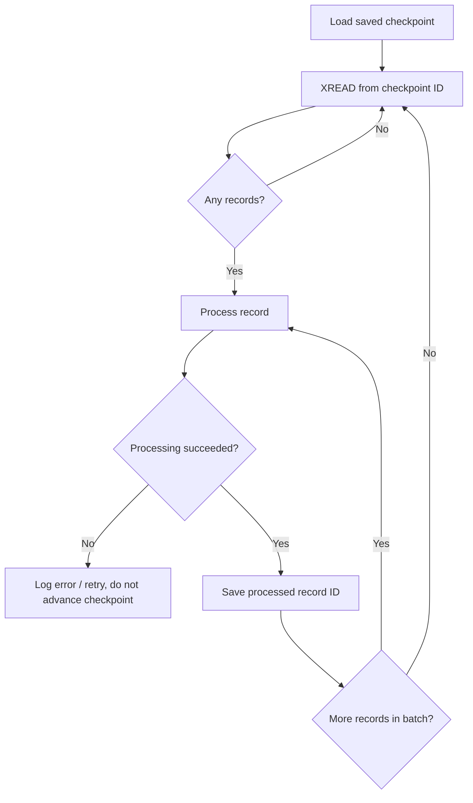

# Range Reads, Offset Reads, and Blocking Reads in Redis Streams with Spring Data Redis

## 1. Goal and Problem Statement

Redis Streams is a log-like data structure of ordered events, well suited for event streams such as orders, payments, inventory changes, or asynchronous jobs. Unlike a Redis List, each record in a Stream has an **ordered ID** and a set of field–value pairs. Thanks to this ID, an application can look up history by range, resume reading from a processed checkpoint, or wait for new events.

For example, an application writes events to the Stream `shop:orders:events`:

```text
ID                  type        orderId   status
1700000000000-0     CREATED     O-1001    NEW
1700000000001-0     CONFIRMED   O-1001    PAID
1700000000002-0     CREATED     O-1002    NEW
1700000000003-0     SHIPPED     O-1001    SHIPPING
```

Different reading needs lead to different commands:

- **Range read:** retrieve events from ID A to ID B, or fetch the first 20 records in history for inspection.
- **Offset read:** already processed up to ID B; now fetch only records **after B**.
- **Blocking read:** if no new record is available yet, hold the read request for a period of time instead of sending commands continuously.
- **Consumer group read:** multiple workers need to divide work and track records pending acknowledgment; this is an additional mechanism, distinct from independent offset reads.

In Spring Data Redis, the first three needs are mainly handled with `StreamOperations`, `Range`, `ReadOffset`, `StreamOffset`, and `StreamReadOptions`.

## 2. Stream IDs Are Record Position Markers

Each entry in a Redis Stream consists of an **ID** and a field–value map:

```text
1700000000001-0
  type       = CONFIRMED
  orderId    = O-1001
  status     = PAID
```

IDs follow the common `milliseconds-sequence` format, e.g., `1700000000001-0`. The first part is a millisecond time component, and the second part is a sequence number within the same millisecond. When using `XADD ... *`, Redis creates a new ID in ascending order appropriate for the Stream.

Key principles:

1. **The ID is a read position**, not a field name or business identifier. `orderId=O-1001` may appear in many entries with many IDs.
2. Two entries in the same millisecond can still have different IDs, such as `1700000000001-0` and `1700000000001-1`.
3. IDs increase monotonically within a Stream. If the application supplies its own IDs, it must follow Redis's ID constraints.
4. Do not definitively infer business occurrence time from the ID if the system uses client-supplied IDs or delayed event writes. To filter by `businessOccurredAt`, store an extra field and choose an appropriate query strategy.
5. Re-reading old IDs vs. reading after new IDs depends on the API: **`XRANGE` uses range bounds**, whereas **`XREAD` uses an exclusive offset**.

### Common Symbols

| Symbol | Context | Meaning |
|---|---|---|
| `-` | `XRANGE` / `XREVRANGE` | Lowest possible ID in a range |
| `+` | `XRANGE` / `XREVRANGE` | Highest possible ID in a range |
| `0-0` | `XREAD` or range | Very early starting point; commonly used to read history |
| `$` | `XREAD` | Only interested in entries arriving **after the read command starts** |
| `(1700000000001-0` | Range | Open boundary: excludes this ID |
| `>` | `XREADGROUP` | Entries not yet delivered to any consumer in the group per group semantics |

Specifically, `$` and `>` are not interchangeable: `$` belongs to direct Stream reads; `>` is the symbol for reading new records in a consumer group.

## 3. Creating Sample Data with Redis CLI

You can use Redis CLI in a development environment to add a few entries:

```redis
XADD shop:orders:events * type CREATED orderId O-1001 status NEW
XADD shop:orders:events * type CONFIRMED orderId O-1001 status PAID
XADD shop:orders:events * type CREATED orderId O-1002 status NEW
XADD shop:orders:events * type SHIPPED orderId O-1001 status SHIPPING
```

Redis returns the actual ID for each `XADD` command. In the following examples, replace illustrative IDs with the **actual IDs Redis returned on your system**.

Check the number of stored entries:

```redis
XLEN shop:orders:events
```

Inspect general Stream information:

```redis
XINFO STREAM shop:orders:events
```

`XLEN` is the number of entries currently in the Stream, not the total number of events ever written since creation; deletions or trimming reduce the count. `XINFO STREAM` provides useful metadata, though it does not replace reading individual records when content processing is needed.

## 4. Range Reads with `XRANGE`

The `XRANGE` command retrieves records whose IDs fall within a range:

```redis
XRANGE shop:orders:events - +
```

`-` is the lowest bound and `+` is the highest bound. The command above reads all records still existing in the Stream in **ascending ID order**.

If you need to limit the result count in a single call:

```redis
XRANGE shop:orders:events - + COUNT 2
```

This fetches at most the first two entries currently in the range. `COUNT 2` limits the results of **this call**; it does not alter Stream data and does not mean the Stream only has two entries left.

### Reading a Specific ID Range

Suppose you want to read from ID `1700000000001-0` to `1700000000003-0`:

```redis
XRANGE shop:orders:events 1700000000001-0 1700000000003-0
```

By default, bounds are **inclusive** if an entry with the boundary ID exists. To exclude the ID at the start of the range, prepend `(`:

```redis
XRANGE shop:orders:events (1700000000001-0 1700000000003-0
```

The second command does not return the entry with exact ID `1700000000001-0`, even if that ID exists.

### When to Use Range Reads?

- Investigating events within a known ID range.
- Building an event history viewer page.
- Replaying entries from an old checkpoint up to a specific point.
- Reading data for a reconciliation job with a bounded result count.
- Paginating history using the last ID of the previous page.

`XRANGE` **does not wait** for new records. If the range contains no entries, it returns an empty result immediately.

## 5. Reverse Reads with `XREVRANGE`

When you need to display the newest events first, use `XREVRANGE`:

```redis
XREVRANGE shop:orders:events + - COUNT 5
```

Results are in **descending ID order**, up to five entries.

The boundary order is reversed compared to `XRANGE`: with `XREVRANGE`, pass **max first**, **min second**.

| Purpose | Command |
|---|---|
| All records, oldest to newest | `XRANGE key - +` |
| First 10 records | `XRANGE key - + COUNT 10` |
| 10 newest records | `XREVRANGE key + - COUNT 10` |
| Specific range, ascending | `XRANGE key startId endId` |
| Specific range, descending | `XREVRANGE key endId startId` |

`XREVRANGE` is usually suited for a recent-activity log UI or an admin screen showing just-arrived events; forward-processing workers usually use `XREAD` or consumer groups.

## 6. Paginating by ID to Avoid Duplicate Pages

A common requirement: read 100 entries per page without loading the entire Stream into memory.

In ascending order:

1. First page: `XRANGE key - + COUNT 100`.
2. Record the **ID of the last entry on the page**.
3. Next page: `XRANGE key (lastId + COUNT 100`.
4. Repeat until no entries remain.

CLI syntax example with sample IDs:

```redis
XRANGE shop:orders:events - + COUNT 2
XRANGE shop:orders:events (1700000000001-0 + COUNT 2
```

The `(` prefix ensures the next page **does not repeat the last entry of the previous page** due to inclusive bounds.

Do not construct the next ID by adding 1 to the ID's sequence number, because with Redis-generated IDs or gaps after trimming/deletion, manual incrementing is unnecessary and error-prone. Use an **open boundary** with the actual last seen ID.

### Paginating in Reverse Order

To continue from the last entry of the page just viewed when using `XREVRANGE`, make the upper bound open:

```redis
XREVRANGE shop:orders:events + - COUNT 2
XREVRANGE shop:orders:events (1700000000002-0 - COUNT 2
```

In the second call, `(1700000000002-0` excludes that corresponding upper ID. The input must be the **last ID of the previous page** in the actual descending order.

### Changes During Pagination

ID-based pagination is more stable than paginating by a numeric list index. However, it is not an immutable snapshot:

- New records can be appended to the end of the Stream while a user views older pages.
- Records can be removed by `XDEL` or `XTRIM`.
- If the application switches to a different Stream key, the old ID checkpoint no longer represents a position in the new key.

When exporting a fixed historical range, record the **final target ID** before iterating, then paginate up to that bound. If data can be trimmed during export, an appropriate storage/retention mechanism is needed.

## 7. Spring Data Redis: Range Reads with `StreamOperations`

In Spring Boot, you can use `StringRedisTemplate` to work with Streams whose key, field names, and values are strings.

Gradle dependency:

```kotlin
dependencies {
    implementation("org.springframework.boot:spring-boot-starter-data-redis")
}
```

Or Maven:

```xml
<dependency>
    <groupId>org.springframework.boot</groupId>
    <artifactId>spring-boot-starter-data-redis</artifactId>
</dependency>
```

Illustrative local configuration:

```yaml
spring:
  data:
    redis:
      host: localhost
      port: 6379
```

With the default starter, Spring Boot can auto-configure `RedisConnectionFactory` and `StringRedisTemplate` from connection properties. Production projects must configure endpoints, TLS, authentication, timeouts, and topology per environment.

### Example Service Reading ID Ranges

**`OrderEventRangeReader.java`**

```java
package com.example.orders.stream;

import java.util.List;

import org.springframework.data.domain.Range;
import org.springframework.data.domain.Limit;
import org.springframework.data.redis.connection.stream.MapRecord;
import org.springframework.data.redis.core.StreamOperations;
import org.springframework.data.redis.core.StringRedisTemplate;
import org.springframework.stereotype.Service;

@Service
public class OrderEventRangeReader {

    private static final String STREAM = "shop:orders:events";

    private final StreamOperations<String, String, String> streams;

    public OrderEventRangeReader(StringRedisTemplate redis) {
        this.streams = redis.opsForStream();
    }

    public List<MapRecord<String, String, String>> firstPage(int size) {
        requirePageSize(size);

        return streams.range(
                STREAM,
                Range.unbounded(),
                Limit.limit().count(size)
        );
    }

    public List<MapRecord<String, String, String>> between(
            String startId,
            String endId,
            int size
    ) {
        requirePageSize(size);

        return streams.range(
                STREAM,
                Range.closed(startId, endId),
                Limit.limit().count(size)
        );
    }

    public List<MapRecord<String, String, String>> newest(int size) {
        requirePageSize(size);

        return streams.reverseRange(
                STREAM,
                Range.unbounded(),
                Limit.limit().count(size)
        );
    }

    private static void requirePageSize(int size) {
        if (size < 1 || size > 1_000) {
            throw new IllegalArgumentException(
                    "size must be between 1 and 1000"
            );
        }
    }
}
```

Explanation:

- `StreamOperations<String, String, String>` is the API for string Stream names, fields, and values.
- `Range.unbounded()` selects the entire readable range; combine with `Limit` to keep the result size per call reasonable.
- `Range.closed(startId, endId)` defines a range inclusive of both bounds.
- `range(...)` reads from oldest to newest; `reverseRange(...)` reads from newest to oldest.
- `MapRecord` contains the record ID along with fields and values; the Stream key name is also part of the record's metadata.
- `Limit.limit().count(size)` limits the maximum number of records returned for that read; it does not set a limit on total records in the Stream.

Usage:

```java
List<MapRecord<String, String, String>> page =
        orderEventRangeReader.firstPage(10);

for (MapRecord<String, String, String> record : page) {
    System.out.println("ID = " + record.getId().getValue());
    System.out.println("Fields = " + record.getValue());
}
```

Remember that `MapRecord` is data **read from the Stream**, not necessarily automatically mapped to a business POJO. When object mapping is needed, explore `ObjectRecord` and mapping operations; this example uses strings to focus on positional reading behavior.

### Next Page Pagination with an Open Boundary

With Spring Data, you can describe the next range with an open boundary:

```java
String lastSeenId = "1700000000001-0";

List<MapRecord<String, String, String>> nextPage =
        streams.range(
                "shop:orders:events",
                Range.leftOpen(lastSeenId, "+"),
                Limit.limit().count(100)
        );
```

This means **the ID must be greater than `lastSeenId`**, without exceeding the upper bound. Use the actual last ID of the read page as the boundary; do not synthesize the next ID manually.

When building user-facing APIs, validate `lastSeenId` against a valid ID format, cap `size`, and ensure callers can only query their authorized Stream.

## 8. Offset Reads with `XREAD`

Unlike `XRANGE` which reads within a range, `XREAD` reads entries whose IDs are **greater than the supplied offset**. This is how you build an independent consumer that resumes where it left off.

Example:

```redis
XREAD COUNT 10 STREAMS shop:orders:events 0-0
```

This reads up to 10 entries with IDs **greater than `0-0`**. For a normal Stream, this reads from the start of retained history.

If that read returns the last entry with ID `1700000000002-0`, read next:

```redis
XREAD COUNT 10 STREAMS shop:orders:events 1700000000002-0
```

This time Redis only returns entries with IDs **after `1700000000002-0`**.

### Key Differences: `XRANGE` vs. `XREAD`

| Property | `XRANGE` | `XREAD` |
|---|---|---|
| Primary input | Start ID and end ID | Last processed ID offset |
| Includes start boundary ID? | Yes by default | No; only returns records with greater IDs |
| Has an end bound? | Can specify an end ID | Normally reads forward toward the Stream tail |
| Waits for new data | No | Can use `BLOCK` |
| Suitable for | History, pagination, reconciliation | Resuming processing after a checkpoint |
| Has consumer-group PEL/ACK | No | No, when using plain `XREAD` |

The two commands can read similar records when boundaries are set appropriately, yet they carry different semantics. Mixing up boundaries can cause **duplicate reads or skipped entries**.

### Reading from the Tail with `$`

If a consumer only wants entries that arrive after it starts listening:

```redis
XREAD BLOCK 5000 STREAMS shop:orders:events $
```

`$` represents the highest ID at the time the read command starts. Pre-existing entries are not replayed by this command.

Important point: **`$` is not a durable checkpoint.** If every poll passes `$`, events arriving between two polls can be missed. Once a batch is received, use the **last processed ID** as the offset for the next turn.

## 9. Reading `XREAD` with Spring Data Redis

Spring Data Redis provides `ReadOffset` to represent a read position and `StreamOffset` to bind that position to a specific Stream key.

**`OrderEventOffsetReader.java`**

```java
package com.example.orders.stream;

import java.util.List;

import org.springframework.data.redis.connection.stream.MapRecord;
import org.springframework.data.redis.connection.stream.ReadOffset;
import org.springframework.data.redis.connection.stream.StreamOffset;
import org.springframework.data.redis.connection.stream.StreamReadOptions;
import org.springframework.data.redis.core.StreamOperations;
import org.springframework.data.redis.core.StringRedisTemplate;
import org.springframework.stereotype.Service;

@Service
public class OrderEventOffsetReader {

    private static final String STREAM = "shop:orders:events";

    private final StreamOperations<String, String, String> streams;

    public OrderEventOffsetReader(StringRedisTemplate redis) {
        this.streams = redis.opsForStream();
    }

    public List<MapRecord<String, String, String>> readAfter(
            String lastProcessedId,
            int maxRecords
    ) {
        if (maxRecords < 1 || maxRecords > 1_000) {
            throw new IllegalArgumentException(
                    "maxRecords must be between 1 and 1000"
            );
        }

        StreamReadOptions options =
                StreamReadOptions.empty().count(maxRecords);

        List<MapRecord<String, String, String>> records =
                streams.read(
                        options,
                        StreamOffset.create(
                                STREAM,
                                ReadOffset.from(lastProcessedId)
                        )
                );

        return records == null ? List.of() : records;
    }
}
```

Invocation:

```java
List<MapRecord<String, String, String>> first =
        reader.readAfter("0-0", 20);

if (!first.isEmpty()) {
    String lastId =
            first.get(first.size() - 1).getId().getValue();

    List<MapRecord<String, String, String>> next =
            reader.readAfter(lastId, 20);
}
```

`ReadOffset.from(lastProcessedId)` represents an explicit offset. Spring Data Redis reads records **with IDs greater than** that offset.

You can use:

```java
StreamOffset.create(
        "shop:orders:events",
        ReadOffset.latest()
);
```

to start from events arriving after the read command executes, equivalent to Redis's `$` concept. Only use this when intentionally **skipping backlog**; do not use `latest()` as a replacement for a checkpoint when all events must be read.

## 10. Blocking Reads with `XREAD BLOCK`

Instead of asking Redis repeatedly:

```text
GET new events?  no
GET new events?  no
GET new events?  no
...
```

A consumer can ask Redis to **wait for new events** for a period of time using `BLOCK`:

```redis
XREAD BLOCK 5000 COUNT 10 STREAMS shop:orders:events $
```

Meaning:

- `BLOCK 5000`: wait up to about 5,000 milliseconds if no matching record exists yet.
- `COUNT 10`: limit/hint for the number of records returned in one read per command syntax.
- `STREAMS shop:orders:events $`: wait for records appearing after the Stream's current position.

If no new record arrives within the wait window, the command returns an empty/nil result. If records **after the supplied offset** already exist, the command can return immediately without waiting the full 5 seconds.

Redis also allows `BLOCK 0` to wait indefinitely, though the application must consider how to stop the worker, connection timeouts, shutdown, and holding a Redis connection while blocked. For services needing controlled shutdown, a finite wait is usually simpler.

### Blocking Does Not Mean Sleeping in Java

When `XREAD BLOCK` is sent to Redis, the wait happens on the Redis server side. The Java worker does not have to continuously send empty requests to the server. However, **one Redis connection remains held during the block duration**; account for the number of concurrent readers and your connection pool.

### Using an Old Offset When You Want to Read the Backlog Too

If a consumer has processed up to ID `1700000000002-0`, the appropriate command is:

```redis
XREAD BLOCK 5000 COUNT 10 STREAMS shop:orders:events 1700000000002-0
```

If entries newer than that checkpoint exist, Redis returns immediately. If not, Redis waits up to 5 seconds. When events arrive, the consumer processes them and continues from the last completed ID.

This combines **backlog catch-up + waiting for future data** in a single processing loop.

## 11. Blocking Reads with `StreamReadOptions.block()`

In Spring Data Redis, `StreamReadOptions` can configure record count and wait duration.

**`OrderEventBlockingReader.java`**

```java
package com.example.orders.stream;

import java.time.Duration;
import java.util.List;

import org.springframework.data.redis.connection.stream.MapRecord;
import org.springframework.data.redis.connection.stream.ReadOffset;
import org.springframework.data.redis.connection.stream.StreamOffset;
import org.springframework.data.redis.connection.stream.StreamReadOptions;
import org.springframework.data.redis.core.StreamOperations;
import org.springframework.data.redis.core.StringRedisTemplate;
import org.springframework.stereotype.Service;

@Service
public class OrderEventBlockingReader {

    private static final String STREAM = "shop:orders:events";

    private final StreamOperations<String, String, String> streams;

    public OrderEventBlockingReader(StringRedisTemplate redis) {
        this.streams = redis.opsForStream();
    }

    public List<MapRecord<String, String, String>> waitAfter(
            String lastProcessedId
    ) {
        StreamReadOptions options = StreamReadOptions.empty()
                .count(50)
                .block(Duration.ofSeconds(3));

        List<MapRecord<String, String, String>> records =
                streams.read(
                        options,
                        StreamOffset.create(
                                STREAM,
                                ReadOffset.from(lastProcessedId)
                        )
                );

        return records == null ? List.of() : records;
    }
}
```

Key points:

- `count(50)` limits the number of records received in a single read.
- `block(Duration.ofSeconds(3))` waits up to three seconds if no record satisfies the offset.
- `ReadOffset.from(lastProcessedId)` reads only after the processed ID.
- When it times out with no records, the API may return `null`; the service returns `List.of()` so callers do not have to handle null.
- The call is still **blocking I/O** on the thread calling the synchronous API; do not place it directly on an HTTP request path with a tight latency budget.

### Note on Timeouts

The `block(...)` duration can interact with the Redis driver's timeout and pool settings. If the client-side command timeout is shorter than the expected block duration, a normal wait can end with a client timeout before Redis replies.

Therefore:

- Choose a block duration aligned with the worker lifecycle.
- Ensure the driver's command/network timeouts are compatible.
- Have mechanisms to stop the worker, handle connection errors, and apply bounded retries.
- Do not spawn more blocking readers than the application's connection capacity can support.

Do not confuse Redis `BLOCK` with a `Thread.sleep` in Java code: sleeping merely delays the client and creates blind intervals without real-time event listening.

## 12. Managing Checkpoints to Resume After Restart

Offset reading requires an important decision: **where does the next offset come from?**

If every restart uses `ReadOffset.latest()`, the worker skips events that arrived while it was down. If every restart uses `ReadOffset.from("0-0")`, the worker re-reads the entire remaining history.

The common solution is to persist the **ID of the last successfully processed record** in a suitably durable store:

```text
orders-worker:lastProcessedId = 1700000000002-0
```

Flow:



**Checkpoint write order is critical.** If you update the checkpoint **before** business processing and the process crashes, the event can be skipped on restart.

If business processing succeeds and the process crashes **before** the checkpoint is saved, the event may be read again. Hence, systems managing their own offsets usually achieve **at-least-once** semantics when retries exist, and handlers should handle duplicates safely.

### Example Loop with an Abstract Checkpoint

```java
package com.example.orders.stream;

import java.util.List;

import org.springframework.data.redis.connection.stream.MapRecord;

public class OrderEventWorker {

    private final OrderEventBlockingReader reader;
    private final EventHandler handler;
    private final CheckpointStore checkpoints;

    public OrderEventWorker(
            OrderEventBlockingReader reader,
            EventHandler handler,
            CheckpointStore checkpoints
    ) {
        this.reader = reader;
        this.handler = handler;
        this.checkpoints = checkpoints;
    }

    public void runUntilInterrupted() {
        String checkpoint = checkpoints.load()
                .orElse("0-0");

        while (!Thread.currentThread().isInterrupted()) {
            List<MapRecord<String, String, String>> batch =
                    reader.waitAfter(checkpoint);

            for (MapRecord<String, String, String> record : batch) {
                // Only advance the offset once processing has succeeded.
                handler.handle(record);

                String processedId = record.getId().getValue();
                checkpoints.save(processedId);
                checkpoint = processedId;
            }
        }
    }

    public interface EventHandler {
        void handle(MapRecord<String, String, String> record);
    }

    public interface CheckpointStore {
        java.util.Optional<String> load();
        void save(String lastProcessedId);
    }
}
```

`EventHandler` and `CheckpointStore` are illustrative interfaces defined by the application; concrete implementations are required. `CheckpointStore` should persist in a system with durability matching recovery requirements. The code above intentionally lets exceptions from handling or saving the checkpoint propagate so a caller or supervisor manages restarts/retries; never silently swallow errors and advance the offset.

Production workers also need backoff policies on Redis errors, shutdown hooks, lag instrumentation, and handling for repeatedly failing events. Do not run an infinite loop directly inside a constructor or HTTP controller method.

### Multiple Independent Readers on One Stream

Two readers independently using `XREAD` with their own checkpoints will **both receive the same entries**. This fits systems that need to fan out events to multiple functional areas.

If you want workers in the same group to divide events and track pending/ack state, use a **Redis consumer group** rather than sharing a manual checkpoint without coordination.

## 13. Reading from the Beginning, Reading Latest, and Reading After a Checkpoint

Depending on the business goal, initial offset selection differs:

| Goal | Redis CLI | Spring Data Redis |
|---|---|---|
| Read retained history from the start | `XREAD STREAMS key 0-0` | `ReadOffset.from("0-0")` |
| Resume after a processed ID | `XREAD STREAMS key <lastId>` | `ReadOffset.from(lastId)` |
| Wait only for events arriving after read starts | `XREAD BLOCK ... STREAMS key $` | `ReadOffset.latest()` |
| Workers dividing work via consumer group | `XREADGROUP ... STREAMS key >` | `ReadOffset.lastConsumed()` in group read context |

Two rules to avoid losing events:

1. **To avoid missing backlog, do not pass `$` on every poll.** Use the last processed ID from the previous round.
2. **To recover after a restart, persist the checkpoint outside process memory.** A `lastId` variable kept only in RAM is insufficient to resume after a crash.

When an application starts with `$`, entries that appeared before the first `XREAD` are not read. If skipping them is intentional, that may fit a live-only monitoring screen. If it is an order-processing worker, recovery from a checkpoint or consumer group is usually required.

## 14. When Do You Need `XREADGROUP` Instead of `XREAD`?

Direct `XREAD` returns records after a client-managed offset. It **does not** create a Pending Entries List and does not require `XACK`.

Redis consumer groups add these concepts:

- **Group:** a set of consumers sharing delivery progress.
- **Consumer:** a worker name receiving entries.
- **Pending Entries List (PEL):** entries delivered but not yet acknowledged.
- **`XACK`:** confirms an entry has been processed.
- **Claim/recovery:** reprocessing pending entries when a consumer fails via an appropriate mechanism.

Redis CLI example creating a group:

```redis
XGROUP CREATE shop:orders:events order-handlers 0-0 MKSTREAM
```

Reading new entries for a consumer:

```redis
XREADGROUP GROUP order-handlers worker-1 COUNT 10 BLOCK 5000 STREAMS shop:orders:events >
```

Acknowledging a processed ID:

```redis
XACK shop:orders:events order-handlers 1700000000001-0
```

Replace the illustrative ID with the actual ID received.

### Differences in Offset Meaning

- `XREAD ... 0-0`: reads all existing records with IDs greater than `0-0`; does not track acks.
- `XREAD ... $`: only interested in entries arriving after the command starts.
- `XREADGROUP ... >`: requests entries not yet delivered to a consumer of the group per group progress.
- With consumer groups, to re-read a consumer's pending entries or handle unacked records, use ID/PEL semantics and commands such as `XPENDING`, `XAUTOCLAIM`; do not just repeat `>` expecting Redis to redeliver all pending entries automatically.

Creating a group at `0-0` allows starting from existing history; creating at `$` starts from new entries at group creation time. This decision must also align with whether backlog should be processed.

### In Spring Data Redis

The Stream API supports group reads via `Consumer`:

```java
import org.springframework.data.redis.connection.stream.Consumer;
import org.springframework.data.redis.connection.stream.ReadOffset;
import org.springframework.data.redis.connection.stream.StreamOffset;
import org.springframework.data.redis.connection.stream.StreamReadOptions;

var records = stringRedisTemplate.opsForStream().read(
        Consumer.from("order-handlers", "worker-1"),
        StreamReadOptions.empty()
                .count(10)
                .block(java.time.Duration.ofSeconds(5)),
        StreamOffset.create(
                "shop:orders:events",
                ReadOffset.lastConsumed()
        )
);
```

You must create the group beforehand and add an `acknowledge(...)` call after processing to track pending entries accurately. This example only distinguishes group reading; the main focus of this lesson remains `XRANGE`, `XREAD`, and `XREAD BLOCK`.

## 15. Reading Multiple Streams Simultaneously

`XREAD` supports reading multiple Stream keys in one command:

```redis
XREAD COUNT 20 BLOCK 5000 STREAMS shop:orders:events shop:payments:events 0-0 0-0
```

After the `STREAMS` keyword, Redis expects the **list of Stream names first**, followed by the **list of offsets in the exact same order as the Stream names**.

In the example:

```text
shop:orders:events   -> offset 0-0
shop:payments:events -> offset 0-0
```

A different offset can be used for each Stream, because IDs in Stream A do not define processing progress in Stream B.

Spring Data Redis can pass multiple `StreamOffset` instances:

```java
var records = stringRedisTemplate.opsForStream().read(
        StreamReadOptions.empty()
                .count(20)
                .block(java.time.Duration.ofSeconds(5)),
        StreamOffset.create(
                "shop:orders:events",
                ReadOffset.from(orderCheckpoint)
        ),
        StreamOffset.create(
                "shop:payments:events",
                ReadOffset.from(paymentCheckpoint)
        )
);
```

Here `orderCheckpoint` and `paymentCheckpoint` are two independently managed IDs.

**Do not share a single checkpoint across unrelated Streams.** The processing side must store the Stream name alongside the entry ID to know which checkpoint to update.

In Redis Cluster, multi-key commands have hash-slot constraints. If Streams do not reside on compatible slots, a multi-Stream read command may not work the same way as on single-node Redis. Design key placement or per-Stream reads according to driver and topology capabilities.

## 16. Blocking Reads and Connection Management in Spring Boot

A synchronous consumer using `block(Duration.ofSeconds(3))` holds one thread and one Redis connection for the duration of the wait. When scaling up workers, calculate resources carefully instead of opening unlimited `while(true)` loops.

Decisions to make:

| Factor | Operational question |
|---|---|
| Number of readers | How many workers actually need to read the same Stream? |
| Distribution model | Independent fan-out via `XREAD` or work-sharing via consumer group? |
| Block duration | How long to wait to save polls while still allowing worker shutdown? |
| Client timeout | Is the driver timeout large enough for the blocking command to finish? |
| Connection pool | Are there enough connections if many readers block concurrently? |
| Redis failures | Do retries use backoff and limits, or hammer continuously? |
| Shutdown | Does the read loop honor stop signals and release connections? |
| Checkpoint | Where is it persisted so restarts do not skip backlog? |

### `StreamMessageListenerContainer`

Spring Data Redis also provides `StreamMessageListenerContainer` for listener-based Stream processing. It manages polling and event dispatch using `StreamReadOptions` and `StreamOffset`, reducing the need to manually manage a blocking loop in business code.

Configuration sketch:

```java
import java.time.Duration;

import org.springframework.data.redis.connection.stream.MapRecord;
import org.springframework.data.redis.connection.stream.ReadOffset;
import org.springframework.data.redis.connection.stream.StreamOffset;
import org.springframework.data.redis.stream.StreamMessageListenerContainer;

// redisConnectionFactory is the application's RedisConnectionFactory bean.
var options =
        StreamMessageListenerContainer.StreamMessageListenerContainerOptions
                .builder()
                .pollTimeout(Duration.ofSeconds(2))
                .build();

var container = StreamMessageListenerContainer.create(
        redisConnectionFactory,
        options
);

// listener must match the MapRecord type of the template/converter.
// container.receive(StreamOffset.create(...), listener);
// container.start();
```

This sketch shows the idea of creating the container and configuring poll timeout; in a real application, specify exact record types, serializers, listeners, bean lifecycle, and offset/ack strategies according to your Spring Data Redis version.

For reactive applications, Spring Data Redis also provides `StreamReceiver` and reactive APIs suited to non-blocking flows. However, **reactive APIs do not automatically solve checkpointing, retries, or exactly-once guarantees**.

## 17. Processing Records in Order and Avoiding Gaps from Retention

Redis Streams retain records until an explicit delete/trim operation removes them; this is not a message queue that deletes every record immediately after one client reads it.

Related commands:

```redis
XDEL shop:orders:events 1700000000001-0
XTRIM shop:orders:events MAXLEN ~ 100000
```

`XDEL` deletes entries by ID. `XTRIM` caps Stream length; `~` allows approximate trimming to optimize performance.

If a consumer saved a checkpoint but the Stream is trimmed too aggressively, records the consumer **has not yet read** can be deleted before it resumes. `XREAD` will only return records still existing after the offset; it cannot recover trimmed content.

Therefore, design retention around these metrics:

- Producer write rate.
- Processing speed of the slowest consumer needing the data.
- How long a consumer might remain stopped.
- Redis memory budget and record size.
- Historical auditing/reconciliation requirements.

If data must be kept long-term, a memory-bound Redis Stream usually does not replace a durable storage system with corresponding retention policies. You can archive events to another historical store after receiving them.

### Streams Do Not Guarantee “Exactly Once” in All Cases

Even when a consumer always reads ascending IDs:

- If processing finishes without saving the checkpoint, a restart can reprocess.
- If the checkpoint is saved before processing, a crash can lose processing logic.
- If a record is trimmed before being read, it cannot reappear on its own.
- If the same business action emits duplicate payloads under different IDs, an ID checkpoint does not eliminate business duplicates.

Design handlers to be **idempotent** by event ID or business key whenever possible. For operations with critical side effects, persist result state or processed markers in an appropriate store so retries are safe.

## 18. Choosing the Right Read Approach for Each Requirement

| Requirement | Appropriate API/command | What to watch out for |
|---|---|---|
| View first 20 events | `XRANGE ... COUNT 20` / `range(..., Limit)` | Inclusive bounds; do not use for continuous polling |
| View newest 20 events | `XREVRANGE ... COUNT 20` / `reverseRange` | Descending order |
| Next page in history | `XRANGE key (lastId + COUNT n` | Excludes the last record of the previous page |
| Replay an ID segment | `XRANGE key startId endId` | Choose history bounds and cap record count |
| Resume after processed record | `XREAD ... lastId` / `ReadOffset.from(lastId)` | Save checkpoint after processing succeeds |
| Monitor only events from now on | `XREAD ... $` / `ReadOffset.latest()` | Intentionally skips backlog; avoid reusing `$` on every poll |
| Wait for new events without busy polling | `XREAD BLOCK t STREAMS key lastId` | Timeouts, connection resources, worker lifecycle |
| Multiple workers in same group sharing events | `XREADGROUP` / `Consumer.from` | Pending, ack, retry/reclaim |
| Multiple departments all needing every event | Each department uses `XREAD` with its own checkpoint | Fan-out, managing multiple checkpoints |
| Read from two Streams concurrently | `XREAD STREAMS key1 key2 id1 id2` | Independent offsets per key, cluster limits |
| Large data needing long history | Stream + retention/archiving | Trimming can drop unread backlog |

## 19. Common Mistakes

### 19.1. Using `XRANGE` and Continuing with the Same Closed Boundary

`XRANGE key lastId +` will **re-include** `lastId`. For the next page, use `XRANGE key (lastId +`, or use `XREAD` from offset `lastId` if the semantics fit.

### 19.2. Using `XREAD` from `$` on Every Poll

A record arriving between two calls can be skipped if `$` is passed every time. After a read returns results, keep the **ID of the last processed entry** to continue reading.

### 19.3. Assuming `BLOCK` Always Waits the Full Duration

`BLOCK 5000` only waits when no matching records exist yet. If backlog exists after the offset, Redis can return immediately. On timeout, do not treat an empty result as meaning the Stream has ended forever.

### 19.4. Using `BLOCK 0` Without a Shutdown Plan

Indefinite blocking can make workers hard to stop and hold connections for long periods. Use finite timeouts, Spring-managed lifecycles, and connection cancellation on shutdown.

### 19.5. Not Persisting Checkpoints

A worker running once in RAM may look fine, but after a restart it will not know where it left off. A durable checkpoint is needed if backlog cannot be skipped.

### 19.6. Saving the Checkpoint Before Processing

If the process fails after saving the offset but before completing work, the event will not be re-read from the new checkpoint. Save the checkpoint **after processing succeeds** and make handlers tolerate reprocessing.

### 19.7. Treating `XREAD` as a Consumer Group

`XREAD` has no pending/ack state and does not distribute work across workers. When a group of consumers needs load sharing and unacked-entry tracking, use `XREADGROUP` with a recovery process.

### 19.8. Reading Too Many Records at Once

Unbounded `XRANGE key - +` can produce huge payloads. Use `COUNT`/`Limit` to paginate; avoid loading entire Stream histories into memory.

### 19.9. Not Handling a Trimmed Stream

If a checkpoint points to a deleted record, `XREAD` can still find existing records with larger IDs, but trimmed events **cannot be recovered from the Stream**. Ensure proper retention and fallback recovery from another source if required.

### 19.10. Using Incompatible Serializers

`StringRedisTemplate` is convenient for string fields/values. If a producer uses JSON, JDK, or another binary serializer and a consumer uses a mismatched default template, data may not decode properly. Producers and consumers must agree on format, schema version, and Stream field/value serialization.

### 19.11. Multi-Stream Reads on Redis Cluster Without Checking Slots

Redis Cluster distributes keys across hash slots. Multi-Stream commands may be rejected if incompatible with multi-key rules. Design key placement and read patterns to match your topology.

### 19.12. Forgetting Event IDs Differ from Business Time

Filtering by ID range approximates Redis's ID-generation time, not queries by business-supplied `eventTime`. When business-time auditing is needed, store a dedicated timestamp field and choose an appropriate storage/query strategy.

## 20. Hands-On Combining All Three Read Modes

Start from a fresh Stream in a test environment:

```redis
XADD demo:stream:learning * event CREATED aggregate A
XADD demo:stream:learning * event UPDATED aggregate A
XADD demo:stream:learning * event CREATED aggregate B
```

**Step 1 — View the first two entries:**

```redis
XRANGE demo:stream:learning - + COUNT 2
```

Record the last ID of the page; suppose Redis returns `1700000000001-0`.

**Step 2 — View the next page, excluding the ID already seen:**

```redis
XRANGE demo:stream:learning (1700000000001-0 + COUNT 2
```

Replace the example ID with the actual ID you received.

**Step 3 — Continue reading by offset:**

```redis
XREAD COUNT 10 STREAMS demo:stream:learning 1700000000001-0
```

Now the entry equal to the offset is not returned; only larger IDs are read.

**Step 4 — Start waiting for new events:**

```redis
XREAD BLOCK 5000 COUNT 10 STREAMS demo:stream:learning $
```

In another terminal window, send:

```redis
XADD demo:stream:learning * event SHIPPED aggregate A
```

If the blocking command is still waiting, it will receive the new record. If 5 seconds pass with no event, it returns an empty result; re-issue the command with the appropriate offset.

**Step 5 — Continue from the newly received ID:**

```redis
XREAD BLOCK 5000 COUNT 10 STREAMS demo:stream:learning <last-received-id>
```

In practice, replace `<last-received-id>` with the ID returned by Redis, such as `1700000000003-0`, **without keeping angle brackets or placeholders** in the command. Once the application finishes processing the record, save that ID as the checkpoint.

### Takeaways After Practice

- `XRANGE` returns data by range, which can include boundary IDs.
- `XREAD` resumes after an offset without repeating the entry equal to the offset.
- `BLOCK` makes Redis wait when no entries exist after the offset, avoiding continuous polling.
- With `$`, you only receive entries arriving after the command starts; switch to a real processed ID to resume accurately.
- There is no `XACK` in plain `XREAD` calls; that belongs to consumer groups.

## 21. Summary of API Choices

In Spring Data Redis, the three core operations can be seen in the snippets below:

**Read an ID range:**

```java
streams.range(
        streamKey,
        Range.closed(startId, endId),
        Limit.limit().count(100)
);
```

**Read after a processed ID:**

```java
streams.read(
        StreamReadOptions.empty().count(100),
        StreamOffset.create(
                streamKey,
                ReadOffset.from(lastProcessedId)
        )
);
```

**Blocking read after a processed ID:**

```java
streams.read(
        StreamReadOptions.empty()
                .count(100)
                .block(Duration.ofSeconds(3)),
        StreamOffset.create(
                streamKey,
                ReadOffset.from(lastProcessedId)
        )
);
```

`XRANGE` is suited for **traversing history within boundaries**. `XREAD` is suited for **advancing by offset**. `XREAD BLOCK` is suited for **waiting for new events without continuously sending empty polls**. When multiple workers need to share work and track acknowledgments, add a consumer group.

Whichever API you choose, clarify **inclusive vs. exclusive bounds**, **when the offset is saved**, **behavior after restart**, **retention limits**, and **duplicate-handling semantics**. These are the factors that make a Stream-reading system reliable for business needs.

### References

- [Spring Data Redis — Redis Streams](https://docs.spring.io/spring-data/redis/reference/redis/redis-streams.html)
- [Spring Data Redis — StreamOperations API](https://docs.spring.io/spring-data/redis/reference/api/java/org/springframework/data/redis/core/StreamOperations.html)
- [Spring Data Redis — StreamReadOptions API](https://docs.spring.io/spring-data/redis/reference/api/java/org/springframework/data/redis/connection/stream/StreamReadOptions.html)
- [Redis — Streams introduction](https://redis.io/docs/latest/develop/data-types/streams/)
- [Redis — XRANGE](https://redis.io/docs/latest/commands/xrange/)
- [Redis — XREVRANGE](https://redis.io/docs/latest/commands/xrevrange/)
- [Redis — XREAD](https://redis.io/docs/latest/commands/xread/)
- [Redis — XREADGROUP](https://redis.io/docs/latest/commands/xreadgroup/)
- [Redis — XTRIM](https://redis.io/docs/latest/commands/xtrim/)
