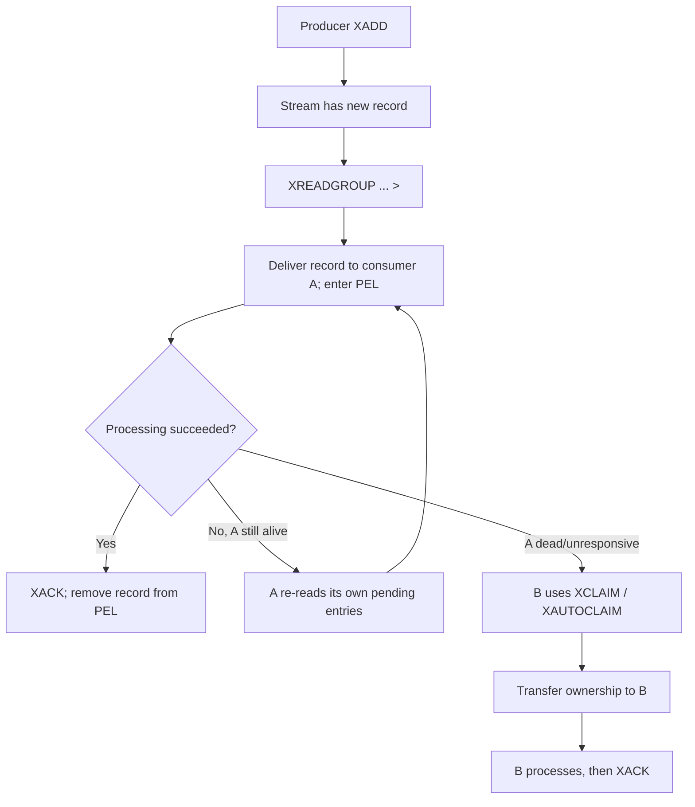
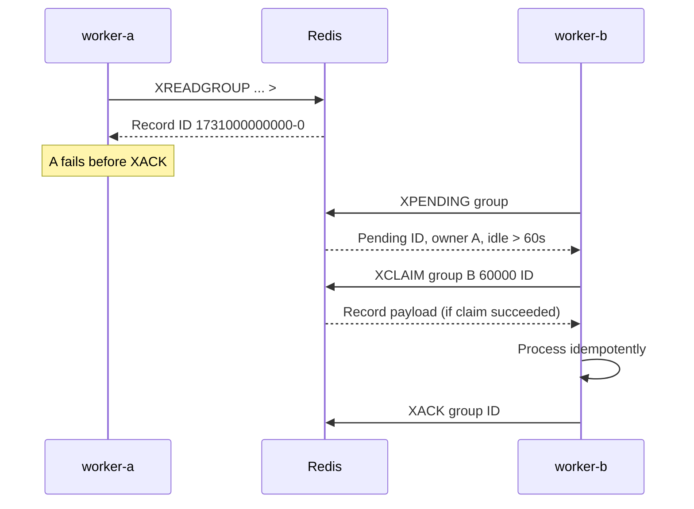

# Re-Reading Pending Records and Transferring Ownership of Abandoned Records

In **Redis Streams**, a record delivered by a consumer group to a consumer does not mean the work is finished. When a consumer reads via `XREADGROUP`, Redis can place the record into the **Pending Entries List (PEL)**. The record is only removed from the group's pending state after the consumer confirms it with `XACK` or another explicitly designed completion mechanism.

If a process fails after receiving a record but before acknowledging it, the record becomes **pending work**. Spring Data Redis provides APIs to re-read pending records; Redis also provides `XPENDING`, `XCLAIM`, and `XAUTOCLAIM` so another consumer can take over records abandoned by a failed consumer.

**Key principle:** taking over only changes **record ownership within the consumer group**. It does not undo side effects the previous consumer may already have executed. Every handler with side effects must tolerate an event being processed more than once.

## 1. How Does a Record Move from New to Pending?

Suppose a producer writes an event:

```redis
XADD orders:events * eventId evt-101 orderId O-101 type OrderCreated
```

We create a consumer group:

```redis
XGROUP CREATE orders:events order-workers 0 MKSTREAM
```

`0` means the group starts before existing records; old records can be delivered. If `$` is used when creating the group, the group normally receives only new records added after creation time. If the group already exists, `XGROUP CREATE` returns `BUSYGROUP`; do not treat this as a reason to delete an active group.

Worker `worker-a` reads new records:

```redis
XREADGROUP GROUP order-workers worker-a COUNT 10 STREAMS orders:events >
```

`>` requests records **never yet delivered to any consumer in the group**. After a normal read (without `NOACK`), Redis tracks the record in the PEL:

```text
Stream: orders:events
  id=1731000000000-0  eventId=evt-101
                |
                v
Consumer group: order-workers
  PEL
    id=1731000000000-0
    owner=worker-a
    deliveryCount=1
    idleTime=time since most recent delivery
```

If `worker-a` finishes processing:

```redis
XACK orders:events order-workers 1731000000000-0
```

The PEL stops tracking that ID for the group. **`XACK` does not delete the record from the stream itself**; retention, trimming, and stream deletion are managed separately.

## 2. Understanding the Pending Entries List (PEL)

The PEL is metadata maintained by Redis for **each consumer group**, recording entries delivered but not yet acknowledged. A pending entry typically contains:

| Information | Meaning |
| --- | --- |
| Stream record ID | Record identifier in the stream |
| Owner consumer | Consumer currently recorded by the group as owning the record |
| Idle time | Elapsed time since the most recent delivery/claim |
| Delivery count | Number of times the record was delivered per Redis semantics |

A record may have sat in the stream for a long time without being pending if it was never delivered to the group. Conversely, a record can remain pending after the consumer process owning it has stopped.

Redis Streams maintains both **group-level PEL** and **per-consumer PEL**. Consumers in the same group do not automatically see each other's pending records when reading new records (`>`).



**Do not use `NOACK`** if the goal is recovering abandoned work: with `NOACK`, Redis does not track records in the PEL for normal acknowledgment.

## 3. Two Recovery Scenarios to Distinguish

| Scenario | Suitable mechanism | Key point |
| --- | --- | --- |
| `worker-a` restarts with the **same consumer name** and wants to handle records it already received | `XREADGROUP GROUP ... worker-a STREAMS key 0` | Reads **pending entries of `worker-a` itself** |
| `worker-a` is gone and `worker-b` must take over A's records | `XCLAIM` or `XAUTOCLAIM` | Changes owner in the PEL once records meet idle criteria |
| Want records never delivered before | `XREADGROUP ... STREAMS key >` | Reads **new records** for the group |
| Want to inspect pending entries without taking ownership | `XPENDING` | Reads metadata; does not transfer ownership |

In practice, systems often combine all three: check pending entries of the current consumer on restart, reclaim stale pending records from dead workers, and then continue reading new records.

## 4. Inspecting Backlog with `XPENDING`

Before recovering, check how many unacknowledged records the group has.

### 4.1. Summary View

```redis
XPENDING orders:events order-workers
```

Redis returns summary information, typically including total pending count, smallest/largest IDs, and pending counts per consumer. This is metadata, not event content.

Illustrative logical output:

```text
pending total: 6
smallest ID: 1731000000000-0
largest ID:  1731000004000-0
worker-a: 5 pending
worker-b: 1 pending
```

These numbers are illustrative only, not verbatim Redis CLI response syntax.

### 4.2. Listing Pending Records

```redis
XPENDING orders:events order-workers - + 10
```

Each item in the extended output shows the ID, owner, idle time in milliseconds, and delivery count. To view pending entries for a single consumer:

```redis
XPENDING orders:events order-workers - + 10 worker-a
```

On Redis versions supporting the idle filter, you can filter for records not redelivered for at least 60 seconds:

```redis
XPENDING orders:events order-workers IDLE 60000 - + 10
```

`60000` is **milliseconds**, not seconds. `IDLE` in `XPENDING` helps inspect and filter metadata; **it does not claim or mark records as processed**.

### 4.3. Additional Inspection Commands

```redis
XINFO GROUPS orders:events
XINFO CONSUMERS orders:events order-workers
XLEN orders:events
```

`XINFO GROUPS` provides group statistics; `XINFO CONSUMERS` shows consumers and pending counts. `XLEN` represents the total records currently stored in the stream, **not the number of unacknowledged records**. A large `XLEN` does not mean all records are pending.

## 5. Re-Reading a Consumer's Own Pending Records

Redis distinguishes two ID modes when calling `XREADGROUP`:

```redis
# Fetch records never delivered in the group
XREADGROUP GROUP order-workers worker-a STREAMS orders:events >

# Re-read pending records of worker-a
XREADGROUP GROUP order-workers worker-a STREAMS orders:events 0
```

When the passed ID is **not `>`**, Redis walks the history of pending records already delivered to the **current consumer** with IDs greater than the supplied ID. Therefore, `0` is the starting point to read that consumer's own pending records.

Example:

```redis
XREADGROUP GROUP order-workers worker-a COUNT 20 STREAMS orders:events 0
```

If `worker-a` previously received `evt-101` and died before `XACK`, restarting with the **consumer name `worker-a`** lets this command retrieve that record again.

**Notes on looping:**

- One call with `0` may return only one batch up to `COUNT`. To read multiple batches, use the last traversed ID to continue, or keep calling from `0` after successfully processed records are `XACK`ed.
- When processing fails without `XACK`, immediately calling from `0` again can return the same records repeatedly. Add backoff and bounded retry policies.
- Pending history mode is not a `BLOCK` command waiting for new records. After clearing pending entries, switch to reading `>` to receive new work.
- A new consumer named `worker-b` **cannot use `0` to read pending entries owned by `worker-a`**. That case requires claiming.

### 5.1. Spring Data Redis Example Using `StringRedisTemplate`

The example below shows one pass re-reading pending records for the **same consumer name** and calling `XACK` after the handler finishes. It assumes stream `orders:events` and group `order-workers` already exist.

```java
package com.example.orders.stream;

import java.util.Map;
import org.springframework.data.redis.connection.stream.Consumer;
import org.springframework.data.redis.connection.stream.ReadOffset;
import org.springframework.data.redis.connection.stream.StreamOffset;
import org.springframework.data.redis.core.StreamReadOptions;
import org.springframework.data.redis.core.StringRedisTemplate;
import org.springframework.stereotype.Service;

@Service
public class OwnPendingRecoveryService {

    private static final String STREAM = "orders:events";
    private static final String GROUP = "order-workers";

    private final StringRedisTemplate redis;
    private final OrderEventHandler handler;

    public OwnPendingRecoveryService(
            StringRedisTemplate redis, OrderEventHandler handler) {
        this.redis = redis;
        this.handler = handler;
    }

    public int replayOneBatch(String consumerName) {
        Consumer consumer = Consumer.from(GROUP, consumerName);

        var records = redis.opsForStream().read(
                consumer,
                StreamReadOptions.empty().count(20),
                StreamOffset.create(STREAM, ReadOffset.from("0")));

        if (records == null || records.isEmpty()) {
            return 0;
        }

        int acknowledged = 0;
        for (var record : records) {
            // Must process idempotently; exceptions prevent XACK.
            handler.handle(record.getId().getValue(), record.getValue());

            Long ack = redis.opsForStream()
                    .acknowledge(STREAM, GROUP, record.getId());
            if (ack != null && ack == 1L) {
                acknowledged++;
            }
        }

        return acknowledged;
    }

    public interface OrderEventHandler {
        void handle(String recordId, Map<?, ?> fields);
    }
}
```

`OrderEventHandler` in the example is an application contract requiring a concrete implementation/bean. It can use fields such as `eventId`, `orderId`, and `type` to execute business logic while checking idempotency via `eventId`.

The code reads only **one batch** to avoid uncontrolled tight loops when the handler continuously fails. In a real job, schedule multiple batches, increase wait intervals between failures, and measure pending counts before and after. `XACK` is called only after processing is confirmed complete.

When deploying multiple instances, choose a meaningful `consumerName` strategy. If an instance restarts under a new name, old pending entries under the prior consumer name must be taken over with `XCLAIM`/`XAUTOCLAIM`.

## 6. Transferring Ownership with `XCLAIM`

`XCLAIM` fits when you already know the **specific IDs** of pending records to transfer:

```redis
XCLAIM orders:events order-workers worker-b 60000 1731000000000-0
```

Parameters:

| Parameter | Meaning |
| --- | --- |
| `orders:events` | Stream holding the record |
| `order-workers` | Consumer group owning the PEL |
| `worker-b` | Consumer that will become the new owner |
| `60000` | Minimum idle time, in milliseconds |
| `1731000000000-0` | Record ID to take over |

Redis only claims the record if it is actually pending in the group and satisfies the idle-time condition (aside from special optional flags with distinct semantics). After a successful claim, the record belongs to `worker-b`'s PEL and no longer belongs to `worker-a`'s individual PEL.



A typical `XCLAIM` workflow:

1. `XPENDING` finds records waiting past the threshold.
2. Select candidate IDs.
3. Call `XCLAIM` with `min-idle-time`.
4. Process **only records actually returned after a successful claim**.
5. Call `XACK` once business work completes.

Between `XPENDING` and `XCLAIM`, another consumer may have already processed or claimed the record. Thus `XPENDING` output is only a candidate list, whereas the `XCLAIM` response confirms which records were transferred to the current worker.

Redis also supports advanced flags such as `IDLE`, `TIME`, `RETRYCOUNT`, `FORCE`, and `JUSTID`. Do not use `FORCE` to forcibly create pending entries or reset `RETRYCOUNT` unless you fully understand the impact: they alter normal retry and delivery-count tracking semantics.

## 7. Automatic Transfer with `XAUTOCLAIM`

If the pending backlog is large, calling `XPENDING` to list IDs and then `XCLAIM` in batches is cumbersome. Redis **6.2 and later** support `XAUTOCLAIM`, which scans the PEL and claims records meeting the idle threshold:

```redis
XAUTOCLAIM orders:events order-workers worker-b 60000 0-0 COUNT 25
```

Meaning:

- `worker-b` is the consumer taking ownership.
- `60000` requires records to have been **idle for at least 60 seconds**.
- `0-0` is the cursor where PEL scanning begins.
- `COUNT 25` is the maximum number of records requested in one response.

Typical output includes:

1. **Cursor to continue scanning the PEL**.
2. **Claimed records**, with IDs and field/value pairs.
3. On Redis **7.0 and later**, an additional list of pending IDs whose original entries were gone from the stream and were cleaned from the PEL.

Example flow:

```text
XAUTOCLAIM ... 60000 0-0 COUNT 25
  -> nextCursor = 1731000010000-0
  -> claimed = [record A, record B]

XAUTOCLAIM ... 60000 1731000010000-0 COUNT 25
  -> nextCursor = 0-0
  -> claimed = [record C]
```

A returned cursor of `0-0` means the **current scan pass reached the end of the PEL**, not that no pending entries will ever exist again. Records that had not yet reached 60 seconds of idle time during this pass may become eligible on the next check.

An important detail: Redis inspects only a bounded number of pending entries per `XAUTOCLAIM` call (related to `COUNT`), so it can return **few or zero records** while still returning a cursor other than `0-0`. Do not stop simply because the claimed list is empty; use the cursor to determine when the pass is complete.

### 7.1. Recovery Procedure with Redis CLI

```redis
# Check backlog before claiming
XPENDING orders:events order-workers

# Claim records idle for at least 60s
XAUTOCLAIM orders:events order-workers worker-b 60000 0-0 COUNT 25

# After successfully processing each returned ID
XACK orders:events order-workers 1731000000000-0

# Inspect again
XPENDING orders:events order-workers
```

Replace the illustrative record ID with actual IDs returned by `XAUTOCLAIM`. For multiple batches, loop with the returned cursor; once the cursor is `0-0`, end the scan pass and re-check on schedule if needed.

### 7.2. In Spring Data Redis

Spring Data Redis provides `StreamOperations` and Redis connection components for pending, claim, and auto-claim operations. Signatures and return types for `StreamOperations.claim(...)`, pending overloads, and `autoClaim(...)` have evolved across library releases.

At a general usage level:

```java
var ops = stringRedisTemplate.opsForStream();

// List/summarize group pending entries with ops.pending(...).
// Claim specific RecordIds with ops.claim(...).
// On supported versions, use ops.autoClaim(...) and iterate the returned
// cursor until a full scan pass completes.
```

When writing production code for `autoClaim`, use the exact signature and `AutoClaimedRecords`/offset types of the **Spring Data Redis version in your project**, as this API evolved alongside Redis versions supporting `XAUTOCLAIM`. The business handling remains unchanged: process only successfully claimed records, acknowledge after processing, and persist retry state durably if required.

On older Redis servers without `XAUTOCLAIM`, implement an **`XPENDING` → `XCLAIM`** loop. Never send `XAUTOCLAIM` to an unsupported Redis server.

## 8. How Long Before a Record Is Considered Abandoned?

`min-idle-time` defines how long a record has gone **without being redelivered**, not definitive proof that the old consumer died. A worker might still be executing a long-running task.

Example:

```text
12:00:00  worker-a receives record
12:00:30  worker-a is calling an external service, has not XACKed yet
12:01:00  worker-b sees idle >= 60s and runs XAUTOCLAIM
12:01:01  worker-a is still running, unaware it lost ownership
12:01:02  worker-a and worker-b may both produce side effects
```

Therefore, choose the idle threshold based on:

| Factor | Consequence of setting the threshold too low |
| --- | --- |
| p95/p99 processing time | Records still actively processing get claimed |
| External API timeouts | Worker is waiting, not dead |
| GC pauses or thread starvation | Redis sees high idle time even though the process is alive |
| Redis/network latency | Overlapping claims due to slow workers |
| Batch size and worker count | Records queued in a batch waiting their turn to process |

A 60-second threshold may suit fast jobs, yet fail when normal processing takes 2–3 minutes. Configure thresholds per workload characteristics instead of copying one constant across all streams.

**The Redis PEL is not a lease with a fencing token.** Transferring a record to a new owner does not prevent an old worker that already received the payload from continuing external operations. For tasks requiring strict exclusion of stale workers, add version/fencing checks or target-system transactions/idempotency.

## 9. Delivery Count, Retries, and Poison Messages

The PEL also tracks **delivery count**. Whenever a record is re-read or claimed via normal flows, its delivery count can increment. This is a useful signal for spotting records that fail repeatedly.

Example using extended `XPENDING`:

```redis
XPENDING orders:events order-workers - + 20
```

From this, applications can enforce policies:

| Delivery / failure count | Handling approach |
| --- | --- |
| First attempt | Normal processing |
| Transient error, low count | Leave pending; retry/backoff once idle threshold passes |
| Repeated failures due to invalid data | Avoid hot retries; route to investigation / dead-letter flow |
| Exceeds max allowed attempts | Persist error durably; escalate to DLQ or manual intervention |

`deliveryCount` is not strictly equal to “how many times the handler actually produced side effects”: a worker may have received the record and died before running, or finished running without sending `XACK`.

### 9.1. Dead-Letter Stream

One way to handle unrecoverable records is writing details to a separate stream:

```redis
XADD orders:dead-letter * originalId 1731000000000-0 eventId evt-101 reason invalid-payload
```

Only after the error-record transfer is confirmed per the application contract should you decide to `XACK` the original record. A dead-letter `XADD` and an `XACK` are **not automatically atomic** when invoked separately by the application: crashing between them can create duplicate dead-letter entries or lose status traces. If strict guarantees are needed, use an appropriate atomic/idempotent design, keeping same-hash-slot constraints in mind on Redis Cluster.

Never bulk-`XACK` all pending entries just to drive the backlog to 0. Doing so removes consumer-group retry capability for records that were never genuinely processed.

## 10. Why Must Handlers Be Idempotent?

Redis Streams consumer groups are typically used with an **at-least-once** model. If a handler succeeds and the process dies before `XACK`, the record stays pending and will be reprocessed:

```mermaid
sequenceDiagram
    participant R as Redis Stream
    participant A as worker-a
    participant DB as Database
    participant B as worker-b
    R-->>A: Record eventId=evt-101
    A->>DB: Create order state
    DB-->>A: Commit succeeds
    Note over A: A dies before XACK
    B->>R: XAUTOCLAIM after idle timeout
    R-->>B: Same eventId=evt-101
    B->>DB: Check if evt-101 already processed?
    DB-->>B: Present; skip side effect
    B->>R: XACK record ID
```

A common mechanism is placing a unique constraint on `(consumerGroup, eventId)` or a stable business ID in the target system. During processing:

1. Begin the target data transaction (if supported by the system).
2. Check/insert `eventId` as a unique operation.
3. Perform the business update **in the same transaction**.
4. Commit the target transaction.
5. Send `XACK` to Redis.

If `XACK` fails, the record may be redelivered; next time it sees `eventId` is already processed and can acknowledge after verifying. If processing markers and side effects reside in two different systems, a coherent consistency design is still required—never just an in-memory `Set`.

**Record ID** is the ID in the Redis Stream, whereas **`eventId`** is the business event identifier. A producer might accidentally emit two records with different Record IDs but the same `eventId`, so deduplicating by `eventId` generally provides broader protection than deduplicating by Record ID alone.

## 11. Records Trimmed or Deleted While Still Pending

A Redis Stream can be trimmed via `XTRIM`, `XADD MAXLEN`, or another retention mechanism. An entry already delivered to a group and not yet `XACK`ed **can still be deleted from the stream** if retention does not protect it.

When that happens:

- PEL metadata may persist for a while even though the original payload is gone.
- `XREADGROUP` re-reading pending history may no longer return the full payload as before.
- `XAUTOCLAIM` on Redis 7.0+ can remove PEL entries whose stream records no longer exist and return the list of cleaned IDs.
- Event content cannot be reconstructed solely from the ID and PEL metadata once stream data is actually deleted.

Therefore, size retention based on maximum acceptable consumer downtime and peak backlog. If work must survive longer than Redis retention holds records, persist payloads in an appropriate durable store or use retention modes that protect unprocessed entries where supported by your Redis version.

`XACK` and deleting records from a stream are two distinct actions. **Shrinking the PEL with `XACK` does not delete historical data**, and **trimming a stream does not mean consumers finished processing**.

## 12. Startup and Recovery Lifecycle for Multiple Workers

A real-world system typically needs two recovery paths:

### 12.1. Worker Restarting with the Same Name

If an instance uses a fixed consumer name like `orders-node-1`, on restart it can:

1. Connect to Redis and ensure the stream/group exists per deployment procedures.
2. Re-read pending entries for `orders-node-1` using `XREADGROUP ... 0`.
3. Process each record and `XACK` upon completion.
4. Once processable pending entries are drained, switch to `XREADGROUP ... >` to receive new records.

Fixed consumer names aid recovering a consumer's own pending entries, but only work when **two live instances never share the same name simultaneously**. Under autoscaling, each instance usually gets a unique name; pending entries from terminated instances require an active claim mechanism.

### 12.2. Workers Replacing a Lost Consumer

With autoscaling or permanently dead workers:

1. New workers still process new work from `>`, per system load policy.
2. A scheduled recovery task runs `XAUTOCLAIM` with an appropriate idle threshold.
3. Advance the cursor for a full pass or up to a per-run budget; process each claimed record.
4. Acknowledge after handler completion; leave transient errors pending for retry.
5. Monitor pending count, pending age, and claim counts; alert when backlog grows.

You do not need to halt all new-record reads to run recovery if load and worker counts are controlled. However, avoid letting recovery continuously contend with the main flow and worsen the backlog.

## 13. Distinguishing Reclaim from Redis Stream Consumer-Group Lag

Commonly confused metrics:

| Metric / state | Meaning |
| --- | --- |
| **Pending count** (`XPENDING`) | Delivered to a consumer in the group, not yet `XACK`ed |
| **Group lag** (`XINFO GROUPS` when supported) | New records not yet delivered to the group per Redis calculation |
| **Stream length** (`XLEN`) | Records currently retained in the stream |
| **Consumer idle** (`XINFO CONSUMERS`) | Consumer activity/inactivity per Redis stats; does not prove a worker is dead |
| **Delivery count** (extended `XPENDING`) | Delivery/claim history of a pending record |

A system can show `lag = 0` while `pending = 1000`: all records have been delivered, yet they remain unfinished or unacknowledged. Looking only at lag can mislead operators into thinking the consumer group has finished all work.

Conversely, low pending with high lag indicates the group is not keeping up with reading new records. Both cases need different responses: scaling new-message consumption and resolving pending backlogs are not the same task.

## 14. Common Mistakes

### Mistake 1: Using `>` Expecting to Re-Read Pending Entries

```redis
XREADGROUP GROUP order-workers worker-a STREAMS orders:events >
```

`>` is for undelivered records in the group. To re-read pending entries belonging to `worker-a` itself, use a historical ID such as `0`. To move pending entries from `worker-b` to `worker-a`, claim them.

### Mistake 2: Generating a New Consumer Name on Every Restart While Only Reading Pending with `0`

A brand-new consumer has no pending entries of its own, so `XREADGROUP ... 0` can return empty even when `XPENDING` shows thousands of records under old consumer names. Use `XAUTOCLAIM` or `XCLAIM` to transfer ownership.

### Mistake 3: Calling `XACK` Before Business Work Completes

If you ACK first and processing fails, the record is no longer in the PEL for group redelivery. Always define the business completion boundary before ACKing. For multi-step workflows, persist durable state and retry at the appropriate layer.

### Mistake 4: Treating `XPENDING` as a Claim Operation

`XPENDING` only reads metadata. Two workers can see the same ID in a pending summary; only `XCLAIM`/`XAUTOCLAIM` output confirms ownership transferred.

### Mistake 5: Choosing `min-idle-time` Shorter Than Normal Processing Time

If a job takes 120 seconds and another worker claims after 30 seconds, two processes can execute concurrently. Raise the threshold, speed up processing, or enforce versions/fencing at the target system per business needs.

### Mistake 6: Stopping `XAUTOCLAIM` Immediately on an Empty List

One batch with no sufficiently idle records does not mean you reached the end of the PEL. Check the returned **cursor**; a scan pass only ends when the cursor is `0-0`.

### Mistake 7: Infinite Toxic Retries

A record with an invalid payload can be claimed and fail forever. Enforce max delivery limits, backoff, DLQ/investigation workflows, and alerts; avoid hot loops that overload Redis.

### Mistake 8: Taking Delivery Count as Proof of N Business Executions

Delivery count tracks Redis delivery attempts, not how many times business side effects actually ran. When auditing is needed, record processing history in the business system.

### Mistake 9: Deleting a Consumer or Group to “Clear Pending”

Administrative commands like `XGROUP DELCONSUMER` and `XGROUP DESTROY` affect pending state and recovery capability. Never use them as a routine backlog cleanup when unfinished work remains; evaluate data and ownership first.

### Mistake 10: Mixing Pending Replay and New Reads on the Same Offset

`0` and `>` are two different read modes. Clearly separate jobs recovering a consumer's own pending entries from loops reading new events, avoiding loops that neither drain pending entries nor keep up with new reads.

## 15. An Applicable Operational Workflow

| Step | Command / API | Expected outcome |
| --- | --- | --- |
| 1. Inspect group | `XINFO GROUPS`, `XPENDING` | See lag, pending count, and owning consumers |
| 2. Recover same consumer | `XREADGROUP ... STREAMS key 0` | Retrieve old pending records of the same consumer |
| 3. Detect abandoned work | `XPENDING ... IDLE ...` | Spot records not redelivered for a long time |
| 4. Take over | `XCLAIM` or `XAUTOCLAIM` | Records transfer to the claiming consumer |
| 5. Process idempotently | Handler with `eventId`/target transaction | No duplicate side effects on redelivery |
| 6. Acknowledge | `XACK stream group id` | Remove pending entry from consumer group |
| 7. Monitor | `XPENDING`, pending age, delivery count | Catch backlogs, poison messages, slow recovery |

### Combined Redis CLI Commands

```redis
# Create stream/group and send sample data
XGROUP CREATE lesson:orders lesson-group 0 MKSTREAM
XADD lesson:orders * eventId evt-1 type OrderCreated orderId O-1

# Consumer A receives new record, without ACKing
XREADGROUP GROUP lesson-group consumer-a COUNT 1 STREAMS lesson:orders >
XPENDING lesson:orders lesson-group

# A restarts and reads its own pending entries
XREADGROUP GROUP lesson-group consumer-a COUNT 10 STREAMS lesson:orders 0

# Or B claims A's record after sufficient idle time
XPENDING lesson:orders lesson-group - + 10
XAUTOCLAIM lesson:orders lesson-group consumer-b 60000 0-0 COUNT 10

# After a consumer processes successfully, ACK using the actual ID
XACK lesson:orders lesson-group 1731000000000-0
XPENDING lesson:orders lesson-group
```

The snippet above is an illustrative workflow. Replace the final ID with the actual `RecordId`, and only call `XACK` on the consumer that completed processing. With `XAUTOCLAIM ... 60000`, the record must truly have been idle for at least 60 seconds; running it immediately after reading may claim nothing.

## 16. Summary

In Redis Streams, the **PEL** tracks records delivered to a consumer group that have not yet been `XACK`ed. When a consumer restarts with the **same name**, use `XREADGROUP ... 0` to re-read its own pending entries. When another consumer must take over, use `XPENDING` to inspect and `XCLAIM` or `XAUTOCLAIM` to transfer ownership of sufficiently idle records.

`XAUTOCLAIM` fits scanning many pending IDs with cursor pagination; `XCLAIM` fits when exact IDs are already known. **Only ACK after processing succeeds**, choose idle thresholds based on processing duration, track retries/poison messages, and design idempotent handlers. PEL ownership does not stop a stale worker from continuing side effects, so critical workflows still need duplicate protection at the target system.

### References

- [Redis — XREADGROUP](https://redis.io/docs/latest/commands/xreadgroup/): reading new records and re-reading consumer pending history.
- [Redis — XPENDING](https://redis.io/docs/latest/commands/xpending/): inspecting PEL, owners, idle times, and delivery counts.
- [Redis — XCLAIM](https://redis.io/docs/latest/commands/xclaim/): transferring pending record ownership by ID.
- [Redis — XAUTOCLAIM](https://redis.io/docs/latest/commands/xautoclaim/): scanning and transferring ownership by idle time and cursor.
- [Redis — XACK](https://redis.io/docs/latest/commands/xack/): confirming completion and removing records from the PEL.
- [Spring Data Redis — Redis Streams](https://docs.spring.io/spring-data/redis/reference/redis/redis-streams.html): consumer groups, pending reads, and `StreamOperations` API.
- [Spring Data Redis — StreamOperations API](https://docs.spring.io/spring-data/redis/reference/api/java/org/springframework/data/redis/core/StreamOperations.html): read, pending, claim, auto-claim, and acknowledge methods.
