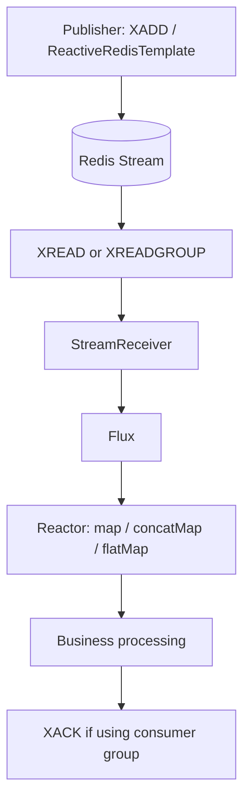
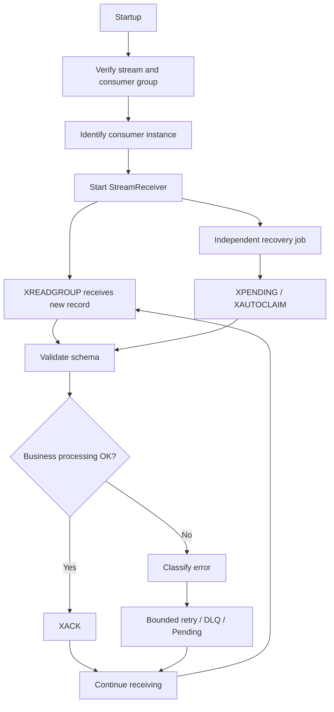

# Using `StreamReceiver` in Reactive Flows with Spring Data Redis

## 1. Problem Statement: Processing Redis Streams Without Manually Managing Polling Loops

Suppose a sales service writes an event to a Redis Stream whenever a new order appears:

```redis
XADD orders.events * eventType ORDER_CREATED orderId o-101
XADD orders.events * eventType ORDER_CREATED orderId o-102
```

Another service needs to receive those events, process them asynchronously, and acknowledge them only after business logic succeeds. With an imperative approach, a developer can write an explicit `XREAD` or `XREADGROUP` loop, managing connections, wait times, worker threads, shutdown mechanics, and network errors.

Spring Data Redis provides **`StreamReceiver`** to consume Redis Streams as a **Reactor `Flux`**. Instead of controlling an infinite loop yourself, the application subscribes to a stream of `Record` items; the framework coordinates reads from Redis with downstream consumption demand.

```java
Flux<MapRecord<String, String, String>> events =
    receiver.receive(StreamOffset.fromStart("orders.events"));
```

Once subscribed, `events` emits records from the stream, and the application uses Reactor operators to transform, filter, handle errors, or compose with other asynchronous sources.

However, a `Flux` emitting records **does not automatically guarantee exactly-once processing**. You must understand:

- Which offset does `receive(...)` read from?
- How does reading directly via `XREAD` differ from reading via a consumer group with `XREADGROUP`?
- When should `XACK` be called, and when should `receiveAutoAck(...)` be avoided?
- How do backpressure, subscription, cancellation, and polling interact?
- If the process stops mid-flight, how are pending records recovered?

This lesson focuses directly on those questions in the context of **Spring Data Redis / Redis Streams**.

## 2. What Is a Redis Stream?

A Redis Stream stores a sequence of **entries with increasing ordered IDs**, where each entry contains a set of field/value pairs. For example:

```redis
XADD orders.events * eventType ORDER_CREATED orderId o-101
XADD orders.events * eventType ORDER_PAID orderId o-101
```

Redis generates IDs of the form:

```text
1750000000000-0
1750000000001-0
```

These numbers only illustrate the format. Actual IDs depend on the timestamp and sequence generated by Redis. Unlike Redis Pub/Sub:

- A Stream **retains entries** until deleted, trimmed, or affected by relevant infrastructure policies.
- Consumers can start reading from a known ID.
- Consumer groups distribute work across multiple consumers and track pending entries.
- Streams support `XACK` to mark an entry as processed at the consumer group level.

Thus Streams fit better than Pub/Sub when applications need to replay backlog or manage in-flight work. Still, retaining entries **does not equate to zero-data-loss guarantees across every failure**: consider persistence, replication, trimming, retention, and retries.

### 2.1. Foundational Concepts

| Concept | Meaning |
|---|---|
| **Stream key** | Redis key containing entries, e.g., `orders.events` |
| **Record** | Entry with a `RecordId` and a body of field/value pairs |
| **Stream ID** | Marker identifying read position, usually `milliseconds-sequence` |
| **Consumer group** | Group receiving work; members share delivery progress |
| **Consumer name** | Identity of one consumer inside a group |
| **PEL** (*Pending Entries List*) | List of entries delivered to consumers but not yet `XACK`ed |
| **Read offset** | Rule telling Redis where to start reading |
| **Acknowledgment** | `XACK` confirms an entry for a group; **does not delete the entry from the stream** |

Key point: **Redis maintains stream data and group pending state as two distinct concerns**. An ACKed entry can remain in the stream until a retention policy removes it.

## 3. Where `StreamReceiver` Fits in Spring Data Redis

Spring Data Redis offers two styles for consuming Redis Streams:

1. **Imperative:** `StreamMessageListenerContainer` manages listener callbacks and typically dispatches to `onMessage`.
2. **Reactive:** `StreamReceiver` produces a `Flux` and fits Reactor/WebFlux applications composing asynchronous operators.



In this model:

- `StreamReceiver` is not a separate broker. It is a Spring Data Redis layer that creates and coordinates the read process.
- `Flux` represents the record stream and supports demand-driven coordination with downstream consumers.
- Confirming business completion is an **application-chosen** step, not automatically identical to a record being emitted.

### 3.1. Common Classes and APIs

| API | Purpose |
|---|---|
| `StreamReceiver<K, V>` | Reactive receiver emitting records from a Redis Stream |
| `StreamReceiver.StreamReceiverOptions` | Configures how the receiver polls and converts records |
| `StreamOffset<K>` | Associates a stream name with a read offset |
| `ReadOffset` | Chooses a specific ID, latest point, or last consumed point |
| `Consumer.from(group, name)` | Identifies a consumer belonging to a consumer group |
| `MapRecord<K, HK, HV>` | Record whose body is a Map of fields/values |
| `ObjectRecord<K, V>` | Record whose content is mapped into an object |
| `ReactiveRedisTemplate` | Writes and manages streams/consumer groups via reactive APIs |
| `ReactiveStreamOperations` | Stream operations including `add` and `acknowledge` |

Generic types and overload names can vary across Spring Data Redis releases. When building a real project, check the API of the version declared in your dependencies.

## 4. Preparing the Spring Boot and Redis Environment

Examples use Spring Boot 3.x, Spring Data Redis, and the Lettuce driver, which supports reactive Redis connections.

```groovy
dependencies {
    implementation 'org.springframework.boot:spring-boot-starter-data-redis-reactive'
    implementation 'org.springframework.boot:spring-boot-starter-webflux'
}
```

If the application does not use WebFlux controllers, you can still use Reactor and the Reactive Redis API without exposing reactive web endpoints. The WebFlux starter here helps illustrate a complete Reactor-based application.

Local Redis connection config:

```yaml
spring:
  data:
    redis:
      host: localhost
      port: 6379
```

The application can inject `ReactiveRedisConnectionFactory` and `ReactiveStringRedisTemplate` when auto-configuration applies.

### 4.1. Creating Sample Stream Data

In `redis-cli`:

```redis
XADD orders.events * eventType ORDER_CREATED orderId o-101
XADD orders.events * eventType ORDER_CREATED orderId o-102
XADD orders.events * eventType ORDER_PAID orderId o-101
XLEN orders.events
XRANGE orders.events - +
```

`XLEN` returns the number of entries currently in the stream. `XRANGE` inspects data and generated IDs. In production, avoid reading entire large streams; use ID ranges, counts, or proper retention policies.

## 5. Minimal `StreamReceiver` Configuration

For records with string fields and values, you can use `MapRecord<String, String, String>`:

```java
import java.time.Duration;

import org.springframework.context.annotation.Bean;
import org.springframework.context.annotation.Configuration;
import org.springframework.data.redis.connection.ReactiveRedisConnectionFactory;
import org.springframework.data.redis.connection.stream.MapRecord;
import org.springframework.data.redis.stream.StreamReceiver;
import org.springframework.data.redis.stream.StreamReceiver.StreamReceiverOptions;

@Configuration
public class RedisStreamReceiverConfig {

    @Bean
    StreamReceiver<String, MapRecord<String, String, String>>
    orderStreamReceiver(ReactiveRedisConnectionFactory connectionFactory) {

        StreamReceiverOptions<String, MapRecord<String, String, String>> options =
            StreamReceiverOptions.<String, MapRecord<String, String, String>>builder()
                .pollTimeout(Duration.ofSeconds(2))
                .batchSize(50)
                .build();

        return StreamReceiver.create(connectionFactory, options);
    }
}
```

In some Spring Data Redis releases, builder overloads can infer generics from the target variable. The example declares generics explicitly to show the intended record type.

Explanation:

- `connectionFactory` lets the receiver use reactive Redis connections.
- `pollTimeout(Duration.ofSeconds(2))` bounds the wait duration of a blocking-style Redis read until data arrives.
- `batchSize(50)` sets the maximum records requested per poll, without guaranteeing 50 are always returned.
- `StreamReceiver.create(...)` builds the receiver; actual reading starts when the `Flux` is subscribed to.

**Do not interpret `pollTimeout` as a record expiration time or whole-business-flow timeout.** It governs how long a poll cycle waits for Redis to return new data.

### 5.1. Must the Receiver Be Created as a Bean?

No. You can call `StreamReceiver.create(...)` elsewhere under Spring management. However, when multiple components read the same kind of stream, declaring the receiver via configuration helps:

- Reuse the connection factory and options.
- Easily adjust `pollTimeout` and `batchSize` per environment.
- Consistently apply serialization/type conversion settings.

**Note:** the receiver bean itself is not a subscription. Without a subscriber on the `Flux` produced by the receiver, Redis will not start delivering records to business handlers.

## 6. Direct Reading with `receive(StreamOffset)`

Example starting from existing entries:

```java
import org.springframework.data.redis.connection.stream.MapRecord;
import org.springframework.data.redis.connection.stream.StreamOffset;
import org.springframework.data.redis.stream.StreamReceiver;
import reactor.core.publisher.Flux;

public class DirectStreamReader {

    private final StreamReceiver<String, MapRecord<String, String, String>>
        receiver;

    public DirectStreamReader(
            StreamReceiver<String, MapRecord<String, String, String>> receiver) {
        this.receiver = receiver;
    }

    public Flux<MapRecord<String, String, String>> allAvailable() {
        return receiver.receive(StreamOffset.fromStart("orders.events"));
    }
}
```

`StreamOffset.fromStart(...)` expresses the intent to start from the beginning of the stream. On non-group read paths, Redis uses an ID marker to fetch entries with IDs greater than that marker, so the receiver advances the marker as it consumes.

When the source emits:

```text
MapRecord:
  stream key = orders.events
  id         = 1750000000000-0
  value      = {eventType=ORDER_CREATED, orderId=o-101}
```

The application can process:

```java
Flux<String> orderIds = reader.allAvailable()
    .map(record -> record.getValue().get("orderId"));
```

In practice, verify fields exist and data is valid before using them. `MapRecord` also carries the entry ID, which is useful for logging, checkpointing, and consumer group acknowledgment.

### 6.1. Without a Group: Limitations

With direct reads:

- A subscription can read entries without creating a consumer group.
- The receiver can start at the position specified by `ReadOffset`.
- **Redis does not manage a PEL or ACK for a non-group reader**.
- If the receiver restarts, the application must determine the right starting offset or persist a checkpoint itself.
- Two instances reading the same stream directly can both see the corresponding entries; there is no consumer-group load balancing.

Direct reads fit observers, analytics, or stream processors where each subscriber needs its own full pass. When multiple workers must divide work and track unacknowledged entries, use a consumer group.

## 7. Understanding `ReadOffset` Correctly

One of the most important decisions is choosing the offset. Common modes:

| API | Intent | Watch out for |
|---|---|---|
| `ReadOffset.from("0-0")` | Choose a specific starting ID | Redis returns entries with IDs greater than the marker; fits reading backlog |
| `ReadOffset.latest()` | Only interested in entries newer than the latest point at read time | Can skip old data and is sensitive to polling pauses |
| `ReadOffset.lastConsumed()` | Continue from consumed position; in groups, typically fetches undelivered new entries | Meaning differs between standalone and group contexts |
| `StreamOffset.fromStart("orders.events")` | Create an offset at the start of the stream | Useful for replaying existing backlog |
| `StreamOffset.create("orders.events", offset)` | Specify an exact offset for a stream | Used with `receive(...)` or group receives |

Example reading from a specific position:

```java
import org.springframework.data.redis.connection.stream.ReadOffset;
import org.springframework.data.redis.connection.stream.StreamOffset;

StreamOffset<String> offset =
    StreamOffset.create(
        "orders.events",
        ReadOffset.from("1750000000000-0")
    );
```

When reading via `XREAD`, the offset ID acts as an **exclusive lower bound** for returning entries newer than that ID.

### 7.1. Why Can `latest()` Skip Entries?

When using the latest mode, the receiver only reads newly arriving entries per Redis semantics on each poll. If polling pauses due to lack of downstream demand or because a query repeatedly uses the latest marker, entries added during that gap can be missed.

When you **cannot afford to miss** data, prefer a controllable ID marker or a consumer group with proper pending and retention controls instead of defaulting to `latest()`.

Offset choice must follow business requirements:

- Dashboards showing activity **from now onward**: can use the latest marker when skipping backlog is acceptable.
- Importing existing data from the beginning: use a starting offset.
- Workers taking new jobs and tracking ACKs: use a consumer group with `ReadOffset.lastConsumed()`.
- Readers with checkpoints across restarts: resume from the saved ID, paired with duplicate-handling policies.

## 8. Creating a Consumer Group for Workers

Redis supports consumer groups via `XGROUP`. Example creating a group before the application starts receiving:

```redis
XGROUP CREATE orders.events orders-workers 0 MKSTREAM
```

Where:

- `orders.events`: stream name.
- `orders-workers`: group name.
- `0`: starts before existing entries, enabling backlog reads.
- `MKSTREAM`: creates an empty stream if the key does not exist yet.

To receive only entries arriving after group creation:

```redis
XGROUP CREATE orders.events orders-workers $ MKSTREAM
```

These two commands are **alternatives**, not run sequentially for the same group name. If the group already exists, Redis reports `BUSYGROUP`; the application should handle the “already exists” case intentionally instead of deleting and recreating the group, which would destroy pending state.

### 8.1. Why Does Creating a Group with `0` vs. `$` Matter?

Suppose the stream already has three entries:

```text
ID 100-0: ORDER_CREATED o-101
ID 101-0: ORDER_CREATED o-102
ID 102-0: ORDER_PAID    o-101
```

Creating the group at `0` lets the group read existing entries as backlog.

Creating the group at `$` starts the group pointer at the newest current ID; workers reading new messages will not automatically receive entries written before group creation.

Decide whether business logic requires **replaying history** or **only tracking future events** before creating the group. Never change an active group's cursor casually just for a deployment.

## 9. Consuming via a Consumer Group with `StreamReceiver`

This model fits when multiple instances process entries while Redis tracks delivered vs. unacknowledged status.

```java
import org.springframework.data.redis.connection.stream.Consumer;
import org.springframework.data.redis.connection.stream.MapRecord;
import org.springframework.data.redis.connection.stream.ReadOffset;
import org.springframework.data.redis.connection.stream.StreamOffset;
import org.springframework.data.redis.stream.StreamReceiver;
import reactor.core.publisher.Flux;

public class OrderGroupReader {

    private final StreamReceiver<String, MapRecord<String, String, String>>
        receiver;

    public OrderGroupReader(
            StreamReceiver<String, MapRecord<String, String, String>> receiver) {
        this.receiver = receiver;
    }

    public Flux<MapRecord<String, String, String>> incoming(
            String instanceConsumerName) {

        return receiver.receive(
            Consumer.from("orders-workers", instanceConsumerName),
            StreamOffset.create(
                "orders.events",
                ReadOffset.lastConsumed()
            )
        );
    }
}
```

When using a consumer group, `ReadOffset.lastConsumed()` normally corresponds to Redis's `XREADGROUP ... STREAMS orders.events >` to fetch entries **not yet delivered** to the group.

### 9.1. Each Instance Gets Its Own Consumer Name

Use an identifier stable for the instance lifecycle, for example:

```text
orders-workers / order-worker-a1
orders-workers / order-worker-a2
orders-workers / order-worker-a3
```

All belong to `orders-workers`, yet have distinct consumer names. Redis splits delivery of new entries across consumers actively requesting reads.

If another group, such as `analytics-workers`, also reads the same stream, that group maintains its own progress and pending entries. This lets multiple systems independently process the same event set without contending inside one group.

**A consumer group does not mean broadcasting to every instance.** If every instance must receive a copy of every event, you need a separate group per logical receiver or a different fan-out pattern.

### 9.2. A Delivered Record Is Not Yet Finished Processing

When `XREADGROUP` returns an entry, Redis places it into the group/consumer's **Pending Entries List (PEL)**. Once business work succeeds, the application calls `XACK` to mark it processed.

```text
XADD -> entry in stream
       |
       v
XREADGROUP -> Redis delivers entry to consumer
       |
       +--> entry appears in PEL (not ACKed)
       |
       v
Application executes business logic
       |
       +--> success: XACK -> removed from PEL
       |
       +--> error: no XACK -> stays pending for recovery
```

Redis cannot know on its own whether the handler wrote to a database, called an HTTP API, or sent an email. Only the application can choose the right ACK point.

## 10. Calling ACK After Business Logic Succeeds

Spring Data Redis reactive provides `acknowledge(...)` via `ReactiveStreamOperations`.

Example service handling a record:

```java
import org.springframework.data.redis.connection.stream.MapRecord;
import org.springframework.data.redis.core.ReactiveStringRedisTemplate;
import org.springframework.stereotype.Service;
import reactor.core.publisher.Mono;

@Service
public class OrderEventHandler {

    private final ReactiveStringRedisTemplate redis;

    public OrderEventHandler(ReactiveStringRedisTemplate redis) {
        this.redis = redis;
    }

    public Mono<Void> handleAndAck(
            MapRecord<String, String, String> record) {

        String orderId = record.getValue().get("orderId");
        String eventType = record.getValue().get("eventType");

        if (orderId == null || eventType == null) {
            return Mono.error(
                new IllegalArgumentException("Missing required stream fields")
            );
        }

        return applyBusinessOperation(orderId, eventType)
            .then(
                redis.opsForStream()
                    .acknowledge(
                        "orders.events",
                        "orders-workers",
                        record.getId()
                    )
            )
            .then();
    }

    private Mono<Void> applyBusinessOperation(
            String orderId, String eventType) {
        // Replace with real reactive operation: DB write, HTTP call, ...
        return Mono.fromRunnable(
            () -> System.out.println(eventType + " " + orderId)
        );
    }
}
```

Processing sequence:

1. Extract `orderId` and `eventType` from record fields.
2. Validate sufficient data exists to process.
3. Execute business logic.
4. **Only when step 3 completes successfully**, call `XACK`.
5. If step 3 emits an error, `then(acknowledge(...))` does not run.

`Mono.fromRunnable(...)` only illustrates chaining; in reactive apps, real operations should also use asynchronous APIs. If blocking I/O is unavoidable, do not run it directly on the Reactor event-loop—use non-blocking alternatives or isolate it on an appropriate scheduler.

### 10.1. `XACK` Does Not Delete Entries from the Stream

After `XACK`, the entry usually stays in `orders.events` for other groups or readers:

```redis
XRANGE orders.events - +
XPENDING orders.events orders-workers
```

`XRANGE` can still display the ACKed entry. `XPENDING` reflects entries currently pending in the group, so a successfully ACKed entry no longer appears in that group's pending list.

Removing old data from the stream is **retention management**, distinct from ACKing. Never substitute `XDEL` or `XTRIM` for `XACK` when managing the PEL.

## 11. Attaching Processing to the `Flux` with `concatMap`

Example pipeline reading and processing sequentially:

```java
import reactor.core.publisher.Flux;

Flux<Void> processing = receiver.receive(
        Consumer.from("orders-workers", "worker-a1"),
        StreamOffset.create(
            "orders.events",
            ReadOffset.lastConsumed()
        )
    )
    .concatMap(handler::handleAndAck);
```

`concatMap` processes inner Publishers sequentially in source order, fitting when:

- You want to cap concurrent active business operations.
- You want to ACK after each record finishes.
- Ordering is required within **one subscription**.

However, `concatMap` does not guarantee global processing order if:

- Multiple consumers exist in the same group.
- Multiple instances process concurrently.
- External operations progress asynchronously out of order.
- A failed entry becomes pending and is handled later by another worker.

### 11.1. `flatMap` and Concurrency Limits

For independent records:

```java
Flux<Void> processing = receiver.receive(
        Consumer.from("orders-workers", "worker-a1"),
        StreamOffset.create(
            "orders.events",
            ReadOffset.lastConsumed()
        )
    )
    .flatMap(handler::handleAndAck, 8);
```

`flatMap(..., 8)` caps concurrency at this stage, yet does not guarantee completions happen in the order records were received.

If the same `orderId` has `CREATED`, `PAID`, and `SHIPPED` events, concurrent processing can update state out of order. Use event versioning, key-based partitioning, or appropriate consistency checks. **Choosing `flatMap` for throughput must not break business semantics.**

### 11.2. Prefer Non-Blocking Pipelines

Avoid:

```java
receiver.receive(groupConsumer, offset)
    .map(record -> {
        blockingJdbcRepository.save(...);
        return record;
    });
```

If calling a blocking API is mandatory, offload it to a suitable scheduler such as `Schedulers.boundedElastic()` or a dedicated bounded worker tier. Even better in reactive systems is using reactive/asynchronous clients throughout the entire processing path.

## 12. `receiveAutoAck(...)`: Convenient but Risky

Spring Data Redis provides an overload for consumer groups:

```java
Flux<MapRecord<String, String, String>> records =
    receiver.receiveAutoAck(
        Consumer.from("orders-workers", "worker-a1"),
        StreamOffset.create(
            "orders.events",
            ReadOffset.lastConsumed()
        )
    );
```

`receiveAutoAck(...)` automatically acknowledges received records. This suits cases where work **does not need ACKing after business side effects succeed**, or where losing work on downstream errors is acceptable.

**Critical risk:** ACK can happen **before** the business handler finishes. If the handler subsequently errors, the entry has already been removed from the PEL and is no longer “unacknowledged” for standard consumer-group recovery.

Comparison:

| Receive mode | ACK timing | Best suited for |
|---|---|---|
| `receive(Consumer, offset)` + app calls `XACK` | When the app chooses to confirm, usually after success | Business processing needing retries/state control |
| `receiveAutoAck(Consumer, offset)` | Framework auto-ACKs during receipt | Tasks tolerating downstream failures without redelivery |

Never assume:

```text
receiveAutoAck()
    -> record appears in Flux
    -> call payment API
    -> payment API fails
    -> Redis will redeliver the record
```

The conclusion “Redis will redeliver” is **not guaranteed**. For critical systems, use `receive` + explicit ACK after recording outcomes.

## 13. Subscription, Cancellation, and Receiver Lifecycle

A Reactor `Flux` is normally **lazy**: building the pipeline does not start reading from Redis yet.

```java
Flux<MapRecord<String, String, String>> flux =
    receiver.receive(StreamOffset.fromStart("orders.events"));
```

Until subscribed, `flux` is just a pipeline description.

In a continuously running application, manage the subscription with a `Disposable`:

```java
import jakarta.annotation.PreDestroy;

import org.springframework.boot.context.event.ApplicationReadyEvent;
import org.springframework.context.event.EventListener;
import org.springframework.stereotype.Component;

import reactor.core.Disposable;

@Component
public class OrderStreamWorker {

    private final OrderGroupReader reader;
    private final OrderEventHandler handler;

    private Disposable subscription;

    public OrderStreamWorker(
            OrderGroupReader reader,
            OrderEventHandler handler) {
        this.reader = reader;
        this.handler = handler;
    }

    @EventListener(ApplicationReadyEvent.class)
    public void start() {
        subscription = reader.incoming("worker-a1")
            .concatMap(handler::handleAndAck)
            .subscribe(
                ignored -> { },
                error -> System.err.println(
                    "Stream worker stopped: " + error.getMessage()
                )
            );
    }

    @PreDestroy
    public void stop() {
        if (subscription != null) {
            subscription.dispose();
        }
    }
}
```

This snippet illustrates **where to store the subscription handle** and how to stop on shutdown; it is not a complete production worker:

- Consumer name `worker-a1` must be uniquely generated per instance in real deployments.
- When the Flux terminates with an error, the subscriber stops; proper retry/restart policies are needed.
- Calling `dispose()` can cancel in-flight work mid-way.
- If side effects already ran while ACK never reached Redis, entries may be reprocessed during recovery.
- Add structured logs, metrics, and health checks instead of `System.err.println`.

### 13.1. Why Not Scatter `subscribe()` Everywhere?

Multiple `subscribe()` calls create multiple independent subscriptions and can cause:

- Multiple polling loops.
- Multiple executions of the same record when reading without a group.
- Contention over entries inside the same consumer group.
- Difficulty controlling shutdown, errors, and connection counts.

Subscribe only at managed application boundaries. In WebFlux request flows, usually **return the Publisher to the caller** so the framework/external subscriber manages lifecycle instead of calling `subscribe()` arbitrarily across layers.

## 14. Backpressure: What Does Lowering Downstream Demand Mean?

Reactor supports demand signaling (*demand*). `StreamReceiver` coordinates polling from Redis according to downstream demand so Java memory is not flooded unboundedly.

For example, when downstream can only handle a few in-flight records:

```java
receiver.receive(
        Consumer.from("orders-workers", "worker-a1"),
        StreamOffset.create(
            "orders.events",
            ReadOffset.lastConsumed()
        )
    )
    .flatMap(handler::handleAndAck, 4);
```

Limiting concurrency reduces simultaneous business operations. However, distinguish:

- **Flux backpressure** controls emission rate to the subscriber.
- **Redis stream retention** is the number of entries sitting on the server.
- **Consumer group PEL** is the count of entries delivered but not yet ACKed.

These three quantities are not identical. Slow downstream processing can grow the stream backlog; conversely, due to prefetching/batch polling, records may already enter the PEL before business handlers finish.

### 14.1. Why Is the `latest()` Offset Sensitive to Backpressure?

If the receiver pauses polling because downstream stops requesting items, new data can keep arriving in the Redis stream. Resuming with a “latest” offset risks skipping entries added during the pause.

To prioritize zero missed data:

- With consumer groups, use `ReadOffset.lastConsumed()` for new entries and run a pending recovery process.
- With standalone readers, maintain a concrete resumable offset instead of always asking for “latest”.
- Size retention long enough so backlog is not trimmed before readers catch up.

Backpressure improves resource coordination; **it does not automatically create durable checkpoints** or business ACKs.

## 15. Tuning Polling and Batch Size

`StreamReceiverOptions` provides settings affecting how reads execute:

```java
StreamReceiverOptions<String, MapRecord<String, String, String>> options =
    StreamReceiverOptions.<String, MapRecord<String, String, String>>builder()
        .pollTimeout(Duration.ofMillis(500))
        .batchSize(100)
        .build();
```

### 15.1. `pollTimeout`

Redis allows Stream read commands to wait for new data via `BLOCK`. `pollTimeout` tunes the wait window of one read:

- Short: the receiver wakes up and issues new read cycles more often when the stream is empty.
- Long: reduces empty polls, though a single read cycle may wait longer before checking other states.

This is **not** a business record timeout. If a handler takes 30 seconds calling an external API, `pollTimeout = 500 ms` does not cancel the handler after 500 ms.

### 15.2. `batchSize`

`batchSize(100)` caps the maximum entries requested in a single read. It does not mean:

- Every poll definitely returns 100 entries.
- Redis runs 100 business operations in parallel.
- All 100 entries are ACKed together.
- The receiver wraps 100 records in a single transaction.

If batch sizes are large while downstream is slow, monitor memory, PEL growth, and record latency. Smaller batches smooth bursts while increasing read round trips. **No single batch size fits every workload**; measure it.

## 16. Error Handling in a Reactor Pipeline

With:

```java
receiver.receive(groupConsumer, offset)
    .concatMap(handler::handleAndAck);
```

If `handleAndAck` emits an error, `concatMap` can terminate the entire Flux with an error and stop the subscription. Meanwhile, the failing record stays pending and subsequent records remain in the stream.

Error types to distinguish:

| Error type | Possible impact | Handling approach |
|---|---|---|
| Payload missing fields | Handler cannot process | Log, route to error flow or DLQ by design |
| Transient business failure | Record stays pending if unACKed | Bounded retry; later pending recovery |
| Redis connection error | Receiver may terminate or retry | Restart subscription per policy |
| ACK error after side effects succeeded | Entry may stay pending despite completion | Idempotency before retrying |
| Server trimmed entry before processing | No data left for full replay | Adjust retention and alert |

### 16.1. Do Not Retry a Poison Message Forever

Example:

```java
handler.handleAndAck(record)
    .retryWhen(
        reactor.util.retry.Retry.backoff(
            3,
            java.time.Duration.ofMillis(200)
        )
    );
```

This retries **for one record**, with capped attempts and backoff. If the error stems from malformed JSON or permanently invalid data, retrying more times will not fix it.

A mature policy classifies:

- **Transient errors:** backend timeouts, rate limits, certain network glitches.
- **Permanent errors:** bad schema, missing required fields, valid business rejections.
- **Uncertain state:** side effects happened, yet ACK or response was lost.

For permanent errors, write a dead-letter record or persist the error durably, then ACK the original once decisively handled. Never ACK unconditionally if writing to the DLQ itself failed.

### 16.2. Retrying the Whole Receiver vs. Retrying One Record

Example:

```java
receiver.receive(groupConsumer, offset)
    .retryWhen(
        reactor.util.retry.Retry.backoff(
            5,
            java.time.Duration.ofSeconds(1)
        )
    );
```

This operator retries by **resubscribing** when upstream errors. It helps with connection drops, yet does not automatically recover records already sitting in the PEL, and can mask repeated handler bugs if placed at the wrong layer.

When consuming a group with `ReadOffset.lastConsumed()`, resubscribing typically resumes receiving **undelivered new entries**, not automatically re-reading old pending entries. Recovering pending entries requires a separate step.

## 17. Pending Entries List: What Happens When a Worker Dies?

Suppose Redis delivered `o-101` to worker A:

```text
XREADGROUP -> worker A receives entry 100-0
Worker A writes to database successfully
Worker A dies before XACK
Entry 100-0 remains pending in group
```

After restart, another worker starts:

```text
XREADGROUP GROUP orders-workers worker-B STREAMS orders.events >
```

`>` fetches **undelivered new entries**, not automatically picking up pending entries owned by worker A. This is one of the most frequent architectural mistakes: the application uses consumer groups and ACKs properly, yet lacks a pending-recovery process.

### 17.1. Inspecting Pending Entries with `redis-cli`

```redis
XPENDING orders.events orders-workers
```

This returns summary pending counts, min/max IDs, and per-consumer breakdowns (in the supported Redis format). To inspect detailed ranges:

```redis
XPENDING orders.events orders-workers - + 10
```

Detailed output shows IDs, owning consumers, idle times, and delivery counts.

### 17.2. Claiming Entries from Failed Consumers

Redis supports `XCLAIM` and, from Redis 6.2, `XAUTOCLAIM` to transfer ownership of pending entries idle long enough.

Redis CLI example:

```redis
XAUTOCLAIM orders.events orders-workers worker-B 60000 0-0 COUNT 20
```

Meaning:

- `orders.events`: stream.
- `orders-workers`: group.
- `worker-B`: consumer claiming ownership.
- `60000`: minimum idle time 60,000 ms.
- `0-0`: cursor to begin scanning the PEL.
- `COUNT 20`: cap on entries handled/returned in one call.

`XAUTOCLAIM` returns a cursor to continue scanning. Manage the cursor, delivery counts, idle times, and entries trimmed/deleted from the stream.

**Do not claim too early**: a record legitimately taking a long time on another worker could be handed to a second worker, causing duplicate side effects. Idle thresholds must account for normal processing times and overload.

### 17.3. Reading a Consumer's Own Pending Entries

In some recovery flows, you can read pending entries belonging to **the same consumer name** using `XREADGROUP` with an explicit ID instead of `>`. Redis CLI example:

```redis
XREADGROUP GROUP orders-workers worker-a1 COUNT 10 STREAMS orders.events 0
```

This does not fetch pending entries across all consumers in the group: with an ID other than `>`, Redis accesses pending history for the specified consumer per `XREADGROUP` semantics. To move entries from an old worker to a new worker, use appropriate claiming.

**Never automatically alter the group offset or delete the group just to “re-read the whole backlog”.** Doing so loses pending tracking or triggers uncontrolled duplicate replays.

## 18. Why Are Redis Streams Typically At-Least-Once with Retries?

Suppose processing consists of:

```text
1. Receive event E
2. Write result to database
3. XACK event E
```

If the worker dies between step 2 and step 3, the database write succeeded while Redis does not yet know it was processed. When E is redelivered, business logic can run a second time.

Hence consumer groups + ACK after success + pending recovery generally achieve **at-least-once processing**, not automatic exactly-once side effects.

To stay safe under redelivery, use:

- Event IDs as deduplication keys.
- Transactional writes with uniqueness constraints where the database supports them.
- Business version checks so stale state cannot overwrite newer state.
- Idempotency keys for external APIs.
- Separating “message receipt” from “side-effect confirmation” via durable workflows.

### 18.1. Idempotency Example by Record ID

Each `MapRecord` provides `record.getId()`. You can combine that ID with the stream/group name as a processing key:

```text
processingKey = "orders.events:orders-workers:" + recordId
```

In the authoritative database, put a unique constraint on `processingKey` to prevent the same event from applying side effects multiple times.

Do not do this:

```text
EXISTS processed:event-id
if missing:
    call external API
    SET processed:event-id 1
```

and assume the whole block is atomic. Two workers can both observe “not processed yet” and both trigger side effects. For business-level exactly-once guarantees, enforce idempotency constraints where side effects occur.

## 19. Should Consumer Startup Recreate the Group Every Time?

Applications usually want to boot smoothly even if the stream/group already exists. Manage group setup via an independent migration/bootstrap step:

```redis
XGROUP CREATE orders.events orders-workers 0 MKSTREAM
```

If Redis reports `BUSYGROUP`, the group already exists. Treat this as valid; **never delete and recreate the group**.

To manage groups via Spring Data Redis APIs, operations exist on `ReactiveStreamOperations`/stream operations. Conceptual example:

```java
redis.opsForStream()
    .createGroup("orders.events", "orders-workers");
```

However, programmatic group creation may require the stream key to exist already or require overloads specifying an offset. To avoid races among multiple starting instances, perform idempotent bootstrapping or a dedicated deployment step managed by the application.

**Specifically:** groups created at `0` vs. `$` have different backlog semantics. Once in production, do not alter the group marker arbitrarily, as it changes delivery behavior.

## 20. Serialization: `MapRecord`, `ObjectRecord`, and Keys

Redis Streams stores fields and values as bytes. Spring Data Redis mapping supports different record shapes.

### 20.1. `MapRecord`

Suitable when fields and values are Strings:

```text
record.getId()        -> Redis Stream ID
record.getStream()    -> stream name
record.getValue()     -> Map<String, String>
```

Example:

```java
String type = record.getValue().get("eventType");
String orderId = record.getValue().get("orderId");
```

Pros: clear Redis schema without requiring deserialization into an app class inside the receiver itself. However, you must validate required fields, type conversions, and schema versions yourself.

### 20.2. `ObjectRecord`

With object mapping, you can read records such as:

```java
ObjectRecord<String, OrderEvent> record;
OrderEvent event = record.getValue();
```

Receiver options can configure target types and conversions. However, **producer and receiver must agree on mappers/serializers**; never assume a JSON event `XADD`ed under a `payload` field will automatically turn into an arbitrary Java DTO via framework object mapping.

### 20.3. Schema Evolution

An event can survive in a Stream longer than the current deployment cycle. After upgrading an application version, new receivers may encounter old-schema records.

Example:

```text
v1: { eventType: "ORDER_CREATED", orderId: "o-101" }
v2: { eventType: "ORDER_CREATED", orderId: "o-101", tenantId: "t-7" }
```

If `tenantId` becomes required in v2, define a policy for v1 backlog:

- Supply a controlled default if business rules permit.
- Use event schema versions and adapters.
- Route invalid records to a DLQ and ACK per approved policy.

Do not retry the same unparseable entry infinitely in the PEL.

## 21. Reactive Producer for End-to-End Practice

In Spring Data Redis, `ReactiveStringRedisTemplate` provides stream operations to add a `MapRecord`:

```java
import java.util.Map;

import org.springframework.data.redis.connection.stream.MapRecord;
import org.springframework.data.redis.connection.stream.RecordId;
import org.springframework.data.redis.connection.stream.StreamRecords;
import org.springframework.data.redis.core.ReactiveStringRedisTemplate;
import org.springframework.stereotype.Service;

import reactor.core.publisher.Mono;

@Service
public class OrderEventPublisher {

    private final ReactiveStringRedisTemplate redis;

    public OrderEventPublisher(ReactiveStringRedisTemplate redis) {
        this.redis = redis;
    }

    public Mono<RecordId> publishCreated(String orderId) {
        MapRecord<String, String, String> record =
            StreamRecords.string(
                Map.of(
                    "eventType", "ORDER_CREATED",
                    "orderId", orderId
                )
            ).withStreamKey("orders.events");

        return redis.opsForStream().add(record);
    }
}
```

The method returns `Mono<RecordId>`. Only when the Mono is subscribed does `XADD` get sent. Redis returns the new entry's ID, useful for log correlation or tracking processing.

If the producer uses a String serializer while the receiver uses a different binary/JSON mapper, records may fail to parse properly. Align stream names, field/value serialization, and key formats on both sides.

### 21.1. Writing Records and Database Rows Together

Suppose the Order Service saves an order in PostgreSQL and `XADD`s an event to Redis. Those two actions do not automatically share a distributed transaction:

```text
DB order write -> succeeds
Redis XADD     -> fails
```

or:

```text
Redis XADD     -> succeeds
DB order write -> fails
```

If events are critical data, consider a transactional outbox, resynchronization mechanisms, or an explicit consistency design. `StreamReceiver` only handles the **read** side; it does not solve atomicity between a data source and writing to a Redis Stream.

## 22. Redis CLI: Observing Exactly What `StreamReceiver` Is Doing

### 22.1. Inspecting the Stream

```redis
TYPE orders.events
XLEN orders.events
XINFO STREAM orders.events
XRANGE orders.events - + COUNT 10
```

If `TYPE` is not `stream`, the key may be misused for String/Hash data and `XADD` will raise a wrong-type error.

### 22.2. Inspecting Groups

```redis
XINFO GROUPS orders.events
XINFO CONSUMERS orders.events orders-workers
```

These commands show groups, consumers, pending counts, and other operational stats (depending on Redis version).

### 22.3. Reading Directly to Understand Offsets

```redis
XREAD COUNT 5 STREAMS orders.events 0-0
```

This reads entries with IDs greater than `0-0`. To wait for new entries:

```redis
XREAD BLOCK 2000 COUNT 5 STREAMS orders.events $
```

`$` expresses interest only in new entries, waiting up to 2,000 ms. Use this to see why choosing the latest offset can skip existing backlog.

### 22.4. Reading a Consumer Group

Once the group exists:

```redis
XREADGROUP GROUP orders-workers worker-debug COUNT 5 BLOCK 2000 STREAMS orders.events >
```

This command mutates group state: delivered entries enter `worker-debug`'s PEL. **Never run a debug consumer inside a production group just to peek at data**, because it will steal work from real workers.

To inspect historical data without altering production group PELs, use read-only commands like `XRANGE` with appropriate bounds.

## 23. Retention: Streams Can Grow Without Bound

If producers keep calling `XADD` without retention, a Redis Stream can grow huge. Redis allows trimming entries:

```redis
XADD orders.events MAXLEN ~ 100000 * eventType ORDER_CREATED orderId o-103
```

`MAXLEN ~ 100000` performs approximate trimming to roughly cap stream size.

However, be careful:

- Unprocessed entries can be trimmed if the stream hits the cap too fast.
- Group PELs can retain IDs whose payloads were already deleted.
- Overly short retention stops slow or temporarily offline workers from replaying trimmed data.
- Trimming does not equal ACK; they serve two separate goals.

When sizing retention, factor in write rates, maximum acceptable downtime, slowest processing durations, and memory capacity. If data is a long-term source of truth, use a dedicated durable storage system.

## 24. Redis Cluster and Consumer Groups

A Redis Stream is a single key belonging to one hash slot in Redis Cluster. Calling `XREADGROUP` on one stream routes the request to the node owning that key. Reading multiple streams in a single command in Redis Cluster may require all keys to share the same hash slot.

If an application has multiple related streams:

```text
orders:{region-a}:created
orders:{region-a}:paid
```

Hash tag `{region-a}` places these keys in the same hash slot when multi-key operations are needed. However, avoid putting all data under a single tag, which can overload one shard.

Consider:

- After failover, connections can drop and the receiver must recover.
- Entries delivered by Redis right before disconnection may sit in the PEL.
- Resubscribing for new entries does not automatically re-fetch all pending entries.
- All ACK/claim operations must target the exact stream key and group.
- Business handler correctness still requires idempotency even when cluster/driver reconnection works.

## 25. Building a Complete Worker Deployment Strategy

A production worker is more than a single `subscribe()`:



### 25.1. Two Complementary Flows

**Flow A — receiving new entries:** `StreamReceiver.receive(Consumer, StreamOffset(...lastConsumed()))`.

**Flow B — rescuing pending entries:** a scheduled worker inspects the PEL, claims entries idle long enough, and re-runs the idempotent handler.

Both flows can invoke the business handler, so enforce safeguards against duplicate side effects, manage concurrency, and ACK under the same contract.

### 25.2. Minimum Monitoring

| Metric | What to watch |
|---|---|
| Entries `XADD`ed per second | Source ingress rate |
| Entries processed per second | Worker throughput |
| Pending entries in group | Unacknowledged backlog |
| Oldest pending age | Sign of dead or slow workers |
| Redelivery/claim counts | Error and recovery rate |
| Handler latency p95/p99 | Whether capacity meets demand |
| Parse/schema error counts | Incompatible data detection |
| Subscription reconnect/retry counts | Redis/client stability |
| Stream length and retention | Risk of trimming unprocessed entries |
| ACK error rate | Risk of duplicate processing after crash |

Never treat a small backlog as proof of healthy processing: the receiver might be auto-ACKing before business completion or retention might be trimming entries faster than workers process them.

## 26. Common Mistakes

### Mistake 1: “Creating a `StreamReceiver` bean means messages are already being received”

False. A `Flux` needs a subscriber to actually begin reading. Managing subscription lifecycles is the application's responsibility at appropriate boundaries.

### Mistake 2: “Redis Streams behaves like Redis Pub/Sub, so offline subscribers lose all messages”

Streams can retain entries for replay from an offset or consumer group. However, retention/persistence still determines whether enough data remains to replay.

### Mistake 3: “`receiveAutoAck` is safest because you don't have to call `XACK` manually”

Auto-ack simplifies code yet can acknowledge records before business side effects succeed. When losing work is unacceptable, ACK after success.

### Mistake 4: “`XACK` deletes the entry from the stream”

False. `XACK` clears pending state inside the consumer group; deleting/trimming entries from the stream is a separate operation.

### Mistake 5: “`lastConsumed` automatically picks up all pending entries from a dead worker”

No. In consumer groups, new-entry reading normally uses `>`. Pending entries need a dedicated workflow such as reading consumer history, `XCLAIM`, or `XAUTOCLAIM`.

### Mistake 6: “High-concurrency `flatMap` still preserves business ordering”

No. `flatMap` can complete out of order. Multiple consumers in a group further remove global completion-order guarantees.

### Mistake 7: “With backpressure, Redis does not need retention”

No. Backpressure limits Java downstream; Redis still accepts new entries and the stream grows if producers keep writing.

### Mistake 8: “A lost ACK means business work failed”

Not necessarily. Side effects may have completed right before the Redis connection dropped prior to `XACK`; recovery requires idempotency.

### Mistake 9: “`XGROUP CREATE $` is always appropriate”

If the stream already has a backlog, creating the group at `$` skips older entries on the new-read path. Explicitly decide whether backlog is needed.

### Mistake 10: “A happy-path pipeline is enough for production”

It may still lack pending recovery, idempotency, retention, schema validation, and metrics. Those mechanisms determine real-world fault recovery.

## 27. Step-by-Step Practice

Run on an isolated test Redis instance.

**Step 1 — Create the stream and group from the start.**

```redis
XGROUP CREATE demo:orders demo-workers 0 MKSTREAM
```

**Step 2 — Write three entries.**

```redis
XADD demo:orders * eventType CREATED orderId o-1
XADD demo:orders * eventType PAID orderId o-1
XADD demo:orders * eventType CREATED orderId o-2
```

**Step 3 — Read as a worker.**

```redis
XREADGROUP GROUP demo-workers demo-worker-A COUNT 2 STREAMS demo:orders >
```

Record the two IDs returned by Redis.

**Step 4 — Inspect pending entries.**

```redis
XPENDING demo:orders demo-workers
XPENDING demo:orders demo-workers - + 10
```

The two delivered entries sit in the PEL until ACKed.

**Step 5 — ACK one successful entry.**

```redis
XACK demo:orders demo-workers <first-ID>
```

Replace the placeholder with the real ID. Check `XPENDING` again. The second entry remains pending if unACKed.

**Step 6 — Read more new entries.**

```redis
XREADGROUP GROUP demo-workers demo-worker-A COUNT 10 STREAMS demo:orders >
```

`>` returns remaining undelivered entries, **without re-reading the second entry** still pending on consumer A.

**Step 7 — Practice recovery.**

```redis
XPENDING demo:orders demo-workers
XAUTOCLAIM demo:orders demo-workers demo-worker-B 1000 0-0 COUNT 10
```

Only entries idle for at least 1,000 ms qualify for claiming in this example. Once claimed for reprocessing, ACK them after success.

**Step 8 — Run with Spring Data Redis.** Register a receiver using:

```java
receiver.receive(
    Consumer.from("demo-workers", "demo-worker-java"),
    StreamOffset.create(
        "demo:orders",
        ReadOffset.lastConsumed()
    )
);
```

Do not just create the Flux. Subscribe within a managed lifecycle and observe records, process them, and ACK using exact `demo:orders` / `demo-workers`.

**Step 9 — Simulate worker stop.** Let a worker receive an entry without ACKing, stop the app, and restart with a different consumer. Observe that new reads via `>` do not automatically replay the pending entry; then run recovery to claim and reprocess it. This experiment illustrates why pending recovery is an indispensable part of the architecture.

## 28. Choosing a Consumption Model

| Need | Typically suitable choice | Notes |
|---|---|---|
| Observe stream from start only | `receive(StreamOffset.fromStart(...))` | No PEL/ACK without a group |
| Track new data, okay skipping backlog | Context-appropriate latest offset | Sensitive to polling pauses |
| Multiple workers dividing work and ACKing after success | `receive(Consumer, StreamOffset(...lastConsumed()))` | Requires group creation and pending recovery |
| Accept early acknowledgment | `receiveAutoAck(...)` | Can lose redelivery when handlers fail |
| Business logic requires per-key ordering | Process sequentially per key and check versions | Multiple consumers break global order |
| Need crash retries | Consumer group + manual ACK + PEL claim | Idempotency mandatory for side effects |
| Want Reactor streaming | `StreamReceiver` | Manage subscriptions, schedulers, and errors |
| Callback-based imperative code | `StreamMessageListenerContainer` | Different programming model from Reactor Flux |
| Need long-term zero-loss durability | Redis persistence/retention + durable data store | Streams do not replace all durability architectures |

## 29. Conclusion

`StreamReceiver` is Spring Data Redis's reactive API for turning a Redis Stream into a **`Flux<Record>`**, letting applications compose stream reads with Reactor operators and asynchronous processing. It provides demand-driven polling that is far cleaner than a hand-rolled Java loop, yet does not remove consumer design responsibilities.

Core principles:

1. **Choose the right offset:** `fromStart` for backlog, specific offsets for checkpoints, `lastConsumed` for new entries via a consumer group; use `latest` carefully.
2. **Choose the right ACK strategy:** for critical business processing, use `receive(...)` and `XACK` after success rather than early auto-ack.
3. **Manage subscription lifecycles:** a receiver bean alone creates no read connection; subscribe, retain the handle, and stop cleanly.
4. **Respect backpressure and concurrency:** cap load, never assume `flatMap` preserves order, and never run blocking I/O on the event-loop.
5. **Recover pending entries independently:** `>` fetches new entries; `XPENDING`/`XAUTOCLAIM` handle delivered-but-unacknowledged entries.
6. **Design idempotency and retention:** ACKs can be lost after side effects, and entries can be redelivered or trimmed; correctness requires both Redis and business safeguards.

When these pieces are clearly designed, `StreamReceiver` becomes a solid foundation for building a **reactive, load-controlled, and resilient** worker, rather than merely a continuous message-reading loop.

## References

- [Spring Data Redis Reference — Redis Streams](https://docs.spring.io/spring-data/redis/reference/redis/redis-streams.html)
- [Spring Data Redis Reference — Reactive Redis Support](https://docs.spring.io/spring-data/redis/reference/redis/reactive.html)
- [Spring Data Redis API — StreamReceiver](https://docs.spring.io/spring-data/redis/docs/current/api/org/springframework/data/redis/stream/StreamReceiver.html)
- [Spring Data Redis API — StreamReceiverOptions](https://docs.spring.io/spring-data/redis/docs/current/api/org/springframework/data/redis/stream/StreamReceiver.StreamReceiverOptions.html)
- [Spring Data Redis API — ReactiveStreamOperations](https://docs.spring.io/spring-data/redis/docs/current/api/org/springframework/data/redis/core/ReactiveStreamOperations.html)
- [Redis Documentation — Streams](https://redis.io/docs/latest/develop/data-types/streams/)
- [Redis Documentation — XREAD](https://redis.io/docs/latest/commands/xread/)
- [Redis Documentation — XREADGROUP](https://redis.io/docs/latest/commands/xreadgroup/)
- [Redis Documentation — XACK](https://redis.io/docs/latest/commands/xack/)
- [Redis Documentation — XPENDING](https://redis.io/docs/latest/commands/xpending/)
- [Redis Documentation — XAUTOCLAIM](https://redis.io/docs/latest/commands/xautoclaim/)
- [Redis Documentation — XGROUP CREATE](https://redis.io/docs/latest/commands/xgroup-create/)
- [Project Reactor — Reference Guide](https://projectreactor.io/docs/core/release/reference/)
