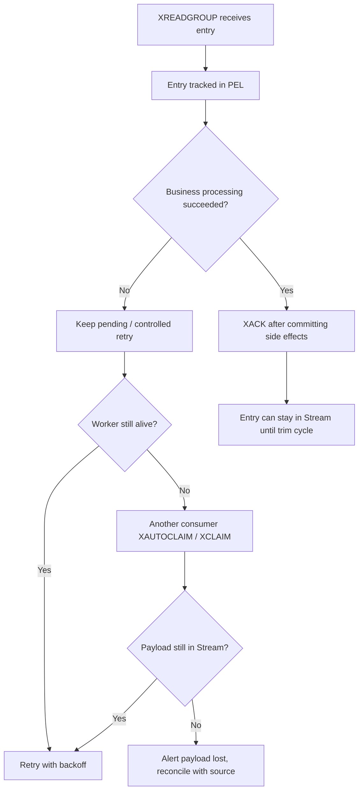
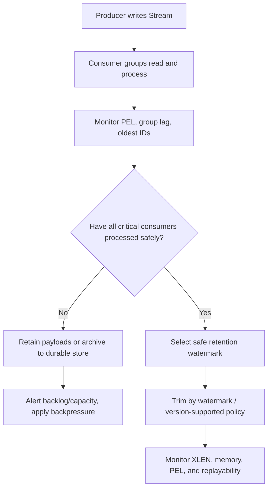

# Stream Trimming, Storage Limits, and Pending Data in Spring Data Redis

## 1. Core Problem: Streams Cannot Grow Forever

Redis Streams lets applications write events with `XADD`, read back by ID with `XREAD`, and distribute work among consumers in a group with `XREADGROUP`. Unlike Redis Pub/Sub, Stream messages are **stored as entries** so they can be read after the producer sends them.

That benefit carries a responsibility: if producers keep writing without storage limits, entry counts grow endlessly and consume large amounts of Redis memory. You therefore need a **trim** mechanism (*removing old entries*) and a **retention policy** (*data retention rules*).

A common cause of lost business data is:

> **Deleting entries from a Stream differs from acknowledging processing in a consumer group.** An entry may have been delivered to a worker without being `XACK`ed yet. If trimming deletes that entry's payload, a recovering worker may no longer have the data needed to reprocess it, even though pending metadata still appears in the group on certain Redis versions and policies.

This lesson focuses on combining three kinds of state:

1. **Stream entries:** messages physically remaining in the log.
2. **Consumer-group metadata:** delivered positions, pending entries, and consumer states.
3. **Storage limits:** size/timestamp cutoffs, memory capacity, and recovery windows.

A good retention policy must account for the **slowest consumer**, not just the producer's write rate.

## 2. Distinguishing Commonly Conflated Concepts

Suppose an event has ID `1763000000000-0` in Stream `events:payments`.

| Concept | Question it answers | Typical command |
|---|---|---|
| Stream entry | Is the message/payload still in Redis? | `XRANGE`, `XREAD` |
| Group's `last-delivered-id` | How far has the group delivered messages? | `XINFO GROUPS` |
| Pending entry (PEL) | Was the message delivered to the consumer group without an ACK? | `XPENDING` |
| Acknowledgment | Did the group confirm processing is complete? | `XACK` |
| Stream trimming | Which entries are removed from the log due to retention? | `XTRIM`, `XADD ... MAXLEN/MINID` |
| Deleting specific entries | Remove one or more specific IDs from the Stream? | `XDEL` |
| Deleting the whole stream | Remove the entire key and data structure? | `DEL`, key expiration |

These operations have different consequences. For example:

- `XACK` ends pending status in **one consumer group**; in the traditional model it **does not delete the payload** from the Stream.
- `XTRIM` removes entries by age/order or count; it **does not imply all groups finished processing**.
- `XDEL` removes specific entries from the log, which is not an “ACK for all groups”.
- `DEL events:payments` wipes out the Stream along with all group metadata attached to that key; this is not safe backlog management.
- Newer Redis versions include options for managing PEL references during delete/trim; understand exact semantics per version.

### Illustrating the Relationship Between a Stream and Consumer Groups

```text
Stream events:payments (retained payloads)
  ID-101  -> PaymentRequested
  ID-102  -> PaymentAuthorized
  ID-103  -> PaymentCaptured
  ID-104  -> PaymentRefunded

Consumer group billing
  ID-101: acknowledged
  ID-102: pending on worker-a
  ID-103: undelivered
  ID-104: undelivered

Consumer group analytics
  ID-101: acknowledged
  ID-102: acknowledged
  ID-103: pending on worker-b
  ID-104: undelivered
```

If a trim deletes `ID-102` because it looks old, `worker-a` loses the payload needed for retries. Likewise, `ID-103` pending in `analytics` must also be considered when setting retention. **There is no single system-wide “already read” flag shared across all groups.**

## 3. `XTRIM MAXLEN`: Bounding by Entry Count

Basic syntax:

```redis
XTRIM events:payments MAXLEN 100000
```

This instructs Redis to evict the oldest entries so the Stream keeps at most roughly the configured count per command semantics. When using **exact trimming**, Redis trims down to the specified limit.

Small example:

```redis
DEL demo:stream:len

XADD demo:stream:len * type A
XADD demo:stream:len * type B
XADD demo:stream:len * type C
XADD demo:stream:len * type D

XLEN demo:stream:len
# (integer) 4

XTRIM demo:stream:len MAXLEN = 2
# (integer) 2 (assuming no other mutations)

XLEN demo:stream:len
# (integer) 2

XRANGE demo:stream:len - +
# Remaining 2 newest entries (C and D), by Redis-generated IDs.
```

Notes:

- Redis evicts entries with the oldest IDs; it does not filter by fields like `type` or business status.
- `MAXLEN` bounds **entry count**, not MBs or total bytes.
- Payload sizes can vary widely; the same `MAXLEN 100000` does not use fixed RAM.
- `XTRIM` returns the number of entries evicted by the command, not the number of ACKed messages.
- Do not assume `XLEN` right after trimming equals the threshold under concurrent writes or approximate trimming.

### 3.1. Exact Trimming vs. Approximate Trimming

Redis supports comparison modifiers:

```redis
XTRIM demo:stream:len MAXLEN = 100000
XTRIM demo:stream:len MAXLEN ~ 100000
```

| Mode | Meaning | Trade-off |
|---|---|---|
| `=` (exact) | Trims precisely down to the target limit | Can cost more due to internal storage node splitting/adjustment |
| `~` (approximate) | Lets Redis trim efficiently along internal storage macro-nodes | Usually faster, yet may retain **more** entries than the configured count |

Streams are organized internally in macro-nodes optimized for storing many entries; approximate trimming avoids trimming individual entries inside a partially full node, instead dropping whole nodes where possible. Thus **`MAXLEN ~ N` is not a strict hard cap of N entries**.

This is a useful tool for bounding **average memory growth** on high-write event streams, though it does not replace measuring `XLEN`, `MEMORY USAGE`, and memory alerts.

### 3.2. `LIMIT` Caps Trimming Work

Where supported, `LIMIT` caps how much scanning/trimming work a command performs:

```redis
XTRIM demo:stream:len MAXLEN ~ 100000 LIMIT 1000
```

Do not interpret `LIMIT 1000` as “keep exactly 1000 messages”, nor as “delete at most 1000 entries” in an absolute sense across all versions/representations. It bounds the trim algorithm's work factor; check your Redis server's exact definition and constraints. When using `~` under heavy workloads, this option may leave entry count above the target after one call.

If a strict hard cap is required, measure the performance cost of exact trimming or choose another appropriate retention mechanism.

## 4. `XADD` with `MAXLEN`: Writing While Enforcing Bounds

Besides calling `XTRIM` separately, Redis lets you attach a limit policy directly on append:

```redis
XADD events:payments MAXLEN ~ 100000 * eventId evt-1 type REQUESTED
```

This adds a new entry and trims on the write path of the same command. This is common for high-throughput streams because no separate cleanup worker is needed to maintain the entry-count cap.

Example:

```redis
DEL demo:stream:bounded

XADD demo:stream:bounded MAXLEN = 3 * n 1
XADD demo:stream:bounded MAXLEN = 3 * n 2
XADD demo:stream:bounded MAXLEN = 3 * n 3
XADD demo:stream:bounded MAXLEN = 3 * n 4

XLEN demo:stream:bounded
# (integer) 3

XRANGE demo:stream:bounded - +
# Remaining entries n=2, n=3, n=4
```

With `MAXLEN ~`, the Stream can exceed the target threshold somewhat. Monitor actual memory and producer latency, especially if multiple workloads share a Redis instance.

### 4.1. Is Adding Then Trimming Separately the Same as `XADD MAXLEN`?

Both reduce growth, yet they **differ in timing and operation atomicity**:

```redis
XADD events:payments * eventId evt-2 type CAPTURED
XTRIM events:payments MAXLEN ~ 100000
```

These are **two separate Redis commands**. If the producer succeeds at `XADD` and hits a network failure or crashes before `XTRIM`, trimming never happens. Other clients can also interleave between the two commands.

With `XADD ... MAXLEN ...`, appending and bounding happen in one Redis command. Even so, **atomicity of write+trim does not guarantee safety for unprocessed consumers**. Retention can still evict pending entries.

### 4.2. When Should Producers Not Trim Immediately on Write?

If a Stream acts as a **mandatory job queue**, producers normally do not know:

- Which groups are slow or paused.
- Which messages remain pending on individual consumers.
- Whether a new group will need to replay history.
- Whether messages were confirmed in the target system or merely delivered.

Picking `MAXLEN ~ 1000` by guesswork on the producer can drop unprocessed jobs during traffic spikes. For critical data, base retention on **consumption progress and recovery windows**, not an arbitrary number in producer config.

## 5. `XTRIM MINID`: Retaining by Stream ID Threshold

Besides entry count, Redis supports trimming entries with IDs smaller than a threshold:

```redis
XTRIM events:payments MINID = 1763000000000-0
```

This retains entries **with IDs greater than or equal to the threshold** and removes older ones, subject to group-reference policies where applicable. Approximate syntax example:

```redis
XTRIM events:payments MINID ~ 1763000000000-0
```

You can also specify it on the write path:

```redis
XADD events:payments MINID ~ 1763000000000-0 * eventId evt-3 type SETTLED
```

When Redis auto-generates timestamp–sequence stream IDs, `MINID` can approximate “retain at least N hours/days”. However:

- **Stream IDs are not per-entry TTLs.**
- If producers supply IDs manually or clocks have quirks, the link between ID and business time may not always hold.
- The `MINID` cutoff must be calculated and applied consistently; computing the wrong timestamp can delete still-needed data.
- With approximate trimming, some entries older than the cutoff may remain.
- If a group holds pending entries older than the cutoff, time-based trimming still risks losing payloads unless pending items are protected.

### 5.1. How to Choose Between `MAXLEN` and `MINID`?

| Need | Approach | Limitation |
|---|---|---|
| Keep roughly the latest 100,000 events | `MAXLEN ~ 100000` | Does not guarantee each event stays for a minimum duration |
| Keep events from the last 24 hours by ID time | `MINID` with corresponding cutoff | No cap on entry count if write rate spikes |
| Need both a RAM cap and a minimum replay window | Combine policy with monitoring and secondary storage | A single threshold rarely guarantees both simultaneously |
| Critical job queue that must be processed until ACK | Retention accounting for group progress | A fixed `MAXLEN` is unaware of consumer progress |
| Event log queried over many months | Archive to durable storage/search/log store | Redis RAM is rarely economical for long-term history |

In workloads with highly variable write rates, `MAXLEN` fixes message count while actual replay duration fluctuates widely. For example, 100,000 entries at 100 events/s holds ~1,000 seconds of history, whereas at 10 events/s it holds ~10,000 seconds, assuming no other trimming/deletion.

## 6. Consumer Groups and the Pending Entries List (PEL)

A consumer group maintains metadata to distribute messages to consumers and track entries delivered but **not yet ACKed**.

Typical commands:

```redis
XGROUP CREATE events:payments billing 0-0 MKSTREAM
XREADGROUP GROUP billing worker-a COUNT 10 STREAMS events:payments >
XPENDING events:payments billing
XACK events:payments billing 1763000000000-0
```

Where:

- `XREADGROUP ... >` fetches new entries never before delivered in the group.
- Delivered-but-un`XACK`ed entries are tracked in the group's **PEL**.
- `XPENDING` returns summary or detailed PEL info.
- `XACK` removes the pending reference in **that group**, without deleting the Stream payload by default.
- Delivering a message to a consumer in one group does not mean other groups have processed that event.

### 6.1. PEL Differs from Undelivered Backlog

A common monitoring mistake is checking only `XPENDING`:

```text
Producer wrote:               1,000,000 entries
Group delivered so far:         200,000 entries
Group ACKed:                    199,999 entries
PEL remaining:                        1 entry
Undelivered to group:           800,000 entries
```

The PEL shows only 1 entry, yet the group is actually **far behind the head of the stream**. Trimming based solely on pending count can wipe out hundreds of thousands of entries never even seen by a worker.

Monitor simultaneously:

- Stream `XLEN`, `XINFO STREAM`.
- `XINFO GROUPS`: group progress, pending count, and `lag` when Redis can compute it.
- `XPENDING`: delivered-but-unACKed messages.
- `XADD` rate and successful processing rate.
- Age of oldest retained entry, age of oldest pending entry, and end-to-end latency.
- Status of paused or uninitialized groups.

`lag` in `XINFO GROUPS` can be undefined under certain conditions, such as offset initialization or deletions/trimming affecting internal counters. Do not assume `lag` is always exact across all Redis versions.

## 7. What Happens If Trimming Deletes a Pending Entry?

This scenario must be understood thoroughly.

### 7.1. Hands-On Experiment with `redis-cli`

Use an **isolated test namespace**—never run on production Streams:

```redis
DEL demo:stream:pending

XGROUP CREATE demo:stream:pending group-a 0-0 MKSTREAM
# OK

XADD demo:stream:pending * eventId ev-1 payload first
# <id-1>

XADD demo:stream:pending * eventId ev-2 payload second
# <id-2>

XREADGROUP GROUP group-a worker-a COUNT 1 STREAMS demo:stream:pending >
# Receives id-1; id-1 is now in the PEL.

XPENDING demo:stream:pending group-a
# 1 pending message.

XTRIM demo:stream:pending MAXLEN = 1
# Evicts oldest entry id-1, leaving id-2 in the Stream.

XRANGE demo:stream:pending - +
# Only entry id-2 remains.
```

The goal of this example is creating the state: **id-1 was delivered without ACK, then its payload was trimmed from the stream**.

In many Redis versions prior to Redis 8.2's reference-handling extensions, traditional trimming could leave the deleted message's reference in the PEL. Result:

- `XPENDING` can still show `id-1`.
- When a consumer tries to re-read pending entries by ID, `id-1`'s payload **is gone**.
- The trimmed body cannot be reconstructed from the Redis Stream.
- The PEL and Stream content diverge: delivery metadata remains while data needed to reprocess is missing.

When reading pending entries with `XREADGROUP` by explicit ID, some Redis versions return a record with null/missing fields for a deleted ID. Handle that case instead of assuming every pending ID has a body.

### 7.2. `XAUTOCLAIM` Cannot Resurrect Trimmed Payloads

`XAUTOCLAIM` lets consumers reclaim pending messages past an idle threshold:

```redis
XAUTOCLAIM demo:stream:pending group-a worker-b 60000 0-0 COUNT 10
```

However, if the entry's payload was trimmed or deleted, Redis **cannot redeliver data no longer stored**. Since Redis 7.0, `XAUTOCLAIM` cleans up PEL references pointing to entries missing from the Stream and returns a list of removed IDs per that version's contract. Cleaning up metadata like this **is not message recovery**.

Therefore, recovery workflows must distinguish:

1. Pending ID and payload still exist → claim, reprocess, then ACK.
2. Pending ID exists yet payload vanished → record **lost payload**, alert, or rebuild from source data if the architecture permits.
3. Entry ACKed in group A yet still needed by group B → never assume trimming is safe just because A ACKed.

Never fabricate dummy payloads or auto-ACK a payload-missing message and pretend business processing succeeded.

## 8. Changes in Newer Redis Versions Around References During Delete/Trim

Starting in **Redis 8.2**, Stream commands add controls for consumer group references during deletion and trimming, such as **`KEEPREF`**, **`DELREF`**, and **`ACKED`**, alongside coordinated acknowledge/delete commands like `XACKDEL` and `XDELEX`.

Design implications:

| Policy | Purpose | Trade-off |
|---|---|---|
| `KEEPREF` | Can delete payload while keeping PEL references in groups per traditional mechanics | Pending entry remains while payload may be lost |
| `DELREF` | When deleting an entry, also deletes related references in PELs | Erases pending traces for recovery; does not mean processed |
| `ACKED` | Deletes only entries meeting the condition of having been acknowledged by consumer groups per Redis semantics | Cannot enforce a small hard cap if a group is slow or stops ACKing |

This is a major difference between older and newer Redis deployments. **Never assume every Redis server supports these three options**; verify exact server version and syntax for `XADD`, `XTRIM`, `XDELEX`, and `XACKDEL` before adding them to configs or runbooks.

What remains unchanged: if a mode permits deleting unprocessed payloads, keeping or dropping PEL references **does not get the message processed**. A policy like `DELREF` can drive pending metrics down, yet that is not proof the workload succeeded.

### 8.1. Is `ACKED` a Universal Retention Solution?

No. Deleting only once groups have ACKed protects payloads from premature trimming **within its supported rules**, yet carries consequences:

- A dead or very slow group can cause the Stream to grow beyond the desired `MAXLEN`.
- New, test, or retired groups must have strict lifecycle management.
- Memory pressure builds whenever producers outpace consumers for long stretches.
- If business work runs outside Redis and a worker ACKs at the wrong time, ACK status does not guarantee side effects actually completed.
- Depending on new features requires aligning Redis server and client versions.

In systems with strict RAM limits, ACK-aware retention still needs **alert thresholds, backpressure, producer throttling, or secondary storage**—you cannot simply set `MAXLEN` and forget it.

## 9. `XACK` Does Not Free Stream Capacity the Way You Might Expect

Example:

```redis
XGROUP CREATE demo:stream:ack group-a 0-0 MKSTREAM
XADD demo:stream:ack * eventId ev-101
XREADGROUP GROUP group-a worker-a STREAMS demo:stream:ack >
XACK demo:stream:ack group-a <received-id>
```

In the traditional Redis Streams model, after `XACK`:

- The entry is no longer pending in `group-a`.
- The entry's payload can still be read with `XRANGE`.
- `XLEN` does not drop solely because of ACKing.
- Another group can still read/replay that entry.
- Redis memory used by the Stream does not shrink automatically per ACKed message.

Thus, even if a consumer pipeline processes millions of messages, without trimming/deletion/retention the Stream keeps growing. **ACK management and storage management are two independent lifecycles** that must be designed in parallel.

### 9.1. Can `XDEL` Replace `XACK`?

No. `XDEL` deletes a specific ID from the Stream, not completing group work. Under older policies/versions, the PEL can still hold references to deleted entries.

Likewise, if one consumer group finishes, calls `XACK`, and immediately calls `XDEL`, another group that has not processed yet loses the payload. When a Stream serves multiple groups, a single consumer **must not decide to delete history for all groups** without a shared retention contract.

### 9.2. `EXPIRE` on a Stream Key Is Completely Different from Entry Retention

```redis
EXPIRE events:payments 3600
```

This sets a TTL on the **entire Redis Stream key**, not individual entry TTLs. When the key expires, both the Stream and its consumer groups vanish.

Never use `EXPIRE` on an active Stream as a substitute for “keep each message for 1 hour”. That risks wiping the entire log, group metadata, and pending state all at once. For time-based retention, consider `MINID` with dedicated cutoff calculation and monitoring.

## 10. Building a Retention Policy from Business Needs

Instead of asking “What should `MAXLEN` be on this Stream?”, determine:

1. **Peak and average write rate** (events/second).
2. **Payload size** and storage overhead per key/field.
3. **Processing rate** of the slowest consumer group.
4. **Allowed worker downtime** while still catching up.
5. **Investigation/replay window** after bugs or new releases.
6. **Number of groups** and when groups are created or retired.
7. **Message criticality**: droppable vs. mandatory recovery.
8. **Redis memory budget** for Streams, PELs, persistence, and replication.
9. **Backup/archive**, long-term retention, and compliance requirements.

### 10.1. Estimating Capacity from Write Rate

A simple estimate for how many entries to retain:

```text
N ≈ producer_rate_per_second × retention_seconds
```

For example, if a system writes 200 entries/second and wants 6 hours of history:

```text
6 hours = 6 × 3600 = 21600 seconds
N ≈ 200 × 21600 = 4,320,000 entries
```

Setting only `MAXLEN 100000` yields an actual window at 200 entries/s of about 500 seconds—just over 8 minutes. If workers are allowed 30 minutes of downtime, that policy cannot guarantee backlog catch-up.

If payloads average ~400 bytes/entry, raw payload data alone is ~1.7 GB for 4.32 million entries (decimal estimate). Redis also needs internal node overhead, field names, PELs, replication buffers, AOF/RDB overhead, and room for other workloads; **never multiply raw payload bytes and treat that as exact Redis RAM usage**.

Measure on your system or representative load tests using `MEMORY USAGE`, `INFO memory`, and real growth rates.

### 10.2. Time-Based Retention Has No Hard Memory Bound

If you pick “keep 6 hours” and producer rate jumps from 200 to 2,000 events/second, entries stored in 6 hours grow roughly 10x. Thus `MINID`-based policies must be paired with:

- Producer rate limits/throttling.
- Capacity planning for peak traffic.
- Memory and backlog alerts.
- Load shedding or spill-to-archive plans.
- Explicit rules for what happens when retaining all data exceeds the RAM budget.

If the system strictly **must not lose a single job**, you cannot evict old entries on out-of-memory and still claim compliance. You must either add storage capacity, throttle ingress, move to a broker/storage engine built for disk-backed backlogs, or revise the SLA to accept defined loss risks.

## 11. Safety with Multiple Consumer Groups

Suppose Stream `events:orders` serves:

- Group `notifications`: fast, almost zero pending.
- Group `billing`: 2 hours behind due to a downstream outage.
- Group `analytics`: paused for a few days for maintenance.

If the producer trims for `notifications`, the other two groups can lose unprocessed messages. An event ACKed in `notifications` is not ACKed in `billing` or `analytics`.

### 11.1. Defining a Safe Watermark

A **safe retention watermark** is the oldest ID threshold that can be deleted without violating processing or replay needs of critical consumers.

Checking `last-delivered-id` alone is **insufficient** to compute it:

- A group may have delivered up to a new ID while still holding old entries in its PEL.
- Entries may remain undelivered if a consumer just started or the group lags.
- Another group may require longer history.
- Audit/replay history may need retention even after all groups ACK.

Designing a safe policy combines **delivered position, unACKed pending entries, replay windows, and active groups**. In systems with uneven completion order, a single “highest ACKed ID” can jump ahead of an unACKed entry and is unsafe as a trim cutoff.

An application can maintain a **contiguous processed watermark** per group (a point before which every entry satisfies completion criteria), though that is custom business logic; Redis does not guarantee such a watermark out of the box via one `XPENDING` call.

### 11.2. Abandoned Groups and Cleanup Policies

An unused group can block cleanup if policy requires every group to ACK. Runbooks should document:

- Owner of each consumer group.
- Processing SLA and maximum offline window.
- Criteria for retiring decommissioned groups.
- Plan for pending entries when redeploying consumers.
- Authority to bypass or drop a group to free capacity.

Never run `XGROUP DESTROY` merely because a group looks “inactive for a while” without verifying business needs; it destroys the group's metadata and PEL recovery path.

## 12. Pending Lifecycle: ACK, Retry, Reclaim, and Lost Data

A standard worker:



Processing sequence matters:

1. Receive event via `XREADGROUP`.
2. Validate payload and process business logic idempotently by event ID.
3. Only `XACK` after side effects are confirmed per the business contract.
4. If the worker dies before ACK, the message can be reprocessed.
5. If the message is trimmed before the worker recovers, Redis cannot redeliver the lost payload.

### 12.1. Pending Recovery Does Not Run Automatically Just Because a Group Exists

Workers calling only:

```redis
XREADGROUP GROUP billing worker-a STREAMS events:payments >
```

receive new entries; they do not automatically pick up pending entries left by dead consumers. A recovery loop is needed, e.g.:

```redis
XPENDING events:payments billing
XAUTOCLAIM events:payments billing worker-b 60000 0-0 COUNT 50
```

When a consumer restarts keeping its old name, it can read its own pending entries via `XREADGROUP` with the appropriate ID per API/version. Pending entries owned by another consumer must be claimed or transferred via ownership recovery.

Set `min-idle-time` on claims to match normal processing durations; too small makes two workers execute the same event concurrently, while too large delays crash recovery.

### 12.2. Idempotency Does Not Replace Retention

Idempotency protects when **a message is redelivered** and side effects risk running twice. Yet when a payload is trimmed before its first processing, idempotency cannot recreate the message. Solve the two requirements separately:

- **Prevent duplicates:** event ID, deduplication state, post-processing ACK.
- **Prevent lost payloads:** sufficient retention, persistence, replay archives, backlog monitoring, never trimming needed entries.

## 13. Spring Data Redis: Writing, Reading, ACKing, and Trimming

Spring Data Redis exposes Streams APIs via `StringRedisTemplate.opsForStream()` or `RedisTemplate.opsForStream()`. Producer and consumer code should share serializers, keyspaces, and event schemas.

### 13.1. Sample Dependencies and Connection Config

```groovy
dependencies {
    implementation 'org.springframework.boot:spring-boot-starter-data-redis'
}
```

```yaml
spring:
  data:
    redis:
      host: localhost
      port: 6379
```

Use `StringRedisTemplate` to write string keys and fields/values, making inspection via `redis-cli` easy.

### 13.2. Producer with `MapRecord`

```java
package com.example.demo.streams;

import java.util.Map;
import org.springframework.data.redis.connection.stream.MapRecord;
import org.springframework.data.redis.connection.stream.RecordId;
import org.springframework.data.redis.connection.stream.StreamRecords;
import org.springframework.data.redis.core.StringRedisTemplate;
import org.springframework.stereotype.Service;

@Service
public class PaymentEventPublisher {

    private static final String STREAM = "events:payments";

    private final StringRedisTemplate redis;

    public PaymentEventPublisher(StringRedisTemplate redis) {
        this.redis = redis;
    }

    public RecordId publish(
            String eventId, String paymentId, String eventType) {

        MapRecord<String, String, String> record =
                StreamRecords.newRecord()
                        .in(STREAM)
                        .ofMap(Map.of(
                                "eventId", eventId,
                                "paymentId", paymentId,
                                "eventType", eventType
                        ));

        return redis.opsForStream().add(record);
    }
}
```

`RecordId` is the entry ID inside the Redis Stream. `eventId` is the application-assigned business ID usable as a deduplication key. Never equate the two: retrying the same event can produce a new Stream ID unless deduplication is present.

### 13.3. Consumer Group: Process First, Then ACK

Assume the group was already initialized in Redis:

```redis
XGROUP CREATE events:payments billing 0-0 MKSTREAM
```

Illustrative worker:

```java
package com.example.demo.streams;

import java.time.Duration;
import org.springframework.data.redis.connection.stream.Consumer;
import org.springframework.data.redis.connection.stream.ReadOffset;
import org.springframework.data.redis.connection.stream.StreamOffset;
import org.springframework.data.redis.core.StreamReadOptions;
import org.springframework.data.redis.core.StringRedisTemplate;
import org.springframework.stereotype.Service;

@Service
public class PaymentStreamWorker {

    private static final String STREAM = "events:payments";
    private static final String GROUP = "billing";

    private final StringRedisTemplate redis;
    private final PaymentHandler handler;

    public PaymentStreamWorker(
            StringRedisTemplate redis,
            PaymentHandler handler) {
        this.redis = redis;
        this.handler = handler;
    }

    public void pollOnce(String consumerName) {
        var records = redis.opsForStream().read(
                Consumer.from(GROUP, consumerName),
                StreamReadOptions.empty()
                        .count(20)
                        .block(Duration.ofSeconds(1)),
                StreamOffset.create(
                        STREAM,
                        ReadOffset.lastConsumed()
                )
        );

        if (records == null || records.isEmpty()) {
            return;
        }

        for (var record : records) {
            try {
                String eventId =
                        (String) record.getValue().get("eventId");
                String paymentId =
                        (String) record.getValue().get("paymentId");

                // Handler must process idempotently by eventId.
                handler.process(eventId, paymentId);

                // XACK only after processing succeeds.
                redis.opsForStream().acknowledge(
                        STREAM, GROUP, record.getId()
                );
            } catch (RuntimeException ex) {
                // Log/record metrics and leave entry pending.
                // Recovery worker must retry/reclaim later.
                throw ex;
            }
        }
    }

    public interface PaymentHandler {
        void process(String eventId, String paymentId);
    }
}
```

This example focuses on the **process → ACK** relationship; it omits scheduling, pending recovery, DLQ, and retry policies. If a batch has multiple records and the worker stops on an exception, remaining unreached entries delivered in that batch also sit in pending and need recovery. Never call `XACK` in a `finally` block, which could ACK even when the handler failed.

### 13.4. Spring Data Redis `StreamOperations.trim`

For retention models that accept capping by entry count, Spring Data Redis supports trimming via `StreamOperations`:

```java
package com.example.demo.streams;

import org.springframework.data.redis.core.StringRedisTemplate;
import org.springframework.stereotype.Service;

@Service
public class StreamRetentionService {

    private static final String STREAM = "events:notifications";
    private static final long TARGET_MAXLEN = 100_000L;

    private final StringRedisTemplate redis;

    public StreamRetentionService(StringRedisTemplate redis) {
        this.redis = redis;
    }

    public Long trimApproximate() {
        return redis.opsForStream().trim(
                STREAM,
                TARGET_MAXLEN,
                true
        );
    }

    public Long trimExact() {
        return redis.opsForStream().trim(
                STREAM,
                TARGET_MAXLEN,
                false
        );
    }
}
```

The boolean overload selects approximate vs. exact trimming per your Spring Data Redis version's API. Verify the exact signature in your project's version; newer APIs also provide `MINID` trimming or `XAddOptions` to apply limits right in the write command.

**Important:** the retention example uses Stream `events:notifications`, not `events:payments` which acts as a mandatory work queue. Intentionally separating the two Streams underscores that a simple `MAXLEN` policy may suit notification streams whose old history is expendable, yet is **not automatically safe for job queues with critical pending/consumer groups**.

### 13.5. When `XADD MAXLEN` Is Needed in a Single Command

Redis CLI:

```redis
XADD events:notifications MAXLEN ~ 100000 * eventId notif-100 message updated
```

With Spring Data Redis, you can use `XAddOptions` or lower-level connection stream commands **if your version supports the required options**. Distinguish:

- Calling `add(record)` then `trim(...)`: two commands.
- Using `XADD` combined with `MAXLEN`: one write+trim command.

Never write a wrapper calling two separate commands and claim it is atomic. When retention limits affect pending data, align with your Redis server version and newer reference-aware command policies.

## 14. Designing a Safe Retention Job

For a notification Stream where partial history loss is acceptable, a periodic policy can be simple:

```text
Producer -> XADD
Scheduler (periodic) -> XTRIM MAXLEN ~ N
Metrics -> XLEN, MEMORY USAGE, oldest ID, errors
```

For a Stream holding **mandatory work**, the policy must be stricter:



A safe retention job cannot merely do:

```text
If XLEN > 100000:
    XTRIM MAXLEN 100000
```

while ignoring group lag. High-durability systems typically require **SLA-backed retention** and documented policies for what happens when consumers fall behind.

### 14.1. Before Trimming: What Should You Inspect?

Useful commands:

```redis
XLEN events:payments
XINFO STREAM events:payments
XINFO GROUPS events:payments
XINFO CONSUMERS events:payments billing
XPENDING events:payments billing

XRANGE events:payments - + COUNT 1
XREVRANGE events:payments + - COUNT 1

MEMORY USAGE events:payments
INFO memory
```

`XRANGE ... COUNT 1` and `XREVRANGE ... COUNT 1` show the oldest and newest retained IDs, useful for comparing the retention window against replay SLAs. They do not confirm consumers finished old events.

Use `XINFO GROUPS` to inspect groups, remembering those numbers are Redis-side metadata; combine them with real handler success/ACK metrics.

### 14.2. After Trimming: Determine What Was Removed

After a trim run, verify:

- Number of evicted entries, remaining `XLEN`, and smallest remaining ID in the Stream.
- Lowest position of groups still needing replay.
- Whether the PEL still holds IDs pointing to trimmed payloads, per Redis version/policy.
- Whether critical events were archived or remain reconstructible from a source of truth.
- Whether Redis memory decreased correspondingly (memory does not always drop byte-for-byte immediately due to allocator fragmentation).

Never use “`XPENDING` decreased” as the sole measure of trim success: if references were also deleted, pending count may drop because data was **lost**, not because handlers finished.

## 15. Common Incidents

| Symptom | Possible cause | Fix |
|---|---|---|
| `XLEN` stays huge despite constant ACKs | `XACK` does not delete Stream payloads | Add dedicated trim/retention design |
| Worker sees pending ID yet no fields | Entry was removed by `XTRIM` or `XDEL` while PEL ref stayed | Reconcile from source store, review trim policy, never fabricate payloads |
| New consumer cannot read old events | Events already trimmed or group created at `$` | Check retention and bootstrap offsets |
| Redis memory grows despite `MAXLEN ~` | Approximate trimming, large payloads, many streams/PELs | Measure `XLEN`/`MEMORY USAGE`, tune policy and capacity |
| `MAXLEN` suffices off-peak yet loses data at peak | Higher producer rate shrinks time window | Size retention by peak rate or use `MINID`/archival |
| Group pending is low yet processing is way behind | Many entries **never delivered** to the group | Check `lag` and `last-delivered-id`, not just `XPENDING` |
| Workers only read `>` while pending ages grow | Missing pending recovery/claim loop | Add retry/reclaim logic |
| `XAUTOCLAIM` returns deleted IDs instead of payloads | Payloads were trimmed; Redis 7+ cleans stale PEL refs | Log data loss, fix retention/recovery |
| Deleting after group A ACKs starves group B | No shared retention policy across groups | Account for all critical groups |
| Stream vanishes along with all groups | Key `EXPIRE` or `DEL` | Never use key TTLs for per-entry retention |
| Exact trimming spikes producer latency | Exact trimming does extra work at high load | Benchmark approximate mode, `LIMIT`, or separate cleanup |
| Newer reference policy commands fail | Redis version lacks `ACKED/DELREF` | Check server and driver versions/syntax |
| Backlog exceeds RAM and zero jobs may be lost | Producer outpaces processing for long periods | Backpressure, scale consumers, or use durable disk-backed storage |

## 16. Operating with Redis Cluster and Other Constraints

One Stream key lives in **one hash slot** in Redis Cluster. If all events funnel into one huge Stream, adding nodes does not shard that Stream. A hot Stream concentrates both write pressure and memory on its owning node.

You can shard across multiple partitioned Streams, for example:

```text
events:payments:0
events:payments:1
events:payments:2
events:payments:3
```

When partitioning:

- Each Stream has its own groups and retention.
- Consumers must poll/subscribe across each Stream.
- Event order holds **per partition** only when routed consistently.
- Multi-key commands/scripts in Cluster must satisfy hash-slot rules.
- Capacity monitoring must aggregate across all Streams and ensure no slow partition gets trimmed early.

If the business must retain long-term history, archiving to a database, object store, or dedicated event log is usually cheaper and easier to operate than holding months of data in Redis RAM. Redis Streams can serve the *hot processing window* while long-term history lives elsewhere.

### 16.1. Can Redis Persistence Replace Retention?

No. AOF and RDB recover Redis data under specific failure conditions, yet:

- They do not stop a Stream from growing if producers never trim.
- They do not make trimmed messages readable again through the Stream.
- They do not replace independently queryable backups or audit archives.
- They do not turn Redis writes/ACKs and external databases into a distributed transaction.

Distinguish **durability** (whether data survives server crashes) from **retention** (how long the application intentionally keeps data). A system with solid persistence can still lose payloads due to an aggressive trim policy.

## 17. Example Policy Tiers by Criticality

### 17.1. Real-Time Notifications Without Long Replay Needs

```text
Stream: events:notifications
Purpose: display recent UI updates
Retention: MAXLEN ~ 100000
On overflow: accept trimming oldest entries
UI recovery: fetch snapshot from API / source of truth
Monitoring: XLEN, memory, latency, trim rate
```

Here an approximate cap works well because dropping an old notification does not lose authoritative state.

### 17.2. Payment Jobs or Critical Business Events

```text
Stream: events:payments
Purpose: workers must process every event
Retention: protect pending and undelivered entries for all required groups
Overflow: alert, apply backpressure, scale capacity / spill storage
Recovery: XPENDING + XAUTOCLAIM, idempotent handlers, intentional DLQ
Durability: Redis & source-DB architecture aligned with SLA
Monitoring: lag, pending age, handler success, oldest ID, RAM
```

If a newer Redis server supports deleting only entries ACKed by all groups, consider using it alongside capacity alerts and limits—never treat it as an infinite-memory guarantee. On older servers, use a custom retention job or watermark/progress tracking.

### 17.3. Event Log for Analytics and Long-Term Replay

```text
Redis Streams: holds hot processing window
Archive: database, object storage, or durable event log
Analytics consumers: track offsets/checkpoints and replay from archive
Redis retention: covers worst-case outage and short rebuild windows
Historical reads: read from archive instead of forcing Redis to retain everything
```

In this pattern, trimming Redis does not delete events from the overall system—provided archiving is reliably written and recoverable.

## 18. Misconceptions to Avoid

**“`XACK` shrinks the Stream.”** Not in the traditional model: it only clears pending state for a group. Payloads stay until trimmed or deleted.

**“`XTRIM` only deletes processed messages.”** Not by default. `MAXLEN`/`MINID` select by position or count without knowing whether all consumers finished business work.

**“The PEL count equals total backlog.”** No. The PEL excludes entries **never yet delivered**.

**“If a message is still pending, Redis definitely still has its payload for retry.”** False. Trimming/deletion can remove payloads while PEL references linger under certain versions and policies.

**“`XAUTOCLAIM` can always rescue trimmed messages.”** False. Claiming only recovers what remains stored, and some versions use `XAUTOCLAIM` to purge stale PEL references to missing entries.

**“`MAXLEN ~ 100000` is a strict hard cap of 100,000 entries.”** No. `~` prioritizes efficiency and can exceed the target.

**“`MINID` is a per-event TTL.”** No. It trims by Stream ID threshold; time semantics depend on how IDs/cutoffs are generated and which trim command runs.

**“Enough RAM means events can never be lost.”** No. Trimming, key expiration, persistence/failover gaps, and business bugs can all break replayability.

**“Once one group ACKs, the event can be deleted immediately.”** Not if other groups or audit/replay policies still need it.

**“`ACKED` solves both memory limits and absolute retention.”** No. If a consumer stops ACKing, entries stop being deleted and memory climbs; backpressure and capacity policies are still required.

## 19. Conclusion

**Stream trimming** controls Redis Streams growth by **entry count** (`MAXLEN`) or **ID threshold** (`MINID`). You can invoke `XTRIM` separately or attach bounds to `XADD`; exact vs. approximate trimming trade off CPU cost against precision.

Most importantly in systems with consumer groups, **payload retention is not processing progress**. `XACK` confirms only within one group, the PEL tracks only delivered-but-unACKed messages, and both pending and unread entries can lose their payloads if trim policies fail to protect them. Newer Redis versions offer reference-aware / ACK-aware deletion options that aid safer designs, yet never remove the need for capacity planning and recovery workflows.

In Spring Data Redis, `StreamOperations` helps append, read, ACK, and trim; applications still must design retention around **write rates, slowest consumers, replay windows, RAM capacity, and fault recovery**. For expendable notifications, a simple `MAXLEN` cap may suffice. For mandatory business events, retain messages until safely processed, monitor both lag and pending entries, and plan backpressure or archival before hitting memory limits.
