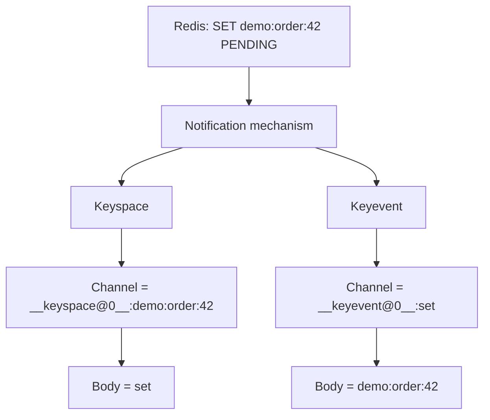
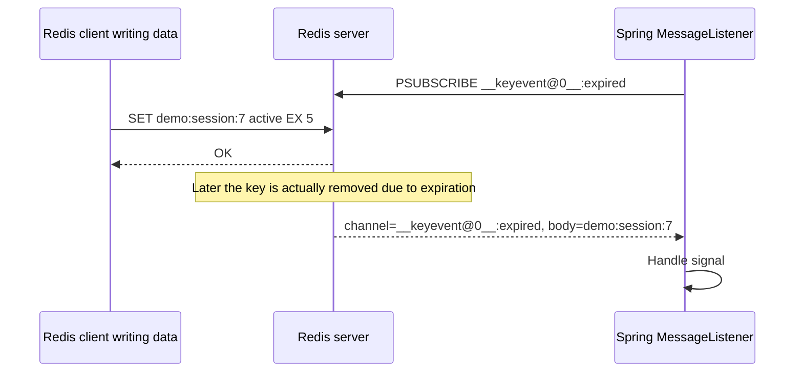
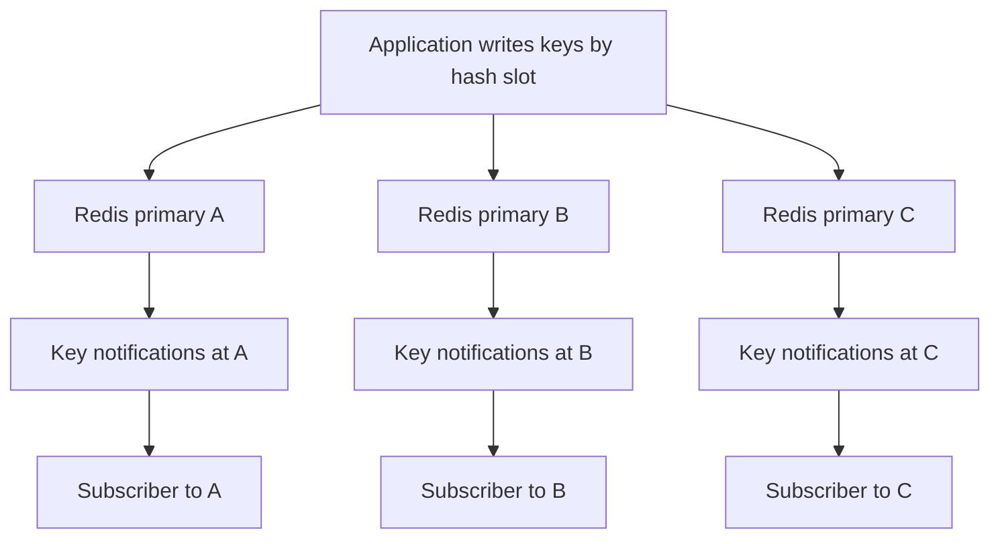

# Keyspace notifications and keyevent notifications in Spring Data Redis

Redis does not only store data by key. It can also **emit notifications when a key is created, modified, deleted, expired, or evicted from memory**. This mechanism is collectively called *Redis keyspace notifications*, and it includes two channel organizations that are very easy to confuse: **keyspace notifications** and **keyevent notifications**.

In a Spring Data Redis application, key notifications are useful when you need to observe signal-like changes: a session key has just expired, a cache key was deleted, or a group of business keys was just updated. An application can use `RedisMessageListenerContainer` to subscribe to Redis Pub/Sub channels or channel patterns, and then forward notifications to a `MessageListener`.

However, this is **not a durable event queue**. Keyspace/keyevent notifications are based on Redis Pub/Sub: if a subscriber disconnects, has not subscribed yet, or Redis is not configured to emit that event type, notifications can be missed and Redis does not store them for replay. An `expired` event also does not mean a callback is invoked at the exact millisecond the TTL reaches 0.

This lesson clarifies the structure of both channel groups, the `notify-keyspace-events` option, Redis CLI and Spring Data Redis examples, TTL/eviction cases, and the limitations regarding reliability, performance, security, Cluster, and business design.

## 1. What is a keyspace notification?

A key in Redis can go through a lifecycle:

```text
Does not exist
    |
    v
SET / HSET / SADD ...
    |
    v
Exists
    |
    +-- SET / HSET ... -> value changes
    |
    +-- EXPIRE ... -> has a time-to-live
    |
    +-- DEL ... -> actively deleted
    |
    +-- TTL expires -> Redis removes due to expiration
    |
    +-- maxmemory -> Redis removes according to eviction policy
```

Redis can emit notifications when the corresponding operations and events occur. For example, an application runs:

```redis
SET demo:order:42 PENDING
```

If the appropriate notification type is enabled, Redis can send a message stating that the key `demo:order:42` just received a `set` operation.

Two ways to organize the message:

1. **Keyspace:** the channel indicates **which key** changed, and the body states **what event** occurred.
2. **Keyevent:** the channel indicates **what event** occurred, and the body states **which key** was affected.

These are two perspectives on the same type of Redis event; they are not two independent event-emitting systems, nor are they a mechanism to automatically synchronize data between Redis and a database.

## 2. Distinguishing keyspace and keyevent with an example

Suppose Redis database `0` is used, with key `demo:order:42` and operation `SET`.

**Keyspace-style notification:**

```text
Channel: __keyspace@0__:demo:order:42
Message: set
```

**Keyevent-style notification:**

```text
Channel: __keyevent@0__:set
Message: demo:order:42
```

| Property | Keyspace notification | Keyevent notification |
|---|---|---|
| Channel structure | `__keyspace@<db>__:<key>` | `__keyevent@<db>__:<event>` |
| Channel contains | Key name | Event type |
| Message body contains | Event name | Key name |
| Best suited for | Watching a key or a group of keys by prefix | Watching all keys on which a specific event occurs |
| Example subscription | `__keyspace@0__:demo:order:*` | `__keyevent@0__:expired` |
| Flag group to enable | `K` | `E` |

You can visualize it as:



**Easy rule to remember:** *keyspace: key in the channel; keyevent: event in the channel*.

### 2.1. Both groups do not have to be enabled at the same time

If you only need to know which keys have just expired, a subscription such as `__keyevent@0__:expired` is usually simpler. In that case, you can enable only the `E` and `x` flags.

If you only need to watch operations on `demo:order:*` keys, you can choose keyspace channels and enable only the relevant event groups.

Enabling both groups provides flexible observation, but also increases the number of Pub/Sub messages that Redis must generate and send. There is no operational reason to always enable every event type in production.

## 3. Redis Pub/Sub is the transport channel for notifications

Keyspace/keyevent notifications use **Redis Pub/Sub**. Redis publishes messages to clients that are currently subscribed to the matching channel or channel pattern.

General flow:



Key characteristics:

- A subscriber must **be connected and already subscribed** when Redis emits the event in order to receive the message.
- Redis does not store keyspace notifications as a separate queue that supports `ACK`, `retry`, or replay.
- If a client loses its connection, messages emitted during the disconnection window are not automatically replayed upon reconnect.
- Receiving a message in a subscriber does not mean a subsequent business operation has completed.
- If there are multiple subscribers, each subscribed client can receive the same message. This is a broadcast model, not a consumer group that distributes work.

Therefore, keyspace notifications are a **best-effort signal**, not a source of truth for accounting ledgers, payment processing, access provisioning, or exactly-once guarantees.

## 4. Configuring notify-keyspace-events

By default on many Redis installations, keyspace notifications are **disabled** to avoid unnecessary event emission overhead.

Check the configuration:

```redis
CONFIG GET notify-keyspace-events
```

If the returned value is an empty string, Redis is not configured to emit the corresponding notifications.

Enable temporarily for the current server:

```redis
CONFIG SET notify-keyspace-events KEA
```

The command above is a convenient example when learning, because it enables both keyspace, keyevent, and many commonly used event groups. **`KEA` should not be treated as an optimal configuration for production**, and the `A` symbol does not encompass every newly added notification type in every Redis version.

### 4.1. Meaning of K and E

Two foundational flags:

| Flag | Meaning | Channels that may be published |
|---|---|---|
| `K` | Enable **keyspace channels** | `__keyspace@0__:some:key` |
| `E` | Enable **keyevent channels** | `__keyevent@0__:set` or `__keyevent@0__:expired` |

`K` or `E` alone is **not enough**: you must also specify the event groups to watch, such as `g`, `$`, or `x`.

Example:

```redis
CONFIG SET notify-keyspace-events Ex
```

This means emitting **keyevents** for expired keys. When a key is actually deleted by the expiration mechanism, the channel has the form:

```text
__keyevent@0__:expired
```

The message body is the key name.

### 4.2. Event group flags

Commonly used symbols:

| Flag | Event group | Examples |
|---|---|---|
| `g` | Generic commands, data-type-independent operations | `del`, `expire`, `rename_from`/`rename_to` depending on operation |
| `$` | String commands | `set` |
| `l` | List commands | `lpush`, `rpop` |
| `s` | Set commands | `sadd`, `srem` |
| `h` | Hash commands | `hset`, `hdel` |
| `z` | Sorted Set commands | `zadd`, `zrem` |
| `t` | Stream commands | `xadd`, `xdel` |
| `x` | Expired events | `expired` |
| `e` | Evicted events due to memory policy | `evicted` |
| `A` | Alias for common event groups | Bundles many groups; does not necessarily include every flag |

Some Redis versions also include flags for key miss, new key, overwritten, or type change. The exact list and semantics depend on the Redis version; when using a less common event, consult the documentation for the exact server version deployed.

Minimal configuration examples by requirement:

| Requirement | Example configuration |
|---|---|
| Receive keyevent only when keys expire | `Ex` |
| Both keyspace and keyevent for expired | `KEx` |
| Watch String and generic operations on keyspace | `K$g` |
| Watch multiple event types during development | `KEA` |
| Watch only events evicted due to maxmemory | `Ee` |

**Distinguish letter case:** `x` is expiration, `e` is eviction, whereas uppercase `E` selects the *keyevent* channel style. These are different flags.

### 4.3. Configuration in redis.conf

Instead of `CONFIG SET` at runtime, self-managed Redis environments can use:

```conf
notify-keyspace-events Ex
```

Then start or reload the configuration according to the corresponding deployment procedure.

`CONFIG SET` changes the running configuration but does not automatically guarantee persistence across all restarts. You may need to update the source configuration, run `CONFIG REWRITE` in environments that allow it, or use the service provider's configuration mechanism.

Managed Redis services may **disallow `CONFIG SET`** or require changes via a parameter group/management portal. A Spring application should not assume it is always granted permission to modify the Redis server config.

### 4.4. Do not enable all events in production just for debugging

A cache system with heavy `GET`, `SET`, `DEL` traffic can generate a huge number of notifications if broad groups are enabled. The costs include:

- Redis generates and distributes additional Pub/Sub messages.
- Subscriber connections receive more data.
- The application parses and filters out irrelevant messages.
- Logs can grow rapidly if every event is printed.
- Repeated operations on the same key can produce multiple notifications.

Enable only the groups actually needed. When the goal is to watch expiration, `Ex` is usually more sensible than enabling `KEA` just to listen solely for `expired`.

## 5. Observing notifications with Redis CLI

To see the difference, you need **two terminal windows** connected to the same appropriate Redis server/database.

### 5.1. Enable keyspace and keyevent for String

```redis
CONFIG SET notify-keyspace-events KE$
```

In terminal A:

```redis
PSUBSCRIBE __keyspace@0__:demo:order:*
```

In terminal B:

```redis
SET demo:order:42 PENDING
SET demo:order:42 PROCESSING
```

Terminal A receives messages with the conceptual format:

```text
pattern = __keyspace@0__:demo:order:*
channel = __keyspace@0__:demo:order:42
body    = set
```

The channel name tells **which key** changed, while the body tells the `set` operation.

### 5.2. Watch all SET operations via keyevent

In terminal A:

```redis
PSUBSCRIBE __keyevent@0__:set
```

In terminal B:

```redis
SET demo:order:42 PAID
SET demo:order:43 NEW
```

Terminal A receives two Pub/Sub messages:

```text
channel = __keyevent@0__:set
body    = demo:order:42

channel = __keyevent@0__:set
body    = demo:order:43
```

The channel is the same because the event type is the same, but the message body differs because the Redis keys are different.

### 5.3. If no messages appear

You should check:

1. Does the current server have the right `K`/`E` flag and corresponding event group configured?
2. Did the subscriber subscribe **before** the write command ran?
3. Does the database index in the channel name match the database used by the write command?
4. Are you connected to the same Redis instance or node that emits the event?
5. Does the pattern match the key/event name?
6. Does the command actually trigger that event type?

Redis Pub/Sub does not retain messages for later subscribers to receive. Therefore, registering a listener **after** a `SET` command will not reveal operations that already happened earlier.

## 6. Watching expired keys with keyevent

Expiration is the most common use case for Redis key notifications.

Enable configuration:

```redis
CONFIG SET notify-keyspace-events Ex
```

Terminal A:

```redis
PSUBSCRIBE __keyevent@0__:expired
```

Terminal B:

```redis
SET demo:session:7 active EX 5
```

When Redis **actually removes the key due to expiration**, the subscriber may receive:

```text
channel = __keyevent@0__:expired
body    = demo:session:7
```

Required conditions:

- The key has a valid expiration and actually expires.
- The Redis server has the `E` and `x` flags enabled.
- The subscriber is still connected at the time the event is emitted.
- Redis processes expiration sufficiently to remove the key.

**Do not confuse "TTL reaches 0" with "notification is sent at that exact moment."** Redis has active and passive expiration mechanisms; an expired event is emitted when Redis deletes the key due to expiration, which may be later than the scheduled expiration time.

### 6.1. Expiration is not an exact timer

This is a common scenario:

```text
T0          SET demo:session:7 active EX 5
T0 + 5s     Logical deadline has passed
T0 + 5s+δ   Redis actually deletes the key and publishes "expired"
```

The interval `δ` is not a constant controlled by the application. It depends on the cleanup mechanism, Redis load, number of expiring keys, and runtime characteristics.

Therefore, do not use the `expired` event as an **exact schedule** for tasks such as transferring money at 09:00:00.000, closing an auction at the exact moment, or triggering tasks with strict millisecond-level SLAs.

If you need to run tasks by deadline, you should have a durable schedule source or a scheduler with appropriate polling/recovery mechanisms, using Redis TTL as a supporting signal rather than the sole source of guarantee.

### 6.2. By the time an expired event arrives, the value is usually gone

Code with the idea:

```java
String key = "demo:session:7";
String value = stringRedisTemplate.opsForValue().get(key);
```

inside an expired callback usually returns `null` because Redis has already removed the key.

An expiration notification usually contains the **key name**, not the value prior to expiration. Redis also does not retain the "old value" for subscribers to retrieve from the message.

If you need the old data for cleanup processing:

- Store the metadata needed for processing in another source with a longer lifecycle.
- Or emit a business event with payload into a durable stream before expiration.
- Or maintain a state record in the DB and use the key ID to look up the primary source.

Do not place logic that depends on the value of an expired key without storing that data elsewhere.

## 7. Distinguishing EXPIRE, expired, DEL, and evicted

The event name reflects the **cause and timing**, not merely the final outcome "the key is gone."

| Situation | Relevant event | Meaning |
|---|---|---|
| `EXPIRE key 60` succeeds | `expire` | TTL has been set/updated; **not** yet key deleted due to expiration |
| Key removed by Redis upon expiration | `expired` | Key has actually been removed due to expiration |
| `DEL key` | `del` | Key was actively deleted |
| Redis removes key under `maxmemory-policy` | `evicted` | Key was evicted due to memory pressure |
| `PERSIST key` succeeds | `persist` | TTL removed, key still exists |
| `SET key value` | `set` | String SET operation |

Note that Redis may emit a `del` event instead of `expired` when an expiration is set to a past time or a non-positive TTL, causing the key to be deleted immediately. Therefore, do not use `expired` alone to infer **all** cases where a key disappears.

### 7.1. Example: EXPIRE is not expired

```redis
SET demo:task:1 RUNNING
EXPIRE demo:task:1 60
TTL demo:task:1
```

`EXPIRE` sets a deadline. If a subscriber has the generic group enabled and watches `expire`, it may receive a notification when the TTL is set. The `expired` notification occurs only **later**, when the key is actually deleted due to expiration.

### 7.2. DEL before expiration time

```redis
SET demo:task:2 RUNNING EX 60
DEL demo:task:2
```

The key is actively deleted. A subscriber listening only to `__keyevent@0__:expired` will not receive the `del` event type caused by the `DEL` command.

If the business logic needs to know "the key no longer exists for any reason," you must identify the set of causes to watch, rather than listening only to expired. Even when listening to multiple event types, you must still account for the fact that Pub/Sub can lose messages.

### 7.3. Evicted due to memory policy

When Redis reaches its memory limit under `maxmemory` and uses an eviction policy such as `allkeys-lru` or `volatile-ttl`, a key may be removed to free resources.

If `Ee` is enabled, the corresponding keyevent may look like:

```text
channel = __keyevent@0__:evicted
body    = demo:cache:product:42
```

This is **not** TTL expiration. An evicted key may still have remaining TTL or have no TTL at all, depending on the policy. If you use events to gather statistics on why keys disappear, you must clearly distinguish the two types.

## 8. When does Redis emit events?

Redis emits notifications according to the internal events that the server actually executes and has been configured to allow. Not every command produces an event that an application can guess solely from the command name:

- A command that modifies a key may emit an event with the same name or a related event name.
- An operation affecting multiple keys may generate multiple separate notifications.
- A command may emit no event if no corresponding change occurs.
- Commands that set TTL may generate an `expire` event type, whereas deleting a key due to expiration generates `expired`.
- The Redis version and enabled flag groups determine which event types can appear.

Example:

```redis
HSET demo:profile:42 name Lan
HSET demo:profile:42 city HCM
HDEL demo:profile:42 city
```

When the Hash group is enabled, the application can receive notifications related to `hset`/`hdel`, but the notification **does not contain the old or new value of the field**. A keyspace notification is a signal about an operation on a key, not a complete change data capture record.

Do not use the number of notifications as the number of business records successfully updated, because one business operation may emit multiple notifications; conversely, some operations emit no events or messages may be missed.

## 9. What does Spring Data Redis use to receive notifications?

Spring Data Redis provides `RedisMessageListenerContainer` to manage Pub/Sub connections and dispatch messages to registered `MessageListener` instances. Main components:

| Component | Role |
|---|---|
| `RedisConnectionFactory` | Creates Redis connections for the container |
| `RedisMessageListenerContainer` | Manages subscriptions and dispatches messages to listeners |
| `MessageListener` | Receives the `onMessage(Message, byte[] pattern)` callback |
| `PatternTopic` | Subscribes by Pub/Sub pattern such as `__keyevent@0__:expired` |
| `ChannelTopic` | Subscribes to an exact channel |
| `StringRedisTemplate` | Reads/writes string keys when needed to handle a signal |

You do not need to call `PSUBSCRIBE` manually in application code if the container is configured appropriately.

### 9.1. What does the received message contain?

In `MessageListener.onMessage(...)`:

- `message.getChannel()` is the bytes of the **Pub/Sub channel**.
- `message.getBody()` is the bytes of the **message body**.
- The `pattern` parameter is the corresponding subscription pattern information when a pattern is used.

For keyevent expired:

```text
message.getChannel() -> "__keyevent@0__:expired"
message.getBody()    -> "demo:session:7"
```

For keyspace:

```text
message.getChannel() -> "__keyspace@0__:demo:order:42"
message.getBody()    -> "set"
```

In examples using `StringRedisTemplate`, you can decode the channel/body as UTF-8 if keys are defined as UTF-8 strings. In principle, Redis keys can contain arbitrary bytes; with binary keys, converting bytes to String may not preserve the original key.

## 10. Complete example: listening to expired and keyspace in Spring Boot

The following example uses Spring Boot with Spring Data Redis, Redis database `0`, and UTF-8 key names. Two subscriptions:

1. `__keyevent@0__:expired` to receive the names of **all expired keys** in DB 0, then filter by the prefix `demo:session:`.
2. `__keyspace@0__:demo:order:*` to receive enabled event types for order keys by prefix.

### 10.1. Dependency and Redis configuration

Typical Maven dependency:

```xml
<dependency>
    <groupId>org.springframework.boot</groupId>
    <artifactId>spring-boot-starter-data-redis</artifactId>
</dependency>
```

Example Spring Boot connection configuration:

```yaml
spring:
  data:
    redis:
      host: localhost
      port: 6379
      database: 0
```

For both channel groups to work in the example, the Redis configuration needs to enable `E`, `K`, expiration, and the event groups to listen for on order keys. During testing, you can use:

```redis
CONFIG SET notify-keyspace-events KEA
```

In real deployments, choose narrower flags based on your needs, configure them through your Redis administration system, and specify the exact database index.

### 10.2. MessageListener receiving and classifying

```java
package com.example.redis.notifications;

import java.nio.charset.StandardCharsets;

import org.slf4j.Logger;
import org.slf4j.LoggerFactory;
import org.springframework.data.redis.connection.Message;
import org.springframework.data.redis.connection.MessageListener;
import org.springframework.stereotype.Component;

@Component
public class RedisKeyNotificationHandler implements MessageListener {

    private static final Logger log =
            LoggerFactory.getLogger(RedisKeyNotificationHandler.class);

    private static final String KEYEVENT_PREFIX =
            "__keyevent@0__:";
    private static final String KEYSPACE_PREFIX =
            "__keyspace@0__:";

    @Override
    public void onMessage(Message message, byte[] pattern) {
        String channel = new String(
                message.getChannel(), StandardCharsets.UTF_8);
        String body = new String(
                message.getBody(), StandardCharsets.UTF_8);

        if (channel.startsWith(KEYEVENT_PREFIX)) {
            String event = channel.substring(KEYEVENT_PREFIX.length());

            if ("expired".equals(event)
                    && body.startsWith("demo:session:")) {
                // body is the expired key name.
                log.info("Session key expired: {}", body);
            }
            return;
        }

        if (channel.startsWith(KEYSPACE_PREFIX)) {
            // For keyspace, channel contains the key name,
            // while body contains the event such as "set" or "del".
            String key = channel.substring(KEYSPACE_PREFIX.length());
            String event = body;

            if (key.startsWith("demo:order:")) {
                log.info(
                        "Order key notification: key={}, event={}",
                        key, event);
            }
        }
    }
}
```

This code **only observes and logs**, and does not assume that every expired event is guaranteed to be received. To keep the demo easy to understand, the listener classifies by channel prefix. In a real system, do not log the full key if the key contains sensitive identifying data.

Do not put slow DB queries or retry-prone business logic directly into `onMessage` without controlling execution threads. The container receives messages over Pub/Sub and can build up a backlog if the listener processes too slowly. If asynchronous tasks are needed, you must design an executor/queue, load limits, and a queue-full strategy; **moving from Pub/Sub to an internal queue does not automatically turn it into durable delivery**.

### 10.3. Registering RedisMessageListenerContainer

```java
package com.example.redis.notifications;

import org.springframework.context.annotation.Bean;
import org.springframework.context.annotation.Configuration;
import org.springframework.data.redis.connection.RedisConnectionFactory;
import org.springframework.data.redis.listener.PatternTopic;
import org.springframework.data.redis.listener.RedisMessageListenerContainer;

@Configuration
public class RedisNotificationConfig {

    @Bean
    RedisMessageListenerContainer keyNotificationContainer(
            RedisConnectionFactory connectionFactory,
            RedisKeyNotificationHandler handler) {

        RedisMessageListenerContainer container =
                new RedisMessageListenerContainer();

        container.setConnectionFactory(connectionFactory);

        container.addMessageListener(
                handler,
                new PatternTopic("__keyevent@0__:expired"));

        container.addMessageListener(
                handler,
                new PatternTopic("__keyspace@0__:demo:order:*"));

        return container;
    }
}
```

Spring manages the lifecycle of the container bean. When the application context starts, the container establishes the appropriate subscriptions; when it closes, the container releases resources according to the lifecycle.

Notes:

- The container **does not automatically enable** `notify-keyspace-events` on the Redis server merely by subscribing.
- If the application uses a Redis database other than `0`, the channel name must follow the corresponding DB index.
- With Cluster, subscribing on a single connection/node should not be assumed by default to capture all keyspace events across all nodes.
- The container configuration here only demonstrates **how to receive messages**; it does not provide replay for messages lost while the container was inactive.

## 11. Running the demo with the Spring listener

With the app running and Redis notifications enabled:

### Step 1 — Watch operations on the order key

```redis
SET demo:order:42 PENDING
SET demo:order:42 PROCESSING
DEL demo:order:42
```

The listener can log the corresponding events if the flag groups are enabled:

```text
Order key notification: key=demo:order:42, event=set
Order key notification: key=demo:order:42, event=set
Order key notification: key=demo:order:42, event=del
```

### Step 2 — Watch expiration

```redis
SET demo:session:7 active EX 5
```

When Redis actually removes the key due to expiration, the listener can log:

```text
Session key expired: demo:session:7
```

### Step 3 — Distinguish active deletion from expiration

```redis
SET demo:session:8 active EX 60
DEL demo:session:8
```

The listener in the example only subscribes to **keyevent expired** for sessions, so there is no reason to receive an `expired` notification for `demo:session:8` just because `DEL` deleted the key.

If you need to track `del`, enable the generic group and also subscribe to:

```text
__keyevent@0__:del
```

In that case, the handler should classify `del` separately rather than placing every key-disappearance event into the `expired` branch.

## 12. Subscribing to one key, one event, or a group

Redis Pub/Sub has two subscription forms:

- **Exact channel:** `SUBSCRIBE channel`, in Spring `ChannelTopic`.
- **Pattern subscription:** `PSUBSCRIBE pattern`, in Spring `PatternTopic`.

Example:

```java
container.addMessageListener(
        handler,
        new ChannelTopic("__keyevent@0__:expired"));
```

This is an exact channel name.

Example:

```java
container.addMessageListener(
        handler,
        new PatternTopic("__keyspace@0__:demo:order:*"));
```

This is a Pub/Sub pattern. The `*` character is a Redis Pub/Sub pattern wildcard, **not a Java regex** and not the Redis `SCAN` mechanism.

### 12.1. When to choose keyspace channels?

If you need to watch all changes to a set of keys:

```text
demo:order:42
demo:order:43
demo:order:44
```

Pattern:

```text
__keyspace@0__:demo:order:*
```

Here, the body represents the event type. The handler can filter `set`, `del`, `expire`, or other enabled events inside the handler.

### 12.2. When to choose keyevent channels?

If the goal is every key that has just expired:

```text
__keyevent@0__:expired
```

The subscriber does not need a pattern dependent on each key prefix to receive expired events; it only needs to inspect the message body and filter the key names of interest.

If you only want to receive `set` events:

```text
__keyevent@0__:set
```

The subscriber can match by key name in the body, but Redis still publishes events for all keys within the DB/node scope and enabled flags. Filtering in the listener does not mean Redis only emits messages for that prefix.

### 12.3. Avoid unnecessary duplicate subscriptions

If the same listener subscribes to both:

```text
__keyspace@0__:demo:order:42
__keyevent@0__:set
```

then a single `SET demo:order:42 ...` operation can result in **two messages** related to the same change (one on each channel type). If the code translates each message into a business task, it may process the event twice.

With notifications, duplicate reception can also happen due to multiple subscribers, multiple instances, or application retry behavior. Clearly define one channel type as the primary signal source or use appropriate deduplication logic.

## 13. KeyExpirationEventMessageListener in Spring Data Redis

Spring Data Redis includes a dedicated listener for expiration in the `org.springframework.data.redis.listener` package: `KeyExpirationEventMessageListener`. It helps handle the `expired` event group without writing all the channel registration manually.

An extended example:

```java
package com.example.redis.notifications;

import java.nio.charset.StandardCharsets;

import org.slf4j.Logger;
import org.slf4j.LoggerFactory;
import org.springframework.data.redis.connection.Message;
import org.springframework.data.redis.listener.KeyExpirationEventMessageListener;
import org.springframework.data.redis.listener.RedisMessageListenerContainer;
import org.springframework.stereotype.Component;

@Component
public class SessionExpirationListener
        extends KeyExpirationEventMessageListener {

    private static final Logger log =
            LoggerFactory.getLogger(SessionExpirationListener.class);

    public SessionExpirationListener(
            RedisMessageListenerContainer listenerContainer) {
        super(listenerContainer);
    }

    @Override
    public void onMessage(Message message, byte[] pattern) {
        String key = new String(
                message.getBody(), StandardCharsets.UTF_8);

        if (key.startsWith("demo:session:")) {
            log.info("Expired key observed: {}", key);
        }

        // If you need to preserve the superclass's Spring event
        // publishing behavior, consider calling super.onMessage(...)
        // according to your contract and application goals.
        super.onMessage(message, pattern);
    }
}
```

**Use one of the two registration approaches:** the manual listener in Section 10 or the specialized listener in this section, depending on your goal. If you register both at the same time, the same Redis expired event may be observed by two listeners, and business processing must avoid duplication.

### 13.1. Notes on auto-configuring notify-keyspace-events

Specialized listener classes may attempt to configure Redis notifications upon initialization, depending on the Spring Data Redis version and related configuration. In managed Redis services, `CONFIG SET` operations may be disallowed.

In environments where the application is not permitted to modify Redis config, configure notifications **directly at the server/provider level**, and check the Spring Data Redis version's API/configuration to avoid disallowed `CONFIG SET` commands. Do not grant broad Redis administrative privileges to the application just to make a listener run.

### 13.2. Distinguishing KeyExpirationEventMessageListener from Redis Repository TTL

Spring Data Redis repositories can also use key expiration events to manage the lifecycle of entities with TTL. Some repository configurations also use **shadow copy / phantom copy** to retain entity data for a period of time so information can be provided in the event after the primary key expires.

That is a mechanism belonging to **Repository infrastructure**, not a default property of every Redis expired notification. A plain Pub/Sub listener receives only the **key name**, and does not automatically obtain the old expired DTO.

If you use Redis Repository TTL in an application, you need to understand listener configuration, shadow copies, memory overhead, startup subscriptions, and the possibility of missed events in multi-node environments. Do not rely solely on expired events to guarantee that mandatory business work is executed.

## 14. Keyspace notifications and Spring Cache

Spring Cache with `RedisCacheManager` typically creates physical Redis keys with a prefix:

```text
<cacheName>::<logicalKey>
```

Example:

```java
@Cacheable(cacheNames = "productDetail", key = "#id")
public ProductDto getProduct(String id) {
    return repository.load(id);
}
```

For ID `p-42`, the Redis key may be:

```text
productDetail::p-42
```

or have an additional namespace depending on `RedisCacheConfiguration`.

If you subscribe to:

```text
__keyspace@0__:productDetail::*
```

the handler can observe events that Redis emits for physical keys belonging to that cache, provided the notification flags are suitable.

Things to understand:

- `@CacheEvict` can lead to a Redis key deletion operation and a `del` notification when the key is actually deleted.
- TTL cache entry expiration can emit `expired`, though not at an exact time predetermined by the application.
- A cache entry evicted by Redis due to memory pressure can emit `evicted` if the `e` group is enabled.
- `RedisTemplate` and `RedisCacheManager` may use different prefixes/serializers; the listener sees the **physical Redis key**.
- Do not assume every logical cache key maps directly 1:1 to a string you concatenate yourself if the cache manager has custom prefix, key conversion, or serializer settings.

### 14.1. Can expired events be used to update a cache before expiration?

Not in the sense of *refresh before expiry*. The `expired` event is emitted **when the key has already been deleted**. By the time the listener receives it, the old cache entry is gone, so warming the cache requires querying the data source again.

If you want to refresh before expiration or perform controlled refreshes, you can use remaining TTL, a scheduler, a refresh-ahead mechanism, or a separate business event system. Do not use keyspace expired notifications as a precise timer for pre-expiry refresh.

### 14.2. Do not create an infinite cache write loop

A listener that handles a `set` event by calling `SET` again on the same key that just changed can create a loop:

```text
SET key
  -> keyspace event "set"
  -> listener SET key
  -> keyspace event "set"
  -> listener SET key
  -> ...
```

To avoid this:

- Only read, or write to a different namespace when needed.
- Use idempotent conditions, generation/version numbers, or processing markers.
- Do not use a listener to react to every write operation with the exact same write operation.
- Consider designing dedicated business events instead of inferring business logic from every `SET`.

## 15. Keyspace notifications do not contain old and new data

This is an important limitation when compared to CDC (Change Data Capture) or event sourcing.

Suppose:

```redis
SET account:42:status ACTIVE
SET account:42:status SUSPENDED
```

If listening to `__keyevent@0__:set`, both notifications have the body:

```text
account:42:status
```

There is no:

```text
oldValue = ACTIVE
newValue = SUSPENDED
```

in the default message. When the handler calls `GET account:42:status`, it reads the **state at the time of the GET**, which may already differ from the state when the event occurred.

Example:

```text
T1: SET status = ACTIVE      -> publish "set"
T2: SET status = SUSPENDED   -> publish "set"
T3: Listener receives event T1
T4: Listener GET status -> SUSPENDED
```

The listener cannot accurately reconstruct every intermediate state from keyspace notifications. If the business logic needs to store change history with old/new values, emit a **business event with payload** or use an appropriate CDC/event log mechanism.

## 16. Notification ordering and concurrent processing

Redis processes commands according to its ordering rules, but an application receiving keyspace notifications should not infer a **global business transaction order**:

- Messages on a single Pub/Sub connection are received in the order Redis sends them on that connection.
- A single change can produce multiple notification types on different channels.
- Multiple Redis nodes in a Cluster do not have a single global notification stream provided automatically by this mechanism.
- Multiple subscriber instances can receive the same event and perform different side effects.
- A handler with an asynchronous processing executor may complete tasks out of the order messages were received.
- An event may arrive after the data has already changed again.

Therefore, keyspace notifications are better suited for **"something changed, go re-check"** than **"this is update number N that must be applied exactly once."**

A safer pattern for operations that only need to refresh a read model is, upon receiving a signal, to re-check the authoritative data source and apply changes in a version-controlled manner. However, if signals can be lost, you still need a periodic check or a durable event pipeline to guarantee progress.

## 17. Redis Cluster: notifications are node-local

In Redis Cluster, keys are distributed across multiple hash slots and primary nodes. An operation updating a key on node A generates a notification on the node that processed that operation.

**Keyspace notifications are not automatically broadcast by Redis Cluster across all nodes so that any arbitrary subscriber can receive every key event.** A subscription attached to only one node is not enough to observe all changes across the Cluster.

Illustration:



To observe the entire Cluster, you need to design subscriptions to **the nodes that need to be watched**, typically the primaries responsible for handling the relevant keys, and adapt to topology changes.

Points to pay attention to:

1. **Event flag configuration on nodes.** Do not assume that running `CONFIG SET` on one node enables notifications on all remaining nodes.
2. **Client/subscription topology.** Verify specifically how your Lettuce/Jedis driver and Spring Data Redis version support subscribing across nodes; do not assume a default container collects all keyspace events across the Cluster.
3. **Resharding.** When slots move between nodes, where events are emitted can change. Subscribers must be updated if you want to continue covering that key group.
4. **Failover.** Subscriptions to the old primary may lose connection; messages emitted during the transition are not replayed.
5. **Database index.** Redis Cluster typically uses database `0`, so channel names usually contain `@0`; do not rely on multiple logical DBs as in standalone mode.

If business requirements demand every event across the entire Cluster without loss, a durable event log intentionally written by the producer is usually more suitable than keyspace notifications.

## 18. Managed Redis and configuration permission limits

Some managed Redis providers restrict:

- `CONFIG GET`/`CONFIG SET` or `CONFIG REWRITE`.
- Dynamic parameter changes at runtime.
- Permission to use Pub/Sub or certain pattern subscriptions.
- Direct access to individual nodes when running Cluster.

In that case:

1. Check which notification groups the provider supports.
2. Enable the necessary flags using parameter groups or permitted operational procedures.
3. Ensure the Redis user/ACL has Subscribe/PSubscribe permissions for the appropriate channels.
4. Avoid writing code that grants permissions to itself or attempts to alter server configuration at startup using an application account if unnecessary.
5. If notifications cannot be enabled, use an alternative mechanism: business events, Redis Streams, a database outbox, or controlled polling.

There is no reason to give an application user broad Redis administrative permissions just to receive `expired` notifications.

## 19. Security considerations for information in key names

Keyevent notifications place the **entire key name in the message body**. Keyspace notifications place the **key name in the channel**. If an application uses a key like:

```text
session:user-email@example.com:token-secret
```

then notifications can expose this information to authorized subscribers and in logs.

Therefore:

- Do not put passwords, access tokens, or secrets into Redis key names.
- Minimize direct personal identifiers in key names when internal IDs can be used.
- Grant Pub/Sub permissions only to the scope the application actually needs.
- Do not log raw keys if they contain sensitive data.
- Review ACLs for Pub/Sub channels, especially when multiple applications share a single Redis server.

A key name prefix is not a security boundary. A subscriber permitted to listen to a broad pattern can see channels/messages within that permission scope.

## 20. Should business logic rely on expired events?

Consider the session timeout case:

```text
session:42 -> TTL 30 minutes
```

If the goal is only to **delete auxiliary data** after the session key expires, a notification can be a useful signal to clean up supplemental structures.

If the goal is to **guarantee payment, account locking, or invoice issuance exactly once** when the TTL expires, notifications are insufficient because:

- Emission timing of `expired` can be delayed.
- Messages can be lost when subscribers are offline.
- Multiple instances can receive the same event and process it multiple times.
- The key has already been deleted so the value may not be readable.
- There is no durable retry/ACK mechanism.

A more suitable design usually keeps a deadline in a durable source and has a scheduler/worker check the deadline, idempotency, and processed state. Redis TTL and notifications can accelerate processing, while a periodic reconciliation mechanism handles cases where signals are missed.

### 20.1. A good signal for auxiliary cache invalidation

For example, there is an in-memory local cache and Redis is the shared cache. When a Redis key is deleted, an instance wants to remove the corresponding local entry.

Key notifications can help reduce how long the local cache holds stale data, but **they do not guarantee every instance receives the event**. Therefore, the local cache still needs its own TTL or a durable invalidation mechanism appropriate to consistency requirements.

### 20.2. Do not treat "saw expired" as "processing completed"

An expired message has no ACK. If the callback calls an external API and times out, Redis does not keep a pending entry to automatically redeliver to another worker. The application must define its own state source and retry mechanism if the work is mandatory.

## 21. Keyspace/keyevent notifications vs. Redis Streams

| Characteristic | Keyspace / Keyevent notifications | Redis Streams |
|---|---|---|
| Message creation source | Emitted automatically by Redis on key operations when flags are enabled | Producer explicitly calls `XADD` |
| Main content | Event type and key name | Entry ID and field–value pairs declared by the producer |
| Transport channel | Redis Pub/Sub | Stream data type |
| Retained for later reading | No | Yes, within retention limits |
| Offline consumer reads later | No | Yes, if entries still exist |
| Has entry ID/offset | No | Yes |
| Has consumer groups and ACK | No | Yes |
| Has old/new values in message | Not by default | Possible if producer includes them in payload |
| Captures all DB changes | No; only knows Redis operations | Not automatic; requires producer/CDC/outbox |
| When to use | Lightweight, best-effort signal | Event stream requiring replay and processing management |

If the system needs to know **a key was just deleted**, notifications can be appropriate. If the system needs **a job that must not be lost and can be retried**, Redis Streams or a durable message broker/event log is usually the right choice.

### 21.1. A listener alone cannot turn notifications into a Stream

A commonly proposed approach:

```text
Redis keyevent Pub/Sub -> Spring listener -> XADD Redis Stream
```

This approach provides replay capability **after the message has been written to the Stream**, but the gap beforehand still carries risk of loss:

```text
Redis emits keyevent
       |
       +-- listener offline -> message lost, never XADDed
```

If you need to guarantee no events are lost, the producer must emit durable events on the **primary data-change path**, or have a reconciliation process and authoritative source to recover missed changes.

## 22. When business events are needed, emit them explicitly

Instead of inferring business events from every `SET`/`DEL` operation, a service can explicitly emit an event when a DB transaction commits successfully.

Conceptual example:

```text
DB transaction
    UPDATE order
    INSERT outbox(OrderPaid, orderId, eventId)
COMMIT
    |
    v
Outbox relay
    XADD orders:events *
        eventType OrderPaid
        orderId 42
        eventId evt-...
    |
    v
Consumer group
    Process + idempotency
    XACK
```

This approach better satisfies requirements such as:

- Having a business payload.
- Having an event ID for deduplication.
- Having proof in the outbox that the event needs to be emitted.
- Having retries when Redis or the consumer encounters an error.
- Having the ability to re-read within retention limits.

This is an architecture with higher operational cost than simple notifications, but appropriate when losing or duplicating an event causes serious consequences.

## 23. Performance: filter early and avoid slow callbacks

A Redis system serving thousands of commands per second can emit a large volume of notifications if multiple flag groups are enabled. You should:

1. Enable the **fewest event types** necessary on the Redis server.
2. Subscribe to channels/patterns with an appropriate scope.
3. Filter prefixes or event names in the callback if the subscription is broad.
4. Do not run slow DB queries for every duplicate event.
5. Do not log full payloads or key names under high traffic.
6. Monitor notifications/second, callback processing time, and CPU usage.
7. Design idempotent listeners when receiving multiple signals related to one change.

If processing via a thread pool:

- Use a bounded queue.
- Have a policy when the queue is full.
- Avoid assuming callback completion order matches message order.
- When tasks are mandatory, do not merely move messages from Redis Pub/Sub into an in-memory queue and consider that durability.

Key notifications are convenient but not free; enabling broad flags can add overhead on both Redis and the application.

## 24. Common issues in production

### 24.1. Listener runs but does not receive expired

Possible causes:

- Server does not have `Ex` or `KEx` enabled.
- Key never had a TTL set.
- Key was deleted via `DEL` instead of expiring naturally.
- Subscriber was not active when Redis emitted the message.
- Redis actually deleted the key later than the logical TTL.
- Subscription is on a different DB/node.

### 24.2. Event received but GET returns null

This is normal behavior for `expired` because the key has been deleted. The same applies to `del`. The key name in the notification is not a way to recover lost data.

### 24.3. Receiving two events for one operation

The application may be subscribed to both keyspace and keyevent simultaneously, or a single Redis operation may generate different events. Do not duplicate side effects for each message.

### 24.4. During redeployment, some events are missing

Redis Pub/Sub does not replay the period while the app is stopped. Reconciliation or a durable event log is needed if missing events are unacceptable.

### 24.5. Cluster only receives events for a subset of keys

A subscription tied to a specific node cannot see keys handled by other nodes. Design topology-aware subscriptions while accounting for resharding/failover.

### 24.6. Managed Redis disallows CONFIG SET

This is an environment permission/configuration restriction. Set flags at the provider or choose an alternative mechanism; do not try to grant broad administrative permissions to the app.

### 24.7. Cache evict does not generate expected notifications

Check the physical key, event flags, whether the Redis key actually existed, and whether it was deleted. `Cache.evict(logicalKey)` does not necessarily call `DEL` on the exact unprefixed logical key name.

### 24.8. Listener creates an operation loop

A callback that receives `set` and then calls `SET` on the same key again can cause repeating events. Perform actions only conditionally, implement loop prevention, or write to a separate namespace.

### 24.9. Using notifications as an audit system

Notifications lack before/after payloads, are not durably stored, and do not guarantee completeness. For auditing, you need an authoritative source and logs designed for traceability.

### 24.10. Treating the expired reception time as the deadline time

The time the callback is invoked may be later than when the key expired. Store the business deadline separately and check it at the authoritative system if accuracy is required.

## 25. Building a reconciliation mechanism when notifications are only signals

In many systems, notifications remain useful if used as a **fast path**, not the sole path.

Example of a worker cleaning up temporary records:

```text
                   +---------------------------+
                   | DB storing session deadline |
                   +-------------+-------------+
                                 |
                +----------------+----------------+
                |                                 |
                v                                 v
      Redis expired notification          Scheduled reconciliation
                |                                 |
                v                                 v
          Attempt cleanup now              Scan overdue deadlines
                |                                 |
                +----------------+----------------+
                                 |
                                 v
                        Idempotent cleanup
```

Principles:

1. **The deadline is durably stored** in the authoritative data source.
2. Redis keys with TTL optimize lookup speed.
3. The expired event is a prompt for early cleanup.
4. A periodic job finds records that are overdue but not yet processed.
5. Cleanup uses locking/idempotency to avoid multiple impacts.

Even if notifications are lost, reconciliation still finishes the job. If events arrive multiple times, idempotent logic limits side effects.

This is a more suitable design pattern for tasks requiring reliability while leveraging notifications to reduce average latency.

## 26. How to test listeners without relying on absolute timing

When writing integration tests for expired notifications, **do not assert a fixed expectation that the callback occurs at exactly 1,000 ms** after `SET EX 1`.

A practical test should:

- Use a test Redis server with the right flags enabled.
- Register the listener before creating the key.
- Use a dedicated key prefix for the test to avoid receiving unintended events.
- Write a key with a short TTL.
- Wait for the callback with a **generous timeout**.
- Avoid assertions based on absolute callback ordering relative to other events.
- Clean up test data and release connections/containers when finished.

Conceptual example with `CountDownLatch`:

```java
import java.nio.charset.StandardCharsets;
import java.time.Duration;
import java.util.concurrent.CountDownLatch;
import java.util.concurrent.TimeUnit;

import org.springframework.data.redis.connection.Message;
import org.springframework.data.redis.connection.MessageListener;
import org.springframework.data.redis.core.StringRedisTemplate;
import org.springframework.data.redis.listener.ChannelTopic;
import org.springframework.data.redis.listener.RedisMessageListenerContainer;

public void observeExpiration(
        RedisMessageListenerContainer container,
        StringRedisTemplate redis) throws InterruptedException {

    String key = "test:expiration:sample";
    CountDownLatch latch = new CountDownLatch(1);

    MessageListener listener = (Message message, byte[] pattern) -> {
        String expiredKey = new String(
                message.getBody(), StandardCharsets.UTF_8);
        if (key.equals(expiredKey)) {
            latch.countDown();
        }
    };

    ChannelTopic topic =
            new ChannelTopic("__keyevent@0__:expired");

    // The listener/container must actually be subscribed before SET.
    container.addMessageListener(listener, topic);

    try {
        redis.opsForValue().set(key, "temporary", Duration.ofSeconds(1));

        boolean received = latch.await(10, TimeUnit.SECONDS);
        if (!received) {
            throw new AssertionError(
                    "Expired notification was not observed");
        }
    } finally {
        container.removeMessageListener(listener, topic);
        redis.delete(key);
    }
}
```

This is a conceptual test method example; when implementing it, the test must manage the container lifecycle and **ensure the subscription is confirmed/established before writing the key**, avoiding setup race conditions. The test also requires a Redis server with `Ex` enabled; adding a listener alone does not guarantee the configuration.

Even a test that successfully receives an event is not proof that Pub/Sub provides **durable delivery** in production.

## 27. Hands-on exercises

### Exercise 1 — Identify channels and messages

Redis emits notifications for the operation:

```redis
SET demo:cart:17 OPEN
```

Write out:

1. The keyspace channel and message body.
2. The keyevent channel and message body.
3. Which subscription is appropriate to watch all `demo:cart:*` keys?
4. Which subscription is appropriate to watch all `set` operations in DB 0?

Reference answer:

```text
Keyspace: channel __keyspace@0__:demo:cart:17, body set
Keyevent: channel __keyevent@0__:set, body demo:cart:17
```

### Exercise 2 — Enable only expired keyevents

Configure:

```redis
CONFIG SET notify-keyspace-events Ex
```

Subscribe:

```redis
PSUBSCRIBE __keyevent@0__:expired
```

Then:

```redis
SET demo:ttl:1 value EX 3
```

Observe the event and explain why the listener does not receive a body containing `value`.

### Exercise 3 — Distinguish expired and del

Execute:

```redis
SET demo:ttl:2 value EX 60
DEL demo:ttl:2
```

Explain why you should not wait for an `expired` event when a key is actively deleted. Which group must be enabled and which channel subscribed if you want to receive `del`?

### Exercise 4 — Implement a Spring listener

Write a `RedisMessageListenerContainer` subscribing to:

```text
__keyspace@0__:demo:inventory:*
__keyevent@0__:expired
```

In `MessageListener.onMessage(...)`, distinguish:

- The key name in the channel for keyspace.
- The event name in the channel for keyevent.
- The corresponding key name or event in the message body.

Do not call `GET` to retrieve the "old value" of an expired key.

### Exercise 5 — Simulate subscriber disconnection

1. Enable keyevent for `set`.
2. Stop the subscriber.
3. Send several `SET` commands.
4. Restart the subscriber.

Determine which events the subscriber can receive. Compare this with a Redis Stream that already holds entries and can be read from an older retained ID.

### Exercise 6 — Analyze Redis Cluster

Suppose `cart:{1}:items` belongs to primary A and `cart:{2}:items` belongs to primary B. A Spring listener only subscribes on A.

Explain why you cannot assume this listener receives all keyspace notifications on B, and describe the changes needed when slots are moved during resharding.

### Exercise 7 — Design reliable timeout handling

A business requirement demands closing reservations right after the deadline without missing any order. Explain why relying solely on Redis `expired` events is insufficient. Propose a model with durable deadline storage, a scheduler/reconciliation, and idempotent processing.

### Exercise 8 — Prevent event loops

A listener receives a keyspace `set` for `demo:status:42` and then calls `SET` on that same key. Draw the resulting loop. Propose logic changes to avoid generating infinite notifications or to separate business events from storage operations.

## 28. Key takeaways

| Question | Answer |
|---|---|
| What is a keyspace notification? | Channel contains key, message body contains event |
| What is a keyevent notification? | Channel contains event, message body contains key |
| What form does a keyspace channel have? | `__keyspace@<db>__:<key>` |
| What form does a keyevent channel have? | `__keyevent@<db>__:<event>` |
| What setting does Redis use to enable it? | `notify-keyspace-events` |
| How do flags `K` and `E` differ? | `K` selects keyspace channels, `E` selects keyevent channels |
| What is the flag for expiration? | `x`; often combined as `Ex` |
| What is the flag for eviction by memory policy? | `e` |
| Are `expire` and `expired` the same? | No; one is setting TTL, the other is removing a key due to expiration |
| Do you receive the old value from an expired notification? | Not in the default message; the key has usually been deleted |
| Does the expired event arrive at the exact moment TTL reaches 0? | Not guaranteed |
| Does an offline subscriber get replayed notifications? | No |
| What does Spring Data Redis use to subscribe? | `RedisMessageListenerContainer` and `MessageListener` |
| Is there a convenience listener for expired? | `KeyExpirationEventMessageListener` |
| Does Redis Cluster automatically broadcast keyspace events to all nodes? | No; node/topology-aware subscriptions must be considered |
| Do key notifications replace Redis Streams? | No; this is best-effort Pub/Sub without retention/ACK |
| What should you do when tasks must not be missed? | Design a durable deadline/event source, retries, idempotency, and reconciliation |

**In summary:** Redis keyspace and keyevent notifications both describe changes to Redis keys, differing only in **which information is in the channel and which is in the body**. In Spring Data Redis, subscribing is straightforward with `RedisMessageListenerContainer`, but **the Pub/Sub transport has no replay guarantee, no old/new payload, and expiration is not a precise timer**. Use notifications to optimize responsiveness to signals; for mandatory business work, supplement them with an authoritative data source and appropriate error handling.

### References

- [Redis — Redis keyspace notifications](https://redis.io/docs/latest/develop/pubsub/keyspace-notifications/)
- [Redis — Pub/Sub](https://redis.io/docs/latest/develop/pubsub/)
- [Redis — CONFIG SET](https://redis.io/docs/latest/commands/config-set/)
- [Redis — EXPIRE](https://redis.io/docs/latest/commands/expire/)
- [Redis — TTL](https://redis.io/docs/latest/commands/ttl/)
- [Redis — Key eviction](https://redis.io/docs/latest/develop/reference/eviction/)
- [Redis — Redis Cluster specification](https://redis.io/docs/latest/operate/oss_and_stack/reference/cluster-spec/)
- [Spring Data Redis — Pub/Sub Messaging](https://docs.spring.io/spring-data/redis/reference/redis/pubsub.html)
- [Spring Data Redis — RedisMessageListenerContainer API](https://docs.spring.io/spring-data/redis/reference/api/java/org/springframework/data/redis/listener/RedisMessageListenerContainer.html)
- [Spring Data Redis — KeyExpirationEventMessageListener API](https://docs.spring.io/spring-data/redis/reference/api/java/org/springframework/data/redis/listener/KeyExpirationEventMessageListener.html)
- [Spring Data Redis — Time To Live / Repositories](https://docs.spring.io/spring-data/redis/reference/redis/redis-repositories/expirations.html)
