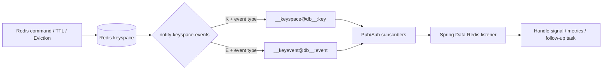

# Configuring notify-keyspace-events and selecting event types in Spring Data Redis

## 1. Objectives

Redis can emit notifications when keys are created, modified, deleted, expired, or removed from memory due to an eviction policy. This mechanism is called **keyspace notifications**. In a Spring Data Redis application, you can register a listener to receive notifications and handle tasks such as:

- Knowing that a temporary session key has expired.
- Tracking key deletion events within a namespace.
- Updating metrics or emitting signals to refresh derived data.
- Observing Redis key changes produced by multiple processes.
- Integrating with Redis Repository key lifecycle handling mechanisms.

However, Redis **does not automatically emit all events by default**. You must enable the `notify-keyspace-events` configuration with the right combination of characters. If the configuration is missing the character that selects the notification style or event type, the listener still runs without receiving the expected notifications.

This lesson explains how to choose a sufficient minimal configuration, register listeners through Spring Data Redis, distinguish `expired` from `expire` and `evicted`, and understand the limitations of Redis Pub/Sub when used in real-world business workflows.

> **Principle:** keyspace notifications are **signals for observing changes that have already occurred**, not a durable job queue, an exact timer, or a transaction mechanism.

## 2. How do keyspace notifications work?

Redis keyspace notifications are emitted over Redis Pub/Sub. There are two perspectives on the same change:

1. **Keyspace notification:** the channel represents **which key changed**, and the message represents **what event occurred**.
2. **Keyevent notification:** the channel represents **what event occurred**, and the message represents **which key was affected**.

Suppose the key `session:user-42` in Redis database 0 expires.

Redis may emit:

```text
Keyspace notification
  Channel: __keyspace@0__:session:user-42
  Message: expired

Keyevent notification
  Channel: __keyevent@0__:expired
  Message: session:user-42
```

The difference lies in how the listener filters data:

| Criterion | Keyspace | Keyevent |
|---|---|---|
| Channel structure | `__keyspace@<db>__:<key>` | `__keyevent@<db>__:<event>` |
| Message content | Event name, e.g., `expired` | Key name, e.g., `session:user-42` |
| Suitable when | Observing one key or a group of keys by name | Receiving all keys with the same event type |
| Configuration character to enable | `K` | `E` |
| Filtering with `PSUBSCRIBE` | `__keyspace@0__:session:*` | `__keyevent@0__:expired` |

Both still depend on the enabled **event type groups**. Configuring only `K` or `E` without selecting a corresponding event type is not enough to produce useful notifications.

### Event flow diagram



These messages are sent when Redis generates the event. Redis **does not store them as history** for an application that arrives later to re-read.

## 3. Configuring notify-keyspace-events as a character string

The Redis configuration parameter is named:

```text
notify-keyspace-events
```

Its value is a **string of character flags**. Each character selects a feature or an event group. For example:

```text
Ex
```

means:

- `E`: enable **keyevent**-style notifications.
- `x`: select **expired** key events.

When using `Ex`, subscribers on the `__keyevent@0__:expired` channel can receive the names of expired keys.

If using:

```text
Kx
```

it selects **keyspace notifications** for expired events. Subscribers need to listen on `__keyspace@0__:<key>` and read `expired` from the message.

### 3.1. Two required flags to choose notification style

| Flag | Meaning |
|---|---|
| `K` | Enable keyspace notifications; channel contains key name |
| `E` | Enable keyevent notifications; channel contains event name |

You can enable both with `KE` if the application needs both formats. However, to actually receive events, you must add event group flags such as `x`, `g`, or `h`.

Example:

```text
KEx
```

enables both keyspace and keyevent for expired events. When a key expires, the same change can produce two notifications with two different channel formats.

### 3.2. Flags for selecting event groups

| Flag | Event group | Typical examples |
|---|---|---|
| `g` | Generic command events | `del`, `expire`, `rename_from`, `rename_to` |
| `$` | String commands | `set`, `incrby`, and other string mutations |
| `l` | List commands | `lpush`, `rpop`, `lpop` |
| `s` | Set commands | `sadd`, `srem` |
| `h` | Hash commands | `hset`, `hdel` |
| `z` | Sorted set commands | `zadd`, `zrem` |
| `t` | Stream commands | `xadd`, `xdel` |
| `d` | Events for module key types | Depends on the Redis module in use |
| `x` | Expired keys | `expired` |
| `e` | Evicted keys | `evicted` |
| `m` | Key-miss access events | `keymiss` |
| `n` | New key creation events | `new` |
| `o` | Key overwritten events | `overwritten` |
| `c` | Key type-changed events | `type_changed` |

Some groups or notification types only appear in specific Redis versions. Characters such as `m`, `n`, `o`, and `c` must be evaluated against the Redis server version in operation. Do not assume older Redis versions or compatible Redis services support all newer events.

### 3.3. The A flag: shorthand for multiple event groups

Redis provides the `A` character as an alias for most commonly used event groups. According to Redis documentation, `A` stands for:

```text
g$lshztdxe
```

Therefore:

```text
KEA
```

is a way to enable keyspace + keyevent and many common notification types. **`A` does not mean every possible event type**, because some groups such as `m`, `n`, `o`, `c` are not included in that alias and may need to be enabled explicitly.

More importantly, production applications rarely need to receive almost every notification type. A broad configuration forces Redis to emit many additional messages when data changes frequently, leading to higher Pub/Sub and log load.

**Prefer the minimal configuration tailored to your needs** rather than enabling `KEA` out of habit.

## 4. Choosing flag combinations by required event type

Start by asking: **what really needs to be watched?** Then choose keyspace or keyevent and the appropriate event groups.

| Requirement | Example configuration | Channels to subscribe |
|---|---|---|
| Receive only expired keys | `Ex` | `__keyevent@0__:expired` |
| Watch a prefix when keys expire | `Kx` | `__keyspace@0__:session:*` |
| Receive keys deleted via DEL | `Eg` | `__keyevent@0__:del` |
| Receive both active deletion and expiration | `Egx` | `__keyevent@0__:del` and `__keyevent@0__:expired` |
| Receive keys evicted due to memory | `Ee` | `__keyevent@0__:evicted` |
| Watch hash mutation operations | `Eh` | `__keyevent@0__:hset` and supported hash events |
| Watch string updates | `E$` | Keyevent channels for strings, such as `set` |
| Watch stream updates | `Et` | Corresponding channels, such as `xadd` |
| Watch generic + expired + evicted | `Egxe` | Corresponding channels |
| Need both channel formats for expired | `KEx` | `__keyspace...` and `__keyevent...` |

These configurations are **examples by purpose**; it does not mean a Redis instance can serve only one requirement. If multiple applications share one Redis server, the necessary flags must be combined into **a single unified configuration string**.

For example, if one application needs `Ex` and another needs `Eg`, the combined value can be:

```text
Egx
```

The order of flags carries no execution-order meaning.

### Do not confuse expire, expired, and evicted

Three situations are frequently confused:

**1. Command setting a TTL:**

```redis
EXPIRE session:user-42 300
```

When Redis accepts a command setting a time limit, a generic event such as `expire` may be emitted if `g` is enabled. **The key has not expired yet**: only the TTL deadline has been set or updated.

**2. Key actually expires:**

```text
After some time, Redis detects that the key's TTL has elapsed.
Event: expired
Flag group: x
```

`expired` is not synonymous with `expire`.

**3. Key removed by memory policy:**

```text
Redis needs to free memory according to maxmemory-policy.
The key is evicted.
Event: evicted
Flag group: e
```

`evicted` is not synonymous with TTL `expired`. A key with a TTL can still be evicted ahead of its deadline if the memory policy allows it. Conversely, a key that expires by TTL is not necessarily evicted due to `maxmemory`.

### DEL is not expired

If an application actively runs:

```redis
DEL session:user-42
```

the event belongs to the generic group, such as `del`, not `expired`. If a listener only subscribes to `__keyevent@0__:expired`, it **will not receive** deletions performed by `DEL`.

If you need to watch both cases, use a configuration containing both `g` and `x`, such as `Egx`, and subscribe the listener to both channels.

## 5. Reading and changing configuration in Redis CLI

### 5.1. View current configuration

On the Redis server to configure:

```redis
CONFIG GET notify-keyspace-events
```

An empty value means this type of notification is not yet enabled. Some Redis servers may return a string with normalized character ordering; what matters is **the set of enabled characters**, not the position of each character in the string.

### 5.2. Enable keyevent expired

```redis
CONFIG SET notify-keyspace-events Ex
```

Then read it back:

```redis
CONFIG GET notify-keyspace-events
```

This configuration serves to receive `__keyevent@0__:expired`. It does **not** automatically create keys with TTL or register subscribers; the application still has to listen on the right channel.

### 5.3. Enable multiple types when needed

If you want to receive events for actively deleted keys and expired keys:

```redis
CONFIG SET notify-keyspace-events Egx
```

If you also want to watch eviction due to memory:

```redis
CONFIG SET notify-keyspace-events Egxe
```

**Caution:** `CONFIG SET notify-keyspace-events ...` replaces the **entire configuration value**, not just appends a new flag. If the Redis server also serves another application that needs the `h` event type, setting `Ex` can accidentally cause the other application's listener to stop receiving hash events.

Before changing it in a shared environment, read the current configuration and align on the required set of flags.

### 5.4. Configuration in redis.conf or at Redis startup

For self-managed Redis, you can configure it in `redis.conf`:

```conf
notify-keyspace-events "Egx"
```

Or when starting the server for a test environment:

```bash
redis-server --notify-keyspace-events Egx
```

This makes the configuration take effect when Redis starts with that file/argument. If changed via `CONFIG SET` while the server is running, the runtime configuration **does not necessarily survive restarts**.

Some self-hosted Redis setups allow:

```redis
CONFIG REWRITE
```

to persist some dynamic settings back to the active config file. This capability depends on how the server was started, the config file, and write permissions; managed Redis environments may not support or permit `CONFIG REWRITE`.

### 5.5. Managed Redis and CONFIG access permissions

On many managed Redis platforms, applications **do not have permission** to use `CONFIG SET` or cannot modify configuration via runtime commands. In those cases, you must use parameter groups, service settings, or administrative tools supported by the provider.

Do not put logic inside every application instance to repeatedly run `CONFIG SET` without permission control and coordination. When multiple services share a Redis server, configuration commands can overwrite one another.

Applications should verify that configuration has been properly deployed in infrastructure rather than assuming server-modification permissions are always available.

## 6. Hands-on: receiving expired events with Redis CLI

The exercise below uses Redis database 0 and two terminal windows.

**Step 1 — enable keyevent expired:**

```redis
CONFIG SET notify-keyspace-events Ex
```

**Step 2 — terminal A subscribes before creating the key:**

```redis
PSUBSCRIBE __keyevent@0__:expired
```

Terminal A stays open to wait for messages.

**Step 3 — terminal B creates a key with a short TTL:**

```redis
SET demo:notification:session:1 active EX 5
```

The `SET ... EX 5` command creates a string key with a 5-second lifetime.

**Step 4 — observe:**

When Redis processes expiration, terminal A receives a message on channel:

```text
__keyevent@0__:expired
```

and payload:

```text
demo:notification:session:1
```

The notification may arrive **slightly after** the 5-second mark because Redis emits the event when the key is actually processed as expired, with no guarantee of emitting at the exact moment the TTL hits 0.

### Try keyspace notification instead of keyevent

Change the configuration:

```redis
CONFIG SET notify-keyspace-events Kx
```

Terminal A:

```redis
PSUBSCRIBE __keyspace@0__:demo:notification:*
```

Terminal B:

```redis
SET demo:notification:session:2 active EX 5
```

The message upon expiration has the form:

```text
Channel: __keyspace@0__:demo:notification:session:2
Payload: expired
```

**The clearest difference:** with keyevent, the payload is the key name; with keyspace, the key name is in the channel and the payload is the event type.

### Do not forget to select the right database

If a subscriber is listening on `__keyevent@0__:expired` while the application writes keys in Redis logical database 1, the event will appear on the channel corresponding to database 1, such as:

```text
__keyevent@1__:expired
```

Therefore, you must check the connection factory, the application's database configuration, and the DB used in Redis CLI. Redis Cluster typically supports only database 0, so do not extrapolate multi-logical-DB practices from standalone Redis to a cluster design.

## 7. Hands-on: distinguishing DEL and expired

Set the configuration:

```redis
CONFIG SET notify-keyspace-events Egx
```

Terminal A watches keyevents:

```redis
PSUBSCRIBE __keyevent@0__:*
```

Terminal B:

```redis
SET demo:notification:delete-me value
DEL demo:notification:delete-me

SET demo:notification:expire-me value EX 5
```

Notable events:

| Operation | Typically related event | Flag to enable |
|---|---|---|
| `DEL demo:notification:delete-me` | `del` | `g` |
| `SET ... EX 5` | May emit `set` for string and TTL-setting event in the appropriate group | `$` / `g` depending on type |
| Key `expire-me` actually expires | `expired` | `x` |

With `Egx`, the purpose of the experiment is to receive `del` and `expired`; there is **no need** to enable `$` if you do not care about string write events.

Also distinguish the case `EXPIRE key 0` or setting a past deadline: Redis may delete the key immediately and emit a `del` event per command semantics, rather than `expired` as when a key waits for its TTL and expires naturally.

## 8. Registering a listener with Spring Data Redis

Redis keyspace notifications are a Pub/Sub mechanism, so you can use Spring Data Redis's `RedisMessageListenerContainer` to subscribe to the channels you want to listen to.

Spring Boot dependency with Gradle:

```kotlin
dependencies {
    implementation("org.springframework.boot:spring-boot-starter-data-redis")
}
```

Or Maven:

```xml
<dependency>
    <groupId>org.springframework.boot</groupId>
    <artifactId>spring-boot-starter-data-redis</artifactId>
</dependency>
```

Illustrative local Redis configuration in `application.yml`:

```yaml
spring:
  data:
    redis:
      host: localhost
      port: 6379
      database: 0
```

A Spring Boot application usually auto-configures `RedisConnectionFactory`. Authentication, TLS, topology, and timeouts must also be set according to the real environment. **Connection configuration does not automatically enable `notify-keyspace-events` on the Redis server**; that remains a Redis-side setting.

### 8.1. Listener receiving expired keys

**File `RedisExpiredKeyListenerConfig.java`:**

```java
package com.example.notifications;

import java.nio.charset.StandardCharsets;

import org.slf4j.Logger;
import org.slf4j.LoggerFactory;
import org.springframework.context.annotation.Bean;
import org.springframework.context.annotation.Configuration;
import org.springframework.data.redis.connection.RedisConnectionFactory;
import org.springframework.data.redis.listener.ChannelTopic;
import org.springframework.data.redis.listener.RedisMessageListenerContainer;

@Configuration
public class RedisExpiredKeyListenerConfig {

    private static final Logger log =
            LoggerFactory.getLogger(RedisExpiredKeyListenerConfig.class);

    @Bean
    public RedisMessageListenerContainer expiredKeyContainer(
            RedisConnectionFactory connectionFactory
    ) {
        RedisMessageListenerContainer container =
                new RedisMessageListenerContainer();

        container.setConnectionFactory(connectionFactory);

        container.addMessageListener(
                (message, pattern) -> {
                    String key = new String(
                            message.getBody(),
                            StandardCharsets.UTF_8
                    );

                    log.info("Redis key expired: {}", key);
                },
                new ChannelTopic("__keyevent@0__:expired")
        );

        return container;
    }
}
```

Things to note:

- `RedisMessageListenerContainer` manages subscribe/unsubscribe operations using Redis Pub/Sub.
- `ChannelTopic` subscribes to **one exact channel**; here it is `__keyevent@0__:expired`.
- `message.getBody()` contains the payload. For keyevent expired, the payload is the **Redis key name**.
- The example converts bytes to UTF-8 because the system assumes key names can be represented in UTF-8. With some binary keys or other serializers, you should not assume all bytes are valid UTF-8 strings by business convention.
- The listener **only receives** events occurring while it is subscribed; it does not replay past events.
- To receive messages, the Redis server must enable `Ex` or a configuration that includes `E` and `x`.

In production, avoid logging raw key names if they contain tokens, user data, or sensitive information. You can classify by namespace and log safely processed hashes/identifiers.

### 8.2. Listening to multiple keyevent types

If you need to receive `del`, `expired`, and `evicted` simultaneously:

```java
@Bean
public RedisMessageListenerContainer keyLifecycleContainer(
        RedisConnectionFactory connectionFactory
) {
    RedisMessageListenerContainer container =
            new RedisMessageListenerContainer();

    container.setConnectionFactory(connectionFactory);

    container.addMessageListener(
            (message, pattern) -> {
                String channel = new String(
                        message.getChannel(),
                        java.nio.charset.StandardCharsets.UTF_8
                );

                String key = new String(
                        message.getBody(),
                        java.nio.charset.StandardCharsets.UTF_8
                );

                if (channel.endsWith(":expired")) {
                    // Handle expired key signal.
                } else if (channel.endsWith(":del")) {
                    // Handle active deletion signal.
                } else if (channel.endsWith(":evicted")) {
                    // Handle eviction signal.
                }
            },
            new org.springframework.data.redis.listener.PatternTopic(
                    "__keyevent@0__:*"
            )
    );

    return container;
}
```

The snippet above illustrates choosing actions by event name. If the subscriber only cares about those three types, you can also register **three separate `ChannelTopic`s** to avoid listening to irrelevant events.

The Redis server must be configured with the corresponding flags, for example:

```redis
CONFIG SET notify-keyspace-events Egxe
```

`PatternTopic("__keyevent@0__:*")` only widens the **subscription** scope; it does not automatically enable more events on the Redis server.

**Do not create multiple redundant containers at the same time** unnecessarily. The two beans in examples 8.1 and 8.2 are **independent configuration options**: choose one based on your needs, or organize into one container that clearly manages multiple listeners.

## 9. Listening to keyspace notifications by key prefix

If you need to watch all enabled changes for the `session:*` key group, keyspace channels are a better fit:

```java
container.addMessageListener(
        (message, pattern) -> {
            String channel = new String(
                    message.getChannel(),
                    java.nio.charset.StandardCharsets.UTF_8
            );

            String event = new String(
                    message.getBody(),
                    java.nio.charset.StandardCharsets.UTF_8
            );

            // Example:
            // channel = "__keyspace@0__:session:user-42"
            // event   = "expired"
        },
        new org.springframework.data.redis.listener.PatternTopic(
                "__keyspace@0__:session:*"
        )
);
```

With the Redis configuration:

```redis
CONFIG SET notify-keyspace-events Kx
```

the listener can receive expired notifications on keys with the `session:` prefix. If you also want to watch `del`, add `g`, e.g. `Kgx`.

### Which channel style should a Spring application choose?

| Requirement | Consider |
|---|---|
| All expired keys in DB 0 | `E` + `x`, channel `__keyevent@0__:expired` |
| One namespace when change types occur | `K` + event groups, pattern `__keyspace@0__:prefix*` |
| Classify multiple events by event name | Keyevent channels |
| Only need to know a specific key changed | Keyspace channel for that key |
| Need the value content before deletion | Keyspace notifications alone do not have enough info |
| Need event processing that must not be lost | Do not rely solely on Redis Pub/Sub notifications |

Be aware that channel patterns use Redis Pub/Sub glob-style matching. If user input enters a pattern subscription, you must control its scope and special characters to avoid accidentally subscribing more broadly than intended.

## 10. Spring Data Redis Repository and key expiration events

When using **Redis Repository** with `@RedisHash(timeToLive = ...)` or `@TimeToLive`, Spring Data Redis can use keyspace notifications to track entity expiration and publish an application event.

Example temporary entity:

```java
package com.example.notifications.model;

import org.springframework.data.annotation.Id;
import org.springframework.data.redis.core.RedisHash;

@RedisHash(value = "demo:temporary-session", timeToLive = 600)
public class TemporarySession {

    @Id
    private String id;

    private String state;

    public TemporarySession() {
    }

    public TemporarySession(String id, String state) {
        this.id = id;
        this.state = state;
    }

    public String getId() {
        return id;
    }

    public void setId(String id) {
        this.id = id;
    }

    public String getState() {
        return state;
    }

    public void setState(String state) {
        this.state = state;
    }
}
```

The entity's key may be stored by convention as:

```text
demo:temporary-session:session-1001
```

After the key expires, the Spring Data Redis Repository listener can receive the corresponding event and publish `RedisKeyExpiredEvent` within the application, if configured to run.

### 10.1. Enable the listener when needed

Example explicit repository configuration:

```java
package com.example.notifications.config;

import org.springframework.context.annotation.Configuration;
import org.springframework.data.redis.core.RedisKeyValueAdapter.EnableKeyspaceEvents;
import org.springframework.data.redis.repository.configuration.EnableRedisRepositories;

@Configuration
@EnableRedisRepositories(
        basePackages = "com.example.notifications.repository",
        enableKeyspaceEvents = EnableKeyspaceEvents.ON_STARTUP
)
public class RedisRepositoryConfig {
}
```

This example is used when an application needs manual repository configuration. If Spring Boot already has proper repository configuration, do not add an overlapping repository scan layer without understanding the impact.

`ON_STARTUP` starts the listener when the application boots. Other modes may defer listener initialization until an entity with a TTL is added. Choose based on tracking requirements and resource impact.

Spring Data Redis Repository may require an appropriate `notify-keyspace-events` configuration (usually expired) and may attempt to set Redis configuration when initializing the listener. On managed Redis where `CONFIG` is blocked, this auto-configuration may fail; set the configuration on the server and adjust the library's auto-configuration behavior according to the version in use.

### 10.2. Shadow copy: does the expiration event carry entity content?

Once a Redis key actually expires, the original hash is **no longer available to read**. Spring Data Redis Repository has a mechanism using **shadow copy/phantom copy** in certain configurations to temporarily retain data for expiration events containing entity content.

This feature incurs a memory cost, as it may store an extra auxiliary key with a longer lifetime than the original hash. If the application does not need the entire entity content inside `RedisKeyExpiredEvent`, consider configuring shadow copy off as supported by the version in use.

Even with shadow copy, expiration events still depend on Pub/Sub and listeners. Do not use it as a durable event channel for business operations that require exactly-once execution.

### 10.3. Secondary indexes and expiration handling

Redis Repository can manage secondary indexes for `@Indexed` properties. When an entity hash expires naturally, Redis **does not automatically remove every index relation** created by Spring Data.

Receiving expiration events can help the repository perform index cleanup. If the listener is not running or misses events, auxiliary indexes may retain stale references even though the main key has disappeared.

Therefore, when using Redis Repository with TTL, consider not only the entity's lifetime, but also:

- `notify-keyspace-events` and listener configuration.
- Ability to receive events while the application is running.
- Cases where the application stops while keys expire.
- A strategy to check and clean up stale indexes.
- Memory cost of shadow copies and notifications on large keyspaces.

## 11. Limitation: notifications are not guaranteed to arrive right when TTL hits 0

Suppose:

```redis
SET demo:notification:short value EX 5
```

This command asks Redis to let the key live for about 5 seconds. However, `expired` is emitted when Redis **actually detects and processes the key expiration**, not necessarily at the exact clock moment when the theoretical TTL reaches 0.

Redis has passive and active expiration mechanisms. A key may be processed as expired when accessed or during Redis's scan cycle of expiring keys. Thus, the time the event is emitted can lag behind the scheduled TTL mark.

### Consequences for business logic

Do not use `expired` as a precise timer to:

- Settle payment transactions down to the millisecond.
- Send mandatory notifications guaranteed exactly once.
- Process a single refund request.
- Decide access permissions based on whether an event arrives late or early.
- Guarantee task completion before a hard deadline.

If business rules have deadlines, store the `expiresAt` timestamp and verify the condition at the decision point. When a task must reliably be processed after a deadline, use a scheduler, queue, or durable job capable of retrying.

### Special case: immediate expiration via EXPIRE with non-positive duration

If you set a TTL of 0 or a past expiration timestamp on an existing key, Redis may delete the key immediately per command semantics. The event may then be treated as **`del`**, not a normal `expired`. A listener with only `x` enabled may not see this case.

If you need to watch every way a key disappears, you must also select the relevant event groups and understand both active deletion and eviction.

## 12. Limitation: Redis Pub/Sub does not durably store notifications

Keyspace notifications rely on **Redis Pub/Sub**. This is a mechanism for delivering notifications to currently connected subscribers, not a Stream or ackable queue.

Scenario:

```text
09:00:00  Spring listener is running
09:00:01  Application loses Redis connection
09:00:02  A key expires and Redis emits expired
09:00:05  Application reconnects
```

The notification emitted at 09:00:02 may **have been lost to the application**. When the listener reconnects, Redis does not replay past events.

Therefore:

- There is no `ACK` or automatic retry mechanism for an emitted keyspace notification.
- There is no ability to read backlogs like `XREAD` in Redis Streams.
- You cannot prove "nothing was missed" merely because the listener normally runs.
- If a listener throws an error after receiving a message, Redis does not automatically redeliver that message via a consumer group mechanism.
- When multiple instances subscribe to the same Pub/Sub channel, every active subscriber can receive the notification; work is not automatically partitioned like a single-consumer queue.

If you need to process every event with retries and progress monitoring, consider explicitly publishing business events into Redis Streams or a queue with appropriate durability at **the time of the business operation**, rather than inferring a durable event solely from TTL.

## 13. Redis Cluster and multiple nodes: do not assume cluster-wide scope

In Redis Cluster, keys are distributed across multiple primaries by hash slot. Keyspace notifications are generated at the node handling the key mutation. Subscribing through a connection to one specific node **does not automatically mean the application observes every change across the entire cluster**.

When deploying, consider:

- Which node each key resides on and where that key's notifications are emitted.
- The Redis driver (Lettuce/Jedis), connection factory, and how Pub/Sub is handled in a cluster.
- Failover, resharding, and how subscribers reconnect.
- Whether listeners need to subscribe or be managed across multiple nodes.
- Redis database index in cluster mode; commonly database 0.
- Whether `notify-keyspace-events` configuration is consistent across nodes.

Do not confirm "a listener is configured on one host" and treat that as sufficient for the entire Redis Cluster. Rely on your driver/Redis deployment documentation and design subscribers to match the topology.

In Redis Sentinel, clients typically connect to the current primary, and failover can change connections. Subscribers need reconnect logic and still face the risk of missing events during the switchover window.

## 14. Performance: enable only the event types needed

Keyspace notifications have processing overhead because Redis must construct messages when keys change and publish them over Pub/Sub to subscribers. Redis usually disables this feature by default to avoid overhead when applications do not use it.

Suppose a system writes tens of thousands of `HSET` operations per second. If `Eh` is enabled and the listener writes a log line per change, the system can generate massive amounts of Pub/Sub messages and logs.

Sources of overhead:

| Component | Potential overhead |
|---|---|
| Redis server | Generating messages for enabled mutation types |
| Pub/Sub connection | Continuously transmitting messages to subscribers |
| Spring listener | Decoding channel/payload and dispatching callbacks |
| Logging/metrics | Writing high volumes of events to logs or monitoring systems |
| Business processing | Possibly invoking databases, HTTP calls, or creating jobs per event |
| Multiple subscribers | Every matching subscriber can receive the same event |

### How to limit load

1. **Enable only the event groups actually needed.** If you only need expired, choose `Ex` instead of `KEA`.
2. **Subscribe to specific channels.** For instance, `__keyevent@0__:expired` instead of all of `__keyevent@0__:*`.
3. **Filter namespaces early.** With keyevent, the payload is the key name; the listener can check prefixes to avoid acting outside its managed scope.
4. **Avoid heavy work directly inside the callback.** A slow callback can stall dispatch/notification threads; offload suitable work to a bounded executor/queue if needed.
5. **Do not log secrets or full sensitive data.** Key names can contain identifiers, session tokens, or private data.
6. **Do not use notifications in place of authoritative state checks.** Events are only signals triggering a check, not an immutable source of truth.

### Limiting duplicate processing

If an application has multiple instances subscribed to keyevents, an expired event can be received and processed by multiple instances. If all of them call an external API, side effects can occur multiple times.

When single execution is required, you must have coordination/idempotency by business key; Pub/Sub subscriptions by themselves do not provide exactly-once delivery.

## 15. Keyspace events do not contain the key's old value

A typical keyevent notification gives the **key name**, while keyspace reports the **event type** in the message. The full old hash/value is not available in the payload.

Example:

```text
Channel: __keyevent@0__:expired
Body:    session:user-42
```

If the listener runs:

```java
String value = redis.opsForValue().get("session:user-42");
```

the value is usually already gone because the key expired. Do not build business logic on the assumption that you can read back the key's contents after an `expired` notification.

Similarly, when receiving `del`, the key has already been deleted so the old contents usually cannot be queried from Redis.

Design approaches when you need the contents before disappearance:

- Store the required metadata or business record in another durable source.
- Emit a business event containing the required data **before** deleting or resetting state.
- With Redis Repository TTL, consider the shadow copy mechanism if appropriate for requirements and cost.
- Put only the key identifier in the message and query the authoritative source to re-verify.

**Do not create a critical dependency on a Redis expired event providing the full deleted object.**

## 16. Choosing listener strategies by namespace

A Redis instance may hold multiple data groups:

```text
shop:v1:cart:*
shop:v1:session:*
shop:v1:products:*
shop:v1:rate-limit:*
```

Not every group's events need identical handling.

Design examples:

| Namespace | Requirement | How to listen |
|---|---|---|
| `shop:v1:session:*` | Observe expired sessions | Keyspace pattern + `Kx` or keyevent expired + prefix filter |
| `shop:v1:cart:*` | Record metrics on expired carts | `Ex`, prefix filter, optional handling |
| `shop:v1:products:*` | Track manual delete commands | `Eg`, prefix filter |
| `shop:v1:rate-limit:*` | No side effect needed when counters expire | No listener needed |
| `shop:v1:order:*` | Durable business processing required | Use dedicated events/jobs; do not rely solely on Pub/Sub expired |

The `notify-keyspace-events` setting is per Redis server, not per prefix. Prefix filtering happens at the **subscription channel** level (for keyspace) or inside the **callback** (for keyevent).

If multiple teams share Redis, establish clear namespaces so subscribers do not accidentally process each other's keys.

## 17. Diagnosing when a Spring listener does not receive events

When a listener is running but sees no messages, check in order.

### 17.1. Does Redis have the right configuration enabled?

```redis
CONFIG GET notify-keyspace-events
```

If waiting for keyevent expired, `E` and `x` must be present (or an equivalent configuration with `A` that includes `x`).

If configured as `Kx`, the server emits **keyspace**, not **keyevent**; subscribing to `__keyevent@0__:expired` will receive nothing.

### 17.2. Are you subscribed to the right Redis database?

Channels include the DB index:

```text
__keyevent@0__:expired
__keyevent@1__:expired
```

If the listener listens on DB 0 while the client creates keys in DB 1, no messages will arrive on the DB 0 channel.

### 17.3. Was the event actually generated?

- `SET key value` is not an `expired` event.
- `EXPIRE key 60` only sets a deadline; you must wait 60 seconds before `expired` can occur.
- `DEL key` is a delete operation, not TTL expired.
- If `DEL` runs on a non-existent key, there may be no mutation to emit a corresponding event.
- If Redis is configured without the `x` group enabled, waiting longer will not fix the missing flag.

### 17.4. Was the listener running before the event was emitted?

Pub/Sub does not replay. If a key expired before Spring initialized the subscription, there are no past messages to receive.

Try `PSUBSCRIBE` directly in Redis CLI before creating a new key. If CLI receives the event while Spring does not, inspect the application's container, connection factory, channels, permissions, and connection lifecycle.

### 17.5. Did you confuse keyspace and keyevent payloads?

With keyspace:

```text
Channel = __keyspace@0__:session:user-42
Payload = expired
```

With keyevent:

```text
Channel = __keyevent@0__:expired
Payload = session:user-42
```

If code treats the payload as the key name while listening to keyspace, the application will try to process the string `"expired"` as if it were a key name. Decode according to the channel type subscribed.

### 17.6. Did Redis Cluster or Redis Sentinel fail over?

In multi-node environments, notifications may be emitted on another node, or the listener may have disconnected during failover. Verify topology-aware subscriptions and reconnect status.

### 17.7. Are Redis access permissions sufficient?

Some Redis ACLs may restrict `SUBSCRIBE`/`PSUBSCRIBE` commands, Pub/Sub channel access, or `CONFIG GET/SET`. Verify the permissions of the Redis account used by the application.

Do not grant `CONFIG SET` permission to all application workers just to enable notifications. Redis server configuration should be managed intentionally at the operations layer.

## 18. Common troubleshooting table

| Symptom | Common cause | Resolution |
|---|---|---|
| `PSUBSCRIBE` does not receive `expired` | Missing `E` or `x` | Use `Ex` or an equivalent configuration |
| Keyspace listener receives nothing, while keyevent listener does | Config only enables `E` | Add `K` when keyspace is needed |
| Receives `expire` but not `expired` | Only generic `g` enabled, missing `x` | Add `x` |
| Deleting with `DEL` does not emit `expired` | `DEL` belongs to the generic group | Listen for `del` and enable `g` |
| Evicted keys are not received | Confusing eviction with TTL | Add `e`, listen for `evicted` |
| One listener receives too many notifications | Too many flags enabled or pattern too broad | Narrow flags, channels, and namespace |
| Cannot read value after receiving expired | Main key has already been removed | Save metadata beforehand or use another data source |
| Events arrive late | Redis does not process expiration at the exact instant TTL hits 0 | Do not use events as precise timers |
| Events lost during application restart | Redis Pub/Sub is not durable | Use queues/jobs when events must not be missed |
| Listener runs against a different DB | Channel has a different DB index | Verify connection and channel DB |
| `CONFIG SET` error on managed Redis | Provider blocks CONFIG | Configure at infrastructure level |
| Setting `Ex` causes another listener to stop receiving events | Overwrote the entire existing configuration | Merge the required flags |
| Redis Cluster receives events for only some keys | Subscriber does not cover relevant nodes | Design subscriptions per topology/driver |
| Multiple instances execute the same task | Pub/Sub delivers to multiple subscribers | Use idempotency, locking, or an appropriate queue |
| Redis Repository index holds stale data | Expiration listener missed events | Implement reconciliation/index cleanup |

## 19. Implementation checklist in a Spring Data Redis application

Before enabling keyspace notifications in production, follow this sequence:

1. **Define what the business uses the event for.** Is it only for metrics, cache refresh, index cleanup, or triggering a critical transaction?
2. **Identify the exact event types needed.** `expired`, `del`, `evicted`, or hash/string/stream mutation events?
3. **Choose the channel style.** Use `E` to select by event; use `K` to filter by key/prefix.
4. **Compute the merged configuration.** Do not overwrite flags used by other applications.
5. **Configure on the Redis side.** Use `redis.conf`, startup arguments, authorized `CONFIG SET`, or managed service configuration.
6. **Register `RedisMessageListenerContainer`.** Use an appropriate `ChannelTopic` or `PatternTopic` on the right database.
7. **Keep callbacks short, safe, and bounded.** Do not put long blocking tasks in the message-receiving path.
8. **Define a policy for missed events.** If processing must be guaranteed, use another data source/queue to recover.
9. **Check Redis topology.** Standalone, Sentinel, and Cluster have different subscribe/reconnect requirements.
10. **Set up metrics and alerts.** Monitor Pub/Sub connections, event rates, callback errors, and failed processing tasks.

### A minimal selection example

An application only wants to record the number of expired temporary sessions for statistics:

- Redis server: `notify-keyspace-events Ex`.
- Listener: `__keyevent@0__:expired`.
- Callback: accept only keys prefixed with `session:`, increment a metrics counter, and avoid exposing sensitive identifiers.
- If notifications are missed during Redis or application disconnects, the statistics tolerate minor variance; if exact figures are required, reconcile from a more reliable source.

In this case, there is no need to additionally enable `K`, `g`, `e`, or `A` if the application does not use those events.

## 20. Practice questions

**Question 1.** An application subscribes to `__keyevent@0__:expired`, but Redis has `notify-keyspace-events Kx`. Why are no messages received?

**Explanation:** `Kx` only enables keyspace notifications for expired. Keyevent channels require the `E` flag. Switch to `Ex`, or `KEx` if both are needed.

**Question 2.** Setting `EXPIRE key 300` and expecting an `expired` event immediately. Is this understanding correct?

**Explanation:** No. The `EXPIRE` command sets the TTL; the `expired` event is emitted when the key is actually processed as expired. To observe TTL-setting operations, check the generic group; to observe expiration, use `x`.

**Question 3.** A key is deleted by `DEL`, and the listener only listens for `expired`. Why is nothing received?

**Explanation:** `DEL` is active deletion, which typically emits a `del` event when generic `g` is enabled, not `expired`.

**Question 4.** A Redis server has `Egx`. Another process runs `CONFIG SET notify-keyspace-events Ex`. What changes?

**Explanation:** The configuration value is replaced; group `g` is no longer enabled. Listeners watching `del` may stop receiving events even though the subscriber remains connected.

**Question 5.** A listener receives `expired` and then reads back the key's value using `GET`. Can it expect to read the pre-expiration value?

**Explanation:** No. Events usually contain only the key, and by the time the event is emitted, the main key has already been deleted. Essential data must be stored beforehand or another storage source must be used.

**Question 6.** A key expires while the Spring application is stopped. When the application restarts, will `RedisMessageListenerContainer` receive that event again?

**Explanation:** There is no guarantee. Pub/Sub does not store events for replay; if work must not be missed, a different architecture is needed.

**Question 7.** A Redis Cluster project subscribes on only one node and receives events for some keys while missing others. Can you conclude the `Ex` configuration is wrong?

**Explanation:** Not necessarily. You must examine key distribution across nodes and the Redis Cluster/driver Pub/Sub strategy. A correct event configuration does not mean a single connection covers all nodes.

**Question 8.** A system only needs to receive expired sessions, yet enables `KEA` and logs every event. What is unreasonable about this?

**Explanation:** The configuration is overly broad and creates extra overhead. `Ex` with a `session:` prefix filter may suffice for this requirement.

**Question 9.** Redis has both maxmemory eviction and TTL expiration. Does `Ex` report both situations?

**Explanation:** No. `x` is for expired; `e` is for evicted. You need to add `e` and subscribe to `evicted` if you want to distinguish them.

## 21. Conclusion

The **`notify-keyspace-events`** configuration has two independent parts:

1. **Choose notification style:** `K` for keyspace or `E` for keyevent.
2. **Choose event types:** `g` for generic, `x` for expired, `e` for evicted, `$`/`h`/`l`/`s`/`z`/`t` for data types, and additional groups supported by the Redis version.

The shortest example when you only need to receive expired keys:

```redis
CONFIG SET notify-keyspace-events Ex
PSUBSCRIBE __keyevent@0__:expired
```

In Spring Data Redis, use `RedisMessageListenerContainer` and a topic with the right channel to receive those messages. Verify the database, Pub/Sub permissions, Redis server configuration, reconnect behavior, and Redis topology.

**Remember:** `expired`, `del`, and `evicted` are different situations; notification payloads do not contain old values; TTL events do not arrive precisely on the clock; and Pub/Sub can miss events. Therefore, keyspace notifications are very useful for observation and auxiliary processing, but mandatory business tasks that must not be missed must have their own durable storage and recovery mechanisms.

### References

- [Redis — Keyspace notifications](https://redis.io/docs/latest/develop/pubsub/keyspace-notifications/)
- [Redis — CONFIG SET](https://redis.io/docs/latest/commands/config-set/)
- [Redis — EXPIRE](https://redis.io/docs/latest/commands/expire/)
- [Redis — TTL](https://redis.io/docs/latest/commands/ttl/)
- [Redis — Pub/Sub](https://redis.io/docs/latest/develop/pubsub/)
- [Spring Data Redis — Pub/Sub Messaging](https://docs.spring.io/spring-data/redis/reference/redis/pubsub.html)
- [Spring Data Redis — RedisMessageListenerContainer](https://docs.spring.io/spring-data/redis/reference/api/java/org/springframework/data/redis/listener/RedisMessageListenerContainer.html)
- [Spring Data Redis — Redis Repositories: Time To Live](https://docs.spring.io/spring-data/redis/reference/redis/redis-repositories/expirations.html)
