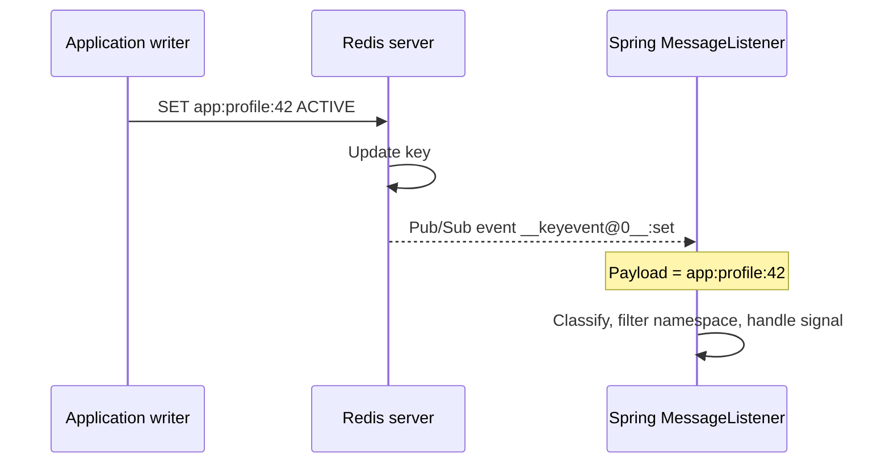

# Subscribing to key changes with Spring Data Redis

## 1. When do you need to listen for Redis key changes?

An application using Redis may want to know **when a key is created, modified, deleted, expired, or evicted**. For example:

- An instance updates its local cache when a configuration key in Redis changes.
- A metrics service tracks the number of session keys that have just expired.
- An admin tool needs to observe `SET`, `HSET`, and `DEL` operations on a group of test keys.
- An application emits signals to active components when auxiliary data changes.

Redis provides **keyspace notifications** to emit these notifications via **Redis Pub/Sub**. Spring Data Redis provides `RedisMessageListenerContainer` and `MessageListener` to subscribe to, receive, and process these notifications.

However, key notifications are meant for **observing changes**. They are not a durable changelog, do not include old/new field values by default, and do not guarantee that the application receives every event while disconnected.

Objectives of this lesson:

1. Understand the difference between a **keyspace event** and a **keyevent**.
2. Enable the right notification types in Redis using `notify-keyspace-events`.
3. Register listeners in Spring using `RedisMessageListenerContainer`.
4. Decode the channel name, key name, and operation type represented by a notification.
5. Limit the listening scope and handle notifications safely in multi-instance environments.
6. Know when to use Streams, an outbox, or reconciliation mechanisms instead of relying solely on notifications.

## 2. How do keyspace notifications work?

When Redis executes an operation belonging to an enabled event group, it can emit a Pub/Sub message. Subscribers listening to the corresponding channel receive the message almost immediately upon emission.

For example, Redis receives the command:

```redis
SET app:profile:42 "ACTIVE"
```

If configuration allows notifications for `SET` operations, Redis may emit:

```text
Keyevent channel:
  channel = __keyevent@0__:set
  message = app:profile:42

Keyspace channel:
  channel = __keyspace@0__:app:profile:42
  message = set
```

The `@0` indicates logical database 0 in the example. The two notifications refer to **the same change**, but swap the positions of the key name and the event name.

Diagram:



Notifications are **emitted by the Redis server**, without requiring the writer to call `PUBLISH` separately. Thus, a change made via `redis-cli`, a Python client, or a Java application can generate notifications as long as Redis has the corresponding event type enabled.

Conversely, an application calling `PUBLISH` on a channel with a notification-like name does not prove that any key changed; it is just a client-published Pub/Sub message.

## 3. Two channel formats: keyspace and keyevent

### 3.1. Keyspace notification

The channel name describes the **key**, and the payload is the **operation type**:

```text
Channel: __keyspace@0__:app:profile:42
Payload: set

Channel: __keyspace@0__:app:profile:43
Payload: hset

Channel: __keyspace@0__:app:profile:42
Payload: del
```

This format is especially useful if you want to listen to a specific key or namespace:

```redis
PSUBSCRIBE __keyspace@0__:app:profile:*
```

Because the key name is in the channel, Redis can filter key names at the pattern subscription step. The listener receives fewer irrelevant messages.

### 3.2. Keyevent notification

The channel name describes the **operation type**, and the payload is the **key name**:

```text
Channel: __keyevent@0__:set
Payload: app:profile:42

Channel: __keyevent@0__:hset
Payload: app:profile:43

Channel: __keyevent@0__:del
Payload: app:profile:42
```

This format is convenient when you need to track one operation type across many keys:

```redis
SUBSCRIBE __keyevent@0__:del
```

Or track multiple operation types:

```redis
PSUBSCRIBE __keyevent@0__:*
```

**Limitation to understand:** if subscribing to `__keyevent@0__:*`, Redis does not filter the payload by `app:profile:*`. The listener must check the key name in Java. When a Redis instance has heavy write traffic, choosing a narrow keyspace pattern usually reduces the number of notifications delivered to the application.

### 3.3. Comparison table

| Criterion | Keyspace | Keyevent |
| --- | --- | --- |
| Channel | `__keyspace@<db>__:<key>` | `__keyevent@<db>__:<event>` |
| Payload | Event name, such as `set` or `del` | Key name, such as `app:profile:42` |
| Filter by key prefix at subscription | Convenient with `PatternTopic` | Usually must filter payload in listener |
| Filter by operation type at subscription | Usually filter payload in listener | Convenient with `ChannelTopic` |
| Contains old/new value of the key? | No | No |
| Stores history for subscribers to re-read? | No | No |

A single change can generate both types if both flags `K` and `E` are enabled. If an application subscribes to both formats without distinguishing them, it may react twice to the same change.

## 4. Enabling notifications with `notify-keyspace-events`

Redis does not necessarily enable any keyspace notifications by default. Check the configuration:

```redis
CONFIG GET notify-keyspace-events
```

An empty string value means key notifications are not enabled. The configuration parameter is a combination of flags selecting **channel style** and **event groups**.

| Flag | Meaning |
| --- | --- |
| `K` | Emit notifications in **keyspace** format. |
| `E` | Emit notifications in **keyevent** format. |
| `$` | Event group for String-type commands, such as `SET`. |
| `h` | Hash event group, such as `HSET` and `HDEL`. |
| `g` | Generic event group, such as `DEL` and appropriate expiration metadata operations. |
| `x` | Notifications when keys actually become **expired**. |
| `e` | Notifications when keys are **evicted** due to memory policy. |
| `A` | Alias for multiple common event groups; meaningful only when combined with `K` or `E`. |

To listen for String changes, Hash changes, key deletions, and expirations on both channel styles in a test environment:

```redis
CONFIG SET notify-keyspace-events "KE$ghx"
```

Then:

- `K` allows receiving `__keyspace@0__:*`.
- `E` allows receiving `__keyevent@0__:*`.
- `$`, `h`, `g`, `x` enable the event groups to observe.

To receive only `expired` keyevents:

```redis
CONFIG SET notify-keyspace-events "Ex"
```

To observe a broad range of events in a **test environment**, you can use:

```redis
CONFIG SET notify-keyspace-events "KEA"
```

Do not use `KEA` by default in production: Redis must generate and send many more notifications, which can increase CPU, network traffic, and callback load. Select only the event groups you truly need.

### When the environment disallows `CONFIG SET`

Many managed Redis services do not allow application accounts to run `CONFIG SET`. In those cases, configure `notify-keyspace-events` via a parameter group, the provider's configuration mechanism, or server configuration managed by operations.

Spring's `RedisMessageListenerContainer` **does not automatically change `notify-keyspace-events` just because a `PatternTopic` is registered**. If Redis does not emit the corresponding event type, the listener will not receive notifications even though the Pub/Sub connection is working.

Be careful not to arbitrarily overwrite existing notification flags when multiple services share Redis. Read the configuration and coordinate with operations to preserve event groups needed by other services.

## 5. Types of key changes commonly listened to

| Command / situation | Possible event name | What to understand |
| --- | --- | --- |
| `SET key value` | `set` | String value is written; notification does not contain the new value. |
| `HSET hash field value` | `hset` | Hash is modified; you do not know by default which field or value changed from the notification. |
| `DEL key` | `del` | Key is deleted if it exists and the delete takes effect. |
| `EXPIRE key seconds` | `expire` | TTL metadata is updated; **does not mean** the key has expired immediately. |
| Key expires naturally due to TTL | `expired` | Redis actually removes the key when expiration is processed. |
| Key removed to free memory | `evicted` | Caused by eviction policy; different cause from `expired`. |

You must distinguish:

**`expire`** is a notification about **setting or changing the expiration time** of a key. **`expired`** is a notification that **the key has been deleted by Redis due to expiration**. Calling `EXPIRE` does not guarantee that an `expired` event occurs immediately.

Redis does not always emit the event at the exact moment the TTL countdown hits 0: expiration may happen when Redis accesses the key or when the active expiration cycle removes it. Therefore, do not build a second-accurate scheduler solely from `expired`.

Some commands may emit multiple notification types or change events depending on arguments and key state. For instance, an expiration operation with a non-positive duration may lead to immediate key deletion, so consult command semantics and your running Redis version. Do not treat the event list above as an exhaustive contract for every case.

## 6. Building a subscriber with `RedisMessageListenerContainer`

In Spring Data Redis, the common way to listen for notifications is to register a `MessageListener` with `RedisMessageListenerContainer`.

Components:

- `RedisConnectionFactory`: creates connections to Redis.
- `RedisMessageListenerContainer`: manages subscriptions, lifecycle, connections, and callback dispatch.
- `ChannelTopic`: subscribes to an exact channel name.
- `PatternTopic`: subscribes to channels matching a pattern.
- `MessageListener.onMessage(...)`: processes the payload and channel name.

The example below uses Spring Boot with the Spring Data Redis dependency and a Redis server with an appropriate `notify-keyspace-events` setting enabled.

### 6.1. Listener receiving keyevents and filtering prefixes in Java

```java
package com.example.redis;

import java.nio.charset.StandardCharsets;
import org.slf4j.Logger;
import org.slf4j.LoggerFactory;
import org.springframework.data.redis.connection.Message;
import org.springframework.data.redis.connection.MessageListener;
import org.springframework.stereotype.Component;

@Component
public class RedisKeyChangeListener implements MessageListener {

    private static final Logger log =
            LoggerFactory.getLogger(RedisKeyChangeListener.class);

    private static final String CHANNEL_PREFIX = "__keyevent@0__:";
    private static final String KEY_PREFIX = "app:profile:";

    @Override
    public void onMessage(Message message, byte[] pattern) {
        String channel = new String(
                message.getChannel(), StandardCharsets.UTF_8);
        String key = new String(
                message.getBody(), StandardCharsets.UTF_8);

        if (!channel.startsWith(CHANNEL_PREFIX)) {
            return;
        }
        if (!key.startsWith(KEY_PREFIX)) {
            return;
        }

        String operation = channel.substring(CHANNEL_PREFIX.length());

        switch (operation) {
            case "set", "hset", "del" -> {
                log.info("Key event={}, namespace=app:profile:", operation);
                onProfileKeyChanged(key, operation);
            }
            case "expired" -> onProfileKeyExpired(key);
            default -> {
                // Ignore event types the application does not care about.
            }
        }
    }

    private void onProfileKeyChanged(String key, String operation) {
        // Example: invalidate local cache or update a metric.
        // Handler must run fast and tolerate duplicate/lost events.
    }

    private void onProfileKeyExpired(String key) {
        // Signal that the key expired; do not expect to read back an existing key.
    }
}
```

The example uses `UTF-8` because keys are created by the application using a string convention. Redis transmits channels and payloads as bytes. If key names use another serializer, they must be decoded in the right format; a binary key is not necessarily equivalent to a UTF-8 string.

The logger logs only the event type and namespace to avoid exposing IDs, tokens, or sensitive data from key names. If business requirements call for logging detailed key names, apply an appropriate logging/sanitization policy.

### 6.2. Registering with `PatternTopic`

```java
package com.example.redis;

import org.springframework.context.annotation.Bean;
import org.springframework.context.annotation.Configuration;
import org.springframework.data.redis.connection.RedisConnectionFactory;
import org.springframework.data.redis.listener.PatternTopic;
import org.springframework.data.redis.listener.RedisMessageListenerContainer;

@Configuration
public class KeyNotificationConfiguration {

    @Bean
    public RedisMessageListenerContainer keyNotificationContainer(
            RedisConnectionFactory connectionFactory,
            RedisKeyChangeListener listener) {

        RedisMessageListenerContainer container =
                new RedisMessageListenerContainer();

        container.setConnectionFactory(connectionFactory);

        container.addMessageListener(
                listener,
                new PatternTopic("__keyevent@0__:*"));

        return container;
    }
}
```

The container registers the pattern subscription and invokes `onMessage(...)` for notifications matching the pattern. In the example, the listener filters keys with the `app:profile:` prefix itself.

Because the `__keyevent@0__:*` pattern can receive many event types across all keys in database 0, high-traffic systems should consider configuring Redis to emit only needed event groups or switching to a **prefix-based keyspace subscription**.

### 6.3. Listening only to deleted keys

If a feature only needs to know about deleted keys and does not need other events:

```java
container.addMessageListener(
        listener,
        new ChannelTopic("__keyevent@0__:del"));
```

You need to import `org.springframework.data.redis.listener.ChannelTopic`. The listener above checks the `del` event and prefix; with this configuration, the callback is invoked only from the `__keyevent@0__:del` channel.

`DEL` is not the only way keys are removed. Keys can expire or be evicted, producing `expired` or `evicted` instead. To handle keys disappearing for any reason, choose the right event groups rather than listening only to `del` and assuming it covers every way a key disappears.

## 7. Subscribing by keyspace to filter namespaces directly in Redis

When keyspace notifications are enabled (flag `K`), you can subscribe by key name pattern in the channel:

```java
container.addMessageListener(
        keyspaceListener,
        new PatternTopic("__keyspace@0__:app:profile:*"));
```

With this subscription:

```text
Channel: __keyspace@0__:app:profile:42
Body:    set

Channel: __keyspace@0__:app:profile:43
Body:    hset

Channel: __keyspace@0__:app:profile:42
Body:    del
```

The listener must decode the reverse of keyevent: the channel contains the key name, and the body contains the operation.

```java
package com.example.redis;

import java.nio.charset.StandardCharsets;
import org.springframework.data.redis.connection.Message;
import org.springframework.data.redis.connection.MessageListener;
import org.springframework.stereotype.Component;

@Component
public class ProfileKeyspaceListener implements MessageListener {

    private static final String CHANNEL_PREFIX =
            "__keyspace@0__:app:profile:";

    @Override
    public void onMessage(Message message, byte[] pattern) {
        String channel = new String(
                message.getChannel(), StandardCharsets.UTF_8);
        String operation = new String(
                message.getBody(), StandardCharsets.UTF_8);

        if (!channel.startsWith(CHANNEL_PREFIX)) {
            return;
        }

        String profileId = channel.substring(CHANNEL_PREFIX.length());

        if ("set".equals(operation) || "hset".equals(operation)) {
            // Handle update signal for the key corresponding to profileId.
        } else if ("del".equals(operation) || "expired".equals(operation)) {
            // Handle signal that the key no longer exists.
        }
    }
}
```

This is a convenient approach if the program only cares about `app:profile:*`. Do not reuse the same listener that decodes payloads in keyevent style when the subscription is keyspace: the two formats place different data in channel and body.

A `PatternTopic` can use globs like `*`, but it is a channel name filter, not a SQL query or a value filter inside a Redis Hash. If there are multiple tenants or keys belonging to different security groups, do not treat patterns at the listener level as an access-control mechanism.

## 8. How keyspace notifications differ from custom business Pub/Sub

Both use Redis Pub/Sub, but the **source and meaning of the message** are different:

| Criterion | Keyspace notifications | Business Pub/Sub |
| --- | --- | --- |
| Emission source | Emitted automatically by the Redis server when executing an enabled operation | Application calls `PUBLISH` or `convertAndSend(...)` |
| Channel | System convention `__keyspace@...__:*`, `__keyevent@...__:*` | Application-defined name such as `orders.created` |
| Payload | Key name or event type | Content designed by the publisher, e.g., JSON |
| Has before/after values? | Not automatically | Possible if the application explicitly includes them |
| Stores history? | No | No with standard Pub/Sub |
| Meaning | Notification of a Redis change that executed | A signal/event emitted by the application |

Spring example:

```java
stringRedisTemplate.opsForValue().set(
        "app:profile:42",
        "ACTIVE");
```

When Redis enables appropriate notifications, this operation can automatically generate `__keyevent@0__:set`.

Conversely:

```java
stringRedisTemplate.convertAndSend(
        "profile.changed",
        "{\"profileId\":\"42\"}");
```

This is business Pub/Sub. It **does not modify the key `app:profile:42`**, nor does it prove that a `SET` or `HSET` occurred.

Depending on the design, an application can use both: keyspace events to observe actual storage changes, and business events to carry richer semantics. Do not build a critical business protocol based on parsing every Redis command event.

## 9. What limitations does the received data have?

A notification such as:

```text
channel = __keyevent@0__:hset
body    = app:profile:42
```

only proves that Redis emitted an `hset` notification for the stated key. It **does not contain**:

- Which Hash field was updated.
- The value before the update.
- The value after the update.
- Who ran the command, request ID, or business metadata.
- Which SQL transaction committed.
- How many prior events were missed by the subscriber.

### Re-reading state with RedisTemplate may yield a different result

For example, a listener receives `set` and then reads:

```java
String currentValue = stringRedisTemplate
        .opsForValue()
        .get("app:profile:42");
```

Between when Redis emits the event and when the listener reads, another client may have called `SET` again or `DEL`. The listener receives a signal about a change but reads the **latest state at the time of the read**, not necessarily the exact state right after the initial event.

For `expired` or `del` events, the key may already be deleted. Reading with `GET` will return `null`, unless a client has recreated a key with the same name.

Therefore:

- To know **which key changed**, notifications can be useful.
- To know the **exact old → new change**, design a business event with a complete payload or a durable changelog source.
- To react based on **current state**, use the notification as a signal and then re-read, with concurrency handling.

## 10. Subscribing to expired keys with Spring

A special case of key notifications is the `expired` event. You can subscribe directly:

```java
container.addMessageListener(
        expirationListener,
        new ChannelTopic("__keyevent@0__:expired"));
```

Redis must enable `Ex` or a compatible flag combination. The body is the expired key name:

```text
channel = __keyevent@0__:expired
body    = app:session:s-101
```

For Redis Repository with entities having a TTL, Spring Data Redis also provides dedicated components, such as `KeyExpirationEventMessageListener`, and can publish `RedisKeyExpiredEvent` through the repository listener mechanism.

Example repository configuration concerned with expiration events:

```java
@Configuration
@EnableRedisRepositories(
        basePackages = "com.example.session",
        enableKeyspaceEvents =
                RedisKeyValueAdapter.EnableKeyspaceEvents.ON_STARTUP,
        shadowCopy = RedisKeyValueAdapter.ShadowCopy.OFF)
public class SessionRepositoryConfiguration {
}
```

The corresponding imports are `org.springframework.data.redis.repository.configuration.EnableRedisRepositories` and `org.springframework.data.redis.core.RedisKeyValueAdapter`.

In this configuration, the repository event listener can emit `RedisKeyExpiredEvent` when it receives a notification; `shadowCopy = OFF` avoids creating auxiliary entity copies for the payload. Without a copy, the event mainly carries identifying information rather than the full expired entity.

**Do not confuse the two flows**:

1. Custom `RedisMessageListenerContainer` as in the beginning of the lesson: listens to the event channels you register, without requiring Redis Repository entities.
2. TTL Repository listener: targets metadata/entities managed by Redis Repository, with additional lifecycle and shadow copy options.

Both depend on Redis keyspace notifications and an active connection; do not register two handlers that perform the same side effect without controlling duplicate processing.

### Managed Redis service configuration

When Redis does not allow the application to change `notify-keyspace-events` via `CONFIG`, for the **repository listener** you can instruct Spring Data Redis not to reconfigure the parameter automatically:

```java
@EnableRedisRepositories(
        enableKeyspaceEvents =
                RedisKeyValueAdapter.EnableKeyspaceEvents.ON_STARTUP,
        keyspaceNotificationsConfigParameter = "")
```

This empty configuration **only prevents the repository listener's auto-configuration attempt**; it does not enable events on Redis. Operators still must enable the appropriate flags from the Redis management system.

## 11. Database scope, Redis Cluster, and multiple instances

### 11.1. Logical database appears in the channel name

`__keyevent@0__:set` and `__keyevent@1__:set` are two different channels corresponding to database 0 and database 1.

If the application uses logical database 2 while the listener subscribes only to `__keyevent@0__:*`, the listener will not see events from database 2.

In Redis Cluster, typically only database 0 is used, but that **does not mean a subscription to one node automatically sees all keyspace events across all nodes**. Notifications are emitted at the node owning/executing the operation; when using a cluster, evaluate how events are received from relevant nodes and configure listeners according to the actual topology.

### 11.2. Multiple subscribed applications can receive the same event

If two Spring Boot instances both subscribe to `__keyevent@0__:del`:

```text
Redis emits keyevent del
       |
       +--> Instance A receives
       |
       +--> Instance B receives
```

This is **broadcast**, not a work-distribution queue. If both instances invalidate their own local cache, that matches the goal. However, if both send an email, update an invoice, or perform a non-repeatable side effect, that design is unsafe.

### 11.3. Reconnecting subscribers do not receive history

Redis keyspace notifications rely on Pub/Sub. When an application stops, restarts, or loses its connection, events emitted during that period are not queued for catch-up reading.

Missed changes can cause local caches to drift out of sync. Therefore, if using notifications for cache invalidation, keep a TTL on the local cache or use a periodic reconciliation/refresh mechanism.

## 12. Performance, access control, and subscriber protection

### 12.1. Cost of enabling many events

When notification flags are enabled, Redis must perform an extra step to construct and emit notifications for matching operations. If the application writes tens of thousands of keys per second, event volume can be substantial.

Some guidelines:

1. Enable only the event groups needed, e.g., `E$ghx` instead of all.
2. If interested in one prefix, consider a **keyspace pattern** to filter at subscription time.
3. Keep callbacks short; do not make slow HTTP calls or run heavy data processing directly on the notification-receiving thread.
4. Monitor received message rates, handler errors, callback duration, and listener connection status.
5. Do not use `KEYS *` for bulk checks in production; if reconciliation is needed, use bounded `SCAN`.

### 12.2. Redis ACL and connections

The Redis user used for subscribing needs connection permissions, `SUBSCRIBE` or `PSUBSCRIBE` depending on registration style, and permissions on the corresponding channels under Redis ACL policies. This user **does not necessarily need `PUBLISH` permission** because keyspace notifications are emitted by the Redis server.

If the listener also performs `GET`/`HGETALL` to read current state, the connection executing those reads needs the corresponding command and key pattern permissions.

Do not grant runtime accounts `CONFIG SET` or `+@all` just to enable notifications. Server configuration should remain under operations control, while the service should only have permissions required to read subscriptions.

Key names in notifications may contain IDs or sensitive information according to key naming conventions. Restrict subscribe permissions, use encrypted connections where appropriate, and control logging.

### 12.3. Listener error handling

Java callbacks can throw exceptions due to invalid payloads or external errors. `RedisMessageListenerContainer` supports configuring an error handler:

```java
container.setErrorHandler(error ->
        log.error("Redis key notification listener failed", error));
```

`log` in the example is an existing logger in the configuration class. An error handler helps observe errors; **it does not make Redis redeliver the message that failed processing**.

If heavy processing is required, forward the signal to a controlled processing mechanism. Merely moving a message from Pub/Sub to an in-callback queue without additional durable data also does not solve the case where the listener was offline before receiving it.

## 13. Hands-on with keyevent and keyspace

Practice on a test Redis instance, using the `demo:notify:*` namespace to avoid affecting other data.

### Step 1 — Check and enable configuration

```redis
CONFIG GET notify-keyspace-events
CONFIG SET notify-keyspace-events "KE$ghx"
```

If the application does not have `CONFIG` permissions, ask the administration system to configure it beforehand. Do not overwrite notification settings on a shared Redis instance.

### Step 2 — Subscribe to keyevent

In a `redis-cli` window:

```redis
PSUBSCRIBE __keyevent@0__:*
```

Keep this terminal open.

### Step 3 — Perform operations on test keys

In another terminal, on the same Redis instance and database 0:

```redis
SET demo:notify:status ACTIVE
HSET demo:notify:profile:42 name An
DEL demo:notify:status
SET demo:notify:short lived EX 3
```

Observe events on the subscriber such as `set`, `hset`, `del`, and later `expired` for `demo:notify:short` when Redis actually expires and removes the key.

### Step 4 — Subscribe to keyspace by prefix

In a third terminal:

```redis
PSUBSCRIBE __keyspace@0__:demo:notify:*
```

Run additional commands:

```redis
SET demo:notify:status AGAIN
HSET demo:notify:profile:42 name Binh
DEL demo:notify:profile:42
```

In the keyspace subscriber, **the channel is the key name**, while the payload consists of words such as `set`, `hset`, and `del`. Compare directly with the keyevent subscriber to see how they represent the same change in two ways.

### Step 5 — Run the Spring listener

Start the application containing `KeyNotificationConfiguration` and `RedisKeyChangeListener`. Run a `SET` or `DEL` on a key prefixed with `app:profile:` to see the callback receive the notification.

If using the `demo:notify:` namespace in the exercise, change `KEY_PREFIX` in the sample listener to `demo:notify:` before running. The two examples intentionally use different prefixes to distinguish the application model from test data.

Do not conclude from a single run with no logs that Redis is not emitting notifications: check server flags, logical database, registered topics, connection factory, and when the container starts subscribing.

## 14. Verifying the listener in Spring integration tests

An integration test can write a test key after the listener has subscribed, then wait briefly to confirm the callback receives the expected channel and payload.

Example behavioral outline to test:

```text
Given:
  Test Redis has E$ enabled (SET keyevent).
  Spring RedisMessageListenerContainer has started.
  Listener has completed subscribing to __keyevent@0__:set.

When:
  StringRedisTemplate SET demo:notify:status "ON".

Then:
  Listener receives channel __keyevent@0__:set.
  Payload is demo:notify:status.
```

There are two reasons integration tests easily become flaky:

1. The listener container has an asynchronous lifecycle. If `SET` is called **before the subscription is ready**, the event is missed and the test fails even though the configuration is right.
2. Redis Pub/Sub does not replay messages. "Waiting longer" cannot rescue an event emitted before subscribing.

Therefore, tests need a mechanism to verify that the listener has subscribed successfully—for example, a lifecycle synchronization or subscription readiness step in the test environment—before writing the key. Use `CountDownLatch` or an event-waiting utility with a timeout to avoid hanging tests; avoid excessively long fixed delays.

If the test runs on Redis Cluster, determine which node the key belongs to and verify the listener is subscribed to the right topology. On standalone Redis, avoid assuming every test has an empty database if multiple tests run in parallel against the same instance.

## 15. When notifications are not received: diagnostics

| Symptom | Common cause | How to check |
| --- | --- | --- |
| Subscriber connected but no events | `notify-keyspace-events` is empty or missing flags | Run `CONFIG GET notify-keyspace-events` using an operator identity |
| Receives `set` but not `expired` | `x` not enabled, key has not truly expired, or was deleted by another cause | Check TTL and flag groups; wait for Redis to process expiration |
| Listener listens only on `@0` but key is in another DB | Wrong logical database in channel | Compare writer's database and topic name |
| Receives keyevent but code parses as keyspace | Swapped channel/body | Check `__keyevent@...` prefix and payload |
| `NOPERM` on subscribe | Missing `SUBSCRIBE`/`PSUBSCRIBE` or channel permission | Check Redis ACL |
| `NOPERM` on CONFIG | Service does not grant permission to change Redis config | Configure via operations tooling; do not add admin permissions to app |
| Missing events for some keys in Cluster | Listener is not observing the node emitting notifications | Inspect cluster topology and per-node subscribe strategy |
| Callback has no logs when app restarts | Event emitted while listener was not subscribed | Design a state re-synchronization mechanism |
| Callback runs multiple times | Multiple listeners, overlapping subscriptions, or multiple instances subscribed | Inspect topic list, topology, and idempotency |
| Handler re-reads but key is gone | Event happened before read; key expired/deleted or changed further | Accept current state; do not assume payload carries a snapshot |
| CPU and network traffic rise after enabling notifications | Too many event groups enabled or subscription too broad | Narrow flags and patterns; monitor metrics |

When you need to observe messages being emitted, you can use `redis-cli PSUBSCRIBE` on a test Redis instance. Do not run `MONITOR` continuously in production: `MONITOR` can cause heavy load and expose data from Redis commands.

## 16. When should you not rely solely on keyspace notifications?

Keyspace notifications are suitable for **supplementary signals**, such as:

- Waking up an observer task or invalidation with a recovery path.
- Tracking expired key counts for near-real-time statistics.
- Best-effort local cache synchronization, backed by TTL for self-healing.
- Updating UI while connected, accepting a fresh snapshot on reconnect.

They are **not suitable as the sole source of truth** when:

- Every key change must be fully audited.
- Every event must be processed and retried when consumers are offline.
- You need the exact Hash field that changed and before/after values.
- Expiration events must trigger a payment obligation, permission revocation, or mandatory timely workflow.
- Business logic requires total order or exactly-once across multiple instances.

Complementary approaches:

| Requirement | Mechanism to consider |
| --- | --- |
| Notifications may be missed but drift must self-correct | Local cache TTL and periodic reconciliation job |
| Need to store and replay events | Redis Streams or a durable message broker |
| Database change and event emission must be recoverable | Transactional outbox within the same database transaction |
| Need exact changed fields/values | Complete business event payload or application-written changelog |
| Need to run work at a specific deadline with retries | Durable scheduler/queue with state and idempotency |

For example, if the requirement is "when a session expires, revoke permissions in another service," listening only to `expired` can miss events during application downtime. You must design TTL as a signal and use an authoritative data source/authorization logic that can self-verify, paired with a reconciliation job when needed.

## 17. Common misconceptions

**"Just registering a `PatternTopic` makes Redis automatically enable all notifications."**  
No. Redis must have the appropriate `notify-keyspace-events` flags enabled beforehand.

**"Keyspace and keyevent are two different kinds of changes."**  
No. They are two **notification formats** that can be emitted for the same operation: one puts the key name in the channel, and the other puts the operation name in the channel.

**"An `hset` notification tells which Hash field changed."**  
No. Standard notifications carry only the key name or event type. You need another data source if you want the changed field or value.

**"Calling `EXPIRE` guarantees receiving `expired` immediately."**  
No. Setting a TTL is different from the key being removed due to TTL; actual deletion timing may come later.

**"If `redis-cli GET` still returns data, the event did not happen."**  
Not necessarily. After a `set` event, the current value may already differ from the value at event time; after a `del` event, the key may also have been recreated.

**"One listener receiving an event means every instance received it."**  
No. Each instance needs an active subscription and reachability to the right Redis node/channel; Pub/Sub provides no guarantees when offline.

**"Keyspace notifications replace an audit log."**  
No. Pub/Sub stores no history, has no ACK, and has no replay.

## 18. Self-check questions

1. For `SET app:profile:42 ACTIVE`, how do the payloads of `__keyspace@0__:app:profile:42` and `__keyevent@0__:set` differ?
2. Why does a listener using `PatternTopic("__keyevent@0__:*")` typically have to filter key name prefixes itself, while `PatternTopic("__keyspace@0__:app:profile:*")` can filter via the channel name?
3. What do the `K` and `E` flags in `notify-keyspace-events` mean?
4. Why must `expire` and `expired` not be treated as the same event?
5. When a Spring listener receives `hset` and then reads back the Hash, can it be sure that is the value immediately after the `HSET` operation that produced the notification?
6. Why do `RedisMessageListenerContainer` and `@EnableRedisRepositories(enableKeyspaceEvents=...)` serve different listening paths?
7. If the application is offline while Redis emits notifications, how can state be recovered?
8. When a Redis Cluster has multiple primary nodes, what must be checked before concluding one listener watches all keys?
9. Why should `CONFIG SET` permissions not be granted to all application accounts just to use notifications?
10. When every event must be processed with ACK/retry, why are Redis Streams or an outbox better suited than keyspace notifications?

**Takeaway:** Subscribing to Redis key changes in Spring Data Redis usually consists of **enabling `notify-keyspace-events` in Redis**, **subscribing to a `ChannelTopic` or `PatternTopic` via `RedisMessageListenerContainer`**, and **decoding `MessageListener.onMessage(...)` correctly for keyspace or keyevent format**. This is an instantaneous Pub/Sub mechanism, useful for observing and signaling, but it does not replace a durable event storage system.

## References

- [Redis — Keyspace Notifications](https://redis.io/docs/latest/develop/pubsub/keyspace-notifications/): `__keyspace`/`__keyevent` format, `notify-keyspace-events`, and event groups.
- [Redis — Pub/Sub](https://redis.io/docs/latest/develop/pubsub/): broadcast characteristics and at-most-once delivery.
- [Spring Data Redis — Pub/Sub Messaging](https://docs.spring.io/spring-data/redis/reference/redis/pubsub.html): `MessageListener` and `RedisMessageListenerContainer`.
- [Spring Data Redis — RedisMessageListenerContainer API](https://docs.spring.io/spring-data/redis/docs/current/api/org/springframework/data/redis/listener/RedisMessageListenerContainer.html): listener registration and container lifecycle.
- [Spring Data Redis — Time To Live](https://docs.spring.io/spring-data/redis/reference/redis/redis-repositories/expirations.html): expired entity listeners, `RedisKeyExpiredEvent`, and shadow copies.
