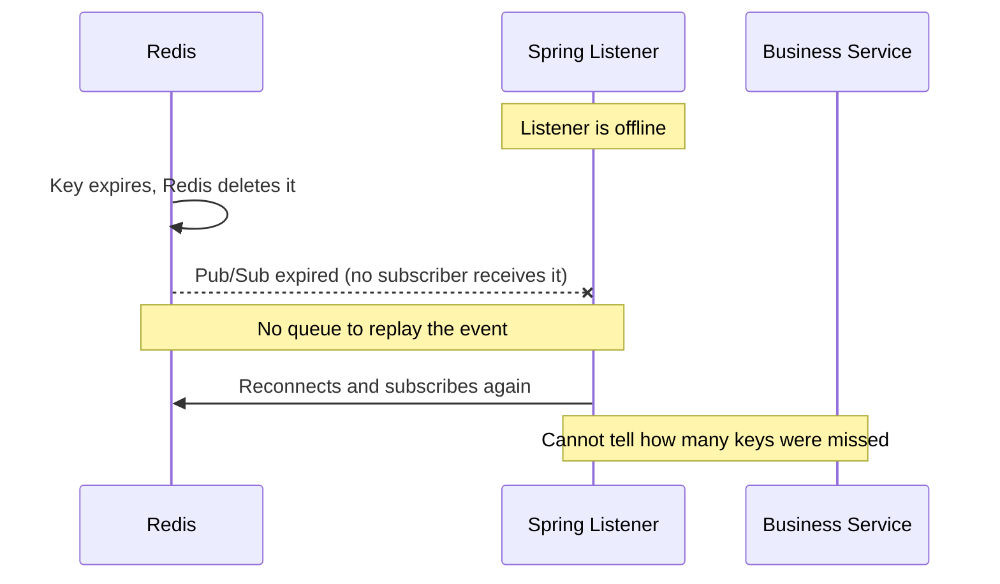
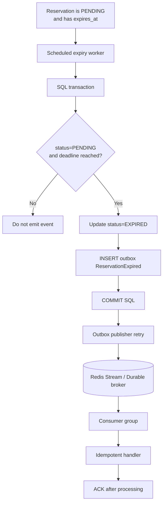

# Distinguishing infrastructure key events from reliable business events

In applications using **Spring Data Redis**, creating, modifying, deleting, or expiring a key can produce **Redis keyspace notifications**. Spring can listen to those notifications to record cache activity, clean up auxiliary resources, or update observability metrics. However, an `expired` event for a Redis key **does not mean** a business event such as `PaymentExpired`, `ReservationCancelled`, or `OrderClosed` has reliably occurred.

This is a critical architectural boundary. Key notifications belong to the **storage infrastructure** layer; business events, by contrast, must represent **a meaningful state transition within the domain**, with appropriate identifiers, payloads, and recovery mechanisms. If you use keyspace notifications as a mandatory work queue, the application can miss notifications whenever listeners are stopped, disconnected, or Redis changes roles.

This lesson clarifies the guarantee scope of Redis keyspace notifications, how to receive events in Spring Data Redis, where they are useful, and how to build a business event pipeline capable of retries, reconciliation, and deduplication.

## 1. Two kinds of events serve two different purposes

Suppose a ticketing application temporarily holds a seat for 10 minutes:

```text
reservation:r-101   -> Redis key with 600-second TTL
Reservation r-101   -> Business record, status PENDING
```

When Redis emits a notification that `reservation:r-101` has expired, what we know is that **Redis deleted the key due to expiration**, at a moment when Redis performed the deletion. We **do not know for sure**:

- Whether the ticket reservation actually transitioned from `PENDING` to `EXPIRED`.
- Whether the user paid in time, or another process extended the hold.
- Whether the payment system, primary database, and notification service are in consistent state.
- Whether any listener actually received the notification.

The differences:

| Aspect | Infrastructure key event | Reliable business event |
| --- | --- | --- |
| Examples | Redis `expired`, `del`, `set`, `evicted` | `ReservationExpired`, `PaymentCaptured`, `OrderCancelled` |
| Origin | Redis key operation or lifecycle | Business rule and application-confirmed state transition |
| Identifiers | Usually the key name and command/event type | `eventId`, `aggregateId`, event type, version, or timestamp |
| Payload | Keyspace notifications typically lack full business data | Has a schema contract and data needed by downstream consumers |
| Retention for replay | No: Pub/Sub does not store notification history | Requires a persistent event log/outbox/broker |
| Consumption acknowledgment | No `ACK` for keyspace notifications | Can have `XACK`, consumer offset, or target processing state |
| When listener disconnects | Events can be permanently lost | Has retry/replay/reconciliation paths if supported by architecture |
| Use as source of truth for business logic | **Should not** | Possible, when tied to state transitions and consistency protocols |

A key may exist for **access-speed optimization**, while business data lives in another system. Redis deleting a cache key does not mean the business entity was deleted from the primary database.

## 2. How do Redis keyspace notifications work?

Redis can publish notifications via **Pub/Sub** when key-related events occur. By default, keyspace notifications are usually disabled because they carry execution overhead; `notify-keyspace-events` must be set appropriately.

Two basic channel formats:

| Notification type | Example channel | Message content |
| --- | --- | --- |
| **Key-space notification** | `__keyspace@0__:session:abc` | Event name, e.g., `expired` |
| **Key-event notification** | `__keyevent@0__:expired` | Key name, e.g., `session:abc` |

Here `0` is Redis logical database 0. If another database is used, the channel name changes accordingly; in Redis Cluster, logical databases are typically restricted to database 0.

The `expired` event is a **notification that the key was deleted by Redis due to expiration**, not a scheduled notification guaranteed to run right when TTL reaches 0.

### 2.1. Enabling key notifications in Redis

For example, in a development environment, enable **key-event notifications for expiration**:

```redis
CONFIG SET notify-keyspace-events Ex
```

Character meanings:

- `E`: emit notifications on channels formatted `__keyevent@<db>__:<event>`.
- `x`: include `expired` events when keys expire.

Check:

```redis
CONFIG GET notify-keyspace-events
```

To receive key-space channel format instead of key-event, use the configuration group with `K` (e.g., `Kx`). The `A` character is a broad event group, but **does not replace the requirement to enable `K` or `E`** to select the channel style. Enable only the groups you truly need to observe to limit overhead and noise.

On managed Redis services, `CONFIG SET` may be blocked. In those cases, use the provider's configuration mechanism rather than expecting the Java application to have permission to alter server config.

### 2.2. Observing with Redis CLI

Open terminal A:

```redis
PSUBSCRIBE __keyevent@0__:expired
```

In terminal B:

```redis
SET session:demo "active" EX 3
```

After the key actually expires and is deleted by Redis, terminal A **may** see:

```text
channel: __keyevent@0__:expired
message: session:demo
```

The notification arrives when expiration processing runs. Do not use this example to infer Redis always emits notifications after exactly 3,000 milliseconds.

Compare with direct deletion:

```redis
SET session:manual "active"
DEL session:manual
```

`DEL` produces a key-deletion event group, **not `expired`**. Likewise, `evicted` describes keys removed by Redis under memory-limit policies, not TTL expiration. A key can disappear for many reasons; do not lump every case into a single "expired" business event.

## 3. TTL expiration time is not an exact schedule

Redis tracks TTL by a key's expiration timestamp and has two primary paths for removing expired keys:

1. **Passive expiration:** a command accessing the key detects it is overdue and deletes it.
2. **Active expiration:** Redis proactively checks and removes expired keys via an internal mechanism.

Therefore, when a key has a 600-second TTL, Redis **does not guarantee** sending the `expired` event at the exact 600th second's millisecond. If the application depends on work that must be triggered at an exact time, using keyspace notifications as a business scheduler is inappropriate.

Example:

```text
12:00:00  SET reservation:r-101 ... EX 600
12:10:00  Expected deadline reached
12:10:01  Redis may delete key during expiration scan
12:10:01  If notifications enabled, Redis publishes expired event
12:10:02  Listener may receive it, if connected
```

The timing between deadline, key deletion, and listener handling can all vary. That is why **TTL is well suited for automatic data cleanup**, not a guaranteed schedule for completing business operations.

## 4. Delivery guarantee limits of Redis Pub/Sub

Keyspace notifications are transported over **Redis Pub/Sub**. This leads to several characteristics to keep in mind:

| Situation | Consequence |
| --- | --- |
| Listener has not started yet | Does not receive notifications emitted before subscribing |
| Listener loses network for a few seconds | Events occurring during the outage can be lost |
| Application restarts | No message store exists to replay old notifications automatically |
| Consumer errors after receiving | Redis Pub/Sub keeps no PEL or ACK mechanism for retries |
| Multiple instances subscribe | Every subscriber can receive the event independently; does not distribute work like a consumer group |
| Redis failover/restart | Notifications can be missed; no keyspace event log exists to replay after failover |
| Redis Cluster | Keyspace notifications are node-dependent; requires topology-aware configuration and subscriptions |

Thus, keyspace notifications are **best effort**, not an *at-least-once* delivery guarantee. A listener may receive **0 events** for a change that happened if it was temporarily absent.

Even when a listener receives a notification, that does not by itself provide **exactly-once processing**: the program can crash, re-run, or have multiple instances execute the handler simultaneously. Critical systems still need durable processing state and idempotency.



A design relying solely on the `onMessage(...)` callback to cancel orders or collect payments creates an **unrecoverable gap** across any disconnection window.

## 5. Receiving keyspace notifications with Spring Data Redis

In Spring Data Redis, `RedisMessageListenerContainer` manages subscriptions to Redis Pub/Sub and dispatches messages to `MessageListener` instances.

### 5.1. Dependencies and connection

With Spring Boot 3.x:

```groovy
// build.gradle
dependencies {
    implementation 'org.springframework.boot:spring-boot-starter-data-redis'
}
```

Example local Redis on development machine:

```yaml
# application.yml
spring:
  data:
    redis:
      host: localhost
      port: 6379
```

Enable expired key-events on the Redis Server with `notify-keyspace-events Ex` before testing the listener. Boot's Redis connection properties **do not automatically ensure** the Redis Server has keyspace notifications enabled.

### 5.2. Example listener used only for observation

Create a service that counts notifications received **within the process lifetime**, without using this count as a source of truth:

```java
package com.example.shop.redis;

import java.util.concurrent.atomic.AtomicLong;
import org.springframework.stereotype.Component;

@Component
public class RedisExpiryObserver {

    private final AtomicLong observedSessions = new AtomicLong();

    public void observeExpiredKey(String key) {
        // Redis key is infrastructure info, not a business event.
        if (key.startsWith("session:")) {
            observedSessions.incrementAndGet();
        }
    }

    public long getObservedSessions() {
        // Only the count of events observed by this instance.
        return observedSessions.get();
    }
}
```

Registering the container listening on database 0:

```java
package com.example.shop.redis;

import java.nio.charset.StandardCharsets;
import org.springframework.context.annotation.Bean;
import org.springframework.context.annotation.Configuration;
import org.springframework.data.redis.connection.RedisConnectionFactory;
import org.springframework.data.redis.connection.MessageListener;
import org.springframework.data.redis.listener.PatternTopic;
import org.springframework.data.redis.listener.RedisMessageListenerContainer;

@Configuration
public class RedisKeyEventConfiguration {

    @Bean
    public RedisMessageListenerContainer expiredKeyListenerContainer(
            RedisConnectionFactory connectionFactory,
            RedisExpiryObserver observer) {

        RedisMessageListenerContainer container =
                new RedisMessageListenerContainer();
        container.setConnectionFactory(connectionFactory);

        MessageListener listener = (message, pattern) -> {
            String key = new String(
                    message.getBody(), StandardCharsets.UTF_8);
            observer.observeExpiredKey(key);
        };

        container.addMessageListener(
                listener, new PatternTopic("__keyevent@0__:expired"));
        return container;
    }
}
```

`message.getBody()` contains the key name when subscribing in key-event format for `expired`. This snippet assumes keys are encoded as UTF-8, which fits if the application uses `StringRedisTemplate`. If keys are created with binary serializers, do not automatically decode them as UTF-8 strings.

**Limitation of the example:** the `AtomicLong` counter only tallies notifications the current instance observed. It resets on restart and does not reflect the actual number of expired keys. If running three instances, each instance can have a different counter, or even receive the same event simultaneously.

### 5.3. What not to do inside the callback

Do not place tasks that must succeed directly inside a Pub/Sub callback:

```java
// Unsuitable design for mandatory business logic:
MessageListener listener = (message, pattern) -> {
    paymentService.refundReservation(...);
    orderService.cancelOrder(...);
    emailService.sendCancellation(...);
};
```

If Redis published while the instance was not listening, the operations above never run. If the callback throws an exception, Pub/Sub has no automatic ACK/replay for that notification. Furthermore, slow handlers can back up message consumption and increase resource pressure.

Instead, listeners should perform **non-critical work for correctness**, such as recording metrics, logging sanitized data, or waking up a reconciliation job that can also run independently.

## 6. Redis Repository and `RedisKeyExpiredEvent`

Spring Data Redis Repository supports TTL for aggregates annotated with `@RedisHash`, for example:

```java
package com.example.shop.redis;

import org.springframework.data.annotation.Id;
import org.springframework.data.redis.core.RedisHash;

@RedisHash(value = "temporary-sessions", timeToLive = 900)
public class TemporarySession {

    @Id
    private String id;

    private String ownerId;

    public TemporarySession() {
    }

    public TemporarySession(String id, String ownerId) {
        this.id = id;
        this.ownerId = ownerId;
    }

    public String getId() {
        return id;
    }

    public void setId(String id) {
        this.id = id;
    }

    public String getOwnerId() {
        return ownerId;
    }

    public void setOwnerId(String ownerId) {
        this.ownerId = ownerId;
    }
}
```

The repository can use Redis keyspace notifications to emit `RedisKeyExpiredEvent` at the Spring layer when the aggregate expires. Example enabling the listener at application startup:

```java
package com.example.shop.redis;

import org.springframework.context.annotation.Configuration;
import org.springframework.data.redis.core.RedisKeyValueAdapter.EnableKeyspaceEvents;
import org.springframework.data.redis.repository.configuration.EnableRedisRepositories;

@Configuration
@EnableRedisRepositories(
    basePackageClasses = TemporarySessionRepository.class,
    enableKeyspaceEvents = EnableKeyspaceEvents.ON_STARTUP
)
public class SessionRepositoryConfiguration {
}
```

In the example, `TemporarySessionRepository` is a `CrudRepository<TemporarySession, String>` interface defined in the project.

Depending on version and configuration, the repository uses a **shadow copy** (also called phantom copy) mechanism, retaining a temporary copy for a period after the primary key expires to populate the payload of `RedisKeyExpiredEvent`. That mechanism incurs extra memory cost; if disabled or if the copy is gone, the event may not contain enough of the aggregate for arbitrary processing.

Points to remember:

- `RedisKeyExpiredEvent` is triggered based on **Redis notifications**, so it carries the same Pub/Sub limitations.
- `enableKeyspaceEvents = ON_STARTUP` initializes the listener mechanism earlier, but **does not make Redis events durable events**.
- If the listener starts only on demand (`ON_DEMAND`), keys expiring before the listener is registered may go unobserved.
- If managed Redis disallows calling `CONFIG SET`, you may need to set `keyspaceNotificationsConfigParameter = ""` and enable keyspace notifications externally. An empty string only stops the framework from modifying the config; it **does not enable the feature on the Redis Server**.
- Repositories may rely on notifications to clean up secondary indexes tied to expired keys. If notifications are lost, metadata/indexes risk incomplete cleanup; appropriate operational policies are required.

Therefore, this event can be useful for **cleanup or observation**, but should not be used alone as a mandatory command to emit `PaymentRefunded` or `OrderCancelled`.

## 7. Expired, deleted, and evicted do not share the same meaning

Keys can disappear from Redis through several mechanisms:

| Cause | Example | Related event group | Is business state guaranteed expired? |
| --- | --- | --- | --- |
| TTL elapsed | `SET k v EX 60`, Redis deletes when overdue | `expired` | No, only certain the key expired and was deleted |
| Active deletion | `DEL k` or `UNLINK k` | Corresponding deletion event | No, could be proactive invalidation |
| Memory eviction | Redis needs to free memory per `maxmemory-policy` | `evicted` | No, can happen before the deadline |
| Key replacement | `SET k newValue` | Write operation event group | No, record may still exist with another value |
| `FLUSHDB`/`FLUSHALL` | Administrative data wipe | Not equivalent to per-key `expired` list | No |

Do not build rules such as:

```text
If expired received -> cancel order
If expired not received -> order is still active
```

Both statements can be false. Infrastructure notifications lack sufficient context to validate business rules and cannot guarantee complete observation.

### An easy-to-confuse case: the Redis key is a copy of SQL data

Suppose SQL contains:

```text
reservations(id=r-101, status=CONFIRMED, expires_at=12:10)
```

Redis key `reservation:r-101` is used to cache state and expires. If a listener inspects the key name and emits `ReservationExpired`, it may emit a false event because the reservation was already paid and confirmed. The **business data source** must be checked or updated with state conditions, never inferred from cache key lifecycles.

## 8. What does a reliable business event need?

A business event should clearly answer:

1. **What happened?** For example `ReservationExpired`, not `redis-key-expired`.
2. **Who/what did it happen to?** `reservationId`, `tenantId`, or aggregate ID.
3. **Does the event have a stable identifier?** `eventId` for deduplication across retries.
4. **Is there a versioned schema?** So consumers know how to decode when the publisher evolves.
5. **When did the state actually transition?** `occurredAt` or `stateVersion`.
6. **Is there a way to replay after a crash?** Outbox, durable log, or broker with appropriate retention.
7. **Are there processing acknowledgment rules?** ACK/offset and consumer-side idempotency.

Example payload independent of Redis key names:

```json
{
  "eventId": "evt-reservation-r-101-expired",
  "eventType": "ReservationExpired",
  "schemaVersion": 1,
  "aggregateId": "r-101",
  "aggregateVersion": 7,
  "occurredAt": "2030-05-01T12:10:03Z",
  "reason": "DEADLINE_REACHED"
}
```

`eventId` must be generated/recorded consistently with the state transition so it can be reused when the publisher retries. The same business event **should not generate a new eventId** on each resend, because that makes deduplication difficult.

Event reliability does not come merely from JSON formatting or field naming. It comes from **the protocol for writing state, persisting events, and handling errors**.

## 9. Architecture pattern: authoritative deadline + transactional outbox

For business workflows that must expire reliably, such as seat reservations, a clear design is:

1. Store `status` and `expires_at` in a suitably durable data source, such as PostgreSQL.
2. A periodic worker locates overdue `PENDING` records.
3. The worker transitions status from `PENDING` to `EXPIRED` conditionally inside **the database itself**; if status already moved to `CONFIRMED`, the operation does nothing.
4. In the **same SQL transaction**, insert a record into an outbox table with `eventId`.
5. A publisher reads the outbox, sends the event to Redis Streams or a broker, and marks it published.
6. Consumers process idempotently and acknowledge after side effects complete.



If the worker dies before SQL commit, both the state change and the outbox row roll back. Another worker can re-scan the record. If the worker dies **after commit**, the outbox row already exists for the publisher to send. If the publisher finishes sending but dies before marking the outbox row published, the event may be sent twice; consumers must recognize `eventId`.

This is the *at-least-once with idempotent consumers* pattern, not a promise of **end-to-end exactly-once**.

### 9.1. Conditional state-transition SQL example

PostgreSQL example, where `:reservationId` and `:eventId` are parameters supplied by the application:

```sql
BEGIN;

WITH expired AS (
    UPDATE reservations
       SET status = 'EXPIRED',
           version = version + 1
     WHERE id = :reservationId
       AND status = 'PENDING'
       AND expires_at <= CURRENT_TIMESTAMP
     RETURNING id, version
)
INSERT INTO outbox_events (
    event_id, aggregate_id, aggregate_version,
    event_type, created_at
)
SELECT :eventId, id, version,
       'ReservationExpired', CURRENT_TIMESTAMP
  FROM expired;

COMMIT;
```

If the reservation is no longer `PENDING` or has not reached its deadline, the `expired` CTE returns no rows, so the statement creates no outbox event. If multiple workers process the same reservation concurrently, `status = 'PENDING'` combined with database row locking ensures only one valid transition wins.

In a Spring application, `@Transactional` from the **SQL transaction manager** can group the `UPDATE` and `INSERT outbox` into one transaction. **`@Transactional` does not automatically create an atomic transaction across PostgreSQL and Redis Pub/Sub/Streams.** That is precisely why an outbox is needed when two systems are involved.

For tasks scanning many records, select overdue reservations in batches and handle contention with `FOR UPDATE SKIP LOCKED` or appropriate conditional updates. Use cursors/batch limits to avoid locking too many rows or exhausting resources.

### 9.2. What is Redis TTL still used for?

Redis TTL remains useful for:

- Automatically cleaning up reservation or temporary session caches.
- Reducing retention time for unneeded tokens.
- Providing fast auxiliary checks at a secondary layer.
- Emitting **best-effort** notifications to wake a check job earlier.

However, **the worker scanning `expires_at` must function even if it receives zero Redis notifications**. If the listener merely nudges the job to run sooner while the scheduler still scans periodically, lost notifications affect latency without losing correctness.

## 10. If business state uses Redis as the primary store

Not every application has SQL. If state that must expire is managed primarily in Redis, consider **a scannable deadline structure**, such as a Redis sorted set:

```redis
# Score is a Unix timestamp in milliseconds.
ZADD reservations:deadlines 1893499800000 r-101
```

A worker periodically selects items whose deadline has arrived:

```redis
ZRANGEBYSCORE reservations:deadlines -inf 1893499800000 LIMIT 0 100
```

The upper bound is the current timestamp from a time source chosen by the application. Workers may re-process the same ID on error; when transitioning state, use an appropriate atomic operation such as a Lua script or a conditional Redis transaction, then record the event in a durable mechanism per requirements.

A conceptual model:

```text
Redis hash reservation:r-101
  status: PENDING
  expiresAt: 1893499800000

Redis sorted set reservations:deadlines
  member: r-101
  score:  1893499800000

Worker:
  -> fetch due IDs
  -> check current status/version
  -> transition PENDING to EXPIRED if condition still holds
  -> record event / processed marker in a recoverable manner
  -> remove ID from deadline index upon completion
```

**Merely adding `ZADD` does not create reliability.** You must address updating the hash and sorted set consistently, duplicate workers, retries, Redis durability, Cluster hash-slot constraints, and connection errors after a write command may have executed. If using Lua to transition state and `XADD` in the same script, all involved keys in Redis Cluster must reside in the same hash slot.

With Redis Streams as an event log, Redis provides storage for consumers to re-read records, yet data durability on crash/failover depends on persistence/replication configuration and retention policies. Redis Streams do not automatically make every workflow exactly-once.

## 11. Why are Redis Streams more reliable than keyspace notifications, yet still require design?

Both mechanisms live in Redis, but have different contracts:

| Aspect | Keyspace notification | Redis Stream with consumer group |
| --- | --- | --- |
| Event creation | Emitted automatically by Redis on key changes | Producer explicitly calls `XADD` |
| Payload retention | Does not retain Pub/Sub messages | Entries stored in stream until deleted/trimmed |
| Replay after listener restart | No | Can re-read retained records by offset/PEL |
| Consumer ownership | No | Consumer groups and pending entries |
| Acknowledge after processing | No | `XACK` |
| Takeover of crashed worker | No PEL mechanism | `XCLAIM`/`XAUTOCLAIM` by idle time |
| Risk of losing records | Missed immediately if subscriber absent | Depends on persistence, failover, trim, and ops |
| Duplicate processing | No single-processing contract | Still possible; consumers must be idempotent |
| Tied to SQL commit | No | Requires outbox or dedicated protocol |

Example writing a business event to a Redis Stream:

```redis
XADD reservations:events * eventId evt-r101-expired type ReservationExpired reservationId r-101 version 7
```

Consumer group reads and acknowledges:

```redis
XREADGROUP GROUP reservation-workers worker-a COUNT 10 STREAMS reservations:events >

# After handler finishes for the corresponding eventId:
XACK reservations:events reservation-workers 1893499801000-0
```

`1893499801000-0` in the `XACK` example must be replaced with the **actual record ID** returned by `XREADGROUP`. Payload `eventId` and Redis record ID serve different roles: the first is for business idempotency; the second is for managing stream position/ACKs.

A consumer may die after updating target data but before `XACK`; on recovery, the record is redelivered. Therefore, record the processed `eventId` and the side effect within an appropriate transaction at the target system.

## 12. Processing business events idempotently

Suppose a consumer receives `ReservationExpired` and must release a quota in SQL. One approach is a `processed_events` table with a unique key:

```sql
CREATE TABLE processed_events (
    consumer_name VARCHAR(100) NOT NULL,
    event_id VARCHAR(200) NOT NULL,
    processed_at TIMESTAMP NOT NULL DEFAULT CURRENT_TIMESTAMP,
    PRIMARY KEY (consumer_name, event_id)
);
```

Inside the same SQL transaction as the quota update:

```text
BEGIN TRANSACTION
  Attempt INSERT processed_events(consumerName, eventId)
  If already exists:
      Do not repeat the quota release operation
  If new:
      Verify reservation status
      Update quota per business rules
COMMIT

After COMMIT: send XACK to Redis Stream
```

If the process dies before SQL commit, the transaction rolls back; when the record is redelivered, the consumer can process it from the start. If it dies after commit but before `XACK`, reprocessing sees `eventId` already exists and does not release the quota again.

**Using only `SETNX` with a short TTL in Redis as a processed marker** may be unsuitable for SQL side effects: the dedup token can expire, be lost on restart, or be written before the SQL update finishes. Choose marker retention and atomicity according to real business requirements.

## 13. Failure scenario matrix: infrastructure vs. reliable flow

| Failure | `expired` listener alone | Deadline + outbox + idempotent consumer |
| --- | --- | --- |
| Listener offline when key expires | Notification missed, no replay | Worker still scans overdue deadlines when running again |
| Listener receives event then process crashes | Handler completion uncertain, Redis retains no message | State and outbox can still be inspected and retried |
| Worker processes same reservation twice | Risk of duplicate side effects | Conditional state update and `eventId` deduplication |
| Redis `EXPIRE` is delayed | Business logic depends on when Redis publishes | Worker relies on `expires_at` in authoritative source |
| Reservation already paid | Listener may cancel mistakenly if looking only at key | `status='PENDING'` condition prevents invalid transition |
| Publisher emits event then loses response | No reliable retry state | Outbox row remains; can retry with same `eventId` |
| Consumer dies before ACK | No ACK/PEL on notifications | Stream retains entry so it can be claimed/replayed |
| Primary database temporarily unavailable | Pub/Sub callback has no durable retry | Worker/outbox keeps state to process after DB recovers |

There is no single implementation for every problem. Yet if the requirement is "never miss expiring a reservation and never cancel a paid reservation," you must have a **durable state source and conditional state transitions**, rather than relying solely on a Redis key disappearing.

## 14. Common misconceptions

### 14.1. "Enabling `notify-keyspace-events` ensures no events are lost"

False. The setting only instructs Redis to **publish** notifications; Pub/Sub maintains no message log for offline subscribers. Enabling `Ex` adds no retries, ACKs, or retention.

### 14.2. "`expired` is sent right when TTL = 0"

False. Redis deletes the key when expiration processing handles it, which can lag behind the expected deadline. Use timestamps/deadlines and a rescanning worker when business deadlines matter.

### 14.3. "Notifications go to only one Spring instance"

False. Pub/Sub uses a fan-out model: subscribers listening to the channel can **all** receive the notification. Do not treat Redis notifications as a single-assignment job queue across multiple instances.

### 14.4. "`RedisKeyExpiredEvent` is a reliable business event"

False. Even though represented as a Spring `ApplicationEvent`, it originates from Redis keyspace notifications and inherits their delivery limitations. Spring events do not automatically add event durability.

### 14.5. "Key expired means the transaction must transition to EXPIRED"

Not necessarily. The key might only be a cache, while business state already changed. Always check conditions against the source of truth, such as `status='PENDING' AND expires_at <= now`.

### 14.6. "Redis Streams automatically guarantee exactly-once"

No. Streams persist entries for re-reading and support consumer groups/ACKs, but producers can send duplicates after timeouts and consumers can reprocess before/after ACK. Stable `eventId`s, idempotent handlers, and proper retention/persistence settings are still needed.

### 14.7. "Sending the event right after SQL commit is enough"

Not completely. The process can crash between the SQL commit and sending the event. Transactional outbox closes that gap by saving **both the state change and the event to emit in the same SQL transaction**.

### 14.8. "Listening to `del` or `evicted` is the same as `expired`"

No. The reasons keys disappear differ. Active deletion, memory eviction, and TTL expiration are not the same business action. When domain events are needed, emit them after domain state transitions, not by inferring from a Redis key event type.

### 14.9. "If no event is received, the key definitely still exists"

No. Listeners can lose notifications due to not being subscribed yet, restarts, failovers, or disconnections. To check whether a key still exists, read current Redis state; to check business state, read the business source of truth.

### 14.10. "Payments can be invoked directly inside RedisMessageListenerContainer"

Not recommended for mandatory, non-idempotent actions or those requiring durable retries. Use listeners only as best-effort signal sources; critical tasks must go through recoverable queues/logs and workflows.

## 15. Proper operations and observability

If using keyspace notifications for **observability**, collect:

| Metric | What to understand |
| --- | --- |
| `redis_expired_notifications_observed` | Number of notifications the listener received, **not total keys actually expired** |
| Listener connected/subscribed | Current ability to receive events |
| Redis key expiration/eviction metrics | Redis operational trends, not a substitute for business event counts |
| Redis Pub/Sub errors/reconnects | Time windows with risk of lost notifications |
| Cache hit/miss | Impact of TTL on application performance |

If using deadlines + outbox for **business workflows**, also collect:

- Count of overdue `PENDING` reservations not yet processed.
- Latency from `expires_at` to domain state transition.
- Count of unpublished outbox records, age of oldest record, and publisher retry counts.
- Consumer group lag, pending entries, and redelivery counts.
- Number of duplicate events detected; number of failed jobs needing intervention.
- Processing success rate and time to complete side effects after receiving events.

When keyspace notifications are lost, a reliable system still needs an **independent reconciliation path**. A job can run periodically:

```text
SELECT id
  FROM reservations
 WHERE status = 'PENDING'
   AND expires_at <= CURRENT_TIMESTAMP
 ORDER BY expires_at
 LIMIT 100;
```

Then transition state conditionally and write to the outbox in a transaction. Use work partitioning or concurrency controls so multiple workers do not act redundantly without coordination.

## 16. Choosing an architecture by requirement

| Requirement | Implementation direction |
| --- | --- |
| Observe when cache/session keys vanish | Redis keyspace notifications + `RedisMessageListenerContainer`, accepting event loss |
| Clean up a rebuildable auxiliary resource | Best-effort listener plus periodic reconciliation |
| Record expiration metrics | Listener for trend observation; do not use notification counts as source of truth |
| Guarantee reservation eventually becomes EXPIRED when overdue | Durable `expires_at` + rescanning worker + conditional state transition |
| Broadcast `ReservationExpired` to multiple services | Outbox and Redis Streams/broker with proper persistence/retention |
| Consumer may crash mid-processing | Consumer group, pending recovery, ACK after commit, and idempotency |
| Prevent double refund/cancellation | Unique event/operation ID and conditional state transition at data source |
| Redis is the primary data store | Scannable deadline index, atomic operations, explicitly designed persistence and recovery |

## 17. Hands-on workflow

### Experiment 1: Observe infrastructure notifications

In Redis for learning purposes:

```redis
CONFIG SET notify-keyspace-events Ex
```

Terminal A:

```redis
PSUBSCRIBE __keyevent@0__:expired
```

Terminal B:

```redis
SET lesson:expiry "demo" EX 5
```

After the key expires and Redis processes expiration, the subscriber may receive the key name. Stop the subscriber, create another key with a short TTL, wait for it to expire, and then subscribe again: the old notification **is not re-sent by Redis**.

### Experiment 2: Distinguish `del` and `expired`

To observe both key-event types in a learning environment:

```redis
CONFIG SET notify-keyspace-events Egx
```

Terminal A:

```redis
PSUBSCRIBE __keyevent@0__:*
```

Terminal B:

```redis
SET lesson:manual "value"
DEL lesson:manual

SET lesson:auto "value" EX 5
```

The output shows `del` comes from active deletion whereas `expired` comes from expiration. The example configuration enables `E` along with generic `g` and expired `x` event groups; which groups to enable in production must be based on requirements and overhead.

### Experiment 3: Build an independent business event

Create a reservation table with `status` and `expires_at`, and run a worker that conditionally transitions state while writing an outbox row in the SQL transaction. Turn off the Redis notification listener while the worker runs. If the system still transitions overdue state and emits events after the outbox publisher recovers, the business flow **no longer depends** on observing a specific Pub/Sub notification.

This is a far more valuable test than merely confirming `expired` appears in a terminal under ideal conditions.

## 18. Summary

**Redis keyspace notifications are infrastructure signals, not reliable business events.** They help applications observe key changes and perform best-effort cleanup. Because they travel over Pub/Sub, notifications lack persistence, ACKs, replay, or on-time delivery guarantees; events can be lost if listeners are absent.

For workflows like seat holds, order cancellations, refunds, or quota releases, store **deadlines and state in the source of truth**, perform **conditional state transitions**, write to an **outbox** in the same transaction if backed by a supporting database, and emit events over a stream/broker capable of reprocessing. Consumers must be idempotent and acknowledge only after side effects are confirmed.

Redis TTL remains useful for data cleanup and performance improvements. However, **never let business correctness depend on whether a listener caught an `expired` notification in time**.

### References

- [Redis — Keyspace notifications](https://redis.io/docs/latest/develop/pubsub/keyspace-notifications/): keyspace/keyevent channels, `notify-keyspace-events` config, Pub/Sub, and delivery limits.
- [Redis — Pub/Sub](https://redis.io/docs/latest/develop/pubsub/): fan-out model and at-most-once semantics of Pub/Sub.
- [Redis — EXPIRE](https://redis.io/docs/latest/commands/expire/): setting TTL and key expiration lifecycle.
- [Spring Data Redis — Pub/Sub Messaging](https://docs.spring.io/spring-data/redis/reference/redis/pubsub.html): using `RedisMessageListenerContainer` and `MessageListener`.
- [Spring Data Redis — Time To Live](https://docs.spring.io/spring-data/redis/reference/redis/redis-repositories/expirations.html): aggregate TTL, `RedisKeyExpiredEvent`, keyspace event listener, and shadow copy.
- [Spring Data Redis — Redis Streams](https://docs.spring.io/spring-data/redis/reference/redis/redis-streams.html): writing/reading entries, consumer groups, pending entries, and acknowledgment.
- [Redis — XADD](https://redis.io/docs/latest/commands/xadd/): adding events to a stream and retention options.
