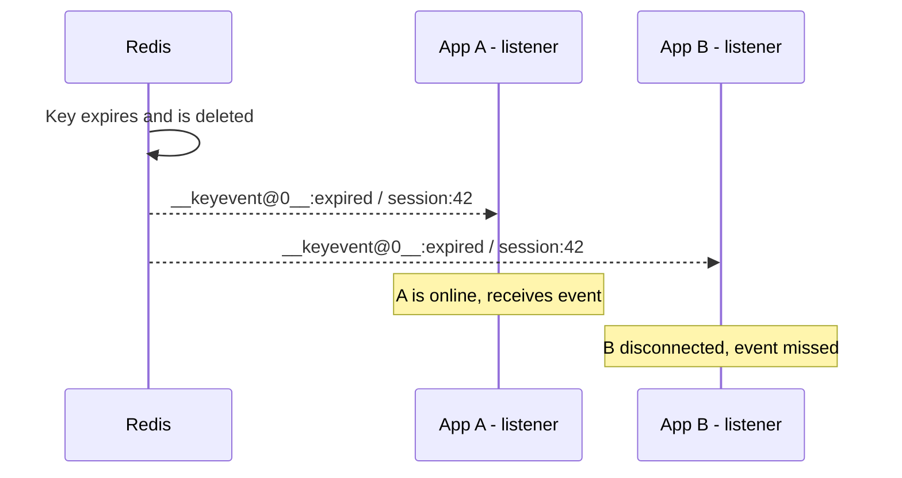
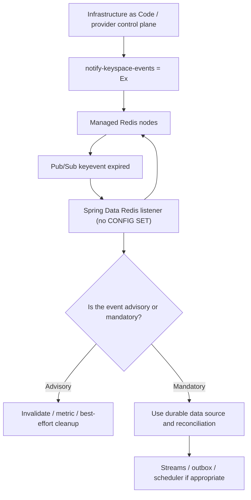
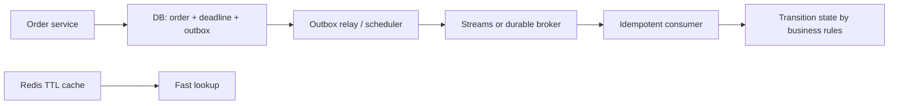

# Operational overhead and configuration permission limits for key notifications in Spring Data Redis

## 1. Why are keyspace notifications an operational decision?

Redis can emit **keyspace notifications** when keys are created, modified, deleted, expired by TTL, or removed by an eviction policy. Spring Data Redis can subscribe to these signals to serve logic such as:

- Knowing that a temporary session key has expired.
- Emitting an application event when a Redis Repository entity reaches its TTL.
- Assisting cleanup of secondary indexes attached to expired entities.
- Acting as an invalidation signal for a cache layer elsewhere.
- Observing certain changes in the keyspace without continuously polling every key.

The consideration is not just adding a few lines of Java for a listener. Enabling notifications may require changing **configuration across Redis nodes**, increasing the number of Pub/Sub events generated and transmitted over the network, and depends on permissions allowed by a managed Redis service (*managed Redis*).

> **Do not treat keyspace notifications as a durable event log.** They rely on Redis Pub/Sub: disconnected listeners can miss notifications, there is no built-in ack/replay mechanism, and expiration notifications are not guaranteed to arrive at the exact moment TTL becomes 0.

This is especially important on managed Redis services, where application developers may **lack `CONFIG SET` permissions** or lack control over individual cluster nodes.

This lesson focuses on two questions:

1. What **operational costs and risks** arise from enabling and consuming key notifications?
2. When a managed service **restricts configuration commands**, how do you use Spring Data Redis without relying on application-level administrative privileges?

## 2. Distinguishing keyspace events from keyevent events

Redis has two channel formats for the same mutation.

Suppose the following command deletes key `session:42` in database 0:

```redis
DEL session:42
```

If the appropriate event type is enabled, Redis can produce two notification formats:

| Format | Channel | Message content |
|---|---|---|
| **Keyspace** | `__keyspace@0__:session:42` | `del` |
| **Keyevent** | `__keyevent@0__:del` | `session:42` |

With **keyspace**, the channel states *which key* and the payload states *what event*. With **keyevent**, the channel states *what event* and the payload states *which key*. These two differ in message structure, not storage mechanism.

When you want to receive all keys that just expired, you typically subscribe to:

```text
__keyevent@0__:expired
```

and read the key name in the body.

When you want to watch a specific key across event types, you can subscribe to a pattern like:

```text
__keyspace@0__:session:42
```

and read the event name in the body.

**Do not confuse channel `__keyevent@0__:expire` with `__keyevent@0__:expired`.** The `expire` event relates to setting a timeout on a key, whereas `expired` is emitted when Redis actually deletes an overdue key.

### 2.1. The notify-keyspace-events parameter

Redis controls emitted event groups via the parameter:

```text
notify-keyspace-events
```

Commonly needed symbols:

| Symbol | Meaning |
|---|---|
| `K` | Emit channels formatted as `__keyspace@<db>__:...` |
| `E` | Emit channels formatted as `__keyevent@<db>__:...` |
| `g` | Generic command events such as `del`, `expire`, `rename` |
| `$` | Events for String commands |
| `l` | List |
| `s` | Set |
| `h` | Hash |
| `z` | Sorted Set |
| `t` | Stream in supported versions |
| `x` | Key actually **expired** |
| `e` | Key **evicted** due to memory policy |
| `A` | Alias for a broad group of events; expanded list may vary by version |

Newer Redis versions add event groups such as key miss, new, overwrite, or type-change. Do not blindly copy a flag string from a newer version to a service running an older Redis/Valkey engine.

**At least `K` or `E` must be present** for Redis to emit either channel style. Setting `x` alone without `K` or `E` will not trigger expiration notifications.

Some typical configurations:

| Value | Effect | When to use |
|---|---|---|
| `""` | Disable keyspace notifications | System needs no listeners |
| `Ex` | Emit keyevents for expired keys | Watching `__keyevent@...__:expired` |
| `Eg` | Emit keyevents for generic commands | Watching `del`, `rename`, `expire` as needed |
| `Kx` | Emit keyspace for expired keys | Watching `__keyspace@...__:<key>` |
| `KEAx` or `KEA` | Enable broad event groups, version-dependent | Only when wide scope is genuinely needed and load has been measured |

When you only need to listen for expiration events, **`Ex` is usually a much less noisy starting point than `KEA`**. Preserve flags needed by other applications sharing the node; do not overwrite a configuration serving other consumers just to add `Ex`.

### 2.2. Testing on self-managed Redis

In a development environment with Redis admin privileges:

```redis
CONFIG GET notify-keyspace-events
# Initial example: ""

CONFIG SET notify-keyspace-events Ex
# OK
```

First terminal:

```redis
SUBSCRIBE __keyevent@0__:expired
```

Second terminal:

```redis
SET demo:notification:42 active EX 2
# OK
```

After Redis removes the expired key, the first terminal receives the key name:

```text
demo:notification:42
```

Arrival time may be later than 2 seconds; do not use this experiment as proof that Redis guarantees millisecond-exact scheduling.

**This example is for self-managed Redis.** On managed Redis, `CONFIG GET` or `CONFIG SET` may be blocked; do not apply this command sequence verbatim to production. If changing configuration for an experiment, have a plan to restore the original configuration afterward, and understand that the parameter affects other applications sharing the node.

## 3. Key notifications lack message queue durability

Redis keyspace notifications are sent over Pub/Sub. Simple model:



For critical events, there are at least three risk windows:

1. **Before the listener starts:** Redis emitted the event, but the application had not subscribed yet.
2. **While the listener is disconnected:** network glitches, failover, restarts, or redeployments drop notifications.
3. **After the listener receives but before processing finishes:** thread/process crashes, while Redis does not retain the event for ack-based redelivery.

Therefore, even though Spring provides reconnection via the listener container, events emitted when no subscriber was present are not replayed after reconnecting.

| Expectation | Do keyspace notifications satisfy it? |
|---|---|
| Emit near-real-time signals to connected subscribers | Yes |
| Persist events for offline consumers to re-read | **No** |
| Ack after business processing | **No** |
| Redelivery when handler fails | **No** |
| Replay from offset or timestamp | **No** |
| Know exactly how many events were lost | No direct mechanism |
| Suitable as supplementary signal for cache/TTL | Yes, if missed events are acceptable |
| Guarantee every mandatory email/payment/job runs | Should not be used as the sole channel |

This is why you must analyze **the criticality of side effects** before enabling notifications; CPU cost is not the only trade-off.

## 4. Operational overhead of enabling keyspace notifications

Redis documentation explicitly states this feature is usually **disabled by default because generating notifications consumes CPU resources**. Actual resource usage also depends on enabled event types, operation rates, subscriber counts, distribution patterns, and application-side work.

### 4.1. CPU for detecting, building, and dispatching events

Every Redis operation already incurs data-structure work. When notifications are enabled for that event type, the server performs extra work to build a Pub/Sub message and distribute it to matching subscribers.

In a system handling thousands or tens of thousands of operations per second, a small per-operation overhead can still add up significantly.

When only expiration events are needed yet `KEA` is configured, Redis may have to emit write, delete, and list/hash/set/stream events across supported flags. A system heavy on Hash or Set operations will generate excessive unnecessary messages.

**Principle:** enable **the fewest event types that satisfy real goals**, do not pick `KEA` just because it feels "easy to debug."

### 4.2. Network, Pub/Sub fan-out, and subscriber count

With keyevents, the payload is typically the key name, yet there is still overhead from protocol framing, channel names, connections, network buffers, and client libraries.

**Illustrative estimation example**, not a Redis benchmark:

```text
5,000 events/second
3 listeners receiving each event
80 bytes average message data before transport overhead

=> 5,000 × 3 × 80 = 1,200,000 bytes/second
   ≈ 1.2 MB/second counting assumed message data alone
```

Actual figures can be higher due to protocol/transport framing, channel names, encoding, and metadata. Beyond Redis outbound bandwidth, **each listener** must also parse messages, filter keys, log, or trigger follow-up work.

An architecture where multiple Spring instances all subscribe to `__keyevent@0__:expired` can cause **all instances to receive the same notification**. This is *fan-out*, not a work queue distributing one event to one worker. If each listener calls an API or writes to a database, a single event can trigger multiple side effects.

### 4.3. Cost table by design choice

| Factor | As it increases | Possible consequence | How to mitigate |
|---|---|---|---|
| Flag scope | From `Ex` to `KEA` | More CPU and event traffic | Enable only needed groups |
| Keys changing state | More writes/expirations/evictions | Higher event rate | Reduce churn, choose narrow event types |
| Subscriber count | More application instances | Higher fan-out/network/listener CPU | Dedicate specialized subscribers if suitable |
| Key length | Keys encode lots of data in name | Larger payloads, higher bandwidth | Stable, short naming without secrets |
| Heavy work inside listener | Calling DB/API directly in callback | Thread blocking, client backlog, more errors | Offload heavy work to bounded, durable mechanisms |
| Logging every event | Writing logs for all events | Higher I/O, log cost, and cardinality | Sampling, aggregated metrics, never log sensitive payloads |
| Multiple Redis nodes | Larger Cluster | More subscriptions/observability needed | Track per node and topology |
| Reconnect frequency | Unstable network or failover | Events lost while offline | Alerts, reconciliation, never rely on events for correctness |

### 4.4. Extra overhead of Spring Data Redis Repository

When using Redis Repository entities with TTL, publishing expiration events may involve a **shadow copy / phantom copy** of the aggregate so the event object can carry the expired entity's data. Depending on configuration/version, the copy is retained for an extra duration after the original key expires.

Benefit: listeners can receive domain object details rather than just the ID/key.

Trade-offs:

- Extra data stored in Redis briefly.
- Extra serialization/write and storage cost for aggregates.
- Large entities or short TTLs can inflate copy volume.
- When listeners are disabled or miss events, auxiliary data/indexes still need separate lifecycle consideration.

If only the expired key's ID is needed, consider **turning off shadow copies** via the appropriate Spring Data Redis API. When disabled, events no longer contain a full snapshot of the deleted object; consumers must consult another data source if business fields are needed.

Do not copy shadow-copy assumptions into every `StringRedisTemplate` application: it is a feature of the Redis Repository TTL mechanism, not mandatory behavior for all keys with TTL.

## 5. Expired events do not arrive at the exact millisecond TTL equals 0

Redis removes expired keys using two common mechanisms:

- **Passive expiration:** when a key is accessed, Redis sees the TTL has passed and removes it.
- **Active expiration:** Redis periodically inspects a sample of keys with TTL and removes expired ones.

The `expired` event is generated **when the key is actually deleted from the dataset**, not immediately when the wall clock crosses the theoretical TTL boundary.

Example:

```text
12:00:00  SET session:42 active EX 60
12:01:00  Theoretical TTL ends
12:01:01  Redis has not scanned or accessed the key yet
12:01:03  Redis actually deletes the key -> may emit expired
```

The delay depends on load, key count, and the expiration algorithm. Under certain conditions it can be considerable.

**Do not use `expired` as an exact timer** for jobs such as:

- Automatically transferring funds at an exact timestamp.
- Guaranteed order closing within a strict deadline.
- Running jobs with a per-second SLA.
- Revoking permissions assuming listeners are always running.

If the requirement is "after time T, access is no longer permitted," check **the expiration timestamp on the read/authorization path** against an authoritative source. Notifications can be used to clean up auxiliary data, not as the sole condition for blocking access.

### 5.1. Expired differs from evicted

| Event | Cause | Flag |
|---|---|---|
| `expired` | Key reached TTL and Redis actually deleted it | `x` |
| `evicted` | Redis removed key due to `maxmemory` policy | `e` |
| `del` | A delete operation/command removed the key | `g` |

Do not assume enabling `Ex` captures every way a key disappears. If a cache experiences `maxmemory` eviction, keys can disappear via eviction **without producing an expired event**.

Conversely, enabling expired/evicted/delete together increases traffic and still does not solve subscriber disconnection gaps.

## 6. CONFIG and ACL permissions: two distinct layers of restriction

On self-managed Redis, operators can configure `notify-keyspace-events` via `redis.conf` or `CONFIG SET` when authorized.

On managed Redis, two types of restrictions can exist:

1. **Redis user permissions (ACL):** `CONFIG`, `SUBSCRIBE`, `PSUBSCRIBE`, or channels may not be permitted.
2. **Provider policies:** certain settings are prohibited or changeable only through the control plane/parameter groups, even when the application account holds broad Redis permissions.

Both layers must be checked separately. Granting `+config` in Redis ACLs will not necessarily bypass a managed service restriction.

### 6.1. What minimum permissions does a listener need?

A listener that purely receives events usually needs:

- Connectivity and authentication to Redis.
- Subscribe permission corresponding to `SUBSCRIBE` or `PSUBSCRIBE`.
- Channel pattern permissions compatible with the ACL version, e.g., channel `__keyevent@0__:expired`.
- Network connectivity to the nodes actually emitting events.
- Permissions for other commands only if listener code also reads/writes Redis (keep minimal).

A listener **does not need `CONFIG SET` permission** just to subscribe, provided Redis **already has the right notifications enabled** via infrastructure configuration.

Separate three responsibilities:

| Role | Typically required permissions |
|---|---|
| Infra/platform administrator | Configure Redis settings in the control plane |
| Redis notification listener | Subscribe to permitted channels, minimal Redis privileges |
| Business service handler | Read/write permissions on specific business keys, no default admin privileges |

Do not hand configuration-management permissions to an entire microservice just to work around a listener startup error.

### 6.2. Permission errors and their meanings

| Symptom | Possible interpretation |
|---|---|
| `NOPERM ... CONFIG` | Redis ACL rejects the CONFIG command |
| `ERR unknown command 'CONFIG'` or command blocked | Provider/engine hid or disabled CONFIG |
| `NOPERM ... PSUBSCRIBE` | User is not allowed to subscribe or channel pattern is disallowed |
| Redis connects fine, but no expired events | Flags not enabled properly, wrong DB/node subscribed, or listener offline |
| Code calling `CONFIG GET` also fails | Config read permission is restricted; do not immediately assume notifications do not exist |
| After failover only some keys have events | Topology subscriptions or listener not tracking the right nodes |
| Service works locally but fails on managed | Local has admin rights; managed requires control-plane configuration |

When diagnosing, inspect the **root error logs** and platform policy first; do not endlessly retry a prohibited administrative command.

## 7. Managed Redis services: configuring via the control plane

Managed Redis typically separates the **data plane** (key read/write commands) from the **control plane** (configuration, topology, security, failover management). Applications are permitted to work with data but are not necessarily allowed to modify server parameters.

### 7.1. Amazon ElastiCache example

For Amazon ElastiCache for Redis OSS/Valkey, provider documentation describes the `notify-keyspace-events` parameter inside a **parameter group**. Typical deployment steps:

1. Identify the engine version, parameter-group family, and currently applied group.
2. Create or select an editable **custom parameter group**.
3. Set `notify-keyspace-events` to the minimal scope (e.g., `Ex`).
4. Associate the appropriate parameter group with the replication group/cluster per provider procedures.
5. Monitor parameter application status and verify the listener receives events.
6. Manage that setting via IaC/runbooks rather than modifying it silently from application code.

Spring Data Redis documentation notes that `CONFIG` is not available as needed in ElastiCache environments; therefore, a startup listener attempting to call `CONFIG` automatically can fail. The solution is to **decouple Redis configuration from the application process** and disable Spring Data Redis's automatic config adjustment as shown in the next section.

Do not assume a custom parameter group applies every change immediately across all engine versions/topologies; whether a restart/apply is needed must be checked against your provider's policy and the specific parameter type.

### 7.2. With Azure, Google Cloud, and other providers

There is no single administrative command or UI shared across all managed Redis offerings. Verify against your specific service:

- Does the service/edition/engine version **support** keyspace notifications?
- Can `notify-keyspace-events` be set via portal/API/IaC, or is it locked?
- Are `CONFIG GET` and `CONFIG SET` supported, and do they require special roles?
- Are events emitted on primary/replica/specific nodes?
- Does cluster mode require subscribing per node, endpoint, or shard?
- On failover/scale-out, do settings synchronize automatically and do clients reconnect properly?
- Which flags are accepted in the running engine version?

Do not infer from "Redis protocol compatible" that every admin command and every server setting is open. Managed services may restrict commands for security, stability, and multi-tenant operations.

### 7.3. Configuration decision matrix

| Environment | Who configures `notify-keyspace-events`? | How the application should behave |
|---|---|---|
| Self-managed Redis with admin access | Platform/DBA via redis.conf or controlled CONFIG | Listener subscribes; app may not need CONFIG permission |
| Managed Redis with control-plane parameter config | Infra/platform team | Configured outside the app; listener never calls CONFIG |
| Managed Redis allowing controlled CONFIG SET | Per platform policy | Still prefer IaC; avoid instances racing to change config |
| Managed Redis not supporting notifications | Cannot enable as expected | Use polling/scheduler/Streams/outbox per requirements |
| Multi-node Redis Cluster | Infra configures all relevant nodes | Listener covers emitting nodes; test failover |

## 8. Spring Data Redis: listener for keyevents without CONFIG

If you only need to receive expired key names, you can create a `RedisMessageListenerContainer`. The container manages subscriptions and dispatches messages, yet **does not automatically guarantee Redis has `notify-keyspace-events` enabled**.

Spring Boot example:

```groovy
dependencies {
    implementation 'org.springframework.boot:spring-boot-starter-data-redis'
}
```

```yaml
spring:
  data:
    redis:
      host: localhost
      port: 6379
```

Java configuration:

```java
package com.example.redis.notifications;

import java.nio.charset.StandardCharsets;
import org.springframework.context.annotation.Bean;
import org.springframework.context.annotation.Configuration;
import org.springframework.data.redis.connection.MessageListener;
import org.springframework.data.redis.connection.RedisConnectionFactory;
import org.springframework.data.redis.listener.ChannelTopic;
import org.springframework.data.redis.listener.RedisMessageListenerContainer;

@Configuration
public class ExpirationListenerConfiguration {

    @Bean
    public MessageListener expiredKeyListener() {
        return (message, pattern) -> {
            String key = new String(
                    message.getBody(),
                    StandardCharsets.UTF_8
            );

            // Filter key names to avoid processing irrelevant events.
            if (!key.startsWith("session:")) {
                return;
            }

            // This is only a signal; the key may already be gone.
            // Do not run long or non-idempotent work
            // directly inside the Pub/Sub callback.
            System.out.println("Expired session key: " + key);
        };
    }

    @Bean
    public RedisMessageListenerContainer expirationContainer(
            RedisConnectionFactory connectionFactory,
            MessageListener expiredKeyListener) {

        RedisMessageListenerContainer container =
                new RedisMessageListenerContainer();

        container.setConnectionFactory(connectionFactory);
        container.addMessageListener(
                expiredKeyListener,
                new ChannelTopic("__keyevent@0__:expired")
        );

        return container;
    }
}
```

Explanation:

- `ChannelTopic` subscribes to the exact channel for expiration events in **database 0**.
- The keyevent body contains the **key name**, not the lost object's value.
- `RedisMessageListenerContainer` manages a dedicated subscription connection appropriately; handlers must still account for disconnects, duplicate side effects across instances, and operations.
- `startsWith("session:")` filters only **on the application side after the event has been delivered to the subscriber**; it does not reduce the number of events Redis emitted to the `expired` channel.
- This example **does not attempt to call `CONFIG SET`**. Beforehand, the platform must enable `Ex` or an equivalent configuration on Redis.

To limit overhead, do not spin up a new subscription container for every individual session key. One or a few listeners managed per deployment model are far more efficient than multiplying subscriptions without bound.

### 8.1. Events arrive after the key has already been deleted

The following snippet easily causes confusion:

```java
String value = stringRedisTemplate.opsForValue().get(expiredKey);
// Usually returns null because Redis already deleted the expired key.
```

The `expired` notification is created when Redis deletes the key. Therefore, listeners should not expect to read back the payload from the just-expired key.

If the handler needs `userId`, `tenantId`, session type, or job details, you can:

- Encode **minimal, non-sensitive IDs** into the key name according to safe naming rules.
- Store metadata in another data source with a longer lifetime.
- Write a durable event prior to expiration time.
- Use Spring Data Redis Repository's shadow copy mechanism when appropriate and accepting its overhead/event-loss limits.

Do not put passwords, tokens, or PII into Redis key names merely to retrieve info upon expiration, because key names can surface in logs, metrics, monitoring, and notifications.

## 9. Spring Data Redis Repository: avoiding CONFIG commands on managed Redis

Redis Repository supports TTL and can emit `RedisKeyExpiredEvent` when an aggregate expires. When enabling expiration listeners through Repository, Spring Data Redis has a mechanism that configures `notify-keyspace-events` if it is not yet set in Redis.

This is what commonly causes an application to **work locally yet fail when deployed to managed Redis**: the application account cannot execute `CONFIG`.

### 9.1. Configuring @EnableRedisRepositories

Example configuration using the corresponding Spring Data Redis API:

```java
package com.example.redis.repository;

import org.springframework.context.annotation.Configuration;
import org.springframework.data.redis.core.RedisKeyValueAdapter;
import org.springframework.data.redis.repository.configuration.EnableRedisRepositories;

@Configuration
@EnableRedisRepositories(
        basePackages = "com.example.redis.repository",
        enableKeyspaceEvents =
                RedisKeyValueAdapter.EnableKeyspaceEvents.ON_STARTUP,
        keyspaceNotificationsConfigParameter = ""
)
public class ManagedRedisRepositoryConfiguration {
}
```

The most important part:

```java
keyspaceNotificationsConfigParameter = ""
```

It tells Spring Data Redis **not to attempt modifying** the `notify-keyspace-events` parameter in Redis. This is the workaround documented in Spring Data Redis for environments where `CONFIG` commands are disallowed.

**It does not automatically enable notifications on the server.** If infrastructure has not configured `Ex` or an appropriate flag set, the listener may run yet **receive no expired events**.

Two tasks must be kept separate:

```text
Platform team:
  Managed Redis parameter group / control plane
  notify-keyspace-events = Ex

Application:
  @EnableRedisRepositories(...)
  keyspaceNotificationsConfigParameter = ""
  subscribe/handle RedisKeyExpiredEvent
```

Also evaluate `ON_STARTUP` versus on-demand startup modes. Deferring the listener until the first TTL entity is saved can miss events occurring before the listener starts.

### 9.2. Example entity with TTL

```java
package com.example.redis.repository;

import org.springframework.data.annotation.Id;
import org.springframework.data.redis.core.RedisHash;
import org.springframework.data.redis.core.TimeToLive;

@RedisHash("sessions")
public class SessionEntity {

    @Id
    private String id;

    private String ownerId;

    @TimeToLive
    private Long ttlSeconds;

    protected SessionEntity() {
    }

    public SessionEntity(
            String id, String ownerId, Long ttlSeconds) {
        this.id = id;
        this.ownerId = ownerId;
        this.ttlSeconds = ttlSeconds;
    }

    public String getId() {
        return id;
    }

    public String getOwnerId() {
        return ownerId;
    }

    public Long getTtlSeconds() {
        return ttlSeconds;
    }
}
```

After the entity is saved via Repository and its TTL elapses, Spring Data Redis can emit the corresponding application event if the listener is active and Redis actually emits the keyevent. However:

- Redis Pub/Sub does not persist events for reconnecting listeners to re-read.
- Keyspace events may not arrive at the exact TTL mark.
- Event payloads depend on the shadow copy mechanism and Repository config.
- If an entity has auxiliary indexes and events are missed, metadata/indexes may require reconciliation.

### 9.3. Turning off shadow copies when only the ID is needed

For cases that do not require an aggregate snapshot inside the expired event, Spring Data Redis provides a shadow copy option:

```java
@EnableRedisRepositories(
        basePackages = "com.example.redis.repository",
        enableKeyspaceEvents =
                RedisKeyValueAdapter.EnableKeyspaceEvents.ON_STARTUP,
        keyspaceNotificationsConfigParameter = "",
        shadowCopy = RedisKeyValueAdapter.ShadowCopy.OFF
)
```

This is an alternative configuration template to the annotation in Section 9.1, not an annotation to add a second time on the same configuration.

When shadow copies are off, expiration events no longer carry a full copy of the aggregate; as described in the documentation, the event may contain only the ID/key. In return, you save the overhead of storing extra auxiliary data for TTL entities.

Not every project needs keyspace events enabled for Repositories. If using Redis solely as a key-based cache without domain expiry events, do not turn this mechanism on out of habit.

## 10. Redis Cluster problem: subscribing to one node does not see all keys

In Redis Cluster, each key belongs to a hash slot and is managed by the corresponding node. Redis documentation explicitly notes that **keyspace notifications have node scope**, and are not broadcast to every node as a cluster-wide aggregated stream.

```text
                 Redis Cluster
         +---------------------------+
         |                           |
       Node A                     Node B
    key: session:1             key: session:2
         |                           |
   expired(session:1)          expired(session:2)
         |                           |
         v                           v
     Listener A                  Listener B
```

If a Spring listener only subscribes to node A, it can miss expirations for keys owned by node B.

This is not fixed by setting the topic to `__keyevent@0__:expired`: **the topic selects the event type; it does not create a centralized stream across all shards**.

### 10.1. Points that must be designed in a cluster

- Identify which primaries own the keys of interest.
- Check how the provider supports subscriptions and node endpoints.
- Configure `notify-keyspace-events` consistently across relevant nodes.
- Subscribe to the event-emitting nodes as required by the deployment topology.
- Monitor reconnects and re-subscriptions after failover/scale-out.
- Do not assume a listener automatically covers the cluster just because the Redis client can route `GET`/`SET` by slot.
- Redis Cluster typically uses database 0; avoid configuring topics for other DBs without valid reason.

With managed clusters, endpoints advertised for data commands may not correspond directly to the endpoints/connections needed for node-specific Pub/Sub notifications. Exact rules must be confirmed via provider docs and testing.

### 10.2. Failover can create event gaps

When a primary fails over:

1. The old subscription connection may drop.
2. The listener/container reconnects according to client mechanics.
3. The new node takes over the corresponding keyspace.
4. Expirations that happened during the gap may **not be replayed**.

No solution that simply increases `SUBSCRIBE` retries can turn Pub/Sub into a durable queue. If the application must know about every expiration for certain, an alternative design is needed: durable business events, job scheduling from authoritative data, or reconciliation.

## 11. ACLs and the principle of least privilege

On Redis supporting user/channel ACLs, you can restrict:

- Command groups allowed to execute.
- Application key patterns permitted for reads/writes.
- Pub/Sub channels allowed to subscribe/publish.
- Administrative commands such as `CONFIG`.

For an expired-key listener:

- Grant only the required subscription permissions.
- Allow only relevant channels according to ACL syntax and engine version.
- Do not grant `CONFIG SET` so the listener can "fix" the server on every startup.
- Do not share a common administrative account between application and platform.
- Do not log full key names if keys contain sensitive info.
- Use TLS and provider credential management per enterprise policy.

Example verification queries in an authorized environment:

```redis
ACL WHOAMI
CONFIG GET notify-keyspace-events
```

If the second command is blocked, do not try to "bypass" it with another account. Ask infrastructure to verify the configuration and subscription permissions through provider-supported channels. Even `ACL WHOAMI` can be restricted depending on user/service; failure of a check command does not mean Redis as a whole is unusable.

**Do not grant `+@all` or overly broad admin rights to a listener just because of a `NOPERM` error.** That poses a security risk and allows the application to unintentionally modify shared configuration.

## 12. Safe deployment model on managed Redis

A clear division of responsibilities:



Here:

- The platform configures the server as part of deployment, versioned and audited.
- The app simply connects and subscribes.
- Redis state outside the application's scope is not mutated whenever an instance boots.
- Critical functions never depend solely on an event that can be lost.

### 12.1. Choosing startup mode

Spring Data Redis Repository has options to start the event listener at startup or on demand. If the listener starts too late, keys expiring before the listener subscribes may not be reported to the app.

Distinguish:

- **ON_STARTUP:** attempts to start the listener immediately as the application initializes.
- **ON_DEMAND:** initializes on demand, potentially missing events before the first need.
- **OFF:** does not listen for events via this mechanism.

The specific choice also depends on the Spring Data Redis version and Repository context. If the application does not need expiry events and only uses `@TimeToLive` for key lifecycle, `ON_STARTUP` is not always necessary.

If `ON_STARTUP` is enabled on managed Redis without setting `keyspaceNotificationsConfigParameter = ""`, `CONFIG` permission errors can occur during listener initialization. Check startup logs and readiness probes so a service does not report Ready when mandatory notification components are not actually working.

### 12.2. Why applications should not run CONFIG SET automatically

In a multi-instance system:

```text
Pod A startup -> CONFIG SET notify-keyspace-events Ex
Pod B startup -> CONFIG SET notify-keyspace-events KEA
Pod C startup -> CONFIG SET notify-keyspace-events ""
```

If instances have permission to change shared config, the final value depends on whichever process writes last. One change can accidentally disable event types needed by another application. In managed Redis, an application attempting this command may also be rejected.

Therefore, even when self-managed Redis permits `CONFIG SET`, production setups should usually:

1. Have a single configuration owner.
2. Declare settings in IaC/config management.
3. Verify changes are compatible with existing consumers.
4. Roll out according to plan and measure overhead.
5. Separate the subscriber role from the administrative role.

## 13. Processing overhead inside the Spring listener

An expiry event body contains only the key name, yet the listener may perform very expensive follow-up work: database reads, API calls, logging, session processing, or complex cleanup.

### 13.1. Avoid blocking the dispatch thread

Unsuitable example:

```java
return (message, pattern) -> {
    String key = new String(
            message.getBody(),
            StandardCharsets.UTF_8
    );

    // Example not to apply directly:
    remoteBillingApi.finalizeInvoice(key); // Can be slow, retry, or time out.
};
```

If each event makes a 500 ms API call and there are thousands of events per second, the listener easily builds up a client-side backlog. Moreover, if the callback receives the message and the process crashes, Redis Pub/Sub retains no event for consumer recovery.

For purely best-effort work, processing can run through a bounded executor with load controls. If the work **must complete**, a durable queue/Streams/outbox is required at the right point in the workflow; merely calling `executor.submit(...)` in RAM does not give events durability.

### 13.2. Multiple instances lead to duplicate processing

For example, three service instances subscribe to expired events simultaneously:

```text
Redis expired(session:42)
    |
    +--> instance A -> cleanup
    +--> instance B -> cleanup
    +--> instance C -> cleanup
```

All three can receive **the same event**. If cleanup is simply deleting an auxiliary entry by key, the operation may be idempotent. However, if each instance sends an email, charges a fee, or generates an invoice, the action may execute multiple times.

The fix is not simply adding `synchronized` in Java, because per-process local locks do not coordinate across processes. You need:

- A dedicated listener owner where architecture permits.
- Idempotent side effects keyed by operation ID/key.
- State checks against the primary data source.
- Or offloading business work to a queue with competing consumers and acks.

### 13.3. The message body is not a complete business event

`expired(session:42)` does not provide:

- Who created the session.
- Why the timeout was set.
- Whether this is the latest incarnation.
- Which cleanup tasks have already run.
- Retry policy and final outcome.

Therefore, keyspace events should be treated as **infrastructure-layer signals**. If the domain needs `SessionClosed`, `OrderExpired`, or `PaymentTimedOut` with full data and replay, the application should emit a business event from an authoritative source.

## 14. Measuring and alerting when enabling notifications

A safe rollout requires **measurements before and after the change**.

### 14.1. Redis-side metrics

Useful metrics:

| Signal | Purpose |
|---|---|
| Redis CPU usage | Detect overhead after enabling notifications |
| Network outbound / bytes sent | Detect fan-out across many subscribers |
| Connected clients / Pub/Sub subscriptions | Detect large listener counts or abnormal reconnects |
| `expired_keys` in `INFO stats` | Keys removed by Redis due to TTL |
| `evicted_keys` in `INFO stats` | Keys removed due to memory policy |
| Redis p95/p99 latency | Detect impact on read/write commands |
| Memory usage / fragmentation | Monitor background memory pressure |
| Failover/topology changes | Explain windows when listeners received no events |

`INFO stats` is not per-application; when multiple workloads share Redis, `expired_keys` is an instance/node-level counter. It also **does not equal the number of notifications guaranteed to have reached the application**.

In Redis Cluster, aggregate metrics across the relevant nodes. Do not treat the expired counter on primary A as the total for the whole cluster.

### 14.2. Application-side metrics

Some custom metric names:

```text
redis_keyevent_listener_connected
redis_keyevent_messages_received_total
redis_keyevent_messages_filtered_total
redis_keyevent_handler_errors_total
redis_keyevent_handler_duration_seconds
redis_keyevent_listener_reconnects_total
redis_keyevent_reconciliation_pending
```

These are suggestions, **not metrics emitted automatically by Spring Data Redis by default**.

How to interpret them:

- `received_total` increasing proves the listener received events; it does not prove Redis did not emit events that were missed.
- `listener_connected` and reconnect counters reflect basic health, without carrying replay guarantees.
- `handler_errors_total` helps spot callback failures.
- `reconciliation_pending` measures items waiting to be verified by the durable workflow.

Do not create a `key="session:..."` label for every individual key in systems with millions of keys; metric cardinality will explode. Use event type, service, environment, shard, or normalized prefixes.

### 14.3. End-to-end verification with a canary

An operational readiness check can:

1. Create a unique canary key in a test namespace with a short TTL.
2. Confirm the listener is already subscribed before creating the canary.
3. Observe receipt of the key name when it expires.
4. Record observed latency, source node, and configuration version.
5. Clean up data and never use canaries to trigger business side effects.

A canary proves **one sample event arrived**, not that the system receives every event or that latency is always constant. In cluster deployments, verify coverage across relevant nodes/shards.

## 15. Runbook for enabling notifications on a managed service

### Step 1: confirm the requirement

Clearly define which event types are needed and the consequences if missed:

```text
Use case: clean up session metadata after TTL expires
Event: expired
Event loss tolerance: acceptable if reconciliation handles it
Entity data snapshot needed in event: no
Target load: based on expired sessions/second
```

If "missing one event loses money or violates an SLA," abandon the idea of using keyspace notifications as the sole source and adopt a durable model first.

### Step 2: verify provider capabilities

Gather:

- Redis/Valkey engine version.
- Managed service and standalone/replica/cluster topology.
- Configuration method: parameter group, portal, API, or unsupported.
- Pub/Sub and channel ACL permissions.
- Whether config values can be read directly or must be confirmed by infrastructure.
- Any change/rate limits or maintenance window constraints.

Do not test admin commands in production before understanding permissions and blast radius.

### Step 3: choose narrow flags

For example, only expired keyevents in DB 0:

```text
notify-keyspace-events = Ex
subscription topic = __keyevent@0__:expired
```

If multiple consumers need different events, aggregate requirements to choose the **union of flags** without accidentally dropping existing event groups. Do not lump everything into `KEA` without justification.

### Step 4: configure at the infrastructure layer

Use the appropriate parameter group/control plane/IaC. Document:

- Who owns the change.
- Before and after values.
- Target nodes/shards.
- Effective time.
- Rollback plan.
- Baseline load metrics prior to enabling.

### Step 5: deploy listeners without self-configuring Redis

For direct listeners, use `RedisMessageListenerContainer` and subscribe to topics. For Repository expiry events, set:

```java
keyspaceNotificationsConfigParameter = ""
```

in the corresponding configuration when avoiding `CONFIG` commands. Also determine startup mode and shadow-copy policy.

### Step 6: test failover and disconnection

Test at least:

- Listener receives expired events normally.
- Disconnection while keys expire.
- Reconnect and resumption of operation.
- Primary failover or topology changes.
- Partial node subscription failure in a cluster.
- Listener handler errors and duplicate events across multiple instances.

For events occurring while the listener is offline, either accept loss or have genuine **reconciliation**; never conclude from "after reconnecting the listener works again" that old events were processed.

### Step 7: measure overhead and roll into operations

Monitor CPU, network, Redis latency, event rates, reconnects, and handler processing. If only expired is needed yet event traffic is high due to `KEA`, narrow the flags. If fan-out is excessive because many instances subscribe simultaneously, revisit listener topology.

### Step 8: have clear rollback and fallback

If enabling notifications degrades the service:

1. Narrow the flag scope per platform procedures.
2. Pause non-essential callbacks.
3. Keep authoritative data and reconciliation running.
4. If disabling completely, do so via the control plane rather than having the app call CONFIG.
5. Confirm critical functions do not depend solely on the disabled events.

## 16. When managed Redis prohibits enabling keyspace notifications

Sometimes a service/edition does not support the feature, forbids changing parameters, or security policies prevent operators from granting subscription rights. In that case, the application needs a different solution **aligned with business requirements**, rather than trying to escalate privileges against policy.

| Requirement | Alternative approach | Trade-off |
|---|---|---|
| Normal cache expiration | Rely on TTL at read time | No callback when key is removed |
| Close session on time | Check `expiresAt` on read/auth paths | Must keep timestamps and source of truth synchronized |
| Run job at scheduled time | Scheduler + durable deadline table | Needs polling/leases/retries and latency management |
| Guarantee every event processed | Redis Streams with consumer groups or broker | Needs acks, idempotency, retention, recovery |
| Synchronize events with database | Transactional outbox + relay | Extra components, but reduces post-commit event loss risk |
| Clean up non-critical auxiliary data | Periodic reconciliation and idempotent operations | Not strictly real-time; avoid heavy Redis scans |
| Non-critical real-time UI updates | Application Pub/Sub or WebSocket with snapshot refresh | Must still resynchronize state after offline periods |
| TTL events used to clean secondary indexes | Repair/cleanup workflow based on reliable ID source | More effort, but avoids relying on transient events |

**Do not use `KEYS prefix:*` by default as a listener substitute.** `KEYS` can cause severe load in production and cannot find already-expired keys to recreate missed events. `SCAN` is also not an event log: it scans existing state, returning no history of deleted keys. Reconciliation needs a data source or metadata sufficient to identify objects that have expired or must expire.

### 16.1. Outbox for mandatory business events

Suppose "order expired" must be processed even if Redis or the listener is interrupted. An alternative model:



Here Redis TTL aids fast lookups or cache cleanup, while **business deadlines/intent are stored durably**. To ensure single business impact, handlers need stable IDs, state checks, and appropriate idempotent/transactional mechanisms.

An outbox does not automatically grant exactly-once for external side effects outside the database (e.g., sending emails); it closes the gap between primary data commit and event emission.

## 17. Practical design scenarios

### 17.1. Lightweight session cache on managed Redis

A system stores:

```text
session:user-42:device-7 -> state, TTL 30 minutes
```

Requirement: know when sessions expire to decrement an active-sessions counter on a dashboard.

If the counter is only an **estimate**, expired notifications can serve as a supporting signal. Account for missed events and run periodic reconciliation or compute from authoritative data when needed.

If the counter governs authorization or billing, never rely solely on expiration callbacks. The authorization path must verify TTL/`expiresAt` itself, and business state changes must come from a reliable source.

### 17.2. Redis Repository with indexed entities and TTL

An entity has `@RedisHash`, `@Indexed`, and `@TimeToLive`. Upon expiration, Spring Data Redis can use keyspace events to help clean up secondary indexes.

Risks:

- Listener had not started up when the entity expired.
- Managed Redis does not have `Ex` enabled.
- Failover causes events to be lost.
- Shadow copies increase memory when entities are numerous or large.
- Auxiliary indexes retain references to expired entities if events are missed.

Operational design must include an appropriate keyspace notifications policy, configuration avoiding disallowed `CONFIG` calls, and a mechanism to verify/repair indexes when consistency matters.

### 17.3. Millions of short-TTL keys expiring together

For example, rate-limit caches or short-lived tokens with large key counts and similar TTLs. If `Ex` is enabled for all keys, expired event volume can spike in bursts.

Even if only one listener cares about `session:`, Redis still emits **events for other keys** of the expired type to subscribers on the same channel. Prefix filtering in Java only reduces post-delivery work; it does not eliminate event emission overhead in Redis.

If you only need alerts for a few key types, consider separating workloads/keyspaces/nodes appropriately or skipping keyspace notifications and using dedicated business data. Reducing listener count does not stop Redis from generating all enabled events, though it does reduce fan-out and application load.

### 17.4. Multi-node Redis Cluster with many pods

For example, 4 primaries and 20 Spring pods. If each pod connects to a single endpoint and subscribes to `expired`, there is no guarantee events from all 4 primaries are collected. If every pod instead subscribes to all 4 primaries, you could end up with 80 subscription connections and fan-out to 20 pods per event.

Architectural design is needed:

- Clearly partition which consumers are responsible for which nodes.
- Avoid running business processing 20 times for the same expired event.
- Monitor reconnects/scale-out and ACL permissions on every node.
- Have a fallback when events are missed.
- Optimize flags and traffic before scaling subscribers.

**Topology-aware subscription** is just as important as the message-handling code.

## 18. Troubleshooting table

| Symptom | What to check | Appropriate resolution |
|---|---|---|
| Works locally, managed fails `CONFIG` on startup | Spring Repository auto-configuring `notify-keyspace-events` | Set via provider; use `keyspaceNotificationsConfigParameter = ""` |
| Listener runs but receives no expired | `Ex` not enabled or wrong DB/channel | Verify infrastructure and subscribe to the right channel |
| Only receives expirations for some keys | Redis Cluster node-specific events | Ensure subscription coverage across nodes |
| Key TTL elapsed yet event arrives late | Active/passive expiration | Do not use as a precise timer |
| Key vanished without `expired` | May be `DEL` or `evicted` | Distinguish event types; do not widen flags unnecessarily |
| Sudden spike in CPU/network | Overly broad flags, higher event rate, or more subscribers | Narrow flags, watch fan-out |
| Events lost during deploy/failover | Pub/Sub has no replay | Reconciliation or durable event source |
| One event triggers multiple side effects | Multiple instances subscribed together | Idempotency or a single appropriate consumer owner |
| Redis Repository has many extra keys on TTL | Shadow/phantom copy | Consider turning off shadow copy if only ID is needed |
| `NOPERM` on subscribe | ACL missing command or channel permission | Grant proper least-privilege permissions |
| Listener lags due to slow callbacks | Heavy work directly inside callback | Bounded executor or durable processing pipeline |
| After restart index still has stale data | Expiry events missed while app was offline | Repair/reindex and plan for TTL events |
| Server metrics show `expired_keys` rising, app receives few | Server metric differs from delivered events, topology/disconnects | Measure listeners, shard coverage, and canaries |
| Provider config change has no effect | Parameter group not applied properly to topology | Check deployment status and engine version |
| Feature cannot be enabled despite Redis permissions | Provider unsupported or locked parameter policy | Choose a design not dependent on notifications |

## 19. Decision checklist

Before using keyspace notifications on managed Redis, answer clearly:

1. **Can messages be lost?** If not, a durable event source is required.
2. **What is the minimal event type?** E.g., `Ex` instead of enabling all notifications.
3. **Who has permission to enable it on the server?** Platform control plane, do not assume the app does.
4. **Which exact nodes does the listener subscribe to?** Especially with Redis Cluster.
5. **If an event is missed, how does the system recover?** Reconciliation, outbox, or scheduler.
6. **How many times can each event be processed?** Multi-instance fan-out requires idempotency or assignment.
7. **Is the content of the expired entity needed?** Shadow copy carries additional memory overhead.
8. **What is the expected events/sec and subscriber count?** Estimate CPU/network and measure in practice.
9. **During failover/scale-out, are gaps detected?** Metrics and runbooks are needed.
10. **Is there a security policy for channel/key names?** Avoid secrets in key names; grant minimal ACLs.

A good choice is not necessarily "getting events enabled." A sound system is one that knows **what events can do** and **what they cannot guarantee**.

## 20. Conclusion

Redis key notifications are useful for signaling when keys are modified, expired, or evicted, and Spring Data Redis provides listener/Repository integrations to receive them. However, enabling `notify-keyspace-events` is a **server-side operational decision**, not merely an annotation setting.

On managed services, applications may not be allowed to call `CONFIG`. A sensible design is usually for the **platform to configure minimal flags via the control plane**, while Spring listeners only subscribe. For Redis Repository, `keyspaceNotificationsConfigParameter = ""` avoids attempting self-configuration of Redis in restricted environments, though it does not enable events on the server.

Three limitations must be accepted: **Pub/Sub does not replay lost events**, **`expired` does not guarantee exact TTL timing**, and **Redis Cluster emits keyspace notifications per node**. Additionally, factor in CPU, network, fan-out, callback execution, and shadow-copy overhead. If business rules require zero missed work, anchor correctness on a durable mechanism such as an outbox, scheduler, or appropriate Streams/broker; use keyspace notifications as a supplementary optimization signal.

## References

- [Redis documentation — Keyspace notifications](https://redis.io/docs/latest/develop/pubsub/keyspace-notifications/)
- [Redis documentation — Expiration events and cluster behavior](https://redis.io/docs/latest/manual/keyspace-notifications/)
- [Spring Data Redis — Redis Repositories, Time To Live](https://docs.spring.io/spring-data/redis/reference/redis/redis-repositories/expirations.html)
- [Spring Data Redis — @EnableRedisRepositories API](https://docs.spring.io/spring-data/redis/docs/current/api/org/springframework/data/redis/repository/configuration/EnableRedisRepositories.html)
- [Amazon ElastiCache — Engine-specific parameters](https://docs.aws.amazon.com/AmazonElastiCache/latest/dg/ParameterGroups.Engine.html)
- [Amazon ElastiCache — Implement keyspace notifications](https://repost.aws/knowledge-center/elasticache-redis-keyspace-notifications)
