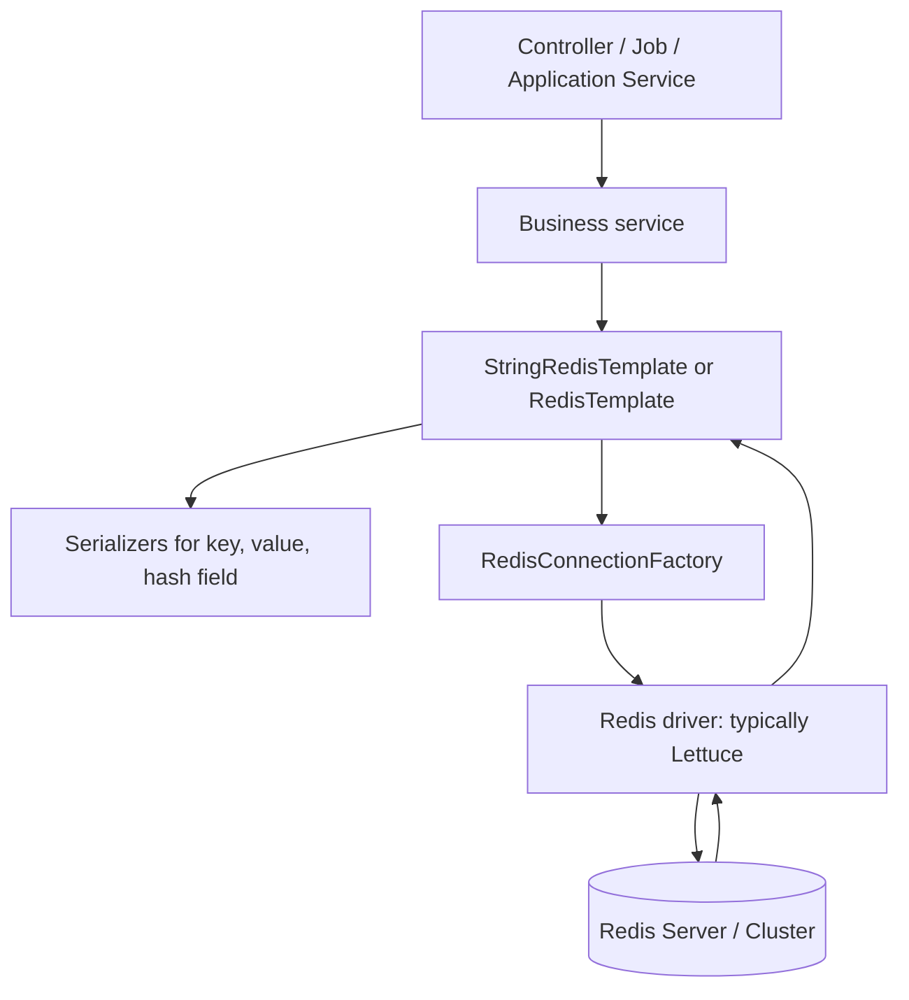

# RedisTemplate and StringRedisTemplate for Synchronous Data Access

## 1. Role of templates in the Spring Data Redis architecture

When a Spring Boot application needs to read or write Redis data **synchronously**, the two most common APIs are `RedisTemplate<K, V>` and `StringRedisTemplate`. They are application-layer data-access helpers: they turn Java operations into Redis commands, manage acquiring connections via `RedisConnectionFactory`, serialize keys/values into bytes, and convert results back to the expected Java types.

Suppose a service needs to store shopping cart state, increment a counter, or quickly read a pre-prepared record. Instead of manually opening a TCP connection, sending raw commands, and decoding responses, the service calls operation groups such as `opsForValue()`, `opsForHash()`, `opsForSet()`, or `opsForZSet()`. This is the boundary between **business code** and **Redis infrastructure** in Spring Data Redis.



The diagram depicts primary responsibilities; it does not mean the serializer is a separate server or separate connection. The template applies serializers during reads/writes and invokes connection operations created through the factory. In a typical Spring Boot setup, `LettuceConnectionFactory` is an implementation of `RedisConnectionFactory` backed by the Lettuce Redis client.

Key points to establish upfront:

- **Synchronous** means the Java thread calling the method generally waits for the Redis operation to return a result or error before continuing. Lettuce may use asynchronous I/O internally, but `RedisTemplate` method calls still expose a synchronous contract.
- **A template is not a fixed Redis connection owned by a single service**. Spring manages the factory/client, and a template can be injected and reused across many components.
- **Templates do not automatically turn data into a cache**. Calling `opsForValue().set(...)` is a direct data-write operation. `@Cacheable` belongs to Spring Cache, even if Redis is used underneath.
- **Generic types do not replace serializers**. `RedisTemplate<String, Product>` only describes Java compile-time expectations; Redis actually receives and stores byte sequences.

## 2. Bootstrapping Redis in a Spring Boot application

For a Spring Boot project using Gradle (Groovy DSL), the standard dependency is:

```groovy
dependencies {
    implementation 'org.springframework.boot:spring-boot-starter-data-redis'
}
```

This starter brings Spring Data Redis and the appropriate client components into the application. Using `RedisTemplate` **does not require** `@EnableCaching`. That annotation is for Spring Cache when using annotations such as `@Cacheable`.

Example local configuration in `application.yml`:

```yaml
spring:
  data:
    redis:
      host: localhost
      port: 6379
      database: 0
      connect-timeout: 2s
      timeout: 2s
```

- `host`/`port` specify the Redis address.
- `database` selects the logical database in Redis environments that support it. Redis Cluster only uses database 0; logical databases are also not a boundary for resource or security isolation.
- `connect-timeout` bounds the time to establish a connection; `timeout` bounds the operation wait time per client configuration.
- In real deployments, authentication, TLS, topology, retries, and pooling (if needed) must be configured according to infrastructure. Never hardcode passwords in examples or source code.

When auto-configuration is active, Spring Boot typically provides:

| Bean | Purpose |
|---|---|
| `RedisConnectionFactory` | Creates/obtains Redis connections through the client. |
| `StringRedisTemplate` | Template specialized for string keys, values, and hash entries. |
| `RedisTemplate<Object, Object>`, commonly named `redisTemplate` | General-purpose template created by Boot by default; understand its serializers before using it. |

In applications with multiple beans or custom configuration, which beans auto-configuration creates depends on classpath conditions and user-defined beans. A `RedisTemplate<String, ProductSnapshot>` with custom serializers generally needs to be declared as its own bean rather than expecting Spring to infer serializers from generic types.

Example injecting the built-in template:

```java
import org.springframework.data.redis.core.StringRedisTemplate;
import org.springframework.stereotype.Service;

@Service
public class RedisHealthNoteService {
    private final StringRedisTemplate redis;

    public RedisHealthNoteService(StringRedisTemplate redis) {
        this.redis = redis;
    }

    public void saveNote(String note) {
        redis.opsForValue().set("demo:note", note);
    }

    public String readNote() {
        return redis.opsForValue().get("demo:note");
    }
}
```

This snippet is intentionally brief so the API call layer stands out. In real designs, keys should have business namespaces, values need validation, and you must decide whether a TTL is required. `get` can return `null` when a key does not exist or has expired.

## 3. How are RedisTemplate and StringRedisTemplate alike and different?

`StringRedisTemplate` is a specialized variant of `RedisTemplate<String, String>`, configured to use `StringRedisSerializer` for keys, values, hash keys, and hash values. As a result, string data can usually be inspected directly with `redis-cli`.

`RedisTemplate<K, V>` is the general-purpose class. It lets you choose serializers independently for keys, values, and hash components, but **Redis does not understand Java objects simply because generics are declared**.

| Criterion | `StringRedisTemplate` | `RedisTemplate<K, V>` |
|---|---|---|
| Keys and values in Java | Primarily `String` | Application-defined types |
| Default serializers | String serializer for the primary components | Depends on configuration; the default general template may use Java native serialization |
| Inspecting via `redis-cli GET` | Usually human-readable when storing text | Only human-readable if the serializer produces text, such as JSON |
| Best-fit scenarios | Counters, string tokens, flags, text hash fields, short metadata | Structured objects, DTOs, data needing a specialized serializer |
| Main risks | Manual number/JSON parsing, unstandardized key/value conventions | Mismatched serializers, schema changes, cross-version incompatibility |
| Inheritance relationship | Extends `RedisTemplate<String,String>` | General API serving as the base for the string template |

Example of the same write-key idea:

```java
// UTF-8 string, convenient to inspect with redis-cli.
stringRedisTemplate.opsForValue().set("demo:greeting", "Hello");

// With RedisTemplate<K,V>, actual storage format depends on configured serializers.
productRedisTemplate.opsForValue().set("product:42", productSnapshot);
```

If you write using the default general template and then switch to the string template to read the same key, the value may not be found or may fail to decode because **key bytes and value bytes do not match**. For example, the JDK serializer writes keys as Java serialization byte streams; `redis-cli GET product:42` queries a different text key and finds nothing.

A practical rule is: **use `StringRedisTemplate` when the data structure is genuinely string-based; create a `RedisTemplate<K,V>` with explicit serializer configuration when working with objects**.

## 4. Serializers are the most important data contract

Redis stores byte sequences. Spring Data Redis converts Java objects into bytes on writes and reverses the process on reads. Common serializers include:

| Serializer | Representation | When to consider |
|---|---|---|
| `StringRedisSerializer` | UTF-8 encoded strings | Keys, field names, string values |
| `Jackson2JsonRedisSerializer<T>` | JSON for a known target type | Java DTOs/records with a clear schema |
| `GenericJackson2JsonRedisSerializer` | JSON with configurable type information | Values of multiple types; requires care regarding type metadata and security |
| `JdkSerializationRedisSerializer` | Java native serialization | Primarily legacy systems with well-understood version and source constraints |

For new designs, avoid treating Java native serialization as the default choice for business data: contents are opaque to operational tools, coupled to class structure, and carry risks when deserializing untrusted data. JSON is easier to inspect, yet **does not solve schema compatibility automatically**. If you rename fields, enums, date formats, or remove classes, existing records in Redis still have to be read by the new version.

### 4.1. Creating a RedisTemplate for structured objects

Suppose an application wants to store a short-lived snapshot of a product:

```java
// ProductSnapshot.java
public record ProductSnapshot(
        String id,
        String name,
        long priceInCents
) {}
```

Declare a dedicated template bean. The example below targets Spring Data Redis 3.x APIs with Jackson on the classpath:

```java
import org.springframework.context.annotation.Bean;
import org.springframework.context.annotation.Configuration;
import org.springframework.data.redis.connection.RedisConnectionFactory;
import org.springframework.data.redis.core.RedisTemplate;
import org.springframework.data.redis.serializer.Jackson2JsonRedisSerializer;
import org.springframework.data.redis.serializer.StringRedisSerializer;

@Configuration
public class RedisTemplateConfiguration {

    @Bean("productRedisTemplate")
    public RedisTemplate<String, ProductSnapshot> productRedisTemplate(
            RedisConnectionFactory connectionFactory) {

        RedisTemplate<String, ProductSnapshot> template = new RedisTemplate<>();
        template.setConnectionFactory(connectionFactory);

        StringRedisSerializer keys = new StringRedisSerializer();
        Jackson2JsonRedisSerializer<ProductSnapshot> values =
                new Jackson2JsonRedisSerializer<>(ProductSnapshot.class);

        template.setKeySerializer(keys);
        template.setValueSerializer(values);
        template.setHashKeySerializer(keys);
        template.setHashValueSerializer(values);

        return template;
    }
}
```

Design notes in this snippet:

1. **Keys use String** so `product:42` remains readable in Redis CLI.
2. **Values use typed JSON**. This template is dedicated to `ProductSnapshot` and should not be casually reused for counters or values with different schemas.
3. **Hash keys and hash values are configured explicitly** so that if hashes are used with this template, they do not accidentally fall back to another serializer.
4. **Spring manages the bean and initialization lifecycle**. With a Spring-managed bean, you do not need to close connections after each call or invoke `afterPropertiesSet()` manually from services.
5. This configuration uses a specific JSON type. If you add date/time types, Java Time, or complex structures, configure Jackson accordingly and control compatibility with previously written data.

Service using this bean:

```java
import java.time.Duration;
import java.util.Optional;
import org.springframework.beans.factory.annotation.Qualifier;
import org.springframework.data.redis.core.RedisTemplate;
import org.springframework.stereotype.Service;

@Service
public class ProductSnapshotStore {
    private final RedisTemplate<String, ProductSnapshot> redis;

    public ProductSnapshotStore(
            @Qualifier("productRedisTemplate")
            RedisTemplate<String, ProductSnapshot> redis) {
        this.redis = redis;
    }

    public void save(ProductSnapshot product) {
        redis.opsForValue().set(
                key(product.id()),
                product,
                Duration.ofMinutes(15));
    }

    public Optional<ProductSnapshot> findById(String productId) {
        return Optional.ofNullable(
                redis.opsForValue().get(key(productId)));
    }

    public boolean remove(String productId) {
        return Boolean.TRUE.equals(redis.delete(key(productId)));
    }

    private String key(String productId) {
        return "product:snapshot:" + productId;
    }
}
```

```text
save(new ProductSnapshot("42", "Keyboard", 890000))
       │
       ▼
Redis key:   product:snapshot:42
Redis value: {"id":"42","name":"Keyboard","priceInCents":890000}
TTL:         15 minutes
```

The JSON content is conceptual; exact details may vary with Jackson configuration. `priceInCents` is used to avoid floating-point rounding errors; units and currency must still be defined in the business contract.

### 4.2. Standardizing serializers across all readers/writers of a key

Multiple services may read `product:snapshot:42`. They must agree on:

- Key prefixes and naming conventions, including environment/tenant namespaces where applicable.
- Value format (UTF-8 string, JSON, binary), encoding, field names, and schema version.
- TTL and refresh/deletion policies.
- Meaning of missing data, `null`, legacy objects, or decoding errors.

**Java generic types are checked only at compile time; they are not a Redis schema registry.** Especially in systems running multiple versions concurrently during deployments, account for the transition window when old and new versions read keys written by each other.

Do not carelessly enable polymorphic typing for untrusted objects. If multiple types are required, restrict the allowed deserializable types, separate namespaces/schemas, or create distinct templates per value type.

## 5. Synchronous operation groups on RedisTemplate

Both templates expose a rich `RedisOperations` set. Choose the Redis data type according to the queries you need, then pick the matching operation group:

| API | Redis data type | Representative commands/needs |
|---|---|---|
| `opsForValue()` | String | `GET`, `SET`, `INCR`, `MGET` |
| `opsForHash()` | Hash | `HGET`, `HSET`, `HDEL`, `HGETALL` |
| `opsForList()` | List | `LPUSH`, `RPUSH`, `LPOP`, `LRANGE` |
| `opsForSet()` | Set | `SADD`, `SISMEMBER`, `SMEMBERS` |
| `opsForZSet()` | Sorted set | `ZADD`, `ZRANGE`, score-based queries |
| `opsForStream()` | Stream | `XADD`, `XREAD`, stream/group operations |
| `opsForGeo()` | Geo | Store/search coordinates by distance |
| `opsForHyperLogLog()` | HyperLogLog | Estimate distinct element counts |
| `keys()`, `delete()`, `expire()`, `getExpire()` | Keyspace | Key lifecycle management |

You do not need a separate template for every Redis data type. A single `StringRedisTemplate` can operate on Strings, Hashes, Sets, Lists, and Sorted Sets whenever their elements can be represented as strings.

### 5.1. String: storing, reading, incrementing counters, and TTL

Example using the string template for a time-limited notice:

```java
import java.time.Duration;
import java.util.Optional;
import org.springframework.data.redis.core.StringRedisTemplate;
import org.springframework.stereotype.Service;

@Service
public class NoticeStore {
    private final StringRedisTemplate redis;

    public NoticeStore(StringRedisTemplate redis) {
        this.redis = redis;
    }

    public void publish(String tenantId, String notice) {
        redis.opsForValue().set(
                "notice:" + tenantId,
                notice,
                Duration.ofHours(1));
    }

    public Optional<String> currentNotice(String tenantId) {
        String value = redis.opsForValue().get("notice:" + tenantId);
        return Optional.ofNullable(value);
    }
}
```

A key detail is that `set(key, value, Duration)` passes **both value and TTL in a single Redis operation**. Unlike calling `set` followed by `expire`, this avoids a gap where the key exists without an expiration.

For integers:

```java
Long current = redis.opsForValue().increment("metric:page-view:42");
Long afterAddingFive = redis.opsForValue().increment("metric:page-view:42", 5);
```

`INCR`/`INCRBY` is an atomic Redis command for a single key; the return value is the new number after updating. However, if business logic requires “increment a counter and set TTL only on the first increment”, calling `increment` + `expire` **is not automatically atomic as a single block**. In that case, consider a Lua script or appropriate server-side mechanism.

A key may be absent on read because its TTL expired, it was deleted, or it was evicted under a memory policy. `get` returning `null` does not tell you why. In pipelines/transactions, some APIs may also return `null` before actual results are collected; read the API contract carefully in that context.

### 5.2. Hash: multiple fields under one key

Hashes are well suited for sets of fields read or written individually, such as SKU quantities in a shopping cart:

```java
import java.time.Duration;
import java.util.Map;
import org.springframework.data.redis.core.StringRedisTemplate;
import org.springframework.stereotype.Service;

@Service
public class CartHashStore {
    private final StringRedisTemplate redis;

    public CartHashStore(StringRedisTemplate redis) {
        this.redis = redis;
    }

    public void putItem(String userId, String sku, int quantity) {
        String key = "cart:" + userId;

        if (quantity <= 0) {
            redis.opsForHash().delete(key, sku);
        } else {
            redis.opsForHash().put(key, sku, Integer.toString(quantity));
        }

        redis.expire(key, Duration.ofDays(7));
    }

    public Map<Object, Object> allItems(String userId) {
        return redis.opsForHash().entries("cart:" + userId);
    }
}
```

This example demonstrates `HSET`, `HDEL`, `HGETALL`, and TTL on **the entire hash key**. In standard Redis, TTL attaches to keys; do not assume each hash field has an independent TTL or mistake a key-level TTL API for per-field expiration.

`put/delete` and `expire` above are separate commands, so if the application fails in between, the TTL may not be updated. If the policy “every cart change must reset expiration” is an invariant that must hold strictly, use Lua or an appropriate atomic operation. Also consider concurrent requests modifying the same cart and rules around negative quantities, maximums, or state conflicts.

### 5.3. Set, List, and Sorted Set

Examples operating directly on Redis collections:

```java
// Set: no duplicate elements.
redis.opsForSet().add("group:admins", "alice", "bob");
Boolean isAdmin = redis.opsForSet().isMember("group:admins", "alice");

// List: ordered, can append to the tail and pop from the head.
redis.opsForList().rightPush("demo:recent-jobs", "job-101");
String oldest = redis.opsForList().leftPop("demo:recent-jobs");

// Sorted Set: each member has a score for ordering.
redis.opsForZSet().add("leaderboard:week-45", "alice", 980.0);
redis.opsForZSet().add("leaderboard:week-45", "bob", 750.0);
Set<String> topMembers =
        redis.opsForZSet().reverseRange("leaderboard:week-45", 0, 9);
```

These snippets assume `redis` is a `StringRedisTemplate` and `java.util.Set` is imported. Lists and Sorted Sets serve different needs: a List is a positional sequence, while a Sorted Set associates scores and supports rank queries. With large datasets, avoid frequently reading entire Sets/Hashes/ZSets in a single request without size bounds.

Commands retrieving lists or entries may return empty collections, `null`, or other shapes depending on API and context; business code must follow the return contract rather than casting blindly.

### 5.4. Bound operations when multiple commands share one key

When a service repeatedly operates on the same key, `BoundValueOperations` or `BoundHashOperations` avoids repeating the key argument:

```java
import java.time.Duration;
import org.springframework.data.redis.core.BoundValueOperations;

BoundValueOperations<String, String> status =
        redis.boundValueOps("job:42:status");

status.set("RUNNING", Duration.ofMinutes(10));
String current = status.get();
```

This is a convenience API on the template, not a Redis session or transaction. Multiple calls on `status` remain independent commands unless the application explicitly uses another atomicity mechanism.

## 6. RedisTemplate and atomic operations

Redis executes individual commands according to each command's atomic semantics. This is very useful for `INCR`, `SET ... NX`, and individual list/set/hash operations. However, **multiple Java calls executed sequentially do not automatically form an atomic transaction**.

### 6.1. SET if absent with TTL in a single operation

`StringRedisTemplate` supports setting a key only if it does not yet exist while attaching a TTL at the same time:

```java
import java.time.Duration;
import java.util.UUID;

String token = UUID.randomUUID().toString();
Boolean acquired = redis.opsForValue().setIfAbsent(
        "lock:report:2026-11-12",
        token,
        Duration.ofSeconds(20));

if (Boolean.TRUE.equals(acquired)) {
    // Acquired according to SET NX with TTL semantics.
}
```

`setIfAbsent` corresponds to the idea of `SET key value NX EX/PX`. Checking `Boolean.TRUE.equals(...)` prevents `null` unboxing. Still, this is only a primitive for a simple lease/lock: work may outlast the TTL, failover can affect lock safety, and you must never release with an unconditional `DEL`, as that could delete a lock just acquired by another process.

When releasing, compare the owner token and delete **atomically** (via Lua or a suitable primitive). For tasks with strict side effects, the downstream system of record may also require idempotency, unique constraints, or fencing tokens depending on the scenario.

### 6.2. Lua scripts to keep multiple steps as one server-side operation

Consider a fixed-window counter: the first increment should set the window TTL, while subsequent increments preserve the existing expiration. Lua allows executing that logic on the Redis server within a single script:

```lua
local count = redis.call('INCR', KEYS[1])
if count == 1 then
    redis.call('PEXPIRE', KEYS[1], ARGV[1])
end
return count
```

Using it with Spring Data Redis:

```java
import java.time.Duration;
import java.util.List;
import org.springframework.data.redis.core.StringRedisTemplate;
import org.springframework.data.redis.core.script.DefaultRedisScript;
import org.springframework.data.redis.core.script.RedisScript;

public class WindowCounter {
    private static final RedisScript<Long> INCREMENT_WITH_TTL =
            new DefaultRedisScript<>(
                    """
                    local count = redis.call('INCR', KEYS[1])
                    if count == 1 then
                        redis.call('PEXPIRE', KEYS[1], ARGV[1])
                    end
                    return count
                    """,
                    Long.class);

    private final StringRedisTemplate redis;

    public WindowCounter(StringRedisTemplate redis) {
        this.redis = redis;
    }

    public long increment(String key, Duration window) {
        if (window.isZero() || window.isNegative()) {
            throw new IllegalArgumentException("window must be positive");
        }

        Long result = redis.execute(
                INCREMENT_WITH_TTL,
                List.of(key),
                Long.toString(window.toMillis()));

        if (result == null) {
            throw new IllegalStateException("No Redis script result");
        }
        return result;
    }
}
```

This is a simple **fixed-window counter**: requests arriving near window boundaries can still produce bursts above the desired average rate. A production rate limiter must also choose an algorithm, define key granularity, enforce limits, return appropriate statuses, and decide how to handle Redis failures. Lua avoids the race between `INCR`/`PEXPIRE`, but scripts execute on the Redis server, so avoid heavy scripts or large loops that block other requests.

### 6.3. How Pipeline, MULTI/EXEC, and Lua differ

| Mechanism | Goal | Key points to remember |
|---|---|---|
| Single command like `SET ... EX` or `INCR` | Single atomic operation | Only guarantees the semantics of that command itself |
| Pipelining | Reduce network round trips for multiple commands | Does not create atomicity; other commands can interleave |
| `MULTI/EXEC` | Queue and execute a sequence of Redis commands under Redis transaction rules | Not a multi-resource ACID transaction; understand `WATCH`, results, command errors, and retries |
| Lua script | Execute multi-command logic in one server-side script | Atomic inside Redis, but avoid long-running scripts and understand limits when coordinating external systems |

Spring Data Redis provides `executePipelined(...)` and `multi()`/`exec()` through operations or appropriate callbacks. Pipelined commands are typically batched and their results returned once the pipeline completes; do not expect per-command return values inside the callback to behave like normal synchronous execution.

When using Redis transactions, ensure related operations run on the proper transaction-bound connection. Placing `@Transactional` on a service accessing a relational database **does not automatically enlist Redis into the same distributed transaction**. Spring Data Redis offers transaction support that must be explicitly enabled/chosen; pay special attention to reading data inside a transaction and interpreting `EXEC` results. Do not enable transaction support on a shared bean merely hoping “multiple commands will be safer.”

## 7. What does synchronous access mean for execution threads?

A single Java call:

```java
ProductSnapshot product =
        productRedisTemplate.opsForValue().get("product:snapshot:42");
```

goes through these logical steps:

1. The template prepares the key bytes with the key serializer.
2. The factory/client provides an access path to Redis.
3. The client sends the command and **the calling thread waits for the response** in the synchronous model.
4. The template decodes the value into `ProductSnapshot`, returns `null`, or throws an exception if the operation fails.
5. The service continues with the result.

In traditional thread-per-request Spring MVC, this synchronous model is natural and easy to follow. In WebFlux/Reactor applications running on an event loop, **do not call blocking RedisTemplate APIs directly on event-loop threads** under heavy load: waiting on I/O stalls threads serving many requests. If the flow is reactive, consider `ReactiveRedisTemplate`/`ReactiveStringRedisTemplate` and proper asynchronous integration; if a blocking API must be used, isolate execution according to your architecture.

`RedisTemplate` and `StringRedisTemplate` are typically registered as singletons and shared across many services and concurrent requests once fully configured. Do not mutate serializers, factories, or template settings while threads are using them. Do not create a new client/factory per request. Clients and connection factories have their own lifecycles, connection-sharing strategies, and pooling options; do not assume “every thread needs its own connection” or “adding a pool always makes it faster.”

### 7.1. Timeouts and load limits

Synchronous access is directly affected by network and Redis server latency:

- **Low latency** keeps request processing fast because Redis wait time is small.
- **Timeouts** cap how long the caller waits when the network/server does not respond; they do not prove the command never ran. For example, a request may have reached Redis while its response was lost.
- **Retrying** read commands is usually simpler than retrying writes with side effects. Blindly retrying `INCR` can increment twice if the first attempt succeeded before the client lost the response.
- **Value size** and command count per request impact bandwidth, decoding cost, and latency; reading large keys in full can cause response-time spikes.

If business logic requires a command to take effect exactly once, design idempotency using a request ID or business key; simple client retries do not provide that guarantee.

## 8. Key lifecycle, TTL, and caching policies

Key-management methods shared by both templates:

```java
// Does a key exist?
Boolean exists = redis.hasKey("demo:note");

// Extend TTL of an existing key; does not create a new key.
Boolean renewed = redis.expire("demo:note", Duration.ofMinutes(30));

// Read remaining TTL if the key exists.
Long secondsLeft = redis.getExpire("demo:note");

// Delete a key.
Boolean deleted = redis.delete("demo:note");
```

These calls return boxed `Boolean` or `Long` in several APIs; do not assume results are always non-`null` across all contexts (such as pipelines/transactions). `getExpire` distinguishes missing keys, keys without expiration, and keys with remaining TTL per the API contract; do not interpret every negative value as a connection error.

**TTL is a key retention policy, not the definition of a cache.** Sessions, temporary state, idempotency keys, and locks also have TTLs. A true cache can reload missing entries from the source of truth; templates only issue Redis commands and do not implement cache-miss loading or invalidation on their own.

If using Spring Cache:

```java
@Cacheable(cacheNames = "products", key = "#id")
public ProductView getProduct(String id) {
    return repository.findById(id).orElseThrow();
}
```

cache operations are handled by the Spring Cache interceptor and `CacheManager`. When backed by Redis, `RedisCacheManager` constructs keys, serializes values, and applies TTL according to cache configuration. Those keys may use different prefixes/serializers than a manually configured `RedisTemplate`. **Do not arbitrarily use `StringRedisTemplate` to overwrite Spring Cache keys** without aligning exact formats and lifecycles.

Especially with expirable data, distinguish between:

- **Expiration:** TTL set by the application elapsed.
- **Eviction:** Redis removed keys under its memory policy upon reaching memory limits.
- **Deletion:** explicitly deleted by the application.
- **Data loss/failover:** data lost due to an outage or persistence/replication settings.

All lead to “key not found”, but their causes and operational remedies differ.

## 9. Key naming and organizing data across services

Key names are part of the inter-service contract. Readable conventions:

| Key | Data type | Meaning |
|---|---|---|
| `shop:product:snapshot:42` | String JSON | Snapshot of product 42 |
| `shop:cart:user-18` | Hash | Shopping cart of user 18 |
| `shop:metrics:page-view:42` | String integer | Product page-view counter |
| `shop:groups:admins` | Set | Unique list of members |
| `shop:ranking:weekly` | Sorted Set | Score-based leaderboard |
| `shop:lock:report:2026-11-12` | String token | Lease/lock for the Nov 12 job |

Practical design guidelines:

1. Namespace keys by application, tenant, feature, and data type as needed; avoid collision-prone keys like `data`, `user`, or `list`.
2. Do not let raw user input construct keys unchecked if it could generate huge keys, collide across namespaces, or violate quotas.
3. Document the Redis data type and value schema per prefix; if one service uses a key as a Hash and another uses it as a String, `WRONGTYPE` errors occur.
4. Define consistent TTL rules among readers and writers so one writer does not accidentally strip another's TTL.
5. With Redis Cluster, multi-key operations can be constrained by **hash slots**. Hashtags such as `order:{42}:state` and `order:{42}:lock` co-locate keys in the same slot when needed, but use them intentionally because they can skew key distribution.

For operational key discovery in large systems, prefer cursor-based `SCAN` over `KEYS *`. `SCAN` is iterative and can return partial results or even duplicates while keys mutate; processing code must account for those characteristics. Never turn full-keyspace wildcard scanning into a primary application query path.

## 10. Inspecting results with redis-cli

For the `StringRedisTemplate` examples above, you can inspect directly via CLI while connected to **the right Redis instance/database**:

```redis
TYPE demo:note
GET demo:note
TTL demo:note
TYPE cart:user-18
HGETALL cart:user-18
GET metric:page-view:42
```

Important differences to remember:

- `GET` works only for String keys; running it on a Hash/List returns a type error.
- `HGETALL` displays Hash fields; it does not understand Java schemas if field values are binary- or JSON-serialized.
- `TTL` returns remaining time in seconds, while `PTTL` returns milliseconds; special negative codes indicate no TTL or key absence.
- If a key was written with the JDK serializer, typing the text key in CLI may fail to access the real key because the key bytes differ.
- If a value is JSON, CLI displays JSON text; CLI **does not** reconstruct Java classes.

Example cursor-based scan during testing:

```redis
SCAN 0 MATCH demo:* COUNT 100
```

This command is only **one iteration** of the scan. To find everything, pass the returned cursor into subsequent calls until the cursor returns to `0`. `COUNT` is a hint for batch size, not a guarantee of returning exactly 100 keys.

The same idea can be performed in Java via `ScanOptions` and scan operations; make sure the cursor is closed properly along its lifecycle. In most systems, however, lookups should be designed around known keys or application indexes rather than scanning Redis to filter all objects.

## 11. Designing error handling around data roles

`RedisConnectionFailureException`, timeouts, or deserialization errors can arise from template calls. Spring Data Redis translates many client errors into Spring's data-access exception hierarchy; applications typically handle them at service boundaries with a clear policy rather than catching every exception and returning defaults.

| Redis is used to... | When access fails | Handling strategy to consider |
|---|---|---|
| Store the sole source of state | State is unreachable, and a prior write's outcome may be unknown | Fail cleanly with controlled errors, bounded retries, and recovery plans |
| Cache database data | Can fall back to the origin if it can handle the load | Fallback, short timeouts, cache-stampede protection |
| Increment counters / rate limiters | Uncertain whether quota was incremented/recorded | Choose fail-open or fail-closed based on protection and UX requirements |
| Distributed locks | Ownership of the work cannot be confirmed | Avoid executing risky side effects when lock ownership is unconfirmed |
| Emit events | Delivery or processing outcome may be uncertain | Idempotency, controlled retries, logging/outbox as required |

A common anti-pattern:

```java
try {
    redis.opsForValue().set("payment:lock:42", "held");
} catch (Exception ignored) {
    // Proceed with payment as if the lock were successfully acquired.
}
```

This code hides coordination failures and can allow two instances to execute the task concurrently. A synchronous API makes code look sequential, but **it does not make the whole system sequential across multiple instances**.

Also distinguish client failures from command state on the Redis server: if a request times out, a write command may already have executed even though the client never received the ACK. This matters especially for `INCR`, `LPUSH`, `XADD`, or updates with side effects; retries require deduplication strategies when business rules demand it.

## 12. Common template pitfalls

| Symptom | Common cause | Approach |
|---|---|---|
| `GET` in CLI does not see a key the app claims to have written | Key serializer produces different bytes than plain text, or connected to different DB/instance | Check serializers, prefix, database, and endpoint |
| `SerializationException` / unable to decode object | Reader serializer differs from writer serializer, or schema/value changed | Standardize serializers, version schemas, migrate data |
| `WRONGTYPE Operation against a key holding the wrong kind of value` | The same key was already used for another Redis type | Enforce key namespaces and types per prefix |
| Key was set, then missing on read | TTL expired, eviction, deleted by another service, failover | Inspect TTL, memory policy, operational logs |
| Counter occasionally has no TTL | Increment and TTL issued as two separate commands | Use an atomic script or equivalent primitive |
| WebFlux service slows down under load | Blocking the event loop with synchronous Redis APIs | Use Reactive Redis or isolate blocking calls |
| Assuming `@Transactional` covers both Redis and DB | The two resources have separate transaction mechanisms | Design consistency, outbox, or compensating flows |
| Duplicate processing after timeout | Retrying non-idempotent write commands | Design request IDs and business idempotency/uniqueness |
| Key readable from service A but not service B | Unaligned key prefixes, hash slots, or data formats | Publish a shared key/serializer contract across services |

These issues stem from **data-access contracts and architectural usage**, not from mistaking `get` for `set` syntax.

## 13. Process for choosing an API in a real feature

Consider the requirement: “When the API receives a request, temporarily store data in Redis and query it again within 15 minutes.”

1. Identify **what data is being stored**: a short string, JSON DTO, counter, or multi-field hash?
2. If plain text and inspectable via Redis CLI, choose `StringRedisTemplate`. If an object, define a `RedisTemplate<String, T>` with an explicit serializer and stable schema.
3. Define a namespace, such as `draft:order:{id}`, and determine the **key-level** TTL.
4. Use `opsForValue().set(key, value, Duration.ofMinutes(15))` to write the value and TTL in one command.
5. On read, handle missing keys separately from connection/deserialization failures.
6. If multiple instances update concurrently, decide whether a single command suffices or if compare-and-set, versioning, Lua, or protection at the system of record is needed.
7. Decide how timeouts should be retried without duplicating side effects.
8. Monitor latency, timeouts, key counts, memory, evictions, and recovery behavior.

For a single counter, `StringRedisTemplate.opsForValue().increment(...)` is usually enough. For objects read/written as a whole, a template with a JSON serializer provides a clearer typed API. If you only want to cache method results, the Spring Cache abstraction may fit better than manual template code. If the entire request runs in a reactive pipeline, choose reactive Redis APIs consistently with that architecture.

## 14. Summary of core takeaways

`RedisTemplate` and `StringRedisTemplate` are how Spring Data Redis brings **synchronous Redis access** to Java applications. Both share the connection-factory mechanism and operation groups per Redis data type; the key difference lies in **the expected Java types and serialization configuration**.

- **`StringRedisTemplate`** fits when keys, values, and fields are text; convenient with `INCR`, `SET`, `HSET`, and Redis CLI inspection.
- **`RedisTemplate<K,V>`** fits when objects or custom serializers are needed; generics must be paired with explicit, system-wide consistent serializers.
- **Synchronous** means the caller waits for the Redis command to complete; this suits imperative code but must not block event loops in reactive flows.
- **Single-command atomicity is not multi-call atomicity**; use `SET ... NX EX`, Lua, or Redis transactions when genuinely required.
- **Templates solve how Redis is accessed.** TTLs, schemas, idempotency, DB-Redis consistency, disconnect handling, and data lifecycles remain application design responsibilities.

Understanding serializers, keyspaces, connection factories, and atomicity boundaries helps you use both templates properly from your very first Spring Boot services and avoid subtle bugs as the application scales across instances.
