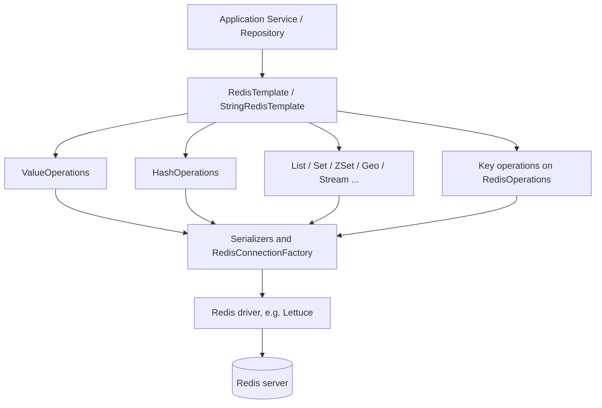

# Operation Groups and Key-Bound Operations

## 1. Where do Operations sit in the Spring Data Redis architecture?

When working with Redis in Spring Boot, applications usually do not send raw `GET`, `HSET`, or `ZADD` strings directly over a socket. **Spring Data Redis** provides data-access classes so Java code works naturally with Redis data types and structures. Two common entry points are:

- **`RedisTemplate<K, V>`**: a synchronous access point where you can configure how Java keys and values are serialized to bytes sent to Redis.
- **`StringRedisTemplate`**: a string-focused variant using string serializers for keys, values, and hash entries. Convenient for counters, status flags, identifiers, and pre-serialized JSON strings.

`RedisTemplate` implements `RedisOperations<K, V>`. From the template, you pick the **`opsFor...`** method group matching the Redis data type you want to work with. For example:

```java
StringRedisTemplate redis = /* injected by Spring */;

redis.opsForValue().set("app:status", "ready");
String status = redis.opsForValue().get("app:status");

redis.opsForHash().put("account:42:settings", "language", "vi");
Object language = redis.opsForHash().get("account:42:settings", "language");
```

This snippet shows two different Operations groups going through the same template. They **do not create two Redis databases** or two specialized connection types.

The dependency flow can be pictured as follows:



**Distinguishing roles:**

1. **Template** orchestrates command execution and applies serializers, the connection factory, and Spring Data Redis access mechanisms.
2. **Operations** are APIs grouped by Redis data type, such as Value, Hash, List, or Sorted Set.
3. **Bound Operations** are APIs already *bound to a specific key*, letting you invoke consecutive operations without passing the key name to every method.
4. **Redis server** executes the actual commands. Constraints around atomicity, TTL, memory, replication, and durability remain governed by Redis and its deployment.

For WebFlux applications using reactive programming, Spring Data Redis also provides `ReactiveRedisTemplate` and `ReactiveStringRedisTemplate` with the same Operations grouping concept, except methods return publishers like `Mono`/`Flux` and require a reactive connection factory. The examples below use **synchronous** APIs; do not mix reactive and synchronous APIs within the same processing flow.

## 2. Overview of Operations groups

A Redis key holds one current data type. Operations groups help select the right commands for that type.

| Spring Data Redis group | Redis data type | Representative operations | Use cases |
|---|---|---|---|
| `opsForValue()` → `ValueOperations<K,V>` | String (text, number, or serialized bytes) | `get`, `set`, `increment`, `setIfAbsent` | Key-based cache, flags, counters, temporary state |
| `opsForHash()` → `HashOperations<K,HK,HV>` | Hash | `put`, `get`, `increment`, `entries`, `delete` | Multiple small fields inside one Redis object |
| `opsForList()` → `ListOperations<K,V>` | List | `leftPush`, `rightPush`, `leftPop`, `rightPop`, `range` | Ordered lists, simple queues |
| `opsForSet()` → `SetOperations<K,V>` | Set | `add`, `remove`, `isMember`, `intersect` | Deduplicated collections, membership checks |
| `opsForZSet()` → `ZSetOperations<K,V>` | Sorted Set | `add`, `incrementScore`, `reverseRange`, `rank` | Leaderboards, scores, ordered sets |
| `opsForGeo()` → `GeoOperations<K,V>` | GEO structure (implemented on sorted sets in Redis) | `add`, `distance`, `search` | Coordinates, proximity lookups |
| `opsForHyperLogLog()` → `HyperLogLogOperations<K,V>` | HyperLogLog | `add`, `size`, `union` | Distinct-element cardinality estimation at large scale |
| `opsForStream()` → `StreamOperations` | Stream | `add`, `read`, `createGroup`, `acknowledge` | Event streams, consumer groups |

Exact method names and signatures may vary across Spring Data Redis and Redis versions. Some newer commands require compatible Redis server or client support. This table highlights the main API groups for choosing the right access pattern.

Common pitfall: **`opsForValue()` does not mean every value must be a Java `String`**. Redis ultimately stores bytes; `RedisTemplate<String, ProductDto>` can serialize an object into JSON/bytes and store it under Redis's String type. Conversely, `HashOperations` structures *one Redis key* into multiple field–value pairs.

## 3. Standard style: Operations taking the key on every call

In the standard API, each call specifies the Redis key explicitly:

```java
@Service
public class ProductViewCounter {
    private final StringRedisTemplate redis;

    public ProductViewCounter(StringRedisTemplate redis) {
        this.redis = redis;
    }

    public long recordView(String productId) {
        String key = "product:view-count:v1:" + productId;

        Long newCount = redis.opsForValue().increment(key);
        if (newCount == null) {
            throw new IllegalStateException("Failed to receive counter value");
        }
        return newCount;
    }

    public String readCount(String productId) {
        return redis.opsForValue().get(
                "product:view-count:v1:" + productId);
    }
}
```

`increment(key)` maps to atomic numeric increment behavior via the corresponding Redis command for that key. If the key does not exist yet, Redis initializes it from 0 before incrementing. **Never** implement increments as `get` followed by `set(count + 1)` under concurrent requests: two requests can read the same stale value and lose an update.

`increment` returns a boxed `Long` that can be `null` in contexts like pipelines/transactions; this example checks for `null` while illustrating standard synchronous calls.

A pattern for storing temporary state with TTL:

```java
String key = "verification:state:v1:" + requestId;
redis.opsForValue().set(key, "PENDING", Duration.ofMinutes(3));

String state = redis.opsForValue().get(key);
```

`set(key, value, Duration)` instructs Redis to store the value with an expiration in the same write operation, which is preferable to issuing `set` and `expire` as two separate commands for the same purpose.

## 4. Key-bound style: Bound Operations

When a service repeatedly interacts with **the same Redis key**, Spring Data Redis provides `bound...Ops(key)` methods. They return a **`Bound*Operations`** object holding the target key:

```java
String key = "job:status:v1:job-17";

// Passing the key each time
redis.opsForValue().set(key, "RUNNING", Duration.ofMinutes(10));
String before = redis.opsForValue().get(key);

// Binding the key once
BoundValueOperations<String, String> job =
        redis.boundValueOps(key);
job.set("DONE", Duration.ofMinutes(10));
String after = job.get();
```

Both styles access the exact same `job:status:v1:job-17` key and value in Redis. `boundValueOps` simply offers an interface to invoke `set(value)`, `get()`, and `increment()` without repeating `key`.

| Capability | Standard Operations | Equivalent Bound Operations |
|---|---|---|
| Single value | `redis.opsForValue().get(key)` | `redis.boundValueOps(key).get()` |
| Hash fields | `redis.opsForHash().get(key, field)` | `redis.boundHashOps(key).get(field)` |
| List | `redis.opsForList().range(key, 0, 9)` | `redis.boundListOps(key).range(0, 9)` |
| Unique set | `redis.opsForSet().isMember(key, element)` | `redis.boundSetOps(key).isMember(element)` |
| Ranked set | `redis.opsForZSet().reverseRange(key, 0, 9)` | `redis.boundZSetOps(key).reverseRange(0, 9)` |
| Coordinates | `redis.opsForGeo().position(key, member)` | `redis.boundGeoOps(key).position(member)` |

Some Spring Data Redis versions also provide a bound interface for Streams. When working with Streams, check the `boundStreamOps` signature for your version's API; in principle, `opsForStream()` can always specify the stream key directly.

**Bound does not mean:**

- A *Redis connection* is permanently dedicated to that object.
- A Redis key is exclusively locked against other requests.
- Multiple method calls automatically form a transaction or pipeline.
- Data is cached inside the JVM without hitting Redis.
- The key receives a default TTL or is pre-created before commands are called.

Each method still executes with the semantics of its corresponding Redis command. Bound Operations are primarily a way to **group operations in a service/repository around a single specific key**, improving readability and reducing key-passing mistakes.

### Example: managing a shopping cart in a Redis Hash

```java
@Service
public class CartStateService {
    private final StringRedisTemplate redis;

    public CartStateService(StringRedisTemplate redis) {
        this.redis = redis;
    }

    public void setQuantity(String cartId, String sku, int quantity) {
        String key = "cart:items:v1:" + cartId;
        BoundHashOperations<String, String, String> cart =
                redis.boundHashOps(key);

        if (quantity <= 0) {
            cart.delete(sku);
        } else {
            cart.put(sku, Integer.toString(quantity));
        }

        redis.expire(key, Duration.ofHours(1));
    }

    public int getQuantity(String cartId, String sku) {
        BoundHashOperations<String, String, String> cart =
                redis.boundHashOps("cart:items:v1:" + cartId);

        String stored = cart.get(sku);
        return stored == null ? 0 : Integer.parseInt(stored);
    }
}
```

In this example, **`key`** is the Redis key for the entire cart; **`sku`** is a *field* inside the Hash. `cart.put(sku, ...)` is an `HSET`-like operation, unlike `redis.opsForValue().set(key, ...)`, which would overwrite the type and contents of the entire key.

`expire(key, ...)` sets the expiration on **the entire Hash**, not on a single SKU field. Notably, `put/delete` and `expire` here are **two independent commands**; if the program fails mid-way, the TTL may not be set/updated as intended. For data that must receive a TTL upon creation, design an atomic operation—such as a Redis script—or a cleanup/monitoring mechanism. This sample cart is also only transient state; finalized orders should be persisted in a durable system of record.

## 5. Understanding each group through single-key access

### 5.1. ValueOperations: one key, one value

This group is closest to the classic key–value model:

```java
ValueOperations<String, String> values = redis.opsForValue();

values.set("feature:maintenance:v1", "off");
String maintenance = values.get("feature:maintenance:v1");

values.set("otp:attempts:v1:user-42", "0", Duration.ofMinutes(5));
Long attempts = values.increment("otp:attempts:v1:user-42");

Boolean created = values.setIfAbsent(
        "request:dedup:v1:req-123",
        "PROCESSING",
        Duration.ofMinutes(2));
```

- `get`: reads the value; may return `null` when the key does not exist.
- `set`: writes or overwrites; overwriting with plain `SET` can drop a previous TTL unless retention or a new TTL is specified.
- `increment`: atomic numeric increment, suitable for counters.
- `setIfAbsent(key, value, timeout)`: creates only if the key does not exist, with an expiration; useful for short-lived duplicate-request detection. Does not by itself guarantee business-level *exactly-once* execution.

Equivalent Bound Value:

```java
BoundValueOperations<String, String> attempts =
        redis.boundValueOps("otp:attempts:v1:user-42");
Long count = attempts.increment();
```

**When to choose:** ID-based caches, counters, simple flags/states, properly protected random tokens. If you need to update individual attributes of an object frequently, consider Hash instead of re-serializing an entire JSON string every time.

### 5.2. HashOperations: one key, multiple field–value pairs

Example storing job state:

```text
Key: jobs:detail:v1:42       (Redis Hash)
  status     -> RUNNING
  percent    -> 70
  owner      -> worker-a
```

```java
HashOperations<String, String, String> hashes =
        redis.opsForHash();

String key = "jobs:detail:v1:42";
hashes.put(key, "status", "RUNNING");
hashes.put(key, "owner", "worker-a");
hashes.put(key, "percent", "70");

String status = hashes.get(key, "status");
Long currentPercent = hashes.increment(key, "percent", 5L);
Map<String, String> allFields = hashes.entries(key);
```

`increment(key, field, delta)` increments a numeric field; the operation on that field is atomic in Redis. `entries(key)` returns all fields of the Hash, so avoid calling it unconditionally on very large Hashes. Redis also offers hash scanning when batched iteration is needed.

Use `boundHashOps(key)` when a repository operates on multiple fields of the same object. Remember to distinguish the `key` parameter (identifying the Hash record in Redis) from `field` (identifying an attribute inside the Hash).

### 5.3. ListOperations: insertion order and popping elements

```java
String key = "notifications:pending:v1:user-42";
redis.opsForList().leftPush(key, "notification-1");
redis.opsForList().leftPush(key, "notification-2");

String next = redis.opsForList().rightPop(key);
List<String> firstPage = redis.opsForList().range(key, 0, 9);
```

Combining `leftPush` and `rightPop` implements a simple FIFO pattern. `range` slices by index; in Redis, `0..9` is inclusive on both ends. Elements can repeat, unlike Sets.

Lists work well for simple lists/stacks/queues, but **a pop operation can lose data if a consumer crashes before finishing processing**. When you need acknowledgments, retries, consumer groups, and pending-entry tracking, look at Redis Streams or a dedicated message broker. Use `boundListOps(key)` to bind to a specific list.

### 5.4. SetOperations: unique-element sets

```java
String key = "course:members:v1:java";
redis.opsForSet().add(key, "user-1", "user-2", "user-1");

Boolean joined = redis.opsForSet().isMember(key, "user-2");
Long memberCount = redis.opsForSet().size(key);
```

A Redis Set keeps only one copy of each element and supports membership tests as well as set union/intersection/difference. It **does not guarantee presentation order**. If you fetch all elements, `members(key)` can consume significant RAM and bandwidth for large sets; use controlled scanning when needed. `boundSetOps(key)` retains the set's key.

### 5.5. ZSetOperations: unique elements with scores

```java
String key = "leaderboard:weekly:v1:2026-W46";
redis.opsForZSet().add(key, "user-1", 120.0);
redis.opsForZSet().add(key, "user-2", 85.0);
redis.opsForZSet().incrementScore(key, "user-2", 40.0);

Set<String> topTen = redis.opsForZSet()
        .reverseRange(key, 0, 9);
```

Sorted Sets keep unique elements ordered by **score**; `reverseRange` returns them in descending score order. `incrementScore` is helpful for leaderboards. If you also need scores alongside members, see `reverseRangeWithScores`, which returns element–score tuples.

`boundZSetOps(key)` fits services managing a single leaderboard. Multi-key operators in Redis Cluster must also respect hash-slot placement constraints.

### 5.6. GeoOperations: location lookups on a single key

A single key can store many members with geographic coordinates. `GeoOperations` can add members, measure distances, and search within a radius. Redis stores geo data using sorted sets internally, while Spring Data Redis provides the Geo API for clarity of intent.

For example, delivery hubs can be stored under `delivery:stations:v1:city-01`, where each member is a station ID with longitude/latitude. Radius searches use `opsForGeo()` with `Point`, `Distance`, `GeoReference`, and search options supported by Spring Data Redis. If an application needs complex GIS math, polygons, multiple coordinate reference systems, or deep spatial relationships, consider PostGIS rather than relying solely on Redis Geo.

### 5.7. HyperLogLogOperations: estimating distinct counts

HyperLogLog estimates cardinality with very small memory usage:

```java
String key = "visitors:unique:v1:2026-11-12";
redis.opsForHyperLogLog().add(key, "user-1", "user-2", "user-1");
Long estimatedUniqueVisitors = redis.opsForHyperLogLog().size(key);
```

The result is an **estimate**, not an exact figure for auditing or billing. Do not use HyperLogLog to check whether a specific user is in the set; it offers no `isMember` operation like Set. You can use `opsForHyperLogLog()` directly when a key tracks high-cardinality distinct counts.

### 5.8. StreamOperations: key for an event stream

A Redis Stream stores ID-indexed records, supporting reads, consumer groups, and acknowledgments. For instance, `events:orders:v1` can hold `created`, `paid`, and `cancelled` records with their corresponding fields.

The primary API is `opsForStream()`. Unlike Lists, Streams provide consumer groups and pending entries; however, **they do not automatically deliver business-level exactly-once processing**. Consumers may redeliver/reprocess records; you still need idempotency, retries, retention/trimming policies, backlog control, and monitoring. Before choosing Streams, evaluate capacity, retention, replay, and durability requirements.

## 6. Operations targeting the Redis key itself

Beyond `opsForValue()`, `opsForHash()`, and the rest, the template itself offers methods to manage **keys**. These work regardless of whether the key holds a String, List, Hash, or Sorted Set.

| Common method | Meaning |
|---|---|
| `hasKey(key)` | Checks whether the key currently exists |
| `delete(key)` | Deletes the key and its contents |
| `unlink(key)` | Requests deletion using Redis's asynchronous memory-reclamation mechanism |
| `expire(key, Duration)` | Sets a relative time-to-live on the entire key |
| `expireAt(key, Date)` | Sets an absolute expiration timestamp |
| `getExpire(key)` or `getExpire(key, TimeUnit)` | Reads the remaining TTL |
| `persist(key)` | Removes the expiration rule so the key stays until deleted or evicted |
| `type(key)` | Determines the Redis data type of the key |
| `rename(oldKey, newKey)` | Renames a key; consider target overwrite behavior and deployment constraints |
| `scan(ScanOptions)` | Iterates keys in batches via a cursor, avoiding loading the entire keyspace |

Example tracking TTL on a temporary state:

```java
String key = "job:status:v1:job-17";

Boolean exists = redis.hasKey(key);
Boolean ttlSet = redis.expire(key, Duration.ofMinutes(5));
Long secondsRemaining = redis.getExpire(key, TimeUnit.SECONDS);

if (Boolean.TRUE.equals(exists)) {
    System.out.println("Remaining TTL: " + secondsRemaining + " seconds");
}
```

Redis conventionally returns **`-1`** for an existing key with no expiration and **`-2`** for a nonexistent key; Spring Data Redis surfaces these as `Long` (and sometimes `null` in pipelines/transactions). Distinguish those sentinel values from actual remaining TTL. Checking `hasKey` and then operating **does not guarantee the key still exists**, because another request may delete it in between.

### TTL applies to the key, not automatically to individual child elements

For example:

```text
Hash key "cart:v1:42"       -> expires after 1 hour
  field "sku-A"             -> quantity = 2
  field "sku-B"             -> quantity = 1
```

Under standard TTL semantics, key expiration deletes the entire cart; **it does not mean `sku-A` and `sku-B` have independent field TTLs**. Modern Redis versions have added hash-field expiration capabilities, but only use them after verifying exact server version and Spring Data Redis API support. Likewise, being able to read individual members of a Set or ZSet does not imply per-member TTLs.

**Never use `keys("*")` to scan a large keyspace in production request paths**: `KEYS` can block Redis while scanning huge numbers of keys, and in Redis Cluster scanning spans distributed nodes. Prefer well-structured key namespaces, direct ID lookups, or batched `SCAN` when enumeration is truly necessary.

## 7. Serialization directly affects Operations results

`RedisTemplate` converts Java objects into bytes before sending them to Redis:

```text
Java String / Object
      |
      v
RedisSerializer
      |
      v
Redis bytes: key / value / hash field / hash value
      |
      v
Redis server
```

Four serializer slots are typically configured independently:

- **Key serializer**: encodes Redis keys.
- **Value serializer**: encodes values for `ValueOperations` and elements of several collections.
- **Hash key serializer**: encodes field names inside a Hash.
- **Hash value serializer**: encodes field values inside a Hash.

For example, given the exact same Java string `"user:42"`, if one template uses `StringRedisSerializer` and another uses a binary serializer, they produce different key bytes. Two templates that appear to use the same key name in Java **do not necessarily point to the same key in Redis**.

Therefore:

1. Use `StringRedisTemplate` when consistent string representation is sufficient.
2. When using `RedisTemplate<String, MyDto>`, choose explicit serializers and plan schema evolution compatibility.
3. For Redis Hashes, verify `hashKeySerializer` and `hashValueSerializer` specifically; Java generics do not automatically configure serialization.
4. Avoid storing Java native serialization or unvalidated polymorphic deserialization for untrusted inputs; cached data exposed to untrusted input should be treated as untrusted.

Type mismatches also fail immediately in Redis: if `cart:v1:42` is currently a Hash, calling `opsForList().leftPush("cart:v1:42", ...)` will not convert it to a List—it returns a `WRONGTYPE` error. Designing key namespaces by purpose and data type prevents collisions.

## 8. When should you use Bound Operations?

**Use `opsFor...` when:**

- A method operates across many different keys inside a loop or flow.
- You want the Operations object injected/stored and keys passed explicitly on each call.
- Only one operation is performed and creating a Bound variable adds no clarity.

**Use `bound...Ops(key)` when:**

- A method reads, writes, increments/decrements, or fetches elements **multiple times on the same key**.
- A service or handler wraps a single specific Redis record as its scope.
- You want to emphasize that multiple Hash fields or Set members belong to the same key.

Comparison example:

```java
String key = "ranking:weekly:v1:2026-W46";

// Operations: key appears on every call
redis.opsForZSet().add(key, "alice", 10);
redis.opsForZSet().incrementScore(key, "alice", 5);
redis.opsForZSet().reverseRange(key, 0, 9);

// Bound Operations: focused on a single leaderboard
BoundZSetOperations<String, String> ranking =
        redis.boundZSetOps(key);
ranking.add("alice", 10);
ranking.incrementScore("alice", 5);
Set<String> topTen = ranking.reverseRange(0, 9);
```

Do not store a `Bound*Operations` instance bound to a specific `userId` as a shared singleton service for all users. Because it carries a **fixed key**, instantiate it per task/user within the appropriate scope. The template itself can be managed by Spring as a reusable bean.

## 9. Atomicity, TTL, and transactions: API boundaries

### 9.1. One Redis command may be atomic, but two Java calls are not

On a single key, `increment` performs an atomic step. By contrast:

```java
String previous = redis.opsForValue().get(key);
redis.opsForValue().set(key, nextValue(previous));
```

Another request can interleave between these two separate commands. **Bound Operations do not change this**:

```java
BoundValueOperations<String, String> bound = redis.boundValueOps(key);
String previous = bound.get();
bound.set(nextValue(previous)); // still two independent Redis commands
```

When an atomic read–modify–write update is required, consider built-in Redis commands, `SET ... NX ...` with TTL, Redis scripts/functions, or appropriate transaction mechanisms. Understand the exact semantics of the chosen approach before applying it to critical business logic.

### 9.2. Transactions and pipelines are distinct mechanisms

- **Pipelining**: batches sending multiple commands to cut network round trips; does not turn them into a transaction.
- **Redis transactions**: use `MULTI`/`EXEC` to queue and execute commands under Redis rules; not equivalent to RDBMS relational rollbacks.
- **Spring transactions**: integrating Redis with Spring transactions requires explicit configuration/mechanisms; you do not get an automatic ACID transaction spanning PostgreSQL and Redis.

None of these behaviors arise simply from using `boundHashOps` or `boundValueOps`. In Redis Cluster, multi-key commands generally must obey hash-slot constraints; a service holding multiple Bound Operations does not guarantee their keys land in the same slot.

### 9.3. Every structure has memory and size costs

Redis runs primarily in RAM. Operations retrieving full contents—such as `entries` on a huge Hash, `members` on a huge Set, or `range(key, 0, -1)` on a huge List—can strain Java memory, network bandwidth, and Redis. Designs should enforce size limits, retention lifetimes, pagination/scanning strategies, and monitoring metrics.

When many keys expire simultaneously or cache entries are evicted, load can surge back onto the origin datastore. TTLs must reflect business requirements rather than arbitrary convenient numbers.

## 10. Designing the Redis access layer in a Spring application

A maintainable structure:

```text
Controller
    |
    v
Application Service
    |
    +--> Domain Repository --> Durable Database
    |
    +--> Redis State/Cache Adapter
             |
             v
     StringRedisTemplate / RedisTemplate
             |
             v
     Operations or Bound Operations
```

Services should expose **business-intent methods** such as `incrementViewCount(productId)`, `findCartQuantity(cartId, sku)`, or `markRequestSeen(requestId)`, rather than leaking Redis key names, Hash types, or TTL details into controllers.

Example adapter managing a job status:

```java
@Repository
public class JobStatusRedisStore {
    private static final Duration TTL = Duration.ofMinutes(20);
    private final StringRedisTemplate redis;

    public JobStatusRedisStore(StringRedisTemplate redis) {
        this.redis = redis;
    }

    private BoundValueOperations<String, String> statusOf(String jobId) {
        return redis.boundValueOps("jobs:status:v1:" + jobId);
    }

    public void save(String jobId, String status) {
        statusOf(jobId).set(status, TTL);
    }

    public String find(String jobId) {
        return statusOf(jobId).get();
    }

    public void remove(String jobId) {
        redis.delete("jobs:status:v1:" + jobId);
    }
}
```

Here, `statusOf(jobId)` expresses the *one job to one Redis key* relationship. `save` ensures temporary status receives a TTL atomically inside the `set` call; `remove` uses a key operation because it deletes the whole key. `find` can return `null` when no status exists or the TTL has expired: the application layer must define what `null` means rather than confusing it with a failed job state.

Across multiple application instances, a shared-state pattern like this works better than per-JVM `Map`s; however, you must still configure connection timeouts, behavior during Redis outages, and which data can be recovered.

## 11. Common pitfalls and proper reasoning

| Symptom | Common cause | Resolution |
|---|---|---|
 `WRONGTYPE` when calling Operations | The same Redis key already holds another data type | Inspect `type(key)`, namespaces, key creation, and migrations |
| Java reads `null` even though Redis has data | Key/serializer mismatch, TTL expired, reading wrong Redis DB/cluster, or missing write | Verify key bytes/serializers, connection target, TTL, and writes |
| Counter is lower than request count | Code uses a `GET` then `SET` pair | Use `increment` / atomic commands |
| All Hash fields disappear together | TTL was set on the Hash key, not per field | Design data lifecycle and key-level TTL intentionally |
| First few requests are slow, subsequent ones fast | Cache miss followed by population in Redis | Monitor hit rate and load on origin database |
| Redis uses too much RAM | Keys lack TTL, huge values/collections, unbounded namespaces | Bound sizes and lifetimes, measure memory, use controlled scans |
| `Bound*Operations` still has race conditions | Bound only fixes the key; it creates no transaction | Use atomic commands, scripts, or proper synchronization |
| Two `RedisTemplate`s cannot read the same Java key name | Different serializer configurations | Standardize serializers and data versions |

## 12. Choosing APIs for a new requirement

Suppose you need to build a “daily article view count” feature:

1. **What Redis data needs to be stored?** An integer counter per `articleId` and date.
2. **Which data type fits?** A Redis String is sufficient; no Hash/List/Stream needed.
3. **Which Operations?** `ValueOperations.increment(key)` for single increments; `BoundValueOperations.increment()` when performing repeated operations on one key.
4. **What TTL?** If only keeping active stats for 7 days, set and manage TTL with an explicit policy. Note `INCR` and `EXPIRE` are two separate commands; if newly created keys must always have a TTL, design an atomic update rather than relying on two independent calls.
5. **Is long-term history required?** If view counts feed official reporting, persist/sync them to a durable store; keep only fast-moving counts in Redis.
6. **Which service owns the key?** Name it e.g. `article:views:daily:v1:<date>:<id>` inside a single adapter rather than scattering key strings across controllers.

Framed around a concrete problem, choosing an Operations group becomes straightforward: **Value for a single value; Hash for multiple fields; List for ordered sequences; Set for unique members; ZSet for rankings; Geo for coordinates; HyperLogLog for cardinality estimates; Stream for record streams**. When performing consecutive operations on the same key, use **Bound Operations** to make data scope clear in code. Whichever API you choose, keep *the Redis key*, *inner fields/members*, *serializers*, *TTL*, and *atomicity* of each call clearly separated.
