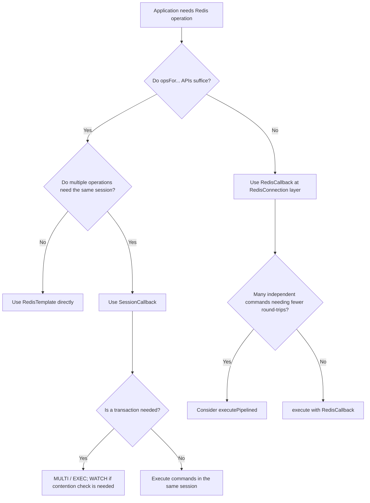

# RedisCallback and SessionCallback in Spring Data Redis

In Spring Data Redis, `RedisTemplate` and `StringRedisTemplate` provide convenient operations such as `opsForValue()`, `opsForHash()`, `opsForSet()`, and `opsForList()`. However, there are situations where you need direct control over Redis commands, to coordinate multiple commands on a single connection, or to execute a transaction with `MULTI`/`EXEC`. Two key extension interfaces in this architecture are **`RedisCallback<T>`** and **`SessionCallback<T>`**.

Both callbacks are passed to the template's `execute(...)` method, yet they receive **two different working objects**:

- `RedisCallback<T>` receives **`RedisConnection`**: a low-level interface working with serialized data and raw commands.
- `SessionCallback<T>` receives **`RedisOperations<K, V>`**: a high-level template-like interface executed within the same Redis session/connection, suited for grouping operations and managing transactions.

The goal of this lesson is to understand the exact responsibilities of each callback, know how to pick the right API, and avoid common pitfalls with connections, serializers, transactions, and pipelines.

## 1. Where callbacks fit in the Spring Data Redis architecture

### 1.1. Layers of operation

```text
Application Service / Repository
              |
              v
     RedisTemplate<K, V>          StringRedisTemplate
              |                          |
              +--------------------------+
              |
        +-----+-----------------------------+
        |                                   |
        v                                   v
  Standard operation APIs              Callback API
  opsForValue/Set/Hash/...              execute(...)
                                            |
                           +----------------+----------------+
                           |                                 |
                           v                                 v
                     RedisCallback<T>                 SessionCallback<T>
                     RedisConnection                  RedisOperations<K,V>
                     low-level commands               commands via template API
                           |                                 |
                           +----------------+----------------+
                                            |
                                            v
                                  RedisConnectionFactory
                                            |
                                            v
                                     Redis Server
```

`RedisConnectionFactory` creates or provides Redis connections through a driver such as Lettuce. `RedisTemplate` manages connection usage lifecycles and translates exceptions according to the Spring Data model. Callback authors focus on data operations and **must not call `close()` on the connection supplied by the template**.

`RedisTemplate` can be used concurrently by multiple threads once configured, but individual method calls do not automatically share the same connection. This is why `SessionCallback` has a distinct role when multiple operations require the same connection context.

### 1.2. Quick comparison

| Criterion | `RedisCallback<T>` | `SessionCallback<T>` |
|---|---|---|
| Functional method | `T doInRedis(RedisConnection connection)` | `<K,V> T execute(RedisOperations<K,V> operations)` |
| Received object | Low-level connection | Template-level Redis operations API |
| Command parameter types | Typically `byte[]` or lower-level types | Keys/values typed as `K`, `V`, via the template's configured serializers |
| Primary use case | Low-level commands, direct connection access, certain pipeline forms | Ensuring multiple template-level operations share one session, especially `WATCH`/`MULTI`/`EXEC` |
| Connection management | Handled by the template | Handled by the template |
| Creates a transaction automatically? | No | **No**; you must explicitly call `multi()`/`exec()` or use configured transaction support |
| Makes all commands atomic automatically? | No | No; you must understand Redis atomicity semantics |

Do not assume only `SessionCallback` uses a single connection: a single `RedisCallback` invocation also receives a concrete `RedisConnection`. The crucial difference is **the API level provided** and the ability to group standard `RedisOperations` calls within the same session.

## 2. `RedisCallback<T>`: operating directly on RedisConnection

### 2.1. API shape

```java
@FunctionalInterface
public interface RedisCallback<T> {
    T doInRedis(RedisConnection connection) throws DataAccessException;
}
```

This snippet illustrates the basic interface signature; nullability annotations and exact declaration details may vary by library version. In application code, the corresponding imports are:

```java
import org.springframework.data.redis.connection.RedisConnection;
import org.springframework.data.redis.core.RedisCallback;
import org.springframework.dao.DataAccessException;
```

The template accepts the callback and supplies an active `RedisConnection`:

```java
T result = redisTemplate.execute((RedisCallback<T>) connection -> {
    // Invoke commands directly through connection.
    return resultFromRedis;
});
```

This is a conceptual sketch where `T` and `resultFromRedis` are replaced by concrete types and values. Java lets you write `RedisCallback` as a lambda because it has a single abstract method.

### 2.2. Example: incrementing a counter via RedisConnection

Suppose a service needs to invoke the Redis `INCR` command directly to increment page views:

```java
import org.springframework.data.redis.core.RedisCallback;
import org.springframework.data.redis.core.StringRedisTemplate;
import org.springframework.data.redis.serializer.StringRedisSerializer;
import org.springframework.stereotype.Service;

@Service
public class VisitCounterService {

    private final StringRedisTemplate redisTemplate;
    private final StringRedisSerializer stringSerializer;

    public VisitCounterService(StringRedisTemplate redisTemplate) {
        this.redisTemplate = redisTemplate;
        this.stringSerializer = new StringRedisSerializer();
    }

    public Long countVisit(String pageId) {
        String key = "page:" + pageId + ":views";
        byte[] rawKey = stringSerializer.serialize(key);

        return redisTemplate.execute((RedisCallback<Long>) connection ->
                connection.stringCommands().incr(rawKey));
    }
}
```

Here:

1. The application builds the key name as a business-readable String.
2. `StringRedisSerializer` converts the key to `byte[]` because `RedisConnection` APIs expect binary data.
3. `connection.stringCommands().incr(rawKey)` sends the equivalent of `INCR page:<id>:views`.
4. The `Long` returned by Redis is propagated out of `redisTemplate.execute(...)`.

When you only need to increment a number, the shorter option is usually:

```java
Long views = redisTemplate.opsForValue()
        .increment("page:" + pageId + ":views");
```

Thus, `RedisCallback` is **an escape hatch when needed**, not mandatory for routine Redis operations.

### 2.3. Example: reading a String value from the low-level layer

`RedisConnection` does not automatically convert a `byte[]` into a domain-meaningful Java object. You must decode the result with the matching serializer:

```java
public String readRawString(String key) {
    byte[] rawKey = stringSerializer.serialize(key);

    return redisTemplate.execute((RedisCallback<String>) connection -> {
        byte[] rawValue = connection.stringCommands().get(rawKey);
        return rawValue == null ? null : stringSerializer.deserialize(rawValue);
    });
}
```

Crucially, **serialization must match how the data was written to Redis**. If the key was written by a `RedisTemplate` configured with a different serializer, manually encoding with UTF-8 can misread or fail to locate the data even if the key name looks identical.

### 2.4. Control and responsibilities of RedisCallback

`RedisCallback` fits when you need to:

- Call a command or set of commands directly via `RedisConnection` command groups.
- Work with binary payloads or specialized serializers.
- Use connection-level APIs not conveniently expressed by `opsFor...()`.
- Execute a sequence of low-level commands inside one template call or via `executePipelined(...)`.

Inside the callback, **do not close the connection**, do not manually manage the lifecycle of a template-owned connection, and do not assume consecutive `execute` calls return the same connection instance. If your goal is a transaction spanning multiple template-level operations, `SessionCallback` is usually clearer.

## 3. `SessionCallback<T>`: multiple operations on the same Redis session

### 3.1. API shape and why it exists

The interface defines a single method:

```java
public interface SessionCallback<T> {
    <K, V> T execute(RedisOperations<K, V> operations)
            throws DataAccessException;
}
```

Here, `RedisOperations<K,V>` is the contract implemented by `RedisTemplate`. Inside the callback, code can continue using:

```java
operations.opsForValue()
operations.opsForHash()
operations.opsForSet()
operations.opsForList()
operations.multi()
operations.exec()
operations.watch(...)
operations.unwatch()
```

`SessionCallback` ensures operations invoked through **the passed `operations` object** share the same underlying Redis session/connection. This is essential for `WATCH`, `MULTI`, queued commands, and `EXEC` to execute properly on the same Redis connection.

**Note on Java generics:** the callback method declares `<K,V>` type parameters at the method level. When working with String keys/values in learning examples, you can use the raw signature `execute(RedisOperations operations)` as shown in Spring Data Redis documentation. The examples below include `@SuppressWarnings({"rawtypes", "unchecked"})` to scope generic warnings. Real applications should keep template and serializer usage consistent and avoid ungrounded casts.

### 3.2. Example: multiple operations in the same session without a transaction

```java
import org.springframework.data.redis.core.RedisOperations;
import org.springframework.data.redis.core.SessionCallback;

Long size = redisTemplate.execute(new SessionCallback<Long>() {
    @Override
    @SuppressWarnings({"rawtypes", "unchecked"})
    public Long execute(RedisOperations operations) {
        operations.opsForSet().add("online:users", "user-1001");
        return operations.opsForSet().size("online:users");
    }
});
```

Both `SADD` and `SCARD` travel over the same session. However, another client's commands can still execute between those two commands. `SessionCallback` **does not lock Redis and does not implicitly create a transaction boundary**.

For simple operations, calling `opsForSet()` directly remains more readable; use a session deliberately when connection continuity is required by your algorithm.

## 4. Redis transactions with `MULTI`, `EXEC`, and `DISCARD`

Redis supports grouping commands into a transaction with:

```text
MULTI
  -> queue command A
  -> queue command B
EXEC
  -> execute queued commands
```

- `MULTI` starts command-queuing mode.
- Commands after `MULTI` are queued by Redis and do not immediately return normal data results to the client.
- `EXEC` executes the queued commands in order and returns their results.
- `DISCARD` flushes queued commands before the transaction has been executed.

Redis executes the commands of a single `EXEC` contiguously without interleaving commands from other clients. However, **a Redis transaction is not an SQL transaction with automatic rollback on runtime errors**: if one command fails during `EXEC`, other valid commands may still execute. `DISCARD` can only cancel commands still queued prior to `EXEC`.

### 4.1. Complete example: order confirmation

Suppose confirming an order requires recording its status and adding the order ID to a set of confirmed orders:

```java
import java.util.List;
import org.springframework.dao.DataAccessException;
import org.springframework.data.redis.core.RedisOperations;
import org.springframework.data.redis.core.SessionCallback;
import org.springframework.data.redis.core.StringRedisTemplate;
import org.springframework.stereotype.Service;

@Service
public class OrderConfirmationService {

    private final StringRedisTemplate redisTemplate;

    public OrderConfirmationService(StringRedisTemplate redisTemplate) {
        this.redisTemplate = redisTemplate;
    }

    public List<Object> confirm(String orderId) {
        return redisTemplate.execute(new SessionCallback<List<Object>>() {
            @Override
            @SuppressWarnings({"rawtypes", "unchecked"})
            public List<Object> execute(RedisOperations operations)
                    throws DataAccessException {

                operations.multi();
                try {
                    operations.opsForValue()
                            .set("order:" + orderId + ":status", "CONFIRMED");
                    operations.opsForSet()
                            .add("orders:confirmed", orderId);

                    return operations.exec();
                } catch (RuntimeException ex) {
                    // While still in MULTI state, discard queued commands.
                    operations.discard();
                    throw ex;
                }
            }
        });
    }
}
```

In this example, `StringRedisTemplate` handles String keys, values, and set members. Calling `operations.multi()` / `operations.exec()` inside **the same callback** shares one session, keeping the commands in the same Redis transaction. The `SADD` issued between `MULTI` and `EXEC` typically returns `null` in Spring Data Redis because the actual result is deferred until `EXEC`; actual command results are returned in the `List<Object>` from `exec()`.

Some result shapes depend on the driver version and transaction-result conversion; business code should know the element types in `List<Object>` before casting.

On special failure paths such as disconnects or timeouts, `discard()` itself can fail; in such cases preserve the original exception and let the connection layer dispose of the broken connection. Do not treat the `catch` block as guaranteeing rollback after `EXEC` has already succeeded in Redis.

### 4.2. Why shouldn't you call `multi()` and `exec()` as separate template calls?

The following snippet **does not guarantee using the same connection** unless the template has an active transaction/session context:

```java
redisTemplate.multi();
redisTemplate.opsForValue().set("order:42:status", "CONFIRMED");
redisTemplate.exec();
```

Without connection binding, separate template calls can borrow different connections. Redis transactions require `MULTI`/`EXEC` and the intervening commands to execute on the same connection. Wrapping the block in `SessionCallback` is the direct way to establish that condition.

### 4.3. Do not read newly written values while still queuing

Example:

```java
operations.multi();
operations.opsForValue().set("demo:key", "new-value");
Object value = operations.opsForValue().get("demo:key");
List<Object> results = operations.exec();
```

Here, `get(...)` does not supply `"new-value"` for Java code to use immediately during the queuing phase. Read APIs typically return `null` inside a transaction while commands are queued; command outputs appear in `results` after `EXEC`. Never branch business logic on an expected value before `EXEC`.

## 5. `WATCH`: controlling concurrent updates

A `MULTI/EXEC` transaction ensures a group of commands runs without another client interleaving in between, but it does not solve a **read → compute → write** workflow when clients concurrently read stale state. Redis provides `WATCH` for **optimistic locking**.

Flow:

```text
Client A                             Client B
  |                                     |
  | WATCH stock:sku-42                  |
  | GET stock:sku-42  -> 10             |
  |                                     | SET stock:sku-42 8
  | MULTI                               |
  | SET stock:sku-42 9                  |
  | EXEC  -> aborted because key changed|
  |                                     |
  v                                     v
Retry reading and recalculating, if appropriate
```

`WATCH` must be called **before `MULTI`** on the exact same connection used for the transaction. If a watched key is modified before `EXEC`, Redis aborts the transaction instead of overwriting with stale data. The application receives an aborted result and can retry per its policy.

### 5.1. Example: conditional stock reservation

The example below decrements inventory only if sufficient stock remains. Each attempt starts with `WATCH`, reads the current value, and only then enters `MULTI`:

```java
public boolean reserveStock(String productId, long requested) {
    if (requested <= 0) {
        throw new IllegalArgumentException("requested must be positive");
    }

    String key = "stock:" + productId;

    Boolean reserved = redisTemplate.execute(new SessionCallback<Boolean>() {
        @Override
        @SuppressWarnings({"rawtypes", "unchecked"})
        public Boolean execute(RedisOperations operations) {
            for (int attempt = 0; attempt < 3; attempt++) {
                operations.watch(key);

                String raw = (String) operations.opsForValue().get(key);
                long available = raw == null ? 0 : Long.parseLong(raw);

                if (available < requested) {
                    operations.unwatch();
                    return false;
                }

                operations.multi();
                try {
                    operations.opsForValue()
                            .set(key, Long.toString(available - requested));

                    List<Object> txResult = operations.exec();
                    if (txResult != null) {
                        return true;
                    }
                    // WATCH detected contention: start another attempt.
                } catch (RuntimeException ex) {
                    operations.discard();
                    throw ex;
                }
            }
            return false;
        }
    });

    return Boolean.TRUE.equals(reserved);
}
```

This example uses `StringRedisTemplate` as in the earlier service, storing stock values as numeric strings. `exec()` can return `null` when a transaction is aborted due to `WATCH`. Production systems should clearly distinguish contention failures (eligible for retry) from insufficient stock (do not retry), as well as handle exhausted retry attempts.

When you only need an unconditional atomic subtraction on one key, `DECRBY`/`increment(key, -requested)` suffices. However, the condition **decrement only if enough stock remains** requires coordinating a read and an update; `WATCH` or a Redis Lua script are the tools to guard that condition. Also consider changes outside Redis and consistency with any primary database.

## 6. Callbacks and pipelining: a different purpose from transactions

Redis **pipelining** sends multiple commands consecutively without waiting for each response, then collects the results when the pipeline finishes. This cuts round-trip overhead between the application and Redis for bulk operations. Pipelining **does not imply a transaction** and makes no promise that commands execute atomically together.

Spring Data Redis offers two common overloads:

```java
List<Object> results = redisTemplate.executePipelined(RedisCallback<?> action);
List<Object> results = redisTemplate.executePipelined(SessionCallback<?> session);
```

This is API notation, not two Java lines meant to be declared together in a method. With `executePipelined`, the return value of **the callback itself must be `null`**; `executePipelined(...)` returns the `List<Object>` holding the Redis command results.

Example pipelining multiple counter increments:

```java
import java.util.List;
import org.springframework.data.redis.core.RedisCallback;

public List<Object> addVisitsInPipeline(String pageId, int count) {
    if (count < 0) {
        throw new IllegalArgumentException("count cannot be negative");
    }

    byte[] rawKey = stringSerializer.serialize("page:" + pageId + ":views");

    return redisTemplate.executePipelined((RedisCallback<Object>) connection -> {
        for (int i = 0; i < count; i++) {
            connection.stringCommands().incr(rawKey);
        }
        return null;
    });
}
```

Here, the list of results corresponding to each `INCR` is returned after the pipeline completes. Inside a pipeline, never rely on the immediate return value of a connection command to drive subsequent commands; responses may not have arrived yet.

Pipelining optimizes network transport; transactions coordinate execution. The two can be combined in certain driver-supported scenarios, provided you understand result ordering, serializers, and transaction boundaries. For simply adding to a single counter, one `INCRBY` command is far simpler than pipelining hundreds of `INCR` commands.

## 7. Serialization: an easy trap when switching between callbacks

When using `StringRedisTemplate`:

```java
redisTemplate.opsForValue().set("demo:name", "Lan");
```

The template serializes String keys and values via its configured serializers. When using `RedisCallback`:

```java
byte[] key = stringSerializer.serialize("demo:name");
byte[] value = redisTemplate.execute((RedisCallback<byte[]>) connection ->
        connection.stringCommands().get(key));
```

The value returned directly from `RedisConnection` is `byte[]`. To turn it into a String:

```java
String name = value == null ? null : stringSerializer.deserialize(value);
```

In `SessionCallback`, because calls go through the template's `RedisOperations`, key/value serialization generally follows the template's configuration:

```java
Object name = operations.opsForValue().get("demo:name");
```

This snippet illustrates code inside a method taking raw `RedisOperations`. If using a `RedisTemplate<String, MyObject>` with a JSON serializer, the result matches that serializer's target type—**not automatically a String**.

Check all four serializer slots explicitly when working with Hashes or complex objects: `keySerializer`, `valueSerializer`, `hashKeySerializer`, and `hashValueSerializer`. Mismatched serializers can make data look like two distinct keys or cause `EXEC`/pipeline results to deserialize to unexpected types.

## 8. Relationship with `@Transactional` in Spring

`SessionCallback` executes a Redis transaction via explicit `multi()`/`exec()` calls. This is **not synonymous** with Spring's `@Transactional` annotation.

By default, `RedisTemplate` **does not participate** in Spring-managed transactions. To enlist a template into an active transaction, enable transaction support on the template:

```java
@Bean
StringRedisTemplate stringRedisTemplate(RedisConnectionFactory factory) {
    StringRedisTemplate template = new StringRedisTemplate(factory);
    template.setEnableTransactionSupport(true);
    return template;
}
```

With an appropriate transaction manager configured, Spring can bind a Redis connection to the active transaction and issue `EXEC` on commit or `DISCARD` on rollback. Spring Data Redis does not provide a standalone `PlatformTransactionManager` exclusively for Redis the way JDBC does. Enabling Redis transaction support also **does not create an atomic distributed transaction** across Redis and SQL; if both are critical write targets, design an appropriate data-consistency strategy.

Inside a bound Spring transaction, reads may still be routed to a separate connection and not see queued writes. When you need a direct Redis transaction, `SessionCallback` makes the connection scope explicit in code. Avoid casually mixing `@Transactional` with manual `MULTI/EXEC`, as that can produce unpredictable transaction contexts.

## 9. Common mistakes and how to handle them

| Mistake | Why it is wrong | How to handle it |
|---|---|---|
| Using `RedisCallback` and passing a `String` into binary commands | Many `RedisConnection` commands require `byte[]` | Serialize keys/values according to the configured format |
| Calling `connection.close()` inside a callback | The template owns the connection lifecycle | Let the template manage releasing the connection |
| Calling `multi()` and `exec()` as detached template calls | Not guaranteed to share the same connection | Wrap in `SessionCallback` or configure proper transaction binding |
| Assuming `SessionCallback` makes every command atomic | A session only preserves connection context | Use `MULTI/EXEC`, `WATCH`, Lua, or atomic commands |
| Reading a value inside `MULTI` and treating it as already available | Commands are still queued | Read before `MULTI` with `WATCH`, or inspect `EXEC` results |
| Forgetting `DISCARD` on error before `EXEC` | The connection may remain in transaction mode | Clean up transaction state and handle connection errors |
| Expecting pipelining to guarantee a transaction | Pipelining only optimizes command transmission | Use transactions when an atomic execution boundary is needed |
| Returning a non-`null` value from a callback inside `executePipelined` | The API returns pipeline results, not the callback return value | `return null` and read the `List<Object>` from `executePipelined(...)` |
| Calling the outer template instead of the `operations` parameter inside `SessionCallback` | May escape the controlled session | Only use the `operations` object passed into the callback |
| Assuming transaction results match single-command results | `MULTI` queues commands; serializers/converters run on `EXEC` | Interpret the `List<Object>` returned by `exec()` |

## 10. Choosing the right API when designing a service

Several application scenarios:

**Scenario A – Caching a product name:**

```java
redisTemplate.opsForValue().set("product:42:name", "Keyboard");
```

This requirement is simple; no callback is needed.

**Scenario B – Issuing a single connection-level command:**

```java
Long value = redisTemplate.execute((RedisCallback<Long>) conn ->
        conn.stringCommands().incr(rawKey));
```

Use `RedisCallback` when you need direct connection control or raw binary operations. In this example, `rawKey` is a serialized byte array.

**Scenario C – Two Redis updates that must execute in one transaction:**

```java
redisTemplate.execute(new SessionCallback<List<Object>>() {
    @Override
    @SuppressWarnings({"rawtypes", "unchecked"})
    public List<Object> execute(RedisOperations ops) {
        ops.multi();
        try {
            ops.opsForValue().set("a", "1");
            ops.opsForValue().set("b", "2");
            return ops.exec();
        } catch (RuntimeException ex) {
            ops.discard();
            throw ex;
        }
    }
});
```

Use `SessionCallback` because both operations must remain on the same session throughout `MULTI`/`EXEC`.

**Scenario D – Sending a batch of commands without depending on individual intermediate results:**

`executePipelined(...)` sends multiple commands in one batch. Pick the callback matching your desired API level; only use pipelining when command volume and transmission overhead show a measurable benefit.

### Decision flowchart



This flowchart outlines choices by intent. The approaches are not mutually exclusive: `SessionCallback` can be run via an `executePipelined` overload, and a `RedisCallback` can execute multiple low-level commands on the connection it receives. What matters is reading API boundaries and execution semantics clearly.

## 11. Conclusion and key takeaways

`RedisCallback` and `SessionCallback` are both extension points on `RedisTemplate`, serving two distinct architectural needs:

1. **`RedisCallback`** fits when you need `RedisConnection` and low-level operations. You must actively encode/decode `byte[]` according to the serializer.
2. **`SessionCallback`** fits when multiple `RedisOperations` commands must share one session; especially useful for `WATCH`, `MULTI`, `EXEC`, and `DISCARD`.
3. **A session does not automatically mean a transaction.** Transactions require explicit mechanisms; checking and updating based on previously read data requires concurrency control via `WATCH`, atomic commands, or scripts.
4. **Transactions differ from pipelining.** Transactions govern how command groups execute; pipelining primarily reduces network round-trip latency.
5. **The template owns the connection.** Callbacks must not close connections; use matching serializers, understand when results materialize, and avoid stray template calls outside the session.

Choosing the right callback lets Spring Data Redis code retain the convenience of Spring abstractions while granting fine-grained control over Redis operations wherever genuinely needed.

## References

- [Spring Data Redis – Working with Objects through RedisTemplate](https://docs.spring.io/spring-data/redis/reference/redis/template.html)
- [Spring Data Redis – Redis Transactions](https://docs.spring.io/spring-data/redis/reference/redis/transactions.html)
- [Spring Data Redis – Pipelining](https://docs.spring.io/spring-data/redis/reference/redis/pipelining.html)
- [API: RedisCallback](https://docs.spring.io/spring-data/redis/reference/api/java/org/springframework/data/redis/core/RedisCallback.html)
- [API: SessionCallback](https://docs.spring.io/spring-data/redis/reference/api/java/org/springframework/data/redis/core/SessionCallback.html)
