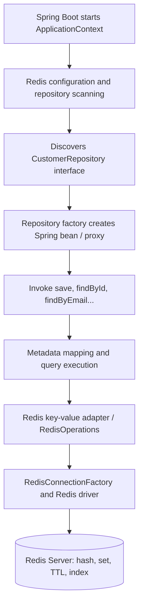

# How Redis Repositories Are Created in Spring Data Redis

When working with Redis in a Spring application, developers can use `RedisTemplate` to send commands directly, or declare a **Redis Repository** to manipulate Java objects via methods such as `save()`, `findById()`, `findAll()`, and `deleteById()`. With the repository approach, you typically write only an interface:

```java
public interface CustomerRepository extends CrudRepository<Customer, String> {
    List<Customer> findByEmail(String email);
}
```

No `CustomerRepositoryImpl` class is written by the developer, yet Spring can still inject `CustomerRepository` into services and execute those methods. **What creates the object implementing this interface, and how does data travel from Java to Redis?** That is the Redis Repository creation mechanism.

In the context of **Spring Data Redis**, distinguish three activities:

1. **Repository declaration:** The developer defines the interface, entity, and mapping metadata.
2. **Spring bean creation:** Spring Data discovers the interface, builds repository infrastructure, and creates a runtime proxy implementing the methods.
3. **Persisting data into Redis:** When methods are invoked, mapping components and the Redis adapter translate repository operations into commands against keys, hashes, sets, and indexes in Redis Server.

Repositories are created by Spring inside `ApplicationContext`; Redis Server **does not create a Java “repository” itself**. Redis only stores the data structures used by the repository.

## 1. Where Redis Repository sits in the Spring architecture

Spring Data offers a shared repository model across multiple databases. Spring Data Redis is one implementation of that model, built around a **key-value repository** engine.

Common components:

| Component | Role |
|---|---|
| `CrudRepository<T, ID>` | Declares standard CRUD contract: `save`, `findById`, `findAll`, `deleteById`, etc. |
| `RedisRepository<T, ID>` | Redis-specific repository interface inheriting key-value repository operations |
| `@RedisHash` | Marks an object type stored in Redis hashes and declares its keyspace |
| `@Id` | Identifies the entity's ID property |
| `@Indexed` | Requests maintaining a secondary index to support querying by that property |
| `@EnableRedisRepositories` | Enables and configures scanning for Redis Repository interfaces when configured explicitly |
| Repository factory / factory bean | Creates the repository bean and the proxy implementing the interface |
| Mapping context / converter | Reads entity metadata, converts Java objects to Redis data and back |
| Redis key-value adapter / template | Translates CRUD and query operations into Redis actions |
| `RedisConnectionFactory` | Provides Redis connections via a driver, typically Lettuce in Spring Boot apps |

Overall flow:



The diagram shows responsibilities at a conceptual level. Exact internal classes may vary across Spring Data Redis versions, yet the principle **interface → repository proxy → mapping → Redis operations** stays the same.

## 2. Preparing Spring to create a Redis Repository

### 2.1. Adding Spring Data Redis to the application

In a Spring Boot project using Gradle, the dependency is typically declared as:

```groovy
dependencies {
    implementation 'org.springframework.boot:spring-boot-starter-data-redis'
}
```

The starter supplies Spring Data Redis components and connection support. Example configuration in `application.yml`:

```yaml
spring:
  data:
    redis:
      host: localhost
      port: 6379
```

Redis Server must be reachable at the configured host/port with appropriate credentials. In Spring Boot applications, `RedisConnectionFactory` is typically auto-configured from properties and classpath dependencies.

### 2.2. Declaring an entity with `@RedisHash` and `@Id`

Suppose you want to store customer information in Redis:

```java
package com.example.redis.customer;

import org.springframework.data.annotation.Id;
import org.springframework.data.redis.core.RedisHash;
import org.springframework.data.redis.core.index.Indexed;

@RedisHash("customers")
public class Customer {

    @Id
    private String id;

    @Indexed
    private String email;

    private String displayName;

    protected Customer() {
        // Constructor for data mapping.
    }

    public Customer(String id, String email, String displayName) {
        this.id = id;
        this.email = email;
        this.displayName = displayName;
    }

    public String getId() {
        return id;
    }

    public void setId(String id) {
        this.id = id;
    }

    public String getEmail() {
        return email;
    }

    public void setEmail(String email) {
        this.email = email;
    }

    public String getDisplayName() {
        return displayName;
    }

    public void setDisplayName(String displayName) {
        this.displayName = displayName;
    }
}
```

The three annotations serve different purposes:

- `@RedisHash("customers")` indicates the entity is managed as a Redis hash; the string `customers` is the **keyspace**, typically forming the prefix of the Redis key name.
- `@Id` uses `org.springframework.data.annotation.Id` to identify the entity ID in Spring Data's model. In this example, IDs are assigned explicitly for clarity.
- `@Indexed` instructs Spring Data Redis to maintain a secondary index structure based on `email`. With this index, the repository can look up customers by email.

An ordinary Java class does not automatically become a Redis entity just by sharing a name with a Redis key. Spring Data requires entity metadata and matching repository configuration to route operations to Redis.

### 2.3. Declaring the repository interface

```java
package com.example.redis.customer;

import java.util.List;
import org.springframework.data.repository.CrudRepository;

public interface CustomerRepository
        extends CrudRepository<Customer, String> {

    List<Customer> findByEmail(String email);
}
```

`CrudRepository<Customer, String>` specifies:

- The stored aggregate type is `Customer`.
- The ID type is `String`, matching the entity's `id` field.
- Basic CRUD methods are provided by Spring Data infrastructure.
- `findByEmail` is a *derived query method*. In Redis Repositories, this relies on metadata and secondary indexes; it does not turn into an SQL query.

You do not need to write `CustomerRepositoryImpl`, nor is `@Repository` required on an interface discovered by Spring Data Repository scanning.

### 2.4. Enabling repository scanning

When you want to configure the Redis Repository scan scope explicitly:

```java
package com.example.redis.config;

import com.example.redis.customer.CustomerRepository;
import org.springframework.context.annotation.Configuration;
import org.springframework.data.redis.repository.configuration.EnableRedisRepositories;

@Configuration
@EnableRedisRepositories(basePackageClasses = CustomerRepository.class)
public class RedisRepositoryConfiguration {
}
```

`basePackageClasses` tells Spring which package containing `CustomerRepository` to scan. Alternatively, Spring Boot can **auto-configure Redis repositories when auto-configuration conditions are satisfied**; not every project needs the explicit annotation. Choose one approach suited to your application structure, especially when combining JPA, MongoDB, or multiple Redis connections.

## 3. How does Spring actually create the repository bean?

Repository creation happens while Spring builds the `ApplicationContext`, before any service uses the bean.

### Stage 1 — Reading configuration and determining scan scope

`@EnableRedisRepositories` or Spring Boot auto-configuration activates Redis Repository registration. Spring Data scans the designated packages for interfaces matching the repository contract, such as `CustomerRepository`.

If an application uses multiple Spring Data modules, store disambiguation is critical. Annotations such as `@RedisHash` allow Redis infrastructure to recognize Redis-owned entities rather than mistaking them for another store's repository. Scan scopes and store-to-entity bindings must be unambiguous.

### Stage 2 — Registering a bean definition for the interface

Spring cannot instantiate an interface directly via `new CustomerRepository()`. Instead, repository infrastructure registers a **factory bean** carrying metadata about the interface, entity, ID, and required dependencies.

That factory uses Spring Data Repository infrastructure to generate a **proxy** implementing the interface contract at runtime. From a consumer's perspective, the proxy behaves like any normal Spring bean:

```java
import org.springframework.stereotype.Service;

@Service
public class CustomerService {

    private final CustomerRepository repository;

    public CustomerService(CustomerRepository repository) {
        this.repository = repository;
    }

    public Customer create(String id, String email, String name) {
        return repository.save(new Customer(id, email, name));
    }
}
```

When instantiating `CustomerService`, Spring injects the repository proxy into its constructor. That is why an interface can be invoked without a developer-written implementation class.

### Stage 3 — Binding behavior for each method category

The proxy intercepts method calls and routes them to the right execution handler:

| Method | Execution path |
|---|---|
| `save(customer)` | Key-value CRUD implementation; maps the entity and writes to Redis |
| `findById("c-001")` | Looks up the key from keyspace + ID; maps the hash back to the entity |
| `findAll()` | Uses the keyspace ID-tracking structure to locate entities |
| `deleteById("c-001")` | Deletes entity data and updates associated metadata/index structures |
| `findByEmail("a@example.com")` | Parses method name, then resolves matching IDs via the secondary index |
| Default or custom fragment methods | Runs logic matching the declared method and fragment configuration |

To callers, all of these are ordinary Java method invocations. Internally, the proxy coordinates Spring Data components such as repository factories, method metadata, and query executors.

### Stage 4 — Mapping Java objects to Redis keys and values

Spring Data Redis uses metadata from `@RedisHash`, `@Id`, `@Indexed`, and mapping settings to convert objects into Redis structures. Components such as `MappingRedisConverter` and the Redis key-value adapter perform this translation.

Unlike manually `SET`ting a JSON string into Redis, a Redis Repository typically **stores entity properties as a Redis hash**, along with auxiliary keys used by the repository:

```text
Java:
Customer {
  id          = "c-001"
  email       = "an@example.com"
  displayName = "An Nguyen"
}

Observable Redis keys:

customers:c-001
  TYPE: hash
  email     -> "an@example.com"
  displayName -> "An Nguyen"
  ...       -> type and mapping metadata if any

customers
  TYPE: set
  contains IDs of Customers in the keyspace

customers:email:an@example.com
  TYPE: set
  contains IDs of Customers with the corresponding email
```

This model illustrates the core structures, not a promise that every version writes the exact same internal fields or byte representation. Actual key names also depend on keyspace, ID, mapping settings, and data.

**Why are auxiliary keys needed?** Redis does not natively know “all Customers” or “all Customers with email X” across isolated hashes. Spring Data Redis maintains ID sets and secondary indexes to support common repository operations.

### Stage 5 — Executing commands over the Redis connection

Finally, the Redis adapter uses `RedisOperations` and `RedisConnectionFactory` to dispatch commands via the driver to Redis Server. Operations may include hash reads/writes, set updates, TTL management, and key deletions.

One `repository.save(customer)` call in Java can therefore translate into **multiple Redis commands** to keep primary data and indexes in sync. Do not assume these multi-key operations are transactionally atomic like a single SQL statement; transaction requirements must be designed separately.

## 4. Tracing a write and read cycle

Suppose a service executes:

```java
Customer saved = repository.save(
    new Customer("c-001", "an@example.com", "An Nguyen")
);

Customer loaded = repository.findById("c-001").orElseThrow();

List<Customer> byEmail = repository.findByEmail("an@example.com");
```

### When `save()` runs

1. The repository proxy receives the object and inspects `Customer` metadata.
2. Metadata identifies keyspace `customers`, ID `c-001`, and persisted properties.
3. The converter maps Java properties into hash fields.
4. The adapter writes the hash at the entity key and adds the ID to the keyspace set.
5. Because `email` carries `@Indexed`, the adapter updates the corresponding index set. When an entity's email is updated via repository operations, old/new index references are updated as well.

### When `findById()` runs

Spring Data derives the key from keyspace and ID, reads the hash data, and reconstructs the `Customer` entity. If the key does not exist, it returns `Optional.empty()`.

### When `findByEmail()` runs

This is not a naive “scan every hash and filter by email”:

1. Query infrastructure extracts the search predicate on `email`.
2. Redis infrastructure consults the matching secondary index to retrieve candidate IDs.
3. The repository reads the hashes for those IDs and maps them into a `List<Customer>`.

`@Indexed` **does not enforce uniqueness**. Two customers can share the same email and both appear in query results. If business rules require uniqueness, the application must enforce it separately.

### Inspecting in Redis CLI

After running `save()`, you can inspect the learning Redis instance:

```redis
TYPE customers:c-001
HGETALL customers:c-001
TYPE customers
SMEMBERS customers
SMEMBERS customers:email:an@example.com
```

The output confirms that Redis Repository uses **hashes for aggregates** and **sets for metadata/indexes**. Exact key names and internal fields can vary with Spring Data Redis configuration.

Avoid modifying these index sets directly via Redis CLI in production applications, as they are managed by the repository. Writing hashes directly while bypassing the adapter leaves indexes out of sync.

## 5. How are repository queries generated from method names?

A repository interface can declare finder methods following naming conventions. Spring Data parses the method name to determine target properties and query criteria. However, **Redis Repositories have different query capabilities than JPA Repositories** because Redis is not a relational database.

Example:

```java
public interface CustomerRepository extends CrudRepository<Customer, String> {
    List<Customer> findByEmail(String email);
}
```

`findByEmail` expresses a lookup on `email`, which Spring Data Redis satisfies using `@Indexed` on that field.

Important limitations:

- There are no relational tables, SQL `JOIN`s, or an RDBMS query optimizer behind Redis Repositories.
- Not every complex query method supported by Spring Data JPA is supported—or has identical semantics—in Redis.
- Redis derived queries generally rely on **declared secondary indexes** and key-value capabilities.
- For analytics, full-text search, complex sorting/pagination, or multi-criteria ad-hoc filtering without appropriate indexes, evaluate custom data structures or a dedicated search/query engine.

In short, Spring Data can **generate repository method implementations**, but it cannot invent indexes or query capabilities that Redis does not have.

## 6. Where is TTL configured in a Redis Repository?

Redis Repositories can manage aggregate lifetimes through metadata.

### Fixed TTL at the entity-type level

```java
@RedisHash(value = "temporaryCustomers", timeToLive = 600)
public class TemporaryCustomer {

    @Id
    private String id;

    private String name;

    // Constructors, getters, and setters.
}
```

`timeToLive = 600` sets a default **600-second** expiration for the entity's key upon saving. Redis deletes the key once that duration elapses.

### Per-entity dynamic TTL

You can annotate a numeric property with `@TimeToLive`, for example:

```java
import org.springframework.data.annotation.Id;
import org.springframework.data.redis.core.RedisHash;
import org.springframework.data.redis.core.TimeToLive;

@RedisHash("loginSessions")
public class LoginSession {

    @Id
    private String id;

    private String userId;

    @TimeToLive
    private Long ttlSeconds;

    public LoginSession() {}

    public LoginSession(String id, String userId, Long ttlSeconds) {
        this.id = id;
        this.userId = userId;
        this.ttlSeconds = ttlSeconds;
    }

    public String getId() { return id; }
    public void setId(String id) { this.id = id; }
    public String getUserId() { return userId; }
    public void setUserId(String userId) { this.userId = userId; }
    public Long getTtlSeconds() { return ttlSeconds; }
    public void setTtlSeconds(Long ttlSeconds) { this.ttlSeconds = ttlSeconds; }
}
```

`@TimeToLive` on a numeric type like `Long` typically represents seconds; Spring Data Redis versions read and apply TTL metadata accordingly. After saving a `LoginSession` with `ttlSeconds = 120L`, you can check:

```redis
TTL loginSessions:session-123
```

**Distinguish TTL from guaranteed retention:** even when a repository sets TTL, Redis can still evict keys early if configured with `maxmemory` and an eviction policy. Once evicted, repository reads no longer return the entity.

### Expiration events and index consistency

When Redis expires a key on its own, hash removal happens on Redis Server. Auxiliary secondary-index sets created by Spring Data Redis may rely on **Redis keyspace notifications** and an expiration listener to stay in sync.

This carries practical implications:

- Redis Pub/Sub does not durably queue events for offline subscribers; if the application is down or disconnected, events can be missed.
- Enabling keyspace notifications depends on Redis Server configuration and hosting constraints. Some managed Redis services restrict configuration commands.
- Index cleanup after expiration should not be assumed instantaneous or guaranteed across all error/disconnect scenarios.
- Spring Data Redis key-value repositories provide mechanisms to handle expired keys, but inspect listener setup carefully if index consistency or expiration callbacks are business-critical.

Accordingly, do not use Pub/Sub expiration notifications as the sole event source for workflows requiring guaranteed exactly-once processing.

## 7. How does Redis Repository differ from `RedisTemplate`?

Both `RedisTemplate` and Redis Repositories talk to Redis, but at different abstraction levels.

| Aspect | Redis Repository | `RedisTemplate` / `StringRedisTemplate` |
|---|---|---|
| Programming model | Entities and repository interfaces | Explicit command / data-structure operations |
| Getting started | `@RedisHash`, `@Id`, interface extending repository | Calling `opsForValue()`, `opsForHash()`, `opsForSet()`, etc. |
| Object mapping | Mapping metadata managed by Spring Data | Developer picks serializers, structures, and conversions |
| Common CRUD | `save`, `findById`, `deleteById`, etc. | `get`, `set`, `put`, `delete`, etc., per API |
| Secondary indexes | Maintainable via `@Indexed` | Designed and updated manually |
| Querying | Bounded by Redis Repository capabilities and indexes | Whatever Redis commands you use |
| Control over Redis | Simple for fitting aggregates | Flexible for fine-grained Redis types/commands |

For example, `StringRedisTemplate` might write:

```java
stringRedisTemplate.opsForValue()
    .set("customer:plain:c-001", "{\"name\":\"An Nguyen\"}");
```

This creates a **Redis string**, not a hash, keyspace set, or secondary index in the Redis Repository format. Hence `CustomerRepository.findById("c-001")` will not automatically know how to load it.

Conversely, when a Redis Repository stores an object as a hash, calling `StringRedisTemplate.opsForValue().get(...)` on that hash key causes a Redis type error. Always match the API to the underlying data structure.

### When to choose which?

- **Redis Repository** makes sense when objects have clear IDs, operations are mostly entity CRUD, queries stay within supported index capabilities, and you want built-in mapping/indexing.
- **RedisTemplate** makes sense when you need direct control over Redis structures—strings, lists, sets, sorted sets, streams, counters, atomic commands, pipelines, or custom cache formats.
- Both can coexist in one application, provided you clearly define **who owns which keys and index structures** to prevent incompatible overwrites.

## 8. Common errors when Spring fails to create a repository

### 8.1. Interface outside the scan scope

If Spring cannot find `CustomerRepository` within configured repository packages, bean injection fails.

**Fix:** Place the interface in a package scanned by Spring Boot or specify `basePackages` / `basePackageClasses` in `@EnableRedisRepositories`.

### 8.2. Unable to distinguish Redis from another store

Applications combining Spring Data JPA, MongoDB, and Redis may operate in strict repository-store disambiguation mode. An interface extending a generic CRUD contract whose entity lacks store-identifying metadata may not be assigned to Redis.

**Fix:** Annotate Redis entities with `@RedisHash`, separate packages and scan configurations per store, and avoid reusing a single domain class with conflicting persistence annotations.

### 8.3. Wrong `@Id` annotation

In these examples, `@Id` must come from `org.springframework.data.annotation.Id`. Accidentally importing another persistence framework's `@Id` can break ID mapping.

**Fix:** Verify the import and ensure the repository ID type matches the entity's ID field.

### 8.4. Repository bean exists, yet Redis connection fails

Spring can create the repository bean successfully even while Redis Server is down. Connection errors then surface later when calling `save` or `findById`.

**Fix:** Check host, port, password, TLS, network, `RedisConnectionFactory` config, and Redis Server status. Bean creation does not prove live Redis connectivity.

### 8.5. `findById()` works, but `findByEmail()` returns unexpected results

If `email` lacks `@Indexed` or existing records were written directly with `RedisTemplate` without updating indexes, index-based lookups will miss those entities.

**Fix:** Verify annotations and existing index sets; standardize on one write path. Adding `@Indexed` in code **does not automatically backfill indexes for pre-existing data**.

### 8.6. Keys disappear shortly after saving

Causes include TTL expiration, Redis eviction policies, explicit deletions, environment resets, or reading the wrong Redis database/keyspace. Repositories do not shield data from these infrastructure events.

**Fix:** Inspect `TTL`, `INFO stats`, `INFO memory`, `maxmemory-policy`, and application logs rather than assuming an empty `findById()` means a broken proxy.

## 9. Responsibility breakdown: what Spring manages vs. what Redis manages

| Task | Primary owner |
|---|---|
| Discovering the `CustomerRepository` interface | Spring Data repository scanning |
| Registering a bean for the interface | Spring container and repository factory |
| Creating proxy handling `save`, `findById`, `findByEmail` | Spring Data Repository infrastructure |
| Mapping `Customer` to a hash | Spring Data Redis mapping |
| Maintaining ID sets and secondary indexes from metadata | Spring Data Redis key-value adapter |
| Sending/receiving Redis commands | RedisOperations / RedisConnectionFactory / driver |
| Storing hashes, sets, TTLs, and executing commands | Redis Server |
| Expiration and eviction per server configuration | Redis Server |
| Business orchestration, consistency control, error handling | Application |

Separating responsibilities simplifies diagnostics: **missing repository bean** points to Spring registration; **bean exists but Redis calls fail** points to connectivity, mapping, keyspaces, data, or Redis limits; **property queries returning empty** usually point to metadata and indexes.

## 10. Short hands-on exercise

To observe the mechanism directly on a dedicated learning Redis instance:

1. Create `Customer`, `CustomerRepository`, and a service following the examples above.
2. Boot Spring Boot with valid Redis settings and inject the repository into the service.
3. Call `repository.save(new Customer("c-001", "an@example.com", "An Nguyen"))`.
4. In Redis CLI, run `HGETALL customers:c-001` and `SMEMBERS customers:email:an@example.com`.
5. Call `findById("c-001")` and `findByEmail("an@example.com")` to match returned objects against stored keys.
6. Change the email and call `save()` with the same ID, observing old vs. new email index sets.
7. Call `deleteById("c-001")`, inspect the hash and related sets; if TTL is configured, observe `TTL` and expiration behavior too.

Note that these commands are for a test Redis instance since writing/deleting entities and indexes mutates data.

## 11. Self-check questions

**1. Why can an interface `CustomerRepository` with no implementation class still run `save()`?**  
Because Spring Data registers a repository factory, generates a proxy implementing the interface contract, and delegates calls to repository infrastructure at runtime.

**2. Does `@RedisHash("customers")` create a `customers` table like a relational database?**  
No. It declares a keyspace for objects mapped into Redis hashes; Spring Data Redis may also create auxiliary set/index keys to support repository operations.

**3. Can you manually `SET customers:c-001` to a JSON string and read it normally with `findById("c-001")`?**  
You cannot assume that works. Redis Repositories use their own mapping and structures; a manually `SET` Redis string is not equivalent to a repository-managed Redis hash.

**4. When calling `findByEmail()`, does Redis scan all customers?**  
Matching finder methods generally rely on secondary indexes, such as `@Indexed` on `email`. Do not treat Redis Repositories as an arbitrary SQL query engine.

**5. Does configuring `@RedisHash(timeToLive = 600)` cause Spring to create the repository proxy?**  
`@RedisHash` describes the entity/keyspace, and `timeToLive` governs key retention. Proxy creation still depends on repository scanning, the repository factory, and infrastructure beans. Having a TTL on an entity does not guarantee the repository was registered.

Core takeaway: **a Redis Repository is a Spring bean generated by Spring Data infrastructure from an interface**, using entity metadata to translate CRUD and supported queries into Redis operations across hashes, ID sets, and secondary indexes. Understanding this pipeline helps you choose cleanly between repositories and templates while distinguishing Spring wiring issues from actual Redis storage behavior.
