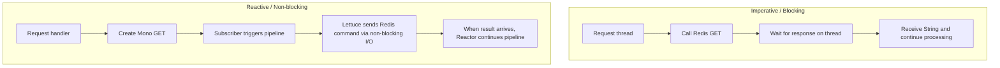

# Non-Blocking Model and Driver Support Requirements in Spring Data Redis Reactive

## 1. Lesson Objectives

Spring Data Redis provides both an **imperative (synchronous)** API and a **reactive** API. Both operate on Redis, but they differ significantly in how threads wait for results, how data is represented, how errors are handled, and what they require from the Redis driver.

For example, suppose an application needs to read a product description from Redis:

- With `StringRedisTemplate`, calling `get(key)` typically blocks the calling thread until a result or error is received.
- With `ReactiveStringRedisTemplate`, `get(key)` returns a `Mono<String>`. The I/O work is organized using a reactive API and a non-blocking driver; the calling thread does not have to stay parked waiting on a socket to receive data.
- However, if application code calls `.block()` on a `Mono` or runs synchronous JDBC directly inside a WebFlux flow, the system can still experience thread blocking even while using a reactive Redis API.

Beyond how code is written, **reactive Redis requires a driver capable of reactive I/O**. In Spring Data Redis, **Lettuce** supports reactive access, whereas **Jedis** primarily serves the imperative API and is not the choice for creating a `ReactiveRedisConnectionFactory` under standard Spring Data Redis integration.

This lesson helps you:

1. Explain the difference between blocking I/O and non-blocking I/O.
2. Understand `Mono`, `Flux`, subscription, backpressure, and Reactor when calling Redis.
3. Declare `ReactiveRedisConnectionFactory` and `ReactiveRedisTemplate` or `ReactiveStringRedisTemplate`.
4. Identify Lettuce/Jedis driver support requirements and common mistakes when migrating from imperative code.
5. Design reactive read/write flows, fallbacks, and appropriate load limits.
6. Recognize situations where reactive should not be used just because the API is available.

## 2. What Does Non-Blocking Redis Mean?

### 2.1. Blocking calls

In a synchronous program:

```java
String value = stringRedisTemplate.opsForValue().get("catalog:sku:1001");
System.out.println(value);
```

The thread calling `get(...)` must wait for the Redis operation to finish before executing the next line. When Redis responds quickly, the wait time is small; when the network is slow or Redis is overloaded, the thread may wait longer.

A system with many concurrent requests may have to maintain many threads waiting for I/O results. Threads consume scheduling resources, stack memory, and JVM coordination overhead.

### 2.2. Reactive calls

With the reactive API:

```java
Mono<String> result =
        reactiveStringRedisTemplate.opsForValue()
                .get("catalog:sku:1001");
```

`result` is not the `String` that was read. It is a **Publisher** following the Reactive Streams model, representing an operation that can emit a value, complete empty, or emit an error.

Subsequent processing is chained using operators:

```java
Mono<String> upperCase =
        reactiveStringRedisTemplate.opsForValue()
                .get("catalog:sku:1001")
                .map(String::toUpperCase);
```

Here, `map(...)` receives the value once the Redis result is ready; the application thread does not need to be held at a `get` call waiting for data.

### 2.3. Diagram of the difference



Key point: **non-blocking is a way of organizing how I/O waiting is handled**. It does not make Redis execute commands faster, does not eliminate network latency, and does not guarantee higher throughput in every workload.

If a task involves very little I/O, synchronous code may be easier to read and sufficiently responsive. Reactive is usually more useful when a system has **many concurrent connections/requests waiting on I/O** and the entire processing chain can remain non-blocking.

## 3. Mono and Flux Represent Redis Results

Spring Data Redis Reactive uses **Project Reactor** with two primary types.

| Type | Number of elements it can emit | Redis examples |
|---|---|---|
| `Mono<T>` | 0 or 1 element; can also terminate with an error | `GET` a single key, `SET` returning status, `EXISTS` a single key |
| `Flux<T>` | 0 to many elements; can also terminate with an error | Scanning multiple keys, reading multiple Stream records, receiving multiple Pub/Sub messages |

Example:

```java
Mono<String> name =
        reactiveRedis.opsForValue().get("catalog:item:1001");

Mono<Boolean> saved =
        reactiveRedis.opsForValue().set(
                "catalog:item:1001",
                "Fountain pen"
        );
```

For a key that does not exist, `get(...)` typically completes **empty** (`Mono.empty()`) rather than emitting `null`. Under Reactive Streams, `Mono` does not emit `null` as a successful element value.

Therefore, handle a cache miss with `switchIfEmpty`:

```java
Mono<String> name = reactiveRedis.opsForValue()
        .get("catalog:item:1001")
        .switchIfEmpty(Mono.just("No data available"));
```

Distinguish between:

- **Key missing:** can result in an empty Mono.
- **Redis timeout/disconnection:** results in an error signal (`onError`).
- **Redis has a value:** Mono emits the element successfully and then completes.

Do not use `defaultIfEmpty(...)` to "fix" a Redis error. This operator only handles an **empty** stream; it does not swallow exceptions.

### Useful operators

| Operator | Role |
|---|---|
| `map` | Synchronously transforms the result without replacing the publisher |
| `flatMap` | Chains an asynchronous operation returning a `Mono` |
| `flatMapMany` | Expands a `Mono` into a `Flux` |
| `switchIfEmpty` | Runs an alternative branch when the publisher emits no elements |
| `onErrorResume` | Recovers from an error according to a policy |
| `timeout` | Limits how long to wait for the publisher |
| `retryWhen` | Retries conditionally according to a policy |
| `then` | Waits for the preceding publisher to complete, ignoring its result |
| `doOnNext` / `doOnError` | Observes data/errors; not the main place to run business flows |
| `collectList` | Collects a Flux into a list in a Mono, consuming memory proportional to element count |

**Do not confuse `flatMap` with `map`:** if the handler function returns another `Mono`, use `flatMap` to chain the publisher; using `map` creates `Mono<Mono<T>>` and does not produce the intended data flow.

## 4. Redis Driver Support Requirements: Lettuce and Jedis

Spring Data Redis has connection abstractions for both models:

- `RedisConnectionFactory`: provides connections for the imperative Redis API.
- `ReactiveRedisConnectionFactory`: provides connections for the reactive Redis API.

Each API must be implemented by an appropriate driver. In standard Spring Data Redis integration, **`LettuceConnectionFactory`** is the key factory that can support both the synchronous API and the reactive API.

### Driver comparison

| Feature | Lettuce | Jedis |
|---|---|---|
| Imperative Redis access via Spring Data Redis | Yes | Yes |
| Netty-based I/O and asynchronous/reactive APIs | Yes | Not the reactive foundation of Spring Data Redis |
| Supports `ReactiveRedisConnectionFactory` in Spring Data Redis | Yes, via Lettuce | Not under standard reactive integration |
| Usable with `ReactiveRedisTemplate` | Yes | Do not use `JedisConnectionFactory` to provide reactive connections |
| When using only synchronous `RedisTemplate` | Can be used | Can be used |
| When working with WebFlux/reactive Redis end-to-end | Appropriate choice | Not a choice for the reactive Redis API |
| Standalone, Sentinel, Cluster | Depends on driver configuration and Redis topology | Depends on driver configuration and Redis topology |

In summary: **changing a service's return type to `Mono` does not turn a blocking Jedis client into a non-blocking driver**.

If an application configures `JedisConnectionFactory` and attempts to inject `ReactiveRedisConnectionFactory`, no suitable reactive factory bean may be found. In that case, revisit the driver being used rather than wrapping Jedis calls in `Mono.just(...)` and calling it reactive.

### Why is Lettuce suitable?

Lettuce uses Netty and a non-blocking I/O model to send/receive Redis commands. Spring Data Redis integrates with this driver to provide `Mono` and `Flux` types, allowing Redis commands to participate in Reactor pipelines.

Lettuce can also be used for the blocking/imperative API. This means seeing the Lettuce dependency **is not enough to prove a service is non-blocking**; the service must properly use `ReactiveRedisTemplate` and avoid blocking threads in the rest of the pipeline.

### Note on versions

The exact API surface, specific driver support conditions, Redis Cluster features, or reactive transactions may change across Spring Boot, Spring Data Redis, and Redis driver versions.

In real deployments, check the dependency versions **actually present in the application**, rather than relying solely on examples from another version. This lesson focuses on Spring Data Redis Reactive mechanisms with Lettuce and Project Reactor.

## 5. Setting Up a Spring Boot Reactive Redis Project

If the project uses Spring Boot with Gradle, you can declare:

```kotlin
dependencies {
    implementation("org.springframework.boot:spring-boot-starter-data-redis-reactive")
    implementation("org.springframework.boot:spring-boot-starter-webflux")
}
```

The reactive Redis starter brings in the components related to Spring Data Redis and a supported client; WebFlux is needed when implementing reactive HTTP endpoints, but **is not mandatory** if reactive Redis is only used inside a worker or non-HTTP service.

Maven example:

```xml
<dependencies>
    <dependency>
        <groupId>org.springframework.boot</groupId>
        <artifactId>spring-boot-starter-data-redis-reactive</artifactId>
    </dependency>
    <dependency>
        <groupId>org.springframework.boot</groupId>
        <artifactId>spring-boot-starter-webflux</artifactId>
    </dependency>
</dependencies>
```

If the Spring Boot project manages dependency versions, you typically do not specify separate versions for the starters.

Local Redis connection in `application.yml`:

```yaml
spring:
  data:
    redis:
      host: localhost
      port: 6379
      timeout: 2s
```

These values are for illustration only. Production systems need to determine host, authentication, TLS, timeouts, topology, reconnect settings, and resource limits according to the environment.

### How does auto-configuration work?

When the reactive Redis starter and Lettuce are present, Spring Boot can automatically create:

- `RedisConnectionFactory` via `LettuceConnectionFactory`.
- `ReactiveRedisConnectionFactory` from a factory that supports reactive.
- `ReactiveRedisTemplate` and/or `ReactiveStringRedisTemplate` matching auto-configuration conditions.
- The Reactor components needed for reactive processing flows.

You do not need to manually declare all beans when the default configuration suffices.

In applications with multiple Redis connections or custom serializers, explicit bean configuration may be needed. In that case, distinguish connection factory beans for synchronous and reactive APIs, as well as bean names when multiple templates exist.

## 6. Explicitly Configuring ReactiveStringRedisTemplate

When keys and values are strings, `ReactiveStringRedisTemplate` is an easy starting point because it already uses suitable string serializers.

Example when a dedicated template needs to be declared:

**`ReactiveRedisConfig.java`**

```java
package com.example.reactive.config;

import org.springframework.context.annotation.Bean;
import org.springframework.context.annotation.Configuration;
import org.springframework.data.redis.connection.ReactiveRedisConnectionFactory;
import org.springframework.data.redis.core.ReactiveStringRedisTemplate;

@Configuration
public class ReactiveRedisConfig {

    @Bean("productReactiveRedis")
    public ReactiveStringRedisTemplate productReactiveRedis(
            ReactiveRedisConnectionFactory factory
    ) {
        return new ReactiveStringRedisTemplate(factory);
    }
}
```

Meaning:

- `ReactiveRedisConnectionFactory` is a Redis connection bean **that supports reactive**.
- `ReactiveStringRedisTemplate` provides Redis command groups returning `Mono`/`Flux`.
- The bean name `productReactiveRedis` helps select the exact template in systems with multiple templates.
- When Spring Boot already auto-configures the corresponding template, this configuration is **optional** and does not need to duplicate the default bean.

Do not manually create `new LettuceConnectionFactory(...)` inside each service or per request. The connection factory should be managed by the Spring lifecycle to reuse resources, apply server configuration, and avoid creating uncontrolled Netty/client resources.

### Checking factory types in the architecture

If the application configures:

```java
@Bean
public RedisConnectionFactory redisConnectionFactory() {
    return new JedisConnectionFactory();
}
```

then this factory serves the imperative API; it should not be assumed to satisfy the constructor:

```java
new ReactiveStringRedisTemplate(reactiveConnectionFactory)
```

`ReactiveStringRedisTemplate` needs a genuine `ReactiveRedisConnectionFactory`. To obtain one in standard Spring Data Redis reactive integration, using Lettuce is appropriate.

Do not cast `RedisConnectionFactory` to `ReactiveRedisConnectionFactory` if the factory does not support that interface.

## 7. Non-Blocking Read/Write Example with ReactiveStringRedisTemplate

Suppose an application stores a product description string in Redis under the key `catalog:v1:description:<sku>`.

**`ReactiveProductCache.java`**

```java
package com.example.reactive.service;

import java.time.Duration;

import org.springframework.beans.factory.annotation.Qualifier;
import org.springframework.data.redis.core.ReactiveStringRedisTemplate;
import org.springframework.stereotype.Service;

import reactor.core.publisher.Mono;

@Service
public class ReactiveProductCache {

    private final ReactiveStringRedisTemplate redis;

    public ReactiveProductCache(
            @Qualifier("productReactiveRedis")
            ReactiveStringRedisTemplate redis
    ) {
        this.redis = redis;
    }

    public Mono<Boolean> saveDescription(
            String sku,
            String description
    ) {
        return redis.opsForValue()
                .set(key(sku), description, Duration.ofMinutes(10));
    }

    public Mono<String> findDescription(String sku) {
        return redis.opsForValue().get(key(sku));
    }

    public Mono<Long> deleteDescription(String sku) {
        return redis.delete(key(sku));
    }

    private String key(String sku) {
        return "catalog:v1:description:" + sku;
    }
}
```

The service does not call `.subscribe()` or `.block()`. It returns a publisher so that **the caller decides when to subscribe and manages the lifecycle**.

Example of a WebFlux handler:

```java
package com.example.reactive.web;

import com.example.reactive.service.ReactiveProductCache;
import org.springframework.web.bind.annotation.GetMapping;
import org.springframework.web.bind.annotation.PathVariable;
import org.springframework.web.bind.annotation.RequestMapping;
import org.springframework.web.bind.annotation.RestController;
import reactor.core.publisher.Mono;

@RestController
@RequestMapping("/api/products")
public class ProductController {

    private final ReactiveProductCache cache;

    public ProductController(ReactiveProductCache cache) {
        this.cache = cache;
    }

    @GetMapping("/{sku}/description")
    public Mono<String> description(@PathVariable String sku) {
        return cache.findDescription(sku);
    }
}
```

Spring WebFlux registers the subscription and writes the HTTP result according to the request lifecycle. If the key has no data, the publisher may complete empty; the application should define how to return 404 or fetch data from the primary source when appropriate. This snippet focuses only on the non-blocking pipeline.

### Why not call subscribe() inside the service?

An example to avoid in a data-reading service:

```java
public Mono<String> wrongGet(String sku) {
    redis.opsForValue()
            .get(key(sku))
            .subscribe(value -> System.out.println(value));

    return Mono.empty();
}
```

Here, the service starts an independent task and then returns an empty Mono, leaving the caller unaware of when the task completes and unable to receive its value or error. With HTTP, the task may keep running after the request has ended, which is undesirable.

Instead:

```java
public Mono<String> correctGet(String sku) {
    return redis.opsForValue().get(key(sku));
}
```

In a typical pipeline, let the framework or the component at the system boundary manage the subscription. Only call `subscribe()` directly when that component genuinely owns the lifecycle of a long-lived stream and manages errors/cancellation.

## 8. Composition: Chaining Multiple Redis Commands with flatMap

Suppose you need to save a description and then read it back to confirm the result:

```java
public Mono<String> saveThenRead(String sku, String description) {
    String key = "catalog:v1:description:" + sku;

    return redis.opsForValue()
            .set(key, description)
            .flatMap(saved -> {
                if (!Boolean.TRUE.equals(saved)) {
                    return Mono.error(
                            new IllegalStateException("Redis SET failed")
                    );
                }

                return redis.opsForValue().get(key);
            });
}
```

`set(...)` returns `Mono<Boolean>`, so `flatMap` is the right choice when the first step's result determines **a subsequent Redis call**.

A concise syntax when you only care that the write completes before the read step:

```java
public Mono<String> saveThenRead(String sku, String value) {
    String key = "catalog:v1:description:" + sku;

    return redis.opsForValue()
            .set(key, value)
            .then(redis.opsForValue().get(key));
}
```

`then(...)` waits for the preceding publisher to terminate successfully and then switches to the next publisher. It does not automatically turn two commands into a Redis transaction; if another client writes to the key between the two commands, the subsequent read may observe a different value.

### Using map for non-I/O transformations

```java
public Mono<String> formatted(String sku) {
    return redis.opsForValue()
            .get("catalog:v1:description:" + sku)
            .map(value -> "Description: " + value);
}
```

The `map` function merely transforms the string in Java, without needing a new publisher.

### When multiple independent commands are needed

You can combine two reads:

```java
public Mono<String> productLine(String sku) {
    Mono<String> name = redis.opsForValue()
            .get("catalog:v1:name:" + sku);

    Mono<String> price = redis.opsForValue()
            .get("catalog:v1:price:" + sku);

    return Mono.zip(name, price)
            .map(tuple -> tuple.getT1() + ": " + tuple.getT2());
}
```

`Mono.zip` waits for both publishers to emit values. If one key does not exist and its publisher completes empty, the zipped result may be empty; `defaultIfEmpty` or missing-data rules are needed if the business logic wants to proceed.

Two independent reads may be issued concurrently depending on subscription/scheduling. They are **not guaranteed to be an atomic point-in-time snapshot** of Redis.

## 9. Reactive Does Not Mean Calling the API Already Executes the Command

An important characteristic of Reactor: a publisher describes a pipeline. For typical reactive Redis operations, registering a subscription is what triggers the associated I/O flow.

Example:

```java
Mono<Boolean> setPublisher =
        reactiveRedis.opsForValue().set("demo:reactive:flag", "ON");
```

If a method simply creates `setPublisher` and discards it without any caller subscribing, you cannot assume the command has completed.

Conversely, if the same publisher is subscribed to multiple times, the I/O operation may be triggered multiple times:

```java
Mono<Boolean> operation =
        reactiveRedis.opsForValue().set("demo:reactive:flag", "ON");

// Two subscriptions can lead to executing the operation twice.
operation.subscribe();
operation.subscribe();
```

Do not rely on this behavior to create two records or mark a transaction complete; this is only an example of subscription behavior. When you need to share a single result among multiple subscribers, consider Reactor's sharing/caching operators according to the desired semantics, while understanding the lifetime and error policy of that publisher.

### Place side effects in the right spot

Do not execute a Redis command inside `map` and ignore the returned Mono:

```java
// Wrong: the Mono returned by set(...) is discarded.
return source.getValue()
        .map(value -> {
            redis.opsForValue().set("demo:key", value);
            return value;
        });
```

Replace with `flatMap`:

```java
return source.getValue()
        .flatMap(value ->
                redis.opsForValue()
                        .set("demo:key", value)
                        .thenReturn(value)
        );
```

This keeps the Redis write **inside** the reactive flow so the caller receives the completion or error signal.

## 10. Avoid block() and Synchronous Operations in WebFlux

A common mistake when migrating from Spring MVC to WebFlux:

```java
@GetMapping("/bad")
public String bad() {
    return reactiveRedis.opsForValue()
            .get("demo:key")
            .block();
}
```

`block()` blocks the thread until a result or error arrives. If run on an event-loop thread that forbids blocking, Reactor may throw an error; even where blocking is permitted, this eliminates the non-blocking benefit.

The appropriate version:

```java
@GetMapping("/good")
public Mono<String> good() {
    return reactiveRedis.opsForValue().get("demo:key");
}
```

Other potentially blocking calls to avoid directly inside event-loop callbacks:

- `Thread.sleep(...)`.
- Synchronous JDBC/JPA and blocking HTTP client calls.
- Large file reads using blocking APIs.
- Operations like `Future.get()` or `CountDownLatch.await()`.
- `redisTemplate.opsForValue().get(...)` (imperative template) inside a reactive pipeline.
- Long-running CPU-heavy work on the event-loop.

### If calling a blocking library is unavoidable

Not every infrastructure component has a reactive API. When you must integrate a blocking operation, you can offload it from the event-loop using an appropriate scheduler:

```java
import reactor.core.publisher.Mono;
import reactor.core.scheduler.Schedulers;

public Mono<String> readLegacyBlocking(String key) {
    return Mono.fromCallable(
            () -> legacyStringRedisTemplate.opsForValue().get(key)
    ).subscribeOn(Schedulers.boundedElastic());
}
```

This avoids blocking the event-loop directly, but **the Redis I/O itself is still blocking** and consumes a scheduler thread while waiting. This is a compatibility measure when a library cannot yet be replaced, not equivalent to a true reactive Redis driver.

Do not use `Schedulers.parallel()` to wrap heavy blocking I/O; that scheduler is meant for CPU-bound work, not long-running blocking socket/file waits.

## 11. Limits of Backpressure When Working with Redis

Reactive Streams allows a subscriber to express its consumption demand via **backpressure**. With a `Flux` of many elements, this helps stages in the pipeline coordinate emission rate and processing rate.

Example:

```java
Flux<String> values = Flux.fromIterable(
        List.of("a", "b", "c", "d")
);

Flux<String> processed = values
        .map(String::toUpperCase)
        .limitRate(2);
```

`limitRate(2)` changes how downstream requests elements from upstream. But one very important point: **Reactor backpressure does not automatically make the Redis server stop producing data or halt all commands already sent to Redis**.

### For individual GET/SET commands

A single `GET` usually returns one element. Backpressure does not mean much at the element-count level of a single `Mono`, though it still coordinates the subscriber and pipeline cancellation.

### For many concurrent Redis commands

If an application creates 100,000 GET Monos and uses `flatMap` with unbounded or overly high concurrency, the driver can experience heavy load even though each individual Mono is non-blocking.

Example limiting concurrency:

```java
import reactor.core.publisher.Flux;

public Flux<String> loadDescriptions(List<String> skuList) {
    return Flux.fromIterable(skuList)
            .flatMap(
                    sku -> reactiveRedis.opsForValue()
                            .get("catalog:v1:description:" + sku),
                    16
            );
}
```

The argument `16` limits the number of inner publishers subscribed concurrently within this operator. This is an illustrative choice; production values must be tuned based on Redis latency, connections, load, and SLOs.

Note: because `GET` on a non-existent key returns an empty Mono, the resulting `Flux<String>` may have **fewer elements than the input SKU list**. If you need to preserve the SKU–value mapping, design a result type that holds both the SKU and the miss state.

### For Streams and Pub/Sub

- A Redis Stream stores data on the server and can be read in batches with an offset and a record count limit to control per-batch volume.
- Redis Pub/Sub does not durably retain messages for disconnected subscribers; a subscriber cannot use Reactor demand to ask Redis to replay missed messages.
- For long-lived Fluxes, you need a plan for buffering, backpressure policy, and handling slow downstream consumers; if upstream keeps sending data and cannot pause, the application risks memory growth or must drop messages according to policy.

**Do not unconditionally use `collectList()` on a long-lived Flux.** If the Flux never terminates, the resulting Mono from `collectList` never emits the list and memory can grow continuously.

## 12. Managing Lettuce Connections and Resources

Non-blocking I/O reduces the need to hold a thread for each command waiting on Redis, but the system still needs to manage other resources:

- Network sockets/connections to Redis.
- Netty event loops and signal-handling threads.
- Memory buffers and serialization/deserialization.
- In-flight Redis commands awaiting responses.
- Server-side limits, Pub/Sub connections, and Stream readers.
- Reconnect mechanisms, TLS, authentication, and Redis topology.

`LettuceConnectionFactory` can use a shared native connection suitable for typical operations. However, you should not infer that every command, every transaction mode, or blocking commands can share the same connection indefinitely without checking driver configuration.

Examples of tasks that hold connections for a long time:

- Subscribing to Redis Pub/Sub.
- Reading a Stream with `BLOCK`.
- Blocking Redis command operations.
- Stateful connection-bound transactions/pipelines.
- Connecting to multiple Redis Cluster nodes.

A "reactive" task may still need to hold a socket or a long-lived subscription. Non-blocking does not mean **zero connection cost**.

### Timeouts and reconnects

Timeout configuration needs to distinguish:

1. **Connect timeout:** time allowed to establish a connection.
2. **Command timeout:** time a command is allowed to wait for a result according to the driver/client.
3. **Reactor timeout:** processing time limit on a pipeline.
4. **Blocking read timeout:** time Redis holds a command waiting for new data, such as `XREAD BLOCK`.

If the Reactor timeout is smaller than the duration needed by a blocking-read Redis command, the pipeline may error or cancel while you expect it to wait normally.

Conversely, setting the command timeout too long on HTTP APIs with tight latency budgets will hold requests open for a long time despite non-blocking processing. Non-blocking **does not replace** timeout policies and circuit breakers.

## 13. Error Handling in Reactive Pipelines

Redis can encounter errors such as timeouts, disconnections, invalid authentication, Redis Cluster failover, or incompatible serialization.

One way to handle errors is to let them propagate to the caller:

```java
public Mono<String> loadCriticalValue(String key) {
    return reactiveRedis.opsForValue().get(key);
}
```

If the key must exist, you can turn a miss into a business error:

```java
public Mono<String> loadRequiredValue(String key) {
    return reactiveRedis.opsForValue()
            .get(key)
            .switchIfEmpty(Mono.error(
                    new IllegalArgumentException("Missing Redis key")
            ));
}
```

This snippet **does not turn a Redis timeout into "key does not exist"**. Connection errors remain separate.

### Fallback when Redis is only an optional cache

Suppose `ProductSource` provides primary data via a reactive API:

```java
public interface ProductSource {
    Mono<String> loadDescription(String sku);
}
```

A cache-aside flow can be designed as:

```java
package com.example.reactive.service;

import java.time.Duration;

import org.springframework.dao.DataAccessResourceFailureException;
import org.springframework.data.redis.core.ReactiveStringRedisTemplate;
import reactor.core.publisher.Mono;

public class ProductDescriptionService {

    private final ReactiveStringRedisTemplate cache;
    private final ProductSource source;

    public ProductDescriptionService(
            ReactiveStringRedisTemplate cache,
            ProductSource source
    ) {
        this.cache = cache;
        this.source = source;
    }

    public Mono<String> getDescription(String sku) {
        String key = "catalog:v1:description:" + sku;

        Mono<String> cacheRead = cache.opsForValue()
                .get(key)
                .onErrorResume(
                        DataAccessResourceFailureException.class,
                        ex -> Mono.empty()
                );

        return cacheRead.switchIfEmpty(
                Mono.defer(() ->
                        source.loadDescription(sku)
                                .flatMap(value ->
                                        cache.opsForValue()
                                                .set(
                                                        key,
                                                        value,
                                                        Duration.ofMinutes(10)
                                                )
                                                .onErrorResume(
                                                        DataAccessResourceFailureException.class,
                                                        ex -> Mono.just(false)
                                                )
                                                .thenReturn(value)
                                )
                )
        );
    }
}
```

In this example, `ProductSource` is an application-defined abstraction. It **must actually be non-blocking** to preserve end-to-end reactive benefits.

The policy above only illustrates ignoring a specific **availability error group** from Spring Data. Depending on the driver and version, connection exceptions may have different types or be wrapped inside another exception; production code should classify errors according to the actual stack and avoid swallowing programming/serializer errors as if they were cache misses.

In addition, when many requests miss concurrently, fallback can overload the primary source. Apply concurrency limits, timeouts, and circuit breakers where appropriate. If Redis is a mandatory data store or holds access control/idempotency state, you must not blindly ignore errors as you would with a catalog cache.

## 14. Retries Must Control Side Effects

Retries can be added for transient errors:

```java
import java.time.Duration;
import reactor.util.retry.Retry;

Mono<String> result = reactiveRedis.opsForValue()
        .get("catalog:v1:description:SKU-1001")
        .retryWhen(
                Retry.backoff(2, Duration.ofMillis(100))
                        .maxBackoff(Duration.ofSeconds(1))
        );
```

This example illustrates syntax, **not a retry policy suitable for every exception**. In a real system you must filter which error types are retryable; retrying authentication errors, Redis data type errors, or serializer mismatches only creates extra load.

Especially with **write** commands:

- A timeout is not definitive proof that Redis did not execute the command.
- Retrying `INCR`, `LPUSH`, or event-producing operations can apply the effect twice.
- `SET key value` with the same value may be easier to retry with respect to final state, yet you must still consider TTL, side effects, and concurrent writes.
- Idempotency must be designed according to business semantics, not inferred merely from the operator name `retryWhen`.

You can use business keys, request IDs, conditional commands, or atomic server-side logic when duplicate execution must be avoided.

## 15. Reactive Redis and Spring WebFlux

If a controller returns `Mono<T>` or `Flux<T>`, Spring WebFlux can keep the entire request pipeline non-blocking until the HTTP response is prepared, provided the participating components are also non-blocking.

Example:

```java
@RestController
@RequestMapping("/api/catalog")
public class CatalogController {

    private final ReactiveProductCache cache;

    public CatalogController(ReactiveProductCache cache) {
        this.cache = cache;
    }

    @GetMapping("/{sku}")
    public Mono<org.springframework.http.ResponseEntity<String>> get(
            @PathVariable String sku
    ) {
        return cache.findDescription(sku)
                .map(org.springframework.http.ResponseEntity::ok)
                .defaultIfEmpty(
                        org.springframework.http.ResponseEntity.notFound()
                                .build()
                );
    }
}
```

The flow does not need to call `block()`, and WebFlux manages the subscription when a request arrives.

Some things are not automatically right just because a controller returns a Mono:

- A primary data source using synchronous JDBC still blocks threads if called directly.
- `map(...)` containing CPU-intensive processing still consumes time on the thread running the callback.
- Performing file processing with blocking APIs is still blocking.
- A Controller/Service using `StringRedisTemplate` instead of `ReactiveStringRedisTemplate` still uses the imperative Redis API.

The reactive model is effective when it is **end-to-end non-blocking**, not when a few calls are merely wrapped with `Mono.just(...)`.

### How do Mono.just and Mono.fromCallable differ?

`Mono.just(value)` takes a value that already exists at call time. If you write:

```java
Mono.just(blockingRedisTemplate.opsForValue().get("demo:key"))
```

the blocking `get` command has already executed **before** the Mono finishes being created. No non-blocking property is added.

If a blocking API must be used, `Mono.fromCallable(...).subscribeOn(Schedulers.boundedElastic())` defers the call until subscription and shifts the work to a more suitable scheduler, though it still consumes a blocking thread. Switching to `ReactiveRedisTemplate` with Lettuce is the way to use true reactive Redis.

## 16. Does Reactive Redis Replace Redis Repositories?

In Spring Data Redis, **Redis Repositories** with `@RedisHash` and `CrudRepository` focus on entity mapping, CRUD operations, and repository secondary indexes.

`ReactiveRedisTemplate` focuses on Redis operations with a reactive API built on a Reactor-capable connection factory.

You should not assume that because `CrudRepository<Entity, ID>` works, you can simply change it to `ReactiveCrudRepository<Entity, ID>` and automatically get an equivalent reactive Redis Repository. Repository support levels vary across Spring Data stores, and imperative Redis repository features do not automatically carry over to `ReactiveRedisTemplate`.

If the goal is reactive I/O with Redis, the usual approach is to build a **reactive service or adapter based on ReactiveRedisTemplate** and explicitly define serializers, key schemas, and required Redis operations. When entity queries with indexes and repository mapping are genuinely needed, verify the support limits of your current Spring Data Redis version rather than assuming feature parity.

### When to choose imperative RedisTemplate?

`RedisTemplate` remains suitable if:

- The application mainly uses synchronous Spring MVC.
- Concurrent I/O scale is low and reactive complexity adds no clear value.
- The project uses Jedis and has no goal to switch drivers.
- Specialized Redis/transaction/repository APIs are better supported on the imperative branch.
- The team does not yet need to build Reactor pipelines across the whole system.

Reactive is an **architectural choice**, not a requirement for every application using Redis.

## 17. Reactive Transactions and Command Ordering

Using publishers for multiple Redis commands does not automatically create a transaction:

```java
Mono<Boolean> saveA = redis.opsForValue().set("demo:a", "1");
Mono<Boolean> saveB = redis.opsForValue().set("demo:b", "2");

return saveA.then(saveB);
```

`then` guarantees **pipeline ordering**: finish `saveA` before subscribing to `saveB`. However, it does not guarantee both commands will succeed together or fail together like a Redis `MULTI`/`EXEC` transaction.

Similarly:

```java
Mono.when(saveA, saveB)
```

waits for both publishers and may allow concurrent execution, not a transaction.

### Differences from synchronous RedisTemplate

In the imperative API, `RedisTemplate` has transaction support and can participate in a Spring transaction context when appropriately configured.

With reactive Redis, **do not assume you can reuse `setEnableTransactionSupport(true)` from the imperative template verbatim** or put an ordinary `@Transactional` on a method expecting all Redis publishers to be grouped into one Redis transaction.

Reactive transactions require explicit connection/API support and an appropriate reactive transaction context. When business logic needs multiple operations to be atomic, verify whether the Spring Data Redis API in use supports it, or choose atomic Redis commands, Lua scripts/Redis Functions, and appropriate key design.

Do not treat `Mono.when`, `flatMap`, or `then` as equivalent to `MULTI/EXEC`. They coordinate publishers; they do not directly change Redis server transaction semantics.

## 18. Redis Streams, Pub/Sub, and Reactive Consumption

Reactive Redis is not only for `GET`/`SET`.

### Reactive Streams

Redis Streams persist entries with IDs, support reading from an offset, and support consumer groups. Reactive APIs help build a Flux that processes entries as a stream, with subscription management and processing limits.

However:

- You still need to define offsets or consumer groups.
- You still need to handle ack, retry, pending entries, and duplicate delivery at the business layer.
- A blocking read on the server still waits and holds connection resources even though Java does not block a thread per synchronous Redis command.
- Backpressure does not eliminate the need to bound batch sizes, concurrency, and retention.

### Reactive Pub/Sub

Redis Pub/Sub is a mechanism for receiving messages while a subscriber is connected. A `Flux` stream represents arriving messages quite naturally, but **it does not turn Pub/Sub into a durable queue**.

If a subscriber disconnects, messages published in the meantime are not automatically stored by Redis for replay. If downstream processing is slow, you must define a buffer/drop strategy and memory safeguards.

When monitoring key changes or `expired` notifications, you need proper Redis server configuration and channel selection. A reactive listener does not automatically turn Redis keyspace notifications into exactly-once or lossless events.

## 19. Specific Limitations of Redis Cluster, Sentinel, and Drivers

In Redis standalone, one connection can access a single keyspace on one Redis server. With Sentinel or Redis Cluster, the driver must handle more complex topologies.

### Redis Sentinel

Sentinel helps clients discover the primary and handles failover. When the primary changes, connections may drop, Redis commands may fail, and the client must reconnect.

Reactive does not automatically eliminate failover errors. Publishers still need timeouts, retry policies, and idempotency.

### Redis Cluster

Redis Cluster partitions keys across hash slots and nodes. Some multi-key commands require keys to reside in the same slot or require specific driver handling. A Reactor pipeline with two independent `GET` commands does not turn them into an atomic multi-key command.

When using:

- Multi-key commands.
- Lua scripts with multiple keys.
- Redis transactions.
- Multi-key Redis Streams.
- Pub/Sub or notifications involving multiple nodes.

you must verify driver behavior against the actual topology. Reactive I/O capability does not imply the driver automatically supports every cluster operation with the exact same semantics as standalone Redis.

### When multiple drivers are on the classpath

An application can accidentally pull both Lettuce and Jedis into the dependency tree. What matters is **which factory Spring actually creates and injects**, not just which library names appear in the build file.

If the dependencies include Lettuce but configuration manually creates `JedisConnectionFactory`, injecting `ReactiveRedisConnectionFactory` can still fail. Keep one clear connection configuration and separate beans by name when an application genuinely uses multiple Redis clients.

## 20. Observing Performance When Using Non-Blocking APIs

A well-operated reactive model requires measuring the right metrics. Seeing fewer threads is not enough to conclude the system is faster.

Useful metrics:

| Metric group | What to observe |
|---|---|
| Redis latency | `GET`/`SET` execution time and latency percentiles |
| HTTP latency | Latency from request receipt to response completion |
| Redis server | CPU, memory, network, slowlog, client count |
| Client/driver | Command timeouts, reconnects, pending queues/commands |
| Reactor pipeline | Error rate, subscription count, completion time, cancellations |
| Downstream | Processing throughput, queue backlog, concurrency level |
| Fallback source | Requests hitting the database on Redis miss/error |
| JVM resources | Threads, heap, GC, Netty event-loop responsiveness |

When Redis is very slow, non-blocking does not mean requests return quickly: the publisher still waits for data or times out. The main benefit is that the application does not hold a thread waiting on a socket per request in the imperative style, yet **in-flight command counts and server resources still must be bounded**.

### Resource errors from creating too many flows

A risky example:

```java
return Flux.fromIterable(largeSkuList)
        .flatMap(sku ->
                reactiveRedis.opsForValue().get("catalog:" + sku)
        );
```

With a very large input, how `flatMap` is organized and its default concurrency can fire more simultaneous commands than the system can safely sustain. Specify an appropriate limit and avoid loading an unbounded set of IDs into memory before building the Flux.

**Reactive does not replace Redis access optimization:** use batching/pipelining operations where supported, design clean key schemas, choose sensible TTLs, and avoid commands that block the Redis server such as broad scans or long-running scripts.

## 21. Controlling Errors and Subscription Cancellation

In Reactor, a pipeline has three key termination signals:

- **Complete:** processing succeeded, possibly with no elements.
- **Error:** an error occurred and the publisher stops according to stream semantics.
- **Cancel:** the subscriber no longer needs results, e.g., the HTTP client disconnected or an upstream timeout occurred.

When a subscription is canceled, the framework/driver can stop further client-side processing, but **you must not assume Redis canceled the executing command or rolled back side effects**.

Example:

```java
Mono<Boolean> write = reactiveRedis.opsForValue()
        .set("demo:order:confirmed", "true");
```

If the request times out after the command has already been sent, the application may not know for sure whether Redis wrote the key. Retrying after a timeout must account for the possibility that the side effect already succeeded.

### Do not swallow errors everywhere

An anti-pattern:

```java
return reactiveRedis.opsForValue()
        .get("security:authorization:" + userId)
        .onErrorResume(ex -> Mono.just("ALLOW"));
```

When Redis errors, this code **automatically grants access** without checking a trusted source. That is a security bug, not a safe fail-open cache.

Better policies:

- For **optional data caches**: falling back to the primary source may be acceptable.
- For **critical authorization/idempotency/rate-limit decisions**: verify from a source of comparable reliability; if unavailable, deny the operation or degrade safely.
- For **serializer/schema errors**: do not silently treat them as cache misses if doing so could hide data corruption.
- For **write commands with side effects**: require idempotency and durable state if retries are needed.

## 22. Advanced Case: Avoid Uncontrolled Infinite Fluxes

A continuous Pub/Sub listener can produce a non-terminating Flux:

```java
Flux<Event> events = eventSource.receive();
```

With streams like this, operations such as:

```java
events.collectList()
```

are unsuitable without a termination bound: they wait for the entire stream to complete and can accumulate unbounded data.

Alternative patterns depending on the goal:

- Process each event with bounded concurrency.
- Group short windows with `bufferTimeout(...)` if business logic accepts batching and memory is bounded.
- Stop cleanly on shutdown.
- Route mandatory events to a store/queue with proper persistence and ack mechanisms.
- When downstream is slow, configure explicit drop/buffer/backpressure policies instead of unbounded defaults.

For Redis Streams, use offsets and batch sizes to regulate read speed; for Redis Pub/Sub, never assume low Flux demand causes Redis to retain unsent messages.

## 23. Decision Checklist for Using Reactive Redis

Before adopting the reactive API, answer these questions:

1. **Does the application have a truly reactive pipeline?** If the controller uses WebFlux but the service calls blocking JDBC or synchronous `RedisTemplate`, non-blocking benefits are incomplete.
2. **Does the driver support `ReactiveRedisConnectionFactory`?** Under standard Spring Data Redis reactive integration, choose Lettuce and configure the factory properly.
3. **Should data be handled as a stream or a single value?** Use `Mono` for single commands and `Flux` for multi-element sources.
4. **Where are subscriptions initiated?** Let WebFlux/containers/consumer boundaries manage them; do not call `subscribe()` arbitrarily in services.
5. **Are any blocking I/O sources hidden in the pipeline?** If so, replace them with reactive adapters or isolate them on a suitable scheduler.
6. **What is the maximum concurrency?** Bound in-flight commands, readers, buffers, and connections to protect Redis.
7. **How are errors and timeouts handled?** Choose retries by error type, set sensible timeouts, and ensure idempotency.
8. **Are multi-command transactions or strong consistency needed?** Reactor composition does not replace Redis transactions or business-level design.
9. **What is the Redis topology?** Standalone, Sentinel, and Cluster have different configuration needs and behaviors.
10. **How will effectiveness be proven?** Measure threads, latency, throughput, errors, memory, and Redis load before and after changes.

### Quick selection matrix

| Context | Recommendation |
|---|---|
| Synchronous Spring MVC, simple Redis GET/SET | `StringRedisTemplate` may be sufficient |
| Spring WebFlux, many requests waiting on Redis I/O | `ReactiveStringRedisTemplate` with Lettuce |
| Complex object data fields | `ReactiveRedisTemplate<K, V>` with an appropriate serialization context |
| System currently using Jedis only | Do not assume a reactive factory; evaluate switching to Lettuce if non-blocking is needed |
| Business source is still blocking JDBC | May need blocking isolation or the imperative model; reactive Redis alone does not solve everything |
| Pub/Sub or Redis Stream | Reactive Flux is useful, but requires lifecycle, backpressure, and loss/duplicate handling |
| Need Redis Repository entity/index like imperative API | Do not assume `ReactiveCrudRepository` automatically provides parity |
| Need atomic updates or duplicate-write prevention | Choose atomic/server-side commands and design idempotency; do not rely on `then` or `zip` |

## 24. Common Issues and Troubleshooting

| Symptom | Typical cause | Resolution |
|---|---|---|
| No `ReactiveRedisConnectionFactory` bean found | Using `JedisConnectionFactory` or missing reactive configuration | Use Lettuce and check auto-configuration |
| Lettuce is present but code still blocks | Calling `StringRedisTemplate` or `.block()` | Use the reactive API end-to-end |
| Controller returns empty Mono even though Redis has a value | Service called `subscribe()` itself and returned an unrelated Mono | Return the publisher directly to WebFlux |
| `SET` command never runs | Created a Mono with no subscription | Wire the publisher into a flow subscribed by the framework/consumer |
| `SET` runs multiple times | Same publisher subscribed to multiple times | Inspect subscription sources and publisher reuse semantics |
| Cache miss treated as error | Confusing `Mono.empty()` with `Mono.error` | Distinguish `switchIfEmpty` from `onErrorResume` |
| Application times out during Redis blocking read | Client timeout is shorter than the `BLOCK` interval | Adjust timeouts appropriately and manage listener lifecycle |
| WebFlux API is slow despite reactive Redis | Blocking downstream JDBC or heavy CPU | Profile the entire pipeline; replace or isolate blocking work |
| Memory spikes when reading a very large Flux | `collectList()` or unbounded buffering | Use bounded batching, windowing, and concurrency |
| Retry increments counter or writes duplicates | Side-effect write ran before timeout | Design idempotency and conditional writes |
| Redis error overloads database | Uncontrolled fail-open | Use bulkheads, circuit breakers, rate limits, and safe fallbacks |
| Expecting `Mono.when` to roll back multiple Redis commands | Reactor coordination is not a transaction | Use supported atomic operations/transactions |
| Using Jedis in reactive pipeline via `Mono.just(jedis.get(...))` | Blocking call executes before creating the Mono | Switch to reactive Lettuce or isolate explicitly |
| Multi-key Redis Cluster command fails | Hash slot/topology mismatch | Design key placement and verify driver behavior |
| Pub/Sub listener loses messages | Redis Pub/Sub has no replay | Use Redis Streams/queues when durable processing is required |

## 25. Practice Questions

**Scenario 1:** An application uses Spring WebFlux, the controller returns `Mono<String>`, but inside it calls `StringRedisTemplate.opsForValue().get(...)`. Is the Redis I/O non-blocking?

**Analysis:** No. A `Mono` return type on the controller does not change how the imperative Redis template waits for results. To stay non-blocking, use `ReactiveStringRedisTemplate` with a suitable reactive driver and avoid blocking elsewhere in the pipeline.

**Scenario 2:** A project uses Jedis and wants to inject `ReactiveRedisConnectionFactory`. Should `JedisConnectionFactory` be cast to the reactive interface?

**Analysis:** No. The reactive API requires a factory that genuinely supports reactive operations; in standard Spring Data Redis usage, `LettuceConnectionFactory` is the choice.

**Scenario 3:** A service creates a `Mono<Boolean>` from `redis.opsForValue().set(...)`, does not return it, does not subscribe to it, and does not chain it into another publisher. Can it be considered saved?

**Analysis:** No. The operation must be placed in a properly subscribed pipeline to execute and deliver success/error signals.

**Scenario 4:** Using `Mono.just(jedis.get("k"))` in a controller. Is Redis being called asynchronously?

**Analysis:** No. `jedis.get(...)` is evaluated before `Mono.just(...)` receives its argument; if it blocks, the thread is already blocked. Wrapping it in `Mono.fromCallable(...).subscribeOn(boundedElastic())` only isolates blocking rather than creating a true reactive client.

**Scenario 5:** A Redis GET returns an empty Mono when the key does not exist. Will adding `onErrorResume` handle the miss?

**Analysis:** No. An empty Mono is a completion signal with no elements; use `switchIfEmpty` or `defaultIfEmpty` according to the intended semantics.

**Scenario 6:** Each request uses `flatMap` to send many concurrent GETs. Redis starts timing out, though the application has fewer threads than before. Is the design successful?

**Analysis:** No. Non-blocking reduces thread wait time, not Redis server capacity limits. You must bound concurrency and monitor latency, in-flight commands, connections, and server load.

**Scenario 7:** You want to use `Mono.when(saveA, saveB)` to update two keys so that either both succeed or neither changes. Does it guarantee that?

**Analysis:** No. `Mono.when` coordinates publisher completion; it does not provide a Redis transaction. You must use supported atomic mechanisms and understand Redis runtime errors.

**Scenario 8:** A Flux receives Redis Pub/Sub messages and downstream is slow. Can you trust backpressure to make Redis retain all unprocessed messages for later delivery?

**Analysis:** No. Redis Pub/Sub is not a durable queue. You need explicit buffer/drop policies or to move to Streams/queues with storage when events must not be lost.

**Scenario 9:** A user wants to convert every Redis entity `CrudRepository` into `ReactiveCrudRepository`. Can you infer that Redis Repository mapping/indexing features automatically carry over equivalently?

**Analysis:** No. Reactive repository capabilities do not default to parity across Spring Data modules. Choose APIs that are genuinely supported and design reactive adapters as needed.

**Scenario 10:** For a small internal Spring MVC application with low traffic, will switching from `StringRedisTemplate` to `ReactiveRedisTemplate` definitely improve response times?

**Analysis:** No. Redis commands still incur server and network latency. Reactive primarily benefits high-concurrency, end-to-end non-blocking workloads; in small apps, the added architectural overhead may yield no meaningful benefit.

## 26. Conclusion

**The Reactive Redis model in Spring Data Redis** relies on two crucial conditions:

1. **The driver and connection factory truly support non-blocking I/O.** Under standard Spring Data Redis integration, use Lettuce via `LettuceConnectionFactory`/`ReactiveRedisConnectionFactory`, and do not treat imperative Jedis as an equivalent reactive driver.
2. **The application keeps the Reactor pipeline non-blocking.** Use `ReactiveRedisTemplate`/`ReactiveStringRedisTemplate`, return `Mono` or `Flux` to the caller, chain operations with operators, and avoid `block()`, arbitrary `subscribe()` calls, or calling blocking libraries on the event-loop.

Once those two conditions are met, operational concerns still remain: timeouts, connections, concurrency, serialization, Redis topology, backpressure, error handling, retries/idempotency, and business consistency. Reactive enables efficient thread usage under high concurrent I/O; **it does not replace Redis optimization or sound system design**.

### References

- [Spring Data Redis — Reactive Redis](https://docs.spring.io/spring-data/redis/reference/redis/redis-reactive.html)
- [Spring Data Redis — Redis Drivers](https://docs.spring.io/spring-data/redis/reference/redis/drivers.html)
- [Spring Data Redis — ReactiveRedisTemplate API](https://docs.spring.io/spring-data/redis/reference/api/java/org/springframework/data/redis/core/ReactiveRedisTemplate.html)
- [Spring Data Redis — ReactiveStringRedisTemplate API](https://docs.spring.io/spring-data/redis/reference/api/java/org/springframework/data/redis/core/ReactiveStringRedisTemplate.html)
- [Spring Data Redis — ReactiveRedisConnectionFactory API](https://docs.spring.io/spring-data/redis/reference/api/java/org/springframework/data/redis/connection/ReactiveRedisConnectionFactory.html)
- [Project Reactor — Reactor Core Reference Guide](https://projectreactor.io/docs/core/release/reference/)
- [Spring Framework — WebFlux](https://docs.spring.io/spring-framework/reference/web/webflux.html)
- [Lettuce — Redis Java Client](https://redis.github.io/lettuce/)
