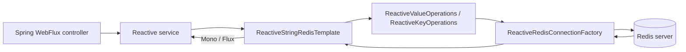

# ReactiveStringRedisTemplate and String Data in Spring Data Redis

## 1. Goal: Working with Strings in Redis Using the Reactive Model

Spring Data Redis provides **`ReactiveStringRedisTemplate`** to interact with Redis using an API built on **Project Reactor**. This class is specifically designed for cases where **both keys and values are strings**: key names are encoded with a String serializer, value contents are Strings, and operations return `Mono<T>` or `Flux<T>` instead of waiting synchronously for results.

Familiar example in an imperative application:

```java
StringRedisTemplate redis = ...;
redis.opsForValue().set("profile:42:status", "ACTIVE");
String status = redis.opsForValue().get("profile:42:status");
```

Reactive version:

```java
ReactiveStringRedisTemplate redis = ...;

Mono<Boolean> write =
        redis.opsForValue().set("profile:42:status", "ACTIVE");

Mono<String> read =
        redis.opsForValue().get("profile:42:status");
```

The two Java lines above merely create **publishers describing the work**. The Redis operation is triggered when a subscriber actually requests data, such as when Spring WebFlux subscribes to the publisher returned from a controller.

Core meaning: **shifting from result-waiting calls to an asynchronous processing pipeline that does not block the calling thread while waiting for I/O**. The Redis server still executes ordinary Redis commands; "reactive" describes how the Spring client connects and processes results, not a new storage mode in Redis.

### Typical problem

A service managing temporary session state:

- Key: `session:42:status`
- Value: `ONLINE`
- TTL: 15 minutes
- On read access, the application reads through WebFlux and returns the result non-blockingly.
- On status change, the application writes a String and can refresh the TTL.

The following sections build a properly ordered pipeline and handle cache misses, connection errors, serialization, and TTLs for this problem.

## 2. Where Does ReactiveStringRedisTemplate Fit in the Architecture?

Components:

| Component | Role |
| --- | --- |
| `ReactiveRedisConnectionFactory` | Creates Redis connections supporting the reactive API, e.g., based on Lettuce. |
| `ReactiveRedisTemplate<K,V>` | General-purpose template working with various key/value types via a serialization context. |
| `ReactiveStringRedisTemplate` | Specialized template for `String` keys and `String` values. |
| `ReactiveValueOperations<String,String>` | Operations on Redis Strings, such as `GET`, `SET`, `INCR`. |
| `ReactiveKeyOperations<String>` | Key-level operations: deleting, checking existence, TTL, etc. |
| `Mono<T>` | Zero or one result, along with completion/error signals. |
| `Flux<T>` | Stream of multiple results, e.g., reading multiple entries or scanning keys on demand. |

Diagram:



`ReactiveStringRedisTemplate` is still built on Redis primitives: String is a **Redis data type**, which does not mean it only supports the Java String API. If you want to work with Hash, Set, List, or Stream, the reactive template also provides the corresponding operation groups; however, this lesson focuses on **String values** stored under a Redis key.

## 3. Configuration Requirements in Spring Boot and Spring Data Redis

A reactive Spring Boot project typically uses these dependencies:

```xml
<dependencies>
    <dependency>
        <groupId>org.springframework.boot</groupId>
        <artifactId>spring-boot-starter-webflux</artifactId>
    </dependency>
    <dependency>
        <groupId>org.springframework.boot</groupId>
        <artifactId>spring-boot-starter-data-redis-reactive</artifactId>
    </dependency>
</dependencies>
```

The reactive Redis starter provides Spring Data Redis integration and a reactive-capable driver, usually **Lettuce**. Do not assume every Redis driver supports the same reactive API set. Traditional `Jedis` is mainly used along the imperative path; when designing a reactive application, choose and verify the appropriate connection factory.

Example connection configuration in Spring Boot `application.yml` using the `spring.data.redis` configuration namespace:

```yaml
spring:
  data:
    redis:
      host: localhost
      port: 6379
      timeout: 3s
```

This is an example for a development environment. In other environments, add TLS, authentication, standalone/sentinel/cluster topology, and connection limits according to deployment policy.

With suitable auto-configuration, Spring Boot can supply the `ReactiveStringRedisTemplate` bean. If you want to declare it explicitly:

```java
import org.springframework.context.annotation.Bean;
import org.springframework.context.annotation.Configuration;
import org.springframework.data.redis.connection.ReactiveRedisConnectionFactory;
import org.springframework.data.redis.core.ReactiveStringRedisTemplate;

@Configuration
public class ReactiveRedisConfig {

    @Bean
    ReactiveStringRedisTemplate reactiveStringRedisTemplate(
            ReactiveRedisConnectionFactory connectionFactory) {
        return new ReactiveStringRedisTemplate(connectionFactory);
    }
}
```

Do not create two beans with the same purpose if auto-configuration already supplies a suitable template and the application has no specific reason. If the system has multiple Redis connection factories, select the factory with qualifiers or explicit bean names.

### Why choose the String template?

`ReactiveStringRedisTemplate` uses a string-oriented serialization context, typically based on `StringRedisSerializer`. This helps:

- Easily inspect keys/values from `redis-cli`.
- Avoid accidentally storing byte streams via Java native/JDK serialization.
- Easily interoperate with services written in other languages when both agree on UTF-8 and schema.
- Fit text-based session tokens, statuses, OTP codes **stored securely according to policy**, feature flags, and integer counters.

However, **the String template does not automatically encrypt or obfuscate data**. Values remain plain data in Redis; protect them with TLS, ACLs, retention policies, and avoid logging secrets.

## 4. Basic Operations: `SET` and `GET`

Define a service:

```java
import org.springframework.data.redis.core.ReactiveStringRedisTemplate;
import org.springframework.stereotype.Service;
import reactor.core.publisher.Mono;

@Service
public class ProfileStatusService {

    private final ReactiveStringRedisTemplate redis;

    public ProfileStatusService(ReactiveStringRedisTemplate redis) {
        this.redis = redis;
    }

    public Mono<Boolean> saveStatus(String profileId, String status) {
        String key = "profile:" + profileId + ":status";
        return redis.opsForValue().set(key, status);
    }

    public Mono<String> findStatus(String profileId) {
        String key = "profile:" + profileId + ":status";
        return redis.opsForValue().get(key);
    }
}
```

Corresponding commands:

```redis
SET profile:42:status ACTIVE
GET profile:42:status
```

Result semantics:

- `opsForValue().set(key, value)` typically returns `Mono<Boolean>`, representing the `SET` result.
- `opsForValue().get(key)` returns `Mono<String>`.
- When the key does not exist, `get(...)` typically completes **empty** (`Mono.empty()`), rather than emitting `null`.

Project Reactor does not allow `null` as an `onNext` value. Therefore, distinguish an **empty publisher** from a publisher emitting an empty String `""`. An empty string is still a valid Redis String value.

The code above still lacks validation for ID and status. In real applications, never concatenate arbitrary user input into key names because it can create unexpected namespaces or collide with keys of other components. Validate IDs by pattern/length before constructing keys.

## 5. Subscription: Why Creating a `Mono` Has Not Written to Redis Yet

Example:

```java
public void updateWithoutSubscription() {
    redis.opsForValue().set("profile:42:status", "ACTIVE");
}
```

This method **does not return a publisher** and nothing subscribes to it. Therefore, you must not expect `SET` to be sent to Redis as a guaranteed side effect.

The proper approach in a reactive service is to **return Mono/Flux to the caller**:

```java
public Mono<Boolean> updateStatus(String key, String value) {
    return redis.opsForValue().set(key, value);
}
```

Then in a WebFlux controller:

```java
@PostMapping("/profiles/{id}/status")
public Mono<Boolean> update(
        @PathVariable String id,
        @RequestBody String status) {
    return service.updateStatus("profile:" + id + ":status", status);
}
```

When handling HTTP, Spring WebFlux subscribes to the returned publisher and sends the response when the pipeline finishes.

Manual subscription is fine at an entry point, in tests, or in lifecycle-managed background tasks, but ordinary services **should not call `.subscribe()` and ignore the result**:

```java
// Unsuitable in an ordinary service:
redis.opsForValue().set(key, value).subscribe();
return Mono.just("Saved");
```

This snippet returns "Saved" without waiting for Redis confirmation. Asynchronous errors may not reach the request, and the task may still be unfinished when the response goes out.

Instead:

```java
return redis.opsForValue()
        .set(key, value)
        .flatMap(success ->
                success
                        ? Mono.just("Saved")
                        : Mono.error(new IllegalStateException(
                                "Redis did not confirm the SET operation")));
```

Errors from Redis flow through Reactor's error path so the caller can handle them.

### Reactive does not mean "execute exactly once"

Redis publishers are typically **cold publishers**: each subscription can execute the command again. For example:

```java
Mono<Long> increment =
        redis.opsForValue().increment("metrics:visits");
```

If subscribed to twice, Redis can increment the counter twice. Do not subscribe repeatedly to a publisher with side effects just to log or inspect:

```java
// Avoid unless intending to increment twice:
increment.subscribe();
increment.subscribe();
```

When you want to observe results, attach `doOnNext` or `doOnError` to the same pipeline and let only the entry point subscribe once. If you truly need to share one execution across multiple subscribers, choose a Reactor sharing/caching strategy with proper lifecycle and account for error/cancellation behavior.

## 6. Chaining Operations in Order with `flatMap` and `then`

A common requirement: save a new status and then read it back. It is crucial to **specify ordering**, not create two independent publishers and assume they always execute sequentially.

### 6.1. Write then read

```java
public Mono<String> writeAndRead(String key, String newValue) {
    return redis.opsForValue()
            .set(key, newValue)
            .flatMap(success -> {
                if (!Boolean.TRUE.equals(success)) {
                    return Mono.error(new IllegalStateException(
                            "SET failed"));
                }
                return redis.opsForValue().get(key);
            });
}
```

Here `flatMap` only runs the read after the `SET` publisher emits its result. The result will be the new value unless another writer overwrites it or the key expires; **the two-command chain is still not an atomic transaction**.

Shorthand with `then`:

```java
public Mono<String> writeAndRead(String key, String value) {
    return redis.opsForValue()
            .set(key, value)
            .then(redis.opsForValue().get(key));
}
```

`then(...)` waits for the `SET` publisher to complete and then subscribes to the read publisher; it **ignores** the Boolean result of `SET`. When you need to check for `false`, use the first approach.

### 6.2. Do not use `Mono.zip` to express write-then-read

```java
Mono<Boolean> write = redis.opsForValue().set(key, "NEW");
Mono<String> read = redis.opsForValue().get(key);

// Does not guarantee GET runs after SET:
Mono<Tuple2<Boolean, String>> both = Mono.zip(write, read);
```

`zip` combines two sources and may subscribe to them nearly concurrently. If business logic requires the first command to finish before the next runs, chain sequentially with `flatMap` or `then`.

### 6.3. Multiple independent keys can be processed concurrently

When operations have no ordering dependency, you can use `flatMap` with a concurrency limit:

```java
public Flux<String> getStatuses(List<String> ids) {
    return Flux.fromIterable(ids)
            .flatMap(
                    id -> redis.opsForValue()
                            .get("profile:" + id + ":status")
                            .map(value -> id + "=" + value),
                    8
            );
}
```

This returns found entries; non-existent keys produce `Mono.empty()` and therefore emit no item for that key. `flatMap` does not guarantee input order; if consistent order is needed, consider `concatMap` or `flatMapSequential`.

Do not set unbounded concurrency for lists of millions of IDs. Cap key counts, use batching/cursors, or paginate to avoid overloading Redis and the network.

## 7. Handling Missing Keys: `Mono.empty()`, `defaultIfEmpty`, and `switchIfEmpty`

When `GET` finds no value, the pipeline completes without emitting any elements:

```java
Mono<String> status =
        redis.opsForValue().get("profile:missing:status");
```

If you want a default value:

```java
Mono<String> safeStatus =
        status.defaultIfEmpty("UNKNOWN");
```

If you want to fall back to another data source:

```java
public Mono<String> findStatusOrLoad(String id) {
    String key = "profile:" + id + ":status";

    return redis.opsForValue()
            .get(key)
            .switchIfEmpty(
                    Mono.defer(() -> databaseStatusService.load(id))
            );
}
```

`Mono.defer(...)` delays creating the fallback publisher until the cache-miss branch is subscribed to. Note that the database service must actually be reactive or safely integrated; never put a blocking JDBC call directly onto the event-loop and call it reactive.

To cache the value loaded from the database:

```java
public Mono<String> findThroughCache(String id) {
    String key = "profile:" + id + ":status";

    return redis.opsForValue()
            .get(key)
            .switchIfEmpty(
                    Mono.defer(() ->
                            databaseStatusService.load(id)
                                    .flatMap(value ->
                                            redis.opsForValue()
                                                    .set(key, value, Duration.ofMinutes(5))
                                                    .thenReturn(value))
                    )
            );
}
```

This example prioritizes returning data only after `SET` finishes, though using `thenReturn` skips checking for `Boolean.FALSE`. In real applications, decide per business requirements whether a Redis error should fail the request or skip the cache and still return the source data.

**Cache stampede:** when many concurrent requests miss the cache, multiple `load(id)` calls can run simultaneously. `switchIfEmpty` alone does not provide single-flight deduplication or distributed locking.

## 8. TTL for Strings: Save with Expiration Instead of Splitting Commands Unnecessarily

Redis is a key/value store that supports key expiration. In Spring Data Redis:

```java
Mono<Boolean> saved =
        redis.opsForValue().set(
                "session:42:status",
                "ONLINE",
                Duration.ofMinutes(15)
        );
```

Meaning: write the String with expiration, matching the semantics of a single Redis `SET` command with the appropriate expiry. Using this overload avoids the gap between "write key" and "set TTL" across two separate commands.

A less safe approach when an error happens between the two commands:

```java
// Two separate operations:
redis.opsForValue().set(key, value)
        .then(redis.expire(key, Duration.ofMinutes(15)));
```

If `SET` succeeds but `EXPIRE` fails, the key can live longer than expected. When business logic requires expiration, prefer setting the TTL together with the write operation where supported by the API.

### Reading does not automatically renew TTL

```java
redis.opsForValue().get("session:42:status");
```

A regular `GET` does not refresh expiration. If you want *time-to-idle*, you need a read path that refreshes expiration such as `GETEX` (if supported by driver and Redis server) or an explicit design. Do not equate String template TTL with Spring Cache's TTI configuration: that is a different abstraction.

### Checking remaining lifetime

The reactive template provides key operations to manipulate and inspect expiration. For example:

```java
Mono<Duration> remaining =
        redis.getExpire("session:42:status");
```

Consider the semantics for keys without expiration or non-existent keys; Redis `TTL` uses special values (-1 when the key exists without expiration, -2 when the key does not exist), while mapping to `Duration` depends on the API. Do not arbitrarily treat `Duration.ZERO` as "key does not exist" across all versions; check the method contract and actual return values when branching business logic.

### Creating a session only if absent

Redis `SET ... NX` creates a key only when it does not exist. Reactive API:

```java
public Mono<Boolean> createIfAbsent(String id, String value) {
    return redis.opsForValue()
            .setIfAbsent(
                    "session:" + id + ":token",
                    value,
                    Duration.ofMinutes(15)
            );
}
```

`true` typically means creation succeeded; `false` means the key already existed. Setting TTL in the same command avoids creating security keys with no expiration if a separate `EXPIRE` step were skipped.

Do not use a predictable token or reuse tokens as distributed locks. If business logic needs a lock, use a unique token, TTL, and conditional release (e.g., Lua compare-and-delete); never blindly call `delete(key)` after a lease expires and may have been acquired by another owner.

## 9. Key Operations: Checking Existence and Deleting

Commonly used methods on the reactive template:

```java
Mono<Boolean> exists =
        redis.hasKey("profile:42:status");

Mono<Long> removed =
        redis.delete("profile:42:status");
```

`hasKey` returns whether the key exists; `delete` returns the count of deleted keys. Note that Redis `DEL` deletes a key regardless of data type: if the same key is used for a Hash or Set by another component, deleting it still removes it.

Do not do this for conditional deletion:

```java
return redis.hasKey(key)
        .flatMap(exists ->
                exists ? redis.delete(key) : Mono.just(0L));
```

Between `EXISTS` and `DEL`, another client could modify the key. When the goal is simply to delete regardless of existence, calling `delete` directly is simpler and safer. When conditions depend on value/version, use an atomic operation such as a Lua script.

When deleting multiple keys, be careful with naming and scope; avoid `KEYS *` or broad deletions in production. Cursor-based key scanning APIs can emit a `Flux`, but that is an operational workflow distinct from operating on a known key's value.

## 10. Updating String Counters with Atomic Commands

Redis Strings can hold integers in text form. Commands like `INCR`/`INCRBY` perform atomic increments on Redis.

```java
public Mono<Long> nextSequence() {
    return redis.opsForValue()
            .increment("sequence:orders");
}
```

Multiple clients calling `INCR` concurrently on the same key still receive atomic increments on Redis. There is no need to `GET` and then `SET` to compute the next value.

Avoid doing this:

```java
// Not atomic between GET and SET:
return redis.opsForValue()
        .get("counter:visits")
        .defaultIfEmpty("0")
        .flatMap(current ->
                redis.opsForValue()
                        .set(
                                "counter:visits",
                                Long.toString(Long.parseLong(current) + 1)
                        )
                        .thenReturn(Long.parseLong(current) + 1));
```

Two requests can read the same old value, compute the same new value, and overwrite each other (*lost update*). Using `increment` is much better for counters.

Notes:

- The value must represent an integer accepted by Redis; `INCR` errors on non-numeric strings.
- Integer range is bounded; incrementing past Redis's supported range causes the command to fail.
- Increment commands do not set a TTL by default. If a counter needs to expire per time window, design TTL and atomic/conditional initialization appropriately.

## 11. String Serializer: Avoiding Misreading Binary Data

`ReactiveStringRedisTemplate` normally uses `StringRedisSerializer` for keys and values. Data written via:

```java
redis.opsForValue().set("flags:checkout", "enabled");
```

can be inspected via Redis CLI:

```redis
GET flags:checkout
TYPE flags:checkout
```

`TYPE` returns `string`. For normal text, `GET` displays the corresponding content.

Conversely, if another service wrote the key using JDK serialization, JSON serialization, gzip, or custom encoding, reading with `ReactiveStringRedisTemplate` does not guarantee returning a semantically valid value. Even the same logical key name with a different key serializer can map to different key bytes.

### When JSON is needed inside a String value

You can store JSON as a String:

```java
public record FeatureFlag(
        String name,
        boolean enabled,
        int version) {
}
```

```java
public Mono<Boolean> saveFlag(FeatureFlag flag) {
    return Mono.fromCallable(() -> objectMapper.writeValueAsString(flag))
            .flatMap(json ->
                    redis.opsForValue().set(
                            "flags:" + flag.name(),
                            json,
                            Duration.ofMinutes(5)));
}
```

`ObjectMapper` is a service dependency; JSON encoding here runs upon subscription. Converting an object to JSON in Java is not Redis I/O. For small payloads and light CPU work it is generally fine; for heavy transformations, manage schedulers so long-running work does not block the event-loop.

Reading and decoding:

```java
public Mono<FeatureFlag> findFlag(String name) {
    return redis.opsForValue()
            .get("flags:" + name)
            .flatMap(json ->
                    Mono.fromCallable(() ->
                            objectMapper.readValue(
                                    json,
                                    FeatureFlag.class)));
}
```

Handle invalid JSON and schema versioning. The String template does not validate JSON or convert a Redis String into a Redis Hash.

### Do not mix templates arbitrarily

| Template | Key serialization | Value serialization | Suitable for |
| --- | --- | --- | --- |
| `ReactiveStringRedisTemplate` | String | String | Statuses, text tokens, numeric counters, explicitly managed JSON text |
| `ReactiveRedisTemplate<String, MyType>` | Per configured serialization context | Per custom configuration | Objects with dedicated serializer contracts |
| `StringRedisTemplate` | String | String | Imperative/blocking paths |
| `RedisTemplate<String, Object>` | Per specific configuration | Per specific configuration | Imperative apps with diverse data types |

A key written by a String template can be read from another reactive template if serializers are compatible. Simply "both using Java String" does not guarantee identical Redis bytes if encoding configurations differ.

## 12. WebFlux Controller: Let the Framework Subscribe

Example controller reading and returning a status:

```java
import org.springframework.http.ResponseEntity;
import org.springframework.web.bind.annotation.GetMapping;
import org.springframework.web.bind.annotation.PathVariable;
import org.springframework.web.bind.annotation.RestController;
import reactor.core.publisher.Mono;

@RestController
public class ProfileStatusController {

    private final ProfileStatusService service;

    public ProfileStatusController(ProfileStatusService service) {
        this.service = service;
    }

    @GetMapping("/profiles/{id}/status")
    public Mono<ResponseEntity<String>> getStatus(
            @PathVariable String id) {

        return service.findStatus(id)
                .map(ResponseEntity::ok)
                .defaultIfEmpty(ResponseEntity.notFound().build());
    }
}
```

When the key exists, the publisher emits a String and Spring returns HTTP 200. On a cache miss, `Mono.empty()` is replaced by `ResponseEntity.notFound().build()`, returning HTTP 404.

When Spring WebFlux handles a controller returning `Mono<ResponseEntity<String>>`, the framework manages subscription and request lifecycle. **The controller does not need to call `block()` or `subscribe()`.**

### Do not use `block()` on the WebFlux event-loop

Incorrect in a reactive request handler:

```java
@GetMapping("/unsafe/{id}")
public String unsafe(@PathVariable String id) {
    return service.findStatus(id).block();
}
```

`block()` synchronously waits for the result, which can block the reactive dispatch thread. In a non-blocking Reactor runtime, this can even be detected and rejected at runtime. This is a classic anti-pattern once WebFlux is chosen.

The right way is to return the publisher and use operators to shape the result:

```java
@GetMapping("/safe/{id}")
public Mono<String> safe(@PathVariable String id) {
    return service.findStatus(id)
            .defaultIfEmpty("UNKNOWN");
}
```

If a legacy library only offers a blocking API that cannot be replaced immediately, isolate it off the event-loop using an appropriate scheduler strategy, resource limits, and concurrency bounds. Still, prefer a driver/abstraction with a real reactive API for Redis I/O.

## 13. Handling Connection Errors, Timeouts, and Fallbacks

In a reactive pipeline, Redis errors arrive via the `onError` signal. For example:

```java
public Mono<String> findStatus(String id) {
    return redis.opsForValue()
            .get("profile:" + id + ":status")
            .timeout(Duration.ofSeconds(2));
}
```

`timeout` bounds how long to wait for the publisher's result, yet it does not mean the Redis command definitely did not execute on the server if the client cancels or times out. For write operations, account for the state "uncertain whether Redis executed it."

### Controlled fallback

If status is purely a cache and another data source exists:

```java
public Mono<String> findStatusResilient(String id) {
    return redis.opsForValue()
            .get("profile:" + id + ":status")
            .timeout(Duration.ofSeconds(2))
            .onErrorResume(ex ->
                    statusRepository.findFromPrimaryStore(id))
            .switchIfEmpty(
                    Mono.defer(() ->
                            statusRepository.findFromPrimaryStore(id)));
}
```

Specify clearly which errors allow fallback. Some errors—such as serializer mismatch, invalid keys, or authorization errors—indicate configuration bugs that should be surfaced rather than hidden with a catch-all `onErrorResume`.

If Redis holds **the primary data source**, falling back to `"UNKNOWN"` on error can corrupt business behavior. Distinguish:

- **Cache miss**: the key does not exist; `Mono.empty()` is normally the right signal.
- **Redis error**: connection failure, timeout, ACL denial, wrong key type, etc.; signaled via `onError`.
- **Empty String result**: the key exists with value `""`; different from a cache miss.

### Retries are not always safe

For `GET`, controlled retries are usually lower risk. For `INCR` or commands with side effects, the connection can drop after the server executes the command but before the response returns. Retrying can increment the counter again.

```java
// Only use after evaluating idempotency:
redis.opsForValue().increment("counter:orders")
        .retry(1);
```

This risks incrementing twice if the first response was lost. Use idempotency tokens, atomic server-side logic, or a contract that tolerates duplicate retries depending on the use case.

## 14. What Role Does Redis Play: Cache, Session, or Source of Truth?

The same `ReactiveStringRedisTemplate` API can be used for:

1. **Cache**: values can be reconstructed from the database; misses/Redis downtime can fall back.
2. **Session/temporary state**: values have TTLs; expiration and deletion policies must be understood.
3. **Feature flag/config**: small values requiring invalidation/versioning; do not treat Pub/Sub events as the sole synchronization mechanism.
4. **Counter**: requires atomic `INCR`/`DECR`; durability and retention must be defined.
5. **Coordination marker**: requires NX/TTL/Lua to enforce conditions and handle retries.

Do not assume "reactive Redis = cache." String data can be critical; design and operations must match its criticality.

Key naming examples:

```text
profile:42:status
session:abc123:state
feature:checkout:enabled
counter:requests:2026-11-13
lease:resource:42
```

Clear prefixes support Redis ACL scoping, observability, cleanup, and collision avoidance. Avoid putting secret tokens in key names unnecessarily; key names can appear in logs, metrics, keyspace notifications, and admin tools.

## 15. Multiple Reactive Commands Do Not Automatically Become a Transaction

Example:

```java
public Mono<Void> writeTwoKeys(String id) {
    Mono<Boolean> first =
            redis.opsForValue().set("profile:" + id + ":a", "A");
    Mono<Boolean> second =
            redis.opsForValue().set("profile:" + id + ":b", "B");

    return first.then(second).then();
}
```

These two commands run sequentially in the pipeline but are **not atomic with respect to each other**. If the second fails, the first may already have been written.

When multiple conditional updates must happen atomically, consider:

- Combining data into a single Redis String/Hash key if the data contract allows.
- Using a Lua script so Redis checks and writes without interleaving commands.
- Using built-in atomic commands such as `INCR`, `SET NX EX`, `GETSET`/`GETEX` where suitable and supported.
- Designing workflows with retries and idempotency when updating multiple systems.

Do not assume Spring JDBC/JPA's `@Transactional` wraps reactive Redis commands into a distributed transaction. Verify which transaction APIs are supported by your stack and version; do not mix imperative Redis transactions with reactive pipelines.

## 16. Differences Between Reactive Redis and Spring Cache

Spring Cache typically wraps method results through the caching abstraction, such as `@Cacheable` with `RedisCacheManager`. `ReactiveStringRedisTemplate` is a direct API for Redis String operations.

A method like:

```java
return reactiveStringRedisTemplate
        .opsForValue()
        .get("catalog::sku-42");
```

does not automatically apply TTL/TTI policies from another `RedisCacheManager`. If accessing keys created by Spring Cache, align serializers and key prefixes; do not assume a `GET` path refreshes TTL according to a CacheManager's TTI settings.

Reactive Redis I/O also does not automatically provide distributed cache stampede protection, cache invalidation, or multi-instance consistency. Those mechanisms still must be designed explicitly.

## 17. Resource and Backpressure Rules

The advantage of reactive programming is serving many concurrent I/O tasks without holding a thread per response. However, the Redis server, network, connection pool, and memory all have limits.

### Mono and Flux

- `Mono<T>`: suited for a single `GET`/`SET` or a single command result.
- `Flux<T>`: suited for multiple results or scanning workflows.

A `Flux` supporting backpressure at the Reactor layer does not guarantee every Redis command pauses in the same way. Emission behavior and prefetching depend on the implementation/driver. Therefore, bound concurrency, batch sizes, fetched item counts, and timeouts to realistic volumes.

Concurrency-limiting example:

```java
Flux.fromIterable(keys)
    .flatMap(
        key -> redis.opsForValue().get(key)
                    .map(value -> new KeyValue(key, value)),
        16
    );
```

`KeyValue` is an application-defined Java record, e.g., `record KeyValue(String key, String value) {}`.

Do not fire millions of concurrent `GET` commands through unbounded `flatMap`. When scanning keys by pattern on a large dataset, prefer cursor-based `SCAN` through the appropriate API rather than `KEYS *` on production request paths.

### Blocking the event-loop negates reactive benefits

Inside operators such as `map`, `flatMap`, or `doOnNext`, avoid:

- Calling blocking JDBC or blocking HTTP directly on the event-loop.
- Calling `Thread.sleep`.
- Calling `Mono.block()`/`Flux.blockFirst()`.
- Running long CPU-bound tasks without arranging a suitable scheduler.
- Calling an imperative Redis client synchronously inside the pipeline without an isolation strategy.

A reactive stack must be consistent from the controller down through I/O dependencies, or have explicit isolation boundaries with blocking components.

## 18. Testing Reactive Services

Use **Reactor Test** and an isolated test Redis instance. For example, unit/integration tests interacting with real Redis via Testcontainers or a dedicated test environment—never use keys in production Redis.

### 18.1. Testing save and read

```java
import org.junit.jupiter.api.Test;
import reactor.test.StepVerifier;

class ProfileStatusServiceTest {

    private final ProfileStatusService service = ...;

    @Test
    void savesAndReadsStatus() {
        StepVerifier.create(
                service.saveStatus("demo-1", "ACTIVE")
                        .flatMap(saved ->
                                saved
                                        ? service.findStatus("demo-1")
                                        : Mono.error(new IllegalStateException(
                                                "SET failed")))
        )
        .expectNext("ACTIVE")
        .verifyComplete();
    }
}
```

`StepVerifier` subscribes to the publisher under test, so the Redis command actually executes. Import `reactor.core.publisher.Mono` when placing this snippet in its own class.

### 18.2. Testing a non-existent key

```java
StepVerifier.create(service.findStatus("missing-id"))
        .verifyComplete();
```

This test expects the Mono to complete empty. To avoid colliding with keys from other tests, use dedicated namespaces and unique test IDs, and clean up test data afterward.

### 18.3. Testing TTL

Save with a short expiration long enough to avoid tight timing flakiness:

```java
Mono<Boolean> write =
        redis.opsForValue().set(
                "demo:ttl:1",
                "TEMP",
                Duration.ofSeconds(30));

StepVerifier.create(write)
        .expectNext(true)
        .verifyComplete();

StepVerifier.create(redis.getExpire("demo:ttl:1"))
        .expectNextMatches(ttl ->
                ttl != null && !ttl.isNegative())
        .verifyComplete();
```

In the test above, expiration should be checked against the actual version's TTL contract. When testing expiration timing, avoid asserting "key disappears at exactly 30,000 ms"; Redis has timer granularity and processing overhead, and test runners also introduce latency.

### 18.4. Testing Redis errors

You can simulate Redis being unreachable or use fake/mocked reactive operations to test `timeout`/`onErrorResume`. Tests must distinguish a cache miss (`Mono.empty`) from a connection error (`Mono.error`) and an empty String (`Mono.just("")`).

## 19. Inspecting in Redis CLI

After the service writes a key in a test environment, you can inspect:

```redis
TYPE profile:demo-1:status
GET profile:demo-1:status
TTL profile:demo-1:status
EXISTS profile:demo-1:status
```

Expected results:

- `TYPE` is `string` when the key exists and was written by the String template.
- `GET` returns the String content.
- `TTL` returns `-1` if the key exists with no expiration, or the remaining seconds if it has a TTL.
- `EXISTS` returns 1 if the key exists, 0 if not.

Never use `KEYS *` in production Redis for inspection. When inspecting a large namespace, use `SCAN` with a narrow pattern and paced iteration.

### Metrics to monitor

| Metric | Reason |
| --- | --- |
| Redis command latency | Detect network/server delays as pipeline concurrency increases |
| Connection errors/timeouts | Distinguish Redis errors from cache misses |
| GET hit/miss | Understand value presence rates |
| SET/increment rate | Spot write load and repeated commands from retries/subscriptions |
| Keyspace memory/evictions | Track TTL behavior and memory policies |
| Reactor pipeline latency | Measure delay from request start to publisher completion |
| Pending/in-flight operations | Detect excessive concurrent Redis requests |

These metrics require proper instrumentation; do not assume all business metrics appear automatically just from adding the reactive Redis starter.

## 20. Common Issues and Troubleshooting

| Symptom | Possible cause | Resolution |
| --- | --- | --- |
| Called `set(...)` but Redis did not change | Publisher was not subscribed to | Return the Mono to WebFlux or manage subscription at the entry point |
| Value changed twice after one action | Publisher with side effects subscribed twice or non-idempotent retry | Control subscriptions, operators, and idempotency |
| Redis returns an unreadable String | Value was stored using a different serializer | Align serialization contexts |
| Missing key `GET` returns `null`? | Reactive streams do not emit null; Mono completes empty | Use `defaultIfEmpty` or `switchIfEmpty` |
| Multiple `flatMap` calls return out-of-order results | Operations run concurrently or complete at different times | Use `concatMap`/`flatMapSequential` when order matters |
| `Mono.zip(write, read)` returns stale data | Read has no completion dependency on write | Use `flatMap`/`then` |
| WebFlux request blocks or throws blocking errors | Calling `block()` or blocking I/O on the event-loop | Return publishers and eliminate blocking dependencies |
| Key lives forever despite needing TTL | Used `set(key,value)` without expiration or separate EXPIRE failed | Use `set(key,value,Duration)` |
| Counter increments twice on retry | Redis executed `INCR` but response was lost | Design idempotency and avoid blind retries |
| Redis times out but app returns `"UNKNOWN"` | `onErrorResume` catches all errors and hides system failures | Only fall back according to cache role; emit metrics |
| `WRONGTYPE` | Same key stored by another service with a different Redis data type | Manage namespaces and key ownership |
| `NOPERM` | Redis ACL lacks command or key pattern permissions | Grant least-privilege permissions for required commands/namespaces |

## 21. Design Rules for ReactiveStringRedisTemplate

1. Choose `ReactiveStringRedisTemplate` when **keys and values are genuinely designed as Strings**; do not assume every object can be stored directly as a String.
2. **Return `Mono`/`Flux` from services**, letting entry points like WebFlux manage subscriptions and responses.
3. Avoid `block()`, uncoordinated `subscribe()`, and blocking I/O calls on reactive request paths.
4. Use `flatMap` or `then` when ordering is required; do not treat `zip` as "write then read."
5. Handle `Mono.empty()` (missing key) separately from `Mono.error()` (Redis failure) and `Mono.just("")` (empty String).
6. When data must expire, prefer the `set(key, value, Duration)` overload so TTL accompanies the write operation.
7. Use atomic Redis commands like `INCR` or `SET NX EX` where appropriate; do not build multi-command read-modify-write sequences and treat them as transactions.
8. Align key prefixes, serializers, encoding, ACLs, and namespace ownership.
9. Bound concurrency, payload sizes, batches, and timeouts to protect the Redis server.
10. Base retry policies on idempotency; a client timeout does not prove Redis did not apply side effects.
11. Test using `StepVerifier` or an equivalent reactive testing model against an isolated Redis instance.
12. Do not confuse Spring Cache configuration with the direct String template API, and do not equate reactive APIs with stronger consistency/transaction guarantees.

## 22. Self-Check Questions

1. How does `ReactiveStringRedisTemplate` differ from `StringRedisTemplate` in return types and execution?
2. Why does creating `Mono<Boolean> save = redis.opsForValue().set(...)` not necessarily write to Redis immediately?
3. If a key does not exist, what kind of publisher does `opsForValue().get(key)` return, and why must it not emit `null`?
4. When you need `SET` followed by `GET`, why are `flatMap`/`then` better suited than `zip`?
5. With two subscribers on the same `increment(...)` publisher, how can the counter change?
6. How does saving a String with TTL in one operation differ from calling `SET` and `EXPIRE` separately?
7. Why is `StringRedisSerializer` critical when multiple services share Redis?
8. How do you prevent *lost updates* when two requests increment a counter simultaneously?
9. Why is `.block()` in a WebFlux request handler an anti-pattern?
10. When a `timeout` occurs after a write operation, can the application be sure the command did not run on Redis?
11. When should you use `defaultIfEmpty`, and when should you use `onErrorResume`?
12. Does a reactive Redis pipeline automatically provide transactions across multiple commands or multiple storage systems?

**Takeaway:** `ReactiveStringRedisTemplate` bridges **Redis String keys/values** and **asynchronous Reactor pipelines**. Methods such as `opsForValue().set(...)`, `get(...)`, `increment(...)`, and TTL operations build `Mono`/`Flux`; commands execute when the publisher is subscribed to. Use proper serialization, chain pipelines with intentional ordering, handle cache misses differently from errors, and control TTLs and retries to gain reactivity without sacrificing data correctness.

## References

- [Spring Data Redis — Reactive Redis support](https://docs.spring.io/spring-data/redis/reference/redis/reactive.html): overview of reactive Redis APIs, templates, and operations.
- [Spring Data Redis — ReactiveStringRedisTemplate API](https://docs.spring.io/spring-data/redis/docs/current/api/org/springframework/data/redis/core/ReactiveStringRedisTemplate.html): template for String keys/values.
- [Spring Data Redis — ReactiveValueOperations API](https://docs.spring.io/spring-data/redis/docs/current/api/org/springframework/data/redis/core/ReactiveValueOperations.html): GET, SET, TTL, and counter operations.
- [Project Reactor — Reference Guide](https://projectreactor.io/docs/core/release/reference/): Mono, Flux, subscription, operators, and backpressure.
- [Redis — String data type](https://redis.io/docs/latest/develop/data-types/strings/): Redis Strings, counters, and use cases.
- [Redis — SET command](https://redis.io/docs/latest/commands/set/): NX/XX conditions and expiration.
- [Redis — INCR command](https://redis.io/docs/latest/commands/incr/): atomic integer increments.
