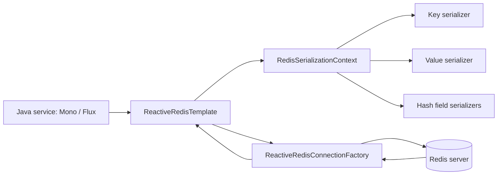
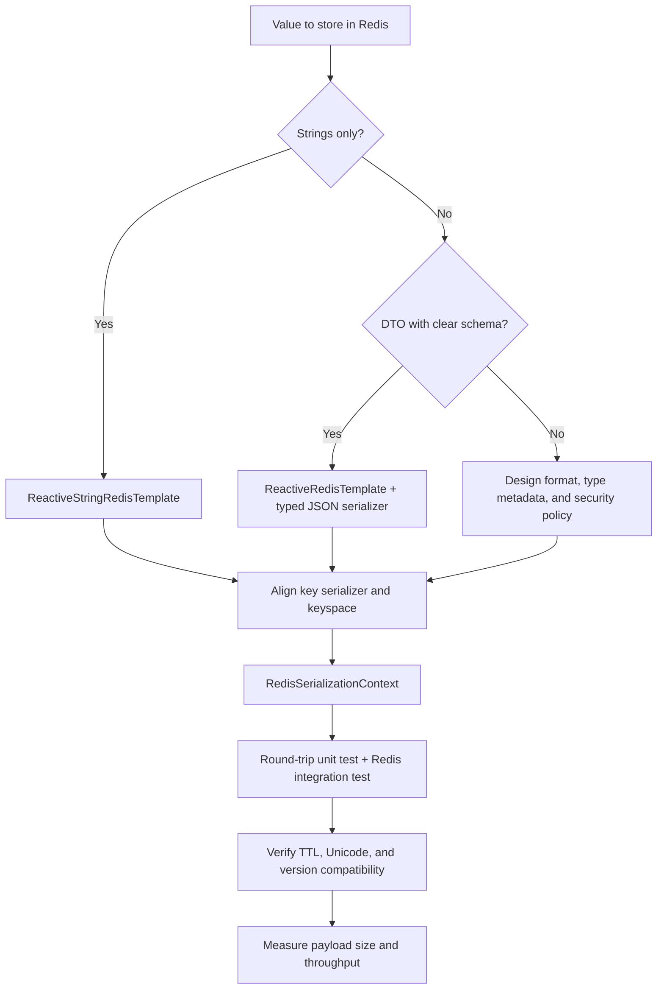

# RedisSerializationContext and Serializers for Reactive Flows in Spring Data Redis

## 1. Problem: Redis Only Stores Bytes, While the Application Works with Objects

Suppose a Spring WebFlux application wants to store user profiles in Redis. On the Java side, the data is an object:

```java
public record UserProfile(
    String userId,
    String displayName,
    int loyaltyPoints
) {}
```

Meanwhile, Redis stores keys and values as byte sequences. It has no built-in knowledge that `UserProfile` is a Java record, how `loyaltyPoints` should be represented, or how to decode JSON back into an object when returning results.

The application needs bidirectional conversion:

```text
Java key:   "profile:u-42"
Java value: UserProfile("u-42", "Linh", 120)
                 |
                 | serialize
                 v
Redis key bytes:   UTF-8("profile:u-42")
Redis value bytes: UTF-8('{"userId":"u-42","displayName":"Linh","loyaltyPoints":120}')
                 |
                 | Redis stores and then returns bytes
                 v
             deserialize
                 |
                 v
Java value: UserProfile("u-42", "Linh", 120)
```

In Spring Data Redis, a **serializer** converts between Java values and bytes; **`RedisSerializationContext<K,V>`** groups the conversion rules needed for **reactive** Redis operations. It is passed when constructing `ReactiveRedisTemplate<K,V>`.

Using Reactor `Mono`/`Flux` does not eliminate serialization. On the contrary, if producer and consumer use different serializers, the system can return `Mono.empty()` when a key is not found, fail with deserialization errors, read the wrong type, or lose compatibility after a new release deployment.

Lesson objectives:

1. Understand the roles of `RedisSerializer`, `SerializationPair`, and `RedisSerializationContext`.
2. Distinguish how **keys**, **values**, **hash keys**, **hash values**, and **Strings** are encoded.
3. Build a `ReactiveRedisTemplate<String, UserProfile>` using UTF-8 keys and JSON values.
4. Use `ReactiveStringRedisTemplate` when handling only String data.
5. Understand when serialization/deserialization occurs in a Reactor pipeline and how to verify round-trips.
6. Design safely for schema, serializer, data type, and application version changes.

## 2. Role of RedisSerializationContext in the Reactive Architecture

Spring Data Redis provides two data-access styles:

| API | Style | Example |
|---|---|---|
| `RedisTemplate<K,V>` | Imperative | `opsForValue().get(key)` returns the result directly |
| `StringRedisTemplate` | Imperative, String key/value | Redis commands using String serializers |
| `ReactiveRedisTemplate<K,V>` | Reactive | `opsForValue().get(key)` returns `Mono<V>` |
| `ReactiveStringRedisTemplate` | Reactive, String key/value | `Mono<String>` / `Flux<...>` for strings |

Inside `ReactiveRedisTemplate<K,V>`:



When the application writes:

```java
Mono<Boolean> stored =
    template.opsForValue().set("profile:u-42", profile);
```

the template uses the context to serialize the key and value, then sends the Redis command over the reactive connection. When reading:

```java
Mono<UserProfile> loaded =
    template.opsForValue().get("profile:u-42");
```

the context lets the template decode the returned bytes back into `UserProfile`.

**Distinction:** `RedisSerializationContext` does not manage threading, does not create transactions, does not guarantee cache hits, does not store schemas in Redis, and does not turn blocking code into non-blocking code. It describes **how data is converted** between Java and Redis in supported operations.

## 3. Core Components

### 3.1. `RedisSerializer<T>`

`RedisSerializer<T>` defines how a Java value is encoded into `byte[]` and decoded from bytes back into a Java object.

Common serializers:

| Serializer | Typical Java data | Format in Redis |
|---|---|---|
| `StringRedisSerializer` | `String` | UTF-8 byte sequence |
| `JdkSerializationRedisSerializer` | Serializable Java objects | Binary Java serialization format |
| `Jackson2JsonRedisSerializer<T>` | DTO with an explicit target type | JSON |
| `GenericJackson2JsonRedisSerializer` | Polymorphic/general objects, per configuration | JSON with configurable type metadata |
| `ByteArrayRedisSerializer` | `byte[]` | Raw bytes preserved |

Class names and factory methods may change or be marked deprecated across Spring Data Redis releases; the Java examples in this lesson target the Spring Data Redis **3.x** API. When implementing on 4.x or newer, check the Javadoc and corresponding JSON serialization configuration.

The core principle is independent of class names: **the writer's serializer and the reader's serializer must agree on bytes, charset, schema, and data type**.

### 3.2. `SerializationPair<T>`

Reactive Redis operations work heavily with `ByteBuffer`. Spring Data Redis uses `RedisSerializationContext.SerializationPair<T>` to represent an encode/decode pair suited to this context.

Concept:

```text
Java T --SerializationPair.write(T)--> ByteBuffer
Java T <--SerializationPair.read(buf)--- ByteBuffer
```

Spring Data Redis can build a pair from a `RedisSerializer<T>`:

```java
import java.nio.ByteBuffer;

import org.springframework.data.redis.serializer.StringRedisSerializer;
import org.springframework.data.redis.serializer.RedisSerializationContext;

RedisSerializationContext.SerializationPair<String> pair =
    RedisSerializationContext.SerializationPair.fromSerializer(
        new StringRedisSerializer()
    );

ByteBuffer bytes = pair.write("profile:u-42");
String roundTrip = pair.read(bytes);
```

This snippet demonstrates **conversion via a pair**, without executing any Redis command. If working directly with `ByteBuffer`, track read/write positions and how an API consumes the buffer; never reuse a buffer whose position has changed assuming it is still in its original state.

### 3.3. `RedisSerializationContext<K,V>`

A context holds `SerializationPair` instances for multiple roles in Redis:

```text
RedisSerializationContext<K,V>
    |
    +-- key       : Java K -> Redis key bytes
    +-- value     : Java V -> Redis value bytes
    +-- hashKey   : Java hash field name -> field bytes
    +-- hashValue : Java hash field value -> value bytes
    +-- string    : String -> byte representation for related string operations
```

Do not conflate:

- **Redis key:** e.g., `profile:u-42`.
- **Redis Hash field:** e.g., `displayName` inside Hash `profile:u-42`.
- **Redis value:** bytes stored under a Redis String key.
- **Redis Hash value:** bytes corresponding to a field inside a Redis Hash.

The key serializer and hash key serializer may both be `StringRedisSerializer`, yet they serve **two distinct roles**. Likewise, the value serializer and hash value serializer do not have to be identical.

## 4. Minimal Configuration with ReactiveStringRedisTemplate

If all data consists of strings, start with `ReactiveStringRedisTemplate`. This template is dedicated to String serialization for keys and values, reducing the risk of accidentally storing JDK binary data or JSON where plain text is expected.

Example local Redis configuration in Spring Boot 3.x:

```groovy
dependencies {
    implementation 'org.springframework.boot:spring-boot-starter-data-redis-reactive'
}
```

```yaml
spring:
  data:
    redis:
      host: localhost
      port: 6379
```

A reactive service:

```java
import java.time.Duration;

import org.springframework.data.redis.core.ReactiveStringRedisTemplate;
import org.springframework.stereotype.Service;

import reactor.core.publisher.Mono;

@Service
public class ReactiveStatusStore {

    private final ReactiveStringRedisTemplate redis;

    public ReactiveStatusStore(ReactiveStringRedisTemplate redis) {
        this.redis = redis;
    }

    public Mono<Boolean> setStatus(String orderId, String status) {
        String key = "order:status:" + orderId;
        return redis.opsForValue().set(
            key,
            status,
            Duration.ofMinutes(5)
        );
    }

    public Mono<String> getStatus(String orderId) {
        return redis.opsForValue()
            .get("order:status:" + orderId);
    }
}
```

On the Redis side:

```redis
GET order:status:o-101
TTL order:status:o-101
```

With the value `"PAID"`, Redis returns the corresponding string content and the key has a TTL of around 300 seconds immediately after writing.

`getStatus(...)` returns `Mono<String>`. When the key does not exist, the result is normally a Mono that emits no value (*empty*), **not** the string `"null"` and not a deserialization error.

If the application needs to store an entire multi-field DTO, use `ReactiveRedisTemplate<String, DTO>` with a suitable value serializer instead of manually concatenating JSON strings on every call.

## 5. Complete Example: String Key, JSON Value

Suppose we want to store a user profile as:

```text
Key:   profile:u-42
Value: JSON of UserProfile("u-42", "Linh", 120)
TTL:   10 minutes
```

### 5.1. Declare the DTO

With Spring Boot 3.x/Java 17+, you can use a record:

```java
package com.example.redis.model;

import com.fasterxml.jackson.annotation.JsonIgnoreProperties;

@JsonIgnoreProperties(ignoreUnknown = true)
public record UserProfile(
    String userId,
    String displayName,
    int loyaltyPoints
) {}
```

`@JsonIgnoreProperties(ignoreUnknown = true)` lets the decoder skip unknown fields when reading newer JSON payloads. This is not a complete migration strategy: renamed fields, changed types, or newly required fields may still need dedicated handling.

### 5.2. Create RedisSerializationContext

Example using the Spring Data Redis 3.x API:

```java
package com.example.redis.config;

import com.example.redis.model.UserProfile;

import org.springframework.context.annotation.Bean;
import org.springframework.context.annotation.Configuration;
import org.springframework.data.redis.connection.ReactiveRedisConnectionFactory;
import org.springframework.data.redis.core.ReactiveRedisTemplate;
import org.springframework.data.redis.serializer.Jackson2JsonRedisSerializer;
import org.springframework.data.redis.serializer.RedisSerializationContext;
import org.springframework.data.redis.serializer.StringRedisSerializer;

@Configuration
public class ReactiveRedisSerializationConfig {

    @Bean
    ReactiveRedisTemplate<String, UserProfile> userProfileRedisTemplate(
            ReactiveRedisConnectionFactory connectionFactory) {

        StringRedisSerializer strings = new StringRedisSerializer();

        Jackson2JsonRedisSerializer<UserProfile> profiles =
            new Jackson2JsonRedisSerializer<>(UserProfile.class);

        RedisSerializationContext<String, UserProfile> context =
            RedisSerializationContext
                .<String, UserProfile>newSerializationContext(strings)
                .value(profiles)
                .hashKey(strings)
                .hashValue(strings)
                .string(strings)
                .build();

        return new ReactiveRedisTemplate<>(connectionFactory, context);
    }
}
```

Configuration breakdown:

| Component | Serializer | Reason |
|---|---|---|
| Key | `StringRedisSerializer` | Key `profile:u-42` is readable via Redis CLI |
| Value | `Jackson2JsonRedisSerializer<UserProfile>` | Typed JSON deserializes into `UserProfile` on read |
| Hash key | `StringRedisSerializer` | Hash field names are encoded as UTF-8 |
| Hash value | `StringRedisSerializer` | For separate string-based Hash operations on the template |
| String | `StringRedisSerializer` | Auxiliary String values in supporting operations |

This is an **intentional configuration**, not a requirement for every application to configure five different serializers. For workloads using only Redis String keys/values, key and value are the most important; hash settings can remain default or be tailored to your needs.

**Important note on hash values:** configuring `hashValue(strings)` does not mean a `UserProfile` is automatically split into Redis Hash fields. In the example, `opsForValue()` stores **the entire JSON object** as a single Redis String value. To store individual Hash fields, use `opsForHash()` with consistent field/value types or dedicated Redis Repository mapping.

### 5.3. Service using ReactiveRedisTemplate

```java
package com.example.redis.service;

import java.time.Duration;

import com.example.redis.model.UserProfile;

import org.springframework.data.redis.core.ReactiveRedisTemplate;
import org.springframework.stereotype.Service;

import reactor.core.publisher.Mono;

@Service
public class UserProfileStore {

    private final ReactiveRedisTemplate<String, UserProfile> redis;

    public UserProfileStore(
            ReactiveRedisTemplate<String, UserProfile> redis) {
        this.redis = redis;
    }

    public Mono<Boolean> save(UserProfile profile) {
        String key = "profile:" + profile.userId();
        return redis.opsForValue()
            .set(key, profile, Duration.ofMinutes(10));
    }

    public Mono<UserProfile> findById(String userId) {
        return redis.opsForValue()
            .get("profile:" + userId);
    }

    public Mono<Long> remove(String userId) {
        return redis.delete("profile:" + userId);
    }
}
```

Example Reactor invocation:

```java
UserProfile profile = new UserProfile("u-42", "Linh", 120);

Mono<UserProfile> savedThenLoaded =
    userProfileStore.save(profile)
        .flatMap(ok -> {
            if (!Boolean.TRUE.equals(ok)) {
                return Mono.error(
                    new IllegalStateException("Redis SET was not successful")
                );
            }
            return userProfileStore.findById("u-42");
        });
```

When `savedThenLoaded` is subscribed to, the write happens first and then the read executes in the declared order. This is a *reactive composition*; do not call `block()` inside a WebFlux controller/event-loop just to extract the object from the Mono.

### 5.4. Inspecting the real bytes in Redis

After saving successfully, in `redis-cli`:

```redis
TYPE profile:u-42
GET profile:u-42
TTL profile:u-42
```

With the configuration above, `TYPE` is expected to be `string`, and `GET` returns a JSON payload similar to:

```json
{"userId":"u-42","displayName":"Linh","loyaltyPoints":120}
```

JSON field order is not a strict contract. What matters is that the serializer can reconstruct the exact `UserProfile` and the content is properly encoded.

## 6. Why Choose the Key Serializer First?

Redis compares keys by **bytes**, not by Java values that look alike. Suppose Application A writes:

```text
Java key: "profile:u-42"
Serializer: StringRedisSerializer
Redis bytes: UTF-8("profile:u-42")
```

Application B also passes the Java key `"profile:u-42"` but uses JDK serialization to encode keys. The resulting Redis bytes are **completely different** from the UTF-8 string bytes, even though the text looks identical in a Java debugger.

Result:

- A writes the key successfully.
- B calls `GET` with the same Java string, producing different key bytes.
- Redis treats it as **a different key** and returns not found.
- In Reactor, Application B receives `Mono.empty()` and assumes the key expired.

This is a common misconfiguration because in the Java API, `get("profile:u-42")` looks identical. When debugging, inspect the **bytes produced by the serializer**, not just the Java string value.

### 6.1. Keyspace conventions

A set of conventions helps reduce mistakes:

```text
profile:v1:u-42
profile:v1:u-43
session:v2:s-101
order:status:v1:o-101
```

- Use domain prefixes so keys do not collide with other applications.
- Specify a version whenever key or value schemas become incompatible.
- Keep the key serializer consistent between producers and consumers.
- Do not include unnecessary sensitive data in key names.
- With Redis Cluster, consider hash tags only when multi-key operations must target the same slot.

**Versioned namespaces** allow changing serializers or schemas without trying to deserialize old data using a new type. However, they also leave older keys that require TTLs or a cleanup strategy.

## 7. Value Serializer: JSON, JDK, or String?

There is no single best serializer for every system. Choose based on cross-language readability, size, speed, security, and schema evolution needs.

| Criterion | UTF-8 String | Typed JSON | JDK serialization |
|---|---|---|---|
| Simple values | Very suitable | Works, though may be overkill | Usually unnecessary |
| Multi-field Java objects | Requires manual encoding | Suitable | Usable |
| Interoperability outside Java | Easy | Easy when schemas align | Difficult |
| Inspectable via redis-cli | Easy | Relatively easy | Binary, hard to read |
| Compatibility across Java class changes | Application-dependent | Controllable via schema | Fragile with class/package names and serial form |
| Payload size | Small for text | Field-name overhead | Serialization overhead |
| Deserialization security needs | Validate content | Control types and JSON input | Significant risk with untrusted data |

### 7.1. `Jackson2JsonRedisSerializer<T>` for an explicit type

If a template only stores `UserProfile`, a typed JSON serializer constrains the expected type:

```java
RedisSerializer<UserProfile> serializer =
    new Jackson2JsonRedisSerializer<>(UserProfile.class);
```

With the value in Redis:

```json
{"userId":"u-42","displayName":"Linh","loyaltyPoints":120}
```

the serializer decodes it into the corresponding `UserProfile`. It does not perform business validation such as "loyaltyPoints cannot be negative" or "userId must exist in the system."

### 7.2. Generic serializers and type metadata

When one cache or keyspace holds multiple object types, you might consider a serializer that supports type metadata. Keep in mind:

- Type metadata can expose Java class names and enlarge payloads.
- Renaming packages or classes can render old entries unreadable.
- Overly broad polymorphic deserialization on untrusted data can be dangerous.
- Polyglot systems generally do not want Java class names embedded in JSON.

If the application controls its schemas, **typed DTOs and clearly separated keyspaces** are usually easier to maintain than a catch-all store holding arbitrary Java objects.

### 7.3. Do not default to JDK serialization out of habit

`JdkSerializationRedisSerializer` may feel convenient for internal data, but introduces problems:

- Payloads are hard to inspect or consume from non-Java languages.
- Changing classes, `serialVersionUID`, or packages can break compatibility with existing entries.
- Deserializing objects from untrusted sources carries security risks.

Only choose it when you understand the compatibility requirements, control the byte source, and manage the data lifecycle. Never treat it as the safe default for every cache or service.

## 8. Hash Key and Hash Value Are Two Separate Serializers

A Redis Hash stores a set of field/value pairs under a single Redis key:

```redis
HSET profile:meta:u-42 displayName Linh lastSeen 2026-11-13
HGET profile:meta:u-42 displayName
HGETALL profile:meta:u-42
```

In a Hash operation:

```text
profile:meta:u-42  <-- Redis key serializer
    displayName     <-- Redis hash key serializer
    Linh            <-- Redis hash value serializer
    lastSeen        <-- Redis hash key serializer
    2026-11-13      <-- Redis hash value serializer
```

Thus, a context declaring:

```java
RedisSerializationContext<String, UserProfile> context =
    RedisSerializationContext
        .<String, UserProfile>newSerializationContext(
            new StringRedisSerializer()
        )
        .value(new Jackson2JsonRedisSerializer<>(UserProfile.class))
        .hashKey(new StringRedisSerializer())
        .hashValue(new StringRedisSerializer())
        .build();
```

allows JSON values on Redis String operations while keeping basic hash fields/values as UTF-8 Strings.

### 8.1. Two ways to store a profile

**Approach A — Single JSON value:**

```redis
SET profile:u-42 '{"userId":"u-42","displayName":"Linh","loyaltyPoints":120}'
```

Pros: fetch or write the whole DTO as one value. Cons: updating a single field usually requires reading and re-serializing the entire object unless a targeted payload update mechanism is used.

**Approach B — Redis Hash:**

```redis
HSET profile:hash:u-42 userId u-42 displayName Linh loyaltyPoints 120
```

Pros: individual fields can be read/updated with `HGET`/`HSET`. Cons: mapping between String fields/values and the Java DTO must be explicit; numbers stored as text need parsing, and nested structures need custom rules.

These two approaches are **two distinct data models**. Simply modifying `RedisSerializationContext` does not make Redis convert a JSON String entry into a Hash, or vice versa.

### 8.2. Do not confuse with Redis Repositories

Redis Repositories use `@RedisHash` and framework mapping/indexing. A `ReactiveRedisTemplate` with a custom serializer **does not automatically maintain secondary indexes or metadata managed by repositories**.

Using a raw template to write keys owned by a repository risks bypassing TTLs, indexes, or entity lifecycles. Be clear on whether the application uses direct Redis Strings/Hashes or Redis Repository mapping.

## 9. Why Does ByteBuffer Appear in Reactive Serializers?

Spring Data Redis uses `ByteBuffer` in several reactive APIs to represent byte sequences. `ByteBuffer` operates on memory regions with position and limit tracking, and can act as a view over underlying data.

A `SerializationPair<T>` supports:

```java
RedisSerializationContext.SerializationPair<String> stringPair =
    RedisSerializationContext.SerializationPair.fromSerializer(
        new StringRedisSerializer()
    );

ByteBuffer wireBytes = stringPair.write("hello");
String javaValue = stringPair.read(wireBytes);
```

Although applications rarely call `write/read` directly, understanding this step helps diagnose:

- Bytes encoded using a mismatched charset.
- Custom serializers reading incomplete bytes due to position/limit bugs.
- Mixing `byte[]`-based serializers with `ByteBuffer`-based code paths.
- Cases where copying large payloads needs to be minimized.

### 9.1. A custom serializer is more than a String conversion method

If building a custom encoder, define:

1. A stable byte format and a way to identify versions.
2. How `null` or empty values are handled per API contract.
3. The type returned on deserialization.
4. Charset and byte order when using binary formats.
5. Thread safety if the serializer is shared concurrently.
6. How malformed payloads, truncated data, and oversized values are handled.

Never rely on an object's `toString()` to serialize a model that must be read back; most `toString()` outputs are not reversible.

## 10. Reactor Lazy Execution and Serialization Errors

With:

```java
Mono<Boolean> operation =
    redis.opsForValue().set("profile:u-42", profile);
```

the application has only created a Publisher. Depending on the code path and serializer, request assembly and byte conversion may occur when the stream is subscribed to; **never assume merely creating a Mono means the SET command completed**.

Example:

```java
Mono<UserProfile> savedAndRead =
    redis.opsForValue()
        .set("profile:u-42", profile)
        .flatMap(saved -> {
            if (!Boolean.TRUE.equals(saved)) {
                return Mono.error(
                    new IllegalStateException("SET did not succeed")
                );
            }
            return redis.opsForValue().get("profile:u-42");
        });
```

Here `flatMap` performs the read only after the write emits a successful result.

### 10.1. Where do errors happen?

| Stage | Common errors |
|---|---|
| Before sending the request | Serializer does not support the object or a field fails to serialize |
| Sending the Redis command | Connection failure, timeout, Redis unavailable |
| Redis execution | Wrong Redis key type, permission error, server limit |
| Receiving the response | Malformed byte payload, deserialization failure |
| Downstream processing | Class/type mismatch, missing field, business validation failure |

In a Reactor pipeline, many errors surface as `onError` signals. A `Mono.empty()` when a key is missing is different from `onError(SerializationException)` when reading corrupted bytes.

Do not attach `onErrorResume(error -> Mono.empty())` across all errors without recording them, because doing so can turn **corrupted data or serializer bugs** into silent "cache misses."

### 10.2. Explicitly define fallback rules

In cache-aside, falling back to the primary source when Redis has no key is normal:

```java
Mono<UserProfile> result =
    redis.opsForValue()
        .get("profile:" + userId)
        .switchIfEmpty(Mono.defer(() -> gateway.fetchProfile(userId)));
```

However, if Redis holds bytes incompatible with the serializer, `get(...)` can emit an error instead of completing empty. In that case, policy options include:

- Raising the error and investigating since data may have been written incorrectly.
- Recording a metric, deleting the incompatible entry if owned properly, and reloading from the trusted source.
- Using versioned keyspaces to avoid reading stale formats in the first place.

Never arbitrarily delete a key managed by another application just to work around an exception.

## 11. Round-Trip Testing: Writing and Reading Must Produce the Same Object

A serializer test suite should verify **round-trip** behavior:

```text
UserProfile Java
    -> serialize
    -> Redis bytes
    -> deserialize
    -> UserProfile Java
```

With a Spring test backed by a dedicated test Redis instance:

```java
import static org.assertj.core.api.Assertions.assertThat;

import java.time.Duration;
import java.util.UUID;

import org.junit.jupiter.api.Test;
import org.springframework.beans.factory.annotation.Autowired;
import org.springframework.boot.test.context.SpringBootTest;
import org.springframework.data.redis.core.ReactiveRedisTemplate;

import reactor.test.StepVerifier;

@SpringBootTest
class UserProfileRedisRoundTripTest {

    @Autowired
    ReactiveRedisTemplate<String, UserProfile> redis;

    @Test
    void writesAndReadsTypedJson() {
        String key = "test:profile:" + UUID.randomUUID();
        UserProfile expected =
            new UserProfile("u-42", "Linh", 120);

        StepVerifier.create(
                redis.opsForValue()
                    .set(key, expected, Duration.ofMinutes(1))
                    .then(redis.opsForValue().get(key))
            )
            .assertNext(actual -> assertThat(actual).isEqualTo(expected))
            .verifyComplete();
    }
}
```

If using `StepVerifier`, include the corresponding test dependencies, for example:

```groovy
testImplementation 'io.projectreactor:reactor-test'
testImplementation 'org.springframework.boot:spring-boot-starter-test'
```

The test above is an **illustrative template**; it requires a real test Redis or Testcontainers setup. Random keys and TTLs help prevent collisions across runs. For a complete test, clean up at the end if needed and never run against production Redis.

### 11.1. Additional edge cases to test

| Input/scenario | What to verify |
|---|---|
| Vietnamese Unicode in `displayName` | UTF-8 and JSON round-trip do not corrupt characters |
| Empty string | Not confused with a missing key |
| Negative or very large numbers | Type conversion matches schema |
| New field in JSON | Older readers handle per policy |
| Renamed field | Whether a migration/adapter is present |
| Corrupted byte payload | Clear deserialization error reported |
| Expired TTL key | `get` completes empty per semantics |
| Reading key with wrong template | Serializer mismatch is detected |
| Concurrent operations | Serializer is thread-safe |
| Redis disconnected | Network errors remain distinct from serialization errors |

**What to avoid:** tests that call `set(...)` without subscribing, then inspect Redis and conclude the write failed. In Reactor, the Publisher must be executed via `StepVerifier` or an appropriate subscriber.

## 12. Testing Serializers Independently of a Redis Server

Not every bug requires a Redis integration test to catch. You can test a serializer directly:

```java
import static org.assertj.core.api.Assertions.assertThat;

import org.junit.jupiter.api.Test;
import org.springframework.data.redis.serializer.Jackson2JsonRedisSerializer;

class UserProfileSerializerTest {

    @Test
    void jsonSerializerRoundTrips() {
        Jackson2JsonRedisSerializer<UserProfile> serializer =
            new Jackson2JsonRedisSerializer<>(UserProfile.class);

        UserProfile expected =
            new UserProfile("u-42", "Nguyen Linh", 120);

        byte[] encoded = serializer.serialize(expected);
        UserProfile decoded = serializer.deserialize(encoded);

        assertThat(encoded).isNotEmpty();
        assertThat(decoded).isEqualTo(expected);
    }
}
```

Advantages:

- Runs fast without needing Redis.
- Catches many JSON/ObjectMapper/type bugs.
- Can test against sample payloads from previous application versions to verify backward compatibility.

Limitations: unit testing the serializer **does not prove key serialization, TTLs, connections, routing, or Reactor subscriptions work properly**. Therefore, a system should have both serializer unit tests and round-trip integration tests.

## 13. Two Applications Sharing Redis Must Share a Data Contract

Suppose Order Service writes:

```text
Redis key:    profile:u-42
Redis value:  JSON encoded UserProfile
```

While Billing Service uses:

```java
ReactiveStringRedisTemplate redis;
```

to read that key. Billing will receive a **JSON string**, not a `UserProfile` automatically. If Billing needs a typed object, it must use a matching JSON parser; if reading via `ReactiveRedisTemplate<String, UserProfile>`, the serializers must match.

Conversely, if one service uses JDK serialization and the other uses JSON, the bytes are incompatible. Services **cannot independently pick serializers** when reading/writing the same keyspace.

### 13.1. Minimum cross-service contract

Agree on:

1. Keyspace names and ID/key format.
2. Key charset and encoding rules.
3. Redis data type: String, Hash, Set, List, Stream, etc.
4. Value format and schema version.
5. Optional/required field policy.
6. TTL, refresh, invalidation, and key ownership.
7. Migration rules when changing serializers.
8. Security rules and sensitive-data controls.

Even when two contexts use the same Java serializer class, differing `ObjectMapper` configurations, naming strategies, or type metadata can still emit different JSON. Align the actual runtime configuration, not just the serializer class name.

## 14. Schema Evolution: Old Data Does Not Disappear on Deploy

Redis often retains cached/session data across application restarts. When Java models change:

```java
// Version 1
public record UserProfile(
    String userId,
    String displayName,
    int loyaltyPoints
) {}
```

To:

```java
// Version 2, added locale field
public record UserProfile(
    String userId,
    String displayName,
    int loyaltyPoints,
    String locale
) {}
```

existing entries still contain version 1 JSON. New readers must define rules for missing `locale`, or use explicit versioned DTOs. With records, missing fields may get Jackson default values, yet that **does not replace business validation**.

### 14.1. Three common strategies

**A. Backward compatibility in serializer/DTO.** Use optional fields, controlled defaults, and readers that accept legacy payloads.

**B. Versioned keyspaces.**

```text
profile:v1:u-42
profile:v2:u-42
```

New readers read v2 while v1 expires by TTL or is cleaned up. Suited for caches that can be rebuilt from the source of truth.

**C. Controlled migration.** Read under the old schema, transform to the new schema, write new keys, then shift traffic—with a rollback plan.

Never let two versions during a rolling deployment **overwrite the same key with two incompatible serialization formats**. A safer approach is using versioned prefixes or maintaining a shared compatible format during the upgrade window.

### 14.2. Changing a serializer is different from changing a property in Java config

If Redis previously stored Java-serialized bytes and you switch to JSON:

```text
Before upgrade:
  profile:u-42 -> JDK binary

After upgrade:
  same key, RedisSerializationContext reads JSON
                   |
                   v
           deserialization fails
```

The framework does not migrate old bytes automatically. Plan how to handle existing cache entries: TTL expiration, a new namespace, explicit migration, or targeted key deletion. In particular, avoid flushing an entire Redis database just because one module changed its storage format.

## 15. Serialization Is Not Encryption

JSON, UTF-8, JDK binary, MessagePack, and compression formats are data representations. They **do not provide security encryption by default**.

If storing tokens, PII, or sensitive data:

- Minimize what gets stored in Redis.
- Use Redis ACLs, TLS, network isolation, and proper access policies.
- Never log raw bytes, full objects, or credentials.
- Define TTLs and retention limits for sensitive data.
- If application-layer encryption is required, use a dedicated encryption and key-management design; a custom serializer is not a substitute for security architecture.

With JSON containing type metadata, prevent unrestricted polymorphic deserialization on data that an untrusted client could tamper with. Data inside Redis should not blindly be assumed safe if multiple services or operators have write access to the same keyspace.

## 16. Reactive Batching: Serialization Runs for Every Value

Suppose 100 user profiles need to be written:

```java
import java.time.Duration;
import java.util.List;

import reactor.core.publisher.Flux;
import reactor.core.publisher.Mono;

public Mono<Void> saveAll(List<UserProfile> profiles) {
    return Flux.fromIterable(profiles)
        .flatMap(profile ->
            redis.opsForValue().set(
                "profile:" + profile.userId(),
                profile,
                Duration.ofMinutes(10)
            ),
            8
        )
        .then();
}
```

Here `flatMap(..., 8)` limits concurrent operations at the Reactor layer. Each value still has to be serialized to JSON. Do not infer that using `Flux` means Redis executes a single multi-key command, a transaction, or a single pipeline.

If the list contains duplicate `userId` entries, `flatMap` can produce non-deterministic write order, so the final state may not reflect list order. When per-key ordering is required, consider `concatMap`, versioning, or dedicated atomic operations.

### 16.1. Serialization cost can become a bottleneck

Even when Redis I/O is non-blocking, serializing large JSON payloads still consumes CPU and allocates objects/byte buffers. With multi-megabyte payloads or very high write rates, measure:

- Total bytes per entry.
- Serialization/deserialization duration.
- Heap allocations and GC pressure.
- Number of concurrent operations.
- Network bandwidth and Redis latency.
- Failures when payloads exceed application limits.

Do not assume "reactive" means all CPU processing is free. JSON serialization, validation, and mapping must also be sized for load.

## 17. Using Redis Streams or Pub/Sub with Reactive Templates

A reactive application can share the same Redis connection factory across multiple data structures. However, **serialization has distinct semantics for each Redis type**.

### 17.1. Redis Streams

A Stream record has a stream name, field names, and field values:

```redis
XADD orders.events * eventType ORDER_CREATED orderId o-101
```

If an application uses `MapRecord` with String fields/values, serialization must ensure fields like `eventType` and `orderId` are encoded into suitable bytes, typically UTF-8.

**Do not assume** that because the value serializer of `ReactiveRedisTemplate<String, UserProfile>` is JSON, every Stream field will automatically encode as `UserProfile` JSON. Stream operations have their own record types and mapping rules; verify `RedisSerializationContext` and the conversion settings of the `ReactiveStreamOperations` in use.

### 17.2. Redis Pub/Sub

Redis Pub/Sub transmits byte payloads by channel. Publishers and subscribers must agree on a serializer, e.g., both using UTF-8 Strings or an explicit JSON schema. A reactive listener still has to decode message payloads just like any other Redis client.

Therefore, when an application uses multiple data models, **declare templates per domain and format** rather than sharing a single generic context object across Strings, Hashes, Streams, and Pub/Sub messages when semantics differ.

## 18. Distinguishing RedisSerializationContext from Spring Cache and Redis Repositories

Three models are frequently confused:

### 18.1. ReactiveRedisTemplate

```java
redis.opsForValue().set("profile:u-42", profile);
```

Serializers come from the template's `RedisSerializationContext`. This is direct Redis access via the reactive API.

### 18.2. Spring Cache

```java
@Cacheable(cacheNames = "profiles", key = "#p0")
public Mono<UserProfile> getProfile(String id) {
    return gateway.fetchProfile(id);
}
```

Spring Cache has its own `CacheManager` and cache configuration; when using `RedisCacheManager`, cache value serializers are normally configured via `RedisCacheConfiguration`. It **does not automatically inherit a `RedisSerializationContext` from an arbitrary `ReactiveRedisTemplate`**.

### 18.3. Redis Repository

```java
@RedisHash("profiles")
public class ProfileEntity {
    @Id
    private String id;
    // ...
}
```

Repositories have their own object-to-Hash mapping, keyspace, and indexing mechanism. A `RedisSerializationContext<String, UserProfile>` using JSON values **does not make a Repository store the entire entity as a JSON String**.

**Conclusion:** configure the right serializer for the **right abstraction**. Sharing the same `RedisConnectionFactory` does not cause Spring Cache, Repositories, and `ReactiveRedisTemplate` to share a single serialization policy.

## 19. Hands-On: Detecting a Serializer Mismatch

Run this against a development or test Redis instance.

### Step 1: write a String with redis-cli

```redis
SET demo:serde:key "hello"
GET demo:serde:key
```

`ReactiveStringRedisTemplate` will read `"hello"` if keys and values use default UTF-8.

### Step 2: try reading a typed JSON key

Write with the typed template:

```java
UserProfile expected = new UserProfile("u-42", "Linh", 120);

Mono<Boolean> saved = profileRedis.opsForValue().set(
    "demo:serde:profile:u-42",
    expected,
    Duration.ofMinutes(5)
);
```

Make sure to subscribe to `saved` or wire it into an executed pipeline.

Inspect in CLI:

```redis
TYPE demo:serde:profile:u-42
GET demo:serde:profile:u-42
TTL demo:serde:profile:u-42
```

With typed JSON, the payload is readable as JSON. Reading this exact key with `ReactiveStringRedisTemplate` normally yields a **JSON string**, not a `UserProfile` object.

### Step 3: decode with the wrong serializer

Create another reader using a JDK serializer for values, but the same UTF-8 key serializer. This reader finds the key because the key bytes match, yet the JSON value is not a JDK serialization stream:

```text
GET bytes: JSON UTF-8
Reader expects: JDK serialized bytes
Result: deserialization error (per specific exception)
```

Do not try to "fix" this by altering the key to match the value format: key and value serialization are separate issues. Use the right reader or actively migrate the data.

### Step 4: change the key serializer

If the writer uses UTF-8 keys while the reader uses JDK serialization for keys, even if both use JSON for values:

```text
Writer: Redis key bytes = UTF-8("demo:serde:profile:u-42")
Reader: Redis key bytes = JavaSerialized("demo:serde:profile:u-42")
Result: two completely different keys
```

The reader may receive empty instead of a deserialization error. This explains why the same serializer misconfiguration manifests differently depending on whether it affects **keys** or **values**.

### Step 5: test Unicode and schema

Write:

```java
new UserProfile("u-42", "Nguyễn Thị Linh", 120)
```

Then read it back with the proper template and compare values. Try adding an unknown field to the JSON in test Redis to observe the DTO/serializer's policy. Never alter production keys directly to test compatibility.

## 20. Troubleshooting Common Issues

| Symptom | Possible cause | Investigation |
|---|---|---|
| `Mono.empty()` even though the key seems to exist | Different key serializer bytes or expired TTL | Inspect key byte format, namespace, `EXISTS`/`TTL` |
| `SerializationException` on read | Value bytes do not match reader | Verify the actual writer serializer, schema, and version |
| `ClassCastException` after deserialization | Returned type differs from template expectation | Check context generics, type metadata, and reader |
| JSON contains unexpected fields | Producer is newer than consumer | Use schema compatibility or versioning |
| Numbers decoded as wrong types | Inconsistent JSON type mapping | Check DTO types, large numbers, null/defaults |
| Vietnamese characters corrupted | Mismatched charset | Check UTF-8 and custom serializers |
| Redis GET returns unreadable bytes | JDK or binary serializer | Use the matching serializer to decode |
| Write never occurs | Reactive Publisher was not subscribed to | Check Reactor flow and subscription |
| Read/write very slow | Large payloads, serialization CPU, connections, or Redis latency | Measure each layer instead of blaming Reactor |
| Payload from another service unreadable | Two services use different formats | Align key/value contract and migration plan |
| In-memory test passes but Redis fails | Test never exercised real serializer/network | Add integration tests with Redis |
| Errors after rolling update | Two versions writing same key with different schemas | Separate namespaces/versions and coordinate rollout |

### 20.1. Helpful Redis commands for inspection

```redis
TYPE profile:u-42
EXISTS profile:u-42
TTL profile:u-42
PTTL profile:u-42
GET profile:u-42
MEMORY USAGE profile:u-42
```

In production environments, avoid `KEYS *` to look up keys. If scanning is necessary, use `SCAN` with limits and a targeted pattern; keep in mind that scanning and reading payloads still generate load.

When data may contain sensitive information, never paste raw `GET` outputs into logs or uncontrolled sharing tools.

## 21. Common Misconceptions

### "RedisSerializationContext automatically serializes every object in the application"

No. It only applies to template/abstraction operations that use that context. Another `ReactiveRedisTemplate` with a different context can produce different bytes.

### "Mono and Flux don't need serializers because they are already reactive"

False. Reactor models asynchronous streams, while Redis still receives and returns bytes. Objects stored in Redis must be converted using an explicit format.

### "Just change the value serializer and old keys will be readable automatically"

No. Changing the key serializer can cause the client to look up different key bytes even when the Java string is identical.

### "JSON is always compatible across versions"

No. Adding fields can be compatible if readers allow it, whereas renaming fields, changing types, removing required fields, or altering polymorphic metadata can break reads.

### "RedisSerializationContext creates a Redis Hash for DTOs"

No. `opsForValue()` stores the value as a Redis String. Hashes require Hash operations and explicit mapping rules.

### "StringRedisSerializer is safe for storing any object type"

It suits Strings. To store a DTO, serialize the DTO to String using a stable format with a matching reader, or use a typed serializer such as JSON.

### "GET in redis-cli doesn't show JSON, so Redis is corrupted"

The entry may be using a binary serializer. Redis does not require values to be human-readable text.

### "Creating a Mono executes the SET"

Do not assume that. Reactive operations execute upon an appropriate subscription/terminal operation.

### "Swallowing all deserialization errors with onErrorResume empty is a clean fix"

That can disguise data corruption or schema mismatches as cache misses. Classify errors, observe metrics, and apply intentional fallbacks.

### "Spring Cache, Redis Repository, and ReactiveRedisTemplate share the same serializer because they share the connection factory"

No. They are distinct abstractions with separate serialization configurations. Configure serialization where the operation actually executes.

## 22. Workflow for Choosing a Serializer in a Reactive Application



A practical design checklist:

1. Choose the Redis data type explicitly: String, Hash, or another structure.
2. Define the **key** format first, usually UTF-8 Strings with a stable namespace.
3. Choose the **value** format according to usage: String for text, typed JSON for DTOs, binary when specifically required.
4. Declare `RedisSerializationContext` on the right template.
5. Align serializers across every writer and reader sharing the keyspace.
6. Use `Mono`/`Flux` properly and avoid blocking the event-loop.
7. Verify round-trip read/write, missing keys, malformed bytes, and legacy schemas.
8. Prepare a migration path before changing serializers or models.
9. Monitor latency, payload sizes, deserialization errors, and Redis memory.

## 23. Summary

`RedisSerializationContext<K,V>` is central when using `ReactiveRedisTemplate<K,V>` in Spring Data Redis. It gathers conversion rules between **Java objects** and **Redis bytes** for keys, values, and Hash components. Serializers can be wrapped as `SerializationPair<T>` instances to serve `ByteBuffer`-based APIs.

Principles to remember:

- **Reactive does not replace serialization.** `Mono`/`Flux` control execution flow; the context controls data representation.
- **Keys and values must be evaluated separately.** Key serializer mismatches typically cause missing keys; value serializer mismatches typically cause deserialization failures or type errors.
- **Use the right template:** `ReactiveStringRedisTemplate` for Strings, `ReactiveRedisTemplate<K,V>` with a typed context when storing objects.
- **Do not mix abstractions:** Spring Cache and Redis Repositories do not automatically adopt the context of an arbitrary `ReactiveRedisTemplate`.
- **Byte format is a long-term contract.** Every service, test, and application version sharing a keyspace must agree on codecs/schemas and plan migrations.
- **Verify round-trips and real behavior.** Write and read against a test Redis instance, checking Unicode, TTL, Redis key types, serialization errors, and subscription execution.

A well-designed reactive system does not merely have an asynchronous pipeline—it maintains a **stable serialization contract** so that bytes written today can still be read accurately by future requests and application versions.

## References

- [Spring Data Redis Reference — Reactive Redis Support](https://docs.spring.io/spring-data/redis/reference/redis/reactive.html)
- [Spring Data Redis Reference — Serialization](https://docs.spring.io/spring-data/redis/reference/redis/redis-repositories/mapping.html)
- [Spring Data Redis Reference — RedisTemplate](https://docs.spring.io/spring-data/redis/reference/redis/template.html)
- [Spring Data Redis API — RedisSerializationContext](https://docs.spring.io/spring-data/redis/docs/current/api/org/springframework/data/redis/serializer/RedisSerializationContext.html)
- [Spring Data Redis API — ReactiveRedisTemplate](https://docs.spring.io/spring-data/redis/docs/current/api/org/springframework/data/redis/core/ReactiveRedisTemplate.html)
- [Spring Data Redis API — ReactiveStringRedisTemplate](https://docs.spring.io/spring-data/redis/docs/current/api/org/springframework/data/redis/core/ReactiveStringRedisTemplate.html)
- [Spring Data Redis API — RedisSerializer](https://docs.spring.io/spring-data/redis/docs/current/api/org/springframework/data/redis/serializer/RedisSerializer.html)
- [Spring Data Redis API — StringRedisSerializer](https://docs.spring.io/spring-data/redis/docs/current/api/org/springframework/data/redis/serializer/StringRedisSerializer.html)
- [Spring Data Redis API — Jackson2JsonRedisSerializer](https://docs.spring.io/spring-data/redis/docs/3.3.7/api/org/springframework/data/redis/serializer/Jackson2JsonRedisSerializer.html)
- [Project Reactor — Reference Guide](https://projectreactor.io/docs/core/release/reference/)
- [Redis Documentation — Data Types](https://redis.io/docs/latest/develop/data-types/)
