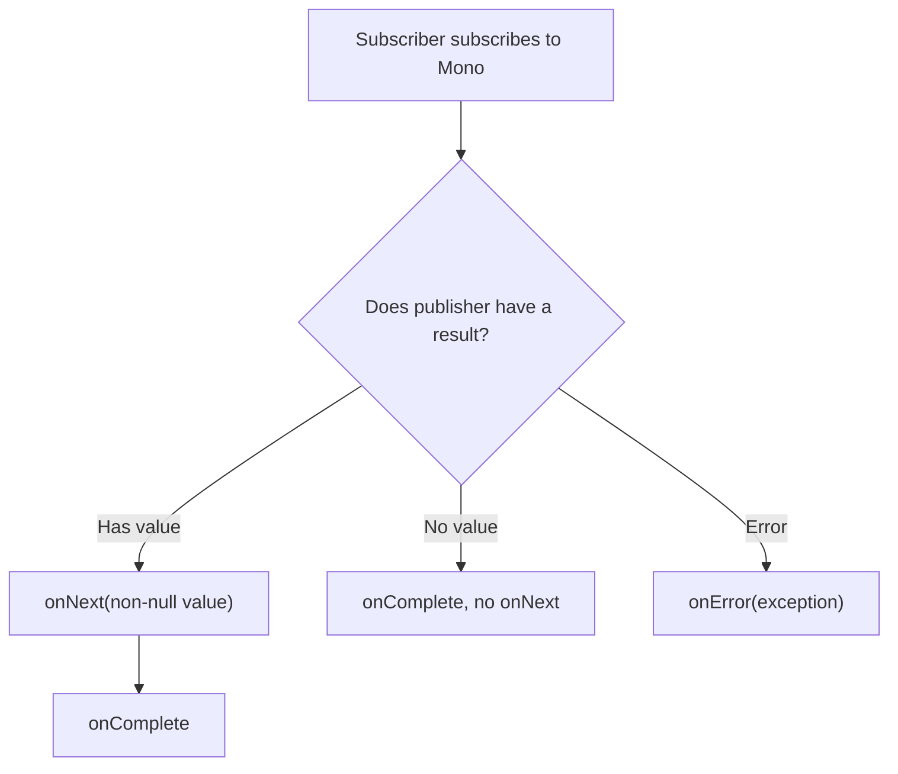
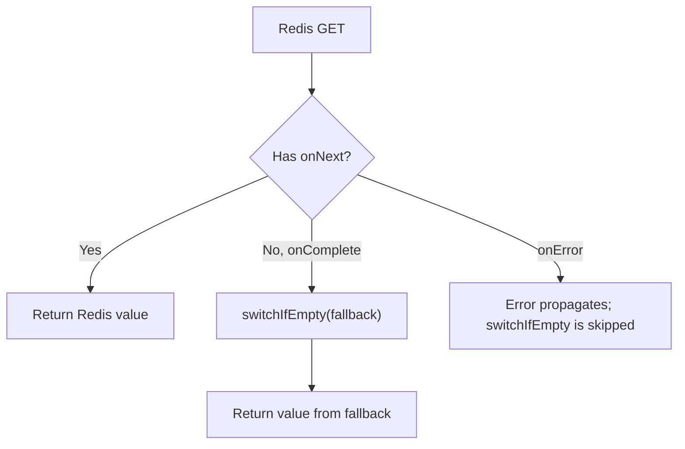

# Representing Missing Data Without Emitting Null Elements in Reactive Spring Data Redis

When writing synchronous Java applications, a Redis read is commonly handled by receiving either a value or `null`:

```java
// Synchronous RedisTemplate: an absent key can result in null.
String value = stringRedisTemplate.opsForValue().get("profile:42:name");
if (value == null) {
    // Data not found.
}
```

When moving to **Spring Data Redis Reactive** with `ReactiveRedisTemplate`, `ReactiveStringRedisTemplate`, and Project Reactor, you must not translate that mental model into "`Mono` emits a `null` value." Under the Reactive Streams specification, **`null` is not a valid element in a signal stream**. Instead, an absent result is represented by a publisher that **completes normally without emitting any element**, such as `Mono.empty()`.

Example:

```java
Mono<String> value =
        reactiveStringRedisTemplate.opsForValue()
                .get("profile:42:name");
```

If the key holds `"Lan"`, the publisher emits `"Lan"` and then completes. If the key does not exist, the publisher **completes empty**. Neither case emits `null`.

This is more than a syntax rule. It shapes how you use `map`, `flatMap`, `switchIfEmpty`, `defaultIfEmpty`, `onErrorResume`, WebFlux APIs, negative caching, testing with `StepVerifier`, and how you distinguish "record not found" from "Redis is failing."

This lesson focuses on representing and handling **missing data without emitting null elements**, in the context of Spring Data Redis Reactive.

## 1. Reactive Streams Uses Signals, Never Null as an Element

Project Reactor provides two common publisher types:

- `Mono<T>`: emits **at most one** element of type `T` and then completes, or simply completes empty, or terminates with an error.
- `Flux<T>`: emits **zero, one, or many** elements of type `T`, then completes or terminates with an error.

Fundamental signals of a publisher:

| Signal | Meaning |
|---|---|
| `onSubscribe` | Subscriber receives subscription handle to request data or cancel |
| `onNext(value)` | An actual data item is emitted; `value` must not be `null` |
| `onComplete()` | Stream ended normally, no more elements |
| `onError(error)` | Stream ended due to an error |

For `Mono<T>`, possible scenarios include:

```text
Scenario A - one value:

subscribe -> onNext("Lan") -> onComplete

Scenario B - no value:

subscribe -> onComplete

Scenario C - error:

subscribe -> onError(RedisConnectionFailureException)
```

There is no valid scenario like:

```text
subscribe -> onNext(null) -> onComplete
```

Diagram:



When a Redis key does not exist, **emitting no element** is the natural representation. This allows the publisher to emit real values like empty strings, `0`, or `false` without confusing them with absent data.

## 2. What Is Mono.empty()?

`Mono.empty()` is a publisher that completes successfully without emitting a value.

```java
Mono<String> missing = Mono.empty();
```

When subscribed to:

```java
missing.subscribe(
        value -> System.out.println("Received: " + value),
        error -> System.err.println("Error: " + error),
        () -> System.out.println("Completed")
);
```

Conceptual output:

```text
Completed
```

The value consumer is never called. That is **not** because the consumer received a `null` and skipped it; the publisher simply never sent `onNext`.

### 2.1. Mono.just(value) vs. Mono.empty()

```java
Mono<String> found = Mono.just("Lan");
Mono<String> missing = Mono.empty();
```

| Publisher | `onNext` | Terminal signal |
|---|---|---|
| `Mono.just("Lan")` | `"Lan"` | `onComplete` |
| `Mono.just("")` | Empty string `""` | `onComplete` |
| `Mono.just("null")` | Four characters `n-u-l-l` | `onComplete` |
| `Mono.empty()` | None | `onComplete` |
| `Mono.error(ex)` | None | `onError(ex)` |

An empty string and the string `"null"` are **real values**. Never treat them as missing data without an explicit business contract.

### 2.2. Why is Mono.just(null) wrong?

```java
Mono<String> broken = Mono.just(null); // Invalid.
```

`Mono.just(...)` requires a non-null value. The line above throws `NullPointerException`; it does not create a valid publisher emitting null.

Alternative:

```java
String nullableValue = loadNullableValue();

Mono<String> safe = Mono.justOrEmpty(nullableValue);
```

When `nullableValue == null`, `Mono.justOrEmpty(...)` creates an empty publisher; when non-null, it emits that value.

If the source is an `Optional<String>`:

```java
Optional<String> optionalValue = findMaybe();
Mono<String> safe = Mono.justOrEmpty(optionalValue);
```

This bridges Java APIs that return null/`Optional` into Reactive Streams **at integration boundaries**, rather than passing nullable values through the reactive chain.

## 3. What Does Redis GET Return When a Key Does Not Exist?

In the synchronous API:

```java
String result = stringRedisTemplate.opsForValue()
        .get("catalog:product:42:name");

// result may be null.
```

In the reactive API:

```java
Mono<String> result = reactiveStringRedisTemplate
        .opsForValue()
        .get("catalog:product:42:name");
```

Suppose Redis has:

```redis
SET catalog:product:42:name "Keyboard"
```

The resulting publisher can emit:

```text
onNext("Keyboard")
onComplete()
```

If the key does not exist:

```redis
DEL catalog:product:42:name
```

The `get(...)` publisher completes empty:

```text
onComplete()
```

In practice, handle both cases using **Reactor operators**, rather than checking `value == null` right after the call. The variable `result` is a `Mono<String>`, not a String.

### 3.1. Redis does not return a Java null as a value

Redis `GET` on an absent key produces a nil reply in the Redis protocol. Spring Data Redis reactive translates that semantics into an **empty-completing publisher** for applicable calls. This differs from intentionally storing the string `"null"`:

```redis
SET sample:word "null"
```

In the latter case, Redis genuinely holds a string. Reactive `GET` emits that string; it cannot be treated as missing merely because its text spells `null`.

### 3.2. Subscription time is what matters

```java
Mono<String> value = reactiveRedis.opsForValue()
        .get("catalog:product:42:name");
```

Creating `value` only assembles a reactive pipeline. For a standard cold publisher, the Redis read runs when there is a **subscription** from WebFlux, another subscriber, or a terminal operator.

Therefore, "no value exists at the moment the Mono is created" **does not mean** "the publisher is `Mono.empty()`." To know the outcome, observe signals when the publisher executes.

## 4. Four Easily Confused States When Reading Reactive Data

A Redis read API can encounter four distinct situations:

| State | Example | Signal/value |
|---|---|---|
| Data present | `GET key` -> `"Lan"` | Semantically `Mono.just("Lan")` |
| Data absent | `GET missing` | Semantically `Mono.empty()` |
| Value is false or 0 | `hasKey(key)` -> false; counter 0 | `Mono.just(false)` or `Mono.just(0L)` |
| Error occurred | Redis timeout, connection failure, corrupted serializer | `Mono.error(exception)` |

These cases carry different business meanings:

- **Missing** might return 404 or read from a DB fallback.
- **False** can be a valid check result.
- **Error** normally requires logging, bounded retries, intentional degradation, or propagating an error upstream.

Never collapse everything into `null` or `Mono.empty()` because doing so destroys critical information.

## 5. Which Reactive Redis Operations Return Mono.empty vs. Flux.empty?

Response shape depends on the *command type*, not just whether a key exists.

| Spring Data Redis reactive operation | Logical return type | When no data exists |
|---|---|---|
| `opsForValue().get(key)` | `Mono<V>` | Usually completes empty when GET finds no value |
| `opsForHash().get(key, field)` | `Mono<HV>` | Usually empty if field/key is missing |
| `opsForList().leftPop(key)` | `Mono<V>` | Empty if no element can be popped |
| `opsForList().range(key, start, end)` | `Flux<V>` | `Flux` completes without emitting elements |
| `opsForSet().members(key)` | `Flux<V>` | Emits no elements when set is empty/absent |
| `hasKey(key)` | `Mono<Boolean>` | Usually emits `false` when key does not exist |
| `opsForValue().set(key, value)` | `Mono<Boolean>` | Emits write command status, does not signal miss like GET |
| `delete(key)` | Delete result publisher | Returns delete command result (e.g., key count), not a read miss |

Key rule: **there is no universal rule that "missing key makes every Redis operation return Mono.empty()."** Commands returning Booleans, counts, or statuses produce explicit values even when the target key is absent.

Example:

```java
Mono<String> value = redis.opsForValue().get("missing:key");
Mono<Boolean> exists = redis.hasKey("missing:key");
```

If the key is absent:

```text
value:  onComplete()                    // No onNext
exists: onNext(false) -> onComplete()   // Emits one Boolean value
```

You cannot use `switchIfEmpty(...)` to branch on `false` as if it were empty. When the source emits `false`, the publisher is **not empty**.

### 5.1. Hash: missing field or missing key?

```java
Mono<String> city = redis.opsForHash()
        .get("user:42:profile", "city");
```

If the `city` field is absent, the result completes empty. Yet a lone empty result **cannot distinguish**:

- The entire Redis Hash key does not exist.
- The Hash exists, but the `city` field does not exist.

If business logic must distinguish them, add an explicit check or adjust the storage model. Simply chaining `hasKey` afterward **does not produce an atomic snapshot** with `HGET`; another client could alter Redis between the two reads. For strong consistency, consider Lua or data structured to return full state in a single server-side operation.

### 5.2. Set and List: no elements means an empty Flux

```java
Flux<String> tags = redis.opsForSet().members("product:42:tags");
```

If Redis has no members to return, the stream completes without emitting elements:

```text
onComplete()
```

It does not emit an empty Java collection as an element. If the caller wants an actual `List<String>`, call `collectList()`; at that point the semantics change as explained next.

## 6. Mono.empty and Mono.just(Collections.emptyList()) Are Not the Same

Two expressions:

```java
Mono<List<String>> a = Mono.empty();

Mono<List<String>> b = Mono.just(List.of());
```

behave differently:

```text
a:
    onComplete()

b:
    onNext([])
    onComplete()
```

In particular:

```java
Mono<List<String>> list = Flux.<String>empty()
        .collectList();
```

`collectList()` returns a `Mono` that **emits an empty List**, not `Mono.empty()`.

This has an important consequence:

```java
Mono<List<String>> result = redis.opsForSet()
        .members("product:42:tags")
        .collectList()
        .defaultIfEmpty(List.of("unknown"));
```

When there are no members, `collectList()` still emits `List.of()`. Because the publisher emitted an element, `defaultIfEmpty(...)` **never activates**. To replace an *empty collection*, inspect the collection's contents:

```java
Mono<List<String>> result = redis.opsForSet()
        .members("product:42:tags")
        .collectList()
        .map(values -> values.isEmpty()
                ? List.of("unknown")
                : values);
```

Three distinct concepts:

1. Zero elements in the stream (`Flux.empty()`).
2. Exactly one element, and that element is an empty List.
3. One element that is an empty String `""`.

When designing REST APIs or DTOs, decide clearly which semantics you intend.

## 7. Using switchIfEmpty to Handle Cache Misses

`switchIfEmpty(...)` switches to an alternative publisher **only when the source completes without emitting any elements**.

Suppose you want to read cache and return a default label when absent:

```java
Mono<String> name = redis.opsForValue()
        .get("catalog:product:42:name")
        .switchIfEmpty(Mono.just("Unknown product"));
```

If Redis emits `"Keyboard"`, the final result remains `"Keyboard"`. If Redis reads an absent key, the final result emits `"Unknown product"`.

Diagram:



### 7.1. Database read fallback

In cache-aside, the fallback is typically a DB query:

```java
Mono<String> productName(String productId) {
    String key = "cache:product:" + productId + ":name";

    return redis.opsForValue()
            .get(key)
            .switchIfEmpty(Mono.defer(
                    () -> productRepository.findNameById(productId)));
}
```

`productRepository.findNameById(...)` here is an assumed method **returning `Mono<String>`** from a reactive repository. On a cache miss, it queries the DB. If the DB also lacks the product, the final result remains `Mono.empty()`.

**Note:** this example does not write the DB result back into Redis yet. It illustrates the distinction between a Redis miss and a DB fallback publisher.

### 7.2. Why is Mono.defer commonly used for fallbacks?

Consider:

```java
Mono<String> result = redis.opsForValue()
        .get(key)
        .switchIfEmpty(loadFromDatabase(id));
```

If `loadFromDatabase(id)` is a **Java function that builds a publisher while performing side effects at call time**, those side effects happen immediately during pipeline assembly, even when Redis hits cache. Standard reactive publishers are normally *cold*, so the inner DB query does not run until subscribed; however, **the Java method constructing the fallback has already executed**.

Using:

```java
Mono<String> result = redis.opsForValue()
        .get(key)
        .switchIfEmpty(
                Mono.defer(() -> loadFromDatabase(id)));
```

defers **calling the fallback factory** until actually needed. This matters when fallback construction increments metrics, captures timestamps, runs validation, prepares statements, or reads subscription-time context.

`Mono.defer(...)` does not magically turn a blocking operation into non-blocking; the fallback method must still be designed properly for a reactive runtime.

### 7.3. switchIfEmpty does not catch Redis errors

If Redis times out:

```text
Redis GET -> onError(timeout)
```

then `switchIfEmpty(...)` **does not run**. It only handles empty completion, never errors.

This is desirable in many systems: a missing key is normal; losing connectivity to Redis is an infrastructure failure that should remain visible.

## 8. Using defaultIfEmpty for Default Values

`defaultIfEmpty(value)` is a simpler alternative when the fallback is just **an already-known constant/value**:

```java
Mono<String> result = redis.opsForValue()
        .get("ui:welcome")
        .defaultIfEmpty("Welcome!");
```

Differences:

| Operator | Use when | Example |
|---|---|---|
| `defaultIfEmpty(value)` | You want to emit a concrete value if empty | Default string |
| `switchIfEmpty(otherPublisher)` | You want to subscribe to another source | Query database on cache miss |
| `Mono.justOrEmpty(nullable)` | Converting nullable/`Optional` data into a valid publisher | Legacy API integration |
| `Mono.empty()` | Intentionally representing absent data | Record not found |

**Do not pass null to `defaultIfEmpty`**:

```java
Mono<String> invalid = Mono.<String>empty()
        .defaultIfEmpty(null);  // Invalid.
```

To preserve the absent state, do not add `defaultIfEmpty(null)`. Simply let the publisher complete empty.

### 8.1. Avoid sentinels that collide with real data

For example:

```java
.defaultIfEmpty("NOT_FOUND")
```

can become ambiguous if `"NOT_FOUND"` is also a valid value stored in Redis. For APIs that must clearly distinguish states, use an explicitly typed result DTO, an `Optional` inside a wrapper value, or handle absence at the HTTP boundary.

Avoid inventing an arbitrary special string as a substitute for absence unless the data contract guarantees that string can never be a valid value.

## 9. How Do map and flatMap Behave on an Empty Mono?

The `map` operator only runs when the source emits `onNext`:

```java
Mono<String> uppercase = redis.opsForValue()
        .get("profile:42:name")
        .map(String::toUpperCase);
```

If Redis `GET` returns an empty publisher, `String::toUpperCase` **is never called**; the resulting Mono still completes empty.

Similarly:

```java
Mono<UserDto> user = redis.opsForValue()
        .get("profile:42:name")
        .flatMap(name -> lookupUserByName(name));
```

If the key is missing, `lookupUserByName(...)` never executes.

### 9.1. map must not return null

Broken code:

```java
Mono<String> broken = Mono.just("Lan")
        .map(name -> null);
```

Reactor does not treat a `null` returned by a mapper as a valid element. The pipeline will fail instead of silently emitting `onNext(null)`.

When conditional logic may decide not to emit a result, use `flatMap` with `Mono.empty()`:

```java
Mono<String> approved = Mono.just("Lan")
        .flatMap(name -> name.length() >= 5
                ? Mono.just(name)
                : Mono.empty());
```

Or use `filter`:

```java
Mono<String> approved = Mono.just("Lan")
        .filter(name -> name.length() >= 5);
```

Because the predicate is false, the publisher completes empty without emitting null.

### 9.2. filter creates absence by policy, not just from Redis misses

Suppose Redis holds a key returning `"DISABLED"`:

```java
Mono<String> activeState = redis.opsForValue()
        .get("account:42:state")
        .filter("ACTIVE"::equals);
```

An empty resulting Mono can have two causes:

1. Redis lacks the key.
2. Redis has a value, but it is not `ACTIVE` and was filtered out.

When designing APIs, do not blindly interpret *every* empty completion as "key does not exist." An upstream operator may also have intentionally filtered out the value.

## 10. Flux.empty(): Emits No Elements Yet Still Completes

`Flux.empty()` represents the equivalent semantics for a 0..N stream:

```java
Flux<String> noTags = Flux.empty();
```

Signals:

```text
subscribe -> onComplete
```

Redis Set example:

```java
Flux<String> tags = redis.opsForSet()
        .members("catalog:product:42:tags");
```

If there are no tags, `Flux` does not emit a null element to mean "no members."

### 10.1. Collecting into a final list

```java
Mono<List<String>> tagsList = redis.opsForSet()
        .members("catalog:product:42:tags")
        .collectList();
```

If the Set is empty:

```text
tagsList -> onNext([]) -> onComplete
```

This is very handy for APIs returning JSON arrays:

```json
[]
```

It lets you distinguish "read the list and it has zero items" from "specific entity not found." The business contract defines which distinction applies.

### 10.2. count and hasElements also emit values

```java
Mono<Long> count = redis.opsForSet()
        .members("catalog:product:42:tags")
        .count();

Mono<Boolean> hasAny = redis.opsForSet()
        .members("catalog:product:42:tags")
        .hasElements();
```

When the Flux emits no members:

```text
count  -> onNext(0L)    -> onComplete
hasAny -> onNext(false) -> onComplete
```

In other words, **aggregating an empty Flux** can produce a Mono emitting `0`, `false`, or an empty collection. Not everything derived from a zero-element Flux stays `Mono.empty()`.

### 10.3. next produces a Mono with or without an element

```java
Mono<String> firstTag = redis.opsForSet()
        .members("catalog:product:42:tags")
        .next();
```

If the Flux emits at least one element, `next()` takes the first one it receives. If the Flux is empty, the resulting Mono is also empty.

Do not use the first element of a Set to infer business order: Redis Sets have no stable order like Lists or Sorted Sets.

## 11. Distinguishing empty, never, and "No Message Arrived Yet"

A publisher may **not have emitted an element** for very different reasons:

```java
Mono<String> empty = Mono.empty();
Mono<String> never = Mono.never();
```

Differences:

| Publisher | Emits an element? | Completes? |
|---|---|---|
| `Mono.empty()` | No | Yes, immediately per its semantics |
| `Mono.never()` | No | No |
| `Mono.error(ex)` | No | Terminates with error, no onComplete |
| `Mono.just("x")` | Yes, one | Yes |

A long-lived subscription such as a Redis Pub/Sub or Redis Streams listener **may simply be waiting for the next message**, rather than having completed empty.

Example:

```text
Redis Pub/Sub Flux:
subscribe -> (waiting for message) -> onNext(message1) -> (waiting for message2) ...
```

Never attach `switchIfEmpty` assuming "if no message arrives in 5 seconds, fall back" on a non-completing Flux. `switchIfEmpty` only observes **empty completion**, not "no data within a time window."

If business logic needs a timeout, use timeout operators or polling with explicit deadlines and handle timeout as its own state.

## 12. Mono<Void> Represents Success Without a Payload

Another case of a publisher emitting no value is an operation whose API only needs to **signal completion**:

```java
Mono<Void> operation = redis.opsForValue()
        .set("demo:flag", "ready")
        .then();
```

`then()` discards the Boolean from `SET` and returns a publisher concerned only with completion or error.

If Redis `SET` succeeds, `operation` completes empty. Yet its meaning is:

> "Executed the chained operation and no payload needs to be returned."

Not:

> "Data not found."

### 12.1. The switchIfEmpty trap on Mono<Void>

The following is a subtle bug:

```java
Mono<Void> write = redis.opsForValue()
        .set("demo:flag", "ready")
        .then();

Mono<Void> followed = write.switchIfEmpty(
        Mono.defer(() -> doSomethingElse()));
```

Because `write` is a `Mono<Void>`, it completes without emitting `onNext` even when the write succeeded. `switchIfEmpty(...)` will subscribe to the fallback even after **a successful operation**.

To run a step **after successful completion**, use `then(...)`:

```java
Mono<Void> followed = write
        .then(doSomethingElse());
```

If you need to know whether `SET` returned `true` or `false`, **do not discard the Boolean too early** with `then()`. Inspect and handle the result first, then convert to `Mono<Void>` if the API requires it.

### 12.2. Completion does not equal cache miss

In a reactive service, methods such as:

```java
Mono<Void> invalidateCache(String key)
Mono<Void> sendNotification(String userId)
Mono<Void> recordMetric(String name)
```

naturally complete empty on success. Treating "every empty Mono means record not found" is wrong. **The API return type and operation context** determine what empty completion means.

## 13. Do Not Force Mono.empty into an Exception in Every API

When looking up an item, there are two common contracts:

**Contract A — data may legitimately be absent:**

```java
public Mono<String> findName(String id) {
    return redis.opsForValue().get("name:" + id);
}
```

The caller decides whether to use a fallback, return 404, or display an empty state.

**Contract B — data is required to exist:**

```java
public Mono<String> requireName(String id) {
    return redis.opsForValue()
            .get("name:" + id)
            .switchIfEmpty(
                    Mono.error(() ->
                            new NameNotFoundException(id)));
}
```

Under Contract B, absence is promoted to an error per the method's policy. Downstream now receives `onError` instead of an empty completion.

Neither contract fits every case:

- A search query can legitimately return empty without error.
- A command acting on an account that must exist can treat missing data as a business error.
- A REST endpoint looking up a resource by ID typically maps absence to 404.
- A cache read falling back to a database normally **does not** treat a cache miss as an error.

Place the absence-to-error boundary where **the business contract is understood**, not inside every low-level Redis helper.

## 14. Mono.empty in a WebFlux REST API

Suppose you want to read a string from Redis and return HTTP 404 when it does not exist.

```java
package com.example.redis.reactive;

import org.springframework.http.HttpStatus;
import org.springframework.http.ResponseEntity;
import org.springframework.web.bind.annotation.GetMapping;
import org.springframework.web.bind.annotation.PathVariable;
import org.springframework.web.bind.annotation.RequestMapping;
import org.springframework.web.bind.annotation.RestController;

import reactor.core.publisher.Mono;

@RestController
@RequestMapping("/api/display-names")
public class DisplayNameController {

    private final ReactiveDisplayNameService service;

    public DisplayNameController(ReactiveDisplayNameService service) {
        this.service = service;
    }

    @GetMapping("/{id}")
    public Mono<ResponseEntity<String>> getName(
            @PathVariable String id) {

        return service.findName(id)
                .map(ResponseEntity::ok)
                .switchIfEmpty(Mono.just(
                        ResponseEntity.status(HttpStatus.NOT_FOUND)
                                .body("Display name not found")));
    }
}
```

Meaning:

- Name found -> `map(ResponseEntity::ok)` produces HTTP 200 with the String body.
- Name missing -> source completes empty, `switchIfEmpty(...)` produces HTTP 404.
- Redis fails -> the error propagates; it is not silently converted into 404.

WebFlux also allows returning `Mono<T>` directly and relying on framework handling of empty publishers. However, when **status 404 is an explicit part of the API contract**, returning `Mono<ResponseEntity<T>>` as above makes the HTTP decision clear.

### 14.1. When to return 200 with an empty list?

For an API listing tags:

```java
@GetMapping("/{id}/tags")
public Mono<List<String>> getTags(
        @PathVariable String id) {

    return redis.opsForSet()
            .members("product:" + id + ":tags")
            .collectList();
}
```

If there are no tags, the API returns:

```json
[]
```

That is reasonable if the contract treats "no tags" as a valid empty collection. If the application must distinguish "product does not exist" from "product exists with zero tags," an empty Redis Set result alone is not enough; add an existence check or a data model that preserves the distinction.

### 14.2. Do not return JSON null instead of HTTP 404

If the API should return 404, never make a publisher emit the string `"null"` or a dummy object just to avoid `Mono.empty()`. The HTTP layer should express absence with status codes, while the data layer preserves proper read semantics.

## 15. Reactive Cache-Aside: Redis Miss -> DB -> Populate Cache

An example close to real-world applications:

```text
Client
   |
   v
Reactive Redis GET
   |
   +-- Value present --> return immediately
   |
   +-- Mono.empty()
          |
          v
      Reactive DB lookup
          |
          +-- Name found --> Redis SET + TTL --> return name
          |
          +-- Mono.empty() --> not found in either store
```

### 15.1. Complete illustrative service

In this example, `ReactiveProductNameRepository` is an assumed business interface backed by a **non-blocking** data source such as R2DBC. How the interface is implemented depends on the project.

```java
package com.example.catalog;

import reactor.core.publisher.Mono;

public interface ReactiveProductNameRepository {
    Mono<String> findNameById(String productId);
}
```

Service:

```java
package com.example.catalog;

import java.time.Duration;

import org.springframework.data.redis.core.ReactiveStringRedisTemplate;
import org.springframework.stereotype.Service;
import reactor.core.publisher.Mono;

@Service
public class ReactiveProductNameService {

    private static final Duration CACHE_TTL =
            Duration.ofMinutes(5);

    private final ReactiveStringRedisTemplate redis;
    private final ReactiveProductNameRepository repository;

    public ReactiveProductNameService(
            ReactiveStringRedisTemplate redis,
            ReactiveProductNameRepository repository) {
        this.redis = redis;
        this.repository = repository;
    }

    public Mono<String> findName(String productId) {
        if (productId == null || productId.isBlank()) {
            return Mono.error(
                    new IllegalArgumentException("productId is blank"));
        }

        String cacheKey = "cache:product:name:" + productId;

        return redis.opsForValue()
                .get(cacheKey)
                .switchIfEmpty(Mono.defer(() ->
                        repository.findNameById(productId)
                                .flatMap(name ->
                                        redis.opsForValue()
                                                .set(cacheKey, name, CACHE_TTL)
                                                .thenReturn(name))));
    }
}
```

On a cache miss:

1. Redis `GET` completes empty.
2. `switchIfEmpty` subscribes to the DB read publisher.
3. If the DB returns a name, `flatMap` issues Redis `SET` with TTL.
4. Once `SET` completes successfully, `thenReturn(name)` emits that name.
5. If the DB also completes empty, `flatMap` does not run; the final result remains empty.

This code demonstrates **waiting for the Redis cache fill to succeed** before returning the name. If Redis `SET` fails, the request fails even though the DB returned data. Systems treating cache as a best-effort optimization can choose a different policy, provided they clearly separate cache errors from DB errors.

### 15.2. What if you still want to return the DB value when Redis SET fails?

A controlled option:

```java
return redis.opsForValue()
        .set(cacheKey, name, CACHE_TTL)
        .onErrorResume(cacheError -> {
            log.warn("Cache fill failed for key {}", cacheKey, cacheError);
            return Mono.just(false);
        })
        .thenReturn(name);
```

This lets `name` be returned even if the cache write fails, while **scoping error handling solely to the cache SET branch**. Putting `onErrorResume` around the entire pipeline without error classification could unintentionally swallow Redis `GET` or DB errors.

Some systems choose fail-open for cache reads: falling back to the DB when Redis `GET` errors. That is an **availability trade-off**, not treating every Redis error as a natural cache miss.

### 15.3. Do not perform blocking DB calls on the event loop

Against reactive principles:

```java
return redis.opsForValue()
        .get(cacheKey)
        .switchIfEmpty(Mono.just(
                jdbcRepository.loadNameBlocking(productId)));
```

The blocking method runs while constructing the fallback and blocks the current thread; `Mono.just(...)` does not turn blocking JDBC into non-blocking I/O.

If integrating a legacy blocking source is unavoidable, isolate it cleanly using `Mono.fromCallable(...)` and an appropriate scheduler such as `Schedulers.boundedElastic()`:

```java
Mono<String> fallback = Mono.fromCallable(
        () -> jdbcRepository.loadNameBlocking(productId))
        .subscribeOn(Schedulers.boundedElastic());
```

If the callback returns `null`, `Mono.fromCallable(...)` completes empty. Still, `boundedElastic` is only a bridge for legacy code and does not remove the need to size thread pools and JDBC load.

## 16. Mono.justOrEmpty When Wrapping Nullable-Returning Java APIs

Suppose a legacy library has:

```java
@Nullable
String lookupLocal(String key);
```

A wrapper:

```java
public Mono<String> lookup(String key) {
    return Mono.defer(
            () -> Mono.justOrEmpty(lookupLocal(key)));
}
```

If `lookupLocal(key)` returns null, the result completes empty. If it returns a non-null String, the value is emitted normally.

Keep in mind:

- `Mono.defer` postpones the call until subscription; **it does not make the call non-blocking**.
- If `lookupLocal` touches disk, network, or synchronous JDBC, use an appropriate scheduler and assess load.
- If the library throws an exception, Reactor turns it into an error signal; it does not silently turn errors into missing values.

For methods that can both return absent results and throw errors, distinguish those outcomes cleanly in the Java contract rather than returning null everywhere and leaving downstream to guess.

### 16.1. Optional at the imperative boundary

```java
Optional<String> optional = findFromLegacyCode();
Mono<String> reactive = Mono.justOrEmpty(optional);
```

With `Optional.empty()`, the reactive result is `Mono.empty()`.

In most reactive chains, you do not need `Optional` just to represent absence because **`Mono.empty` already represents that state**. However, there are cases where absence must be turned into a concrete element; that is covered next.

## 17. When Absence Must Be Kept as a Value: Mono<Optional<T>>

Sometimes a caller needs **an `onNext` signal even when the lookup is absent**—for instance, to combine with another publisher via `zip` or populate a status DTO.

In that case, you can deliberately use:

```java
Mono<Optional<String>> result = redis.opsForValue()
        .get("profile:42:name")
        .map(Optional::of)
        .defaultIfEmpty(Optional.empty());
```

Two outcomes:

```text
Redis has "Lan":
    onNext(Optional["Lan"]) -> onComplete

Redis missing:
    onNext(Optional.empty()) -> onComplete
```

Note: in the second case, **there is no `onNext(null)`**. The emitted item is a **non-null `Optional` object** representing no value internally.

### 17.1. Should you use Mono<Optional<T>> everywhere?

Not necessarily. `Mono<T>` already supports empty completion, so `Mono<Optional<T>>` introduces **two layers of absence**:

1. Mono emits nothing.
2. Mono emits `Optional.empty()`.

That can confuse callers unless the API contract specifies it clearly. Only use it when callers truly need to observe absence as a **value** rather than an empty completion.

For typical lookup APIs:

```java
Mono<String> findName(String id);
```

is concise and idiomatic.

## 18. Representing Missing Data with a Domain Result Type

When you need to distinguish "found," "missing," and other domain states without magic sentinel values, define an explicit type.

Java 17:

```java
public sealed interface LookupResult
        permits LookupResult.Found, LookupResult.Missing {

    record Found(String value) implements LookupResult {}

    record Missing(String reason) implements LookupResult {}
}
```

Convert the Redis result to the domain type:

```java
Mono<LookupResult> lookup = redis.opsForValue()
        .get("profile:42:name")
        .map(value ->
                (LookupResult) new LookupResult.Found(value))
        .defaultIfEmpty(
                new LookupResult.Missing("name_not_available"));
```

When found, the publisher emits `LookupResult.Found`. When absent, it emits `LookupResult.Missing`. Both are non-null Java objects.

Advantages:

- No ambiguous string sentinels.
- Can carry absence reason or metadata.
- Fits WebFlux endpoints needing structured response objects.
- Callers can branch via pattern matching / `instanceof`.

The trade-off is extra types and mapping boilerplate. Do not overcomplicate a simple lookup when empty completion expresses the contract clearly.

## 19. Major Pitfall: Mono.zip with an Empty Source

Suppose you fetch a user's name and email concurrently:

```java
Mono<String> name = redis.opsForValue().get("user:42:name");
Mono<String> email = redis.opsForValue().get("user:42:email");

Mono<UserView> view = Mono.zip(
        name,
        email,
        (n, e) -> new UserView(n, e));
```

With `Mono.zip`, combining requires **one value from every publisher**. If either `name` or `email` completes empty, the zipped publisher also completes empty and the `UserView` constructor never runs.

That makes sense if the business rule says:

> Missing a required field means `UserView` cannot be built.

But it is wrong if the goal is:

> Always build `UserView`, where `email` may be absent.

### 19.1. Using Optional to zip when absence must be preserved

```java
Mono<Optional<String>> nameValue = name
        .map(Optional::of)
        .defaultIfEmpty(Optional.empty());

Mono<Optional<String>> emailValue = email
        .map(Optional::of)
        .defaultIfEmpty(Optional.empty());

Mono<UserSummary> summary = Mono.zip(
        nameValue,
        emailValue,
        (n, e) -> new UserSummary(n, e));
```

DTO:

```java
record UserSummary(
        Optional<String> name,
        Optional<String> email
) {}
```

Both `Mono<Optional<String>>` sources emit one element, even when the inner `Optional` is empty. That lets `zip` execute the combinator function.

Depending on the API contract, you can use another wrapper record instead of `Optional`, or use `defaultIfEmpty(...)` with unambiguous business defaults.

### 19.2. Do not try to zip using Mono.just(null)

Incorrect:

```java
Mono.zip(
        name.defaultIfEmpty(null),
        email.defaultIfEmpty(null));
```

Every element emitted through Reactor must be non-null. Represent absence via empty completion when no combined result is desired, or via a wrapper/DTO when missing fields must be kept during combination.

## 20. doOnNext and doOnSuccess Have Different Semantics

When debugging reactive pipelines, you might write:

```java
Mono<String> source = redis.opsForValue().get(key);

source.doOnNext(value ->
        log.debug("Value present: {}", value));
```

If the source completes empty, `doOnNext` is not called because no element was emitted.

However, `Mono.doOnSuccess(...)` has an easily misunderstood behavior:

```java
source.doOnSuccess(value -> {
    if (value == null) {
        log.debug("Mono completed successfully but empty");
    }
});
```

For **Mono**, the `doOnSuccess` callback receives `null` to **report that the Mono completed with no value**. That is a behavior of the completion-observation callback, **not an `onNext(null)`**.

Distinguish:

| Observation tool | When Mono has a value | When Mono completes empty |
|---|---|---|
| `doOnNext(v)` | Called with the value | Not called |
| `doOnSuccess(v)` | Called with the value | Called with `null` in the callback |
| `Flux.doOnComplete` | Does not inspect payload | Called when Flux completes |
| `doOnError(e)` | Not called on success | Not called on empty completion |

Because `doOnSuccess` contains the word "success," many assume it runs only when data is present. In the reactive protocol, empty completion is also a **successful** termination.

### 20.1. Using switchIfEmpty to count cache misses

```java
Mono<String> observed = redis.opsForValue()
        .get(key)
        .switchIfEmpty(Mono.defer(() -> {
            metrics.incrementCacheMiss();
            return Mono.empty();
        }));
```

This expresses: when the source is empty, increment the metric and **keep the result empty**. If the metric itself blocks or has complex side effects, manage its execution appropriately for a reactive system.

Specifically, never infer that a cache miss is a Redis error; record error metrics on a separate error branch.

## 21. onErrorResume Is Not switchIfEmpty

Three result types must be handled separately:

```java
Mono<String> value = redis.opsForValue().get(key);
```

**Data present:**

```text
onNext("value") -> onComplete
```

**Key missing:**

```text
onComplete
```

**Redis failed:**

```text
onError(RedisConnectionFailureException)
```

Operator choices:

| Operator | Signal it handles |
|---|---|
| `switchIfEmpty` | Completion without `onNext` |
| `defaultIfEmpty` | Completion without `onNext`, replaced with a value |
| `onErrorResume` | `onError`, replaced with another publisher |
| `onErrorReturn` | `onError`, replaced with a fixed value |
| `retryWhen` | Errors per retry strategy |

### 21.1. Anti-pattern: masking all Redis errors as missing keys

```java
Mono<String> risky = redis.opsForValue()
        .get(key)
        .onErrorResume(error -> Mono.empty());
```

Here, disconnections, timeouts, and serializer errors are all turned into "no data." The API layer could return 404 even when the record actually exists in Redis/DB.

If the system intentionally chooses **fail-open** when the Redis cache is unavailable, implement it deliberately:

```java
Mono<String> value = redis.opsForValue()
        .get(cacheKey)
        .onErrorResume(
                RedisConnectionFailureException.class,
                error -> {
                    log.warn("Redis cache unavailable", error);
                    return Mono.empty();
                })
        .switchIfEmpty(
                Mono.defer(() -> repository.findNameById(id)));
```

This only illustrates one specific policy: **Redis connection failures mean bypassing cache to fall back to the DB**. It does not mean an error actually signifies missing data. For timeouts or other exceptions, evaluate which exception types to handle, DB capacity, and logging/metrics.

Do not use `onErrorContinue` as a general way to turn Redis errors into empty streams; its behavior depends on downstream operators and can be hard to predict, especially in flows with side effects.

## 22. Does Mono.empty Execute a Redis Command?

If a method returns directly:

```java
public Mono<String> find(String id) {
    if (id.isBlank()) {
        return Mono.empty();
    }
    return redis.opsForValue().get("name:" + id);
}
```

on a blank input, the method never creates a Redis read step. `Mono.empty()` simply completes empty when subscribed to.

Conversely:

```java
return redis.opsForValue()
        .get("name:" + id)
        .filter(name -> name.length() >= 3);
```

still sends the Redis `GET` upon subscription, and may then filter the result out. Both flows yield an empty outcome externally, yet **their cost and cause differ**.

If the caller needs to distinguish "invalid input" from "data not found," return `Mono.error(new IllegalArgumentException(...))` or an explicit domain result for invalid input; avoid overusing `Mono.empty()` for every abnormal state.

## 23. Read-Your-Writes, Cache Misses, and Concurrency

An empty result from Redis `GET` only states that **at the moment of that read**, the key held no matching value. It does not guarantee:

- The key remains absent when the caller runs the DB fallback.
- Another client won't populate the key immediately afterward.
- The DB also lacks the record.
- Nobody deleted the key between `hasKey` and `get`.

Example:

```text
T1  Request A: Redis GET -> empty
T2  Request B: Redis SET "Lan"
T3  Request A: fallback DB -> "Linh"
T4  Request A: Redis SET "Linh"
```

Cache-aside can produce stale cache fills if source data updates while an older read request is in flight. `Mono.empty()` represents the cache miss accurately, yet **does not solve concurrency races** between requests.

If strong consistency is required, enforce constraints at the DB, use version-aware cache fills, Lua scripts, or proper invalidation strategies. Those are separate design layers, not replacements for representing absence cleanly in Reactor.

### 23.1. Do not call hasKey before get to "avoid Mono.empty"

A redundant and racy pattern:

```java
return redis.hasKey(key)
        .flatMap(exists -> {
            if (exists) {
                return redis.opsForValue().get(key);
            }
            return Mono.empty();
        });
```

Between `hasKey` returning true and `GET` executing, another client can delete the key. The result can still be empty, while costing an extra round trip.

When you simply want the value, call `GET` directly and handle empty completion. Only use `hasKey` when business logic genuinely only needs existence checks and accepts or handles multi-command non-atomicity.

## 24. Negative Caching: Should You Store "Not Found"?

If the DB lacks a record and Redis also lacks a cache entry, every request keeps hitting the DB. When non-existent IDs are queried heavily, that can become a significant load source.

Some systems use **negative caching**: temporarily storing a "does not exist" state.

Because Redis has no default "null value" for `GET`, caching absence requires choosing a **concrete representation** with an explicit contract:

1. A sentinel string that cannot collide with valid data, given a short TTL.
2. A JSON envelope: `{"state":"missing"}`.
3. A dedicated key marking the missing state.
4. A cache abstraction supporting null sentinels under a matching serializer.

Envelope example:

```json
{"state":"missing","schemaVersion":1}
```

or:

```json
{"state":"found","schemaVersion":1,"value":"Lan"}
```

When reading Redis, producer and consumer decode the envelope into **a domain result**, without emitting Java null.

Risks of negative caching:

- A record may be created right after the "missing" sentinel is cached.
- Invalidation events may be lost.
- An older read request may write back the sentinel after the record was created.
- Sentinel TTLs must be shorter or paired with reliable invalidation.

Never store the raw string `"null"` casually and treat it like a Redis nil. A `GET` nil reply and a string holding `"null"` are completely different.

## 25. Mono.cache() Is Not a Redis Cache

Project Reactor has a `Mono.cache()` operator:

```java
Mono<String> shared = redis.opsForValue()
        .get("profile:42:name")
        .cache();
```

This operator caches **the publisher's terminal signal** so subsequent subscribers reuse it. An empty completion signal can also be cached within that publisher's scope.

This differs from:

```java
reactiveRedis.opsForValue().get(key)
```

which reads an actual Redis key, and differs from Spring Cache annotations/`RedisCacheManager`.

Example:

```text
Subscription 1 -> Redis GET missing -> empty completion
Mono.cache() remembers empty completion
Subscription 2 -> receives cached empty completion,
                  does not necessarily query Redis again
```

If the key is created after the first subscription, the `shared` publisher in this example can keep returning the cached empty signal from memory under Reactor's caching semantics until the signal cache expires or a new publisher is created.

That is why you should not blindly apply `Mono.cache()` to a Redis read expected to reflect fresh Redis data on each subscription. When caching signals, define the Reactor cache operator's TTL and the publisher's lifetime explicitly.

## 26. Representing Absence in a Composite Pipeline

Consider building a product page composed of:

- Required product name.
- Optional description.
- Possibly empty list of tags.

A clear contract:

```java
record ProductView(
        String name,
        Optional<String> description,
        List<String> tags
) {}
```

Building the pipeline:

```java
Mono<String> name = redis.opsForValue()
        .get("product:42:name");

Mono<Optional<String>> description = redis.opsForValue()
        .get("product:42:description")
        .map(Optional::of)
        .defaultIfEmpty(Optional.empty());

Mono<List<String>> tags = redis.opsForSet()
        .members("product:42:tags")
        .collectList();

Mono<ProductView> view = Mono.zip(
        name,
        description,
        tags,
        ProductView::new);
```

Semantics:

1. If `name` is absent, the entire `view` completes empty because name is required.
2. If `description` is absent, it is represented as `Optional.empty()`, still providing a valid element for `zip`.
3. If there are no tags, `collectList()` emits `List.of()`, so `zip` still receives a List.
4. Nowhere does any step need to emit null.

This illustrates why you should not force every missing value into the same sentinel. **Required fields and optional fields have different semantics.**

## 27. Observing Empty Completions in Logs and Metrics

When an API returns missing data, operations need to know whether it was:

- A cache miss.
- A DB miss.
- Filtered out by business rules.
- An infrastructure error intentionally degraded via fallback.
- A publisher canceled before finishing.

Operational guidelines:

1. Count cache hits in the `onNext` branch.
2. Count cache misses in the empty-completion branch before the DB fallback.
3. Count Redis errors in a separate `onError` branch.
4. Do not invoke extra subscriber callbacks just to measure state; use `doOnNext`, `doOnError`, and controlled `switchIfEmpty` branches.
5. Do not log sensitive payloads merely to distinguish hits from misses.
6. If a request is canceled, do not conclude it was empty; cancellation is distinct from completion.

Example:

```java
Mono<String> observed = redis.opsForValue()
        .get(key)
        .doOnNext(value -> metrics.hit())
        .doOnError(error -> metrics.redisError())
        .switchIfEmpty(Mono.defer(() -> {
            metrics.miss();
            return Mono.empty();
        }));
```

This snippet increments metrics in lightweight callbacks without running blocking work on the event-loop. In flows with retries or multiple subscriptions, metrics can increment per subscription; understand the lifecycle to avoid misreading counts.

## 28. Testing Empty Publishers with StepVerifier

Project Reactor provides `reactor-test` and `StepVerifier` to assert signals instead of relying on `Thread.sleep` or `block()`.

Test-scoped Maven dependency:

```xml
<dependency>
    <groupId>io.projectreactor</groupId>
    <artifactId>reactor-test</artifactId>
    <scope>test</scope>
</dependency>
```

JUnit examples:

```java
import org.junit.jupiter.api.Test;
import reactor.core.publisher.Flux;
import reactor.core.publisher.Mono;
import reactor.test.StepVerifier;

import java.util.List;

class EmptyPublisherExamplesTest {

    @Test
    void monoEmptyCompletesWithoutEmittingNull() {
        StepVerifier.create(Mono.<String>empty())
                .verifyComplete();
    }

    @Test
    void justOrEmptyNullCompletesWithoutElement() {
        StepVerifier.create(
                Mono.justOrEmpty((String) null))
                .verifyComplete();
    }

    @Test
    void defaultIfEmptyCreatesRealValue() {
        StepVerifier.create(
                Mono.<String>empty()
                        .defaultIfEmpty("fallback"))
                .expectNext("fallback")
                .verifyComplete();
    }

    @Test
    void emptyFluxCollectsToAnEmptyListValue() {
        StepVerifier.create(
                Flux.<String>empty().collectList())
                .expectNext(List.of())
                .verifyComplete();
    }

    @Test
    void emptyIsDifferentFromFalse() {
        StepVerifier.create(Mono.just(false))
                .expectNext(false)
                .verifyComplete();
    }

    @Test
    void missingAndFailureAreDifferent() {
        StepVerifier.create(
                Mono.<String>error(
                        new IllegalStateException("Redis failed")))
                .expectError(IllegalStateException.class)
                .verify();
    }
}
```

In these examples:

- `verifyComplete()` verifies the stream completed cleanly with no items other than declared `expectNext` expectations.
- `expectNext(...)` asserts a real `onNext`, never null.
- `expectError(...)` verifies the publisher terminated with an error.

In Redis integration tests, seed present and absent keys in an isolated test environment and verify `GET` emits the exact signals expected by the application. Avoid running blocking calls to "force" a Mono into a nullable Java value just to test semantics.

### 28.1. Testing switchIfEmpty

```java
@Test
void fallbackRunsOnlyWhenSourceIsEmpty() {
    AtomicInteger fallbackCalls = new AtomicInteger();

    Mono<String> value = Mono.just("cached")
            .switchIfEmpty(Mono.defer(() -> {
                fallbackCalls.incrementAndGet();
                return Mono.just("database");
            }));

    StepVerifier.create(value)
            .expectNext("cached")
            .verifyComplete();

    assertEquals(0, fallbackCalls.get());
}
```

This sample test uses only Reactor/JUnit; when placing it in a test file, import `java.util.concurrent.atomic.AtomicInteger` and static `org.junit.jupiter.api.Assertions.assertEquals`.

A companion test with `Mono.<String>empty()` verifies the fallback runs once per subscription when the source is empty.

## 29. Avoid Using block() to Check for Null in Reactive Flows

An anti-pattern:

```java
String value = redis.opsForValue()
        .get(key)
        .block();

if (value == null) {
    // ...
}
```

`block()` can return `null` at a **blocking boundary** when a Mono completes empty. However, that is behavior of the reactive-to-imperative adapter API—**it does not mean the Mono emitted `onNext(null)`**.

In Spring WebFlux, calling `block()` on the event-loop can throw an exception or stall processing. Instead of blocking to test for null, use:

```java
return redis.opsForValue()
        .get(key)
        .switchIfEmpty(...);
```

If integrating with a synchronous system outside the reactive pipeline is unavoidable, consider `blockOptional()` to represent absence as `Optional`, while controlling threads, timeouts, and blocking risk. Never use it as a default pattern inside WebFlux services.

## 30. Common Mistakes

### Mistake 1: Mono.just(null) to represent a missing key

```java
Mono.just(null);
```

Invalid. Use `Mono.empty()` or `Mono.justOrEmpty(nullableValue)`.

### Mistake 2: map returning null when data fails a condition

```java
.map(value -> condition(value) ? value : null)
```

Invalid. Use `filter(...)` or `flatMap(value -> ... Mono.empty())`.

### Mistake 3: switchIfEmpty on Boolean false

```java
redis.hasKey(key)
        .switchIfEmpty(Mono.just(true));
```

`hasKey` typically emits `false` when a key is absent; that is a value, not empty. To branch on false, use `flatMap(exists -> exists ? ... : ...)` or `filter(Boolean::booleanValue)` as appropriate for the contract.

### Mistake 4: Treating Redis connection errors as cache misses

```java
.onErrorResume(error -> Mono.empty())
```

can mask infrastructure failures. Only apply fallback when error types are classified and fail-open behavior is intentional.

### Mistake 5: Treating a 0-element Flux as equivalent to a Mono emitting an empty List

`Flux.empty()` emits no `onNext`; `Flux.empty().collectList()` emits one empty List. `defaultIfEmpty` behaves differently after `collectList()`.

### Mistake 6: Using switchIfEmpty on Mono<Void>

`Mono<Void>` completes empty on success. A fallback can execute even when the prior operation succeeded. Use `then(...)` to sequence operations after completion.

### Mistake 7: Treating "no message yet" on a live stream as Flux.empty

A long-lived Flux subscription that has not received a message yet **has not completed empty**. `switchIfEmpty` is not a timeout operator.

### Mistake 8: Passing null elements inside Flux.fromIterable

```java
List<String> values = Arrays.asList("a", null, "b");
Flux.fromIterable(values);
```

A null element in the source iterable violates the non-null element contract when emitted. Filter, transform, or wrap absent items in a valid container before building the stream.

### Mistake 9: Mistaking doOnSuccess(null) for onNext(null)

`Mono.doOnSuccess` passes `null` to its callback when the Mono completes empty, yet no null emission occurs. Distinguish **observation callbacks** from **Reactive Streams signals**.

### Mistake 10: Using string sentinels that collide with real data

`"UNKNOWN"`, `"NOT_FOUND"`, or `"null"` could be genuine stored values. If structured state is needed, use a DTO or domain result rather than ambiguous string conventions.

### Mistake 11: Calling blocking APIs inside switchIfEmpty

`Mono.just(blockingCall())` executes blocking work while assembling the pipeline. Use a true reactive fallback or isolate the blocking call with an appropriate scheduler.

### Mistake 12: Using Mono.zip with potentially empty sources while expecting a combined result

If a required source completes empty, `zip` completes empty too. Use `Optional` or a domain wrapper when absence is a field that must be retained during combination.

### Mistake 13: Thinking Mono.empty automatically caches missing results forever

`Mono.empty()` is just an empty completion. Whether missing results are cached depends on Redis sentinels, Reactor `Mono.cache()`, Spring Cache, or another explicit mechanism.

### Mistake 14: Assuming a cache miss implies a DB miss

An empty Redis `GET` only reflects cache state during that read. The DB may still have the record; fallback should query the authoritative store when required.

### Mistake 15: Returning 200 with literal "null" instead of an appropriate status

Never replace absence with the string `"null"` to avoid handling an empty Mono. Return 404, 204, an empty list, or a domain response per your API contract.

## 31. Practice Exercises

### Exercise 1 — Analyzing Mono signals

Given:

```java
Mono<String> a = Mono.just("hello");
Mono<String> b = Mono.empty();
Mono<String> c = Mono.just("");
Mono<Boolean> d = Mono.just(false);
```

Determine how many `onNext` signals each publisher emits and explain the differences among `b`, `c`, and `d`.

### Exercise 2 — Distinguishing cache misses from Redis errors

Write a `findProductName(id)` method using `ReactiveStringRedisTemplate.opsForValue().get(key)`, falling back to a reactive repository when the publisher is empty. Ensure a Redis timeout is not unintentionally interpreted as "product does not exist."

### Exercise 3 — Converting Optional to Mono

Given a legacy method:

```java
Optional<String> findEmail(String userId);
```

Write how to convert it to a valid `Mono<String>`, then explain when `Mono.justOrEmpty(...)` emits a value and when it completes empty.

### Exercise 4 — WebFlux 404

Build endpoint `GET /products/{id}/name`:

- If the name is found, return `200 OK` with the name string.
- If the source completes empty, return `404 Not Found`.
- If the source emits an infrastructure error, do not silently return 404.

### Exercise 5 — Distinguishing Flux.empty from an empty List

Given:

```java
Flux<String> tags = Flux.empty();
```

Compare the signals of `tags`, `tags.collectList()`, `tags.count()`, and `tags.hasElements()`.

### Exercise 6 — Catching the Mono<Void> trap

Given:

```java
Mono<Void> write = Mono.just(true).then();
```

Explain why `write.switchIfEmpty(fallback)` can run the fallback even though the source operation succeeded. Rewrite it with `then(...)` when the goal is "after the write succeeds, run the next step."

### Exercise 7 — Combining two potentially missing fields

Two Redis keys `user:42:name` and `user:42:email` may not exist. Write `Mono<UserView>` allowing `email` to be missing while `name` is required, using `Mono.zip` with `Optional` or a domain wrapper.

### Exercise 8 — Observing with StepVerifier

Write tests verifying:

- `Mono.empty()` emits no `onNext`.
- `Mono.justOrEmpty((String) null)` completes empty.
- `defaultIfEmpty("fallback")` emits exactly one string.
- `Mono.just(false)` differs from `Mono.empty()`.
- `Mono.error(...)` takes the error path.

### Exercise 9 — Designing a negative cache

A service receives heavy requests for non-existent IDs. Propose how to cache the missing state with a TTL without using `Mono.just(null)`, and explain how to invalidate it when the record is later created.

## 32. Quick Reference Table

| Question | Answer |
|---|---|
| Does Reactive Streams allow `onNext(null)`? | No |
| How do you represent a Mono with no result? | `Mono.empty()` |
| How do you represent a Flux with no elements? | `Flux.empty()` |
| Does `Mono.empty` emit a null element? | No, only `onComplete` |
| Is `Mono.just(null)` valid? | No |
| How do you convert nullable/`Optional` into Mono? | `Mono.justOrEmpty(...)` |
| What does reactive Redis GET usually return for a missing key? | An empty-completing Mono |
| Is `hasKey` on an absent key `Mono.empty`? | No, usually emits `false` |
| How do you provide a fallback when source is empty? | `switchIfEmpty(...)` or `defaultIfEmpty(value)` |
| Does `switchIfEmpty` run when Redis errors? | No; handle errors per separate contract |
| Is `Flux.empty().collectList()` a `Mono.empty`? | No, it emits an empty List |
| Does empty completion of `Mono<Void>` mean missing? | Not necessarily; it can indicate payloadless success |
| How to use `Mono.zip` when one source can be absent yet you still want to combine? | Represent absence with `Optional` or an emittable domain wrapper |
| Can `Mono.doOnSuccess` receive a null argument? | Yes on empty completion, though it is not `onNext(null)` |
| Should you use `block()` to check for null in WebFlux? | No; prefer reactive operators |
| Which tool tests empty signals? | Reactor `StepVerifier` |

**Conclusion:** in Spring Data Redis reactive, **absence of data is a stream-signal state, not an element holding `null`**. `Mono.empty()` and `Flux.empty()` represent completion without `onNext`; `Optional` or domain wrappers are used when "missing" must be passed as a structured value. Keep **not found**, **valid values like false/0/empty string**, **payloadless completion**, and **infrastructure failures** distinct, translating them into HTTP statuses, fallbacks, or business outcomes at the right boundary.

### References

- [Spring Data Redis — Reactive Redis](https://docs.spring.io/spring-data/redis/reference/redis/reactive.html)
- [Spring Data Redis — ReactiveRedisTemplate API](https://docs.spring.io/spring-data/redis/reference/api/java/org/springframework/data/redis/core/ReactiveRedisTemplate.html)
- [Spring Data Redis — ReactiveValueOperations API](https://docs.spring.io/spring-data/redis/reference/api/java/org/springframework/data/redis/core/ReactiveValueOperations.html)
- [Project Reactor — Reference Guide](https://projectreactor.io/docs/core/release/reference/)
- [Project Reactor — Mono API](https://projectreactor.io/docs/core/release/api/reactor/core/publisher/Mono.html)
- [Project Reactor — Flux API](https://projectreactor.io/docs/core/release/api/reactor/core/publisher/Flux.html)
- [Project Reactor — StepVerifier API](https://projectreactor.io/docs/test/release/api/reactor/test/StepVerifier.html)
- [Reactive Streams — JVM Specification](https://www.reactive-streams.org/)
- [Spring Framework — WebFlux](https://docs.spring.io/spring-framework/reference/web/webflux.html)
- [Redis — GET](https://redis.io/docs/latest/commands/get/)
