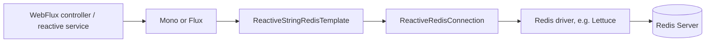
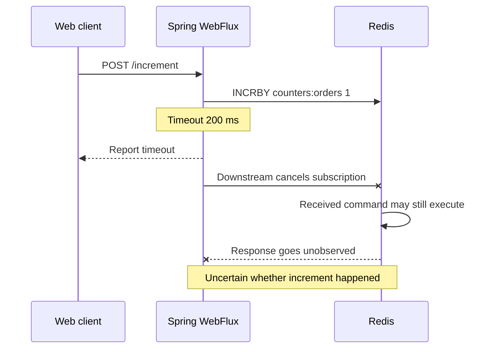
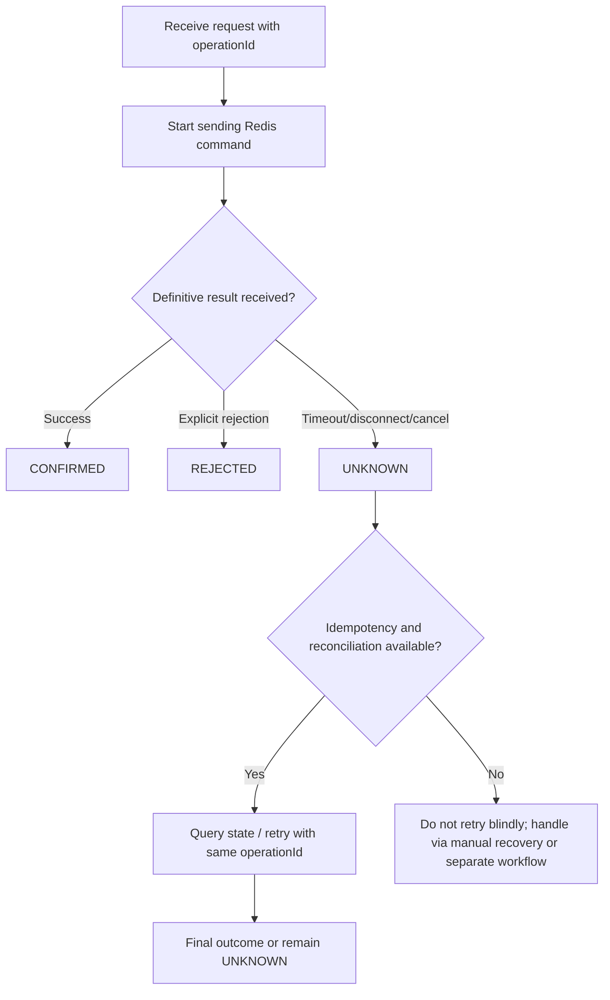
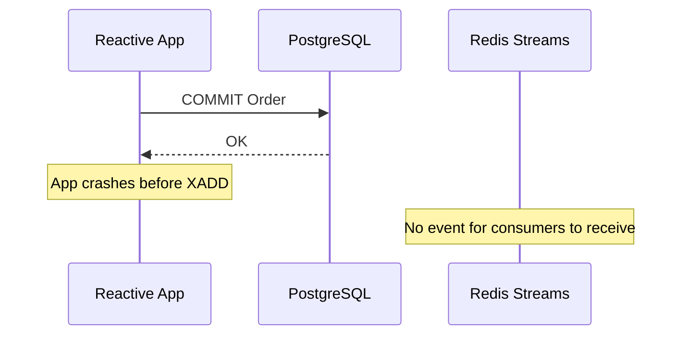
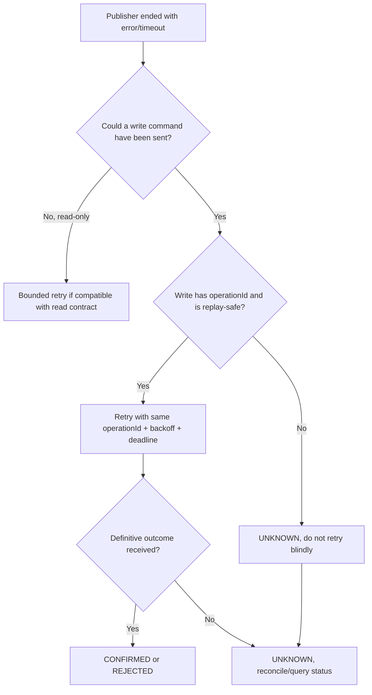

# Cancellation, Timeouts, Retries, and Uncertain Write Outcomes

With **Spring Data Redis Reactive**, applications invoke Redis via **Project Reactor** publishers, typically `Mono<T>` or `Flux<T>`. These publishers make it straightforward to compose asynchronous operations, enforce timeouts, cancel subscriptions, and retry failures. However, there is a critical boundary:

> **Canceling a subscription or hitting a timeout on the application side does not prove Redis did not write data.**

A command may already have been sent to Redis and executed successfully, only for the reply to be lost or arrive after the subscriber stopped waiting. If the client assumes the command never ran and retries an operation such as `INCRBY`, `LPUSH`, or `XADD`, side effects can appear **twice**.

This lesson explains the reactive publisher lifecycle, the semantics of cancellation and timeouts, how to classify retries by operation type, how to identify **uncertain write outcomes** (*unknown write outcome*), and how to use **operation IDs/idempotency** to build safer recovery mechanisms.

## 1. Relevant Classes in Spring Data Redis Reactive

Spring Data Redis provides asynchronous APIs following the Reactive Streams model:

- `ReactiveRedisTemplate<K, V>`: operates on Redis keys/values using configured serializers.
- `ReactiveStringRedisTemplate`: convenient variant for String data.
- `ReactiveValueOperations<K, V>`: String value operations such as `get`, `set`, and `increment`.
- `ReactiveStreamOperations<K, HK, HV>`: Redis Stream operations, such as appending with `XADD`.
- `Mono<T>`: publisher emitting at most one result or an error.
- `Flux<T>`: publisher emitting multiple results or an error.

Basic flow:



Example Redis access:

```java
import reactor.core.publisher.Mono;
import org.springframework.data.redis.core.ReactiveStringRedisTemplate;

public Mono<String> loadStatus(
        ReactiveStringRedisTemplate redis, String id) {
    return redis.opsForValue().get("status:" + id);
}
```

Once subscribed to, the publisher interacts with Redis and emits results downstream. By Reactive Streams convention, applications normally **return the publisher** to the calling layer so WebFlux or an orchestrator manages subscription. Never call `.block()` on the event loop, and never call `.subscribe()` casually inside services just to "fire" an important task.

## 2. Understanding the Lifecycle of a Reactive Operation

A publisher carries these signals:

| Signal / scenario | Reactor-side meaning | Proves Redis write state? |
| --- | --- | --- |
| `onNext` then `onComplete` | Subscriber received the result and publisher finished | Can confirm per command contract and response |
| `onError` | Publisher terminated with an error | **Does not always** prove Redis did not write |
| `cancel` / `dispose` | Downstream no longer wants further signals | **No**; command may be running or already processed |
| `timeout` | No signal within deadline; Reactor emits timeout error | **No**; client-side timeout is not rollback |
| `retry` / `retryWhen` | Re-subscribes to source after selected errors | Can **re-send** commands with side effects |

For standard Redis publishers, the command usually executes upon subscription. However, when the command actually hits the wire and whether it can be aborted depend on the driver, connection, and pipeline state. You cannot infer from "Java method called" that the server executed it, nor from "subscription canceled" that the server did not execute it.

### 2.1. A timeline example



The diagram shows **one possible** interleaving, not a mandatory sequence for every timeout. In another case, the command might not have been sent yet. Because the application cannot distinguish the two from a timeout signal alone, the outcome must be treated as **uncertain** whenever the command may have reached Redis.

## 3. Cancellation: Stopping Observation Does Not Cancel Side Effects

In Reactor, `cancel` is a downstream signal indicating no further data is desired. It occurs when:

- The user closes the HTTP connection or the client aborts the request.
- A `Mono` hits `timeout(...)` before receiving a result.
- An operator short-circuits, such as `take(1)` on a `Flux`.
- Application code explicitly calls `Disposable.dispose()` or cancels a subscription.
- A reactive chain ends early according to application policy.

Illustration:

```java
import reactor.core.publisher.Mono;
import java.util.logging.Logger;

Mono<Boolean> write = redis.opsForValue()
        .set("status:job-101", "PROCESSING")
        .doOnSubscribe(s -> log.info("Redis write subscribed"))
        .doOnCancel(() -> log.info("Subscriber cancelled"))
        .doOnSuccess(ok -> log.info("Received write result: " + ok))
        .doOnError(error -> log.warning("Observed error: " + error));
```

`doOnCancel` only indicates the subscriber canceled the stream on the Reactor side. **Never log "Redis write rolled back" inside `doOnCancel`**, because Redis has no awareness of client cancellation and never rolls back an executed command simply because the client stopped waiting.

In web requests, the framework normally owns subscription lifetime. If work must finish even if the user closes the HTTP connection, do not rely on "fire and forget" via a detached `.subscribe()` hoping it always finishes. Record the request durably so an independent worker can resume even if the process restarts.

### 3.1. Canceling before vs. after sending the command

| Timing point | What may happen |
| --- | --- |
| Cancel before publisher actually starts sending | Driver may avoid sending the command |
| Cancel while command sits in client queue | May be dropped from queue, or still sent depending on driver/state |
| Cancel after Redis received the command | Redis can still execute the command |
| Cancel after Redis executed but before reply arrives | Write occurred; client does not know |
| Cancel after observing a successful reply | Outcome is already known; later cancellation does not undo it |

Thus, only a **reliable confirmation reply** or a **state reconciliation** step suffices to establish how a side effect resolved.

## 4. Reactor Timeout and Redis Driver Timeout Are Different Layers

An application can have multiple timeout layers:

| Timeout type | Example | Meaning |
| --- | --- | --- |
| Reactor `Mono.timeout` | `timeout(Duration.ofMillis(300))` | No signal within limit; Reactor emits timeout error and cancels upstream |
| Redis command timeout | Configured on Redis client/Lettuce or Spring Boot | Driver waits for Redis reply up to this bound |
| Connection timeout | Limit when establishing connection | May show connection was never opened, though check send point |
| HTTP request timeout | Gateway, load balancer, or WebFlux | Client stops waiting for HTTP response; backend may still run some work |
| Business deadline | "Must confirm inventory hold before 12:00" | Business validity condition, not just a network timeout |

Reactor example:

```java
import java.time.Duration;
import reactor.core.publisher.Mono;

Mono<Long> updated = redis.opsForValue()
        .increment("counter:requests")
        .timeout(Duration.ofMillis(300));
```

If `updated` emits `TimeoutException`, **never infer** that `counter:requests` did not increment. `timeout` bounds subscriber waiting time; it issues no rollback on Redis.

An API can classify outcomes as:

```text
OK       -> confirmation received from Redis
REJECTED -> Redis returned an explicit error before writing, or business rules rejected it
UNKNOWN  -> no confirmation; command may have executed
```

In practice, be careful before placing an exception into `REJECTED`: many errors occurring before a reply arrives leave it unknown whether Redis processed the command. Use `UNKNOWN` whenever execution might have happened unobserved.

## 5. Not All Redis Operations Retry Safely the Same Way

A mandatory design step is classifying operations by **idempotency**: does re-executing the same request create new side effects?

| Operation | Example | If re-sent after timeout |
| --- | --- | --- |
| Read | `GET key`, `HGETALL key` | Usually produces no side effects; may return newer data if modified |
| Set fixed value | `SET key "READY"` | Can converge to the same value, though TTL, events, and concurrent writes must be considered |
| Increment/decrement | `INCRBY counter 1`, `DECRBY stock 2` | **Can add/subtract a second time** |
| List push | `LPUSH queue payload` | **Can append duplicate items** |
| Stream append | `XADD stream * ...` | **Can create a new record with a new ID** |
| Set add | `SADD set member` | Usually does not duplicate the member; races/auxiliary logic still apply |
| Create if absent | `SET key value NX` | Retry may see "key already exists," without knowing whether you or another client created it |
| Delete key | `DEL key` | Deleting again leaves same final state, though return count and concurrent recreation differ |
| Lua with operation ID | Script checks ID and writes atomically | Safer when replaying **the same operation ID**, provided deduplication state is retained |

"An atomic Redis command" **does not mean** "safe to execute repeatedly." For example, `INCRBY` is atomic yet running it twice increments twice. `XADD` is atomic when appending a record yet sending twice creates two records if auto-generating IDs.

Conversely, a `SET` writing the same value may appear idempotent regarding **final value**, yet can overwrite a TTL, clobber a newer concurrent write, or trigger notifications. Evaluate idempotency against the **business contract**, not just the Redis command name.

## 6. Why Can `retryWhen` Amplify Side Effects?

Reactor can re-subscribe to a publisher on failure:

```java
import java.time.Duration;
import reactor.util.retry.Retry;

Mono<Long> risky = redis.opsForValue()
        .increment("counter:requests")
        .timeout(Duration.ofMillis(300))
        .retryWhen(Retry.backoff(2, Duration.ofMillis(50)));
```

`Retry.backoff(2, ...)` allows **up to two retries**, meaning up to **three subscriptions/attempts** including the initial one. If all three reach Redis and execute `INCRBY`, the value increments three times from a single user request.

```text
Attempt 1: INCRBY -> Redis incremented, reply lost -> timeout
Attempt 2: INCRBY -> Redis incremented again, reply lost -> timeout
Attempt 3: INCRBY -> Redis incremented again, reply succeeded

Application observes "one successful request"
Redis incremented the counter three times
```

**Never place `retryWhen` unconditionally after write commands with side effects.** Filtering error types avoids retrying `WRONGTYPE`, bad data, or permission errors, yet **error filtering alone is insufficient** if the operation is non-idempotent: even a valid timeout can happen **after commit**.

### 6.1. Separate retry policies for reads and writes

A read query such as:

```java
Mono<String> status = redis.opsForValue()
        .get("status:job-101")
        .timeout(Duration.ofMillis(300))
        .retryWhen(Retry.backoff(2, Duration.ofMillis(40)));
```

can generally be retried when the contract only asks for **the latest value as of some read point**. Still, there is no guarantee attempts return identical values: another process may update or delete the key between attempts.

For writes, first determine **whether repeating the same operation produces new side effects**. If not safe, require idempotency/reconciliation or do not retry automatically.

## 7. Designing Explicit States for Write Operations

An API performing important writes should expose clear states:

```text
NOT_STARTED  -> command sending has not begun
IN_FLIGHT    -> may have been sent, awaiting confirmation
CONFIRMED    -> confirmed success result received
REJECTED     -> explicit rejection received per contract
UNKNOWN      -> lost confirmation after command may have been processed
```



Crucially, `UNKNOWN` is **not** `FAILED`. An HTTP `504 Gateway Timeout` only indicates the caller did not receive a reply in time; it does not prove Redis never ran the operation.

Therefore, APIs for payments, inventory holds, event emission, or order creation should accept a **stable request/operation ID** and provide a status-lookup endpoint. When a client hits a timeout, it reuses the same ID to query or safely retry per contract instead of issuing a brand-new request.

## 8. Unsafe Example: Reserving Inventory with Reactive `increment`

Suppose a simple inventory reservation service:

```java
import org.springframework.data.redis.core.ReactiveStringRedisTemplate;
import reactor.core.publisher.Mono;

public Mono<Long> decrementStock(
        ReactiveStringRedisTemplate redis,
        String sku,
        long quantity) {
    return redis.opsForValue()
            .increment("stock:" + sku, -quantity);
}
```

This code has at least two flaws:

1. It does not check `stock >= quantity`, so stock can go negative.
2. If Redis executes the operation and the reply is lost, **retrying the call deducts stock a second time**.

Adding `.timeout(...).retryWhen(...)` may hide transient network glitches, yet **does not solve** business correctness. You must change the update model, not merely the retry count.

## 9. Operation-ID Solution: Atomic Check and Write with Lua

One way to make operations safer to replay is using a **Lua script** that combines:

1. Checking whether `operationId` was already processed.
2. If already recorded, returning the prior outcome **without deducting stock again**.
3. Otherwise, checking current available stock.
4. Recording rejection or deducting stock and marking the operation processed in **one atomic execution** on Redis.

Example using two Redis keys:

```text
stock:{sku-42}        -> Redis string holding current available quantity
stock-ops:{sku-42}    -> Redis hash mapping operationId -> result
```

The braces `{sku-42}` are a **Redis Cluster hash tag**, ensuring both keys map to the same hash slot for multi-key script execution. `stock-ops` illustrates idempotency tracking; production systems require appropriate retention, partitioning, and durability policies.

### 9.1. Redis script

```lua
-- KEYS[1] = stock:{sku-42}
-- KEYS[2] = stock-ops:{sku-42}
-- ARGV[1] = operationId, unchanged across retries
-- ARGV[2] = quantity, positive integer

local operationId = ARGV[1]
local quantity = tonumber(ARGV[2])

if not operationId or operationId == '' then
    return redis.error_reply('operationId required')
end

if not quantity or quantity <= 0 or quantity % 1 ~= 0 then
    return redis.error_reply('invalid quantity')
end

local prior = redis.call('HGET', KEYS[2], operationId)
if prior then
    -- 1 previously deducted successfully: report ALREADY_APPLIED.
    if prior == '1' then
        return 2
    end
    -- 0: NOT_ENOUGH; -1: NOT_FOUND.
    return tonumber(prior)
end

local raw = redis.call('GET', KEYS[1])
if not raw then
    redis.call('HSET', KEYS[2], operationId, -1)
    return -1
end

local available = tonumber(raw)
if not available or available < 0 or available % 1 ~= 0 then
    return redis.error_reply('invalid stock')
end

if available < quantity then
    redis.call('HSET', KEYS[2], operationId, 0)
    return 0
end

redis.call('DECRBY', KEYS[1], quantity)
redis.call('HSET', KEYS[2], operationId, 1)
return 1
```

Return code meanings:

| Result | Meaning | Deducted stock on this call? |
| --- | --- | --- |
| `1` | First-time processing succeeded | Yes |
| `2` | `operationId` had already succeeded previously | **No** |
| `0` | Insufficient stock; rejection recorded for this ID | No |
| `-1` | Stock key missing; rejection recorded for this ID | No |

Rejection results are also stored for that `operationId`, so a late retry after restocking **does not silently turn an old rejected decision into a new reservation**. If business logic wants to try reserving again after stock changes, it must issue a **new operationId** after a new business decision.

**Important limitation:** Redis scripts run without interleaving from other commands, yet **they are not rollback-capable transactions if a mid-script command errors**. This script assumes valid key types, quantities within Redis/Lua integer limits, and sufficient Redis resources; production needs stricter validation and protection against OOM, overflow, and wrong types. Replay safety also depends on keeping `stock-ops` long enough without eviction or loss.

### 9.2. Calling the Lua script via `ReactiveStringRedisTemplate`

With Java 17+ and Spring Boot 3.x, wrap the reactive invocation:

```java
package com.example.inventory;

import java.util.List;
import org.springframework.data.redis.core.ReactiveStringRedisTemplate;
import org.springframework.data.redis.core.script.RedisScript;
import org.springframework.stereotype.Service;
import reactor.core.publisher.Mono;

@Service
public class ReactiveReservationService {

    private static final RedisScript<Long> RESERVE_SCRIPT =
            RedisScript.of("""
                    local id = ARGV[1]
                    local quantity = tonumber(ARGV[2])
                    if not id or id == '' or not quantity
                       or quantity <= 0 or quantity % 1 ~= 0 then
                        return redis.error_reply('invalid request')
                    end
                    local prior = redis.call('HGET', KEYS[2], id)
                    if prior then
                        if prior == '1' then return 2 end
                        return tonumber(prior)
                    end
                    local value = redis.call('GET', KEYS[1])
                    if not value then
                        redis.call('HSET', KEYS[2], id, -1)
                        return -1
                    end
                    local available = tonumber(value)
                    if not available or available < 0
                       or available % 1 ~= 0 then
                        return redis.error_reply('invalid stock')
                    end
                    if available < quantity then
                        redis.call('HSET', KEYS[2], id, 0)
                        return 0
                    end
                    redis.call('DECRBY', KEYS[1], quantity)
                    redis.call('HSET', KEYS[2], id, 1)
                    return 1
                    """, Long.class);

    private final ReactiveStringRedisTemplate redis;

    public ReactiveReservationService(ReactiveStringRedisTemplate redis) {
        this.redis = redis;
    }

    public enum Outcome {
        APPLIED,
        ALREADY_APPLIED,
        INSUFFICIENT_STOCK,
        STOCK_NOT_FOUND
    }

    public Mono<Outcome> reserve(
            String sku, String operationId, long quantity) {

        if (sku == null || sku.isBlank() || sku.contains("{")
                || sku.contains("}")) {
            return Mono.error(new IllegalArgumentException("invalid sku"));
        }
        if (operationId == null || operationId.isBlank()
                || quantity <= 0) {
            return Mono.error(new IllegalArgumentException("invalid request"));
        }

        String stockKey = "stock:{" + sku + "}";
        String ledgerKey = "stock-ops:{" + sku + "}";

        return redis.execute(
                    RESERVE_SCRIPT,
                    List.of(stockKey, ledgerKey),
                    List.of(operationId, Long.toString(quantity)))
                .single()
                .map(result -> switch (result.intValue()) {
                    case 1 -> Outcome.APPLIED;
                    case 2 -> Outcome.ALREADY_APPLIED;
                    case 0 -> Outcome.INSUFFICIENT_STOCK;
                    case -1 -> Outcome.STOCK_NOT_FOUND;
                    default -> throw new IllegalStateException(
                            "Unexpected script reply: " + result);
                });
    }
}
```

`ReactiveStringRedisTemplate.execute(script, keys, args)` returns a `Flux<T>` of script results; for a script returning a single integer, `.single()` narrows it to `Mono<Long>`. This example is synchronous in **write semantics** while remaining non-blocking on Java threads: results flow via Reactor.

In production, never interpolate arbitrary user-supplied `sku` values directly into keys without validating namespace, length, allowed characters, and permissions. Similarly, the same `operationId` must always bind to **the exact same business parameters** (`sku`, `quantity`, actor, etc.); if a client resends the same ID with a different quantity, reject the request rather than returning the stale result unchecked. Store a request hash alongside the state in the ledger to detect misuse.

### 9.3. Safer retries on the same operation ID

With deduplication inside the script, you can selectively retry transient failures:

```java
import java.time.Duration;
import java.util.concurrent.TimeoutException;
import org.springframework.data.redis.RedisConnectionFailureException;
import reactor.core.publisher.Mono;
import reactor.util.retry.Retry;

public Mono<ReactiveReservationService.Outcome> reserveWithRetry(
        ReactiveReservationService service,
        String sku,
        String operationId,
        long quantity) {

    return Mono.defer(() -> service.reserve(sku, operationId, quantity))
            .timeout(Duration.ofMillis(350))
            .retryWhen(
                    Retry.backoff(2, Duration.ofMillis(40))
                            .maxBackoff(Duration.ofMillis(200))
                            .jitter(0.5)
                            .filter(error ->
                                    error instanceof TimeoutException ||
                                    error instanceof RedisConnectionFailureException));
}
```

Here:

- `Mono.defer` expresses "create a new attempt on each subscription/retry."
- Every retry **keeps the exact same `operationId`, `sku`, and `quantity`**.
- `timeout` bounds each individual attempt, not the combined deadline across all three attempts.
- `Retry.backoff(2, ...)` allows at most **two retries beyond the first attempt**.
- `filter` prevents retrying application errors or data errors outside the chosen transient classes.
- The script's `operationId` prevents deducting stock twice if an earlier attempt committed and the ledger entry remains intact.

Even so, **do not mistake this snippet for absolute exactly-once delivery**. Account for ledger loss during Redis failover, eviction, ledger expiration, runtime errors mid-Lua execution, and ID reuse with altered arguments. When operations affect SQL databases or payment systems, a Redis ledger alone is rarely enough for end-to-end guarantees.

## 10. Protecting Operation IDs Against Misuse

In an idempotency scheme, an `operationId` must represent **an immutable business intent**. For example:

```text
operationId = reserve-req-9
sku         = sku-42
quantity    = 3
userId      = customer-7
```

If a later request resends `reserve-req-9` with `quantity=10`, it must not blindly be treated as a valid replay. A stronger design stores alongside the marker:

```json
{
  "operationId": "reserve-req-9",
  "requestFingerprint": "sha256-of-sku-quantity-userId",
  "result": "APPLIED",
  "stockAfter": 17
}
```

On replay, verify the fingerprint before returning the stored outcome. On mismatch, return an idempotency-key conflict error. Compute the fingerprint over a canonical representation of every field that actually affects the operation.

**Ledger retention** must be at least as long as the window in which clients can resend requests, recover from timeouts, and respect system bounds. If the ledger expires before a late retry arrives, the same `operationId` will execute as if brand new. If retained indefinitely, design partitioning, cleanup, capacity, and max operation limits.

## 11. Reconciling After a Timeout: Do Not Just Read the Final Value

Suppose after an `INCRBY counter 1` times out, the application runs `GET counter`. Seeing `101` instead of `100`, it might assume its command succeeded. Yet another client could have incremented the counter, so **the final aggregate value never proves whose operation committed**.

Proper reconciliation requires a record tied to the **operationId**, not merely aggregate state:

```text
Request: operationId=abc123
Redis ledger:
    abc123 -> APPLIED
```

When the ledger state updates atomically with the business mutation, the application can verify whether the operation applied within that system's guarantees.

| Lookup result | Interpretation |
| --- | --- |
| Ledger has `APPLIED` | Redis recorded the operation as processed per script contract |
| Ledger has `REJECTED` | Previously rejected per business conditions |
| Ledger has no record | **Inconclusive** if ledger may have been deleted/lost or an attempt is still in flight |
| Redis unreachable | State remains `UNKNOWN` |

If a producer appends a record with `XADD` using an auto-generated ID, reading the latest record is not enough to prove which attempt wrote it. Include a stable `eventId` in the payload and define lookup/deduplication rules for retries.

## 12. Total Timeout, Business Deadlines, and Backoff

A `timeout(Duration.ofMillis(350))` inside a retried source allows three attempts of up to 350 ms each plus backoff. If the HTTP request has a 500 ms SLA, that configuration can blow the budget.

Add an outer total deadline outside the retry:

```java
Mono<ReactiveReservationService.Outcome> pipeline =
        reserveWithRetry(service, sku, operationId, quantity)
                .timeout(Duration.ofMillis(900));
```

The outermost `timeout` caps the total duration of the publisher at that level. When it fires, it cancels upstream—yet **still does not prove Redis did not write**.

Configure parameters together:

| Parameter | Purpose |
| --- | --- |
| Redis command timeout | Driver-level command wait limit |
| Per-attempt Reactor timeout | Prevents one attempt from consuming the whole request |
| `maxRetries` | Stops infinite retries during Redis incidents |
| Backoff + jitter | Smooths synchronized retry spikes during shared outages |
| Total request deadline | Ensures requests cannot hang indefinitely |
| Business deadline | Checks whether an operation is still valid on late retries |

**Attention:** timeouts do not always "abort" an already-sent command. For security-critical or financial constraints, check business deadlines at the **actual commit point** (e.g., inside Lua or SQL transitions), not only before dispatching the Java publisher.

## 13. HTTP Request Cancellation in WebFlux

Spring WebFlux uses reactive publishers as request results. Example:

```java
@PostMapping("/inventory/{sku}/reserve")
public Mono<ReservationResponse> reserve(
        @PathVariable String sku,
        @RequestHeader("Idempotency-Key") String operationId,
        @RequestBody Mono<ReservationRequest> request) {

    return request.flatMap(body ->
            reservationService.reserve(
                    sku, operationId, body.quantity()))
            .map(outcome ->
                    new ReservationResponse(operationId, outcome.name()));
}
```

This assumes `reservationService` is `ReactiveReservationService` and DTOs `ReservationRequest` and `ReservationResponse` exist in the project. The point is showing the controller **returning `Mono`** without calling `.subscribe()` internally.

If the client disconnects or the gateway times out, the subscription can be canceled. For a meaningful business reservation:

1. Client generates/sends a stable `Idempotency-Key`.
2. Server executes the command idempotently by ID.
3. Upon confirmation, server returns the result.
4. If the client misses the reply, it **resends the same ID** or queries a status endpoint.
5. Server returns the stored outcome without creating a second reservation.

Never generate a new UUID **per subscription** inside `Mono.defer` for the same request, because retries would then create different operation IDs. Generate or fix the ID **before starting the retry chain**, and reuse it across all attempts for that business intent.

## 14. `doOnError`, `onErrorResume`, and `doFinally` Cannot Fix Redis State

Reactor operators help observe and classify errors:

```java
Mono<Long> task = redis.opsForValue()
        .increment("metrics:processed")
        .timeout(Duration.ofMillis(300))
        .doOnError(ex -> log.warn("Redis write not confirmed", ex))
        .doFinally(signalType ->
                log.info("Publisher terminated: {}", signalType));
```

`doFinally` observes complete, error, or cancel signals at the pipeline level. However, `signalType == CANCEL` **is not a Redis outcome**.

Nor does a fallback branch make a write outcome deterministic:

```java
Mono<Long> misleading = redis.opsForValue()
        .increment("metrics:processed")
        .timeout(Duration.ofMillis(300))
        .onErrorReturn(0L); // Avoid: 0 may be mistaken for writing 0.
```

If `0` is a valid business number, this fallback makes callers unable to tell "Redis returned 0" from "no confirmation received." For critical writes, return a result type explicitly modeling `UNKNOWN` or propagate the error to a recovery orchestrator.

## 15. Using Redis Streams in Reactive Pipelines

Example event producer:

```java
import java.util.Map;
import reactor.core.publisher.Mono;
import org.springframework.data.redis.connection.stream.RecordId;

Mono<RecordId> append = reactiveStringRedisTemplate.opsForStream()
        .add("orders:events", Map.of(
                "eventId", "event-abc",
                "type", "OrderCreated",
                "orderId", "O-1001"));
```

`XADD ... *` generates a fresh `RecordId` every time the command executes. If a timeout occurs and the publisher retries, Redis can store two records with **the same `eventId` under two different `RecordId`s**. Streams let you replay records, yet **do not automatically deduplicate by `eventId`**.

Therefore, for producers:

- Keep `eventId` stable per event.
- Do not assume retrying `XADD` is idempotent.
- When tying business writes to event emission, use a transactional outbox or atomic mechanism in the authoritative store.

For consumers:

- Read via consumer groups per contract.
- Record processed `eventId`s durably at the destination system.
- Only `XACK` after business processing completes.
- Accept that records can be redelivered if a worker crashes before ACK.

**Canceling a consumer subscription mid-processing** also does not mean prior side effects never happened. Replayability, pending recovery, and idempotent handlers are what enable safe recovery.

## 16. Redis Writes and SQL Writes: Two Transaction Boundaries

Suppose an order creation workflow runs:

```text
1. INSERT orders in PostgreSQL
2. XADD orders:events in Redis
```

Even when chained inside a single reactive flow, this **does not automatically become an atomic cross-resource transaction between SQL and Redis**. The process can crash between step 1 and step 2.



**Transactional outbox** bridges this gap:

1. Inside the SQL transaction, write both `Order` and `OutboxEvent`.
2. An independent publisher reads unpublished outbox records.
3. The publisher issues `XADD` with a stable `eventId`.
4. If the Redis write outcome is uncertain, the publisher can retry per contract, accepting possible duplicate events.
5. Consumers deduplicate by `eventId` and apply side effects idempotently.

In this pattern, HTTP request cancellation cannot lose the intent to emit an event because the outbox row is committed in durable storage. Stream durability still depends on Redis persistence/replication, failover, and retention; an outbox does not replace target durability design.

## 17. Distinguishing Retries for Reads, Idempotent Writes, and Non-Idempotent Writes



A practical strategy:

| Operation type | Example | Handling on timeout |
| --- | --- | --- |
| Status read | `GET session:id` | Bounded retry if reading fresher data is acceptable |
| Fixed-value write without order dependency | `SET maintenance:flag on` | Can retry after checking TTL, concurrent writes, and side effects |
| Increment counter | `INCRBY count 1` | Do not retry blindly; use operationId and atomic deduplicated increment |
| Stock reservation | `DECRBY stock 3` | Check condition + idempotency in one atomic unit |
| Append event | `XADD stream * ...` | Keep `eventId`, handle duplicates or use outbox/ledger |
| Payment/order placement | Cross-system action | Durably persist intent, idempotency, and reconciliation; never treat cache as a transaction |

## 18. Common Misconceptions

### Mistake 1: "Timeout means Redis rolled back"

Redis never rolls back an executed command just because Java stopped waiting. Reactor/driver timeouts can fire **after the server has already executed**. State must be reconciled.

### Mistake 2: "Using retryWhen on every Redis command is safe"

`retryWhen` creates a new subscription; for increments, queue pushes, or stream appends, it can duplicate side effects. Only retry automatically when operations are replay-safe or protected by proper idempotency.

### Mistake 3: "An atomic Redis command is all you need"

`INCRBY` is atomic yet increments on every call. An atomic command does not carry an automatic "this request was already applied" marker.

### Mistake 4: "Once the subscriber cancels, the server stops doing anything"

Cancellation propagates along the client pipeline and cannot halt a command that already reached Redis. The command may finish with its reply unobserved.

### Mistake 5: "GETting the value after a timeout tells us whether our write ran"

With concurrent writers, the current value may come from another request. You need an `operationId`, state version, or per-request decision ledger.

### Mistake 6: "Same operationId with a changed payload is still a retry"

A valid retry must preserve the original business intent. Store a request fingerprint and return a conflict error if an ID is reused with different parameters.

### Mistake 7: "A short-TTL idempotency ledger covers all retries"

If the ID expires before a delayed client retry arrives, the operation will execute a second time. Ledger retention must cover retry windows, recovery durations, and business rules.

### Mistake 8: "Successful write to Redis means absolute durability"

Redis returning OK confirms server execution under the command contract, yet surviving crashes or failovers still depends on persistence, replication, and topology. Strict durability SLAs require separate design and verification.

### Mistake 9: "Can fire-and-forget subscribe inside a service for background work"

An ad-hoc `.subscribe()` inside a request lacks lifecycle management, durable retries, or shutdown guarantees. Let WebFlux manage the publisher or offload mandatory work to a recoverable queue/outbox.

### Mistake 10: "An error inside a Lua script rolls back all commands"

Redis scripts block other commands from interleaving during execution, yet runtime errors do not undo mutations already run before the error. Validate before mutating and guard data/resources.

### Mistake 11: "HTTP 504 means a definite business failure"

An HTTP timeout means **no result arrived in time**. Transactional endpoints should expose status lookup by `operationId` and distinguish `UNKNOWN` from `REJECTED`.

## 19. Operational Observability and Testing Uncertain Scenarios

Metrics to track:

| Metric | Meaning |
| --- | --- |
| `redis_write_attempts` | Total write command attempts, including retries |
| `redis_write_confirmed` | Attempts receiving explicit confirmation |
| `redis_write_unknown` | Operations losing confirmation after possibly being sent |
| `redis_write_retries` | Resubscriptions triggered by retries |
| `redis_write_timeouts` | Reactor/driver timeouts |
| `redis_write_cancelled` | Canceled subscriptions |
| `idempotency_replayed` | Times a processed `operationId` was replayed |
| `idempotency_conflicts` | Same `operationId` sent with a different payload |
| `reconciliation_pending` | Operations still `UNKNOWN`, awaiting reconciliation |
| `reconciliation_latency` | Time from `UNKNOWN` to definitive resolution |

Never log passwords, tokens, or raw sensitive payloads. Log `operationId`, operation type, status, attempt count, elapsed time, schema version, and normalized correlation IDs.

### 19.1. Scenarios to practice in a learning environment

| Scenario | What to observe |
| --- | --- |
| Call `GET` when Redis responds slowly | Bounded retries; data may differ from first attempt |
| Call `INCRBY` then time out | Uncertain whether counter already incremented |
| Repeat `XADD` after lost reply | Can produce two distinct Redis record IDs |
| Resend same `operationId` via script | Does not double-deduct stock while ledger is valid |
| Send same `operationId` with different quantity | Rejected when request fingerprint is enforced |
| Cancel HTTP request mid-write | Cannot conclude Redis did not process it |
| Redis failover / ledger lost | Reveals limits of idempotency and recovery |

When testing network faults, use only dedicated test Redis instances and **non-critical** data. Never intentionally break production connections or disrupt live traffic.

### 19.2. Designing API responses for UNKNOWN

An example response shape:

```json
{
  "operationId": "reserve-req-9",
  "status": "UNKNOWN",
  "message": "Could not confirm whether Redis applied the request",
  "statusUrl": "/operations/reserve-req-9"
}
```

`UNKNOWN` does not mean the client may retry using **a new ID**. The client should poll `statusUrl` or retry per the idempotency contract using **the same `operationId`**.

Exact HTTP status codes (`202`, `409`, `503`, `504`, etc.) must align with your API contract; no single HTTP status replaces explicit business state. An `/operations/{id}` endpoint must read state from a recoverable store, not merely in-memory JVM variables.

## 20. Checklist for Reactive Redis Operations with Side Effects

1. **Identify whether the command has side effects.** `GET` differs from `INCRBY`, `XADD`, and order writes.
2. **Define an `UNKNOWN` outcome.** Timeouts, cancellations, and post-send network failures can leave commit state uncertain.
3. **Use a stable `operationId`.** Never generate a fresh ID on each retry.
4. **Deduplicate at the write point.** Combine ID verification and data mutation inside an atomic script or transaction where needed.
5. **Store a request fingerprint.** Never allow one ID to represent two different intents.
6. **Bound retries and timeouts.** Configure per-attempt timeouts, total deadlines, backoff, and jitter.
7. **Do not retry every exception.** Data/permission errors do not heal themselves; some network errors still leave writes uncertain.
8. **Provide a reconciliation path.** Callers can look up status by `operationId` when replies are lost.
9. **Decouple HTTP lifecycle from mandatory work.** Use an outbox/queue/worker when work must continue past disconnect.
10. **Control durability.** Size ledger retention, Redis persistence, failover, and eviction policies.
11. **Test hard cases.** Simulate post-commit timeouts, duplicate requests, lost replies, and subscriber cancellations.

## 21. Summary

In Spring Data Redis Reactive, **cancellation and timeout are client-side signals**. They stop waiting or abort a subscription, yet **never prove Redis did not execute a write command**. Because `retryWhen` re-subscribes to the publisher and can re-issue commands, directly retrying operations like `INCRBY` or `XADD` risks duplicating side effects.

To operate safely, distinguish `CONFIRMED`, `REJECTED`, and **`UNKNOWN`**, carry a **stable operation ID**, pair deduplication markers with data updates atomically, and provide **reconciliation** when outcomes are uncertain. Retries must have caps, backoff, and deadlines; idempotency also needs retention and durability aligned with business requirements.

For multi-store systems or critical events, add transactional outboxes, idempotent consumers, and recovery mechanisms independent of the HTTP request lifecycle. **Never treat a timeout or a canceled subscription as proof that a side effect did not occur.**

### References

- [Spring Data Redis — Reactive Redis](https://docs.spring.io/spring-data/redis/reference/redis/reactive.html): `ReactiveRedisTemplate`, `ReactiveStringRedisTemplate`, and Reactive Streams Redis operations.
- [Spring Data Redis — `ReactiveRedisTemplate` API](https://docs.spring.io/spring-data/redis/reference/api/java/org/springframework/data/redis/core/ReactiveRedisTemplate.html): reactive operations, scripting, and serialization.
- [Project Reactor — Error Handling](https://projectreactor.io/docs/core/release/reference/coreFeatures/error-handling.html): `onError`, fallbacks, and error boundaries.
- [Project Reactor — Retry](https://projectreactor.io/docs/core/release/reference/coreFeatures/error-handling.html#_retrying): `retry`, `retryWhen`, `Retry.backoff`.
- [Project Reactor — Mono API](https://projectreactor.io/docs/core/release/api/reactor/core/publisher/Mono.html): `timeout`, `doOnCancel`, `doFinally`, and operators.
- [Redis — INCRBY](https://redis.io/docs/latest/commands/incrby/): atomicity of integer increments vs. request idempotency.
- [Redis — XADD](https://redis.io/docs/latest/commands/xadd/): stream record appends and Redis-generated IDs.
- [Redis — Scripting with Lua](https://redis.io/docs/latest/develop/programmability/eval-intro/): atomic script execution and error constraints.
