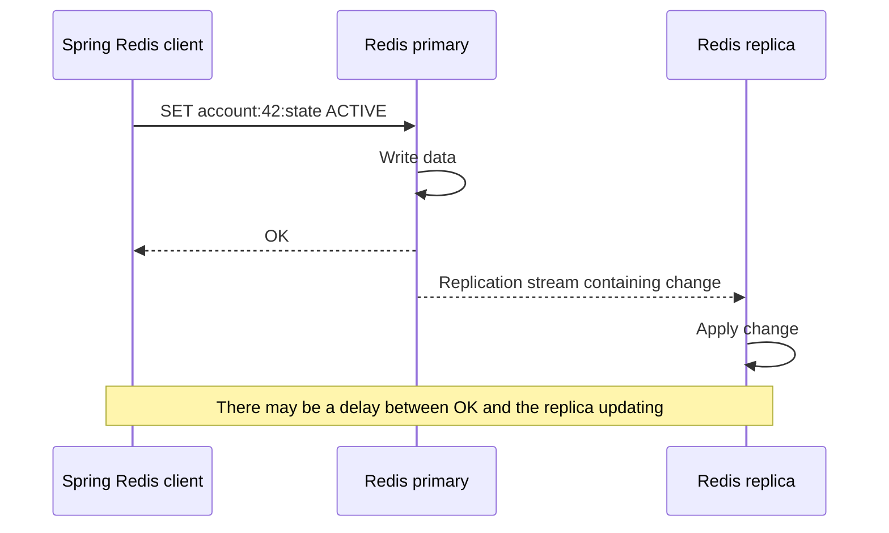
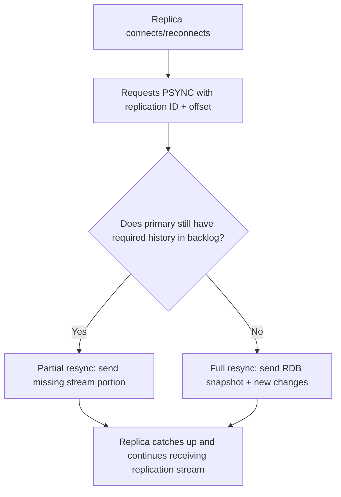
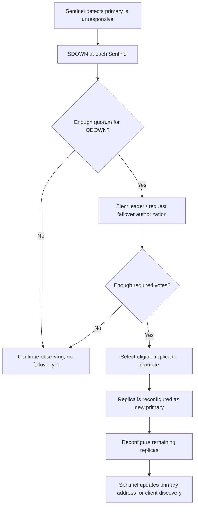

# Primary, Replica Roles, and Replication Mechanism in Spring Data Redis

## 1. Overview: Why Does Redis Need Primary and Replica?

Redis can operate in a **primary–replica** model (in older documentation and configuration, sometimes called *master–replica* or *master–slave*). One Redis server acts as the **primary**, receiving the main write operations. One or more Redis servers act as **replicas**, receiving and applying the change stream from the primary to maintain a copy of the data.

This model serves three major purposes:

- **Increasing resilience:** having a copy of the data on another node allows promoting a replica to primary when the primary becomes unavailable.
- **Distributing read load:** queries that can tolerate stale data can read from a replica, reducing part of the read load on the primary.
- **Providing the foundation for Sentinel:** Redis Sentinel processes monitor the primary and replicas, detect failures, and coordinate failover.

Example:

```text
                         Spring Data Redis
                                 |
                         Write to primary
                                 |
                    +------------------------+
                    | Redis primary          |
                    | redis-1:6379           |
                    +------------------------+
                         |              |
                 replication stream   replication stream
                         |              |
                         v              v
               +---------------+ +---------------+
               | Redis replica | | Redis replica |
               | redis-2:6379  | | redis-3:6379  |
               +---------------+ +---------------+
                         ^              ^
                         |              |
                  Reads tolerating lag
```

**Important warning:** data on a replica is not synchronized instantaneously with the primary by default. Standard Redis replication is **asynchronous**, so a `SET` operation that succeeded on the primary may not yet be present on a replica immediately afterward. Having replicas does not turn Redis into a strongly synchronous data store or guarantee zero loss of an acknowledged write in every failover scenario.

This lesson focuses on the primary/replica roles and the replication mechanism in the context of Spring Data Redis, and then places them into the problem of failure detection and role transition with Sentinel.

## 2. Distinguishing Primary, Replica, and Sentinel

| Component | Function | What to Keep in Mind |
| --- | --- | --- |
| **Primary** | Receives write operations from clients, maintains the authoritative data state, and emits the replication stream | It is the normal write point in a single-primary model. |
| **Replica** | Connects to the primary, receives the snapshot/command stream, and applies changes | Usually read-only for clients; data may lag behind. |
| **Redis Sentinel** | Monitors the health of Redis instances, detects primary failure, selects a replica to promote, and helps clients find the new primary | Sentinel does not replace the primary and is not a proxy forwarding every GET/SET command. |
| **Spring Data Redis client** | Uses a connection factory/driver to connect, execute Redis commands, and optionally discover the primary via Sentinel | Must choose an appropriate read routing policy and handle errors/connection switching properly. |

A primary can have multiple replicas. A replica can also receive data from another replica (chained replication) in some configurations, but the simplest and most common model is replicas connecting directly to the primary.

Sentinel is an independent group of processes that connect to Redis instances to monitor them and coordinate failover. Each Sentinel can monitor multiple master groups; for reliable failover, multiple Sentinels are typically deployed across separate failure domains.

### The Primary Is Not Guaranteed to Be the "Strictly Latest Read" Node at All Times

Under stable conditions, the primary receives writes, so it is usually the most reliable place to read newly written results. However:

- During failover, a client may temporarily connect to the old primary, encounter errors, or have to refresh its topology.
- When failover occurs while replication has not caught up, the new primary may be missing some writes that were already acknowledged by the old primary.
- Writing to Redis does not automatically create an atomic transaction with a database, message broker, or other systems.

Therefore, the architecture must define **durability**, **availability**, and **read consistency** requirements rather than merely choosing whether to have one or multiple replicas.

## 3. Replication Mechanism: From Write Command to Data on the Replica

Redis replication primarily operates on a model where the primary emits a data/change stream and the replica applies that state in the same order.

Conceptual diagram:



**An `OK` response from the primary is not a mandatory ACK from every replica.** The primary can return success to the client before any replica applies the command. This is the reason *replication lag* and *stale reads* occur.

In practice, Redis maintains an ordered replication stream; the replica receives and applies data from the primary while tracking replication IDs/offsets. Initial synchronization and reconnection recovery use different mechanisms.

### The Unit of Replication Is Command/Stream State, Not Java Entities

If Spring Data Redis calls:

```java
stringRedisTemplate.opsForValue().set(
        "account:42:state", "ACTIVE");
```

then the driver sends the corresponding Redis command to the primary. Redis replicates changes at the Redis layer and has no knowledge of Java objects, `@RedisHash`, or specific application request DTOs.

Similarly, `HSET`, `INCR`, key deletion, and TTL changes all affect the data that replicas need to synchronize. Replication is not limited to Redis Strings.

## 4. First-Time Connection: Full Synchronization

When a new replica is configured to follow a primary, it does not yet have enough replication history to continue from a known offset. Redis may have to perform **full synchronization**.

Conceptual steps:

1. The replica connects to the primary and negotiates replication capabilities.
2. The replica requests synchronization; the primary determines whether partial resync is possible or a full resync is needed.
3. When a full resync is required, the primary generates or streams an RDB snapshot of the data to the replica. Redis has mechanisms to write the snapshot to disk or stream it directly over the network, depending on configuration and version.
4. While generating/sending the snapshot, the primary continues accepting new write commands and buffering the changes that must be transmitted next.
5. The replica loads the snapshot to establish an appropriate initial state.
6. The primary continues sending the replication stream from the position after the snapshot; the replica applies the changes to catch up.

Example:

```text
Primary at t0:
  session:1 = A
  session:2 = B

New replica:
  Starts full synchronization
      |
      +-- receives RDB snapshot representing state at t0
      |
      +-- receives writes occurring during snapshot transfer
      |       SET session:1 A2
      |       SET session:3 C
      |
      +-- applies subsequent replication stream
      v
Replica gradually catches up to the primary's state
```

Full synchronization can be resource-intensive:

- CPU and memory for creating the snapshot/copy-on-write.
- Disk I/O or network traffic when transferring the RDB.
- Buffering new changes during synchronization.
- Time taken by the replica to load the snapshot.
- Network bandwidth between nodes.

If multiple replicas need a full sync simultaneously, pressure on the primary can increase significantly. You should monitor and plan capacity when adding replicas or recovering from mass incidents.

### Full Sync Is Not Automatically Equivalent to Backup

The RDB snapshot used for replication is a state-transfer mechanism. It does not replace versioned backup policies, restore testing, or data retention requirements. If the primary already holds corrupt data or has deleted keys via valid commands, the replica can also synchronize that corrupt or deleted state.

## 5. Partial Resynchronization with `PSYNC`

When a replica experiences a brief network interruption and reconnects, retransmitting the entire dataset can be very expensive. Redis supports **partial resynchronization** through the `PSYNC` protocol when both sides still hold the required history information.

Two core concepts:

- **Replication ID**: identifies a replication stream history.
- **Replication offset**: position in the replication stream. The replica tracks the portion of data received/processed according to the protocol, and the primary tracks what has been emitted.

Upon reconnecting, the replica can provide its known replication ID and offset. The primary checks whether:

1. The ID belongs to a history that the primary can serve.
2. The replication bytes starting from the continuation offset are still present in the **replication backlog**.

If both conditions hold, the primary transmits only the missing portion without needing a full snapshot. Otherwise, the replica must perform a full resync.



### Replication Backlog

The backlog is a circular buffer where the primary retains a recent segment of the replication stream history. It helps serve replicas after brief disconnections.

Simple example:

```text
Current primary replication offset: 1.000.000
Replica A last known offset:           998.000
Data needed to catch up:               ~2.000 bytes

Backlog still retains from offset 990.000 onward:
  -> Partial resync is possible.

Replica B last known offset:           700.000
Backlog no longer has segment from 700.000:
  -> Full resync is required.
```

The numbers above are illustrative only. The backlog stores bytes of the replication stream; backlog consumption speed depends on write volume, command sizes, and protocol overhead, not merely the number of keys.

### Sizing the Backlog Based on Actual Load

Directional estimate:

```text
Replication stream emission rate  ≈ 2 MiB/second
Target disconnection tolerance    ≈ 120 seconds
Minimum history size              ≈ 240 MiB

Additional safety margin is needed when write traffic fluctuates.
```

This is a capacity model, not a fixed recommendation for every Redis deployment. A large backlog increases primary memory consumption; a backlog that is too small can cause reconnecting replicas to frequently fall back to full sync. Measure actual workload rather than relying solely on key count.

## 6. Asynchronous Replication and Replication Lag

**Asynchronous replication** means the primary does not wait for every replica to confirm it has applied a command before returning success to the client. The gap between the primary's progress and the replica's progress creates **replication lag**.

Example:

```text
t = 0 ms:  primary processed SET token:42 NEW and returned OK
t = 2 ms:  client runs GET token:42 from replica
t = 4 ms:  replica finally receives and applies SET token:42 NEW
```

At t = 2 ms, the replica may return the old value or `nil`.

Replication lag can increase when:

- The network between primary and replica has high latency or packet loss.
- The primary receives a high volume of writes.
- The replica lacks CPU or memory bandwidth, or is doing heavy work.
- The replica is performing a full sync or loading a snapshot.
- The client reads from a replica geographically far from the primary.
- The Redis server experiences stalls, eviction, persistence I/O, or host resource constraints.

### Read-After-Write Is Not Guaranteed on Replicas by Default

Consider a Spring service:

```java
redis.opsForValue().set("checkout:42", "PAID");
// Immediately afterward, read via a connection allowed to choose a replica:
String status = redis.opsForValue().get("checkout:42");
```

If `SET` goes to the primary while `GET` is routed to a replica that has not caught up, the value may still be `PENDING`.

Do not immediately assume this is a serialization bug or a Spring Cache bug. It can be the expected consequence of read-to-replica routing over asynchronous replication.

When business logic needs to read a newly written value immediately, options include:

- Reading from the primary on critical decision paths.
- Retaining the newly written value in the request scope instead of forcing an immediate read-back.
- Using a version/sequence in the data to check freshness if the architecture requires it.
- Using replicas only for queries that tolerate *eventual consistency*.
- Designing application-level transaction/synchronization mechanisms when stronger guarantees are required; standard replicas do not provide linearizable reads on their own.

## 7. What Does Redis `WAIT` Help With and What Does It Not Guarantee?

Redis provides the `WAIT numreplicas timeout` command, allowing a client to request that the server wait until a given number of replicas acknowledge receiving/applying replication progress corresponding to prior writes on **that same client connection**, within a timeout limit.

Redis CLI example on the connection that performed the write:

```redis
SET checkout:42 PAID
WAIT 1 1000
```

Meaning: wait up to approximately 1,000 milliseconds for at least one replica to acknowledge the corresponding replication progress. The return value is the number of replicas that acknowledged by the time the command finishes; if it is lower than the target, the timeout or wait condition was not met.

Things to understand:

- `WAIT` **does not turn Redis into a strongly synchronous transaction** between primary and replicas.
- `WAIT` does not guarantee a write can never be lost during failover or dual failures.
- A replica acknowledging replication progress does not mean it has durably flushed the data to disk.
- If a client uses a different pooled connection to call `WAIT` than the connection that wrote, it does not automatically inherit the same "wait for prior writes on this connection" semantics as the CLI example.
- Inside transactions or scripts, `WAIT`'s blocking semantics have contextual constraints; do not mix `WAIT` into a pipeline expecting it to block like a standalone command.

`WAIT` can be used as a layer to reduce data-loss risk in certain designs, but it must be designed alongside persistence, failover policy, network partitions, and business requirements.

### Configuring Write Limits When Too Few Replicas Are Connected

Redis supports parameters such as:

```text
min-replicas-to-write
min-replicas-max-lag
```

Example meaning: the primary can reject certain write operations when there are not enough replicas considered recently updated within the configured threshold. This is a **measure to reduce the risk of writing while replicas are disconnected for too long**, not a consensus mechanism or proof that every write has been durably replicated.

A balance is needed: overly strict thresholds can reduce availability during network disruptions, even when the primary is still running and able to serve certain workloads.

## 8. Configuring Replicas and Inspecting Server Roles

### Configuring a Replica

In a Redis replica configuration file:

```conf
port 6380
replicaof 127.0.0.1 6379
replica-read-only yes
```

Or on a running test Redis instance:

```redis
REPLICAOF 127.0.0.1 6379
```

The `REPLICAOF` command instructs the instance to become a replica of the primary at the specified address. Older Redis versions had the command name `SLAVEOF`, but modern documentation should use the `REPLICAOF` terminology.

**Only run role-changing commands in environments you own and with a clear runbook.** Changing server roles in production can alter live serving data, connections, and failover topology.

### Read-Only Replica

Replicas normally have `replica-read-only yes`. Clients sending write operations like `SET` to a replica may receive an error such as `READONLY You can't write against a read only replica`.

Do not disable `replica-read-only` just to let applications write to a replica. Local writes that are not part of the primary's authoritative history can be overwritten during resynchronization, leading to hard-to-control data inconsistencies.

### Checking Roles via `ROLE` and `INFO replication`

On the primary:

```redis
ROLE
INFO replication
```

Visible fields may include:

```text
role:master
connected_slaves:2
master_replid:...
master_repl_offset:...
repl_backlog_active:1
repl_backlog_size:...
```

Field names like `role:master` and `connected_slaves` still appear in Redis INFO/protocol for historical compatibility, even though this guide uses **primary/replica** terminology.

On a replica:

```redis
ROLE
INFO replication
```

Relevant fields include:

```text
role:slave
master_host:...
master_port:6379
master_link_status:up
slave_repl_offset:...
master_last_io_seconds_ago:...
```

Field names and counts vary by Redis version. Checking the role and link status is the first step when investigating why a replica is not updating.

## 9. What Does Sentinel Do in a Primary–Replica Model?

Data replication **does not automatically switch the primary** if the primary node fails. Redis Sentinel adds the following capabilities:

1. **Monitoring**: checks the health of the primary, replicas, and other Sentinels.
2. **Notification**: notifies when a component is marked down or the topology changes.
3. **Automatic failover**: when conditions are met, selects a replica to promote to primary.
4. **Configuration provider**: lets clients discover the current primary address via Sentinel commands.

Example:

```text
               Sentinel S1
               Sentinel S2      -> monitors group "mymaster"
               Sentinel S3
                      |
                      v
                Redis primary P
                 /          \
         Redis replica R1  Redis replica R2

When P stops serving:
  Sentinels coordinate to confirm the failure state,
  elect a leader for the failover round,
  an eligible replica is promoted to primary,
  remaining replicas are reconfigured to replicate from the new primary.
```

**Sentinel does not store Redis data on behalf of Redis** and is not a proxy that receives every Redis command and forwards it to the primary. Applications use a **Sentinel-aware client**, typically Lettuce via Spring Data Redis, to discover the current primary address and reconnect when the topology changes.

### Redis Sentinel Differs from Redis Cluster

| Aspect | Replication + Sentinel | Redis Cluster |
| --- | --- | --- |
| Partitioning data across multiple shards | Not the primary goal; one primary group holds one logical dataset | Yes, data is distributed by hash slots |
| Replicas | Yes | Replicas can exist for each primary shard |
| Failover | Coordinated by Sentinel | Cluster nodes execute Redis Cluster failover |
| How clients find the primary | Sentinel discovery | Cluster topology/slot mapping |
| Scaling capacity with multiple primaries for one dataset | No built-in sharding | Multiple primaries manage different slots |

Do not configure Sentinel and expect the application to automatically distribute data across multiple primaries like Redis Cluster. If the dataset exceeds a single primary's capacity, design sharding/clustering separately.

## 10. How Does Sentinel Detect Failures and Coordinate Failover?

Redis Sentinel has two important concepts:

- **SDOWN (subjectively down)**: an individual Sentinel determines that an instance is unresponsive based on the `down-after-milliseconds` threshold.
- **ODOWN (objectively down)**: enough Sentinels agree, based on the configured **quorum**, that the primary is down.

Once the primary is marked ODOWN and failover conditions are met, the Sentinels run a leader election for the failover round; for a Sentinel to be authorized to execute the failover, it must meet the required vote threshold, including a majority of known Sentinels according to Sentinel rules.

Failover process in outline:



A replica is selected based on signals such as connection state, replica priority, replication progress, and Sentinel selection criteria. **There is no simple guarantee that the replica closest to the application or with the lowest ID/name will be chosen.**

### Quorum and Number of Sentinels

A common practical configuration:

```text
3 Sentinels: S1, S2, S3
Master group quorum: 2
```

A quorum of 2 allows two Sentinels to agree on the failure to establish ODOWN. However, **quorum is not the entire condition for executing a failover**: leader election/authorization with a sufficient majority under Sentinel rules is also required.

Deploying only a single Sentinel creates a single point of failure and is unsuitable for high availability. With three Sentinels, place them in separate failure domains so that losing one host or network zone does not take down the entire monitoring system at once.

## 11. Failover Does Not Eliminate Replication Lag or Data-Loss Risk

Scenario:

```text
t0: primary P has key order:42 = PENDING
t1: client SET order:42 = PAID -> P returns OK
t2: P loses connectivity before R1/R2 receive the PAID update
t3: Sentinel promotes R1 to new primary
t4: application reads order:42 from R1 -> may still be PENDING
```

In this case, a write already acknowledged by the old primary may be absent from the new primary. This is an important design limitation of asynchronous replication and failover based on available replicas.

Ways to mitigate the risk include:

- Choosing appropriate persistence (RDB/AOF) according to data policy.
- Monitoring replication lag, replica links, and backlog status.
- Considering `WAIT` or `min-replicas-to-write` configuration when requirements truly call for it.
- Choosing an architecture with a durable source of truth for critical business workflows; Redis can serve as a cache or rebuildable projection.
- Designing idempotency, conflict handling, and reconciliation for failover.
- Never treating two replicas as a guarantee of **zero data loss**.

### When the Old Primary Returns

After failover, the old primary may still contain some writes that replicas had not received before the outage. When the old node is reconfigured as a replica of the new primary, its local data can be replaced by the new primary's state during resynchronization. This further shows that unreplicated writes can be lost from the recognized topology after failover.

Redis Sentinel prioritizes service continuity on a new primary under its designed conditions; it is not a consensus log guaranteeing every write is committed on a majority of nodes before acknowledgment.

## 12. Configuring Sentinel in Redis

Example sentinel configuration:

```conf
port 26379
sentinel monitor mymaster 127.0.0.1 6379 2
sentinel down-after-milliseconds mymaster 5000
sentinel failover-timeout mymaster 60000
sentinel parallel-syncs mymaster 1
```

Meaning:

| Configuration Line | Interpretation |
| --- | --- |
| `sentinel monitor mymaster HOST PORT 2` | Names the group `mymaster`, monitors the initial primary, with quorum = 2. |
| `down-after-milliseconds ... 5000` | A Sentinel considers the instance potentially SDOWN when unresponsive for this threshold; the threshold is a signal, not a guarantee that failover finishes in 5 seconds. |
| `failover-timeout ... 60000` | Parameter coordinating failover timing/phases, not a fixed failover duration. |
| `parallel-syncs ... 1` | Limits how many replicas synchronize with the new primary simultaneously during a failover phase. |

These lines are illustrative examples to understand the configuration. In production systems, Sentinel requires network connectivity, ACL/authentication, announcement settings suitable for NAT/containers, and persistence for Sentinel's configuration. Redis Sentinel can rewrite its config file when topology changes, so deploy it from a durable configuration source with appropriate write permissions.

Do not copy `127.0.0.1` from examples into container or multi-host environments without adjusting it. Inside a separate container, `127.0.0.1` typically points to that container itself, not to a primary on another host or container.

### Checking Sentinel with redis-cli

Against a Sentinel endpoint, for example localhost:26379:

```redis
SENTINEL GET-MASTER-ADDR-BY-NAME mymaster
SENTINEL MASTERS
SENTINEL REPLICAS mymaster
SENTINEL CKQUORUM mymaster
```

These commands help locate the current primary address and inspect master groups, Sentinel-known replicas, and quorum/failover authorization readiness. Use appropriate Redis/Sentinel permissions; do not grant full administrative privileges to an application just because it needs to look up the primary address.

## 13. Sentinel-Aware Connection in Spring Boot

When using Spring Boot with Spring Data Redis/Lettuce, Sentinel can be configured via properties.

Example `application.yml`:

```yaml
spring:
  data:
    redis:
      sentinel:
        master: mymaster
        nodes:
          - redis-sentinel-1:26379
          - redis-sentinel-2:26379
          - redis-sentinel-3:26379
      timeout: 3s
```

`mymaster` must match the group name managed by Sentinel. `nodes` lists the Sentinel endpoints for the client to discover the primary and topology. Do not put replica addresses in this list if they are not running the Sentinel service.

With standard Spring Boot 3.x, the Redis namespace is `spring.data.redis`. When working with other Boot versions, verify your project's property namespace and dependencies.

In authenticated environments:

- The password or username/password for **Redis data nodes** may differ from the credentials for **Sentinel endpoints**.
- Configuration must match the Spring Boot, Spring Data Redis, and Lettuce versions in use.
- Do not place real secrets in documentation or commit passwords to VCS; use a secret manager or environment injection.

### How Does Spring Reconnect During Failover?

When using a Sentinel-aware driver, the connection factory can discover the primary through Sentinel. After failover, the topology announces the new primary; the driver/connection factory restores connections according to its mechanism.

This **does not mean every in-flight Redis command is retried successfully or experiences no errors during the role transition**. During failover, the application may encounter timeouts, connection resets, `READONLY` errors while still connected to the old node, or missing recently written data on the new primary.

The application should design for:

- Bounded timeouts and retries based on command criticality.
- Idempotency for write commands that are unsafe under blind retries.
- Monitoring of connection/failover state.
- Fallback paths if Redis only holds rebuildable cache data.
- Never relying on an application restart as the required mechanism to switch primaries.

## 14. Configuring Sentinel in Java When Customization Is Needed

When the application explicitly defines a connection factory:

```java
import org.springframework.context.annotation.Bean;
import org.springframework.context.annotation.Configuration;
import org.springframework.data.redis.connection.RedisSentinelConfiguration;
import org.springframework.data.redis.connection.RedisConnectionFactory;
import org.springframework.data.redis.connection.lettuce.LettuceConnectionFactory;

@Configuration
public class RedisSentinelConfig {

    @Bean
    public RedisConnectionFactory redisConnectionFactory() {
        RedisSentinelConfiguration sentinel =
                new RedisSentinelConfiguration();

        sentinel.master("mymaster");
        sentinel.sentinel("redis-sentinel-1", 26379);
        sentinel.sentinel("redis-sentinel-2", 26379);
        sentinel.sentinel("redis-sentinel-3", 26379);

        return new LettuceConnectionFactory(sentinel);
    }
}
```

In this example, Spring uses Sentinel to look up the active primary. Hostnames should be replaced with addresses reachable within the application's network.

This is an **explicit configuration option**, not a mandatory step if Spring Boot auto-configuration already handles `spring.data.redis.sentinel.*`. Avoid defining an extra manual `RedisConnectionFactory` just to duplicate YAML configuration; a custom bean can cause auto-configuration to back off and prevent other properties from being applied as intended.

Also understand that Sentinel **does not automatically provide read-replica load balancing in every configuration**. Whether the client reads from replicas or the primary also depends on the read preference, driver, and how Spring Data Redis uses connections.

## 15. Reading from Replicas with Lettuce `ReadFrom`

When using Lettuce, Spring Data Redis can configure read routing to replicas via `ReadFrom`. Example (only for read paths that tolerate stale data):

```java
import io.lettuce.core.ReadFrom;
import org.springframework.context.annotation.Bean;
import org.springframework.context.annotation.Configuration;
import org.springframework.data.redis.connection.RedisSentinelConfiguration;
import org.springframework.data.redis.connection.RedisConnectionFactory;
import org.springframework.data.redis.connection.lettuce.LettuceClientConfiguration;
import org.springframework.data.redis.connection.lettuce.LettuceConnectionFactory;

@Configuration
public class RedisReplicaReadConfig {

    @Bean
    RedisConnectionFactory redisConnectionFactory() {
        RedisSentinelConfiguration sentinel =
                new RedisSentinelConfiguration();
        sentinel.master("mymaster");
        sentinel.sentinel("redis-sentinel-1", 26379);
        sentinel.sentinel("redis-sentinel-2", 26379);
        sentinel.sentinel("redis-sentinel-3", 26379);

        LettuceClientConfiguration client =
                LettuceClientConfiguration.builder()
                        .readFrom(ReadFrom.REPLICA_PREFERRED)
                        .build();

        return new LettuceConnectionFactory(sentinel, client);
    }
}
```

The two classes `RedisSentinelConfig` and `RedisReplicaReadConfig` in this article are **two alternative illustrative approaches**, not two connection factory beans to place simultaneously in a single application.

Some read preference options:

| Lettuce Option | Purpose |
| --- | --- |
| `ReadFrom.MASTER` | Prefer/keep reads on the primary; suitable for data needing the latest state. |
| `ReadFrom.REPLICA` | Only select replicas per driver policy; must understand cases where no eligible replica exists. |
| `ReadFrom.REPLICA_PREFERRED` | Prefer replicas when available, falling back per driver policy when unavailable. |
| Other modes | May be based on latency/region/other preferences depending on Lettuce version; verify actual policy. |

In Lettuce, normal **write** operations still must go to the primary. Operations that look like reads but have side effects, such as `GETEX` (reads and updates TTL), cannot be treated as safe read-only commands to route to replicas.

### Implications for Spring Cache and Repository

- Spring Cache reading hot keys from a replica may observe stale cache values or cache misses before the replica catches up.
- A `@Cacheable` cache miss can cause two instances to recompute the same data briefly if a replica has not yet received the newly stored entry.
- Redis Repositories reading entities from a replica may see Hash state and secondary indexes lagging behind the primary; do not use them for decisions requiring strong consistency.
- When saving and immediately reading back, routing reads to replicas can break *read-your-writes* expectations.

If every request needs to read immediately after writing, there is no default reason to force reads through replicas just to "boost performance." Read routing must be designed per business case.

## 16. Spring Service Example and Read-After-Write

Service using `StringRedisTemplate`:

```java
import java.time.Duration;
import org.springframework.data.redis.core.StringRedisTemplate;
import org.springframework.stereotype.Service;

@Service
public class OrderStatusService {

    private final StringRedisTemplate redis;

    public OrderStatusService(StringRedisTemplate redis) {
        this.redis = redis;
    }

    public void markPaid(String orderId) {
        String key = "orders:" + orderId + ":status";

        redis.opsForValue().set(
                key, "PAID", Duration.ofMinutes(30));
    }

    public String findStatus(String orderId) {
        return redis.opsForValue().get(
                "orders:" + orderId + ":status");
    }
}
```

If the connection factory routes reads to replicas, the following snippet may observe stale state:

```java
service.markPaid("42");
String status = service.findStatus("42");
// Not guaranteed to return "PAID" by default if GET goes to a lagging replica.
```

For data that determines payment validity, do not treat a Redis replica as a sufficiently strong source of truth. Read from the authoritative store or primary per contract, combined with versioning/idempotency.

If Redis only caches order status computed from a database, reading stale data from a replica may be acceptable if the application has invalidation or TTL and does not make incorrect decisions from stale cache entries.

## 17. Primary–Replica Does Not Replace Transactions or Atomicity

Redis processes individual commands like `INCR` atomically on the primary. However, **replication does not turn multiple commands into a single transaction**.

Example:

```java
redis.opsForValue().set("account:42:state", "ACTIVE");
redis.opsForValue().set("account:42:version", "2");
```

The two commands can be interleaved or interrupted; a replica may have applied up to a different point in the replication stream when read. If the application requires two coupled changes, use an appropriate atomic model such as Lua scripts, MULTI/EXEC, or combining data into a single unified structure, while also handling failover limitations.

In Redis, `MULTI/EXEC` ensures a group of commands executes sequentially without interleaving on the server executing the transaction. **It does not turn replication into strong synchronous replication** and does not create an atomic distributed transaction with SQL.

With Lua scripts, commands inside the script execute atomically with respect to concurrent commands on the Redis server, while their effects are replicated according to the Redis protocol. Lua also does not automatically provide rollback for commands that succeeded before a script error.

## 18. Replication Differs from Persistence and Backup

Three commonly confused concepts:

| Mechanism | Goal | Does Not Automatically Guarantee |
| --- | --- | --- |
| **Replication** | Copies data from primary to replicas to have live standby copies and support reads/failover | Does not guarantee every acknowledged write exists on a replica at the time of failover. |
| **Persistence** (RDB/AOF) | Recovers a single Redis instance's data after restart per disk-write policy | Does not mean a second instance is always ready to serve traffic. |
| **Backup** | Stores scheduled data copies with retention and restore capability after accidental deletion/business errors | Does not provide immediate failover. |

If a `DEL` command accidentally deletes a key on the primary, that change can be replicated to every replica. Having multiple replicas does not help "undo" a valid deletion. Separate backups or versioning/restore mechanisms are needed if the business requires them.

For rebuildable cache data, you may prioritize availability and TTL over strict durability. For critical state, evaluate the AOF fsync policy, backup/restore, RPO/RTO requirements, replica placement, and write-loss potential on failover.

## 19. Key Metrics When Monitoring Replication

### On the Primary

```redis
INFO replication
ROLE
```

Fields to watch:

| Signal | Meaning |
| --- | --- |
| `role` | Whether the node is currently primary or replica. |
| `connected_slaves` / replica list | Number of replicas and status of replication connections. |
| `master_repl_offset` | Replication stream emission progress on the primary. |
| `master_replid` | ID of the current replication history. |
| `repl_backlog_size` | Backlog capacity used to serve partial resyncs. |
| `repl_backlog_active` | Whether the backlog is active. |
| Each replica's offset in INFO | Estimated progress reported back by each replica. |

### On a Replica

```redis
INFO replication
ROLE
```

Observe:

- `master_host` / `master_port`: which upstream node the replica is following.
- `master_link_status`: whether the connection to upstream is up or down.
- `slave_repl_offset` or corresponding offset fields: progress received so far.
- `master_last_io_seconds_ago`: time since last replication activity, evaluated alongside write load and heartbeats.
- Full sync status and data loading progress if any.

Do not deduce "offset difference = exact seconds of lag." Offsets measure **bytes in the replication stream**, whereas lag time must be evaluated against write rate, heartbeats, topology, and actual responsiveness. A replica that has not caught up might still happen to return the same value as the primary for some keys; conversely, a tiny delay is enough to cause stale reads in sensitive situations.

### On Sentinel

```redis
SENTINEL MASTERS
SENTINEL REPLICAS mymaster
SENTINEL CKQUORUM mymaster
SENTINEL GET-MASTER-ADDR-BY-NAME mymaster
```

Monitor:

- Whether the primary announced by Sentinel matches Redis's actual role.
- Whether Sentinels have sufficient quorum/majority to coordinate failover.
- How many replicas are eligible for promotion.
- `SDOWN`/`ODOWN` states, failover counts, and disconnection durations.
- Time taken by the application to switch to the new primary address and request error counts during transition.

## 20. Typical Incidents and How to Analyze Them

### Scenario A: Spring Writes Successfully, but Reading from a Replica Sees Stale Data

**Symptoms:** `SET` returns success, and a `GET` shortly afterward returns the previous value.

**Possible cause:** client is configured with `REPLICA_PREFERRED` and the replica has not caught up yet.

**Resolution:** identify the `GET` route, check `INFO replication`, and consider reading from the primary on paths that require read-after-write.

### Scenario B: Write Fails with `READONLY`

**Symptoms:** `READONLY You can't write against a read only replica`.

**Possible cause:** the application is sending write commands to a replica, a connection became stale after failover, or the current endpoint is not the primary.

**Resolution:** check `ROLE`, the address announced by Sentinel, client topology refresh state, and the driver. Do not "quick-fix" by disabling read-only mode on the replica.

### Scenario C: Replica Repeatedly Performs Full Sync

**Symptoms:** sharp spikes in network/CPU, replica link flapping up and down, and repeated RDB reloads.

**Possible cause:** prolonged network drops, insufficient backlog, overloaded replica, or sync configuration issues.

**Resolution:** inspect `repl_backlog_size`, write rate, offsets, replication logs, network, replica resources, and persistence I/O. Increase the backlog after measuring load, not arbitrarily without bounds.

### Scenario D: Sentinel Sees Primary Failure but Does Not Automatically Fail Over

**Symptoms:** some Sentinels report SDOWN, but no new primary is elected.

**Possible cause:** insufficient quorum/majority authorization, no eligible replica to promote, network issues between Sentinels, or Sentinels lacking accurate topology knowledge.

**Resolution:** check `SENTINEL CKQUORUM`, `SENTINEL MASTERS`, replica list, connectivity, and Sentinel logs. Do not force a manual failover without understanding the partition, as this can risk split-brain or data loss.

### Scenario E: The New Primary Is Missing Some Recent Writes

**Symptoms:** after failover, keys written just before the outage are missing or return older values.

**Possible cause:** asynchronous replication; the promoted replica had not received the final writes from the old primary.

**Resolution:** reconcile against the authoritative business data source, run reconciliation, and review durability/replication settings. Do not assume a Spring serializer bug when the data is actually absent from the new topology.

## 21. Hands-On Practice on Test Redis: Replication and Failover

This exercise should only be performed in a lab where you control Redis. **Do not intentionally stop a primary or change roles in production.**

### Step 1: Prepare Two Redis Instances

- Primary at `127.0.0.1:6379`.
- Replica at `127.0.0.1:6380`, configured with `replicaof 127.0.0.1 6379`.
- Both instances have separate data/log directories to avoid overwriting each other.

Check roles:

```bash
redis-cli -p 6379 ROLE
redis-cli -p 6380 ROLE
```

In `ROLE`, the primary is reported as `master` per legacy protocol; the replica is reported as `slave` per legacy protocol.

### Step 2: Write on Primary and Verify on Replica

```bash
redis-cli -p 6379 SET demo:replication:status ACTIVE
redis-cli -p 6380 GET demo:replication:status
```

Once replication catches up, the replica returns `ACTIVE`. To observe small delays, measure under test load; do not assume every immediate read will always return the new result.

### Step 3: Try Writing to the Replica

```bash
redis-cli -p 6380 SET demo:replication:status WRONG
```

With the default read-only replica setting, Redis rejects the command. This protects write role separation and helps detect misrouted clients.

### Step 4: Observe Replication Offsets

```bash
redis-cli -p 6379 INFO replication
redis-cli -p 6380 INFO replication
```

Locate `master_repl_offset`, `slave_repl_offset`, and the link status. Issue a batch of new `SET` commands and watch the progress update.

### Step 5: Test Reconnection and Partial Resync

In a test environment, temporarily disconnect the replica briefly and reconnect it to inspect the replication logs. If the backlog still holds enough history, Redis can perform a partial resync. If disconnected for too long relative to the write rate and backlog size, a full sync may be required.

Do not perform this test if the instances hold important data; changing replication roles and network state can cause disruption.

### Step 6: Observe Sentinel When Adding at Least Three Sentinels

Initialize a Sentinel group `mymaster` pointing to the primary with an appropriate quorum. Inspect:

```bash
redis-cli -p 26379 SENTINEL GET-MASTER-ADDR-BY-NAME mymaster
redis-cli -p 26379 SENTINEL CKQUORUM mymaster
redis-cli -p 26379 SENTINEL REPLICAS mymaster
```

When running a failover lab exercise per runbook, record the primary announced by Sentinel before/after, the roles of the Redis nodes, and how long the Spring client takes to reconnect. Do not assume failover is instantaneous or free of request errors.

### Step 7: Verify Spring Behavior After Failover

Use a Sentinel-aware Spring Boot configuration. In the lab:

1. Write a key via `StringRedisTemplate`; observe the primary handling it.
2. Trigger failover following the test runbook.
3. Watch client logs during disconnection and recovery.
4. Once Sentinel announces the new primary, test a new write operation.
5. Compare keys written before the failure to understand potential tail-write loss from replication lag.

Do not judge success solely by the absence of client errors: data may require reconciliation after failover.

## 22. Design Principles for Spring Data Redis with Primary–Replica

1. **Choose roles per operation type:** write to primary; route reads to replicas only when stale reads are acceptable.
2. **Understand asynchronous replication:** Redis returning `OK` from the primary does not prove every replica is synchronized.
3. **Use a Sentinel-aware driver with Sentinel:** do not hardcode only the initial primary in an HA application.
4. **Keep timeouts and retries bounded:** during failover a command may fail or execute without the client receiving the response.
5. **Design idempotency for critical writes:** blind retries on `INCR`, `LPUSH`, `XADD`, or multi-step logic can cause duplicates.
6. **Measure replication lag and backlog:** reduce unnecessary full syncs and detect slow replicas.
7. **Ensure replication/persistence meets requirements:** replicas are not backups, and Sentinel does not guarantee zero data loss.
8. **Place Sentinels in distinct failure domains:** quorum, majority, and eligible replicas are all needed during failures.
9. **Account for ACL, TLS, and secret policies:** Redis data-node credentials and Sentinel credentials may differ.
10. **Test failover in an isolated environment:** verify the application discovers the new primary and handles missing/stale data.
11. **Do not equate Sentinel with Redis Cluster:** Sentinel does not shard data across multiple primaries.
12. **Identify the source of truth:** if Redis is a cache, ensure it can be rebuilt; if Redis holds critical state, establish clear durability and recovery plans.

## 23. Common Misconceptions

**"Having replicas means data is completely synchronized when SET returns OK."**  
No. Standard Redis replication is asynchronous; replicas may not have received or applied the write yet.

**"Reading from replicas is always fast and identical to the primary."**  
No. Replicas can offload read traffic but introduce stale reads. Actual speed also depends on network, geographic placement, and node capacity.

**"Sentinel is a proxy that receives GET/SET and forwards them to the primary."**  
No. Sentinel monitors, executes failover, and provides topology information; Redis clients send commands directly to Redis data nodes.

**"If Sentinel has quorum, failover is guaranteed to finish in the exact configured milliseconds."**  
No. Failure detection, leader election, replica selection, promotion, and client reconnection all take time and depend on network and replica state.

**"`last-delivered-id` or replication offset are IDs of the same type."**  
No. A replication offset measures a byte position in the replication stream; it is neither a Redis Stream entry ID nor a business transaction marker.

**"Increasing the replication backlog will eliminate all replication lag."**  
No. The backlog mainly enables partial resync after interruptions; if a replica lacks CPU or network capacity, lag must still be addressed via resources or topology.

**"`WAIT 1 1000` turns a SET into a write that can never be lost."**  
No. It waits for conditional replication acknowledgment, and does not turn Redis into a consensus log or replace disk durability.

**"Replicas can be allowed to accept writes by setting `replica-read-only no`."**  
This is not a safe design for application data: local writes on a replica are not coordinated like a primary and may be overwritten upon resynchronization.

**"With two replicas, losing one node guarantees zero data loss."**  
No. If replicas have not received the latest writes, failover can select a state missing writes acknowledged by the old primary.

**"Sentinel and Redis Cluster are the same thing."**  
No. Sentinel provides HA for a single primary group; Redis Cluster also provides hash-slot sharding.

## 24. Self-Check Questions

1. How do primary and replica responsibilities differ in Redis replication?
2. Why can a `SET` command return `OK` from the primary while an immediate `GET` from a replica still sees the old value?
3. How do full resynchronization and partial resynchronization differ?
4. How do replication ID, replication offset, and the backlog help a replica reconnect using `PSYNC`?
5. Why can an undersized backlog cause frequent full syncs on unstable networks?
6. What does `WAIT 1 1000` assist with, and why cannot it be treated as a zero-data-loss guarantee?
7. How does Sentinel use SDOWN, ODOWN, and quorum to determine a primary failure?
8. Why is having quorum not the entire condition required for a Sentinel to execute failover?
9. What information does Spring Boot need for a client to discover the primary via Sentinel?
10. When should you use `ReadFrom.REPLICA_PREFERRED`, and when should you read from the primary?
11. Why can a `READONLY` error after failover indicate that a client is holding an outdated connection or topology?
12. Why do replicas not replace backups and persistence?
13. How does Redis Cluster differ from a primary–replica model with Sentinel in how datasets are distributed?
14. During failover, why are recent writes that existed only on the old primary at risk of not existing on the new primary?

**Remember:** The Redis **primary** accepts write commands and emits the **replication stream**; **replicas** synchronize state from the primary but may lag due to asynchronous replication. When reconnecting, Redis can use `PSYNC` and the backlog to catch up on missing data or require a full sync via snapshot. **Sentinel** monitors primary/replicas, coordinates failover, and helps Spring Data Redis find the new primary; it does not guarantee zero data loss or eliminate all connection errors during role transitions. Choose read routing, durability, monitoring, and retries based on your application's actual consistency requirements.

## References

- [Redis — Replication](https://redis.io/docs/latest/operate/oss_and_stack/management/replication/): primary/replica, asynchronous replication, PSYNC, replication backlog, and full/partial resynchronization.
- [Redis — Sentinel](https://redis.io/docs/latest/operate/oss_and_stack/management/sentinel/): SDOWN/ODOWN, quorum, election, failover, and discovery.
- [Redis — WAIT](https://redis.io/docs/latest/commands/wait/): waiting for replication acknowledgments and data durability limits.
- [Redis — INFO](https://redis.io/docs/latest/commands/info/): replication status, link, offsets, and backlog.
- [Spring Data Redis — Redis Sentinel](https://docs.spring.io/spring-data/redis/reference/redis/connection-modes.html): `RedisSentinelConfiguration` and connection factories.
- [Spring Data Redis — Lettuce](https://docs.spring.io/spring-data/redis/reference/redis/drivers.html): client/connection factory and read preferences.
- [Lettuce — ReadFrom settings](https://redis.github.io/lettuce/ha-sharding/): read-from-replica and routing in HA environments.
