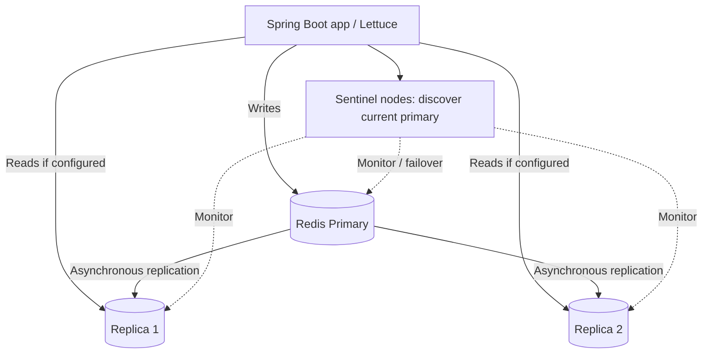
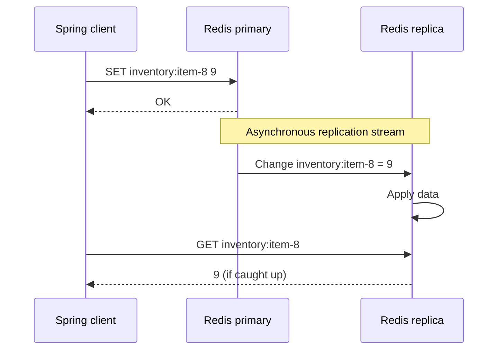
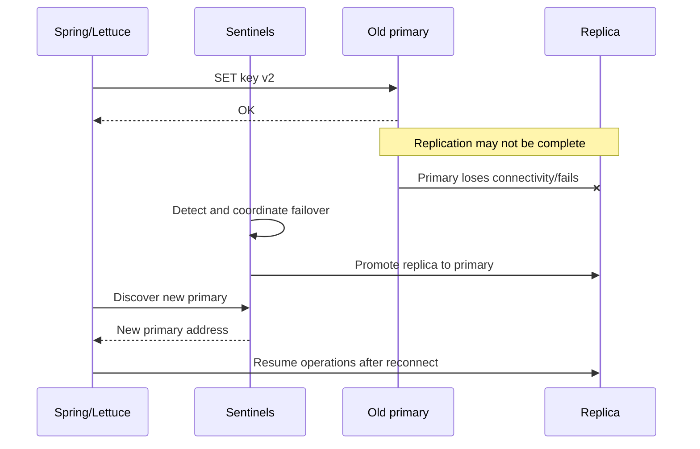

# Replication Lag and Stale Read Risks in Spring Data Redis

## 1. Scenario: Writing Data and Immediately Reading the Previous Value

Suppose a Spring Boot service stores a user's loyalty points in Redis. Redis runs in a **primary–replica** model, monitored by Redis Sentinel to support failover.

The application writes:

```java
redis.opsForValue().set("loyalty:u-42", "150");
```

Immediately afterward, another request reads:

```java
String points = redis.opsForValue().get("loyalty:u-42");
```

In configurations with **replica reads**, the second request may still see `"120"`, or even see the key as missing if it had not been replicated beforehand.

This is not necessarily a bug in the serializer, Redis TTL, or Spring Data Redis. The cause can be **replication lag**: the primary has accepted the change, but the replica chosen for the read has not yet received and applied the corresponding commands.

```text
Application                   Primary                    Replica
    |                            |                          |
    | SET loyalty:u-42 150       |                          |
    |--------------------------->|                          |
    |<---------------------------| OK                       |
    |                            |--- async replication --->|
    | GET loyalty:u-42 (replica) |                          |
    |------------------------------------------------------->|
    |<-------------------------------------------------------| "120"
    |                            |                          |
    |                        replica applies SET 150        |
    |                            |                          |
    | GET loyalty:u-42 (replica) |                          |
    |------------------------------------------------------->|
    |<-------------------------------------------------------| "150"
```

**Core principle:** Redis replication is **asynchronous** by default. A successful write response from the primary does not guarantee that every replica has updated. Redis Sentinel helps detect failures and coordinate selecting a new primary; **Sentinel does not make replication synchronous or guarantee strong consistency**.

In this lesson, we analyze:

1. Primary, replica, Sentinel, and the replication mechanism in Redis.
2. Types of replication lag and scenarios that lead to stale reads.
3. Configuring Spring Data Redis/Lettuce to read from the primary or replicas.
4. Consistency levels such as *read-your-writes*, *monotonic reads*, and *eventual consistency*.
5. The `WAIT` command, limitations of replication acknowledgments, and data-loss risk during failover.
6. How to measure lag, run realistic tests, and choose an architecture for critical data.

## 2. Primary, Replica, and Sentinel Have Distinct Roles

| Component | Primary Role | What Is Not Guaranteed Automatically |
|---|---|---|
| **Primary** (*master*, legacy term) | Accepts write commands and emits the replication stream to replicas | Acknowledging a write does not mean replicas have received it |
| **Replica** | Replicates state from the primary; can serve reads | Not guaranteed to hold the latest data at read time |
| **Redis Sentinel** | Monitors primary/replicas, detects failures, elects and coordinates failover; informs clients of the current primary | Not a proxy for all Redis commands and does not create strong consistency |
| **Spring Data Redis** | Provides Redis connection factories, templates, and Java APIs | Does not force every read after a write to go to the primary if replica routing is configured on the driver |
| **Lettuce** | Redis client/driver; supports Sentinel topology and `ReadFrom` policies | Cannot turn a lagging replica into an up-to-date replica |

Architecture example:



Dashed lines in the diagram represent monitoring/coordination functions. Clients typically connect directly to **Redis data nodes** after resolving topology, rather than routing all `GET`/`SET` commands through Sentinel as a data proxy.

### 2.1. Replication Is a Copy Mechanism, Not a Distributed Database Transaction

The primary receives write commands, records replication progress, and transmits changes to replicas. Replicas consume this command stream to update their copies.

The system is designed so replicas can **converge to the same data** over time when the network and Redis are healthy. However, at any given instant, a replica may be behind the primary.

Adding more replicas typically increases read capacity and redundancy, but it also means having more copies with **varying degrees of lag**. Reading from the fastest replica over the network does not mean it is the replica with the newest data.

## 3. How Does Redis Replicate Data?

A high-level summary:

1. The replica establishes a connection to the primary.
2. The replica performs initial synchronization via full synchronization or partial resynchronization depending on state.
3. The primary continuously sends applicable changes into the replication stream.
4. The replica receives and applies those changes in stream order.
5. If the connection drops, the replica may resynchronize the missing portion if PSYNC/backlog conditions allow, or it must perform a full resynchronization.



In practice, if `GET` occurs **before** the replica applies the write command, the result may be the old value.

### 3.1. Full Synchronization and Partial Resynchronization

When a replica connects for the first time or lacks sufficient history to resume from an older offset, Redis may need to transmit a data snapshot along with subsequent changes. This phase consumes CPU, memory, network, and disk depending on configuration.

If a replica only loses connectivity briefly and the primary still retains enough replication backlog, it can fetch the missing delta without retransmitting the full dataset.

In both cases, the replica may still have to **catch up** before it can be considered to hold the latest data. Completing synchronization at the connection level does not mean business-level consistency requirements have been met.

### 3.2. Latency Can Appear at Multiple Stages

```text
Primary has processed SET
   |
   +-- time for command to enter the replication stream
   |
   +-- network primary -> replica
   |
   +-- replica receives data and applies the change
   |
   +-- client reads from replica
```

Common reasons lag increases:

- High latency or congestion on the network between machines.
- Redis primary receives a burst of many writes in a short time.
- Replica lacks CPU, RAM, or suffers from I/O bottlenecks.
- Replica is performing an initial sync or full resync.
- The replication link drops and the replica must reconnect.
- Data volume / command backlog grows rapidly.
- Failover events, topology changes, or overload during operations.

The consistency observed by users depends on both **replication progress** and **the specific node to which the read command is routed**.

## 4. Two Different Forms of Delay: Replication Lag vs. Application Latency

**Replication lag** is the divergence between the state of the primary and a replica. It can be measured across different dimensions:

| Perspective | Common Unit | Meaning |
|---|---|---|
| Replication offset gap | Progress bytes | How many bytes of the replication stream the replica is behind the primary |
| Replica heartbeat/response time | Seconds | How long the primary has gone without seeing a relevant signal from the replica |
| Business data staleness | Milliseconds/seconds | How long a specific update takes to become visible when reading from a replica |
| Application `GET` command latency | Milliseconds | How fast or slow a read responds; **does not indicate whether the data is fresh** |

A request to a replica may have **1 ms** latency and still return data **5 seconds behind the primary**. Conversely, a slower 50 ms request might read the exact latest version. Therefore, consistency cannot be evaluated using p95 latency of the `GET` command alone.

### 4.1. Offset Lag Does Not Directly Equal Seconds of Staleness

Suppose:

```text
primary master_repl_offset = 15_000_000
replica offset             = 14_900_000
gap                        =    100_000 bytes
```

A 100,000-byte gap reflects the amount of unapplied replication stream progress. It does not automatically equal 100 ms or 1 second; the write rate and the replica's apply rate determine the actual time duration.

When the system has no writes, offsets may appear close even while the replica link still needs inspection; during a heavy write burst, offsets may jump quickly and catch up afterward.

### 4.2. The Danger Is That Lag Fluctuates

A design relying on the assumption that "replicas usually lag by no more than 10 ms" can break during:

- Restarts or rolling upgrades.
- Brief network partitions.
- Load-generating Redis background operations.
- Recovery from backlog or full resynchronization.
- A recent failover before clients have refreshed topology.

Therefore, systems should be designed for **desired consistency bounds**, not just average numbers under normal conditions.

## 5. Common Forms of Stale Reads

### 5.1. Reading Immediately After Writing (*Read-After-Write*)

```text
T0: primary receives SET account:42:status ACTIVE
T1: primary returns OK
T2: client runs GET from a replica that has not applied the change
T3: replica returns INACTIVE
T4: replica catches up; subsequent reads return ACTIVE
```

An application displaying a just-edited status can look as if "saving failed," even though the primary wrote it successfully.

### 5.2. Failing to See a Newly Created Key

```text
Primary: EXISTS session:s-101 -> 1
Replica: EXISTS session:s-101 -> 0
```

This happens if a key is created on the primary but not yet replicated to the replica. When code uses `Mono.empty()` or `Optional.empty()` to represent "does not exist," the application may mistake **replication lag** for a **true cache miss**.

### 5.3. Reading Data Already Deleted on the Primary

```text
Primary: DEL revoked:token-42 -> OK
Replica: GET revoked:token-42 -> "valid" (DEL not yet applied)
```

Reading from a replica for security decisions can be especially dangerous if stale results cause the application to accept a recently revoked token or permission.

### 5.4. Reading Twice and Seeing Data "Go Backwards"

Suppose an app has two replicas:

```text
Replica A: version 12
Replica B: version 10

Read 1 -> A -> version 12
Read 2 -> B -> version 10
```

This is a **lack of monotonic reads**: the same client can observe an older version than one it previously saw if the routing policy switches replicas.

### 5.5. Relationships Across Multiple Keys Not Updating Simultaneously

Given two keys:

```redis
SET order:o-101:status PAID
SET order:o-101:paidAt 2026-11-13T10:00:00Z
```

If the two commands are not updated as an atomic operation, a read may observe the new status alongside the old `paidAt`. Under replication, a replica might also be partway through applying a sequence of changes.

However, distinguish bugs caused by **non-atomic multi-key design** from **stale replica** bugs. Simply forcing reads from the primary will not fix cross-key invariants if the application updates them via independent commands.

## 6. Consistency Levels to Distinguish

| Term | Client Expectation | Guaranteed by Default Redis Replica Reads? |
|---|---|---|
| **Eventual consistency** | If updates stop and connectivity recovers, replicas eventually converge to the primary's state | Usually the expected model of asynchronous replication |
| **Read-your-writes** | After a client writes successfully, subsequent reads by that client observe its own update | **No** if the read goes to a lagging replica |
| **Monotonic reads** | Subsequent reads by a client never see state older than an earlier read | **No** when switching between replicas at different progress points |
| **Strong consistency / linearizability** | A completed operation is observed in real-time order across the required scope | **Not guaranteed** by Redis replication + Sentinel alone |
| **At-least-once processing** | Work can be retried so nothing is missed | A delivery/event concern, distinct from replication read consistency |

Saying "Redis is very fast" does not answer consistency questions. Requirements must be tied to each business path:

- Can an analytics dashboard tolerate a few seconds of delay?
- Does a user who just updated their profile need to see the new value immediately?
- Is a payment transaction allowed to read a stale balance?
- Should an authorization decision rely on a copy that may not have received a revocation command?

Each answer leads to a different routing policy.

## 7. What Does Redis Sentinel Do When the Primary Fails?

Sentinel monitors Redis nodes and coordinates **failover** when the primary stops responding according to monitoring criteria.

A typical sequence:



The main goal is **service recovery**, not guaranteeing that every write prior to the primary stopping exists on the promoted replica.

### 7.1. Successful Writes Can Still Be Lost After Failover

Example:

```text
T0: Primary P writes balance = 90, returns OK to client.
T1: No replica has received/applied this change yet.
T2: P crashes.
T3: Sentinel elects Replica R with balance = 100 as primary.
T4: Client reads the new primary and sees balance = 100.
```

This is the **risk of losing a write acknowledged on the old primary during failover**. It is more severe than temporary stale reads: the latest version the application received an ACK for may no longer exist on the new primary.

Redis Sentinel does not maintain a consensus log with quorum write commits like some distributed databases. Therefore, data with very strict guarantees requires an appropriate source-of-truth system and durability strategy.

### 7.2. Sentinel Is Not a Read/Write Gateway

The application uses Sentinel to look up the primary address and detect topology changes. Redis commands are sent to Redis data nodes through the driver.

Thus, configuring the Sentinel list correctly says nothing about whether reads go to the primary or replicas. That depends on Lettuce's read routing policy and the connection factory configuration.

## 8. Spring Data Redis and Read Target Selection Policies

In a Spring Data Redis application, `RedisConnectionFactory` and the Redis driver determine how connections reach Redis. With **Lettuce**, the `ReadFrom` policy selects between primary and replicas in supported topology modes.

Common options:

| `ReadFrom` | Basic Meaning | Risks to Remember |
|---|---|---|
| `ReadFrom.MASTER` | Prefers/uses the primary for reads in this mode | Increases read load on primary; does not eliminate stale-data risk across failover |
| `ReadFrom.MASTER_PREFERRED` | Prefers primary, may use replicas when needed | Fallback read path can be stale |
| `ReadFrom.REPLICA` | Reads from replicas | Risk of lag; can fail if no eligible replica exists |
| `ReadFrom.REPLICA_PREFERRED` | Prefers replicas, may fall back to primary | Freshness of results can vary across reads |
| `ReadFrom.ANY` | Allows selecting an eligible node per driver policy | Does not guarantee every read hits the most up-to-date node |

Exact constant names and behaviors depend on the Lettuce version in use; some newer versions use `UPSTREAM` terminology instead of `MASTER`. Naming also does not replace verifying that the topology supports reading from replicas.

**Do not assume** that simply having Redis replicas makes Spring Data Redis read from replicas by default. Typically, unless replica routing is explicitly configured, many applications continue reading from the primary.

### 8.1. With Replica Preferred, Data Can Differ Across Requests

`ReadFrom.REPLICA_PREFERRED` can select replicas according to the driver/topology. In certain states, the client falls back to the primary or switches to another replica.

Therefore:

```text
GET 1 -> replica A (caught up) -> version 8
GET 2 -> replica B (lagging)   -> version 7
GET 3 -> primary               -> version 8
```

Do not build business invariants assuming a client stays pinned to the same replica unless the application has a designed and verified pinning/session consistency mechanism.

## 9. Configuring Sentinel in Spring Boot

Example with a Redis Sentinel logical master named `mymaster`:

```yaml
spring:
  data:
    redis:
      sentinel:
        master: mymaster
        nodes:
          - 127.0.0.1:26379
          - 127.0.0.1:26380
          - 127.0.0.1:26381
      timeout: 3s
```

In this example:

- `mymaster` is the **Sentinel primary group name**, not a Redis hostname.
- Ports `26379–26381` are illustrative Sentinel endpoints, not default Redis data node ports.
- The driver must have network access to the Redis data nodes returned by Sentinel.
- Network/TLS/authentication for Sentinels and Redis data nodes may need separate configuration depending on infrastructure.

When Boot auto-configures successfully, the application can use `StringRedisTemplate` or `ReactiveStringRedisTemplate` as normal. However, this configuration **does not automatically enable reading from replicas**; configure a `ReadFrom` policy if you want to distribute reads.

### 9.1. Redis Sentinel Is Only Part of an HA System

For failover to work in practice, you also need:

- Multiple Sentinel nodes with quorum and proper network connectivity.
- Redis replicas properly following the primary.
- Proper permissions for Sentinel to configure replication/failover.
- A Redis client capable of reconnecting, refreshing topology, and handling errors during failover.
- Monitoring of downtime and application recovery.

A YAML file listing endpoints alone is not proof that HA is ready.

## 10. Example Configuring Lettuce `ReadFrom.REPLICA_PREFERRED`

To explicitly route reads to replicas, you can create a `LettuceConnectionFactory` with `LettuceClientConfiguration`.

```java
package com.example.redis.config;

import java.time.Duration;

import io.lettuce.core.ReadFrom;

import org.springframework.context.annotation.Bean;
import org.springframework.context.annotation.Configuration;
import org.springframework.data.redis.connection.RedisConnectionFactory;
import org.springframework.data.redis.connection.RedisSentinelConfiguration;
import org.springframework.data.redis.connection.lettuce.LettuceClientConfiguration;
import org.springframework.data.redis.connection.lettuce.LettuceConnectionFactory;

@Configuration
public class ReplicaReadRedisConfig {

    @Bean
    RedisConnectionFactory redisConnectionFactory() {
        RedisSentinelConfiguration sentinels =
            new RedisSentinelConfiguration()
                .master("mymaster")
                .sentinel("127.0.0.1", 26379)
                .sentinel("127.0.0.1", 26380)
                .sentinel("127.0.0.1", 26381);

        LettuceClientConfiguration lettuce =
            LettuceClientConfiguration.builder()
                .readFrom(ReadFrom.REPLICA_PREFERRED)
                .commandTimeout(Duration.ofSeconds(3))
                .build();

        return new LettuceConnectionFactory(sentinels, lettuce);
    }
}
```

Explanation:

1. `RedisSentinelConfiguration` defines the logical master and Sentinel endpoints.
2. `LettuceClientConfiguration` specifies the read routing policy via Lettuce.
3. `LettuceConnectionFactory` creates connections to Redis according to the discovered topology.
4. Write operations still go to the active primary; read commands may go to replicas per driver policy.

**This is an alternative configuration approach** to pure Spring Boot auto-configuration. If the application declares its own `RedisConnectionFactory`, understand Boot's bean backoff mechanism to avoid ending up with an unintended factory configuration.

More importantly, across driver versions and topologies, read routing capabilities and connection handling can differ. Verify through real testing which node receives read commands rather than assuming calling `readFrom` guarantees every `GET` goes to a replica.

### 10.1. Not Every Redis API Is Routed the Same Way

Normal read commands like `GET` or `HGET` may qualify for replica routing. However, transactions, scripting, write-side-effect commands, server administration commands, and stateful connection models have different requirements.

Do not assume a `SessionCallback`, pipeline, or Lua script will execute on a replica just because it contains a `GET` operation. Check the command semantics and the specific Spring Data Redis/Lettuce contract.

## 11. An Application May Need Two Read Policies

Consider an e-commerce system:

- Catalog page: can tolerate inventory figures delayed by a few hundred milliseconds.
- Order confirmation step: must rely on the latest availability state controlled by the system.
- Reporting dashboard: can tolerate a few seconds of lag.
- Checking a recently revoked token: should not rely on a potentially stale replica.

In that case, a single `REPLICA_PREFERRED` policy for **all** reads is too broad.

One approach is to create **two distinct access paths**, for example:

```text
CatalogReadService
    -> RedisTemplate using ReadFrom.REPLICA_PREFERRED
    -> replica when eligible

CheckoutService
    -> RedisTemplate using ReadFrom.MASTER
    -> current primary
```

Writes for both cases still go to the primary. If using two connection factories against the same Sentinel group, name the beans explicitly and use `@Qualifier` to avoid accidental injection mismatches.

### 11.1. Example Declaring Two Purpose-Built Templates

The following illustrates separating read routing using two factories instead of mutating policy on a shared template:

```java
import io.lettuce.core.ReadFrom;

import org.springframework.beans.factory.annotation.Qualifier;
import org.springframework.context.annotation.Bean;
import org.springframework.context.annotation.Configuration;
import org.springframework.data.redis.connection.RedisSentinelConfiguration;
import org.springframework.data.redis.connection.lettuce.LettuceClientConfiguration;
import org.springframework.data.redis.connection.lettuce.LettuceConnectionFactory;
import org.springframework.data.redis.core.StringRedisTemplate;

@Configuration
public class RedisReadPoliciesConfig {

    private RedisSentinelConfiguration sentinelConfig() {
        return new RedisSentinelConfiguration()
            .master("mymaster")
            .sentinel("127.0.0.1", 26379)
            .sentinel("127.0.0.1", 26380)
            .sentinel("127.0.0.1", 26381);
    }

    private LettuceConnectionFactory factory(ReadFrom readFrom) {
        LettuceClientConfiguration config =
            LettuceClientConfiguration.builder()
                .readFrom(readFrom)
                .build();

        return new LettuceConnectionFactory(sentinelConfig(), config);
    }

    @Bean("primaryConnectionFactory")
    LettuceConnectionFactory primaryConnectionFactory() {
        return factory(ReadFrom.MASTER);
    }

    @Bean("replicaConnectionFactory")
    LettuceConnectionFactory replicaConnectionFactory() {
        return factory(ReadFrom.REPLICA_PREFERRED);
    }

    @Bean("primaryRedisTemplate")
    StringRedisTemplate primaryRedisTemplate(
            @Qualifier("primaryConnectionFactory")
            LettuceConnectionFactory connectionFactory) {
        return new StringRedisTemplate(connectionFactory);
    }

    @Bean("replicaReadRedisTemplate")
    StringRedisTemplate replicaReadRedisTemplate(
            @Qualifier("replicaConnectionFactory")
            LettuceConnectionFactory connectionFactory) {
        return new StringRedisTemplate(connectionFactory);
    }
}
```

This is an **alternative configuration example**, not meant to be used simultaneously with the earlier `ReplicaReadRedisConfig` class in the same context without adjusting bean definitions. With multiple beans of the same type, services also need `@Qualifier` or explicit selection configuration.

Service example:

```java
import org.springframework.beans.factory.annotation.Qualifier;
import org.springframework.data.redis.core.StringRedisTemplate;
import org.springframework.stereotype.Service;

@Service
public class LoyaltyReadService {

    private final StringRedisTemplate primary;
    private final StringRedisTemplate replicaPreferred;

    public LoyaltyReadService(
            @Qualifier("primaryRedisTemplate")
            StringRedisTemplate primary,
            @Qualifier("replicaReadRedisTemplate")
            StringRedisTemplate replicaPreferred) {
        this.primary = primary;
        this.replicaPreferred = replicaPreferred;
    }

    public void update(String userId, String points) {
        primary.opsForValue().set("loyalty:" + userId, points);
    }

    public String readCritical(String userId) {
        return primary.opsForValue().get("loyalty:" + userId);
    }

    public String readForDashboard(String userId) {
        return replicaPreferred.opsForValue().get("loyalty:" + userId);
    }
}
```

The advantage is that business APIs clearly distinguish the "prefer fresh data" path from the "optimize read load" path. **Reading from the primary does not solve every race between clients or lost-write risk across failover**, but it avoids stale reads caused specifically by reading from a lagging replica while the current primary is healthy.

## 12. How to Achieve Read-Your-Writes When Needed?

A scenario:

```text
POST /profiles/u-42
    -> writes displayName = Linh to primary
    -> HTTP 200
GET /profiles/u-42
    -> reads from a stale replica
    -> old displayName
```

There are several ways to handle this, depending on architecture:

### 12.1. Read the Primary for Operations Needing Immediate Post-Write Data

This is the simplest option:

```text
write -> primary
read-after-write -> primary
normal read, tolerates lag -> replica
```

To apply it:

- Separate services or templates by read policy.
- For a just-written request, return the written data directly or route subsequent reads in the same session to the primary for a policy window.
- Do not blindly route all traffic to replicas solely to offload traffic.

**Limitation:** a primary can fail over and lose newly ACKed writes that were not yet replicated. Read-your-writes on the current primary does not make the whole system linearizable across primary changes.

### 12.2. Return the Written Object Instead of Re-Reading from a Replica

If an update API needs to return the new state to the user, construct the response from the result just written, provided the state has been confirmed under the business contract.

```text
PUT /profile
  -> update data source
  -> return new ProfileDto
  -> UI renders this ProfileDto
```

This avoids an immediate replica read right after writing. However, subsequent requests still need a clear consistency strategy if they can pass through a lagging replica.

### 12.3. Use Data Versioning

When updating, increment a version:

```json
{"userId":"u-42","loyaltyPoints":150,"version":27}
```

A client that received version 27 can reject read results with a version lower than 27 or fall back to reading the primary. For multi-session applications, version rules can support monotonic reads and prevent displayed state from "going backwards."

However, the client must have a **reliable source of the expected version**, and updating both version and content must be designed consistently. Merely adding a version field to JSON without controlling how it increments guarantees nothing.

### 12.4. Do Not Use Fixed Sleeps as Proof

Anti-pattern:

```java
primary.opsForValue().set(key, value);
Thread.sleep(100);
return replicaPreferred.opsForValue().get(key);
```

Waiting 100 ms might suffice on a healthy network, but it may be insufficient when a replica is in full resync or disconnected. It also adds latency and blocks threads. Never turn a once-measured sleep duration into a consistency contract.

## 13. The WAIT Command: Waiting for Replicas to Acknowledge Replication Offset

Redis provides the `WAIT` command so a client can request waiting for a specified number of replicas to report receiving/applying the replication stream up to the progress of writes made on **that exact client connection**.

Example on **a single Redis connection**:

```redis
SET order:o-101:status PAID
WAIT 1 1000
```

Where:

- `1`: wait for at least one replica to confirm replicating up to the relevant offset.
- `1000`: maximum timeout of 1,000 ms.
- The return value is the **number of replicas that confirmed** according to the command's conditions.

If Redis returns `1` or higher, the replica count requirement was met within the wait window. If it returns `0` with this example timeout, no replica met the criteria before the command finished; **the prior write command may still have succeeded on the primary**.

### 13.1. WAIT Reduces Risk, It Does Not Replace Durable Transactions

`WAIT` is useful when reducing the chance that a write resides only on the primary. However, it **does not turn Redis into a consensus system guaranteeing strong consistency**:

- A replica ACK is not a guarantee that the data has been durably fsynced to disk.
- Failover does not necessarily promote the exact replica the client waited on.
- Multi-node failures can still cause data loss.
- There is no guarantee all other replicas have caught up.
- A read routed to a different replica can still be stale.

Therefore, **`WAIT 1 1000` does not prove every subsequent read will see the write**, especially when clients select other replicas.

### 13.2. WAIT Must Be Associated with the Same Connection That Wrote

Redis tracks write offsets per **client connection**. A common design mistake is:

```text
Write SET via connection A
Call WAIT via connection B
Conclude it waited for the SET on A
```

That conclusion is not guaranteed. If an application uses pooling or Lettuce connection management, ensure `WAIT` executes in the proper connection context per Redis semantics.

When implementing this yourself with Spring Data Redis, check how to bind the same connection for the write + `WAIT` sequence, rather than arbitrarily invoking another template or a separate Redis CLI session. Do not place blocking `WAIT` calls onto a Reactor event-loop to "fix stale reads" in a WebFlux application.

### 13.3. WAIT Is Not an ACK from Every Reading Client

`WAIT` waits for server-side replication state; it does not wait for users, API gateways, or any consumer processing a business event. It is not equivalent to:

- Confirming cache invalidation has reached every service.
- Confirming another database's transaction has committed.
- Confirming a message consumer has processed an event.
- Guaranteeing the new primary after failover retains the write.

Those requirements need dedicated confirmation/recovery mechanisms.

## 14. min-replicas-to-write: Reducing Risk When the Primary Loses Connectivity

Redis provides two related parameters:

```text
min-replicas-to-write
min-replicas-max-lag
```

When configured appropriately, the primary can refuse write commands if there are not enough replicas considered "healthy" under the lag/response criteria.

Conceptual example:

```redis
CONFIG SET min-replicas-to-write 1
CONFIG SET min-replicas-max-lag 10
```

On a properly administered Redis instance that permits configuration changes, this may require at least one replica meeting the response condition within roughly 10 seconds.

However, this is **not synchronous replication per write**. A replica meeting the healthy criteria at write time does not mean the just-written command is already on that replica. This is a policy to reduce the probability of an isolated primary accepting many writes, not a replacement for per-write acknowledgments or strongly durable storage.

**Warning:** do not run experimental `CONFIG SET` commands on production Redis or managed services without administrator approval. Changing this can cause write errors in the application when available replicas drop. Configure it through infrastructure automation and choose values based on real availability/consistency SLAs.

### 14.1. Trading Consistency for Availability

When too few replicas are available:

- Allowing the primary to keep accepting writes: the application can still write, but risks losing writes after failover.
- Blocking writes when replicas are insufficient: prevents an isolated primary from writing alone, but part of the system loses write capability during an outage.

There is no single right choice for every workload. Classify your data: cache that can be lost, sessions needing recovery, or critical source data requiring durability.

## 15. Redis Durability: Replication and Persistence Are Orthogonal Dimensions

Commonly confused concepts:

| Mechanism | Primary Problem Solved | Does Not Automatically Guarantee |
|---|---|---|
| Primary→replica replication | Having copies on other nodes | Replicas immediately hold the data |
| Sentinel failover | Ability to replace the primary on failure | Zero loss of acknowledged writes |
| RDB snapshot | Periodic snapshots written to disk | Zero loss of writes between snapshots |
| AOF | Logging changes for recovery per fsync policy | All writes fsynced on all nodes |
| `WAIT` | Waiting for replication acknowledgments from a target number of replicas | Durable quorum commit and linearizable reads |
| `WAITAOF` (supported in Redis 7.2+) | Waiting for specified local/replica AOF persistence conditions per command | Automatic consensus or exactly-once business effects |

To reduce RPO, consider **both replication and disk persistence**, along with failover topology and business reconciliation mechanisms. Do not simply count replicas and assume data cannot be lost.

## 16. TTL, DEL, and Cache Invalidation Also Experience Lag

Replication lag does not only affect `SET`; it also affects TTL changes, deletions, and invalidations.

### 16.1. Recently Expired or Deleted Keys

An application may delete a key on the primary:

```redis
DEL session:s-101
```

A replica that has not yet applied the change may continue returning the old value briefly. For TTL, Redis handles expiration in replication to keep state consistent with primary progress; however, **replica lag remains a risk if reads hit a copy that has not caught up**.

Therefore, for authentication, token revocation, security locks, or balance decisions, do not rely solely on an eventually consistent replica read.

### 16.2. Cache-Aside Can "Resurrect" Stale Data

Suppose:

```text
T0: Database source = version 6
T1: App updates database source = version 7
T2: App deletes Redis cache on primary
T3: A request reads a replica that has not received DEL, retrieving version 6
T4: Version 6 is treated as a cache hit and returned to the user
```

This is a stale read after invalidation. If another path subsequently writes version 6 back into the cache without version checks, stale data can persist even longer.

Risk-reduction measures:

- Read from the primary on business paths that must be consistent after invalidation.
- Use source-data versions and disallow stale versions from overwriting newer versions.
- Namespace cache keys by version where appropriate.
- Apply appropriate TTLs and validity checks.
- For critical data, treat the Redis cache as a **temporarily inaccurate copy**, not the source of truth.

## 17. Measuring Replication Lag via Redis INFO

Redis provides the command:

```redis
INFO replication
```

On the primary, fields may include:

```text
role:master
connected_slaves:2
slave0:ip=...,port=...,state=online,offset=14900000,lag=1
slave1:ip=...,port=...,state=online,offset=14750000,lag=2
master_repl_offset:15000000
repl_backlog_active:1
repl_backlog_size:...
repl_backlog_histlen:...
```

Numbers in this example are **not measurements from a real system**.

Explanation:

- `master_repl_offset`: replication progress of the primary.
- `slaveN offset`: progress reported by the replica / tracked by the primary.
- `slaveN lag`: heartbeat/response lag indicator in `INFO replication`; **not the exact number of seconds of business-data staleness**.
- `connected_slaves`: number of connected replicas reported by the primary.
- `repl_backlog_*`: backlog metrics supporting partial resynchronization.

To estimate the offset gap:

```text
offset_gap = master_repl_offset - replica_reported_offset
```

Do not convert `offset_gap` into milliseconds without an appropriate rate model and timestamps.

### 17.1. Inspecting from the Replica Side

On a replica:

```redis
INFO replication
```

Commonly seen fields:

```text
role:slave
master_host:...
master_port:...
master_link_status:up
master_last_io_seconds_ago:0
master_sync_in_progress:0
slave_repl_offset:...
```

`master_link_status:down` or `master_sync_in_progress:1` indicates the replica requires close attention when the application expects fresh reads.

Field names can vary across Redis versions. When building dashboards or alerts, match the metrics schema of the version you operate.

### 17.2. The ROLE Command

```redis
ROLE
```

`ROLE` identifies whether a node is primary or replica and provides replication details. It is useful for cross-checking Sentinel's topology view against the actual Redis nodes.

Do not rely on a single `ROLE` call to pin a role long-term: failover can change roles after the observation.

## 18. Monitoring Redis Sentinel

In `redis-cli` connected to a Sentinel endpoint:

```redis
SENTINEL masters
SENTINEL master mymaster
SENTINEL replicas mymaster
SENTINEL get-master-addr-by-name mymaster
```

These commands inspect which primary/replicas Sentinel knows about and their current monitoring status.

Points to distinguish:

- Sentinel answers with the primary address it currently recognizes.
- Redis data nodes may have just switched roles, so clients need refresh/reconnect mechanisms.
- Sentinels can temporarily hold slightly inconsistent views across instances during failover.
- Role and replica status metadata alone do not prove every copy has applied a specific write.

### 18.1. Metrics to Put on Monitoring Dashboards

| Metric | What It Detects |
|---|---|
| Replica offset gap | How far a replica is falling behind the primary |
| Replica master link status | Whether the replication connection is broken |
| Replica sync in progress | Whether a replica is in full/partial sync and not caught up |
| Replication backlog metrics | Risk of full resync on disconnection |
| Sentinel failover events | Frequency of primary switches and topology changes |
| Lettuce reconnect/command timeout | Client impact during failover |
| Stale-read rate by version | Whether returned data is older than expected |
| Write-to-visible lag | Time for a write to appear on a replica |
| Redis CPU/memory/network | Infrastructure causes behind lag |
| Error rate on critical read paths | Ability to maintain primary-read policies |

Seeing `PING` succeed on a replica is not enough to conclude the replica is well-synchronized.

## 19. Measuring Write-to-Visible Lag at the Application Level

If you need to know **how long a write takes to become visible on a replica**, run a dedicated probe with a unique value or version.

Example method:

```text
1. Pick a dedicated test key: lag-probe:<UUID>.
2. Write a new version to the primary; record the post-ACK timestamp.
3. Read the same key via the replica-read path, with bounded timeout and polling interval.
4. Once the new version is read, measure elapsed time.
5. Record p50/p95/p99 per identifiable replica or route.
6. Track connection errors, primary fallbacks, and the measured topology.
```

**Methodology warning:** if using `REPLICA_PREFERRED`, the driver may fall back to the primary. In that case, an immediate read returning the new version **does not prove the replica caught up**. To measure replicas specifically, verify which node actually served the read or use a test connection pinned to the target replica.

This probe model measures end-to-end experience, complementing the offset gap in `INFO replication`.

### 19.1. Distinguishing Missing Keys Due to Routing vs. Expiration

If a probe has a 2-second TTL while replica lag is 3 seconds, the key may expire before being observed as expected. Therefore, probes should use a TTL long enough relative to the measured threshold and cleanup policy.

Do not use real user data or critical transactions to generate lag-measurement load; use a dedicated test namespace, small payloads, and an appropriate frequency.

## 20. Hands-On Exercise with Redis Primary and Replica

Run this on a **dedicated learning Redis environment**, not production. This example illustrates the logical steps; adjust hosts/ports to your test infrastructure.

Assume:

```text
primary endpoint: 127.0.0.1:6379
replica endpoint: 127.0.0.1:6380
sentinel endpoint: 127.0.0.1:26379
```

### Step 1 — Verify Each Node's Role

In Redis CLI connected to the primary:

```redis
ROLE
INFO replication
```

In CLI connected to the replica:

```redis
ROLE
INFO replication
```

Confirm the second node is indeed a replica of the chosen primary.

### Step 2 — Write a Version on the Primary

```redis
SET demo:replication:status version-1
```

Then, on both primary and replica:

```redis
GET demo:replication:status
```

When healthy and caught up, both return `version-1`.

### Step 3 — Perform Back-to-Back Updates

On the primary:

```redis
SET demo:replication:status version-2
SET demo:replication:status version-3
```

Read quickly from the replica to observe. In a local setup, replication is often so fast that you **cannot reproduce stale reads**, which does not prove replication lag is absent in other environments.

To test lag scenarios, use a test environment where network/CPU/replica state can be controlled without impacting production data.

### Step 4 — Check Offsets

On the primary:

```redis
INFO replication
```

Note `master_repl_offset` and replica offsets. On the replica, inspect `master_link_status` and `master_sync_in_progress`. Compare over time to observe catch-up after writes.

### Step 5 — Try WAIT on the Same Client

In **the same redis-cli session connected to the primary**:

```redis
SET demo:replication:status version-4
WAIT 1 1000
```

Check the number of acknowledged replicas. If `WAIT` returns fewer than the target, do not conclude `SET` was rolled back; Redis may already have accepted the prior command.

Then compare `GET` on the primary and replica.

### Step 6 — Test Routing in the Spring Application

Create two templates as shown in Section 11:

```java
service.update("u-42", "150");

String fromPrimary = service.readCritical("u-42");
String fromReplicaPreferred = service.readForDashboard("u-42");
```

Most of the time under steady conditions, both results match. To verify real freshness, measure during write activity and identify the serving node. A brief difference illustrates a stale read; do not allow that on business paths requiring strict correctness.

### Step 7 — Inspect Sentinel

In a CLI session connected to Sentinel:

```redis
SENTINEL get-master-addr-by-name mymaster
SENTINEL replicas mymaster
```

Results should match your test topology. Do not intentionally shut down a production primary just to watch failover; if testing failover, use an isolated environment with a clear recovery plan.

## 21. Testing Spring Data Redis Without Drawing False Conclusions

### 21.1. A Simple Single Read–Write Test Is Insufficient

```java
primary.opsForValue().set("test:key", "v2");
assertThat(replicaPreferred.opsForValue().get("test:key"))
    .isEqualTo("v2");
```

This test may always pass when Redis runs on one machine and replication is fast. It **does not prove** replica reads have a read-your-writes guarantee.

A test reflecting real risk should include:

- Multiple writes with monotonically increasing versions.
- Concurrent read requests while replication is under load.
- Observing which actual node receives the read.
- Network fault/failover injection in a test environment where appropriate.
- Comparing the read version against the written version, not just checking that the command succeeded.

### 21.2. Version-Based Assertions

Example record:

```java
public record VersionedProfile(
    String id,
    String name,
    long version
) {}
```

The client records the latest observed version and checks:

```java
if (incoming.version() < lastSeenVersion) {
    // Do not display data whose version went backwards.
    // Re-read from primary or handle per consistency policy.
}
```

This is a useful **output filter** for UI or cache layers, not a complete solution for write conflicts. To ensure updates do not overwrite newer versions, use conditional operations or appropriate atomicity at the data source.

### 21.3. Testing Disconnection Errors

When a replica goes down:

- `REPLICA_PREFERRED` can fall back to the primary if the connection path/topology supports it.
- `REPLICA` may return errors if no eligible replica responds.
- The driver may need time to detect the failure and refresh topology.
- Application metrics should surface fallback routing and error rates, rather than only looking at HTTP 200 responses.

During primary failover:

- Some write/read commands may time out or receive errors during the transition window.
- Writes not yet replicated to the node elected as new primary risk being lost.
- Tests must verify business state after failover, not just that the endpoint reconnected.

## 22. Consistency with Redis Cache and Redis Repositories

### 22.1. Spring Cache

Example:

```java
@Cacheable(cacheNames = "products", key = "#id")
public ProductDto findProduct(String id) {
    return productRepository.findById(id);
}
```

When `RedisCacheManager` uses a connection factory with replica routing for eligible GETs, **a cache hit can return a stale value** right after another operation updated or evicted the key on the primary.

Such a stale read can go directly into a response without calling the repository to check the source of truth.

Do not assume `@CacheEvict` immediately clears old values from every replica. Cache strategies must account for TTL, invalidation, versioning, and required freshness.

### 22.2. Redis Repositories and Secondary Indexes

Spring Data Redis Repositories can store entity Hashes, keyspace metadata, and secondary indexes. If those keys are updated across multiple commands, reading a lagging replica can observe components at different stages of progress.

Example:

```text
Index contains ID s-101
Entity Hash s-101 has not yet been applied on replica
      or
Entity Hash is new, while the index is still in an old state
```

Therefore, if a repository query depends on both primary entity data and secondary indexes, do not enable replica reads blindly for low-level commands without checking mapping behavior, command count, and consistency.

### 22.3. ReactiveRedisTemplate

`ReactiveRedisTemplate` enables Reactor-based I/O but **does not automatically guarantee strong read consistency**. It uses connections and routing as configured on the reactive Redis connection factory.

A Reactor pipeline can write to the primary and then `flatMap` into a read on a connection routed to a replica. Even though the ordering of the two Flux steps is correct, the result can still be stale due to asynchronous replication.

**Execution ordering in Java/Reactor and replication ordering in Redis are two separate concerns.**

## 23. Common Design Mistakes and How to Fix Them

### "Sentinel guarantees reading the latest data"

No. Sentinel monitors and coordinates failover. It does not force all replicas to synchronize before serving GETs.

### "SET returning OK means replicas received it"

Not under default asynchronous replication. Check replica progress or use an appropriate waiting mechanism, while understanding its limits.

### "With REPLICA_PREFERRED, every GET definitely goes to a replica"

No. Preferred policies can fall back to the primary. To measure replica lag, identify the actual serving node.

### "Fast replica reads mean accurate data"

GET latency does not reflect freshness. Compare versions/offsets or measure write-to-visible lag.

### "WAIT 1 guarantees every read sees the newly written data"

No. WAIT waits for the required number of replicas to acknowledge the replication offset; it does not guarantee a reader picks that exact replica or preserve writes across every failover scenario.

### "WAIT on any connection waits for the right write"

No. WAIT is scoped to the replication offset of the client connection; keep the connection context intact.

### "Waiting 100 ms after a write is enough"

No. Lag varies widely with network, syncs, and failover. Fixed sleeps are not a consistency guarantee.

### "Reading the primary always gives global strong consistency"

Reading the current primary avoids stale replicas under normal conditions, but does not eliminate races across multiple commands, lost acknowledged writes on failover, or risks during primary transitions.

### "Adding more replicas is always better"

Replicas increase read distribution and redundancy, but also add more copies that can lag. Architectures must account for network, resources, and monitoring.

### "Once a cache TTL expires, all replicas have deleted the key"

Expiration/deletion commands in the replication stream can arrive with lag; sensitive read paths should not rely on stale replica data.

### "A given GET method always hits the same replica"

There is no such general guarantee through read routing policies. The driver may select another node or fall back.

### "A promoted replica definitely holds the last ACKed write"

No. If the write did not reach the chosen replica, it can be lost after failover.

## 24. Design Decisions Based on Business Requirements

| Requirement | Policy to Consider | Limitations |
|---|---|---|
| Dashboards or analytics tolerating delay | Replica reads | Data may lag and occasionally step backwards in version |
| Catalog pages, less sensitive data | `REPLICA_PREFERRED` + TTL/versioning | May fall back to primary; requires freshness monitoring |
| User just updated their info | Return the written object or read primary | Failover can still affect unreplicated writes |
| Access control or revoked token checks | Authoritative/primary read path; better backed by an appropriate source of truth | Do not treat Redis replication as strong consistency |
| Inventory deduction or balance changes | Atomic operations on the authoritative store, never read stale then decide | Redis replicas are not for decisions requiring latest state |
| Reducing lost-write risk | Evaluate `WAIT`, replica count, and persistence settings | Does not become durable consensus |
| HA with Sentinel | Multiple Sentinels + replicas + client reconnect | Still has failover duration and write-loss risk |
| Strong guarantees across failover | Choose an architecture/storage with matching consistency and durability | May trade off latency and availability |

A practical rule is to **classify read paths by their tolerance for stale data**, rather than enabling replica reads globally and fixing bugs afterward.

## 25. Operational Checklist

Before taking a Spring Data Redis + Sentinel system to production:

1. Verify real topology: primary, replicas, Sentinels, quorum, network, and permissions.
2. Document which connection factory each `RedisTemplate`/`ReactiveRedisTemplate` uses.
3. Document which APIs may read from replicas and which must read from the primary/source of truth.
4. Collect metrics for replica offset gap, link status, sync status, and failover events.
5. Test read-after-write and version-based stale reads in an environment with simulated lag.
6. Plan error/timeout handling during failover without blindly retrying non-idempotent writes.
7. If using `WAIT`, ensure the same client connection as the write and understand replica count conditions.
8. Do not treat `min-replicas-to-write` as per-write synchronous acknowledgment.
9. Verify consistency of cache invalidation, TTLs, and Redis Repository secondary indexes.
10. Define target RPO/RTO and validate via failover drills in an isolated environment.
11. Keep an authoritative data source for business flows that cannot tolerate lost updates or stale-read decisions.
12. Have rollback procedures and alerts when replica lag exceeds business tolerances.

## 26. Conclusion

Redis primary–replica is designed to replicate data and scale read capacity, but **replication is asynchronous by default**. In the window after the primary writes successfully and before a replica applies the change, an application reading from a replica may see old values, see deleted keys still present, or miss newly created keys.

Redis Sentinel helps the system **recover when the primary fails**, but does not guarantee every ACKed write was replicated to the promoted replica. `Lettuce ReadFrom.REPLICA_PREFERRED` is a load-distribution choice that trades off consistency; for paths needing immediate fresh data, prefer the primary or an appropriate source of truth.

The `WAIT` command can reduce risk by waiting for replication acknowledgments on **the same connection that wrote**, but it does not turn Redis into a strong-consistency database. To evaluate data freshness, measure **replication offset**, **write-to-visible lag**, **actual serving nodes**, and failover behavior.

**Key takeaway:** do not confuse *HA* with *consistency*, do not confuse *fast GET* with *fresh GET*, and never base a critical business decision on a replica that the application knows can lag behind the primary.

## References

- [Redis Documentation — Replication](https://redis.io/docs/latest/operate/oss_and_stack/management/replication/)
- [Redis Documentation — High Availability with Sentinel](https://redis.io/docs/latest/operate/oss_and_stack/management/sentinel/)
- [Redis Documentation — WAIT](https://redis.io/docs/latest/commands/wait/)
- [Redis Documentation — WAITAOF](https://redis.io/docs/latest/commands/waitaof/)
- [Redis Documentation — INFO](https://redis.io/docs/latest/commands/info/)
- [Redis Documentation — ROLE](https://redis.io/docs/latest/commands/role/)
- [Redis Documentation — PSYNC](https://redis.io/docs/latest/commands/psync/)
- [Redis Documentation — Redis persistence](https://redis.io/docs/latest/operate/oss_and_stack/management/persistence/)
- [Spring Data Redis Reference — Redis Sentinel](https://docs.spring.io/spring-data/redis/reference/redis/connection-modes.html)
- [Spring Data Redis Reference — Redis Connections / Lettuce](https://docs.spring.io/spring-data/redis/reference/redis/drivers.html)
- [Spring Data Redis Reference — RedisTemplate](https://docs.spring.io/spring-data/redis/reference/redis/template.html)
- [Lettuce Reference — Read from replicas](https://redis.github.io/lettuce/ha-sharding/)
