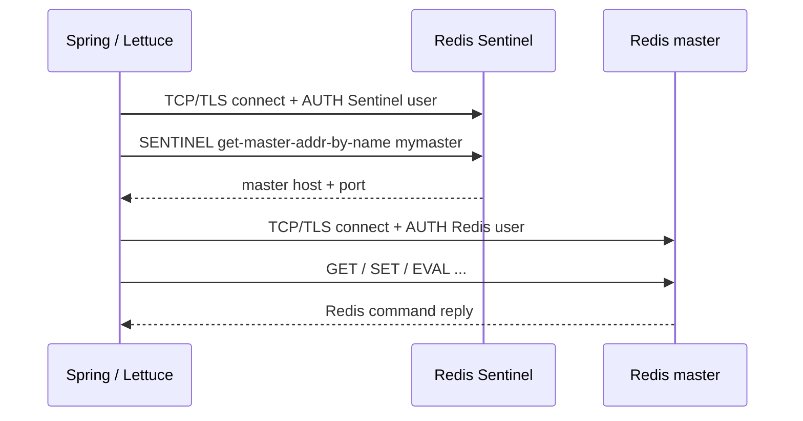
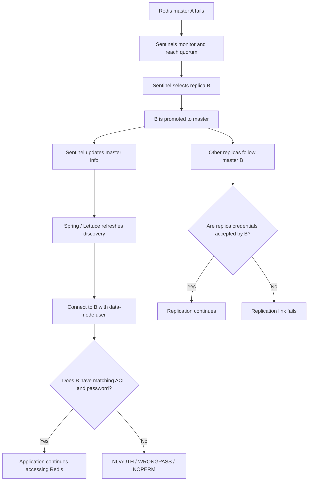

# Configuring Authentication for Sentinel and Redis Nodes in Spring Data Redis

## 1. Problem: A Redis Sentinel Connection Has Multiple Authentication Layers

In a **Redis replication + Sentinel** deployment, a Spring application does not interact with just a single Redis server. It typically connects to one or more Sentinels to query the **current master**, and then opens data connections to the master or eligible replicas. At the same time, Sentinels monitor Redis nodes, replicas authenticate with the master to replicate data, and Sentinels also communicate with one another.

This creates multiple **independent** authentication paths. Setting only `spring.data.redis.password` and concluding "Redis password is configured" is insufficient when both Sentinel and Redis data nodes require authentication.

Consider a topology:

```text
                   Spring Boot application
                          |
                          | 1. Ask for current master
                          |    (Sentinel username/password)
                          v
                +---------------------+
                | Sentinel cluster    |
                | S1, S2, S3 :26379   |
                +---------------------+
                       |         |
          2. Monitor Redis      | 3. Sentinels communicate
             (auth-user/pass)   |    (sentinel-user/pass)
                       v         v
               +----------------------+
               | Redis master :6379   |
               | Redis replica :6380  |
               +----------------------+
                          ^
                          |
              4. Read/write data from application
                 (Redis data-node username/password)

       Redis replica --------AUTH/masteruser/masterauth------> master
                           5. Replication authentication
```

**Master** here refers to the current role of a Redis data node. Sentinel can elect/promote a replica to become the new master during failover. Therefore, authentication settings must be valid **before and after node roles change**.

### 1.1. Five Authentication Flows to Control

| Flow | Connecting Party | Target | Credentials |
|---|---|---|---|
| A | Spring application | Sentinel endpoint | **Sentinel client** username/password |
| B | Spring application | Redis master/replica | **Data-node application** username/password |
| C | Redis Sentinel process | Redis master/replica it monitors | `sentinel auth-user <master-name>` / `sentinel auth-pass <master-name>` |
| D | Redis replica | Redis master | `masteruser` / `masterauth` or equivalent password mechanism |
| E | Redis Sentinel process | Other Sentinel processes | `sentinel sentinel-user` / `sentinel sentinel-pass` when using Sentinel ACLs |

Each flow has its own purpose. The account used in flow A does not have to match flow C; the application account in flow B should not by default be granted permissions to control replication or failover.

> A very common misconfiguration: the application authenticates to Sentinel and receives the master IP, yet fails to connect to the master because the **data node password** is wrong. The reverse also happens: direct Redis access succeeds while Sentinel discovery fails.

## 2. Sentinel's Role in Discovery and Failover

Sentinel is not a Redis proxy forwarding every `GET` and `SET` command. The typical flow for a Sentinel-aware client:

1. The client connects to one of the configured Sentinels.
2. The client authenticates to Sentinel if Sentinel uses ACL/password protection.
3. The client asks `SENTINEL get-master-addr-by-name <master-name>`.
4. Sentinel returns the host and port of the master it knows.
5. The client opens a connection **directly to that Redis data node** using the data-node credentials.
6. When failover occurs, the client/driver refreshes master details and reconnects per its mechanism.



The name `mymaster` is the **logical master group name monitored by Sentinel**, not a username, database name, or server DNS name. The application must use the exact name declared in `sentinel monitor`.

Example endpoints:

```text
Sentinel S1: redis-sentinel-1.internal:26379
Sentinel S2: redis-sentinel-2.internal:26379
Sentinel S3: redis-sentinel-3.internal:26379

Redis node A: redis-data-a.internal:6379
Redis node B: redis-data-b.internal:6379
Redis node C: redis-data-c.internal:6379

Sentinel logical master name: mymaster
```

Ports 26379 and 6379 are common defaults, not immutable rules. Container environments, TLS, managed services, or NAT may use different ports.

## 3. ACLs and Traditional Passwords

### 3.1. Redis 6+ Uses ACLs

Redis 6 introduced Access Control Lists (ACLs), allowing:

- Creating multiple users with distinct usernames and passwords.
- Restricting which commands a user can call.
- Restricting key patterns a user can access.
- Restricting Pub/Sub channels depending on version capabilities.
- Disabling users or rotating credentials without sharing a single global password.

At the connection level, authentication syntax is typically:

```redis
AUTH username password
```

or when clients use Redis protocol supporting `HELLO`:

```redis
HELLO 3 AUTH username password
```

In application code, **you do not need to send AUTH manually** if Spring Data Redis/Lettuce is configured properly; the driver performs the handshake based on configuration. CLI examples are only to understand the protocol.

### 3.2. Password-Only and the Default User

With legacy `requirepass` setups, clients authenticate with a single password:

```redis
AUTH password
```

On Redis 6+, this model maps for authentication purposes to the `default` user as supported by Redis. Systems upgraded from older Redis versions may still use password-only auth, though it makes least privilege and independent credential rotation across components harder.

For **Sentinel instances**, pay attention to versions: Sentinel supported password-only auth in earlier releases, while ACL support for Sentinel processes became available starting in Redis **6.2**. Do not assume that because Redis data nodes support ACLs in 6.0, Sentinel in every Redis 6.0 deployment supports ACLs identically.

### 3.3. Avoid Confusing One Password with Four Different Passwords

A system can deploy independent values:

```text
SENTINEL_CLIENT_PASSWORD      # Spring -> Sentinel
REDIS_APP_PASSWORD            # Spring -> Redis data node
SENTINEL_MONITOR_PASSWORD     # Sentinel -> Redis node
REPLICA_PASSWORD              # Replica -> master
SENTINEL_PEER_PASSWORD        # Sentinel -> Sentinel
```

In this example, all variable names are **illustrative**. A design may reuse a credential across more than one path, but separating credentials generally improves privilege isolation and independent rotation. Never copy real passwords into source code, READMEs, YAML committed to Git, or CLI commands saved in shell history.

## 4. Configuring Spring Boot: Separating Sentinel Credentials from Data-Node Credentials

In modern Spring Boot using Spring Data Redis and Lettuce, the easiest approach is usually auto-configuration.

### 4.1. Dependencies

```groovy
dependencies {
    implementation 'org.springframework.boot:spring-boot-starter-data-redis'
}
```

The Spring Boot starter normally uses Lettuce as the default Redis driver. If a project replaces the client or declares a custom `RedisConnectionFactory`, whether auto-configured properties apply depends on how the factory is built and the version in use.

### 4.2. application.yml

```yaml
spring:
  data:
    redis:
      # Credentials when the application connects to DATA NODES.
      username: app-redis
      password: ${REDIS_APP_PASSWORD}

      # Sentinel discovery uses SEPARATE credentials.
      sentinel:
        master: mymaster
        nodes:
          - redis-sentinel-1.internal:26379
          - redis-sentinel-2.internal:26379
          - redis-sentinel-3.internal:26379
        username: app-sentinel
        password: ${SENTINEL_CLIENT_PASSWORD}

      connect-timeout: 2s
      timeout: 3s
```

Meaning of important fields:

| Property | What Is It Used For? |
|---|---|
| `spring.data.redis.sentinel.master` | Logical master group name managed by Sentinel |
| `spring.data.redis.sentinel.nodes` | Sentinel hosts:ports for discovery |
| `spring.data.redis.sentinel.username` | User when the **application connects to Sentinel** |
| `spring.data.redis.sentinel.password` | Password when the **application connects to Sentinel** |
| `spring.data.redis.username` | User when the **application connects to Redis data nodes** |
| `spring.data.redis.password` | Password when the **application connects to Redis data nodes** |
| `spring.data.redis.connect-timeout` | Connection establishment timeout, per driver/configuration |
| `spring.data.redis.timeout` | Command/read response timeout per Boot configuration |

When either side uses password-only instead of a dedicated ACL user, omit the corresponding `username` field and configure only the password. **Do not omit `sentinel.password` simply because `spring.data.redis.password` is set**: the data-node password does not automatically authenticate the client to Sentinel.

Environment variable placeholders are illustrative. In production, inject credentials from Kubernetes Secrets, a secret manager, or your platform's secure mechanism; never commit real values.

**Spring Boot version note:** Spring Boot 2.x projects typically use the `spring.redis.*` prefix, whereas Spring Boot 3.x and newer versions use `spring.data.redis.*`. Check your project's version; an unbound property can cause the client to attempt unauthenticated connections without an obvious configuration error.

### 4.3. Do Not Confuse a Redis URL with Sentinel Topology

`spring.data.redis.url` can override Redis data-node host/port/username/password per Spring Boot's contract, yet a standalone Redis URL **does not replace the Sentinel nodes list and master name**. When Sentinel is configured, avoid setting a conflicting standalone URL/host unless you understand the precedence rules of your Boot version.

In particular, URIs containing username/password easily leak through logs, process arguments, or copy/paste. With Sentinel, explicit properties and secret injection are safer to operate.

## 5. Configuring RedisSentinelConfiguration in Java

If you need programmatic configuration or custom logic to retrieve secrets per environment, Spring Data Redis provides `RedisSentinelConfiguration` and `LettuceConnectionFactory`.

Example:

```java
package com.example.redis.config;

import java.time.Duration;
import org.springframework.beans.factory.annotation.Value;
import org.springframework.context.annotation.Bean;
import org.springframework.context.annotation.Configuration;
import org.springframework.data.redis.connection.RedisPassword;
import org.springframework.data.redis.connection.RedisSentinelConfiguration;
import org.springframework.data.redis.connection.RedisConnectionFactory;
import org.springframework.data.redis.connection.lettuce.LettuceClientConfiguration;
import org.springframework.data.redis.connection.lettuce.LettuceConnectionFactory;

@Configuration
public class RedisHaConfiguration {

    @Bean
    public RedisConnectionFactory redisConnectionFactory(
            @Value("${redis.auth.data.username}") String dataUsername,
            @Value("${redis.auth.data.password}") String dataPassword,
            @Value("${redis.auth.sentinel.username}") String sentinelUsername,
            @Value("${redis.auth.sentinel.password}") String sentinelPassword) {

        RedisSentinelConfiguration sentinel =
                new RedisSentinelConfiguration()
                        .master("mymaster")
                        .sentinel("redis-sentinel-1.internal", 26379)
                        .sentinel("redis-sentinel-2.internal", 26379)
                        .sentinel("redis-sentinel-3.internal", 26379);

        // Spring application -> Redis master/replica.
        sentinel.setUsername(dataUsername);
        sentinel.setPassword(RedisPassword.of(dataPassword));

        // Spring application -> Redis Sentinel.
        sentinel.setSentinelUsername(sentinelUsername);
        sentinel.setSentinelPassword(
                RedisPassword.of(sentinelPassword)
        );

        LettuceClientConfiguration client =
                LettuceClientConfiguration.builder()
                        .commandTimeout(Duration.ofSeconds(3))
                        .build();

        return new LettuceConnectionFactory(sentinel, client);
    }
}
```

With this configuration, supply `redis.auth.*` properties from a secure source such as environment variables or secret configuration. Hosts in the example are illustrative; replace them with endpoints routable from your actual application.

Key APIs:

- `setUsername(...)` / `setPassword(...)`: used for **Redis data nodes**.
- `setSentinelUsername(...)` / `setSentinelPassword(...)`: used for **Sentinel endpoints**.
- `.master("mymaster")`: Sentinel logical group name.
- `.sentinel(host, port)`: Sentinel endpoint, **not the Redis master**.

`RedisSentinelConfiguration` has varying overloads and APIs across Spring Data Redis versions; this example uses setters common in modern releases. When you declare your own `RedisConnectionFactory` bean, Spring Boot stops auto-configuring a factory from properties. **Pick one clear configuration source** to avoid two factories coexisting and the application injecting the wrong one.

### 5.1. When Should You Choose Java Configuration?

Prefer YAML/auto-configuration if you only need to declare nodes and credentials. Use Java configuration when:

- Integrating with a secret provider where standard property binding is insufficient.
- Customizing `LettuceClientConfiguration`.
- Adjusting topology dynamically by profile or environment.
- Explicitly isolating accounts across separate connection groups.

Java configuration **does not replace** the other three parts: Sentinel processes must be configured to authenticate to Redis, replicas must authenticate to the master, and server-side ACLs must permit the required commands.

## 6. Authentication on Redis Data Nodes

### 6.1. Creating a Dedicated Account for the Application

A Redis data node can define a user for application read/write APIs. **Minimal illustrative** example in a test environment:

```redis
ACL SETUSER app-redis on >REPLACE_WITH_SECRET ~app:* +get +set +del +expire +pttl +ping
```

This command permits basic operations on `app:*` keys. It is **not a sufficient profile for all Spring Cache, Redis Repository, transaction, or pipeline features**: those APIs may also require commands like `mget`, `mset`, `unlink`, `scan`, `eval`, Hash/Set/ZSet commands, `client`, or others depending on implementation.

Do not treat the sample ACL as a complete production permission list. Design permissions around the **actual commands called by your application**, Redis version, and features used. If Redis Repositories create index keys or phantom keys outside the assumed prefix, align `~app:*` with the real keyspace.

For a read-only client, restrict the account to read permissions rather than granting admin or failover commands. Redis users can be provisioned via ACL files, admin commands, or managed-service configuration depending on environment.

### 6.2. Master and Replicas Must Accept the Credentials After Failover

If a Sentinel failover promotes replica B to master, the Spring driver connects to B using the **same configured data-node username/password**. Therefore:

- The application account must be created/synchronized on all nodes eligible to become master.
- Permission patterns must match across nodes when business logic requires it.
- Passwords must not be updated on the current master alone while forgetting replicas.
- If reading from replicas is enabled, the account must also have the required permissions on replicas.
- ACL mismatches between nodes often surface **only after a failover**.

This is why **ACL consistency** across a Sentinel-monitored Redis group is an HA requirement, not merely a security task.

## 7. Sentinel Authenticating to Redis Data Nodes

Sentinel needs to monitor nodes and issue role/topology management commands during failover. When Redis master/replicas enable ACLs, Sentinel requires an account with the necessary control permissions.

In `sentinel.conf`, configuration for the logical master group looks like:

```conf
port 26379

sentinel monitor mymaster redis-data-a.internal 6379 2

# CREDENTIALS SENTINEL -> REDIS DATA NODE
sentinel auth-user mymaster sentinel-monitor
sentinel auth-pass mymaster <SENTINEL_MONITOR_PASSWORD>

sentinel down-after-milliseconds mymaster 10000
sentinel failover-timeout mymaster 60000
```

The `sentinel auth-user` and `sentinel auth-pass` lines authenticate the **Sentinel process when connecting to the Redis master/replica group**. They **do not** configure the username/password for the Spring application to log into Sentinel port 26379.

`mymaster` must match the master group name in `sentinel monitor` and in the Spring application. `2` in `sentinel monitor ... 2` is the quorum, not the number of replicas or passwords to configure.

Deploy this configuration to **all Sentinel processes responsible for monitoring the Redis group**, and create the `sentinel-monitor` account on all relevant Redis data nodes.

### 7.1. ACL for the Sentinel-Monitor Account

Sentinel typically needs commands such as `PING`, `INFO`, `ROLE`, certain client management commands, replication commands, and internal Pub/Sub. Redis documentation provides a recommended ACL profile for Sentinel; a corresponding example:

```redis
ACL SETUSER sentinel-monitor on >REPLACE_WITH_SECRET resetchannels &__sentinel__:hello +multi +slaveof +ping +exec +subscribe +config|rewrite +role +publish +info +client|setname +client|kill +script|kill
```

**This is a reference sample for compatible Redis versions**, not an immutable recipe. Command names, ACL subcommands, and channel permissions can vary across Redis/Valkey versions. Some deployments or failover flows require extra permissions per the Redis server documentation for your running version. Test all monitoring, reconfiguration, and failover states thoroughly.

A common mistake is creating a Sentinel user with only `+ping +info`, seeing health checks pass, and then hitting `NOPERM` during failover when role-changing commands are needed. **Successful authentication does not mean failover permissions are sufficient.**

### 7.2. Sentinel Must Connect to Both Master and Replicas

Sentinel monitors the master group and the replicas it discovers. Creating the `sentinel-monitor` account only on the current master is wrong: once a replica is promoted to master, Sentinel still has to inspect, coordinate, and reconfigure all nodes in the group.

Rules:

1. Provision the Sentinel-monitor account on every Redis data node in the group.
2. Keep credentials/ACLs consistent across failover.
3. Ensure newly added nodes receive the same user and permissions before joining the HA topology.
4. Verify network and TLS not only from the application, but also from Sentinel processes to Redis nodes.

If Sentinel lacks permissions, the system may look normal while healthy yet **fail to self-recover** when the primary fails.

## 8. Replica Authenticating When Replicating from Master

A replica opens a replication connection to the master. This is the **fourth authentication flow**, and is not replaced by `spring.data.redis.password` or `sentinel auth-pass`.

### 8.1. Password-Only Case

For password-only Redis, configuration may look like:

**Master (illustrative):**

```conf
requirepass <REDIS_MASTER_PASSWORD>
```

**Replica:**

```conf
replicaof redis-data-a.internal 6379
masterauth <REDIS_MASTER_PASSWORD>
```

When a replica connects to the master, it must authenticate with a password accepted by the master. These config snippets are illustrative; never store plaintext secrets in Git or grant file read access to unrelated users.

### 8.2. ACL Case: masteruser and masterauth

With Redis ACLs, replicas can use a dedicated replication account:

**On the master and any node eligible to become master:**

```redis
ACL SETUSER replica-sync on >REPLACE_WITH_SECRET +psync +replconf +ping
```

**In the Redis replica configuration:**

```conf
replicaof redis-data-a.internal 6379
masteruser replica-sync
masterauth <REPLICA_SYNC_PASSWORD>
```

The permissions above are a minimal reference ACL example for replication per Redis documentation; verify against your actual engine/version.

Important: because Sentinel can promote a node to master and reconfigure other replicas to follow the new master, the `replica-sync` user and password must work on **every node that can become master**. Do not build a system where only A accepts replication credentials while B/C do not.

### 8.3. Verifying Replication After Enabling Auth

On a Redis node:

```redis
INFO replication
ROLE
```

On the master, inspect replica count and state. On a replica, check the connection to the master, sync status, and replication offset using the fields provided by your version.

If a replica hits `NOAUTH` or `WRONGPASS` while establishing its replication link, that error may not appear in Spring application logs because Spring still connects to the current master normally. Monitor Redis node logs and metrics separately.

## 9. Authenticating to Sentinel Instances: Clients and Peers

A Sentinel instance can require clients to authenticate on its Sentinel port. This uses accounts defined on the **Sentinel server accepting inbound connections**.

### 9.1. Account for the Spring Application Querying Sentinel

In Sentinel ACL environments (Redis Sentinel 6.2+), you can create a discovery-only user rather than giving the application admin privileges.

Commands to consider:

```text
AUTH / HELLO
PING
SENTINEL get-master-addr-by-name
SENTINEL master / masters / replicas / sentinels
CLIENT SETNAME (if used by the driver)
```

Grant the exact ACL syntax for your version and driver requirements. For example, Redis documentation shows an inbound client ACL profile for Sentinel using `+sentinel|get-master-addr-by-name` and selected discovery subcommands. Do not grant `+@all` to an application that only looks up the master.

In the application:

```yaml
spring:
  data:
    redis:
      sentinel:
        master: mymaster
        nodes:
          - redis-sentinel-1.internal:26379
          - redis-sentinel-2.internal:26379
          - redis-sentinel-3.internal:26379
        username: app-sentinel
        password: ${SENTINEL_CLIENT_PASSWORD}
```

The user `app-sentinel` **exists in the Sentinel instances' ACLs**; it is not the `app-redis` user on the Redis master.

### 9.2. Sentinels Authenticating with Each Other

In topologies with Sentinel ACLs, Sentinel processes may also require dedicated credentials when connecting to peer Sentinels. Redis Sentinel provides the directives:

```conf
sentinel sentinel-user <SENTINEL_PEER_USERNAME>
sentinel sentinel-pass <SENTINEL_PEER_PASSWORD>
```

This is the **outbound Sentinel-to-Sentinel** credential, not the application's discovery account and not `sentinel auth-user mymaster` for connecting to Redis data nodes.

At the same time, each Sentinel needs matching inbound ACLs so valid peers can authenticate. Redis Sentinel documentation recommends compatible authentication settings across all Sentinel instances. If the `default` user is disabled, peer Sentinels must have another user with sufficient permissions to communicate and coordinate.

In older password-only Redis Sentinel deployments, `requirepass` can be configured per official guidance. Do not haphazardly mix password-only Sentinels with ACL-based Sentinels in the same deployment; verify supported versions and modes.

### 9.3. Configuration Matrix by Flow

| Setting | Where Does It Live? | Who Uses It? |
|---|---|---|
| `spring.data.redis.sentinel.username/password` | Spring Boot | Application logging into Sentinel |
| `spring.data.redis.username/password` | Spring Boot | Application logging into Redis data nodes |
| `sentinel auth-user mymaster` / `auth-pass` | Sentinel config | Sentinel monitoring Redis data nodes |
| `masteruser` / `masterauth` | Redis replica config | Replica logging into master to replicate |
| `sentinel sentinel-user` / `sentinel-pass` | Sentinel config | Sentinel communicating with peer Sentinels |
| Redis data-node ACL users | Redis server/ACL file | Defines permissions for app, Sentinel monitor, replica |
| Sentinel ACL users | Sentinel server/ACL file | Defines permissions for app discovery and Sentinel peers |

Most authentication failures in HA topologies stem from **valid credentials placed in the wrong configuration location**.

## 10. Testing Each Authentication Layer Independently with redis-cli

To avoid debugging a generic "Redis connection failed" error, test each connection path independently. The following commands are for authorized environments only and use **`--askpass`** to avoid putting passwords directly on the command line.

### 10.1. Connecting to Sentinel

```bash
redis-cli \
  -h redis-sentinel-1.internal \
  -p 26379 \
  --user app-sentinel \
  --askpass \
  PING
```

If that succeeds, test discovery with the same credentials:

```bash
redis-cli \
  -h redis-sentinel-1.internal \
  -p 26379 \
  --user app-sentinel \
  --askpass \
  SENTINEL get-master-addr-by-name mymaster
```

Expected output is a master host/port pair. If `PING` succeeds while discovery returns `NOPERM`, the credentials are valid, but the **ACL does not yet allow the discovery subcommand**.

For password-only setups, omit `--user app-sentinel` depending on Sentinel's auth mode.

### 10.2. Connecting Directly to a Data Node

```bash
redis-cli \
  -h redis-data-a.internal \
  -p 6379 \
  --user app-redis \
  --askpass \
  PING
```

Test role-appropriate commands:

```bash
redis-cli \
  -h redis-data-a.internal \
  -p 6379 \
  --user app-redis \
  --askpass \
  GET app:healthcheck
```

Do not use `SET` in production to test auth unless you have an allowed key/namespace and cleanup plan. A `PING` test only proves login succeeded and PING is permitted; **it does not prove permissions are sufficient for Hashes, Scripts, or Repositories**.

### 10.3. Verifying Sentinel Monitoring and Quorum

With an appropriately authorized operations account:

```redis
SENTINEL masters
SENTINEL replicas mymaster
SENTINEL sentinels mymaster
SENTINEL ckquorum mymaster
```

These commands inspect discovery, peers, replicas, and quorum/majority readiness. They do not replace verifying the actual replication link and do not prove the Spring application has configured valid data-node credentials.

`SENTINEL ckquorum` requires suitable permissions and may not be granted to a discovery-only `app-sentinel` user. This is an operational action, not something every application needs.

## 11. TLS and Authentication: Two Separate Protection Layers

Usernames/passwords identify **who may connect and what they may do**. TLS protects the **transport channel** and can authenticate the server via certificates; some deployments also enforce mutual TLS per provider policy.

In a Sentinel topology, distinguish the network segments:

1. Application → Sentinel.
2. Application → Redis master/replicas.
3. Sentinel → Redis data nodes.
4. Sentinel ↔ Sentinel.
5. Replica → master.

If TLS is enabled only on data nodes while Sentinel runs plaintext, discovery details or credentials on the application–Sentinel path may remain unprotected.

### 11.1. Spring Boot SSL

In TLS environments with supporting Boot versions:

```yaml
spring:
  data:
    redis:
      ssl:
        enabled: true
```

Some Spring Boot versions also support SSL bundles:

```yaml
spring:
  data:
    redis:
      ssl:
        bundle: redis-client
```

These YAML snippets are **environment-specific options**, not a guarantee that setting both automatically configures every Sentinel/Redis path. Carefully check the driver, how `RedisConnectionFactory` is built, truststores, certificate hostnames, SNI, and TLS support on each Sentinel/data endpoint.

If writing a custom `LettuceConnectionFactory`, enable TLS on `LettuceClientConfiguration` accordingly:

```java
LettuceClientConfiguration client =
        LettuceClientConfiguration.builder()
                .useSsl()
                .commandTimeout(Duration.ofSeconds(3))
                .build();
```

This example illustrates basic client SSL configuration; it does not configure custom trust bundles, hostname verification, or mTLS. **Do not disable certificate/hostname verification to bypass environment errors** without a thorough security review.

### 11.2. Notes When Testing with redis-cli

When Redis endpoints use TLS, add `--tls` to `redis-cli` commands as supported by the server. Example:

```bash
redis-cli --tls \
  -h redis-sentinel-1.internal -p 26379 \
  --user app-sentinel --askpass \
  SENTINEL get-master-addr-by-name mymaster
```

If certificates are issued by an internal CA, configure the CA certificate/trust per your environment's security instructions. An `SSLHandshakeException` is fundamentally different from `WRONGPASS`; do not change passwords to fix certificate errors.

## 12. Failover Scenario: Auth Must Still Work After Role Changes

A successful failover requires multiple pieces working together:



A system can pass discovery and failover yet lose service availability because ACLs are inconsistent. Examples:

- `app-redis` exists only on master A; replica B is promoted without that user.
- Sentinel monitors using `sentinel-monitor` on A, but B lacks equivalent permissions.
- Replica C uses an old `masterauth`; B rotated its password so C cannot replicate.
- Peer Sentinels use mismatched credentials after a rotation.
- Spring knows only one Sentinel endpoint that went down and has no remaining seed endpoints.
- The Redis endpoint announced by Sentinel is a private IP unreachable from the application network.

Therefore, **"redis-cli PING to the current master succeeds" is not a complete HA test**.

### 12.1. Account Consistency Across Nodes

For Redis data nodes that may switch roles, establish a process to provision ACLs on every node:

- Same application user and required permissions.
- Same Sentinel-monitor user and monitoring/failover permissions.
- Same replica-sync user and password for replication.
- Synchronized distribution/rotation plan prior to role changes.
- Validation of new configurations during scale-out/rejoin.

Depending on Redis version, ACL changes made via `ACL SETUSER` may not automatically replicate like keyspace data; do not assume "updating the master gives replicas the same user." Use ACL files, config management, or a provider control plane designed for your topology.

### 12.2. Sentinel-Announced Addresses Must Be Reachable

When running in containers/Kubernetes or behind NAT, Sentinel may return a Redis address unreachable from the application, even when authentication is valid.

Symptoms:

```text
SENTINEL get-master-addr-by-name mymaster
=> 10.0.0.12 6379

Application on another network cannot route to 10.0.0.12.
```

In this case the error is typically a connection timeout, not `WRONGPASS`. Configure proper announce addresses, DNS, endpoints, and network policies. Do not attempt to fix a routing error by granting broader admin privileges.

## 13. Rotating Passwords Without Downtime

Credential rotation in a Sentinel topology takes more steps than in a standalone app. Updating a data-node password before updating the application or replicas can break both data connections and replication.

### 13.1. Strategy by Layer

| Credential Type | Where Must It Be Updated? | Risk If Out of Sync |
|---|---|---|
| Application → Sentinel | Sentinel ACLs / Spring client secret | Cannot discover master |
| Application → Redis data node | Data-node ACLs on all nodes / client secret | Discovery succeeds, Redis auth fails |
| Sentinel → Redis data node | Data-node Sentinel-monitor ACL / `sentinel auth-user/pass` | Sentinel cannot monitor or fail over |
| Replica → master | Redis ACLs on nodes / `masteruser/masterauth` | Replication link breaks |
| Sentinel → Sentinel | Inbound Sentinel ACL / `sentinel sentinel-user/pass` | Peers cannot coordinate properly |

### 13.2. Add First, Cut Over Later When Using ACLs

A low-risk rotation approach when multiple users/credentials are supported:

1. **Create the new user/password** or add the new credential across all target servers per security policy.
2. Verify permissions and login capability with the new credentials on each node group.
3. Update dependent clients/processes in an appropriate operational sequence.
4. Monitor authentication failures, replication state, Sentinel quorum, and application latency.
5. Verify behavior in failover topology or role simulation before revoking old credentials.
6. Disable old credentials only after no consumers still depend on them.

Do not assume changing an environment variable in Spring immediately updates all open TCP connections in pools. You may need client refresh/restart, reinitializing the connection factory, or a controlled rollout depending on the driver and secret integration.

With password-only `requirepass`, overlapping old and new credentials is much more limited than with multi-user ACLs. Plan the exact cutover and reconnection window, and schedule maintenance if the platform does not support seamless rotation.

### 13.3. Never Log Secrets

Avoid:

- Printing entire YAML configs or `RedisSentinelConfiguration` objects containing passwords.
- Using CLI `-a literal-password` visible in command history or process lists.
- Committing `sentinel.conf` or `redis.conf` containing production secrets to repositories.
- Sending passwords via unmanaged tickets or chats.
- Granting overly broad secret read permissions to unrelated services.

Use `--askpass` or secure secret injectors during manual checks; logs should record only error types and suitably redacted endpoints/roles, never passwords.

## 14. Least Privilege Without Confusing Security and Availability

### 14.1. Application Permissions

An application user that only reads cache does not need `CONFIG`, `REPLICAOF`, or `SENTINEL FAILOVER`. Grant only commands and key patterns required for the business function.

However, least privilege must be realistic: Spring Cache may use `GET`, `SET`, `DEL`, `UNLINK`, `SCAN`, or Lua scripts depending on configuration; Spring Data Redis Repositories also create Hashes/Sets/TTLs and secondary indexes. Defining an ACL allowing only `GET` and then seeing `NOPERM` on repository `save` is a permission error, not a Sentinel bug.

### 14.2. Sentinel-Monitor Permissions

Sentinel-monitor is not an application user. It must have permissions to observe and **execute failover/reconfiguration** per Redis documentation. Granting too few permissions can make HA look "working" while healthy yet fail when a replica actually needs promotion.

### 14.3. Sentinel Client Permissions

Applications using Sentinel for discovery normally only need to query status/master endpoints. Do not grant configuration modification or forced failover privileges to regular client apps.

### 14.4. Replica-Sync Permissions

Replica credentials must cover the replication protocol. Do not reuse a data-mutating application user simply because authentication succeeds.

## 15. Symptom-Based Diagnosis

| Symptom | Possible Cause | How to Verify |
|---|---|---|
| `NOAUTH Authentication required` when querying Sentinel | Client missing Sentinel credentials | Check `sentinel.username/password` |
| `WRONGPASS invalid username-password pair` from Sentinel | Wrong Sentinel user/password or disabled user | Test port 26379 with CLI |
| Sentinel `PING` OK, discovery returns `NOPERM` | ACL blocks `SENTINEL get-master-addr-by-name` | Test the exact subcommand with same user |
| Sentinel discovery OK, Redis `GET` returns `NOAUTH/WRONGPASS` | Wrong data-node credentials | Test Redis port with `app-redis` |
| Redis `GET` OK, `SET` or Repository save returns `NOPERM` | Data-node ACL missing command/key pattern | Check actual commands and ACL |
| Works locally, Spring fails to connect after failover | Inconsistent user on promoted replica | Check ACLs on the new master |
| Sentinel misses replicas / reports unexpected s_down | Wrong Sentinel-monitor auth, permissions, or network | Check Sentinel logs and `SENTINEL replicas` |
| Replica loses master link | Wrong `masteruser/masterauth` or user missing `PSYNC/REPLCONF` | `INFO replication` and Redis logs |
| Sentinel fails to reach quorum | Peers lack auth, network/TLS issue, too few Sentinels | `SENTINEL ckquorum` and peer logs |
| `SSLHandshakeException` | TLS CA/hostname/trust or TLS mode mismatch | Check endpoints/certificates; do not change passwords |
| Connection timeout to master returned by Sentinel | DNS/NAT/firewall/announce IP | Check if discovered host/port is routable |
| Boot properties have secret, driver uses old auth | Wrong prefix, custom connection factory, or rollout pending | Check property binding, beans, and rollout |
| Client connects, writes fail with `READONLY` | Connected to replica or topology unrefreshed after failover | Check `ROLE`, master discovery, driver state |
| App user lacks permission for Hash/Set/Lua | ACL allows only String commands | Grant required commands per least privilege |
| One dead Sentinel seed prevents app startup | Only one Sentinel configured or unreachable remaining seeds | Configure multiple seeds and verify network |

### 15.1. NOAUTH, WRONGPASS, and NOPERM Mean Different Things

- **`NOAUTH`:** client has not authenticated when the server requires authentication.
- **`WRONGPASS`:** credentials were rejected (wrong username/password, disabled user, or equivalent condition).
- **`NOPERM`:** authentication succeeded, but the user **lacks permission to run the command or access the key/channel**.

These are three separate investigation branches. If you get `NOPERM` on `SENTINEL master`, changing the already-valid password will not grant subcommand permissions.

### 15.2. Check the Right Port and the Right Role

Both Redis and Sentinel speak RESP; `PING` can return `PONG` on both. Thus, **`PONG` does not tell you whether you connected to the right service type**.

On Sentinel, try `SENTINEL get-master-addr-by-name mymaster`.

On a Redis data node, try `ROLE` or `INFO replication` using an appropriately authorized account. Application users may lack permission for those commands; use a controlled operational account when needed.

## 16. A Complete Deployment Scenario

Suppose we need to deploy:

- 1 Redis master, 2 replicas.
- 3 Sentinel instances monitoring the name `mymaster`.
- 2 Spring Boot instances using Lettuce.
- ACLs on both Redis nodes and Sentinel nodes.

### Step 1: Identify the Principals

```text
app-redis        : Spring app accessing data nodes
app-sentinel     : Spring app querying master via Sentinel
sentinel-monitor : Sentinel monitoring and reconfiguring Redis nodes
replica-sync     : replica connecting to master
sentinel-peer    : Sentinel nodes authenticating with one another
```

Each principal receives least-privilege permissions per Redis/Sentinel documentation, and credentials are stored in a secret manager.

### Step 2: Provision Users on Target Servers

- On **every Redis data node** eligible for promotion: `app-redis`, `sentinel-monitor`, and `replica-sync` with appropriate permissions.
- On **every Sentinel instance**: `app-sentinel` and the principal used for peer communication when Sentinel ACLs are enabled.
- Do not provision accounts only on the current master while forgetting replicas.

### Step 3: Configure Replication Credentials

On replicas, configure `masteruser` and `masterauth` matching `replica-sync`, and ensure promotable data nodes accept those credentials.

### Step 4: Configure Sentinel to Monitor Redis

On Sentinels:

```conf
sentinel monitor mymaster redis-data-a.internal 6379 2
sentinel auth-user mymaster sentinel-monitor
sentinel auth-pass mymaster <SENTINEL_MONITOR_PASSWORD>
```

Separate Sentinel inbound authentication/peer credentials according to the mode of your Redis version.

### Step 5: Configure Spring Boot

```yaml
spring:
  data:
    redis:
      username: app-redis
      password: ${REDIS_APP_PASSWORD}
      sentinel:
        master: mymaster
        nodes:
          - redis-sentinel-1.internal:26379
          - redis-sentinel-2.internal:26379
          - redis-sentinel-3.internal:26379
        username: app-sentinel
        password: ${SENTINEL_CLIENT_PASSWORD}
```

### Step 6: Verify Each Connection Path

- CLI → Sentinel using `app-sentinel`.
- CLI → Redis data node using `app-redis`.
- Sentinel → Redis nodes via monitoring credentials.
- Replica → master via replication credentials.
- Sentinel ↔ Sentinel via peer configuration.

### Step 7: Test End-to-End from the Application

Perform a simple Redis operation in a test namespace, such as Spring `StringRedisTemplate` writing and reading the same key. Monitor latency and authentication errors.

### Step 8: Run a Controlled Failover Drill

In an authorized test environment:

1. Write a verifiable test value.
2. Trigger failover following the platform runbook.
3. Identify the new master returned by Sentinel.
4. Verify Spring connects to the new master using `app-redis`.
5. Verify replicas follow the new master and replication continues.
6. Confirm Sentinel quorum and peer accounts remain functional.
7. Handle any unreplicated writes per asynchronous replication SLA.

A failover can still lose recent writes near the outage depending on replication/persistence; valid authentication **does not create synchronous replication**.

## 17. Redis Sentinel and Managed Redis: Is It Always the Same Model?

Not every cloud "Redis HA" service exposes Sentinel endpoints or lets users configure `sentinel.conf`. Some managed services use a proprietary control plane, different endpoint discovery, and provider-managed failover strategies.

If the provider does not expose the Redis Sentinel protocol to clients, **do not configure Spring Sentinel just because the service has replicas and failover**. Use the officially supported connection mode/endpoints, along with TLS/auth per the provider.

When a provider offers Sentinel compatibility:

- Verify whether auth separates Sentinel and data nodes.
- Verify whether ACLs or a single credential is used.
- Test how the driver discovers the master address during failover.
- Check security policies, ports, DNS, and network paths.
- Do not assume permission to read or edit Sentinel config.

The configuration in this lesson applies to **true Redis Sentinel topologies**, not every kind of replicated Redis deployment.

## 18. Design Verification Checklist

| Question | Required Conclusion |
|---|---|
| Does logical master name match `sentinel monitor`? | Spring and Sentinel use the exact same name |
| Does Spring have multiple Sentinel seed endpoints? | Does not depend on a single Sentinel |
| Which user does Application → Sentinel use? | Correct `sentinel.username/password` |
| Which user does Application → Redis node use? | Correct `redis.username/password` |
| Are Redis ACLs on replicas identical to promotable nodes? | Failover does not expose missing users |
| Does Sentinel → Redis have monitoring/failover permissions? | `auth-user/auth-pass` and ACLs are sufficient |
| Does Replica → master have replication permissions? | Correct `masteruser/masterauth` |
| Can Sentinel ↔ Sentinel authenticate? | Peer ACLs/passwords synchronized |
| Is TLS properly applied on every protected path? | No unintended plaintext links |
| Are credentials fetched from a secret manager? | No passwords committed in source/config |
| Do ACLs restrict keys/channels/commands? | Least privilege yet fully functional |
| Is handling defined for rotation/failover? | Clear runbook and monitoring |
| Are discovered endpoints reachable from the app? | DNS/NAT/firewalls/announce addresses valid |
| Are logs/metrics present for auth/replication/quorum? | Can distinguish root causes of failures |

## 19. Conclusion

Configuring authentication in **Spring Data Redis + Redis Sentinel + replication** is not a single password. The application needs credentials to **query Sentinel**, and separate credentials to **read/write Redis data nodes**; Sentinel itself needs permission to connect and control Redis; replicas need replication accounts; and peer Sentinels need compatible authentication.

In Spring Boot, distinguish `spring.data.redis.sentinel.username/password` from `spring.data.redis.username/password`. In Java configuration, `setSentinelUsername/setSentinelPassword` and `setUsername/setPassword` on `RedisSentinelConfiguration` express this boundary. On the infrastructure side, `sentinel auth-user/auth-pass`, `masteruser/masterauth`, and `sentinel sentinel-user/sentinel-pass` belong to distinct flows.

For HA to succeed when failover actually happens, every node eligible to become master must have compatible ACLs/credentials, Sentinel must have permissions to monitor and switch roles, the network must route to announced addresses, and rotation/TLS/monitoring must be under control. **Connecting successfully while the system is healthy is not enough to prove authentication is ready for failover.**

## References

- [Redis — High availability with Sentinel](https://redis.io/docs/latest/operate/oss_and_stack/management/sentinel/)
- [Redis — Access Control Lists, ACL rules for Sentinel and replicas](https://redis.io/docs/latest/operate/oss_and_stack/management/security/acl/)
- [Redis — Redis Sentinel configuration template](https://github.com/redis/redis/blob/unstable/sentinel.conf)
- [Spring Data Redis — Connection Modes / Redis Sentinel Support](https://docs.spring.io/spring-data/redis/reference/redis/connection-modes.html)
- [Spring Data Redis — RedisSentinelConfiguration API](https://docs.spring.io/spring-data/redis/reference/api/java/org/springframework/data/redis/connection/RedisSentinelConfiguration.html)
- [Spring Data Redis — LettuceConnectionFactory API](https://docs.spring.io/spring-data/redis/docs/current/api/org/springframework/data/redis/connection/lettuce/LettuceConnectionFactory.html)
- [Spring Boot — Common Application Properties](https://docs.spring.io/spring-boot/appendix/application-properties/)
