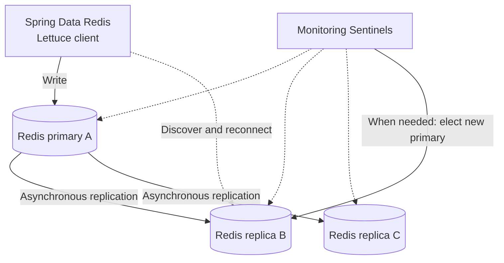
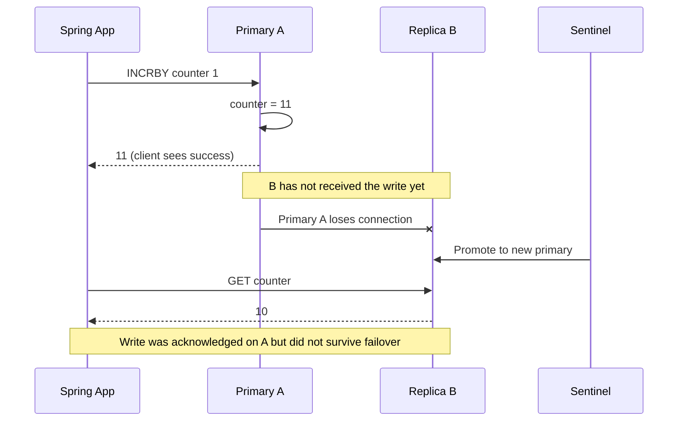
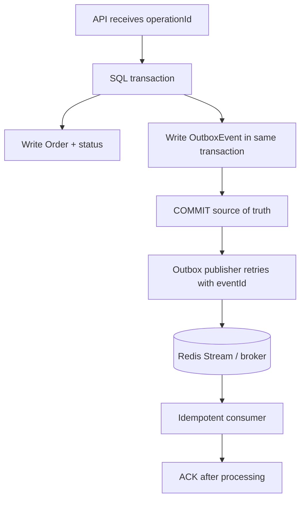
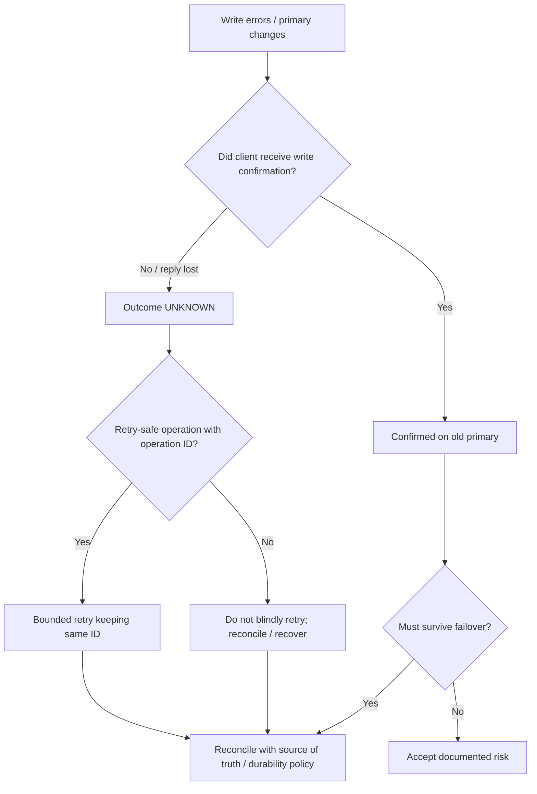

# In-Flight Commands During Primary Failover and Potential Write Loss

In a **Spring Data Redis** system using **replication** and **Redis Sentinel**, data is normally written to a Redis **primary** and then replicated to one or more **replicas**. If the primary becomes unavailable, Sentinel can elect a replica to become the new primary, after which clients reconnect to the new address.

A common misconception is: **failover does not guarantee every command acknowledged by the old primary exists on the new primary**. Traditional Redis replication is **asynchronous**. A write command may execute and return `OK` to the application without reaching the promoted replica in time. Conversely, a command may succeed while its response is lost mid-disconnection, leaving the application unsure whether to retry.

This lesson explains the fate of **in-flight commands when the primary changes**, the difference between acknowledged writes and writes retained after failover, how Spring Data Redis handles Sentinel connections, and the design patterns needed to prevent **lost writes** or **duplicate writes**.

## 1. Foundational Concepts

| Concept | Role | What Not to Infer |
| --- | --- | --- |
| **Primary** | Node accepting normal write commands and emitting the replication stream | Returning `OK` does not mean data is stored on every replica |
| **Replica** | Receives data from the primary via replication | Replicas are not always up to date at every instant |
| **Redis Sentinel** | Monitors primary, detects failures, selects a replacement replica, and provides the current primary address | Sentinel does not make replication synchronous or consensus-transactional |
| **Failover** | Transfers the primary role to another node | Does not guarantee recovering writes not yet received by the replica |
| **Replication offset** | Measure of progress in the replication stream | Not a guarantee of durable disk persistence |
| **AOF/RDB** | Persistence mechanisms saving Redis data to disk | Persistence on the old primary does not guarantee the new primary received all commands |
| **Client timeout** | Application did not receive a reply within its wait limit | Does not prove the command was not executed |

In a typical Sentinel setup:



With Redis Sentinel, the client queries Sentinel to learn which node is announced as primary for a group name, such as `mymaster`. After failover, the client/driver must refresh topology or reconnect. In-flight requests on the old connection **are not automatically migrated intact** to the new node.

## 2. Why Can Writes Be Lost Even After Redis Returns `OK`?

Suppose there is primary A and replica B:

```text
Initially:
    A: counter = 10
    B: counter = 10

T1. Client sends INCRBY counter 1 to A.
T2. A executes and returns 11 to client.
T3. B has not received this update yet.
T4. A disconnects or crashes.
T5. Sentinel promotes B to be the new primary.

After failover:
    B: counter = 10
    Client previously received result 11 from A.
```

The client saw no error on the initial write, yet the post-failover Redis system may no longer have that update. This is **acknowledged write loss** caused by the asynchronous replication window.



**Core point:** acknowledging a single Redis command only states that **the node handling that command** executed the operation and returned a reply. It is not a **majority commit** protocol like Raft, and does not commit the data to whichever replica may be elected in the future.

When A recovers, A can be reconfigured to follow the new primary and sync from B. Data A held that B never received is not automatically "merged back"; A's divergent updates can be discarded to match the new primary's history.

## 3. Stages Where a Command Can Encounter Failover

A request can be in one of the following states when the primary changes:

| Stage | What Can Happen | Safe Application Conclusion |
| --- | --- | --- |
| Command not yet sent | Client has not written request onto the Redis connection | May not have caused side effects, if truly verified unsent |
| Waiting in driver queue | Connection breaks before sending or as driver prepares to write | Depends on driver, queue/reconnect behavior, and failure point; do not guess from timeouts |
| Sent, primary has not processed | Primary crashes or changes role | **Uncertain** without reliable verification |
| Primary processed, reply lost | Result lost when socket closes | **Uncertain**: command may already have written |
| Client received success reply | Write succeeded on that primary at that instant | Still risks being lost on failover if replicas didn't receive it |
| Replica received the write | More copies exist | Reduces risk, yet not an absolute guarantee across all future primaries |
| Replica promoted | New state depends on the sync progress of the elected node | Must re-read state and reconcile if needed |

Distinguish two risks:

1. **Unknown outcome:** The client does not know whether the primary executed the command because the response was lost.
2. **Acknowledged-but-lost write:** The client received a success confirmation, yet the update did not survive the primary switch.

Both can occur in the same system and require different handling. Idempotent retries can help resolve *unknown outcome*; they **do not automatically solve** an acknowledged update disappearing when replication/failover rewrites history.

## 4. Failover Is Not Instantaneous

Sentinel monitors instance health. When conditions indicate a primary is unresponsive, Sentinel can run an election and promote a replica to primary. This process spans multiple intervals:

- Detecting an unresponsive connection or failed primary.
- Having enough Sentinels evaluate the state and authorize failover.
- Selecting a suitable replica to promote.
- Instructing remaining replicas to follow the new primary.
- Publishing the new primary address for clients to rediscover.

During this window, the application may observe:

```text
Timeouts calling the old node
Connection refused / connection reset
READONLY when writing to a node that is now a replica
Unable to resolve primary briefly
Commands queued waiting on driver reconnect
Elevated latency from reconnecting or full/partial resynchronization
```

These are potential symptoms, **not** a mandatory list or fixed order. A `READONLY` error generally indicates the client is writing to a node no longer holding the primary role, yet the application should not conclude prior operations definitely failed to execute.

### 4.1. Quorum and Failover Do Not Equal Write Quorum

Sentinel uses a `quorum` setting to decide when a primary is objectively unavailable; Sentinels also perform leader election/authorization to carry out failover.

However, **Sentinel quorum for detecting and switching roles** is not a **replication quorum for data writes**.

```text
Sentinel quorum:  evaluates primary health and coordinates failover
Replication:      streams updates from primary to replicas
Write durability: determines whether writes survive crash/failover
```

Never claim "we have three Sentinels, so every write is saved on at least two Redis nodes." Sentinel and replication solve different problems.

### 4.2. Network Partition Windows and the Old Primary

During a network partition, the old primary may lose contact with the Sentinel majority while still keeping connections with some application clients. During that interval, the old node **may** continue accepting writes unless blocked by configuration. Meanwhile, Sentinels on the other side of the partition may promote a replica.

Temporarily, clients on both sides may appear able to write; once connectivity recovers, following the elected primary can discard writes made on the isolated old primary. This is a known risk to design around for asynchronous replication and network partitions.

Redis provides settings to reduce the risk of accepting writes without enough replicas, but Sentinel does not turn Redis into a cluster-wide linearizable write system.

## 5. Why Blind Retries Can Corrupt Data

Suppose the application calls:

```redis
INCRBY account:credits 1
```

The client loses its connection right after sending, so it does not know whether Redis processed it.

**Case A — command never ran:**

```text
Primary A did not execute.
Client retries against primary B.
B executes once.
```

**Case B — command ran and replica preserved it:**

```text
A executed and replicated to B.
Reply to client was lost.
B is promoted; the increment already exists.
Client retries INCRBY against B.
Value is incremented a second time.
```

**Case C — command ran on A but was lost after failover:**

```text
A executed, did not replicate to B in time.
B is promoted with the old value.
Client retries against B.
Only the retried increment exists in the new history.
```

From a `RedisConnectionFailureException` or timeout, the client cannot reliably distinguish these three cases. Therefore, for **non-idempotent commands**, unconditional retries can cause **duplicate writes**, whereas never retrying can drop a command the server never executed.

This is why critical systems need an **operation ID and reconciliation contract**, not just higher retry counts.

## 6. Different Write Types Have Different Retry Safety

| Redis Command / Workflow | If Resent After Lost Response | Considerations |
| --- | --- | --- |
| `GET`, `HGET` | No write side effects | Values may change between reads |
| `SET key constant` | Usually converges to the same final value | Can overwrite newer updates, reset TTL, and emit events |
| `INCRBY`, `DECRBY` | Increments/decrements again each time | Needs an operation ID and deduplication |
| `LPUSH`, `RPUSH` | May append duplicate items | Consumer/deduplication by ID |
| `XADD stream * ...` | Can generate multiple Record IDs | Stable `eventId`, outbox, and idempotent consumer |
| `SET key value NX` | Second attempt may fail because key already exists | `NX` result does not prove who created the key |
| `DEL key` | Usually converges to key absence | Check impacts on metadata, events, and concurrent writes |
| Lua write with operation ID | Can return the previously processed result | Safe only while ledger survives and atomic with the write |

An **atomic** Redis command is not automatically **idempotent** on retry. `INCRBY` is atomic, yet two `INCRBY` executions increment twice.

Similarly, the absence of an exception on a write does not guarantee the write survives failover. Distinguish execution correctness on the active primary from state durability across topology changes.

## 7. `WAIT`: Shrinking the Write-Loss Window Without Strong Consistency

Redis provides the command:

```redis
WAIT numreplicas timeout
```

After write commands on **the same connection**, `WAIT` blocks until at least the requested number of replicas acknowledge receiving and processing prior writes on that connection, or the timeout expires.

Example:

```redis
SET orders:status:O-101 CONFIRMED
WAIT 1 1000
```

`WAIT 1 1000` waits up to 1,000 milliseconds for at least one replica to acknowledge replication up to the offset of previous writes on the same connection. The return value is the **number of replicas** that acknowledged.

| Result | Interpretation |
| --- | --- |
| `1` or higher | At least one replica acknowledged up to the required offset within the timeout |
| `0` | Too few replicas acknowledged before timeout; does not mean `SET` rolled back |
| Timeout/connection error while waiting | Desired assurance not observed; write and replication state require reconciliation |

**Keep the write command and `WAIT` on the same connection.** Calling `StringRedisTemplate.opsForValue().set()` and then calling `WAIT` over a different connection does not wait on the offset of the protected operation. In Spring Data Redis, use `SessionCallback` or appropriate low-level connection APIs to control connection boundaries.

### 7.1. Why Doesn't `WAIT` Eliminate Write Loss Completely?

- A replica receiving data does not guarantee it has **fsynced to disk**.
- Sentinel has no strict contract forcing it to elect the exact replica that acknowledged `WAIT`.
- A replica may crash, or another failure may occur before state is durably persisted.
- Failover or network partitions can happen before, during, or immediately after waiting.
- `WAIT` returns the actual replica count; the application must **check** that return value rather than merely assuming command completion means success.

Redis documentation emphasizes that `WAIT` **does not turn Redis into a strongly consistent data store**. It lowers the probability of losing an acknowledged write in practical scenarios, but does not offer consensus write guarantees.

### 7.2. What If Too Few Replicas Acknowledge?

Suppose:

```redis
SET order:O-101:status APPROVED
WAIT 2 500
```

If `WAIT` returns `1`, the `SET` command **may still have succeeded on the primary**, yet fell short of two replicas. Do not immediately re-issue `SET` or claim the first write failed; the application should accurately represent that **the desired replication assurance was not verified**.

For workflows needing strong assurance, mark the state as **insufficient replication assurance**, block downstream steps, and trigger reconciliation/recovery. Distinguish minimum replication requirements from business outcome (`APPROVED`), because an executed write may lack the target durability confirmation.

## 8. `WAITAOF` and Persistence

Redis supports persistence mechanisms such as **RDB snapshots** and **AOF (Append Only File)**. These relate to crash recovery, but do not replace replication/failover design.

In Redis versions supporting **`WAITAOF`** (starting in Redis 7.2), you can wait for prior writes on the connection to be synced into the AOF of the local node and a specified number of replicas:

```redis
WAITAOF 1 1 1000
```

This example asks for AOF sync confirmation on the local node and one replica, waiting up to 1,000 milliseconds; the result reports local/replica counts meeting the command contract. Usage depends on AOF settings and Redis version.

| Tool | What It Improves | What It Does Not Guarantee |
| --- | --- | --- |
| RDB | Point-in-time snapshot for recovery | Changes since the last snapshot may be lost |
| AOF | Logs operations to replay after restart, per fsync policy | Every write fsynced across every node |
| `WAIT` | Counts replicas acknowledging replication up to offset | Fsync durability or that the promoted replica retains the write |
| `WAITAOF` | Waits for requested AOF fsync confirmation where supported | Turning Sentinel failover into a consensus transaction |

If your application SLA demands "an acknowledged write must never vanish even if the primary fails," evaluate more than merely enabling AOF or adding `WAIT`. End-to-end durability depends on failover, correlated failures, fsync config, replica selection, and business contracts. A database or log with quorum-based durable commits may fit better as the **source of truth** for critical transactions.

## 9. Limiting Writes When Replicas Fall Behind

Redis provides primary configuration options such as:

```text
min-replicas-to-write 1
min-replicas-max-lag 10
```

This example instructs the primary to accept writes only when at least one replica meets a replication lag threshold within 10 seconds. The goal is to prevent an isolated primary from continuing to accept writes when no nearby healthy replica remains.

**Limits to understand:**

- This checks that **enough replicas are within acceptable lag**, not that every individual write is ACKed by a replica before the primary replies OK.
- When the condition is not met, Redis rejects writes, trading availability to bound data-loss risk.
- A replica considered close enough can still lag behind by a few specific commands.
- The setting does not eliminate all failover risks and does not replace `WAIT` or idempotency handling.

Choosing replica count and lag threshold is a trade-off between **write availability** and **data-loss risk**. Do not enable arbitrary numbers from examples without measuring traffic, deployment topology, and failure behavior when too few replicas remain.

## 10. Configuring Spring Boot to Connect via Sentinel

In a Spring Boot 3.x application, add the Redis starter:

```groovy
// build.gradle
dependencies {
    implementation 'org.springframework.boot:spring-boot-starter-data-redis'
}
```

For a Sentinel group with primary name `mymaster`:

```yaml
# application.yml
spring:
  data:
    redis:
      sentinel:
        master: mymaster
        nodes:
          - sentinel-1.example.internal:26379
          - sentinel-2.example.internal:26379
          - sentinel-3.example.internal:26379
      connect-timeout: 2s
      timeout: 3s
```

These are illustrative internal hostnames. In real environments, supply hosts, ports, authentication, and TLS matching your infrastructure. Some deployments require **separate authentication for Sentinels and Redis data nodes**; configure both properly without assuming the same password.

Spring Boot normally auto-configures `RedisConnectionFactory` with Lettuce when the starter is present and auto-configuration conditions apply. `StringRedisTemplate` can be injected into services:

```java
package com.example.shop.redis;

import org.springframework.data.redis.core.StringRedisTemplate;
import org.springframework.stereotype.Service;

@Service
public class InventoryCounter {

    private final StringRedisTemplate redis;

    public InventoryCounter(StringRedisTemplate redis) {
        this.redis = redis;
    }

    public Long increment(String sku) {
        return redis.opsForValue().increment("stock:" + sku);
    }
}
```

**Warning:** the service above only illustrates the Spring Data Redis API. Incrementing **is not idempotent**; never attach blind retries to this method across failover.

Sentinel helps the driver **locate the current primary**, but does not reconstruct the exact outcome of commands sent over a broken connection. Whether the driver reconnects automatically, queues commands while disconnected, or throws exceptions depends on driver config/version; test rather than assuming "successful reconnect = old transaction completed."

### 10.1. Manual Java Configuration When Needed

If not relying entirely on Boot auto-configuration, create a factory using Redis Sentinel:

```java
package com.example.shop.config;

import org.springframework.context.annotation.Bean;
import org.springframework.context.annotation.Configuration;
import org.springframework.data.redis.connection.RedisSentinelConfiguration;
import org.springframework.data.redis.connection.lettuce.LettuceConnectionFactory;

@Configuration
public class RedisSentinelConfig {

    @Bean
    public LettuceConnectionFactory redisConnectionFactory() {
        RedisSentinelConfiguration sentinel =
                new RedisSentinelConfiguration()
                        .master("mymaster")
                        .sentinel("sentinel-1.example.internal", 26379)
                        .sentinel("sentinel-2.example.internal", 26379)
                        .sentinel("sentinel-3.example.internal", 26379);

        return new LettuceConnectionFactory(sentinel);
    }
}
```

This is an **alternative** to Boot's auto-configured setup, not a requirement to add a second factory alongside it. In real projects, also configure authentication, TLS, timeouts, client resources, and lifecycle properly. If multiple `RedisConnectionFactory` beans exist, control which bean `RedisTemplate` uses.

## 11. Handling Exceptions in Spring Data Redis

During failover, Spring Data Redis can translate driver errors into exceptions such as `RedisConnectionFailureException`, `RedisSystemException`, or other `DataAccessException` subclasses depending on the failure.

What NOT to do:

```java
// Unsafe for non-idempotent increment/decrement commands:
public long incrementWithBlindRetry(String key) {
    for (int i = 0; i < 3; i++) {
        try {
            return redis.opsForValue().increment(key);
        } catch (org.springframework.dao.DataAccessException ex) {
            // Prior attempt may have executed, so blind retry can double-increment.
        }
    }
    throw new IllegalStateException("Redis unavailable");
}
```

A `DataAccessException` does not prove Redis **failed** to execute the command, and three attempts do not equal "at least once cleanly." For critical writes, define three outcome categories:

| Outcome | Meaning |
| --- | --- |
| `CONFIRMED` | Received confirmation per command contract; may still need additional durability if required by business |
| `REJECTED` | Write was definitely not accepted due to a known condition, such as invalid input or business rule rejection |
| `UNKNOWN` | Cannot determine whether the command executed or survived failover |

An API returning `UNKNOWN` must support **lookup/reconciliation by operation ID**. Returning an HTTP timeout, `503`, or `504` does not erase a request already sent to Redis.

### 11.1. Distinguishing Timeouts from Definitely Unsent Failures

At certain failure points before writing to the socket, the driver layer may know a command never reached Redis. If the library and error type provide a clear contract, the system can retry per policy. However, **never infer that from a generic exception name alone**. Network failures while the socket awaits a reply are classic unknown-outcome scenarios.

Do not automatically delete cache entries, execute compensating actions, or issue inverse commands (`DECRBY` after `INCRBY`) simply because of a timeout. If the original command never ran, compensation introduces a new bug; if it ran and was lost during failover, compensation can corrupt state too.

## 12. Idempotency Pattern with an Operation ID

Suppose an operation **reserves inventory** by `operationId`. The goals are:

1. Deduct stock only if sufficient inventory exists.
2. If the same operation is re-sent, return the previous outcome **within the surviving Redis history**.
3. If the same ID is re-sent with a different amount, reject it.
4. When no reply arrives, callers can resend with the **same ID** instead of creating a new command.

Two Redis keys:

```text
stock:{sku-42}                   -> string storing stock quantity
stock-ops:{sku-42}:request-123   -> hash storing amount and outcome for the operation
```

Both keys share the `{sku-42}` hash tag for compatibility with single-slot rules in Redis Cluster. With Sentinel on standalone Redis, hash tags are optional, yet keep naming consistent if the architecture evolves later.

### 12.1. Lua Performing Atomic Check and Write on Primary

```lua
-- KEYS[1]: stock key
-- KEYS[2]: operation record key
-- ARGV[1]: amount as a positive integer

local previous = redis.call('HGET', KEYS[2], 'outcome')
if previous then
    if redis.call('HGET', KEYS[2], 'amount') ~= ARGV[1] then
        return -3    -- operation ID reused with a different amount
    end
    return tonumber(previous)
end

local amount = tonumber(ARGV[1])
if not amount or amount <= 0 or amount % 1 ~= 0 then
    return redis.error_reply('Invalid amount')
end

local current = redis.call('GET', KEYS[1])
if not current then
    redis.call('HSET', KEYS[2], 'amount', ARGV[1], 'outcome', -1)
    return -1       -- stock key not found
end

local available = tonumber(current)
if not available or available < 0 or available % 1 ~= 0 then
    return redis.error_reply('Invalid stock value')
end

if available < amount then
    redis.call('HSET', KEYS[2], 'amount', ARGV[1], 'outcome', 0)
    return 0        -- insufficient stock
end

redis.call('DECRBY', KEYS[1], amount)
redis.call('HSET', KEYS[2], 'amount', ARGV[1], 'outcome', 1)
return 1            -- stock reserved
```

Results:

| Value | Meaning |
| --- | --- |
| `1` | Operation succeeded; either first execution or cached reply of prior execution |
| `0` | Insufficient stock |
| `-1` | Inventory key does not exist |
| `-3` | Same operation ID with mismatched arguments |

**Note:** the script is atomic relative to other commands on a single Redis primary, yet has no rollback across commands executed before a Lua runtime error. Production usage also needs key-type validation, integer bounds, and resource/TTL management.

### 12.2. Invoking via `StringRedisTemplate`

```java
package com.example.shop.redis;

import java.util.List;
import org.springframework.data.redis.core.StringRedisTemplate;
import org.springframework.data.redis.core.script.DefaultRedisScript;
import org.springframework.stereotype.Service;

@Service
public class IdempotentStockService {

    private final StringRedisTemplate redis;
    private final DefaultRedisScript<Long> script;

    public IdempotentStockService(StringRedisTemplate redis) {
        this.redis = redis;

        // Load the script matching the Lua above. In real projects,
        // store scripts as classpath resources and version them.
        String lua = """
                local previous = redis.call('HGET', KEYS[2], 'outcome')
                if previous then
                    if redis.call('HGET', KEYS[2], 'amount') ~= ARGV[1] then
                        return -3
                    end
                    return tonumber(previous)
                end
                local amount = tonumber(ARGV[1])
                if not amount or amount <= 0 or amount % 1 ~= 0 then
                    return redis.error_reply('Invalid amount')
                end
                local current = redis.call('GET', KEYS[1])
                if not current then
                    redis.call('HSET', KEYS[2], 'amount', ARGV[1], 'outcome', -1)
                    return -1
                end
                local available = tonumber(current)
                if not available or available < 0
                   or available % 1 ~= 0 then
                    return redis.error_reply('Invalid stock value')
                end
                if available < amount then
                    redis.call('HSET', KEYS[2], 'amount', ARGV[1], 'outcome', 0)
                    return 0
                end
                redis.call('DECRBY', KEYS[1], amount)
                redis.call('HSET', KEYS[2], 'amount', ARGV[1], 'outcome', 1)
                return 1
                """;
        this.script = new DefaultRedisScript<>(lua, Long.class);
    }

    public long reserve(
            String sku, String operationId, long amount) {

        if (sku == null || !sku.matches("[A-Za-z0-9_-]{1,64}")) {
            throw new IllegalArgumentException("Invalid sku");
        }
        if (operationId == null ||
                !operationId.matches("[A-Za-z0-9_-]{1,100}")) {
            throw new IllegalArgumentException("Invalid operationId");
        }
        // Keep example range within safe integer representation
        // for Lua tonumber comparisons.
        if (amount <= 0 || amount > 1_000_000_000L) {
            throw new IllegalArgumentException("Invalid amount");
        }

        String stock = "stock:{" + sku + "}";
        String operation = "stock-ops:{" + sku + "}:" + operationId;

        Long result = redis.execute(
                script,
                List.of(stock, operation),
                Long.toString(amount));

        if (result == null) {
            // In pipelines/transactions a direct reply may be unavailable.
            throw new IllegalStateException("Redis result unavailable");
        }
        return result;
    }
}
```

The Java code relies on **one Lua script touching two keys**, because checking `operationId`, deducting stock, and saving the outcome must not be split into three separate commands. If the application re-calls with **the same `operationId` and amount** after a timeout, Lua returns the saved result without deducting again.

**Core failover limitation:** the operation record is also data on the **primary Redis** and is replicated asynchronously. If the primary dies before replicas receive those updates, **both the business write and the idempotency marker can be lost**. The script prevents duplicates within a surviving Redis history, but **does not guarantee a client-acknowledged business event survives every failover**.

For money, orders, or transactions with strict invariants, use a more durable source of truth and a reconciliation process; never treat Lua + Redis Sentinel as an exactly-once guarantee across failover.

### 12.3. Retrying and Deciding When to Stop

Upon receiving an unknown-outcome network error, the application can:

1. Preserve the exact `operationId` and payload.
2. Wait for the new Redis primary to stabilize using bounded backoff with jitter.
3. Re-run the **deduplicated** script or query the corresponding operation status.
4. If still unconfirmed, return `UNKNOWN` and persist a reconciliation task.

Never generate a new `operationId` per attempt. Equally, do not recover a business transaction already confirmed on an external system solely by inferring from the new Redis state.

## 13. When Business Actions Must Not Be Lost: Source of Truth and Outbox

Suppose an e-commerce system uses PostgreSQL as its primary data store while Redis handles fast lookups and event distribution. A more reliable design:



During a Redis failover:

- Authoritative `Order` and outbox data remain in a store with suitable durability guarantees.
- The publisher may transiently fail or re-send the event with **the same eventId**.
- If Redis loses a stream entry due to failover, the publisher/reconciliation still has a path to detect and replay it by design.
- Consumers must tolerate duplicate events; never charge a payment twice just because two stream records share the same business action.

A SQL outbox does not automatically sync with Redis with exactly-once semantics, but it provides an **authoritative record of intent and pending work** to recover from crashes and timeouts.

If Redis is the sole primary store, explicitly accept and document the write-loss risk of your replication/persistence setup, or consider a datastore whose commit protocol matches your SLA.

## 14. Reading from Replicas After a Write Can Return Stale Data

Another issue after a successful write is a **stale read**:

```text
Client writes SET status:O-101 PAID on primary A -> OK.
Client later runs GET from replica B before replication arrives.
Replica B returns PENDING.
```

Failover isn't even required for this to happen: asynchronous replication alone is sufficient. Right when the primary changes, applications must be even more careful where read data comes from.

In Spring Data Redis with Lettuce, replica read policies can be configured via client APIs, yet **do not use replica reads for decisions needing read-your-writes or the latest state** without matching guarantees. When strong consistency is needed, prefer reading from the active primary and reconciling via version/operation IDs; even reading the new primary cannot restore writes lost before failover.

When observing a post-failover value older than one previously seen, do not immediately blame serializer or cache bugs. It can indicate **replication lag or write loss**, requiring inspection of failover history, replication offsets, and operation logs.

## 15. Observing Replication and Sentinel State

In operational environments, useful commands include:

```redis
# On Redis data node
ROLE
INFO replication
INFO persistence

# When executed on a Sentinel connection
SENTINEL get-master-addr-by-name mymaster
SENTINEL masters
SENTINEL replicas mymaster
```

`ROLE` shows whether the node is currently primary or replica. `INFO replication` reports replica count, link status, and offsets. `INFO persistence` reports RDB/AOF status. `SENTINEL ...` commands run on Sentinel endpoints, **not** on ordinary Redis data nodes.

Inspecting write policy settings:

```redis
CONFIG GET min-replicas-to-write
CONFIG GET min-replicas-max-lag
```

On managed Redis, some `CONFIG` or Sentinel admin commands may be restricted; use provider metrics/APIs instead.

### 15.1. Metrics to Monitor

| Metric | Question to Answer |
| --- | --- |
| Failover / promotion count | Is the primary changing roles frequently? |
| Replication offset and lag | Are replicas keeping up with the primary? |
| Replica link status | Is the replica link healthy? |
| Redis command latency, timeouts | Are apps experiencing disruption during primary switches? |
| Driver reconnect count | Are clients losing connections and rediscovering primary? |
| `READONLY` errors | Are writes hitting a node that is no longer primary? |
| `WAIT` / `WAITAOF` outcomes | Are target replication/persistence levels being met? |
| AOF fsync status, RDB age | Is persistence operating per policy? |
| Unknown outcomes | How many client operations remain unverified? |
| Idempotency duplicates | How many retries were caught as repeat operations? |
| Reconciliation backlog | How many operations need post-failover reconciliation? |

When investigating a write-loss incident, collect a **timeline** (command sent, reply received, failover, reconnect), node/role, operation ID, replication lag, and persistence state. Never include credentials or sensitive Redis values in logs.

### 15.2. Controlled Failover Drills

In a **test environment** running Redis Sentinel:

1. Run a producer sending operations with unique IDs, logging send and outcome timestamps.
2. Maintain an independent reference log recording operations confirmed by the application.
3. Generate concurrent read/write load; simulate replica lag if appropriate.
4. Trigger failover **only via an approved test procedure**.
5. Wait for the client to discover the new primary; read back operation IDs and data post-failover.
6. Compare: acknowledged success missing in data, timeouts present in data, duplicates from retries.
7. Measure the impact of `WAIT`, `min-replicas-*`, persistence, and idempotent retries.

Never intentionally kill a production primary or isolate networks just to test a hypothesis. Drills require a rollback plan and bounded blast radius.

## 16. Common Misconceptions and Implementation Mistakes

### 16.1. "Sentinel guarantees zero write loss"

No. Sentinel automates primary switching, while replication is asynchronous by default. Writes that did not reach the promoted replica can be lost even if the client received a success reply.

### 16.2. "Receiving OK means data was written to disk on every node"

No. A command reply from the primary does not mean AOF fsync completed on replicas. For higher durability, consider `WAIT`/`WAITAOF`, persistence settings, and remaining failover limits.

### 16.3. "A timeout proves the command never ran"

No. The command may have executed with only the reply lost. For `INCRBY`, blind retries can apply the update twice.

### 16.4. "Automatic driver reconnect recovers every command cleanly"

No such general guarantee exists. The driver can restore connections and run commands consistent with its state, but cannot guarantee a unique, duplicate-free, lossless outcome for all pre-failover commands.

### 16.5. "`WAIT` reaching one replica means zero write loss"

`WAIT` confirms replication up to an offset on responding replicas, which does not guarantee that specific replica gets promoted, fsynced, or survives correlated failures.

### 16.6. "Configuring `min-replicas-to-write` makes Redis synchronous"

This setting restricts the primary from accepting writes when too few replicas are within acceptable lag, rather than waiting for all replicas to acknowledge every command before returning OK.

### 16.7. "A deduplicating Lua script gives exactly-once across failover"

The script is only atomic on the processing node. If both the update and the ledger are lost during failover, idempotency state vanishes too. For external side effects, you need durable records and dedicated recovery contracts.

### 16.8. "An uncertain command can be compensated by its inverse"

Without knowing whether the original command ran, sending `DECRBY` to undo an uncertain `INCRBY` can corrupt data. Compensation must rely on verified business state and idempotency.

### 16.9. "Reading stale data from a replica means SET failed"

Not necessarily. The replica may simply be lagging. Distinguish pre-failover stale reads from writes genuinely lost after promotion.

### 16.10. "A Redis lock prevents old and new primaries from both accepting writes"

A Redis lock itself is subject to replication/failover risks. If a system requires exclusive ownership of a resource outside Redis, use fencing tokens and version/ownership validation at the target system; never rely on a simple lock key alone as an absolute guarantee.

## 17. Decision Framework by Data Criticality

| Requirement | Recommended Approach |
| --- | --- |
| Rebuildable cache tolerating loss of recent writes | Sentinel + replication + bounded read retries; monitor lag |
| Purely statistical counter updates | Accept a bounded loss/duplicate tolerance or use durable ingestion |
| Inventory, quotas, job state in Redis | Operation ID + atomic updates + idempotent retries, post-failover reconciliation |
| Reducing Redis write-loss probability | Evaluate `WAIT`, `WAITAOF`, AOF, replication lag, and min-replicas policy |
| Events that must not be lost once SQL commits | Transactional outbox + publisher retries + idempotent consumers |
| Payments, ledgers, or monetary balances | Authoritative store with proper durability/transactions; use Redis as cache/aid, never treat Sentinel as consensus |
| Client hits timeout during a write | Return `UNKNOWN`, retain operation ID, provide reconciliation API |

### Core Design Rule



The "received confirmation" branch does not mean the app must blindly retry immediately. If new data is absent after failover, recovery must follow **business intent** and deduplication controls rather than randomly replaying mutation commands.

## 18. Summary

When Redis Sentinel switches primaries, **in-flight commands may fail, execute with lost responses, or be confirmed on the old primary yet missing from the new replica**. The root causes are asynchronous replication combined with failure-detection windows, replica selection, and client reconnection time.

Spring Data Redis/Lettuce helps apps discover the primary and restore connections, yet **does not automatically provide exactly-once semantics or zero data loss**. `WAIT`, `WAITAOF`, AOF, and `min-replicas-*` can lower risk under specific conditions, but do not turn Sentinel into a consensus commit protocol.

For non-idempotent operations, distinguish `CONFIRMED`, `REJECTED`, and `UNKNOWN`, preserve operation IDs across retries, deduplicate at the write target, and provide reconciliation paths when outcomes are uncertain. When write loss is unacceptable at the business level, use a **durable source of truth and recovery mechanism** like transactional outbox rather than relying solely on Redis primary/replica.

### References

- [Redis — Replication](https://redis.io/docs/latest/operate/oss_and_stack/management/replication/): asynchronous replication, offsets, failover, and consistency limits.
- [Redis — Sentinel](https://redis.io/docs/latest/operate/oss_and_stack/management/sentinel/): failure detection, primary switching, client discovery, and write-loss risk.
- [Redis — WAIT](https://redis.io/docs/latest/commands/wait/): waiting for replica replication acknowledgments, ACK counts, and durability limits.
- [Redis — WAITAOF](https://redis.io/docs/latest/commands/waitaof/): waiting for requested AOF write synchronization.
- [Redis — Persistence](https://redis.io/docs/latest/operate/oss_and_stack/management/persistence/): RDB, AOF, and durability trade-offs.
- [Spring Data Redis — Redis Sentinel](https://docs.spring.io/spring-data/redis/reference/redis/connection-modes.html#redis:sentinel): Sentinel configuration and `RedisConnectionFactory`.
- [Spring Data Redis — RedisTemplate](https://docs.spring.io/spring-data/redis/reference/redis/template.html): Redis operations, serializers, callbacks, and connections.
