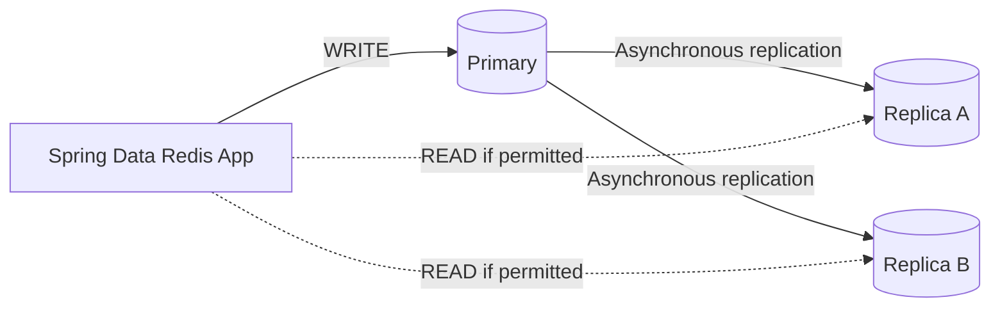
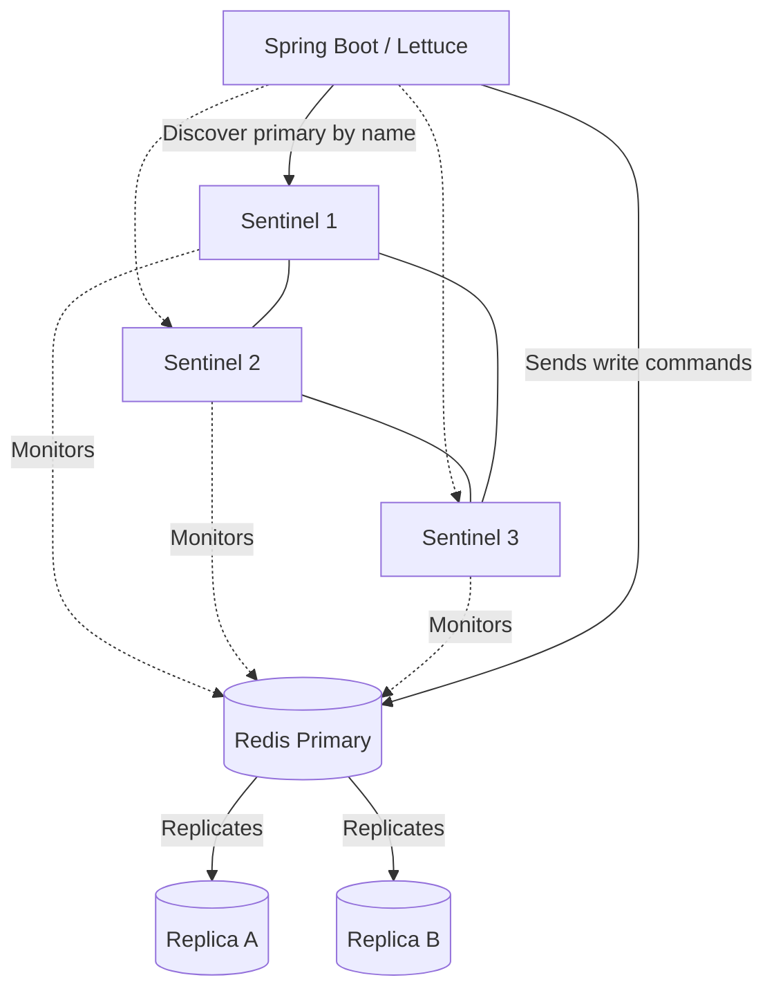
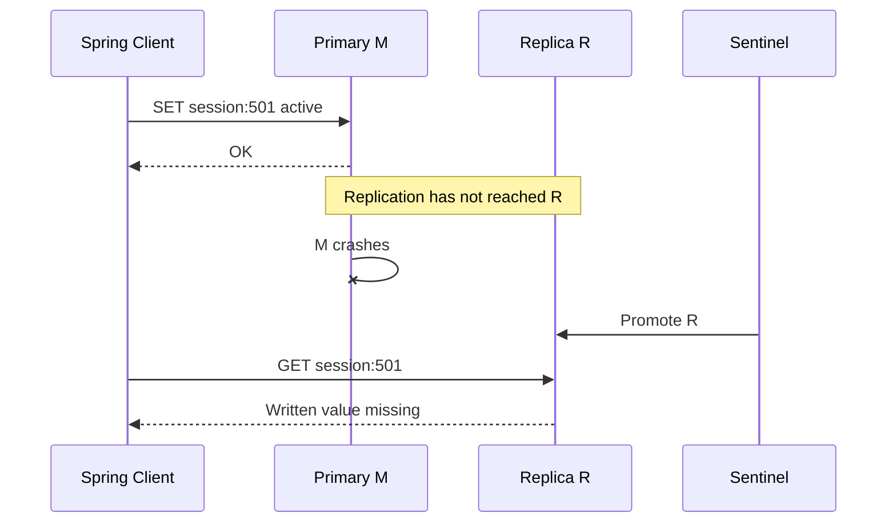

# Distinguishing High Availability from Zero Data Loss in Redis Replication and Sentinel

## 1. Two Commonly Confused Goals

In a Spring Data Redis application, Redis is often deployed with a **primary** for writes, one or more **replicas** to replicate data, and **Sentinel** processes to monitor, detect failures, and automatically switch roles. That architecture improves **service recovery** when the primary fails.

However, "having Sentinel" **does not mean "never losing data."**

Suppose an API just saved an order status:

```text
Spring Boot Client  -> Redis Primary: SET order:901:status PAID
Redis Primary       -> Client: OK
Redis Primary       -x-> Replica: update not yet transmitted
Redis Primary       -> crash
Sentinel            -> promotes replica to new primary
Client              -> reads order:901:status from new primary
```

If the replica had not received the update before the old primary failed, the new primary may **not contain** the just-acknowledged `PAID` status. Service resumed, yet data near the time of failure was lost.

Distinguish carefully:

- **High availability (HA):** ability to continue or quickly resume serving requests when an infrastructure component fails.
- **Durability:** ability to retain written data when one or more nodes fail.
- **Replication consistency:** how up to date replicas are relative to the primary, including cases where a replica returns stale data.
- **Zero data loss:** a very strong guarantee that accepted data is not lost within **a defined scope of failure modes**.

Sentinel focuses on **failure detection and failover**, and does not turn asynchronous replication into a durable commit protocol across all replicas.

## 2. RTO and RPO: Two Different Metrics

| Metric | Meaning | Question to Answer |
|---|---|---|
| **RTO** (*Recovery Time Objective*) | Target recovery time after an outage | "After a primary failure, how soon must the service resume reads and writes?" |
| **RPO** (*Recovery Point Objective*) | Target amount of tolerable data loss, often expressed in time | "If a failure occurs, how many seconds of recent data can be lost?" |

Example system requirements:

```text
RTO = 30 seconds
RPO = 5 seconds
```

This means the operations team sets a target for service recovery within 30 seconds and losing no more than roughly 5 seconds of data across the considered failure scenarios. These are **targets to design and measure**, not built-in guarantees from merely enabling Sentinel.

A system may recover in 8 seconds yet lose writes from 1 second before the crash. In that case availability recovery may be good, while data protection must be evaluated separately.

Conversely, a design with more durable data persistence may still take longer to restore service because state must be recovered or verified.

**Key conclusion:** a good RTO does not prove RPO is 0; a low RPO does not automatically prove short outage duration.

## 3. Redis Replication: Primary Acknowledges Before Replicas Receive

Basic architecture:



In standard Redis replication:

1. Client sends a write command to the primary.
2. Primary executes the command and can return success.
3. Redis emits changes over the replication stream.
4. Replicas receive and apply changes at their own pace.

**The primary does not wait for all replicas to receive the command before returning the result by default.**

### Timeline Example

```text
10:00:00.000  Primary receives SET key value.
10:00:00.002  Client receives OK.
10:00:00.004  Primary loses power.
10:00:00.006  Replica has not received SET.
10:00:08.000  Sentinel elects replica as new primary.
```

These timestamps are illustrative. If the replica has not received the command, an `OK` from the primary **does not guarantee** the data survives failover.

### Replication Lag

**Replication lag** occurs when a replica trails behind the primary. Causes include slow/dropped networks, overloaded replica I/O or CPU, write rates exceeding apply speeds, a replica resynchronizing, or failover/resharding affecting topology.

A replica reported as connected **does not mean** it has applied the latest write. A high replica count also does not guarantee multiple up-to-date copies.

### Full Synchronization and Continuing from Offset

Upon reconnecting, Redis can synchronize missing changes via replication offset/backlog when conditions permit; otherwise, a full data synchronization is needed. A replica actively synchronizing is not suited for reading the latest data or immediate promotion.

Monitor **replication status, offsets, and lag**, rather than merely counting running nodes.

## 4. What Does Redis Sentinel Guarantee?

Sentinel is a **monitoring and coordination** component for Redis primary–replica. It can:

- Monitor the primary and replicas.
- Detect an unresponsive primary.
- Coordinate multiple Sentinels to confirm failures.
- Run elections for the failover process.
- Select an eligible replica to promote to primary.
- Update replica configurations and provide the current primary address to clients.

Diagram:



**Sentinel does not store a copy of every acknowledged SET command.** Sentinel quorum is for failure detection and coordination, not a data commit quorum.

### Sentinel and Redis Cluster Are Not the Same

| Criterion | Redis Sentinel | Redis Cluster |
|---|---|---|
| Primary purpose | HA for one primary/replica set | Partitioning the keyspace into multiple shards plus HA |
| Key distribution | One primary holds the serving dataset for writes | Multiple primaries own different hash slots |
| Who coordinates failover? | Sentinel processes | Cluster protocol between nodes |
| Scales write capacity via sharding? | No | Yes |
| Default replication | Asynchronous | Asynchronous |
| Default zero loss of ACKed writes | No | No |

Having multiple shards in Cluster does not eliminate the data-loss window when a shard primary fails before its shard replica catches up.

## 5. From Failure Detection to Failover

### SDOWN – Subjectively Down

When a single Sentinel fails to receive valid responses from the primary within its configured interval, it marks the primary as potentially down: **SDOWN**. This is one Sentinel's local assessment.

### ODOWN – Objectively Down

When enough Sentinels agree the primary is unavailable according to the configured **quorum**, the status becomes **ODOWN**. This step is required before automatic failover proceeds.

### Leader Election and Replica Selection

For failover to execute, Sentinels also require **majority** authorization/election under the protocol. An elected Sentinel coordinates the process, chooses a candidate replica based on factors such as connectivity, `replica-priority`, and replication freshness, and promotes that replica to primary.

Do not equate "quorum = 2" with "two replicas saved every write." Quorum here governs **Sentinels' agreement about the outage**, not confirmation of individual record contents.

### Client Switches to the New Primary

Sentinel-aware clients discover the primary address by logical name, re-establish connections when topology changes, and resume issuing commands.

During role transition, timeouts, disconnects, read-only errors, or misrouted commands can occur. Automatic failover **reduces manual intervention**, yet does not promise every request succeeds uninterrupted.

```text
T0  Primary M accepting writes
T1  M fails or becomes isolated
T2  Sentinel evaluates SDOWN
T3  Sentinels confirm ODOWN
T4  Coordinating Sentinel elected
T5  Replica R promoted
T6  Client discovers new primary
T7  Application resumes serving
```

The T1–T7 span relates to RTO. Whether R at T5 contains the latest writes from M relates to RPO.

## 6. Three Typical Data-Loss Scenarios

### 6.1. Primary Crashes Right After Returning OK



Sentinel performed its HA duty properly, yet data ACKed by M may be absent on R.

### 6.2. Network Partition and Split-Brain

```text
Side A:   Primary M + some clients
                 |
           NETWORK SPLIT
                 |
Side B:   Replica R + Sentinel majority + other clients
```

Side B can mark M unavailable and promote R. Meanwhile, clients still reaching M on side A might continue writing briefly.

Once the network heals, the old primary usually rejoins the topology as a replica of the new primary. Writes that existed only on old M's branch can be discarded during resynchronization.

Thus, failover does not mean Redis automatically **merges** writes from both branches into a single unified history.

### 6.3. Multi-Node Outage or Un-fsynced Data

If both primary and replicas lose power or suffer storage failures, in-memory copies across multiple nodes can be lost. If persistence has not flushed durably, having replicas cannot save every write.

This is why we separate:

- **Replication:** copying data between nodes.
- **Persistence:** recovering a single node's data after crash/restart.
- **Failover:** how the system selects a new primary.
- **Authoritative source of truth:** where the application can rebuild or reconcile lost data.

## 7. What Does WAIT Help With and What Does It Not?

Redis supports `WAIT` for a client to wait until a number of replicas reach the replication offset of **prior writes on that same connection**.

Redis CLI example:

```redis
SET demo:order:901:status PAID
WAIT 1 1000
```

`WAIT 1 1000` asks to wait up to 1,000 milliseconds for at least one replica to acknowledge the replication milestone. The command returns the **actual number of acknowledging replicas**, which could be `0`, `1`, or another count depending on system state.

`WAIT` lowers write-loss risk in many cases, but **does not create a zero-data-loss guarantee**:

1. A replica acknowledging receipt does not necessarily mean data was fsynced to disk.
2. The replica promoted after a failure might not be the one that acknowledged.
3. Correlated failures can affect multiple nodes.
4. Redis still does not become a strongly synchronous consensus commit protocol.

### Must Use the Same Connection

`WAIT` determines the offset from prior writes on **that client connection**. If an application uses `RedisTemplate` to `SET` and then runs `WAIT` on a different pooled connection, waiting may not correspond to the write needing protection.

When `WAIT` is needed in Spring Data Redis, ensure the write and wait execute on the same suitable Redis connection/session using supported driver APIs.

### WAIT Timeout Does Not Mean the Write Was Rolled Back

If `WAIT` returns fewer replicas than requested, the prior `SET` command **may still have succeeded on the primary**. The client must not assume "nothing was written" and blindly retry non-idempotent operations without checking.

For commands like `INCR` or business operations with side effects, the state may be **uncertain**. Request IDs, idempotency controls, or an authoritative source of truth are needed for reconciliation.

## 8. WAITAOF, AOF, and RDB: Adding Another Durability Layer

Redis can persist data across restarts via persistence mechanisms.

### RDB – Snapshot

RDB creates point-in-time snapshots of data. If a node crashes after a snapshot before the next one runs, subsequent writes may be absent from the restored snapshot.

RDB is useful for backups/recovery and certain workloads, yet **does not guarantee the latest individual writes are persisted**.

### AOF – Append Only File

AOF logs data-modifying operations with configurable file-sync policies:

| Policy | Key Behavior | Trade-Off |
|---|---|---|
| `appendfsync always` | Attempts fsync very frequently on writes | Higher I/O overhead and latency |
| `appendfsync everysec` | Usually fsyncs roughly every second | Leaves a window of un-fsynced data |
| `appendfsync no` | Lets the OS decide when to fsync | Less control over durability timing |

AOF policies govern **per-node** durability and do not automatically ensure a replica elected during failover holds the primary's latest writes.

### WAITAOF

In supporting Redis versions starting from Redis 7.2, `WAITAOF` waits for **AOF fsync** conditions on the local server and replicas.

Syntax example:

```redis
SET demo:order:902:status PAID
WAITAOF 1 1 1000
```

Arguments specify required local confirmations, replica confirmations, and timeout (milliseconds). Check your Redis version, AOF config, execution context constraints, and return value interpretation before adopting it.

Even when the result satisfies the chosen condition, `WAITAOF` **does not guarantee** the post-failure elected primary is among the nodes that fsynced the write, or that all nodes avoid a shared failure.

### The Right Mental Model

```text
Sentinel          -> switches roles, restores service availability
Replication       -> propagates copies between nodes
WAIT              -> confirms replication progress from replicas
AOF/RDB           -> per-node durable persistence mechanisms
WAITAOF           -> waits for AOF fsync conditions where supported
Source of truth   -> business recovery and reconciliation
```

These layers complement one another, yet none lets you claim "zero loss under all failures."

## 9. min-replicas-to-write: Mitigating Isolation at the Cost of Availability

Redis can refuse writes when too few replicas keep up, for example:

```conf
min-replicas-to-write 1
min-replicas-max-lag 10
```

Meaning: the primary needs at least one replica meeting the configured lag criteria; otherwise, Redis can reject write commands.

This helps when a primary becomes isolated or replicas lag excessively. However:

- It **does not** require per-command replica ACKs before returning OK.
- Replication remains asynchronous.
- When replica links degrade, an otherwise healthy primary stops accepting writes.
- Strict settings trade write availability to limit a class of data-loss risk.

Thus, `min-replicas-to-write` is a **safety/availability trade-off policy**, not a switch enabling "100% synchronous mode."

## 10. Replica Reads and Stale Read Scenarios

Beyond failover, replicas can scale read throughput. However, because replication is asynchronous, reading from a replica right after writing to the primary can return stale data.

```text
Primary: SET inventory:sku:1001 7
Primary: returns OK

Replica hasn't received update yet:
  GET inventory:sku:1001 -> 8
```

This is a **stale read**. Do not assume a Sentinel setup automatically provides "read your writes" when clients are permitted to route queries to replicas.

In Lettuce, read settings like `ReadFrom.REPLICA_PREFERRED` can serve suitable workloads. However, do not enable replica reads universally when business logic requires the latest state.

| Business Flow | Can It Read Replicas? | Notes |
|---|---|---|
| Displaying slowly changing catalog | Possibly | Tolerates delayed data |
| Non-real-time analytics dashboard | Possibly | Document expected data lag |
| Reading back right after profile update | Consider primary | Avoid showing old values |
| Checking stock during order checkout | Needs authoritative real-time state | Do not rely on lagging replicas |
| Checking payment/idempotency status | Never infer from stale copy | Requires durable checks |

Writes and critical decisions should traverse data paths whose consistency matches business needs.

## 11. Configuring Redis Sentinel: Infrastructure Example

Suppose we have:

- One initial Redis primary at `10.0.0.10:6379`.
- Two replicas on separate nodes.
- Three Sentinels running across separate failure domains.

Example `sentinel.conf`:

```conf
port 26379

sentinel monitor mymaster 10.0.0.10 6379 2
sentinel down-after-milliseconds mymaster 5000
sentinel failover-timeout mymaster 60000
sentinel parallel-syncs mymaster 1
```

Where:

- `mymaster` is the logical name referenced by Sentinels and clients.
- `2` is the quorum to mark the primary ODOWN.
- `down-after-milliseconds 5000` is the threshold for one Sentinel to consider the primary unresponsive; **not a guarantee of a 5-second RTO**.
- `failover-timeout` governs milestones in the failover workflow; not a hard upper bound on recovery duration.
- `parallel-syncs` controls how many replicas sync with the new primary concurrently during reconfiguration phases.

A replica may be configured with:

```conf
replicaof 10.0.0.10 6379
replica-read-only yes
```

Addresses are learning examples. Production operations must consider auth, TLS, DNS, NAT, container announce addresses, permissions, and election rules.

**Three Sentinel processes on the same physical machine do not equal three independent failure domains.** A single host or power outage can stop all Sentinels at once.

## 12. Connecting Spring Boot/Spring Data Redis to Sentinel

A Spring Boot app using Spring Data Redis can configure Sentinel:

```yaml
spring:
  data:
    redis:
      sentinel:
        master: mymaster
        nodes:
          - sentinel-1.example.internal:26379
          - sentinel-2.example.internal:26379
          - sentinel-3.example.internal:26379
      password: CHANGE_ME_VIA_SECRET_MANAGER
      timeout: 2s
      connect-timeout: 2s
```

Explanation:

- `sentinel.master` is the **logical master name**, not a fixed node hostname.
- `sentinel.nodes` provides Sentinel addresses so clients can discover the primary.
- `password` illustrates Redis data connection authentication; in practice supply it via a secret manager or environment variables, never hard-coded.
- Sentinel authentication may use different credentials from data nodes; configure Sentinel properties matching your Spring Boot version and service.
- Timeouts must align with infrastructure and request budgets; no single value fits all systems.

### Why Not Point Directly to the Old Host?

If an app declares only:

```yaml
spring:
  data:
    redis:
      host: redis-primary-1.internal
      port: 6379
```

then when Sentinel promotes a replica on another host, the app keeps trying to connect to the old primary. A **Sentinel-aware client** looks up the new primary address via `mymaster` and switches connections without changing business code.

### Using RedisTemplate via Abstraction

```java
package com.example.orders.redis;

import org.springframework.data.redis.core.StringRedisTemplate;
import org.springframework.stereotype.Service;

@Service
public class OrderStatusStore {

    private final StringRedisTemplate redis;

    public OrderStatusStore(StringRedisTemplate redis) {
        this.redis = redis;
    }

    public void markPaid(String orderId) {
        redis.opsForValue().set(
                "demo:orders:" + orderId + ":status",
                "PAID"
        );
    }

    public String findStatus(String orderId) {
        return redis.opsForValue().get(
                "demo:orders:" + orderId + ":status"
        );
    }
}
```

The service does not hardcode a primary address. The driver and connection factory choose endpoints per configuration.

Yet when Redis switches primaries, `markPaid` can still time out or fail. **`RedisTemplate` does not guarantee a command succeeds exactly once across failover.** Systems must handle uncertain states and business invariants.

The `PAID` status example merely illustrates Redis operations; in real payment systems, authoritative payment confirmation should never depend solely on a Redis key like this.

## 13. Observing Replication and Failover with Redis CLI

The following commands are useful to inspect topology in an admin or test environment.

### On Redis Data Nodes

```redis
ROLE
INFO replication
```

`ROLE` shows whether a node is primary or replica. `INFO replication` reports link state, connected replicas, offsets, and additional fields depending on Redis version.

To assess data risk, do not look solely at `connected_slaves` or node names: monitor **replication lag/offsets** in context of the topology.

### On Redis Sentinel

Connect to the Sentinel port, commonly `26379`:

```redis
SENTINEL masters
SENTINEL get-master-addr-by-name mymaster
SENTINEL replicas mymaster
SENTINEL sentinels mymaster
```

These commands show the logical master recognized by Sentinel, the current primary, and associated replicas/Sentinels.

### During a Controlled Drill

In a test environment, record:

1. Which offset primary and replicas had synced to.
2. A set of write commands with distinct request IDs.
3. When the primary stopped serving.
4. When Sentinel detected the failure and promoted a new node.
5. When the application resumed writing successfully.
6. Which pre-outage requests actually survived on the new primary.
7. Which timed-out requests may have executed anyway.
8. Reconnect latency, replica-read impact, and rebuild behavior.

Never stop a primary or force failover in production casually just to inspect it; proper planning and operational authorization are required.

A single drill with zero lost data **does not prove** RPO is always 0. Replicas may simply have received all writes before the crash in that run.

## 14. When the Old Primary Returns After Failover

If the old primary only experienced a network split and connectivity returns, Sentinel can instruct it to become a replica of the new primary.

This matters: Redis does not resolve two parallel write histories by automatically merging business updates. Writes accepted solely by the old primary during isolation can be discarded when that node resynchronizes with the new primary.

Therefore, for workflows where **users must never be told a write succeeded and then lose the result**, build verification against a trusted source or an architecture with matching consistency/durability.

### Example Risk with Idempotency Keys

```text
Primary M:  SET payment:request-123 processed
Client:     receives OK
M:          fails before replica receives it
R:          promoted, lacks payment:request-123
Client:     retries the same request
```

If a Redis key is the sole guard against duplicate payments, losing that key can cause the retry to execute payment again.

For payments and operations that must never run twice, store a **durable** idempotency marker or unique constraint/transaction in an authoritative database rather than relying solely on an asynchronously replicated Redis key.

## 15. Caches, Sessions, and Transactional State Have Different RPOs

| Use Case | If Some Keys Are Lost During Failover | Policy to Consider |
|---|---|---|
| Product catalog cache | Higher cache misses, reload data | Redis HA + source of truth + cache stampede protection |
| Recommendations cache | Temporary performance degradation | Higher cache RPO can be acceptable |
| Sessions | Users may be logged out | Weigh tolerance for session loss and security |
| Unsaved shopping cart | User actions lost | Consider durable sync/recovery |
| Rate-limit counters | Limits might be exceeded briefly | Fallback or fail-closed on sensitive endpoints |
| Distributed locks | Two workers could execute concurrently | Fencing/idempotency and write conditions at target system |
| Payment idempotency keys | Risk of duplicate processing | Durable store, unique constraints, and reconciliation |
| Redis Streams for critical events | Unreplicated events could be lost | Durable outbox/queue and replay mechanism |
| Temporary dashboards | Can be recomputed | Rebuild from primary source |
| Financial ledgers | Severe business data corruption | Use storage with matching transaction/durability guarantees |

The real question is not "is Redis good or bad for important data," but **whether your architecture genuinely satisfies the business's RPO and consistency requirements**.

## 16. Spring Data Redis on Errors: Timeouts Can Have Unknown Outcomes

Suppose an application sends:

```redis
INCR orders:sequence
```

The primary executes the command, yet the connection drops before sending the reply. The client sees a timeout.

You cannot be certain whether:

- The command never reached Redis.
- The command executed on the primary.
- The command reached a replica.
- The result exists after failover.

If the service immediately retries `INCR`, it may increment the counter twice if the first attempt succeeded.

### How to Handle It

- Distinguish idempotent commands from commands with non-idempotent side effects.
- Include business request IDs or event IDs to detect duplicates.
- Do not retry every exception indefinitely.
- Use backoff and bounded retries.
- Reconcile state from the authoritative source before re-executing critical work.
- For optional caches, allow cache misses and reload from the database.
- For authorization, locks, or mandatory idempotency, never fail open when Redis is unavailable.

**Lettuce reconnection does not mean automatic exactly-once delivery.** The driver restores connections, but cannot make business decisions when pre-outage write outcomes are ambiguous.

### @Transactional Does Not Change Replication Semantics

Even when configuring transaction support on `RedisTemplate` and using `@Transactional`, Redis `MULTI/EXEC` on the primary does not make replication to replicas synchronously durable.

Similarly, placing `@Transactional` around both SQL and Redis writes does not create an atomic distributed transaction across the two systems.

**Command/transaction atomicity on the primary is distinct from durability across failover.**

## 17. Defense in Depth with Clear Limits

Consider combining these layers:

1. **Multiple replicas across failure domains.** Lowers the chance one failure destroys every copy, without guaranteeing every replica is caught up.
2. **Sentinel with proper quorum/majority settings.** Improves automated failover orchestration, without guaranteeing the newest data.
3. **Replication lag monitoring.** Detects lagging replicas and alerts against RPO targets.
4. **RDB/AOF persistence.** Improves single-node crash recovery; requires appropriate fsync settings.
5. **WAIT/WAITAOF where supported.** Raises replication/fsync assurance for targeted operations, without replacing strong commit protocols.
6. **min-replicas-to-write/min-replicas-max-lag.** Prevents an isolated primary from writing when too few replicas are healthy, trading write availability.
7. **Idempotency and reconciliation.** Handles timeouts and ambiguous writes without uncontrolled duplicate side effects.
8. **Durable source of truth and outbox.** Preserves critical business state, enabling Redis updates or rebuilds after incidents.
9. **Realistic failover drills.** Measures RTO/RPO under deliberate fault modes.
10. **End-to-end application observability.** Measures until HTTP/APIs resume serving, not just when Sentinel switches Redis roles.

No single configuration flag removes the need to define an acceptable data-loss risk budget.

## 18. Common Scenario Matrix

| Scenario | Can Redis Keep Serving? | What Data Issues Can Occur? |
|---|---|---|
| Primary crashes after all replicas caught up | Likely after failover | Still consider persistence and in-flight requests |
| Primary crashes before replicas receive writes | Likely after failover | Loss of ACKed writes |
| Replicas lag by several seconds | Failover candidate exists, yet behind | Higher RPO than expected |
| Primary and replicas lose power, AOF un-fsynced | May need restore or fail immediate recovery | Loss of recent writes |
| Network partition | Failover may occur on majority side | Writes on isolated old primary may be lost |
| Sentinels lack majority to elect | Automatic failover may stall | Extended service outage |
| Client only knows old primary IP | Redis may have failed over | App keeps failing because it cannot find new endpoint |
| Reading from replica after primary write | Returns results | Values may be stale |
| `WAIT` reaches one replica | Extra copy acknowledged | Still not guaranteed to be promoted or fsynced |
| `min-replicas-to-write` unmet | Primary may reject writes | Availability drops to bound risk |
| Redis used as cache loses keys | App can fall back | Cache misses and higher load on primary store |
| Redis holds a lock and the lock vanishes | Another worker may acquire lock | Potential duplicate side effects |

## 19. Misconceptions to Avoid

### "Three Sentinels mean writes are replicated three times"

False. Sentinels are monitoring/coordination processes, not three data copies. Check actual Redis replicas and their replication progress separately.

### "Quorum 2 means two nodes agree on every value"

False. Sentinel quorum applies to failure detection, not two durable confirmations per write command.

### "Having one replica makes data loss impossible"

False. Asynchronous replication creates a gap between primary ACK and replica receipt.

### "WAIT returning the target count guarantees data always survives"

Not guaranteed. WAIT confirms replication offsets, which neither guarantees fsync nor guarantees the post-failover elected replica holds the data.

### "AOF everysec means at most one second of data can ever be lost"

No absolute threshold holds across every failure type. Fsync mechanics have risk windows shaped by OS, storage, and topology.

### "A client timeout means the command never executed"

False. Redis may have executed it before the reply was lost. Retries require idempotency/reconciliation.

### "Replica reads always see the newest writes"

False whenever replicas lag. Read-after-write needs appropriate read routing or consistency controls.

### "Failover will never cause failed requests"

Incorrect. During primary transitions, requests can fail; clients need reconnects, timeouts, and retry policies.

### "Redis Cluster eliminates data-loss risks"

Incorrect. Redis Cluster also uses replication between shard primaries and replicas, which can still be asynchronous.

### "Redis transactions ensure SQL and Redis commit together"

Incorrect. Spring transaction synchronization does not turn two independent datastores into a single atomic distributed commit.

## 20. Practice Questions

**1.** Sentinel detects primary failure and switches to a replica in 9 seconds. Can you conclude RPO is 0?

**Explanation:** no. Failover duration relates to RTO; RPO depends on which writes reached the replica and survived.

**2.** Primary returns OK for `SET` and crashes before the replica receives it. The replica is promoted without that key. Did Redis Sentinel malfunction?

**Explanation:** not necessarily. That is a known limit of asynchronous replication. Successful failover does not guarantee every ACKed write survives.

**3.** `WAIT 1 1000` returns `1`. Can you say the write was fsynced on the replica?

**Explanation:** no. WAIT confirms replication, not replica fsync durability. Distinguish this from persistence/WAITAOF.

**4.** Does `min-replicas-to-write 1` make every SET wait for at least one replica ACK?

**Explanation:** no. It rejects writes when fewer than the required replicas meet the criteria, rather than acting as a per-command synchronous ACK protocol.

**5.** After decrementing inventory from 8 to 7 on the primary, a GET sent to a replica still returns 8. What should you conclude?

**Explanation:** replication lag may be present. For order-checkout decisions, verify state via a source with suitable consistency.

**6.** A Redis lock preventing duplicate job execution vanishes after failover. What is the risk?

**Explanation:** two workers may run the task concurrently. Use idempotency, fencing, or conditional writes at the destination system.

**7.** A client hits a timeout after `INCR` and retries immediately. What is the risk?

**Explanation:** the first command may have run, so retrying can increment twice. Handle uncertain outcomes carefully.

**8.** A product is stored in SQL and cached in Redis. The cache key disappears after failover. Should you report a lost order?

**Explanation:** no. If SQL is the source of truth, the Redis cache can be rebuilt. Guard against cache stampedes when many requests reload simultaneously.

**9.** Three Sentinels run on the same host. Does this survive losing that machine?

**Explanation:** no. Three processes do not substitute for three independent failure domains.

**10.** Business requirement: "zero loss of any acknowledged write across all failures." Are Sentinel, replicas, and AOF everysec sufficient on their own?

**Explanation:** no. Define the exact failure scope and choose a commit/durability architecture meeting the requirement rather than assuming zero loss from an asynchronous Redis topology.

## 21. Pre-Production Design Checklist

1. **Authoritative data source:** Is Redis only a cache, or does it hold non-rebuildable business state?
2. **RTO target:** How quickly must the application resume serving, including driver reconnection?
3. **RPO target:** How much data loss is tolerable, and which writes must never be lost?
4. **Failure domains:** Are primary, replicas, and Sentinels placed across separate nodes/zones/power domains?
5. **Quorum and majority:** Can enough Sentinels reach consensus on topology to execute failover?
6. **Lag monitoring:** Are there alerts when replicas fall behind prior to an outage?
7. **Persistence:** Are AOF/RDB, fsync, and backup/restore aligned with requirements?
8. **Write conditions:** Is `min-replicas-to-write` needed, and is its availability trade-off accepted?
9. **Replication confirmation:** Are WAIT/WAITAOF needed, and are their limits understood?
10. **Sentinel-aware client:** Are Spring Boot/Lettuce configured with the right logical master and Sentinel list?
11. **Replica reads:** Which APIs tolerate stale reads and which must read the latest/authoritative source?
12. **Retries:** Do all critical writes have request IDs/idempotency and timeout handling policies?
13. **Recovery:** Can caches rebuild, transactional states reconcile, and events replay?
14. **Drills:** Have primary crashes, network partitions, replica lag, and failures right after client OK been tested?
15. **Observability:** Are application latency, request outcomes, and post-failover data verified rather than only Redis roles?

## 22. Conclusion

**Redis Sentinel improves availability, but does not guarantee zero data loss.** The most critical distinctions are:

- **Sentinel** detects failures, elects leaders, and switches primaries—mainly impacting RTO.
- **Redis replication is asynchronous by default**, so data acknowledged by the primary may still be absent on the promoted replica, creating RPO risk.
- **WAIT/WAITAOF**, persistence, and write limits when replicas are lacking strengthen protection under specific conditions, yet do not turn Sentinel into an unconditional zero-loss synchronous commit system.
- **Spring Data Redis with a Sentinel-aware client** reconnects to the new primary, but does not resolve stale reads, ambiguous timeouts, or duplicate side effects from retries.
- **Business needs dictate the required guarantees**: a cache rebuildable from SQL is fundamentally different from a ledger, payment event, or idempotency marker that must never be lost.

When designing, always answer two separate questions: **"How quickly must the service recover?"** and **"What data can be lost under which failures?"** Only after separating those questions can you choose the right Sentinel topology, replication/persistence settings, and durable data stores.

### References

- [Redis — Replication](https://redis.io/docs/latest/operate/oss_and_stack/management/replication/)
- [Redis — Sentinel high availability](https://redis.io/docs/latest/operate/oss_and_stack/management/sentinel/)
- [Redis — Persistence](https://redis.io/docs/latest/operate/oss_and_stack/management/persistence/)
- [Redis — WAIT](https://redis.io/docs/latest/commands/wait/)
- [Redis — WAITAOF](https://redis.io/docs/latest/commands/waitaof/)
- [Redis — INFO](https://redis.io/docs/latest/commands/info/)
- [Redis — ROLE](https://redis.io/docs/latest/commands/role/)
- [Spring Data Redis — Redis Drivers](https://docs.spring.io/spring-data/redis/reference/redis/drivers.html)
- [Spring Data Redis — Connection Modes](https://docs.spring.io/spring-data/redis/reference/redis/connection-modes.html)
- [Spring Boot — Redis Support](https://docs.spring.io/spring-boot/reference/data/nosql.html#data.nosql.redis)
