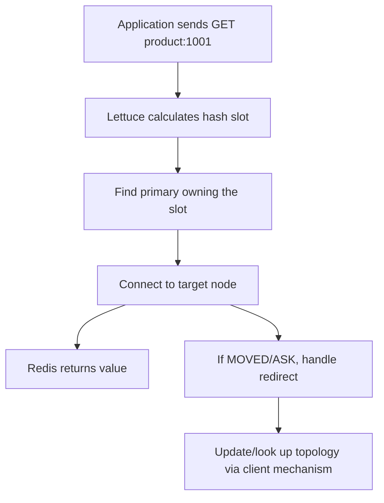
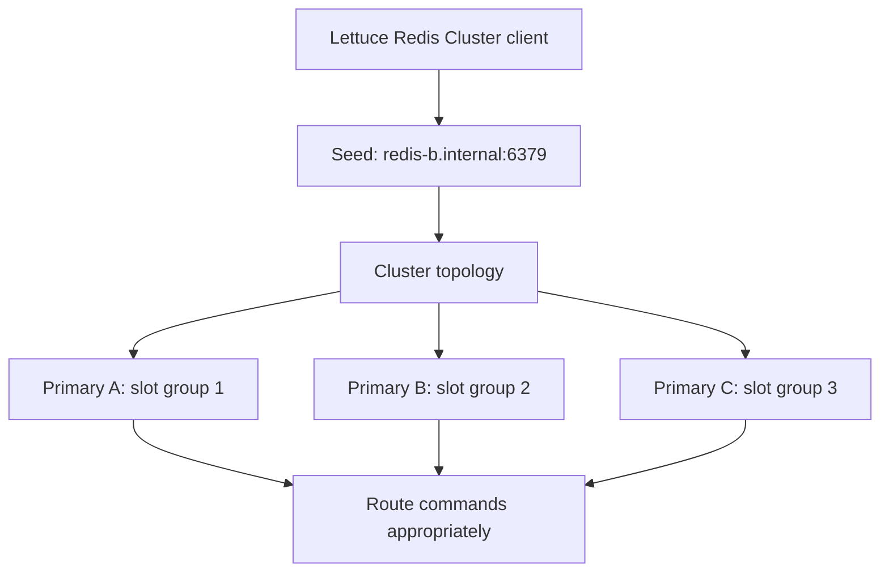

# Configuring RedisClusterConfiguration in Spring Data Redis

In standalone Redis, an application typically configures only a single `host:port` address. With **Redis Cluster**, however, data is distributed across multiple primary nodes across **16,384 hash slots**, from `0` to `16383`. Consequently, the client must know the nodes in the cluster, be able to determine which node owns the slot for each key, handle redirects when slots move, and refresh topology information.

In Spring Data Redis, **`RedisClusterConfiguration`** is the class that describes how a `RedisConnectionFactory` connects to an **existing Redis Cluster**. This class holds the **seed node** addresses, authentication credentials when needed, and redirect settings. In applications using Lettuce, the cluster configuration is typically passed into `LettuceConnectionFactory`, which is then used by `RedisTemplate`, `StringRedisTemplate`, `ReactiveRedisTemplate`, Spring Cache, or Redis repositories.

Minimal example:

```java
RedisClusterConfiguration cluster =
        new RedisClusterConfiguration(List.of(
                "redis-a.internal:6379",
                "redis-b.internal:6379",
                "redis-c.internal:6379"));

cluster.setMaxRedirects(5);
LettuceConnectionFactory factory =
        new LettuceConnectionFactory(cluster);
```

This snippet **does not create a Redis Cluster**. It only instructs the client how to discover and connect to an already deployed cluster. This lesson focuses on Java configuration, Spring Boot, authentication, TLS, Lettuce topology refresh, verifying the setup, and common deployment mistakes.

## 1. How does Redis Cluster differ from standalone and Sentinel?

A standalone Redis server can hold many keys:

```text
Spring application
       |
       v
Redis standalone :6379
    key A
    key B
    key C
```

In Redis Cluster:

```text
                   Spring Data Redis + Lettuce
                               |
                +--------------+--------------+
                |              |              |
                v              v              v
          Primary A       Primary B       Primary C
          slots 0..5460   5461..10922    10923..16383
                |              |              |
                v              v              v
          Replica A       Replica B       Replica C
```

The slot ranges in the diagram merely illustrate an even split. Redis Cluster can distribute slots differently and change allocations during operations, resharding, or failover.

| Architecture | Primary Purpose | Spring Data Redis Configuration |
|---|---|---|
| Standalone | Connect to a single Redis endpoint | `RedisStandaloneConfiguration` |
| Sentinel | Monitor primary and handle failover for a replication group | `RedisSentinelConfiguration` |
| Cluster | Shard data across multiple primaries by hash slot | `RedisClusterConfiguration` |

**Do not confuse Redis Sentinel with Redis Cluster.** A Sentinel group does not automatically partition data into 16,384 slots; a Redis Cluster does not require the application to use Sentinel to route individual keys.

### 1.1. How do hash slots work?

Redis calculates a regular key's slot as:

```text
hashSlot = CRC16(key) mod 16384
```

Example:

```text
product:1001
product:1002
order:42:status
```

These keys can belong to different slots. A cluster client needs to know which primary currently owns each slot.

### 1.2. Why can't the client just keep one connection to a seed node?

If you simply tell it "send every operation to redis-a", keys belonging to primaries B/C may return `MOVED` responses or fail to be processed properly. A cluster-aware client learns the topology, routes each command, and refreshes topology when needed.



## 2. What does RedisClusterConfiguration do?

The class resides in package:

```java
org.springframework.data.redis.connection.RedisClusterConfiguration
```

Important properties:

| Property | Meaning |
|---|---|
| Seed nodes | One or more `host:port` endpoints to initialize connections and discover topology |
| `maxRedirects` | Cluster redirect limit used by Spring Data Redis/driver |
| Username | Redis ACL username when required by server |
| Password | Redis credential, used with username or default user |

Configuration flow:

```text
RedisClusterConfiguration
       |
       v
LettuceConnectionFactory
       |
       +---- StringRedisTemplate
       |
       +---- RedisTemplate<K, V>
       |
       +---- ReactiveRedisTemplate<K, V>
       |
       +---- RedisCacheManager / Repositories
```

This class **does not manage Redis nodes**, initialize slots, enable cluster mode on the server, or automatically upgrade standalone Redis into a Cluster.

### 2.1. Distinguishing from RedisCacheConfiguration

Two similar-sounding names:

```text
RedisClusterConfiguration:
  Which nodes, how to authenticate, which topology to connect to?

RedisCacheConfiguration:
  TTL, serializer, key prefix, Spring Cache null policy?
```

`RedisClusterConfiguration` solves the **connection** problem; `RedisCacheConfiguration` solves **how cache entries are stored**. An application can use both, but their roles should never be swapped.

## 3. Seed nodes: addresses to start discovering the cluster

Suppose there are three endpoints:

```text
redis-a.internal:6379
redis-b.internal:6379
redis-c.internal:6379
```

The client can contact an available seed node, receive slot distribution information, and connect to the appropriate node when operating on keys.



**Seed nodes do not have to be every node in the cluster**. However, providing multiple seed endpoints belonging to the same cluster increases initial connectivity resilience when one node is unavailable.

### 3.1. The seed list must belong to the same cluster

Do not mix:

```text
redis-a.production.internal
redis-b.production.internal
redis-a.staging.internal  <-- Wrong environment
```

The client may retrieve an inconsistent topology or operate against the wrong environment. Select seed endpoints by profile/deployment and never mix production and staging.

### 3.2. One reachable seed is not enough

If the application can connect to `redis-a:6379`, but the cluster advertises node B using a private address unreachable from the JVM, requests targeting node B's slots will still fail.

```text
JVM -> redis-a.internal:6379         OK
Redis topology -> 172.18.0.4:6379   unreachable
Redis topology -> 172.18.0.5:6379   unreachable
```

**Practical requirement:** nodes advertised by Redis in its topology must be reachable from the application. Adding more seed nodes will not fix DNS, firewall, NAT, or incorrect cluster announce addresses.

## 4. Creating configuration from a host:port list

Simple approach:

```java
import java.util.List;
import org.springframework.data.redis.connection.RedisClusterConfiguration;

RedisClusterConfiguration cluster =
        new RedisClusterConfiguration(List.of(
                "redis-a.internal:6379",
                "redis-b.internal:6379",
                "redis-c.internal:6379"));

cluster.setMaxRedirects(5);
```

This is a configuration example with **hypothetical addresses**. The application must substitute the actual nodes of the deployed Redis Cluster.

### 4.1. Adding nodes one by one

```java
RedisClusterConfiguration cluster =
        new RedisClusterConfiguration();

cluster.clusterNode("redis-a.internal", 6379);
cluster.clusterNode("redis-b.internal", 6379);
cluster.clusterNode("redis-c.internal", 6379);
cluster.setMaxRedirects(5);
```

This approach is useful when seed nodes are read from validated external configuration. Keep address lists outside source code so they can vary by environment without recompiling.

### 4.2. Configuration data errors to avoid

- Empty list.
- Invalid port.
- Wrong or unresolvable hostname.
- Seed nodes belonging to different clusters.
- Endpoint allowing only a TLS configuration that differs from the client's.
- Address only reachable on an administration network, not from the service.
- Accidentally copying the cluster bus port into the Redis command port slot.

## 5. Connecting with LettuceConnectionFactory

Example Spring bean:

```java
package com.example.redis.config;

import java.time.Duration;
import java.util.List;

import org.springframework.context.annotation.Bean;
import org.springframework.context.annotation.Configuration;
import org.springframework.data.redis.connection.RedisClusterConfiguration;
import org.springframework.data.redis.connection.RedisConnectionFactory;
import org.springframework.data.redis.connection.lettuce.LettuceClientConfiguration;
import org.springframework.data.redis.connection.lettuce.LettuceConnectionFactory;

@Configuration
public class RedisClusterConfig {

    @Bean
    public RedisConnectionFactory redisConnectionFactory() {
        RedisClusterConfiguration cluster =
                new RedisClusterConfiguration(List.of(
                        "redis-a.internal:6379",
                        "redis-b.internal:6379",
                        "redis-c.internal:6379"));

        cluster.setMaxRedirects(5);

        LettuceClientConfiguration client =
                LettuceClientConfiguration.builder()
                        .commandTimeout(Duration.ofSeconds(3))
                        .build();

        return new LettuceConnectionFactory(cluster, client);
    }
}
```

Here:

1. `RedisClusterConfiguration` supplies seed nodes and redirect limits.
2. `LettuceClientConfiguration` describes client-side options such as timeouts.
3. `LettuceConnectionFactory` creates connections through Lettuce.
4. The factory bean lifecycle is managed by Spring.
5. Templates can use this factory to execute commands.

Spring automatically handles bean initialization callbacks when the factory is Spring-managed. Do not manually call `afterPropertiesSet()` inside `@Bean` to avoid duplicate initialization.

### 5.1. What this configuration does not do

It does not replace:

```text
redis-cli --cluster create
CLUSTER MEET
CLUSTER ADDSLOTS
CLUSTER REPLICATE
```

Those operations are Redis Cluster administration responsibilities. Spring only needs configuration to **use an already-existing cluster**.

## 6. Spring Boot: configuring via application.yml

With Spring Boot 3.x, you can let Spring Boot create the connection factory from properties:

```yaml
spring:
  data:
    redis:
      client-type: lettuce
      cluster:
        nodes:
          - redis-a.internal:6379
          - redis-b.internal:6379
          - redis-c.internal:6379
        max-redirects: 5
      connect-timeout: 3s
      timeout: 3s
```

With the appropriate dependencies and auto-configuration conditions, Spring Boot can create a cluster factory **without manually declaring a `RedisClusterConfiguration` bean**.

| Property | Role |
|---|---|
| `spring.data.redis.cluster.nodes` | List of seed nodes |
| `spring.data.redis.cluster.max-redirects` | Cluster redirect limit |
| `spring.data.redis.client-type` | Selects client type in supported Boot versions |
| `spring.data.redis.connect-timeout` | Timeout for establishing connections |
| `spring.data.redis.timeout` | Redis command operation timeout per Boot/driver |

These timeouts **are not equivalent limits**. Connect timeout applies to opening the TCP connection; command timeout applies to waiting for command completion. Appropriate values should be chosen based on network latency, application SLOs, failover, and retry strategy.

### 6.1. Namespace differences between Boot 2.x and 3.x

Many older projects use:

```properties
spring.redis.cluster.nodes=redis-a:6379,redis-b:6379
spring.redis.cluster.max-redirects=5
```

In newer Spring Boot versions, the typical namespace is:

```properties
spring.data.redis.cluster.nodes=redis-a:6379,redis-b:6379
spring.data.redis.cluster.max-redirects=5
```

Always verify your project's Boot version. Placing properties under a prefix that is no longer bound can cause the client to run with defaults or connect to a different Redis instance.

### 6.2. When does a Java bean make Boot back off?

If the application declares its own `@Bean RedisConnectionFactory`, Boot normally backs off from creating a competing factory. Therefore:

```java
@Bean
RedisConnectionFactory redisConnectionFactory() {
    return new LettuceConnectionFactory(myClusterConfig);
}
```

does not guarantee every `spring.data.redis.*` property will still automatically apply to your custom factory. Either let Boot manage connections via properties, or configure the factory completely yourself. Avoid two inconsistent configuration sources.

## 7. Dependencies for Spring Data Redis

Spring Boot Maven starter:

```xml
<dependency>
    <groupId>org.springframework.boot</groupId>
    <artifactId>spring-boot-starter-data-redis</artifactId>
</dependency>
```

Gradle:

```gradle
implementation("org.springframework.boot:spring-boot-starter-data-redis")
```

The starter normally includes Spring Data Redis and Lettuce, with dependency versions managed by the Spring Boot BOM.

Do not copy incompatible Lettuce/Netty versions from external guides into your build just to use `RedisClusterConfiguration`. The API and client customization options depend on your actual Spring Data Redis, Lettuce, and Spring Boot versions.

## 8. Username, password, and Redis ACL

Redis may require a password or a Redis ACL username/password.

### 8.1. Password in Spring Boot

```yaml
spring:
  data:
    redis:
      cluster:
        nodes:
          - redis-a.internal:6379
          - redis-b.internal:6379
      password: ${REDIS_PASSWORD}
```

The password is loaded from the environment or secret injection. Never write real passwords into source code, documentation, shell history, or version-controlled files.

### 8.2. Redis ACL username

```yaml
spring:
  data:
    redis:
      cluster:
        nodes:
          - redis-a.internal:6379
          - redis-b.internal:6379
      username: ${REDIS_USERNAME}
      password: ${REDIS_PASSWORD}
```

With Java config:

```java
import org.springframework.data.redis.connection.RedisPassword;

cluster.setUsername(username);
cluster.setPassword(RedisPassword.of(password));
```

Setter APIs must match the Spring Data Redis version in use. If Redis uses the default user with only a password, a separate username is usually unnecessary.

### 8.3. Access privileges should be minimal

An application that only reads/writes specific namespaces should not have full Redis administrative privileges. Consider ACLs restricting commands, key patterns, and client operations needed for cluster discovery.

If ACLs are overly restrictive, certain application commands or cluster discovery operations may fail even though a TCP connection opens. Distinguish authentication/authorization failures from timeout or routing errors.

## 9. TLS / SSL when connecting to Redis Cluster

If the Redis Cluster requires TLS, modern Spring Boot can configure:

```yaml
spring:
  data:
    redis:
      cluster:
        nodes:
          - redis-a.secure.internal:6379
          - redis-b.secure.internal:6379
      username: ${REDIS_USERNAME}
      password: ${REDIS_PASSWORD}
      ssl:
        enabled: true
```

Port `6379` is illustrative; an actual TLS cluster may use another port.

Java:

```java
LettuceClientConfiguration client =
        LettuceClientConfiguration.builder()
                .useSsl()
                .commandTimeout(Duration.ofSeconds(3))
                .build();

LettuceConnectionFactory factory =
        new LettuceConnectionFactory(cluster, client);
```

### 9.1. TLS errors that only appear when switching nodes

A seed node might use a hostname matching the certificate, while the topology advertises private IPs or different hostnames. The client moves to a new node and triggers a certificate hostname mismatch.

Ensure that:

- The TLS port is correct across all involved nodes.
- The certificate chain is trusted by the JVM truststore.
- Advertised cluster addresses match the certificates.
- If the server requires mutual TLS, the client has its certificate and key per policy.
- Node discovery and redirects also go over secure connections.

**Do not disable certificate verification in production just to make the connection work.** Fix the hostname, certificate, or network topology.

## 10. maxRedirects: limiting redirections

Redis Cluster can return:

```text
MOVED 12182 redis-b.internal:6379
```

when a client sends a command to a node that no longer owns the slot.

```java
cluster.setMaxRedirects(5);
```

limits redirects during cluster operations as supported by the configuration and driver.

It **is not**:

- A retry count for all connection errors.
- A mechanism guaranteeing a write executes exactly once.
- A way to fix `CROSSSLOT` errors.
- A way to fix DNS or unreachable node ports.
- A replacement for topology refresh configuration.

Increasing max redirects can make requests hang longer without fixing the root cause if the cluster advertises wrong endpoints. Inspect redirect logs, topology, and networking before adjusting it.

## 11. How does MOVED differ from ASK?

### 11.1. MOVED

Example:

```text
MOVED 12182 10.0.0.8:6379
```

It indicates that the queried node no longer owns the slot, and specifies the appropriate new target node. A cluster-aware client should reroute and update its topology according to driver mechanisms.

### 11.2. ASK

Example:

```text
ASK 12182 10.0.0.8:6379
```

Usually associated with a **temporary redirect** while Redis is migrating a slot. Per the protocol, the client may need to send `ASKING` on the target node before the redirected command.

| Signal | Typical Meaning | Client Behavior |
|---|---|---|
| `MOVED` | Slot ownership moved to a new node | Reroute, update topology |
| `ASK` | Temporary redirect during migration | Use temporary redirect mechanism; do not assume permanent ownership change |

The Lettuce cluster client handles many of these details. Normal applications do not need to manually parse `MOVED`/`ASK` messages in every service method.

## 12. Topology refresh in Lettuce

A Redis Cluster can reshard or failover. A client holding stale topology may misroute commands until it hits redirects or proactively refreshes.

Lettuce provides:

- **Periodic refresh:** refreshes topology on a scheduled interval.
- **Adaptive refresh:** refreshes when certain signals occur, such as redirects or connection states depending on enabled options.

`RedisClusterConfiguration` holds seed nodes; detailed refresh options reside in **Lettuce client options**.

### 12.1. Direct example with LettuceClientConfiguration

```java
import java.time.Duration;
import io.lettuce.core.cluster.ClusterClientOptions;
import io.lettuce.core.cluster.ClusterTopologyRefreshOptions;
import org.springframework.data.redis.connection.lettuce.LettuceClientConfiguration;

ClusterTopologyRefreshOptions refresh =
        ClusterTopologyRefreshOptions.builder()
                .enablePeriodicRefresh(Duration.ofSeconds(30))
                .enableAllAdaptiveRefreshTriggers()
                .build();

ClusterClientOptions clientOptions =
        ClusterClientOptions.builder()
                .topologyRefreshOptions(refresh)
                .build();

LettuceClientConfiguration clientConfig =
        LettuceClientConfiguration.builder()
                .clientOptions(clientOptions)
                .commandTimeout(Duration.ofSeconds(3))
                .build();

LettuceConnectionFactory factory =
        new LettuceConnectionFactory(clusterConfig, clientConfig);
```

`30 seconds` is an illustrative value. Too short a refresh interval increases topology-checking traffic; too long slows down client updates when the cluster changes.

### 12.2. With Spring Boot auto-configuration

In compatible Spring Boot versions, you can use a `LettuceClientConfigurationBuilderCustomizer`:

```java
import java.time.Duration;
import io.lettuce.core.cluster.ClusterClientOptions;
import io.lettuce.core.cluster.ClusterTopologyRefreshOptions;
import org.springframework.boot.autoconfigure.data.redis.LettuceClientConfigurationBuilderCustomizer;
import org.springframework.context.annotation.Bean;

@Bean
LettuceClientConfigurationBuilderCustomizer
clusterRefreshCustomizer() {
    ClusterTopologyRefreshOptions topology =
            ClusterTopologyRefreshOptions.builder()
                    .enablePeriodicRefresh(Duration.ofSeconds(30))
                    .enableAllAdaptiveRefreshTriggers()
                    .build();

    ClusterClientOptions options =
            ClusterClientOptions.builder()
                    .topologyRefreshOptions(topology)
                    .build();

    return builder -> builder.clientOptions(options);
}
```

This still requires Boot to be building the Lettuce factory. If you already declared a custom factory bean, the customizer may not take effect as intended.

### 12.3. Caution when multiple client customizers exist

One customizer might call `clientOptions(...)` and **overwrite** options from another customizer if not coordinated. When an app needs socket options, SSL, topology refresh, and timeouts, maintain a single clear configuration source and verify application order for your Boot version.

Topology refresh cannot fix a Redis node blocked by a firewall or an unresolvable hostname.

## 13. Reading from replicas with Lettuce

Lettuce allows configuring a read-from-replica policy:

```java
import io.lettuce.core.ReadFrom;

LettuceClientConfiguration clientConfig =
        LettuceClientConfiguration.builder()
                .readFrom(ReadFrom.REPLICA_PREFERRED)
                .commandTimeout(Duration.ofSeconds(3))
                .build();
```

This policy can improve read load distribution, but remember that Redis replication is **asynchronous**.

Example:

```text
T1 Primary: SET account:{42}:state ACTIVE
T2 Replica: has not applied update yet
T3 Client reads replica: may see previous state
T4 Replica syncs, data updated
```

If business logic requires **read-after-write** or reading the latest value for permissions, quotas, or inventory checks, replica reads may be inappropriate. Do not enable replica reads by default just because they seem "faster".

## 14. How does StringRedisTemplate use a cluster factory?

Once Spring has a properly configured `RedisConnectionFactory`, templates can use that connection factory:

```java
import org.springframework.context.annotation.Bean;
import org.springframework.data.redis.connection.RedisConnectionFactory;
import org.springframework.data.redis.core.StringRedisTemplate;

@Bean
StringRedisTemplate stringRedisTemplate(
        RedisConnectionFactory connectionFactory) {
    return new StringRedisTemplate(connectionFactory);
}
```

A simple service:

```java
import org.springframework.data.redis.core.StringRedisTemplate;
import org.springframework.stereotype.Service;

@Service
public class ClusterProductStore {

    private final StringRedisTemplate redis;

    public ClusterProductStore(StringRedisTemplate redis) {
        this.redis = redis;
    }

    public void save(String productId, String name) {
        redis.opsForValue()
                .set("product:" + productId + ":name", name);
    }

    public String findName(String productId) {
        return redis.opsForValue()
                .get("product:" + productId + ":name");
    }
}
```

For single-key `GET`/`SET`, the driver routes based on hash slots without the application maintaining a per-key primary list.

### 14.1. What if there are multiple factories?

If the app connects to two clusters—for example, one for sessions and one for analytics—qualify the beans:

```java
@Bean("sessionRedisTemplate")
StringRedisTemplate sessionRedisTemplate(
        @Qualifier("sessionRedisConnectionFactory")
        RedisConnectionFactory factory) {
    return new StringRedisTemplate(factory);
}
```

If you let Spring pick one factory among several beans without clear `@Primary` or `@Qualifier` annotations, you may hit wiring errors or connect to the wrong cluster.

Never assume a variable named `redisTemplate` uses the right `RedisClusterConfiguration` just by its name; verify the actual wired factory bean.

## 15. Reactive Redis on a Cluster

With reactive Spring Data Redis:

```java
private final ReactiveStringRedisTemplate reactiveRedis;

public Mono<String> find(String key) {
    return reactiveRedis.opsForValue().get(key);
}
```

`LettuceConnectionFactory` supports the corresponding reactive APIs and uses the same cluster topology. There is no separate `ReactiveRedisClusterConfiguration` class.

Explicit template bean declaration when needed:

```java
@Bean
ReactiveStringRedisTemplate reactiveStringRedisTemplate(
        ReactiveRedisConnectionFactory factory) {
    return new ReactiveStringRedisTemplate(factory);
}
```

The reactive API changes how the application consumes results via `Mono`/`Flux`; it does not eliminate hash slots, `MOVED`, multi-key constraints, timeouts, or TLS/ACL requirements.

## 16. Checking the cluster with redis-cli

Before debugging Spring issues, verify that the Redis Cluster itself is operational.

Connect from an environment with network routing to the cluster:

```bash
redis-cli -c -h redis-a.internal -p 6379
```

`-c` enables cluster redirect mode in Redis CLI. Environments with ACL/TLS may need extra flags or authentication mechanisms; avoid placing passwords directly in shell history.

### 16.1. CLUSTER INFO

```redis
CLUSTER INFO
```

A healthy cluster typically shows values like:

```text
cluster_state:ok
cluster_slots_assigned:16384
cluster_slots_ok:16384
```

This is a **reference output**, not a guarantee for every cluster. If the cluster is in `fail` state or slots are not properly assigned, the application may be unable to execute many commands.

### 16.2. CLUSTER NODES

```redis
CLUSTER NODES
```

Observe:

- Advertised addresses/IPs/hostnames of nodes.
- Primaries and replicas.
- Nodes marked connected/disconnected.
- Which slots belong to which primary.
- Any signs of slot migration or failover.

### 16.3. CLUSTER SLOTS and CLUSTER SHARDS

```redis
CLUSTER SLOTS
CLUSTER SHARDS
```

Depending on Redis version, these commands display the routing topology. The returned endpoint data is very helpful for explaining why a client can reach the seed node but fails to connect to target nodes.

### 16.4. CLUSTER KEYSLOT

```redis
CLUSTER KEYSLOT user:42:status
CLUSTER KEYSLOT user:42:profile
```

Two keys may yield different slots. When you need them in the same slot, use a hash tag:

```redis
CLUSTER KEYSLOT user:{42}:status
CLUSTER KEYSLOT user:{42}:profile
```

Both names use the tag `42` and therefore share the same slot.

### 16.5. Testing GET and SET via redis-cli -c

```redis
SET demo:cluster:one hello
GET demo:cluster:one
SET demo:cluster:two world
GET demo:cluster:two
```

The keys may belong to different slots. A cluster-aware CLI routes/redirects per client capability. If commands to other nodes fail, investigate networking and topology, not just Spring code.

## 17. Hash tags and multi-key limits

Redis Cluster requires many multi-key operations to satisfy the same-slot constraint. Example:

```redis
MGET order:42:status order:42:updatedAt
```

These two keys are not guaranteed to share a slot. For commands requiring the same slot, Redis may return:

```text
CROSSSLOT Keys in request don't hash to the same slot
```

Fix the key naming:

```text
order:{42}:status
order:{42}:updatedAt
```

The hash tag `{42}` puts both keys in the same slot.

### 17.1. Do not use a global hash tag carelessly

Bad for load distribution:

```text
order:{all}:1
order:{all}:2
order:{all}:3
```

All keys hash into the same slot, easily creating a hot slot. Tag by aggregate instead:

```text
order:{1}:status
order:{2}:status
order:{3}:status
```

### 17.2. Cluster configuration does not make Lua atomic across slots

If `RedisTemplate.execute(RedisScript, keys, args)` passes multiple keys in different slots, using `RedisClusterConfiguration` does not turn the script into a distributed transaction. Declare all key names in `KEYS` and organize keys along same-slot boundaries.

### 17.3. Do not assume cross-slot safety from prefixes

Names like `inventory:sku42:available` and `inventory:sku42:reserved` share a prefix but are not guaranteed to share a slot. Use `inventory:{sku42}:available` and `inventory:{sku42}:reserved` if business logic requires a script to execute atomically across both.

## 18. Redis Cluster does not use logical DBs like standalone

In standalone Redis, applications sometimes select a DB via `SELECT`. Standard Redis Cluster only supports **database 0** in normal operation.

Inappropriate configuration example:

```yaml
spring:
  data:
    redis:
      database: 3
      cluster:
        nodes:
          - redis-a.internal:6379
```

Do not rely on `database: 3` to separate data in Redis Cluster. Instead:

- Use key namespaces: `app:cache:...`, `app:session:...`.
- Use separate Redis Clusters if strict resource isolation is required.
- Apply ACL key patterns where appropriate.

A key name prefix is not a substitute for Redis ACLs or network isolation.

## 19. Common issues in Docker

A cluster running inside Docker might advertise container IPs:

```text
Host application -> localhost:7000          OK
Redis topology   -> 172.19.0.2:6379       unreachable
Redis topology   -> 172.19.0.3:6379       unreachable
Redis topology   -> 172.19.0.4:6379       unreachable
```

The client connects to the seed successfully, but requests to slots on other nodes time out.

How to resolve:

1. Place the application on the same network as Redis if architecture permits.
2. Use hostnames/service names resolvable from the application.
3. Configure Redis Cluster announced addresses to match the real network.
4. If using port mapping, ensure all node ports used by the client are reachable.
5. Do not map only a single seed port and expect the client to only use that port.

### 19.1. Redis cluster bus differs from the client port

Redis Cluster performs internal communication between Redis nodes, typically over the cluster bus. For a healthy cluster, nodes must reach one another via the appropriate port/protocol.

Network paths to verify:

| Connection Path | Function |
|---|---|
| Redis node ↔ Redis node | Gossip, failover, slot/topology |
| Spring app ↔ Redis node | Redis commands, topology discovery, redirects |

Healthy application-to-node connectivity does not prove cluster nodes can reach each other, and vice versa.

## 20. Kubernetes and topology addresses

On Kubernetes, seed nodes may be the DNS names of Redis pods or Services depending on how the cluster is deployed.

Hypothetical example:

```yaml
spring:
  data:
    redis:
      cluster:
        nodes:
          - redis-0.redis-headless.redis.svc.cluster.local:6379
          - redis-1.redis-headless.redis.svc.cluster.local:6379
          - redis-2.redis-headless.redis.svc.cluster.local:6379
```

These are not universal service names for every Kubernetes cluster. Actual names depend on the operator, Helm chart, namespace, and infrastructure setup.

Verify:

- Can the JVM resolve the seeds and advertised endpoints?
- Do NetworkPolicies permit connections to the relevant primaries/replicas?
- When pod IPs change, do cluster announcements and topology refresh update properly?
- If TLS is enabled, do certificates match the advertised DNS names?
- Does the Service or load balancer recommended by the Redis provider support the cluster client model?

If using a managed Redis service, follow the provider's connection guide, as some services expose a dedicated **configuration endpoint** for cluster discovery.

## 21. Resharding and failover

Redis Cluster can move slots from one node to another, or promote a replica to primary after a failure.

```text
Before:
    Primary A holds slot 100
    Replica A' replicates A

After failover:
    A is unavailable
    A' becomes the new primary
    Client needs the new endpoint for slot 100
```

Lettuce supports reconnect/topology refresh, yet during a brief window the application can still receive timeouts or Redis exceptions.

Do not treat replicas as an absolute guarantee of write durability: Redis replication is typically asynchronous, so updates close to a failover time can be lost depending on timing.

### 21.1. Retries can duplicate side effects

```java
Long next = redis.opsForValue().increment("counter:{42}");
```

The server may have executed `INCR` while the response was lost. A client retry could increment it a second time.

**A timeout does not prove a Redis operation did not happen.** For non-idempotent operations, use operation IDs, tokens, or duplicate-prevention logic.

## 22. Command timeout and connect timeout

Key limits:

| Setting | Used For | Pitfall to Avoid |
|---|---|---|
| Connect timeout | Opening connection to a Redis node | Too short in environments with jitter |
| Command timeout | Waiting for Redis command reply | Timing out and retrying non-idempotent writes |
| Topology refresh | Discovering updated slot ownership | Refreshing too frequently and causing overhead |
| Max redirects | Limiting redirections | Using it to mask network/wrong topology bugs |
| HTTP deadline | Total business request time | Sum of timeouts/retries exceeding budget |

Design timeouts based on real Redis latency and SLOs. Monitor p95/p99 latency, connection errors, redirect rates, and retry frequency to tune them.

## 23. Spring Cache in Redis Cluster

When Spring Cache uses Redis:

```java
@Cacheable(cacheNames = "productDetail", key = "#id")
public ProductDto find(String id) {
    return productRepository.load(id);
}
```

The cluster connection factory ensures operations on each cache key are routed. However, TTL, serializer, and prefixes live in `RedisCacheConfiguration`, for example:

```java
RedisCacheConfiguration cacheConfig =
        RedisCacheConfiguration.defaultCacheConfig()
                .entryTtl(Duration.ofMinutes(15));

RedisCacheManager cacheManager =
        RedisCacheManager.builder(redisConnectionFactory)
                .cacheDefaults(cacheConfig)
                .build();
```

Notes:

- The physical cache key might be `productDetail::42`, depending on prefix.
- Clearing a cache may require scanning keys across multiple nodes; check how `RedisCacheWriter`/driver handles this.
- Using a single fixed hash tag for all cache entries easily creates a hot slot.
- Redis Cache does not automatically provide strong consistency with the source database.

## 24. Connecting to one node does not prove the whole cluster is healthy

Testing:

```redis
PING
```

on seed node A only shows endpoint A responded at that moment. It **does not confirm** that all slots are assigned, other primaries are reachable, or replication is healthy.

To verify:

1. `CLUSTER INFO` to inspect overall state.
2. `CLUSTER NODES`/`CLUSTER SLOTS`/`CLUSTER SHARDS` to inspect endpoints/ownership.
3. `CLUSTER KEYSLOT` on several keys to see slot placement.
4. `GET`/`SET` on keys spanning multiple slot ranges.
5. Check connection errors, ACLs, and TLS across discovered nodes.

In production, maintain continuous observability rather than relying solely on a startup check.

## 25. Full example with Java configuration and custom properties

If you want to **own `RedisConnectionFactory`**, you can read the seed list from custom properties:

```java
package com.example.redis.config;

import java.time.Duration;
import java.util.List;

import org.springframework.beans.factory.annotation.Value;
import org.springframework.context.annotation.Bean;
import org.springframework.context.annotation.Configuration;
import org.springframework.data.redis.connection.RedisClusterConfiguration;
import org.springframework.data.redis.connection.RedisConnectionFactory;
import org.springframework.data.redis.connection.RedisPassword;
import org.springframework.data.redis.connection.lettuce.LettuceClientConfiguration;
import org.springframework.data.redis.connection.lettuce.LettuceConnectionFactory;

@Configuration
public class ExplicitClusterConfig {

    @Bean
    RedisConnectionFactory redisConnectionFactory(
            @Value("${app.redis.cluster.nodes}") List<String> seedNodes,
            @Value("${app.redis.username:}") String username,
            @Value("${app.redis.password:}") String password) {

        if (seedNodes == null || seedNodes.isEmpty()) {
            throw new IllegalArgumentException(
                    "At least one Redis Cluster seed node is required");
        }

        RedisClusterConfiguration cluster =
                new RedisClusterConfiguration(seedNodes);
        cluster.setMaxRedirects(5);

        if (!username.isBlank()) {
            cluster.setUsername(username);
        }
        if (!password.isBlank()) {
            cluster.setPassword(RedisPassword.of(password));
        }

        LettuceClientConfiguration client =
                LettuceClientConfiguration.builder()
                        .useSsl()
                        .commandTimeout(Duration.ofSeconds(3))
                        .build();

        return new LettuceConnectionFactory(cluster, client);
    }
}
```

And:

```yaml
app:
  redis:
    cluster:
      nodes:
        - redis-a.prod.internal:6379
        - redis-b.prod.internal:6379
        - redis-c.prod.internal:6379
    username: ${REDIS_USERNAME:}
    password: ${REDIS_PASSWORD:}
```

**This example requires TLS**, because `useSsl()` is enabled. If the cluster only accepts plaintext connections, this example will fail. If production requires authentication, validate that the password is non-blank rather than silently connecting anonymously.

In applications with many properties, `@ConfigurationProperties` makes list binding and validation more maintainable than `@Value`. When using `@ConfigurationProperties`, register it via `@EnableConfigurationProperties` or `@ConfigurationPropertiesScan` as appropriate for your Boot version.

### 25.1. Do not run two competing factories with unclear ownership

Defining a custom factory makes Boot back off. Do not put settings under `spring.data.redis.*` and expect your custom factory to automatically pick all of them up if your Java code does not read those properties.

Choose one of two strategies:

1. **Boot properties + customizer** when auto-configuration meets your needs.
2. **Custom RedisConnectionFactory** when full control over configuration is required.

Both strategies are valid, as long as the configuration source is explicit.

## 26. Common configuration mistakes

### Mistake 1 — Using only spring.data.redis.host instead of cluster.nodes

```yaml
spring:
  data:
    redis:
      host: redis-a.internal
      port: 6379
```

This is not an explicit Redis Cluster configuration. For the client to use cluster topology, declare `cluster.nodes` or build a factory with `RedisClusterConfiguration`.

### Mistake 2 — Mixing seed nodes from multiple clusters

A list mixing staging and production can lead to wrong connections or erratic discovery. Only list seeds from the same cluster.

### Mistake 3 — Forgetting advertised node addresses

The seed connects, yet Redis advertises an inaccessible container IP. Fix the network, DNS, or cluster announce address rather than just tweaking timeouts.

### Mistake 4 — Using the cluster bus port as the client port

Redis nodes have an internal communication port. Seed endpoints must use the proper Redis command port; do not guess arbitrary ports for `GET`.

### Mistake 5 — Disabling TLS verification

Instead of disabling certificate verification, fix the truststore, hostname, and TLS certificates properly.

### Mistake 6 — Hardcoding secrets

```java
cluster.setPassword(RedisPassword.of("example-production-secret"));
```

Never put real credentials in source code. Use secret injection and avoid logging passwords.

### Mistake 7 — Increasing maxRedirects to fix CROSSSLOT

`CROSSSLOT` is a key/command design issue. Redirects do not create cross-slot multi-key transactions.

### Mistake 8 — Assuming failover never loses data

Redis replication is not strictly synchronous by default. Assess durability/RPO requirements; do not treat cluster as an automatic strong-ACID guarantee.

### Mistake 9 — Reading from replicas for tasks requiring the latest data

Replica lag can cause stale reads. Read from the primary when read-your-writes is required.

### Mistake 10 — Using SELECT 3 in a Cluster

Standard Redis Cluster does not provide logical DB separation like standalone Redis. Use DB 0 with namespaces or separate clusters.

### Mistake 11 — Scanning KEYS * on one node and assuming it covers the cluster

`KEYS`/`SCAN` have node/driver-scoped semantics. Use an appropriate cluster-aware API if you need to cover multiple slots; avoid `KEYS *` on large keyspaces.

### Mistake 12 — Putting every key under one hash tag

`{global}` places huge numbers of keys in the same slot, creating a hotspot. Design hash tags around aggregates that need atomic operations.

### Mistake 13 — Wiring the wrong factory bean

A `StringRedisTemplate` might be wired to a different `RedisConnectionFactory` than the cluster factory you just created. Check `@Qualifier`, `@Primary`, and auto-configuration.

### Mistake 14 — Treating a successful seed CONNECT as cluster-ready

Check `CLUSTER INFO`, topology, and test operations on keys across different slots. One healthy node does not guarantee the entire cluster is healthy.

## 27. Quick diagnostic reference

| Symptom | Likely Cause | What to Check |
|---|---|---|
| Cannot connect to seed | DNS, firewall, port, TLS, ACL | TCP/DNS, certificate, credentials |
| Seed connects, other keys time out | Advertised node unreachable | `CLUSTER NODES`/`SLOTS` |
| Continuous `MOVED` | Stale topology, slot migration, wrong node/port | Refresh options, topology, network |
| `ASK` during resharding | Slot currently migrating | Migration status, cluster-aware driver |
| `CROSSSLOT` | Multi-key across different slots | `CLUSTER KEYSLOT`, hash tags |
| `CLUSTERDOWN` | Cluster unable to serve normally | `CLUSTER INFO`, node health/quorum |
| `WRONGPASS`/`NOAUTH` | Incorrect credentials | ACL username/password |
| TLS hostname error | Certificate does not match endpoint | DNS/announce address/certificate |
| Stale data from replica read | Replication lag | ReadFrom policy and lag |
| Boot still connects to localhost | Properties unbound or another factory active | Boot namespace, bean wiring |

An effective troubleshooting approach separates **server errors**, **network errors**, **configuration binding errors**, **client topology errors**, and **Redis command semantic errors**. Do not change hash tags to fix TLS, or increase redirects to fix ACLs.

## 28. Guided exercises

### Exercise 1 — Initializing RedisClusterConfiguration

Given:

```text
redis-a.test.internal:6379
redis-b.test.internal:6379
redis-c.test.internal:6379
```

Write a `RedisClusterConfiguration` and `LettuceConnectionFactory` with `maxRedirects = 5` and a 3-second command timeout. Explain why this example does not create a Redis Cluster by itself.

### Exercise 2 — Converting Java config to application.yml

Convert Exercise 1's configuration to `spring.data.redis.cluster.nodes` and `spring.data.redis.cluster.max-redirects`. Identify when Spring Boot can auto-configure the factory without creating a `@Bean RedisConnectionFactory`.

### Exercise 3 — Unreachable advertised node

The application connects to `localhost:7000` successfully, but `CLUSTER SLOTS` advertises `172.20.0.5:6379` which is unreachable.

Explain:

- Why some commands succeed while others time out.
- How to use topology output to identify the failing node.
- Why increasing `maxRedirects` does not fix the root cause.
- Ways to adjust networking/announce addresses.

### Exercise 4 — Comparing slots and hash tags

```redis
CLUSTER KEYSLOT cart:42:items
CLUSTER KEYSLOT cart:42:total
CLUSTER KEYSLOT cart:{42}:items
CLUSTER KEYSLOT cart:{42}:total
```

Explain why the pair with tag `{42}` is guaranteed to share the same slot.

### Exercise 5 — ACL and TLS

Design an `application.yml` reading username/password from the environment, enabling TLS, and specifying at least two seed endpoints. Explain why certificates must be valid for all nodes discovered via topology.

### Exercise 6 — MOVED and ASK

Briefly write out the processing flow when the cluster returns `MOVED` and `ASK`. How do they differ, and why should a cluster-aware driver handle redirects instead of business code?

### Exercise 7 — Topology refresh

Add a 30-second periodic refresh and adaptive refresh in Lettuce. Discuss the impact of refreshing too frequently and how it behaves during repeated cluster resharding.

### Exercise 8 — Replica lag

After the primary writes `status = ACTIVE`, a replica still returns `PENDING`. Explain replication lag and how to choose a read policy for an endpoint requiring read-after-write.

### Exercise 9 — Multiple connection factories

An application uses two different clusters. Create two `StringRedisTemplate` beans with explicit `@Qualifier` annotations and explain the risk of repositories/beans accidentally using the wrong cluster.

### Exercise 10 — Diagnosing CLUSTERDOWN

A deployment returns `CLUSTERDOWN`. Use `CLUSTER INFO` and `CLUSTER NODES` to determine cluster state, node health, and slot ownership. Explain why this is not necessarily a Java configuration error.

## 29. Cheat sheet

| Question | Answer |
|---|---|
| What is RedisClusterConfiguration? | Spring Data Redis configuration to connect to an existing Redis Cluster |
| Does it create a Redis Cluster? | No |
| What are seed nodes for? | Bootstrapping topology discovery |
| Must every node be listed? | Not required; multiple seeds improve initial connection reliability |
| What is the typical factory? | `LettuceConnectionFactory` |
| Where are seeds declared in Boot 3.x? | `spring.data.redis.cluster.nodes` |
| How is maxRedirects set? | `setMaxRedirects(...)` or `cluster.max-redirects` |
| Where are ACL username/password set? | Cluster config or Spring Boot properties, loaded securely |
| Where is TLS enabled? | Lettuce client configuration or Boot SSL properties |
| Where is topology refresh configured? | Lettuce client options/customizer |
| What does MOVED mean? | The slot has moved to another node |
| What does ASK mean? | Temporary redirect during migration |
| If seed connects, is the cluster ready? | Not necessarily; advertised nodes and other slots could be broken |
| How many hash slots exist? | 16,384 |
| Can DB 3 be used like standalone? | Not in standard Redis Cluster |
| Can CROSSSLOT be fixed by increasing maxRedirects? | No; fix keys/commands |
| Are RedisClusterConfiguration and RedisCacheConfiguration the same? | No; one configures connection, one configures caching |
| Can replica reads be stale? | Yes, replication is typically asynchronous |

**Conclusion:** `RedisClusterConfiguration` is how Spring Data Redis describes a **Redis Cluster with multiple nodes and hash slots**. Combining seed nodes, authentication, and `LettuceConnectionFactory` enables topology-based routing; Spring Boot can create that configuration from `application.yml` when auto-configuration applies.

However, connecting to a seed node **does not guarantee all node addresses are reachable**, and proper cluster configuration **does not remove same-slot multi-key constraints, stale replica reads, or failover errors**. In real deployments, simultaneously verify Redis cluster state, advertised endpoints, ACL/TLS, topology refresh, key naming, and application error handling.

### References

- [Spring Data Redis — Redis Cluster](https://docs.spring.io/spring-data/redis/reference/redis/cluster.html)
- [Spring Data Redis — RedisClusterConfiguration API](https://docs.spring.io/spring-data/redis/reference/api/java/org/springframework/data/redis/connection/RedisClusterConfiguration.html)
- [Spring Data Redis — LettuceConnectionFactory API](https://docs.spring.io/spring-data/redis/reference/api/java/org/springframework/data/redis/connection/lettuce/LettuceConnectionFactory.html)
- [Spring Data Redis — Connecting to Redis](https://docs.spring.io/spring-data/redis/reference/redis/redis-connection.html)
- [Spring Boot — Redis](https://docs.spring.io/spring-boot/reference/data/nosql.html#data.nosql.redis)
- [Redis — Redis Cluster specification](https://redis.io/docs/latest/operate/oss_and_stack/reference/cluster-spec/)
- [Redis — CLUSTER INFO](https://redis.io/docs/latest/commands/cluster-info/)
- [Redis — CLUSTER NODES](https://redis.io/docs/latest/commands/cluster-nodes/)
- [Redis — CLUSTER SHARDS](https://redis.io/docs/latest/commands/cluster-shards/)
- [Redis — CLUSTER KEYSLOT](https://redis.io/docs/latest/commands/cluster-keyslot/)
- [Lettuce — Advanced Usage](https://redis.github.io/lettuce/advanced-usage/)
