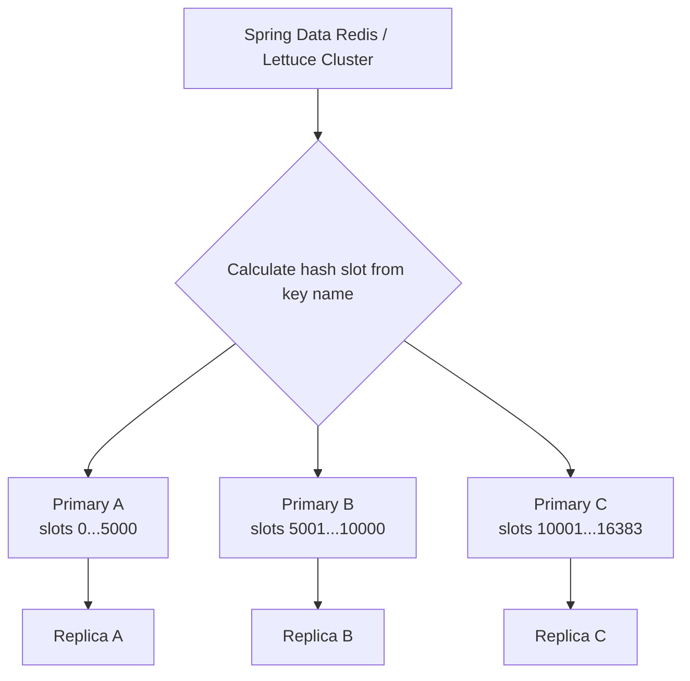
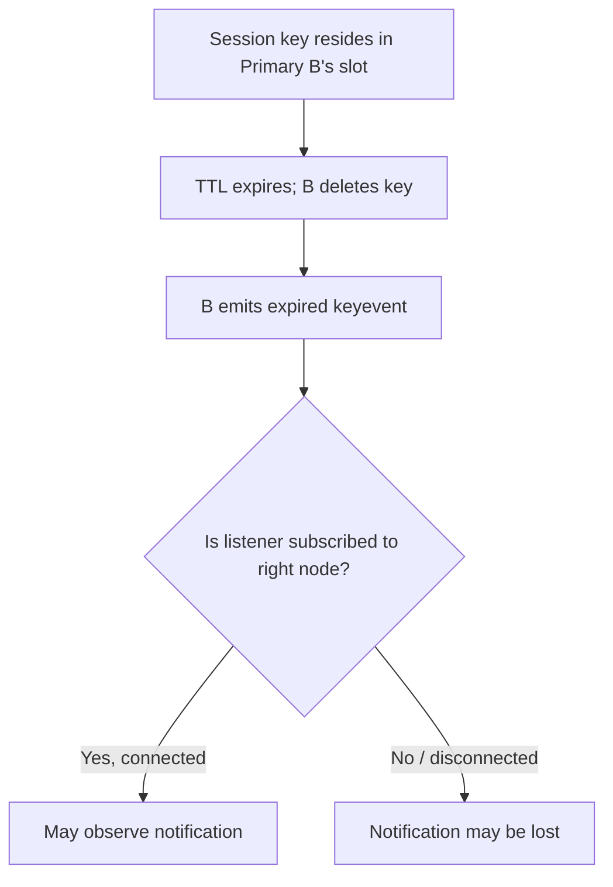

# Cluster Impact on Repositories, Indexes, and Keyspaces

**Redis Cluster** distributes data across multiple primaries across **16,384 hash slots**, whereas **Spring Data Redis Repository** maps a Java object into multiple Redis structures: the aggregate hash, a keyspace ID set, secondary indexes, and sometimes TTL tracking keys. These two models interact directly.

A call like `repository.save(product)` looks like saving a single object, yet at the Redis layer it can touch **multiple keys**. In a Cluster, those keys may reside on different nodes. This affects multi-key operations, transactions, index queries, deletions, keyspace scans, and expiration event handling.

The essential takeaway is: **connecting Spring Data Redis to a Cluster does not automatically make all Repository operations atomic or free from cross-slot limits**. You must understand which keys are created, which keys must share a slot, and whether a centralized index might become a hotspot.

## 1. How does Redis Cluster distribute data?

Redis Cluster divides the keyspace into **16,384 hash slots**, numbered `0` through `16383`. Each primary is responsible for a set of slots. When a client issues a command for a key, the cluster-aware driver identifies the node owning that slot and routes the request.



The slot ranges in the diagram are merely illustrative examples; exact boundaries and node counts depend on your actual Cluster.

Several consequences follow:

- **Single-key commands** like `GET key`, `HGETALL key`, and `SET key ...` are usually routed by a cluster-aware driver to the right primary.
- **Multi-key commands** typically must satisfy the **same hash slot** rule, especially commands like `MGET`, `SINTER`, `SUNION`, multi-key transactions, and Lua scripts.
- **`MULTI`/`EXEC`** does not create atomic transactions across arbitrary slots.
- **One Redis logical database:** Redis Cluster uses database `0`; do not rely on `SELECT 1`, `SELECT 2` as a way to separate data.
- **Resharding** slots to other nodes can trigger `MOVED`/`ASK` redirection responses. The driver must refresh topology or follow redirects properly.

Never think of a Cluster as "a single Redis instance with more capacity". Commands that succeed on standalone Redis may fail when involved keys are scattered across multiple slots.

## 2. Hash slots and hash tags

Redis calculates a slot from the key name using CRC16 modulo `16384`. Normally, two keys with different names are likely to land in different slots.

Redis supports **hash tag** syntax: if a key name contains a valid pair of curly braces with a non-empty substring inside, only the substring inside the braces is used to compute the slot.

```text
products:101           # Slot calculated from entire key name
products:102           # May land in a different slot

{products}:101         # Slot calculated from "products"
{products}:sku:A-101   # Same hash tag "products" => same slot
{products}:category:IT # Same hash tag "products" => same slot

{tenant-7}:product:101 # Slot based on "tenant-7"
{tenant-8}:product:101 # Usually in a different slot
```

You can inspect slots directly in Redis Cluster:

```redis
CLUSTER KEYSLOT products:101
CLUSTER KEYSLOT products:102
CLUSTER KEYSLOT {products}:101
CLUSTER KEYSLOT {products}:sku:A-101
CLUSTER KEYSLOT {products}:category:IT
```

The three keys sharing `{products}` will produce the exact same **slot number**. Untagged keys may happen to share a slot by hash collision; never design a system relying on that coincidence.

**Trade-off:** hash tags put keys that must be operated on together into the same slot, while simultaneously **concentrating all of them onto the single primary owning that slot**. Putting every product in a large system under `{products}` prevents the Cluster from distributing that dataset across multiple primaries.

## 3. What kinds of keys does Redis Repository create?

Suppose an entity is mapped as follows:

```java
package com.example.catalog.redis;

import org.springframework.data.annotation.Id;
import org.springframework.data.redis.core.RedisHash;
import org.springframework.data.redis.core.index.Indexed;

@RedisHash("products")
public class ProductDocument {

    @Id
    private String id;

    @Indexed
    private String sku;

    @Indexed
    private String category;

    private String title;

    public ProductDocument() {
    }

    public ProductDocument(
            String id, String sku, String category, String title) {
        this.id = id;
        this.sku = sku;
        this.category = category;
        this.title = title;
    }

    public String getId() {
        return id;
    }

    public void setId(String id) {
        this.id = id;
    }

    public String getSku() {
        return sku;
    }

    public void setSku(String sku) {
        this.sku = sku;
    }

    public String getCategory() {
        return category;
    }

    public void setCategory(String category) {
        this.category = category;
    }

    public String getTitle() {
        return title;
    }

    public void setTitle(String title) {
        this.title = title;
    }
}
```

Corresponding repository:

```java
package com.example.catalog.redis;

import java.util.List;
import java.util.Optional;
import org.springframework.data.repository.CrudRepository;

public interface ProductRepository
        extends CrudRepository<ProductDocument, String> {

    Optional<ProductDocument> findBySku(String sku);

    List<ProductDocument> findByCategory(String category);
}
```

When executing:

```java
products.save(new ProductDocument(
        "101", "A-101", "ELECTRONICS", "Keyboard"));
```

Spring Data Redis Repository can manage multiple structures:

| Structure | Illustrative Key Name | Purpose |
| --- | --- | --- |
| **Aggregate Hash** | `products:101` | Attributes of `ProductDocument` |
| **Keyspace set / metadata** | `products` | Tracks aggregate IDs belonging to the keyspace |
| **Secondary index set** | `products:sku:A-101` | Set of IDs for products with that SKU |
| **Secondary index set** | `products:category:ELECTRONICS` | Set of IDs for products in that category |
| **Index bookkeeping** | Auxiliary keys created by repository | Helps update/clean indexes when the aggregate changes |

Illustrative names follow Redis Repository's default conventions and may vary with keyspace configuration, mapping, or library version. Never depend on internal key names as a public API contract without verifying the exact implementation in use.

### 3.1. Saving an entity is not necessarily a single Redis command

Conceptually:

```text
Repository.save(ProductDocument)
    |
    +--> Write entity hash
    +--> Track ID in keyspace
    +--> Update secondary index for sku
    +--> Update secondary index for category
    +--> Update index metadata for edits/deletes
```

Each individual Redis command is atomic per its command contract, yet **the full repository operation chain across multiple keys does not automatically become a Cluster-wide atomic transaction**. On connection errors, resharding, timeouts, or failovers mid-sequence, the application must recognize that the hash and its indexes may not always be observed in a mutually consistent state.

## 4. Why do Repositories and secondary indexes easily hit cross-slot?

With default key names:

```text
products:101
products:sku:A-101
products:category:ELECTRONICS
products
```

these keys typically hash to **different slots**. This creates two kinds of consequences:

**First**, an operation composed of separate single-key commands may touch multiple primaries. Even if each individual command succeeds, they lack a shared atomic commit boundary across all primaries.

**Second**, an operation needing multiple keys in **a single Redis command** may be rejected by Redis Cluster with `CROSSSLOT Keys in request don't hash to the same slot`.

Example independent of Repository:

```redis
SADD products:category:ELECTRONICS 101
SADD products:sku:A-101 101

# Can cause CROSSSLOT if the two sets live in different slots:
SINTER products:category:ELECTRONICS products:sku:A-101
```

The `SINTER` command takes multiple keys, so participating keys must share a slot. For repositories, certain derived queries involving multiple indexed conditions may need set operations across multiple ID sets, subjecting them to the same constraint.

**Do not assume every `findBy...` query on a Cluster fails.** A query hitting a single index set or single-key lookup may work fine; limits depend on the query type, how your Spring Data Redis version implements it, key placement, and how many keys must be coordinated.

## 5. Placing hash tags in `@RedisHash` to group keys in one slot

When prioritizing Repository operations across multiple related structures, you can consider a **keyspace containing a fixed hash tag**:

```java
@RedisHash("{catalog-products}")
public class ProductDocument {
    @Id
    private String id;

    @Indexed
    private String sku;

    @Indexed
    private String category;

    // Fields, constructors, and accessors as in the example above.
}
```

With key names derived from this keyspace, related keys can look like:

```text
{catalog-products}:101
{catalog-products}:102
{catalog-products}:sku:A-101
{catalog-products}:category:ELECTRONICS
{catalog-products}
```

They share the hash tag `{catalog-products}`, so Redis Cluster hashes them into the **same hash slot**:

```redis
CLUSTER KEYSLOT {catalog-products}:101
CLUSTER KEYSLOT {catalog-products}:sku:A-101
CLUSTER KEYSLOT {catalog-products}:category:ELECTRONICS
CLUSTER KEYSLOT {catalog-products}
```

If multiple such keys need coordination in a cross-key operation permitted by Redis Cluster, sharing a slot is a prerequisite.

**Be cautious:**

1. This is a **keyspace design rule**, not a guarantee that all Redis Repository operations become transactional.
2. Verify that **every key actually involved in the operation** carries the matching tag. Index bookkeeping, phantom copies, or keys created by custom converters may follow separate rules.
3. A fixed tag for an entire repository forces **every aggregate and index of that repository into one slot**. At scale, this can eliminate Cluster distribution benefits.
4. Switching from `@RedisHash("products")` to `@RedisHash("{catalog-products}")` is not a harmless refactor: it **changes key names**. Existing data and indexes do not move to the new keyspace automatically.
5. Using a hash tag does not magically create a **distributed global query** or Cluster-wide secondary index engine.

Therefore, hash tags suit relatively small, tightly coupled datasets that routinely need joint operations. If you need to store millions of aggregates distributed across nodes **while also** running global attribute searches, design a dedicated indexing/query strategy rather than forcing everything into one slot.

## 6. Trade-offs between co-location and distribution

No single hash tag rule fits every application.

| Strategy | Benefit | Cost / Limitation |
| --- | --- | --- |
| No tag, keys by ID | Aggregates spread across many slots | Indexes and keyspace metadata may land in other slots; multi-key commands are hard to coordinate |
| One tag per repository, e.g., `{products}` | Tagged keys can run same-slot multi-key commands | **Hot slot**, limits scaling across primaries |
| Tag by tenant, e.g., `{tenant-7}` | Data for one tenant stays in the same slot | Querying across all tenants requires fan-out/aggregation |
| Tag by aggregate ID | Auxiliary keys of one aggregate share a slot | A **secondary index shared across aggregates** cannot share a slot with all of them simultaneously |
| Decouple indexing/search from Redis Repository | Data and queries can scale independently | Must sync indexes, manage lag, and handle recovery |

Tenant-level tagging example:

```text
{tenant-7}:product:101
{tenant-7}:product:102
{tenant-7}:index:sku:A-101

{tenant-8}:product:301
{tenant-8}:index:sku:B-301
```

This design keeps operations **within a single tenant** in the same slot while distributing distinct tenants. However, **do not assume** `@RedisHash` automatically generates dynamic keyspaces/tags from a `tenantId` field by default. Class-level annotations take static keyspace strings; dynamic tenant routing requires a custom mapping/keyspace resolver or an explicitly managed storage layer.

A query to "find all products across all tenants matching a SKU" remains a **global lookup** problem needing its own solution. Hash tags only determine key placement, not distributed query execution.

## 7. Secondary indexes: mechanics and limits across slots

Spring Data Redis supports secondary indexes via `@Indexed`. For an aggregate with:

```java
@Indexed
private String category;
```

Spring Data Redis maintains a set of aggregate IDs sharing that property value. Example:

```text
products:category:ELECTRONICS -> {101, 102, 108}
products:category:BOOKS       -> {205, 206}
```

This is a **Redis Set of IDs**, not a Cluster-wide B-tree or self-sharding index. Operations like:

```java
List<ProductDocument> findByCategory(String category);
```

can consult the index to look up IDs, then load the corresponding aggregates. When the index set and the hashes live on different nodes, reading entities and maintaining indexes incur network/topology overhead and multi-operation consistency risks.

### 7.1. Combining multiple indexed conditions

Suppose a repository has two `@Indexed` fields:

```java
List<ProductDocument> findByCategoryAndSku(
        String category, String sku);
```

Logically, the result must satisfy:

```text
IDs in index(category=ELECTRONICS)
  INTERSECT
IDs in index(sku=A-101)
```

If the implementation performs set intersection via `SINTER` across two index keys in different slots, the Cluster returns `CROSSSLOT`. If the implementation takes another path, results and overhead depend on that path.

Therefore, evaluate **specific queries**, rather than assuming success just because `repository.save()` or `findById()` passed. A use case may break only when introducing combined query criteria or additional indexes.

### 7.2. Updating an indexed attribute

```java
ProductDocument p = products.findById("101").orElseThrow();
p.setCategory("OFFICE");
products.save(p);
```

Logically, the repository needs to:

1. Update the product hash.
2. Remove ID `101` from the `ELECTRONICS` index.
3. Add ID `101` to the `OFFICE` index.
4. Update metadata tracking the aggregate's index entries.

If the involved keys span multiple slots, you cannot assume these four steps execute as a Cluster-wide atomic transaction. During updates or partial failures, old and new indexes can drift out of sync with the hash.

For data demanding strict accuracy (inventory, payments, access control), **do not rely solely on Redis Repository secondary indexes as the business source of truth**. Validate invariants where commits occur.

## 8. `@GeoIndexed` and geospatial indexes in a Cluster

Redis Repository also supports `@GeoIndexed`:

```java
import org.springframework.data.geo.Point;
import org.springframework.data.redis.core.index.GeoIndexed;

@GeoIndexed
private Point location;
```

Under the hood, a geo index uses a Redis structure suited for `GEOADD`, `GEOSEARCH`, and related GEO commands. One geo index stores member IDs for many aggregates.

Illustrative keys:

```text
stores:location              -> geo index (sorted set)
stores:store-101             -> aggregate hash
stores:store-102             -> aggregate hash
```

In Redis Cluster:

- One **geo index key** resides in **one slot**. Redis does not automatically split a single GEO sorted set across primaries.
- The hashes for locations can reside in slots different from the geo index.
- Searching a geo index returns IDs, after which the repository loads aggregates by ID; those reads can span multiple nodes.
- At very large scale, a single centralized geo index can become a hotspot.
- Splitting into multiple geo indexes by region/tenant means searches near boundaries must merge results across regions and handle filtering/sorting.

Thus, `@GeoIndexed` does not automatically create **Cluster-wide distributed spatial search**. Choose an index model aligned with your search scope and weigh index update/delete costs when aggregates change.

## 9. `@Reference`, relationships, and multiple aggregates

A Redis Repository entity can reference the ID/key of another entity via mapping mechanisms. In a Cluster, two independent aggregates can be stored in two different slots.

```text
customer:customer-7      -> slot A
orders:order-101         -> slot B
orders:order-102         -> slot C
```

Resolving references may require multiple round trips to different nodes. **A reference in a Java model does not put those aggregates in the same transaction.** Saving an `Order` does not imply that changes to `Customer`, `Order`, and indexes committed atomically across the Cluster.

If a business action must update two aggregates together, pick an explicit consistency strategy:

- Combine data that truly must change atomically into **one Redis key** if size and data model permit.
- Place related keys in the **same slot** when multi-key commands or Lua scripts are required, while avoiding oversized hot slots.
- Use an appropriate transactional database as the **source of truth**, keeping Redis for caches or read models.
- When multiple data stores must coordinate, use idempotency, outbox, compensation, or sagas with durable state.

Do not try to turn Redis Repository into a relational ORM with joins, foreign-key constraints, and cross-shard transactions via annotations alone.

## 10. What does "keyspace" mean in Repository and Cluster contexts?

The term **keyspace** can refer to different concepts:

1. **Redis database keyspace:** all keys in a Redis logical database.
2. **Repository keyspace:** the prefix/aggregate group of an entity, e.g., `products` from `@RedisHash("products")`.
3. **Keyspace notifications:** Pub/Sub notifications on key creation, modification, deletion, expiration, or eviction.

These three concepts are **not identical**. `@RedisHash("products")` does not create a separate database on the Cluster; it only defines part of the key-naming mapping convention.

### 10.1. The keyspace ID set

To support operations across all aggregates of a given type, Repository may maintain a **keyspace set** tracking IDs.

```text
products -> {101, 102, 103, ...}
```

Consequences:

- If this set grows very large, a single key can become a hotspot and consume significant memory on one node.
- Fetching many IDs and loading hashes can trigger heavy fan-out across nodes.
- Bulk deletions or `findAll()` can cause high, sustained load; do not treat them as stable Cluster-wide paginated scans.
- Operations like `count()` or scanning the entire repository must be evaluated against the implementation and dataset size rather than assuming constant cost or strict accuracy amid concurrent writes.

For very large datasets, consider ID-paginated APIs, dedicated indexes, or explicitly partitioned storage models.

### 10.2. Changing the keyspace does not migrate data automatically

Changing:

```java
@RedisHash("products")
```

to:

```java
@RedisHash("{catalog-products}")
```

changes how new keys are named. Existing data under `products:101` **does not automatically become** `{catalog-products}:101`. The updated repository will not find old aggregates and indexes under the new convention.

You need a migration procedure: planned downtime or dual-read/dual-write, data copying and verification, rebuilding secondary indexes, preserving remaining TTLs, and a controlled application cutover.

## 11. `KEYS`, `SCAN`, and traversing data across primaries

On standalone Redis, learners often check:

```redis
KEYS products:*
SCAN 0 MATCH products:* COUNT 100
```

In a Cluster, **each primary owns a portion of the keyspace**. A `SCAN` command run on one node iterates only the keys owned by that node; it does not scan the remaining primaries.

Conceptually, to traverse the entire Cluster:

```text
Cluster discovery
    |
    +--> Primary A: SCAN with cursor A
    +--> Primary B: SCAN with cursor B
    +--> Primary C: SCAN with cursor C
    |
    +--> Merge results, deduplicate if needed
```

Each primary maintains its own cursor. `SCAN` is not an immutable snapshot: keys can be created, deleted, or moved across slots mid-scan, and keys may appear multiple times. During resharding, results must be treated even more strictly as **best effort** rather than an exact point-in-time list.

`KEYS` scans the entire keyspace on a node and can spike latency on large datasets. Some cluster-aware APIs may fan out commands to multiple nodes, yet **never assume every `keys(pattern)` or `scan()` automatically traverses the whole Cluster**; inspect the exact API, driver, and topology in use.

Example inspecting individual nodes in a learning environment:

```sh
redis-cli -h redis-primary-a -p 6379 SCAN 0 MATCH 'products:*' COUNT 100
redis-cli -h redis-primary-b -p 6379 SCAN 0 MATCH 'products:*' COUNT 100
redis-cli -h redis-primary-c -p 6379 SCAN 0 MATCH 'products:*' COUNT 100
```

Each of these is only **one SCAN page** on each node. To finish iterating, keep following the returned cursor on each node until it returns `0`, refresh the primary list if topology changes, and avoid running full scans inside user-facing requests.

**Never use `KEYS products:*` for bulk deletion in production.** When data cleanup is needed, prefer bounded key scopes, small batches, proper TTL policies, and a resumable process.

## 12. TTL and keyspace notifications in Redis Cluster

Redis Repository can configure time-to-live:

```java
@RedisHash(value = "sessions", timeToLive = 900)
public class SessionDocument {

    @Id
    private String id;

    private String userId;

    // Constructors, getters, and setters...
}
```

When saved, Redis applies the TTL to the **aggregate hash key**. When the TTL expires, Redis deletes the key via the expiration mechanism of the node holding that key.

The catch is that **keyspace notifications in Redis Cluster are node-scoped**. Notifications are emitted on the node where the event occurs, not as a durable event log replicated across all nodes.



A listener subscribed to only one node **must not be assumed to observe expirations across the entire Cluster**. On a Cluster, inspect how your Spring Data Redis and driver version subscribe across nodes, refresh subscriptions on topology changes, and configure notification flags uniformly across primaries.

### 12.1. Repository's `RedisKeyExpiredEvent`

Spring Data Redis Repository can leverage keyspace notifications to publish Java events when an aggregate expires. Example configuration:

```java
import org.springframework.context.annotation.Configuration;
import org.springframework.data.redis.core.RedisKeyValueAdapter.EnableKeyspaceEvents;
import org.springframework.data.redis.repository.configuration.EnableRedisRepositories;

@Configuration
@EnableRedisRepositories(
        basePackageClasses = SessionRepository.class,
        enableKeyspaceEvents = EnableKeyspaceEvents.ON_STARTUP)
public class RedisRepositoryConfiguration {
}
```

`SessionRepository` in the example is the repository interface for the entity. `ON_STARTUP` initializes the listener mechanism at application startup, yet **does not turn notifications into durable events**.

Limitations:

- Listeners miss events while offline, disconnected, or during failover or resharding.
- Notifications may arrive later than the theoretical TTL deadline because Redis expires keys via active/lazy mechanisms.
- `RedisKeyExpiredEvent` relies on Pub/Sub, with no history to replay when a consumer restarts.
- When Repository uses secondary indexes, missed expiration notifications can leave auxiliary index data **incompletely cleaned up**.
- Temporary *shadow/phantom copies* used to carry expiration event payloads create extra Redis keys, consume memory, and must be checked for slot/topology impact.

In managed Redis environments, the application might lack `CONFIG SET` permissions. To prevent Spring Data Redis from attempting to modify server config, you can set `keyspaceNotificationsConfigParameter = ""` on `@EnableRedisRepositories` where supported, while **enabling `notify-keyspace-events` via infrastructure configuration** on the required nodes. Setting an empty string does not enable notifications by itself.

### 12.2. Do not use notifications as reliable business events

For example, `session:123` reaching TTL expiration does not reliably prove a business transaction should be canceled or a payment refunded. If a business flow must execute reliably, use a reconcilable state/deadline source, an outbox, or a queue/log with replay guarantees.

On a Cluster, the risk of lost notifications and drifted index data also depends on which node holds each key, slot migrations, and listener wiring. Enabling keyspace notifications does not solve every Repository consistency issue.

## 13. Configuring Spring Data Redis with a Cluster

Spring Boot 3.x application example:

```groovy
// build.gradle
dependencies {
    implementation 'org.springframework.boot:spring-boot-starter-data-redis'
}
```

Declare node addresses for the driver to discover topology:

```yaml
# src/main/resources/application.yml
spring:
  data:
    redis:
      cluster:
        nodes:
          - redis-1.example.internal:6379
          - redis-2.example.internal:6379
          - redis-3.example.internal:6379
        max-redirects: 5
      timeout: 3s
      connect-timeout: 2s
```

These example addresses are placeholders. Production requires TLS, credentials, network reachability, and proper topology settings. The driver must be able to connect to **the endpoints advertised by the Cluster**, not solely the initial seed nodes.

With Spring Boot, `LettuceConnectionFactory` can be auto-configured from the Cluster properties when dependencies and auto-configuration conditions are satisfied. To scope repositories explicitly:

```java
package com.example.catalog;

import com.example.catalog.redis.ProductRepository;
import org.springframework.boot.SpringApplication;
import org.springframework.boot.autoconfigure.SpringBootApplication;
import org.springframework.data.redis.repository.configuration.EnableRedisRepositories;

@SpringBootApplication
@EnableRedisRepositories(basePackageClasses = ProductRepository.class)
public class CatalogApplication {

    public static void main(String[] args) {
        SpringApplication.run(CatalogApplication.class, args);
    }
}
```

`@EnableRedisRepositories` registers and scans repositories. This annotation **does not change hash slot rules**, does not automatically add hash tags to key names, and does not guarantee all secondary indexes share a slot.

### 13.1. Alternative Java configuration when needed

If you need to create the connection factory programmatically, Spring Data Redis provides `RedisClusterConfiguration`:

```java
import java.util.List;
import org.springframework.context.annotation.Bean;
import org.springframework.context.annotation.Configuration;
import org.springframework.data.redis.connection.RedisClusterConfiguration;
import org.springframework.data.redis.connection.lettuce.LettuceConnectionFactory;

@Configuration
public class ClusterConnectionConfiguration {

    @Bean
    public LettuceConnectionFactory redisConnectionFactory() {
        RedisClusterConfiguration config =
                new RedisClusterConfiguration(List.of(
                        "redis-1.example.internal:6379",
                        "redis-2.example.internal:6379",
                        "redis-3.example.internal:6379"));
        config.setMaxRedirects(5);

        return new LettuceConnectionFactory(config);
    }
}
```

This is an **alternative**, not an instruction to create a second factory alongside Boot auto-configuration. When defining the factory manually, configure authentication/TLS/timeouts/topology for your environment and ensure all template beans wire to the intended factory.

Redis Cluster is not Redis Sentinel: Sentinel monitors one primary and its replicas to fail over a single dataset, whereas Redis Cluster shards data by slots and can have multiple primaries. Do not mix both configurations as though they were a single connection mode.

## 14. Transactions, Lua, and multi-key operations

One point must be stated clearly:

> **Sharing a slot is a necessary condition for many multi-key operations in Redis Cluster, yet it does not turn arbitrary command sequences into a transaction.**

Example with two keys in different slots:

```redis
MGET customer:101 order:500
```

This command can fail with `CROSSSLOT`. Similarly, a Lua script touching keys in different slots cannot access all of them across shards as if Redis were a single server.

If data genuinely requires atomic updates in Redis:

1. Identify the exact keys involved in the operation.
2. Design them to share a slot if capacity allows.
3. Use **a single Redis command, valid transaction, or Lua script** with an explicit contract.
4. Handle timeouts or failovers via operation IDs/idempotency if outcomes are uncertain.
5. Never assume local script atomicity prevents write loss due to asynchronous replication after failover.

Example using a shared hash tag:

```redis
MULTI
SET {order-500}:status CONFIRMED
INCRBY {order-500}:version 1
EXEC
```

Both keys share a slot, satisfying Cluster transaction slot constraints. However, a `MULTI` command cannot be arbitrarily extended to `customer:101` in another slot.

A `repository.save()` call can execute internal operations different from the explicit transaction above. Never infer that adding a hash tag automatically gives `save()` the same atomic boundary as an explicitly written `MULTI`.

## 15. Notes on pipelines and multi-key queries

Spring Data Redis supports pipelining to cut round trips, yet in a Cluster:

- Commands route to the nodes owning each key.
- A pipeline containing commands for multiple slots **has no Cluster-wide transactional commit**.
- Ordering and completion across multiple nodes must not be treated as an atomic write sequence.
- If one command fails mid-way, other commands may have already executed; response handling must match each individual command.
- A client timeout does not prove none of the commands in the pipeline wrote data.

Therefore, never use pipelines as a substitute for business transactions. For critical updates, design explicit stateful/idempotent write paths or use a transactional datastore.

## 16. Deletion, TTL, and index consistency

Lifecycles that Repository must manage:

```text
SAVE:
  new hash / keyspace metadata / property indexes

UPDATE:
  updated hash / remove old index entries / add new index entries

DELETE:
  delete hash / remove ID from indexes / update metadata

EXPIRE:
  Redis deletes hash automatically on TTL expiration
  Listener may be used to clean up auxiliary indexes
```

On Redis Cluster, operations touching multiple keys can span multiple slots. Deleting a hash or having its TTL expire **does not automatically purge every secondary index living in other keys**. When an index still holds an ID whose aggregate is gone:

```text
index category=ELECTRONICS -> ID 101
GET hash products:101      -> key does not exist
```

The application must decide how to handle "orphaned" IDs:

- Ignore missing results when the aggregate genuinely no longer exists.
- Emit metrics tracking index drift.
- Route lifecycle updates/deletes through the Repository API.
- Run a controlled reconciliation job to rebuild indexes from the authoritative data source.
- Never rely solely on all expiration notifications arriving reliably.

If Redis holds primary data with no external source of truth, be especially careful before bulk-deleting to "reindex": doing so can destroy unrecoverable values.

### 16.1. Distinguishing keyspace TTL from slots

TTL is always attached to a **key**. Hash tags determine a key's slot, not its lifetime. Example:

```redis
EXPIRE {catalog-products}:101 3600
TTL {catalog-products}:101
CLUSTER KEYSLOT {catalog-products}:101
```

`TTL` returns remaining time, while `CLUSTER KEYSLOT` returns the slot. If a key is resharded to another primary, expiration attributes move with the data per key migration mechanics; however, a listener attached only to the old node cannot be assumed to receive expired notifications emitted by the new node.

## 17. Hands-on Repository verification on a Cluster

Suppose the application runs with keyspace `products`.

**Step 1: Inspect topology and slots.**

```redis
CLUSTER INFO
CLUSTER NODES
CLUSTER KEYSLOT products:101
CLUSTER KEYSLOT products:category:ELECTRONICS
```

**Step 2: Save several aggregates through the repository.**

```java
products.save(new ProductDocument(
        "101", "A-101", "ELECTRONICS", "Keyboard"));
products.save(new ProductDocument(
        "102", "A-102", "ELECTRONICS", "Monitor"));
```

**Step 3: Test independent operations.**

```java
ProductDocument byId = products.findById("101")
        .orElseThrow();

List<ProductDocument> byCategory =
        products.findByCategory("ELECTRONICS");
```

ID lookups and secondary index queries can exhibit different routing behavior. Test against a **real multi-primary Cluster**, not just standalone Redis.

**Step 4: Inspect actual keys created by Repository.**

Observe them in a test environment using cluster-aware tooling or scanning each primary. Never guess index key names from documentation examples and run `DEL` in production.

**Step 5: Try changing an indexed property.**

```java
ProductDocument p = products.findById("101")
        .orElseThrow();
p.setCategory("OFFICE");
products.save(p);
```

Then check:

```java
products.findByCategory("ELECTRONICS");
products.findByCategory("OFFICE");
```

The goal here is to observe how **one aggregate change triggers index maintenance**. For real systems with strict requirements, also test interrupted operations, high load, and resharding.

**Step 6: Test a hash-tagged keyspace model on isolated data.**

Try a test entity/class with keyspace `{catalog-products}` in an isolated test environment, and inspect the resulting slots. Never change annotations on a production entity holding live data without a migration plan.

## 18. Common mistakes

### 18.1. `CROSSSLOT Keys in request don't hash to the same slot`

Cause: a multi-key command received keys in different slots. Identify the actual command, list participating keys, inspect placement with `CLUSTER KEYSLOT`, and redesign keys or operations. Never try to fix this by retrying the same command with unchanged keys.

### 18.2. `findById()` works while `findBy...And...()` fails

Reading by ID typically accesses a single hash; complex indexed queries may involve multiple index keys. Do not treat `findById` passing as proof that all Repository query styles work on a Cluster.

### 18.3. Adding `{products}` to all keys and assuming the Cluster scales data

Same hash tag means same slot; one slot belongs to one primary at a time. If data is large enough to require sharding, one tag for the whole repository creates a potential bottleneck.

### 18.4. Running `SCAN 0` once and claiming the entire Cluster was scanned

`SCAN` is cursor-based and each node has its own keyspace slice. You must exhaust the cursor on every primary and recognize that results are not a snapshot across concurrent writes.

### 18.5. Missing `RedisKeyExpiredEvent` for some entities

This can happen when notifications are disabled on the key-holding node, listeners are not subscribed to all nodes, the app disconnected, or topology changed. Never treat these events as guaranteed delivery.

### 18.6. Deleting a hash via Redis CLI and expecting Repository to clean all indexes

Calling `DEL` directly bypasses Repository-managed index cleanup. Indexes can retain orphaned IDs; prefer Repository APIs and add reconciliation.

### 18.7. Thinking changing `@RedisHash` only changes a display name

`@RedisHash` defines the keyspace and alters actual Redis key names. Changing keyspaces usually requires migrating data, indexes, and TTLs; old keys will not be read automatically.

### 18.8. Confusing Spring Cache with Redis Repository

`@Cacheable`/`RedisCacheManager` belong to Spring Cache; `@RedisHash`, `CrudRepository`, and `@Indexed` belong to Redis Repository. Both can use Redis Cluster, yet they generate different keys and manage lifecycles differently. Do not apply Repository keyspace/index assumptions to cache entries.

### 18.9. Assuming keyspace notifications are a reliable event log

Redis notifications use Pub/Sub without ACKs or replay. Use them for observability or best-effort cleanup, never as the sole trigger for billing or order cancellation.

### 18.10. Treating same-slot keys like a SQL transaction

Co-location permits certain multi-key commands, yet does not provide joins, foreign keys, default multi-entity transactions, or rollback across a sequence of Repository writes. Define real atomicity boundaries explicitly.

## 19. Observability and operations on a Cluster

When running Redis Repository on a Cluster, monitor:

| Metric / Signal | Meaning |
| --- | --- |
| Key count and memory per primary | Detects skewed distribution or hot slots |
| CPU/network per primary | Centralized indexes can overload one node |
| `MOVED`/`ASK` and topology refreshes | Indicates slot migrations or client topology updates |
| `CROSSSLOT` errors | Signals multi-key commands that are poorly designed |
| Latency of `save`, `delete`, index queries | Cost of coordinating multiple keys/nodes |
| Secondary index cardinality | Detects oversized index sets causing heavy aggregate fan-out |
| Keyspace/index drift | IDs present in an index whose hash is missing or mismatched |
| TTL and expired notifications | Evaluates per-node expiration observability |
| Reconnects/failovers/retries | Interruptions leaving multi-key updates incomplete |
| Cluster slot distribution | Shows which tags concentrate data onto one primary |

Log in a controlled way: repository name, operation type, non-sensitive key/slot identifiers, exception codes, node/role, and correlation IDs. Never log passwords, tokens, or sensitive entity values.

When a use case hits `CROSSSLOT`, focus on finding the offending command and keys instead of raising `maxRedirects`. `MOVED`/`ASK` are topology routing matters; `CROSSSLOT` is a **multi-key placement design problem**. Raising redirects will never fix that difference.

## 20. Design decision matrix

| Primary Requirement | Direction to Consider |
| --- | --- |
| CRUD by ID for huge entity volumes | Distribute keys by ID; measure Repository metadata/index impact |
| Query by a single indexed attribute | Inspect query path, index distribution, and aggregate read cost |
| Query combining multiple indexes via intersection | Ensure index keys are slot-compatible or move to a dedicated query engine |
| Small, tightly coupled multi-key atomic updates | Appropriate hash tag with a clearly scoped command/transaction/script |
| Dataset too large for a single slot | Partition by tenant/bucket or use another search/indexing datastore |
| Global queries spanning multiple shards | Design fan-out/aggregation queries or a distributed search system |
| Cleanup on TTL expiration | Never rely solely on notifications; add reconciliation |
| Reliable business events | Source of truth + outbox/stream/broker + idempotent consumers |
| Critical data integrity on multi-key partial failure | Enforce invariants and transactions in an appropriate datastore; Redis Repository is not multi-shard SQL |

## 21. Summary

**Redis Cluster partitions keys by hash slot, whereas Redis Repository often stores an aggregate across multiple keys**: the main hash, keyspace metadata, and secondary/geo indexes. When those keys land in different slots, single-key commands route across nodes, yet multi-key operations can encounter `CROSSSLOT`, and an aggregate's full lifecycle does not automatically form a Cluster-wide atomic transaction.

**Hash tags** help place related keys in the same slot to satisfy multi-key limits, at the cost of potential **hot slots** and reduced data distribution. `@RedisHash` configures the keyspace, without turning Repository into a Cluster-wide indexing engine. TTLs, shadow copies, and keyspace notifications are also bounded by per-node and Pub/Sub semantics, so expiration events alone cannot guarantee index cleanup or business completion.

During implementation, inspect **actual keys**, **actual slots**, **specific repository methods**, index lifecycles, and disconnect/failover behavior. When large-scale distributed querying or strict transactional integrity is needed, choose storage and indexing architectures built for those goals rather than merely switching connection settings to Cluster mode.

### References

- [Redis — Redis Cluster specification](https://redis.io/docs/latest/operate/oss_and_stack/reference/cluster-spec/): slots, hash tags, routing, and cross-slot limits.
- [Redis — Scale with Redis Cluster](https://redis.io/docs/latest/operate/oss_and_stack/management/scaling/): primary/replica model, data distribution, and resharding.
- [Redis — CLUSTER KEYSLOT](https://redis.io/docs/latest/commands/cluster-keyslot/): inspecting a key's hash slot.
- [Redis — SCAN](https://redis.io/docs/latest/commands/scan/): cursors and limitations when scanning keyspaces.
- [Redis — Keyspace notifications](https://redis.io/docs/latest/develop/pubsub/keyspace-notifications/): event scope, configuration, and Pub/Sub limitations.
- [Spring Data Redis — Redis Cluster](https://docs.spring.io/spring-data/redis/reference/redis/cluster.html): APIs and differences between Cluster and standalone Redis.
- [Spring Data Redis — Redis Repositories](https://docs.spring.io/spring-data/redis/reference/redis/redis-repositories.html): aggregate storage, mapping, and keyspaces.
- [Spring Data Redis — Secondary Indexes](https://docs.spring.io/spring-data/redis/reference/redis/redis-repositories/indexes.html): `@Indexed`, `@GeoIndexed`, and index management.
- [Spring Data Redis — Time To Live](https://docs.spring.io/spring-data/redis/reference/redis/redis-repositories/expirations.html): TTL, expiration events, and phantom copies.
