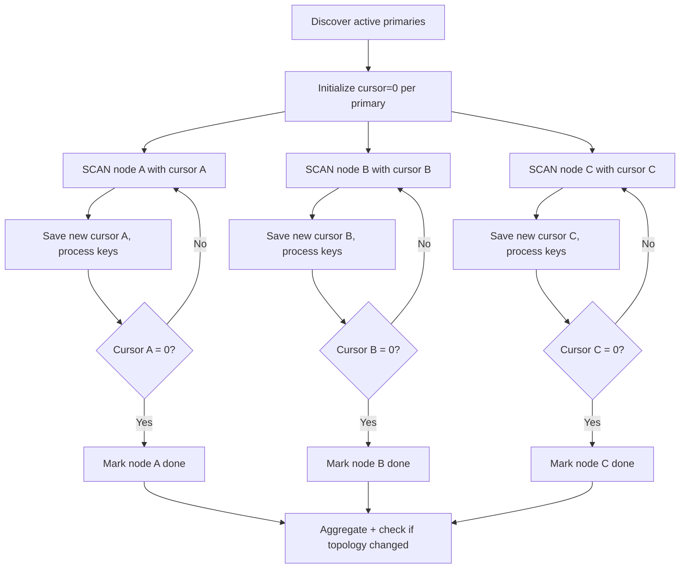
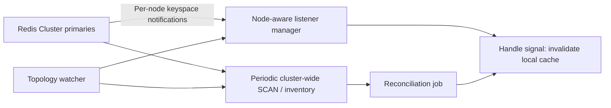

# Scanning Keys and Managing Notifications Across Multiple Nodes in Redis Cluster with Spring Data Redis

## 1. The problem: a Redis Cluster is not a single Redis server

When using standalone Redis, an application normally connects to one endpoint for reading, writing, scanning keys, and subscribing to Pub/Sub. With **Redis Cluster**, data is partitioned across multiple **primary nodes** by **hash slot**. **Replica nodes** receive replicated data from their primary for high availability and, when configured appropriately, selected read workloads.

Consequently, two seemingly simple operations must be reconsidered:

1. **Scanning all keys with a given prefix:** running `SCAN` on one node does not inspect all keys across the cluster.
2. **Listening for key creations, updates, deletions, or expirations:** a subscription receiving **keyspace notifications** from one node does not automatically capture events emitted on other nodes.

Example three-primary cluster:

```text
                         Spring Data Redis
                                 |
                   Cluster-aware connection
                                 |
        +------------------------+------------------------+
        |                        |                        |
        v                        v                        v
   Primary A                 Primary B                Primary C
   slots 0..5460             slots 5461..10922        slots 10923..16383
   app:user:12               app:user:42              app:user:78
   app:cart:1                app:cart:2               app:cart:3
        |                        |                        |
     Replica A                Replica B                Replica C
```

Slot ranges and key names are illustrative. In practice, slot distribution can change during rebalancing, resharding, or failover.

If the application scans Primary A, results **exclude keys on B and C**. Similarly, if a listener only subscribes to keyspace events on A, the application risks **missing changes on B and C**.

This lesson introduces the right ways to handle both in Spring Data Redis: understanding each command's scope, per-node scanning, creating and managing listeners, handling topology changes, and consistency and event-loss limits.

## 2. Hash slots determine which node holds a key

Redis Cluster partitions the keyspace into **16,384 hash slots**, numbered from `0` to `16383`. Redis calculates a key's slot and routes commands to the primary owning that slot.

```text
Key: app:profile:42
          |
          v
      CRC16-based hash
          |
          v
slot = CRC16(key) mod 16384
          |
          v
Primary owning the slot
```

With a *hash tag*, only the substring inside the first valid pair of curly braces is used to compute the slot:

```text
cart:{order42}:items
cart:{order42}:summary

Both keys share hash tag "order42"
-> same hash slot
-> can participate in supported multi-key commands in the cluster.
```

Slot-based routing works great for `GET`, `SET`, or commands targeting known keys. Commands **that do not specify a single key**, such as `SCAN`, require a different mental model: Redis has no unified `SCAN` cursor spanning all nodes.

### A known key name vs. finding all keys

If you need to read `app:profile:42`, use a cluster-aware client and fetch the key directly:

```java
String value = stringRedisTemplate
        .opsForValue()
        .get("app:profile:42");
```

The driver and connection layer route the operation to the node owning the slot. **Never scan the cluster to look up a key whose name is already known.**

Only when you need to enumerate all keys matching `app:profile:*` for reconciliation do you face the multi-primary scan problem.

## 3. Why shouldn't `KEYS *` be used to scan a cluster?

Redis provides the command:

```redis
KEYS app:profile:*
```

The `KEYS` command enumerates keys within the responding node; it can block the Redis server for a significant duration on large keyspaces. In a cluster, some high-level client APIs may fan out to multiple nodes and merge results, yet **never assume every `KEYS` invocation scans the entire cluster**, and even with aggregation, running `KEYS` on each primary still imposes heavy load.

Comparison:

| Criterion | `KEYS pattern` | `SCAN cursor MATCH pattern COUNT hint` |
| --- | --- | --- |
| How results return | Returns full result list at once on the queried node | Iterates incrementally across multiple calls with a cursor |
| Server load | Can cause a long blocking operation delaying other commands | Splits work into smaller chunks |
| Suitable for large production keyspaces | Usually no | Better suited when scan rate is controlled |
| Default Redis command scope | Queried node | Queried node |
| Consistent snapshot under mutations? | Should not be treated as a cluster-wide transaction/snapshot | No; can duplicate or miss keys while dataset mutates |
| How completion is known | Command returns | Cursor on **each node** returns `0` |

**Recommendation:** use rate-limited `SCAN` for traversing large keyspaces; avoid `KEYS *` on user-facing request paths or production Redis operations.

Another optimization: if the application already tracks IDs in a Redis Set, Sorted Set, or reliable index, iterating that structure is usually cleaner and far cheaper than scanning the whole keyspace.

## 4. Redis `SCAN` is cursor-based iteration, not a snapshot

Syntax:

```redis
SCAN 0 MATCH app:profile:* COUNT 200
```

Redis returns a new cursor and a batch of keys. The client must pass the returned cursor back until Redis returns cursor `0`.

Simple example:

```text
SCAN 0   -> cursor 142, keys [app:profile:12, app:profile:13]
SCAN 142 -> cursor 68,  keys [app:profile:42]
SCAN 68  -> cursor 0,   keys [app:profile:78]

Completed one scan pass on this node.
```

A cursor is an iteration token scoped to **one Redis node**. Never pass a cursor from Primary A to Primary B, and never merge cursors into a single cluster-wide number.

### Four properties to remember

1. **`COUNT` is only a per-step work hint**, not a guarantee that each response returns that exact number of keys. Some iterations return fewer keys or zero keys even when the cursor is not yet `0`.
2. **`MATCH` filters by pattern**, not via a prefix query index. Redis still walks the keyspace per the SCAN algorithm; a narrow prefix does not guarantee constant tiny cost.
3. **A key can be returned multiple times** in a single scan pass; processing must be idempotent or deduplicated properly.
4. **Mutating keysets during a scan have no snapshot**: keys created, deleted, or expired mid-scan may or may not appear; guarantees apply loosely only to keys present throughout the entire scan.

This matters even more on Redis Cluster because topology can shift between scan calls.

### Redis can return an empty page

Example:

```text
cursor = 612
keys   = []
```

You must continue calling with cursor `612` whenever the cursor is non-zero. Do not stop merely because one batch's key list is empty.

### Scanning by data type when needed

On Redis versions supporting `SCAN TYPE`, you can use:

```redis
SCAN 0 MATCH app:profile:* COUNT 200 TYPE hash
```

This returns only keys matching the specified Redis type at inspection time. It still does not remove the need to scan every primary in the cluster, and data can still change after a key is returned.

## 5. Procedure for scanning all primaries in a cluster

A clear operational plan:

1. **Discover current cluster topology** and list primaries currently owning slots.
2. **Maintain an independent cursor for each primary**, starting at `0`.
3. On each primary, invoke `SCAN` with appropriate pattern/`COUNT` until that node's cursor returns `0`.
4. Process every key with **idempotent** logic because `SCAN` can yield duplicates.
5. Limit concurrency and scan rate to avoid bursts on primaries.
6. If topology changes noticeably mid-scan, record that results may have gaps/duplicates and consider a fresh reconciliation pass.
7. Finish only when every node in the **scanned topology** has reached cursor `0`, not just the first node.

Diagram:



### Why prefer scanning primaries?

Replicas hold copies of replicated keys. Scanning both primaries and replicas simultaneously to "find all keys" counts most keys multiple times; replicas can also lag behind primaries or be resyncing. For logical keyspace inventories, normally **scan primaries currently owning slots**, not every node regardless of role.

During failover or cluster recovery, the list of primaries can change. Never hardcode that a given host will always remain a primary.

## 6. Testing multi-node scanning with Redis CLI

Suppose a test environment has three primaries on localhost ports `7000`, `7001`, and `7002`. These addresses are illustrative.

Inspect topology:

```bash
redis-cli -c -p 7000 CLUSTER NODES
redis-cli -c -p 7000 CLUSTER SLOTS
```

`CLUSTER NODES` shows addresses, roles, and slots; `CLUSTER SLOTS` (or the corresponding topology command for your Redis version) shows current slot allocations. After a failover, do not assume ports/hosts retain their initial roles.

After writing several test keys with a cluster-aware client:

```bash
redis-cli -c -p 7000 SET app:profile:12 ACTIVE
redis-cli -c -p 7000 SET app:profile:42 PENDING
redis-cli -c -p 7000 SET app:profile:78 ACTIVE
```

Scan each primary:

```bash
redis-cli -p 7000 SCAN 0 MATCH 'app:profile:*' COUNT 100
redis-cli -p 7001 SCAN 0 MATCH 'app:profile:*' COUNT 100
redis-cli -p 7002 SCAN 0 MATCH 'app:profile:*' COUNT 100
```

**These are only the initial pages**, not full scans. Follow the returned cursor on each node for subsequent pages.

`redis-cli -c` follows cluster slot redirections for key-targeted commands. However, **never assume running `SCAN 0` with `-c` scans all primaries**. `SCAN` has no key slot for the client to redirect into a "cluster-wide scan".

If Redis is not on localhost or primaries require authentication/TLS, adjust connection options accordingly without embedding secrets in operational documentation.

## 7. Scanning through Spring Data Redis: `RedisClusterConnection`

Spring Data Redis provides APIs for Redis Cluster, including `RedisClusterConnection` and `RedisClusterNode`. When you need to explicitly scan individual nodes, you can use the cluster connection's `scan(node, scanOptions)` overload.

The following example illustrates a cluster-wide scan **across primaries discovered at start time**, handling String results:

```java
import java.nio.charset.StandardCharsets;
import java.util.HashSet;
import java.util.Set;

import org.springframework.data.redis.connection.RedisClusterConnection;
import org.springframework.data.redis.connection.RedisClusterNode;
import org.springframework.data.redis.connection.RedisConnectionFactory;
import org.springframework.data.redis.core.Cursor;
import org.springframework.data.redis.core.ScanOptions;

public class ClusterKeyScanner {

    private final RedisConnectionFactory connectionFactory;

    public ClusterKeyScanner(RedisConnectionFactory connectionFactory) {
        this.connectionFactory = connectionFactory;
    }

    public Set<String> scanProfileKeys() {
        ScanOptions options = ScanOptions.scanOptions()
                .match("app:profile:*")
                .count(200)
                .build();

        Set<String> result = new HashSet<>();

        try (RedisClusterConnection connection =
                     connectionFactory.getClusterConnection()) {

            for (RedisClusterNode node : connection.clusterGetNodes()) {
                if (!node.isMaster()) {
                    continue; // Skip replicas.
                }

                try (Cursor<byte[]> cursor =
                             connection.scan(node, options)) {
                    while (cursor.hasNext()) {
                        byte[] rawKey = cursor.next();

                        // Valid only if keys are stored as UTF-8 text.
                        String key = new String(
                                rawKey, StandardCharsets.UTF_8);
                        result.add(key);
                    }
                }
            }
        }

        return result;
    }
}
```

**Contract of the example:**

- The connection factory must genuinely be configured for Redis Cluster; this code does not apply to a standalone backend lacking cluster connection support.
- `clusterGetNodes()` returns nodes known to the cluster connection from topology; in real applications handle unavailable nodes and topology refreshes.
- Only scan `isMaster()` nodes to avoid duplicate counts from replicas.
- `ScanOptions` configures the pattern and `COUNT` hint; `Cursor<byte[]>` must be closed.
- Decoding key bytes as UTF-8 is valid only if your key serializer consistently writes text. For other key serializers, decode using the matching serializer.
- `Set<String>` is simple deduplication for demos; **unsuitable for very large keysets** as it loads the entire inventory into application RAM.

Depending on Spring Data Redis and driver versions, signatures and support for cluster-specific commands can differ; check your active version's API before deploying. This pattern demonstrates **per-node scanning**, without promising an atomic cluster-wide snapshot.

### Processing page by page to reduce memory usage

In real applications, instead of collecting all keys into a `HashSet`, process each key as the cursor yields it:

```java
try (Cursor<byte[]> cursor = connection.scan(node, options)) {
    while (cursor.hasNext()) {
        byte[] raw = cursor.next();
        String key = new String(raw, StandardCharsets.UTF_8);

        inventoryHandler.accept(key);  // Must be idempotent.
    }
}
```

`inventoryHandler` is an application-provided callback. If processing each key involves slow network calls, avoid holding a connection/cursor open indefinitely; enforce rate limits, timeouts, and error resumption.

### Do not use scan to replace indexed business queries

If business logic frequently needs to "list all orders for tenant 42", running a prefix `SCAN` per request is far too expensive. Maintain an ID set/index in Redis or a suitable database/query engine, along with safeguards keeping the index aligned with source data.

`SCAN` is better suited for controlled inventory, maintenance, diagnostics, and reconciliation.

## 8. Scan limitations during resharding and failover

A `SCAN` pass has no snapshot, and Redis Cluster can **migrate slots between primaries**.

Example:

```text
t0: key app:profile:42 lives on Primary A
t1: scanner has already passed that keyspace region on A
t2: reshard moves the key's slot to Primary B
t3: scanner already finished B before the slot arrived
```

In this scenario, the inventory pass can miss the key. Under a different timing order, a key might appear twice—once on A and once on B.

Failover can also change which node serves as primary. If the scanner started with a stale node list, a node may no longer hold the primary role or accept connections as before.

### Reducing risk

- For important inventory jobs, prefer running during steady topology or maintenance windows.
- Record cluster topology/slot ownership before and after scanning; if it changed, flag the result for reconciliation.
- Make key processing **idempotent** rather than relying on exactly-once delivery.
- When an accurate point-in-time dataset is mandatory, use a durable datastore/index or a snapshot protocol suited to requirements.
- If scanning solely to clean up old keys, re-check preconditions right before deleting. Never delete a key solely because it appeared in a scan list minutes earlier.
- When encountering `MOVED`, `ASK`, timeouts, or connection errors, refresh topology via driver mechanisms and retry controlled chunks instead of blindly reusing an old cursor on another node.

**Never treat a single scan result as definitive proof that a key exists nowhere in the cluster** when concurrent writes or resharding occur.

## 9. Keyspace notifications in Redis Cluster differ from regular Pub/Sub

Redis provides **keyspace notifications**: when enabled, the node performing a mutation publishes Pub/Sub messages when keys are written, deleted, expired, or evicted.

Two common formats:

```text
Keyevent:
  channel = __keyevent@0__:set
  payload = app:profile:42

Keyspace:
  channel = __keyspace@0__:app:profile:42
  payload = set
```

In Redis Cluster, the logical database is DB 0. The `@0` suffix is part of the channel naming convention.

**Crucial difference:** keyspace notifications are emitted on the **node where the key event happens** and are **not automatically broadcast cluster-wide across all nodes**. To observe keys distributed across multiple primaries, clients must subscribe on **all relevant nodes**.

This differs from how **regular Pub/Sub** via `PUBLISH/SUBSCRIBE` works in Redis Cluster. Just because an application `PUBLISH` message propagates across the cluster does not mean `__keyevent@0__:*` notifications will be forwarded to a subscription on a single arbitrary node.

### Three-primary example

```text
Primary A: holds app:profile:12
Primary B: holds app:profile:42
Primary C: holds app:profile:78

Spring listener only subscribes to __keyevent@0__:set on Primary A

SET app:profile:12 ACTIVE  -> listener on A can receive notification
SET app:profile:42 ACTIVE  -> event emitted on B; listener A does not see it
SET app:profile:78 ACTIVE  -> event emitted on C; listener A does not see it
```

To cover all three primaries, maintain appropriate subscriptions to A, B, and C, and handle topology changes when a replica is promoted or slots migrate.

## 10. Enabling `notify-keyspace-events` on every monitored node

By default, Redis may have keyspace notifications disabled. Check with:

```redis
CONFIG GET notify-keyspace-events
```

Representative configuration flags:

| Flag | Meaning |
| --- | --- |
| `K` | Emit keyspace channels (key name in channel) |
| `E` | Emit keyevent channels (event name in channel) |
| `$` | String event group such as `SET` |
| `h` | Hash event group such as `HSET` |
| `g` | Generic event group such as `DEL` |
| `x` | Key actually expired (`expired` event) |
| `e` | Key evicted by memory policy |
| `A` | Alias for multiple event groups; combine with `K` or `E` |

Example monitoring only key expirations via keyevent:

```redis
CONFIG SET notify-keyspace-events Ex
```

Example monitoring both keyspace and keyevent for String, Hash, delete, expire, and eviction in test Redis:

```redis
CONFIG SET notify-keyspace-events 'KE$ghxe'
```

**In Redis Cluster, notification configuration is per Redis server, not a toggle that automatically propagates to all nodes.** Check and apply it across all relevant nodes via your environment's Redis configuration management.

Do not run `CONFIG SET` on shared production systems without inspecting existing settings: a new value could accidentally disable event flags another service relies on. On managed Redis, configure via parameter groups or provider tooling since `CONFIG` may be restricted.

### Does a new Redis node inherit configuration automatically?

Never assume so. When adding nodes, replacing instances, or switching environments, server configuration must be provisioned from configuration management. Applications should include startup/monitoring checks to detect nodes missing required notification flags.

If `Ex` is enabled on Primary A while B and C leave it off, subscribing to every primary is still insufficient: nodes that do not emit `expired` send nothing to subscribers.

## 11. Choosing keyevent vs. keyspace channels for multi-node workloads

### 11.1. Keyevent: easy to filter by event type

Example:

```redis
PSUBSCRIBE __keyevent@0__:*
```

When a node publishes:

```text
channel = __keyevent@0__:del
body    = app:profile:42
```

The listener immediately knows the event type from the channel, though it must filter key prefixes in code.

### 11.2. Keyspace: easy to filter namespaces by key name

Example:

```redis
PSUBSCRIBE __keyspace@0__:app:profile:*
```

When a node publishes:

```text
channel = __keyspace@0__:app:profile:42
body    = del
```

The listener only receives channels whose keys match the desired prefix. This can cut traffic sent to the application when many unrelated keys share the node.

### 11.3. Comparison table

| Characteristic | Keyevent | Keyspace |
| --- | --- | --- |
| Key name is in | Payload | Channel |
| Event name is in | Channel | Payload |
| Pattern matching by event type | Convenient | Usually requires filtering payload |
| Pattern matching by key prefix | Usually requires filtering payload | Convenient |
| Automatically received from all cluster nodes? | No | No |
| Buffered for replay upon reconnect? | No | No |
| Carries old/new key value? | No | No |

If an application subscribes to both styles for the same mutation, it may react twice. Usually pick one style based on filtering needs, or make handlers idempotent if both are necessary.

## 12. Registering a Spring Data Redis listener on one node

Spring Data Redis uses:

- `MessageListener`: callback receiving a message and pattern.
- `RedisMessageListenerContainer`: manages Pub/Sub connections, subscriptions, and callbacks.
- `ChannelTopic`: subscribes to an exact channel.
- `PatternTopic`: subscribes by pattern.

Example listener for keyspace notifications on the `app:profile:` namespace:

```java
package com.example.rediscluster;

import java.nio.charset.StandardCharsets;

import org.slf4j.Logger;
import org.slf4j.LoggerFactory;
import org.springframework.data.redis.connection.Message;
import org.springframework.data.redis.connection.MessageListener;
import org.springframework.stereotype.Component;

@Component
public class ProfileKeyspaceListener implements MessageListener {

    private static final Logger log =
            LoggerFactory.getLogger(ProfileKeyspaceListener.class);

    private static final String PREFIX =
            "__keyspace@0__:app:profile:";

    @Override
    public void onMessage(Message message, byte[] pattern) {
        String channel = new String(
                message.getChannel(), StandardCharsets.UTF_8);
        String operation = new String(
                message.getBody(), StandardCharsets.UTF_8);

        if (!channel.startsWith(PREFIX)) {
            return;
        }

        String profileId = channel.substring(PREFIX.length());

        switch (operation) {
            case "set", "hset" -> onChanged(profileId);
            case "del", "expired", "evicted" -> onUnavailable(profileId);
            default -> {
                // Ignore events we do not care about.
            }
        }
    }

    private void onChanged(String profileId) {
        // E.g., invalidate a local cache entry.
        // Do not assume the event carries the new data state.
        log.debug("Profile key changed");
    }

    private void onUnavailable(String profileId) {
        // Key is gone, or source data must be reloaded.
        log.debug("Profile key became unavailable");
    }
}
```

This sample assumes UTF-8 key names. If the application uses a binary key serializer, do not blindly decode bytes as String.

Registering in the container:

```java
import org.springframework.context.annotation.Bean;
import org.springframework.context.annotation.Configuration;
import org.springframework.data.redis.connection.RedisConnectionFactory;
import org.springframework.data.redis.listener.PatternTopic;
import org.springframework.data.redis.listener.RedisMessageListenerContainer;

@Configuration
public class NodeKeyspaceListenerConfig {

    @Bean
    RedisMessageListenerContainer keyspaceContainer(
            RedisConnectionFactory nodeConnectionFactory,
            ProfileKeyspaceListener listener) {

        RedisMessageListenerContainer container =
                new RedisMessageListenerContainer();

        container.setConnectionFactory(nodeConnectionFactory);
        container.addMessageListener(
                listener,
                new PatternTopic("__keyspace@0__:app:profile:*"));

        return container;
    }
}
```

**The snippet above describes a single subscription through the supplied connection factory.** In a cluster, one container with a factory pointing to one endpoint **does not automatically guarantee** subscriptions across all primaries. Full coverage requires a node-aware subscription strategy verified by multi-node integration tests.

## 13. Managing one listener per primary: architectural strategy

A controllable approach is managing **node-specific Pub/Sub connections** across every active primary. Each connection/container subscribes to the same pattern on the node it monitors.

```text
                    Topology watcher / coordinator
                          |
               Find active primaries
                          |
            +-------------+-------------+
            |             |             |
       Container A    Container B   Container C
       connect A      connect B     connect C
       pattern P      pattern P     pattern P
            |             |             |
       Primary A      Primary B     Primary C
            \             |             /
                 ProfileKeyspaceListener
                          |
                   invalidate / metric
```

Process:

1. Discover active primaries and reachable node addresses from the application's network.
2. Create direct subscriptions to each primary using the desired listening pattern.
3. Attach node identity or connection identity to logs/metrics in the subscription management layer.
4. Monitor connection health, reconnects, and callback errors.
5. Refresh topology periodically or react to topology-change signals from the driver/monitoring.
6. When a new primary appears (promotion, reshard, scale-out), ensure a subscription is added for the new node.
7. When an old node leaves the primary role, retire its old subscription per policy; avoid dropping the old node before the new node is subscribed.
8. Keep handlers idempotent to tolerate duplicate events during overlap windows.

**Important:** avoid spawning numerous transient `RedisMessageListenerContainer` instances without lifecycle management. In Spring applications, use Spring-managed beans or a coordinator with explicit start/stop/destroy lifecycles, bounded connections and executors, and stable node identities.

### Using a single-node connection factory

If you need to point to a fixed Redis node for Pub/Sub in a test environment, you can create a `LettuceConnectionFactory` with a standalone host/port to subscribe directly to that node:

```java
import org.springframework.context.annotation.Bean;
import org.springframework.context.annotation.Configuration;
import org.springframework.data.redis.connection.RedisStandaloneConfiguration;
import org.springframework.data.redis.connection.lettuce.LettuceConnectionFactory;

@Configuration
public class NodeAConnectionConfig {

    @Bean
    LettuceConnectionFactory nodeARedisConnectionFactory() {
        RedisStandaloneConfiguration node =
                new RedisStandaloneConfiguration("redis-node-a", 7000);

        return new LettuceConnectionFactory(node);
    }
}
```

This bean **does not replace the cluster-aware connection factory used for data operations**; it illustrates connecting directly to one node. Production requires authentication, TLS, lifecycle handling, internal/NAT advertised addresses, and topology changes. Never pin all listeners to one static host and consider the whole cluster covered.

With multiple nodes, configuration should be managed by a coordinator that discovers topology and creates resources per policy, rather than hardcoding three beans for three nodes in a dynamic cluster.

## 14. Why can failover leave gaps in listener coverage?

Suppose:

```text
Initially:
  Primary A: slots 0..5000
  Replica A1: replicates A
  Listener: subscribed to A

When A fails:
  Replica A1 is promoted to new primary
  Slots 0..5000 move to A1
  Clients write keys in these slots on A1
```

If the application has not subscribed to A1, new keyspace notifications emitted by A1 will not be seen by the old listener. A Redis Cluster client automatically redirects `GET`/`SET` commands according to the new topology, yet data-command routing **does not automatically recreate** per-node Pub/Sub subscriptions.

Therefore you must:

- Watch for topology change events or refresh periodically.
- Establish subscriptions on newly promoted primaries.
- Re-verify `notify-keyspace-events` on that node.
- Accept that transition windows may miss or duplicate notifications.
- Maintain a reconciliation mechanism to correct application state after outages.

### Resharding also has an impact

When a slot migrates from A to B, mutations to keys in that slot are handled on the new owner. If a subscriber only listens to A, it misses events after the slot moves. Subscribing to **all active primaries** reduces this risk, yet does not make Pub/Sub a durable event stream.

## 15. Keyspace notifications are at-most-once Pub/Sub, not a change log

Redis keyspace notifications store no history for offline subscribers to catch up on. If the application loses network connectivity while 1,000 `SET` commands execute, those notifications can be lost permanently.

| Scenario | What Can Happen |
| --- | --- |
| Listener not started yet | Events emitted prior to subscription are missed by that listener. |
| A primary loses connection | Events from that node have no default replay path. |
| Primary failover | There is a window before subscriptions attach to the new primary. |
| Key mutations during a scan | Scans can see or miss keys; no snapshot guarantee. |
| Listener throws during handling | Redis does not retry business-level message delivery. |
| Multiple instances subscribe | The same event may be processed by multiple instances. |
| Listener subscribes to both keyevent and keyspace | One mutation can trigger two callbacks. |

If the goal is solely **invalidating a local cache**, best-effort Pub/Sub can suffice when paired with short cache TTLs or periodic reconciliation.

If the goal is "every change must be processed at least once", keyspace notifications alone are insufficient. Record business events in **Redis Streams**, a durable message broker, or a transactional outbox alongside your source database.

### Scanning + listening still does not create an exact snapshot

A design might attempt:

```text
1. Run SCAN to collect existing keys.
2. Subscribe to notifications for subsequent changes.
```

A gap exists **between the scan and subscribing**. Even reversing the order:

```text
1. Subscribe first.
2. Run SCAN afterward.
```

narrows the gap while both run, yet still requires handling duplicate events, mutations during scanning, failovers, disconnects, and confirming subscriptions are active on every primary. You cannot derive an "exact consistent snapshot" merely by combining two best-effort mechanisms.

When exact, replayable state is required, use a transactional/versioned datastore or durable event log combined with watermark/sequence reconciliation.

## 16. Re-reading the key from a listener: data may already have changed again

Suppose a listener receives:

```text
__keyevent@0__:hset
app:profile:42
```

Then the application reads the Hash:

```java
Map<Object, Object> snapshot =
        stringRedisTemplate.opsForHash()
                .entries("app:profile:42");
```

The result reflects the **state at read time**, not a snapshot packaged with the event.

Between Redis emitting `hset` and the handler reading back, another writer may have modified the Hash, deleted the key, or updated its TTL. On a cluster, rerouting or replica reads can even return stale state. If updating a local cache, generally read from the primary or a suitably consistent source of truth.

Standard notifications only carry the **key name and operation type**; they do not specify which fields changed or old/new values. If detailed payloads are needed, emit explicit business events from update logic or use a CDC/event log mechanism.

### Expiration and eviction

- `expired`: Redis actually removed the key due to TTL expiration. The event does not necessarily fire in the exact millisecond TTL hits 0.
- `evicted`: Redis removed the key due to memory eviction policy.
- `del`: key was removed by an explicit delete operation.

If you want to watch for "key disappeared", account for multiple causes rather than subscribing only to `del`. Still, never rely on these events as an exact-time scheduler.

## 17. Scanning and deleting keys: avoiding race conditions

An anti-pattern:

```text
SCAN app:session:*  -> gets app:session:42
Inspect stale key from read data
Wait several seconds
DEL app:session:42
```

During the wait, the key may have been deleted and recreated under the same name for a brand-new session. A blind `DEL` could wipe live data that no longer belongs to the old stale entry.

If state-based cleanup is required:

1. Treat scanned keys strictly as a **candidate list**.
2. Read current state/version/TTL immediately before acting.
3. If the check-and-act must be atomic, use a Lua script to verify and delete/update on the server.
4. Handle cases where the key migrated slots between scanning and writing.
5. Log candidate counts, keys actually modified, and error/retry counts.

In Redis Cluster, multi-key scripts must also obey same-slot constraints. Avoid constructing dynamic key names from `ARGV` inside Lua instead of declaring keys explicitly.

Cluster-wide scanning to purge expired data is usually unnecessary if keys carry proper TTLs and Redis expires them automatically. Scan only for specific operational needs or to reconcile keys lacking TTLs.

## 18. Managing Redis ACL permissions for scans and listeners

Accounts used for scanning keys and accounts used for subscribing to notifications may require different permissions.

| Task | Permissions to Consider |
| --- | --- |
| Scanning keyspace | `SCAN` command, permissions for extra reads like `TYPE`/`TTL`, and allowed key patterns |
| Reading values of scanned keys | `GET`, `HGETALL`, or read commands per data type |
| Listening to keyevent/keyspace | `SUBSCRIBE`/`PSUBSCRIBE` and appropriate channel pattern permissions |
| Modifying `notify-keyspace-events` | `CONFIG` admin rights, usually restricted to operations tooling |
| Deleting scanned keys | `DEL`/`UNLINK` or appropriate scripts, separated from read-only observers |

Redis ACLs distinguish **key patterns** from **channel patterns**. Permission to read keys matching `app:*` does not automatically grant permission to subscribe to `__keyevent@0__:*`; conversely, subscribing to notification channels can leak **key names** even if the subscriber lacks permission to read values.

Do not assign a single Redis user with `+@all` to both inventory jobs and subscribers unless security policy explicitly justifies it. Restrict namespaces, identities, TLS, and allowed endpoints.

### Be careful with sensitive data in key names

Keyspace events can expose:

```text
session:user-id
password-reset:token
tenant:customer-id
```

Avoid embedding secret tokens directly in key names unnecessarily. Never dump full notification bodies into long-lived logs if they contain sensitive identifiers; log hashes, prefixes, or approved metadata instead.

## 19. Performance and capacity planning

Keyspace scanning and event subscriptions impose distinct load profiles:

- **SCAN:** cost scales with total keys traversed, round-trip count, `MATCH` filtering, and total scan duration; rate-limit scans.
- **Keyspace notifications:** overhead grows with the rate of enabled events, number of subscribers, and pattern breadth; heavy write workloads can generate huge callback bursts.
- **Topology watcher:** refreshing too frequently generates extra administrative queries; refreshing too rarely risks missing node changes after failover.
- **Callbacks:** slow handlers can back up client/server buffers, risking disconnects if the Pub/Sub output buffer limit is exceeded.

Example: a three-primary cluster holds 6 million keys and the app scans `app:*` once per minute. Even if only 10% match, Redis still walks an enormous key count. Raising `COUNT` hugely does not eliminate the work; it only packs more work into each command and can spike command latency.

Best practices:

1. Schedule scans during periods with minimal production impact.
2. Cap the number of primaries scanned concurrently.
3. Tune `COUNT` based on latency measurements and load tests.
4. Pause or throttle when Redis latency, CPU, or network exceeds thresholds.
5. Prefer explicit indexes when listings are needed frequently.
6. For event listeners, select minimal patterns and notification flags.
7. Never run heavy blocking work directly inside a Pub/Sub callback.

### Metrics to monitor

| Metric | Meaning |
| --- | --- |
| Node coverage | How many active primaries currently have live subscriptions |
| Topology refresh age | When the system last verified the active primary list |
| Scan duration per node | Detects nodes scanning abnormally slowly |
| SCAN calls/second | Scan command load imposed on Redis |
| Matched keys and duplicates | Tracks dynamic mutation impact and deduplication rate |
| Listener reconnect count | Signals unstable subscriptions |
| Event receive rate per node | Detects unusually silent nodes or missing config |
| Handler failure/latency | Measures message processing capacity |
| Redis command latency/CPU | Assesses overall impact on the cluster |
| Slot/role change count | Explains gaps and inventory completeness |

Receiving zero events does not prove no keys changed; the listener could be disconnected, the node missing flags, or the subscription misconfigured. Add dedicated health checks for listeners.

## 20. Practice on a three-primary Redis Cluster

Run these steps **only on a test environment** owned by your team. `CONFIG SET` and topology changes are not meant for production Redis without a runbook.

### Step 1 — List primaries

```bash
redis-cli -c -p 7000 CLUSTER NODES
```

Note nodes with the master/primary role and their slot ranges. If replicas exist, exclude them from your inventory scan list.

### Step 2 — Create test data

Using a cluster-aware client:

```bash
redis-cli -c -p 7000 SET demo:scan:one 1
redis-cli -c -p 7000 SET demo:scan:two 2
redis-cli -c -p 7000 SET demo:scan:three 3
```

Commands may redirect to the primary owning each slot. You do not need to know up front which node gets each key; inspect with `CLUSTER KEYSLOT key` if curious.

### Step 3 — Scan each primary

On each primary owning slots:

```redis
SCAN 0 MATCH demo:scan:* COUNT 100
```

Continue passing the cursor until it reaches `0`, then aggregate results across **all primaries**.

If the first `SCAN` on node A returns nothing while node B returns keys, that is normal: keys are distributed by slot.

### Step 4 — Enable keyspace notifications with proper scope

On **each primary in the test environment**, inspect:

```redis
CONFIG GET notify-keyspace-events
```

To observe both keyspace and keyevent for String updates and deletions:

```redis
CONFIG SET notify-keyspace-events 'KE$g'
```

Ensure you do not accidentally drop other configuration flags your test environment depends on.

### Step 5 — Subscribe across multiple nodes

In terminals connected separately to each primary:

```redis
PSUBSCRIBE __keyspace@0__:demo:scan:*
```

Keep those terminals open. Then use a cluster-aware client to run:

```bash
redis-cli -c -p 7000 SET demo:scan:one UPDATED
redis-cli -c -p 7000 DEL demo:scan:two
```

Observe which terminal receives each event. Each key executes on the node owning its slot; a terminal subscribed to one primary never covers the others.

### Step 6 — Repeat with a Spring listener

Implement `RedisMessageListenerContainer` and `ProfileKeyspaceListener` as shown earlier, changing the pattern to `__keyspace@0__:demo:scan:*` and adjusting the prefix in the listener. Configure node-specific connections for each primary and register them once containers are ready.

Replay the `SET`/`DEL` commands via a cluster-aware client and verify handled event counts match the key-owning nodes.

### Step 7 — Test interruptions

Stop **one test listener**, mutate keys on that node, then restart the listener. It will not receive the missed past events. Next run a reconciliation `SCAN` to observe current key state, keeping in mind that `SCAN` does not reconstruct lost change history either.

If the environment allows a controlled failover drill, trigger a primary change and verify your subscription manager refreshes onto the new primary. Never alter node roles arbitrarily on a production cluster.

## 21. Combined architecture: scanner + listeners + reconciliation

A system needing **near-real-time observability** and **drift self-healing** can be structured as:



Role of each component:

- **Node-aware listener manager:** receives change signals across active subscriptions, updating coverage when topology changes.
- **Periodic scanner:** observes current key state across primaries at a controlled cost to detect drift and reconcile.
- **Reconciliation job:** compares expected state with actual state and repairs discrepancies idempotently.
- **Topology watcher:** keeps the lists of nodes to scan and subscribe to current.
- **Business source of truth:** when state must be exact, rely on a durable datastore or event log for recovery.

This combination works well for cache invalidation or best-effort metrics. Still, it does not guarantee "every state transition was captured". For full auditing, persist a durable event log at mutation time with IDs/sequences and replay capability.

## 22. Common misconceptions

**"Redis Cluster has automatic routing, so one SCAN scans all keys."**  
No. Basic Redis `SCAN` is node-scoped; cluster-wide inventory requires scanning each primary with its own cursor.

**"Using `redis-cli -c` makes SCAN run across all primaries."**  
No. `-c` handles slot-based command redirects, not a cluster-wide scan cursor.

**"Setting a huge COUNT makes SCAN fast with zero overhead."**  
No. `COUNT` only hints per-iteration work; the total keyspace traversal work remains, and huge values can spike latency.

**"SCAN guarantees every key appears exactly once."**  
No. Keys can appear multiple times; under concurrent mutations, newly created keys may be missed.

**"Subscribing on one node shows all Redis Cluster keyspace notifications."**  
No. Keyspace notifications are emitted on the node processing the key and are not broadcast cluster-wide.

**"Regular Redis Pub/Sub works cluster-wide, so keyspace notifications do too."**  
No. Their propagation scopes differ; keyspace notifications must be monitored per node.

**"Enabling notify-keyspace-events on one primary is enough."**  
No. It is a per-server setting and must be configured on every node emitting events.

**"Replicas hold copies, so scan both primaries and replicas to be thorough."**  
Usually no. That double-counts keys and observes lagged state; logical keyspace inventories should target primaries.

**"Receiving a notification then calling GET returns the exact value at the moment of the event."**  
No. The key may already have been overwritten or deleted again; notifications do not carry value snapshots.

**"Subscribing before SCAN yields an exact-once snapshot + event stream."**  
No. Topology changes, timing boundaries, duplicates, disconnects, and durable logs are still required when strict accuracy is needed.

**"Keyspace events missed during downtime are replayed by Redis upon reconnect."**  
No. Pub/Sub retains no history for replay.

## 23. Self-check questions

1. Why does `SCAN 0 MATCH app:*` on Primary A not list keys on Primary B?
2. When scanning three primaries, why must three independent cursors be tracked?
3. What does `COUNT 200` guarantee, and what does it not guarantee?
4. When a key migrates slots mid-scan, what missed/duplicate outcomes can occur?
5. How do keyspace and keyevent channels differ in where the key name and event name appear?
6. Why does `__keyevent@0__:expired` on one primary not cover expirations on other primaries?
7. Why must `notify-keyspace-events` be verified on every node?
8. After failover, why might an old subscription stop tracking the primary owning a slot?
9. When a listener only wants `app:profile:*`, how does a keyspace pattern reduce traffic?
10. If a listener disconnects for 10 minutes, can running `SCAN` upon reconnect recover every event from those 10 minutes?
11. Why shouldn't you delete keys based solely on scan results captured several minutes earlier?
12. When should you use Redis Streams or a transactional outbox instead of keyspace notifications alone?
13. What problem occurs when scanning primaries and replicas together for inventory?
14. Which metrics help detect that a primary lacks an active listener?
15. Why does seeing a key during `SCAN` not guarantee its value stays unchanged until you read it?

**Key takeaway:** In Redis Cluster, **keys are distributed by hash slot**, so `SCAN` must be executed **per primary with separate cursors**. **Keyspace notifications are emitted on the node handling the event**, so Spring Data Redis needs a **node-aware** subscription strategy, per-node notification settings, and listener updates on failover/resharding. Neither `SCAN` nor Pub/Sub **provides an immutable snapshot or durable event log**; for critical workflows, add idempotency, reconciliation, and a reliable source of truth.

## References

- [Spring Data Redis — Redis Cluster](https://docs.spring.io/spring-data/redis/reference/redis/cluster.html): cluster connectivity, cluster node APIs, and command scopes.
- [Spring Data Redis — RedisClusterConnection API](https://docs.spring.io/spring-data/redis/docs/current/api/org/springframework/data/redis/connection/RedisClusterConnection.html): node-scoped operations, especially SCAN and topology discovery.
- [Spring Data Redis — Pub/Sub Messaging](https://docs.spring.io/spring-data/redis/reference/redis/pubsub.html): MessageListener and RedisMessageListenerContainer.
- [Redis — SCAN](https://redis.io/docs/latest/commands/scan/): cursor, MATCH, COUNT, TYPE, and traversal guarantees.
- [Redis — Keyspace Notifications](https://redis.io/docs/latest/develop/pubsub/keyspace-notifications/): keyspace/keyevent channels, `notify-keyspace-events` flags, and cluster notification scope.
- [Redis — Redis Cluster](https://redis.io/docs/latest/operate/oss_and_stack/management/scaling/): hash slots, topology, resharding, failover, and client routing.
- [Redis — Pub/Sub](https://redis.io/docs/latest/develop/pubsub/): non-persistent broadcast semantics.
