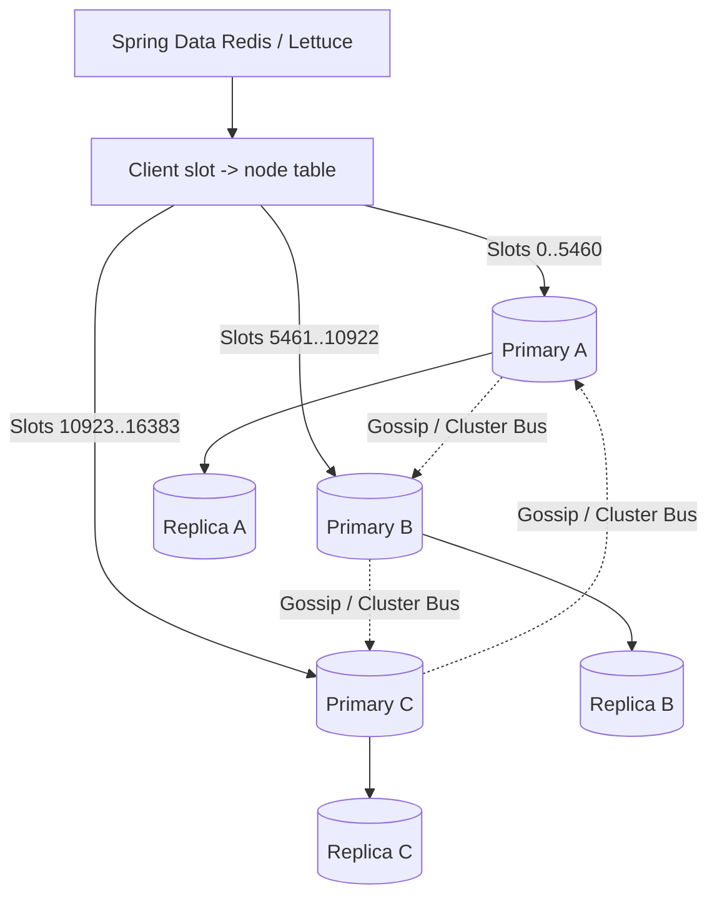
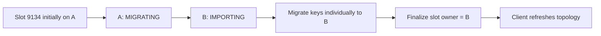
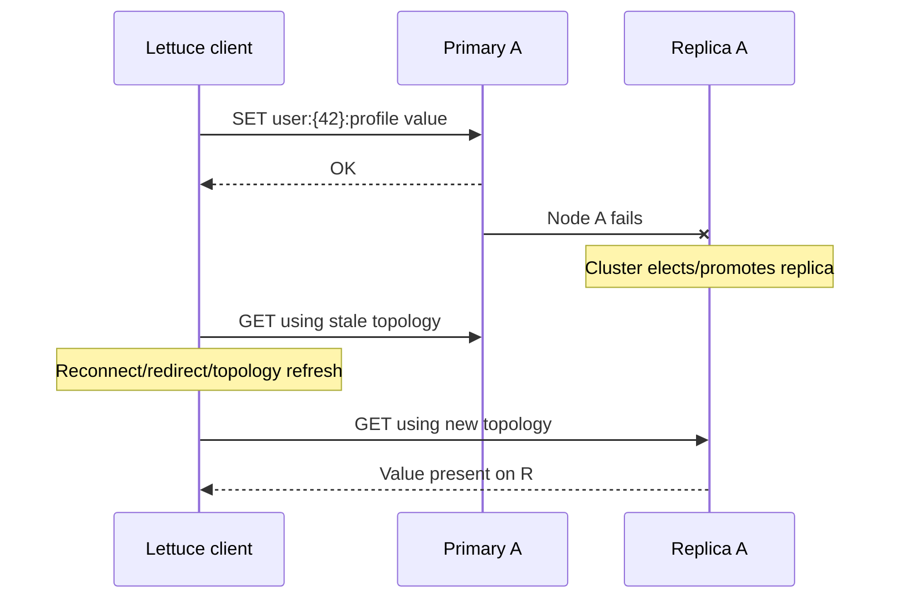
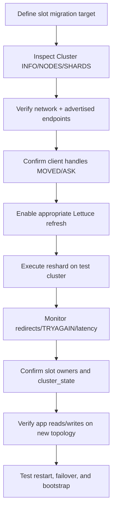

# Topology Changes, Resharding, and Node Refresh in Redis Cluster

## 1. Why does a running application suddenly receive `MOVED`?

Suppose a Spring Boot service stores shopping carts in Redis Cluster:

```java
redis.opsForValue().set("cart:{u-42}:status", "CHECKOUT");
String status = redis.opsForValue().get("cart:{u-42}:status");
```

Initially, commands run normally. Operations then adds a new Redis primary and migrates several hash slots to it to balance load. During this process, a Redis client may still hold a **stale routing table**: it thinks the slot containing `cart:{u-42}:status` is managed by node A, whereas the slot has now moved to node B.

When the client sends a command to A, Redis can respond:

```text
-MOVED 9134 10.0.0.22:6379
```

This message does not mean Redis lost data or the key is invalid. It means **hash slot 9134 is now served by a different node** and the client must adjust its route. During an incomplete data migration window, the client may also encounter:

```text
-ASK 9134 10.0.0.22:6379
```

These two redirects **do not mean the same thing**:

- **`MOVED`** typically signals a **change in slot ownership**, so the client should refresh its topology and send future commands to the new node.
- **`ASK`** signals a **temporary redirect for a single command** while a slot is in transit. The client must send `ASKING` to the target before sending that command; never treat `ASK` as proof that every key in the slot has changed owner.

Redis Cluster relies on topology-aware clients. In Spring Data Redis applications using **Lettuce**, automatic redirect handling and node information refreshing are crucial for keeping the application operating smoothly when the cluster reshards, adds/removes nodes, or fails over.

This lesson explains the Redis Cluster mechanics, Spring Data Redis/Lettuce configuration, topology refresh strategies, real-world operational pitfalls, and safe testing without affecting production.

## 2. How does Redis Cluster partition data?

Redis Cluster divides the keyspace into **16,384 hash slots**, numbered 0 through 16,383. Every key maps to a slot, and in a steady-state topology each slot is owned by one primary node.

```text
16,384 hash slots
┌───────────────────────────────────────────────────┐
│ 0 ... 5460 │ 5461 ... 10922 │ 10923 ... 16383    │
└──────┬─────┴────────┬────────┴───────────┬────────┘
       │              │                    │
       ▼              ▼                    ▼
   Primary A       Primary B           Primary C
       │              │                    │
   Replica A       Replica B            Replica C
```

This diagram illustrates just one slot distribution scheme. In practice, each primary can own multiple non-contiguous slot ranges. Replicas support replication and failover rather than acting as default slot owners for writes.

### 2.1. How slots are determined

In principle:

```text
slot = CRC16(hash-input) mod 16384
```

Normally, `hash-input` is the full key. If the key contains a **valid hash tag** inside curly braces, Redis hashes only the substring inside those braces to calculate the slot:

```text
cart:{u-42}:status
cart:{u-42}:items
cart:{u-42}:total
```

All three keys share the hash tag `u-42`, and therefore belong to the same hash slot.

Verify with Redis CLI:

```redis
CLUSTER KEYSLOT cart:{u-42}:status
CLUSTER KEYSLOT cart:{u-42}:items
CLUSTER KEYSLOT cart:{u-42}:total
```

All three commands must return the same slot number. Never guess slot numbers from documentation; the value returned by the cluster is the authoritative reference.

### 2.2. Why do hash tags matter during resharding?

Redis Cluster enforces constraints on commands accessing multiple keys. Example:

```redis
MGET cart:{u-42}:status cart:{u-42}:total
```

Both keys share a slot and can therefore be handled under Redis Cluster's multi-key rules. If you use keys belonging to two users with different tags:

```redis
MGET cart:{u-42}:status cart:{u-99}:status
```

Redis can return `CROSSSLOT` because a multi-key command requires a shared slot.

Having keys in the same slot **does not guarantee every multi-key operation succeeds while the slot is migrating**: during resharding, some keys may still be at the source while others have moved to the target; Redis may return temporary errors such as `TRYAGAIN` for multi-key operations.

**Never put all application keys under a single hash tag** just to avoid `CROSSSLOT`. Doing so piles every key into one slot and defeats Redis Cluster's load distribution.

## 3. Topology is more than an IP list

A Redis client needs to know several things:

1. Which primaries currently exist.
2. Which hash slots each primary owns.
3. Which replicas belong to which primaries.
4. Which nodes changed roles after a failover.
5. Which addresses Redis **advertises** to peer nodes and clients.
6. Which topology transitions are currently in progress across the cluster.



Redis nodes exchange topology metadata over the cluster bus. The cluster uses **configuration epochs** and state propagation to resolve slot ownership when topology changes. Clients do not run the gossip protocol themselves; clients query topology from nodes and handle redirects.

**Note:** a client may hold a topology snapshot **from a slightly different moment** than Redis nodes. Therefore, the client's topology cache is mutable state that must be refreshed, not a static configuration fixed for the JVM's lifetime.

## 4. Why does topology change?

| Event | What Changes | Impact on Client |
|---|---|---|
| Adding a primary | A new node joins, initially owning no slots | Must learn the new node once slots are assigned |
| Resharding | Moves slots and their keys from one primary to another | May encounter `ASK`, `MOVED`, temporary errors |
| Rebalancing | Redistributes slots to even out load | Multiple slots change owners; client must refresh |
| Primary failover | A replica is promoted to primary | Address/role/slot owner can change |
| Removing a node | Slots must move away or roles shift before removal | Old seed endpoints may become unreachable |
| Network partition | Nodes hold divergent topology views briefly | Redirects, timeouts, `CLUSTERDOWN` |
| Changing advertised addresses | Client-facing IP/hostname/port changes | Must refresh endpoints and fix networking |
| Rolling upgrade | Nodes restart or swap roles sequentially during maintenance | Reconnects and topology updates |

**Resharding** is migrating slot ownership (and its keys) between primaries. **Rebalancing** is deciding how to redistribute many slots to reduce load skew. They are related yet distinct: a cluster can reshard specific slots purposefully without rebalancing total slot counts evenly.

## 5. Steady state vs. resharding phase

In steady state:

```text
Slot 9134
  owner: Primary A
  keys in slot: on A
  GET/SET -> A
```

When moving a slot from A to B, a resharding workflow normally:

1. Sets the slot to **`MIGRATING` state** on source node A.
2. Sets the slot to **`IMPORTING` state** on target node B.
3. Migrates keys in that slot from A to B in batches.
4. Once migration finishes, updates official slot ownership to B.
5. Propagates the new topology to peer nodes and clients.



During migration, keys in the same slot may **temporarily not reside on the same node**. Redis uses `ASK` responses to steer clients to the temporary target before ownership shifts completely.

### 5.1. Why not simply flip the slot table first and copy keys afterward?

If ownership of the entire slot were flipped to B while most keys still lived on A, incoming requests would hit B before data arrived. Conversely, copying keys without managing a transition phase would let reads and writes land on the wrong node.

The `MIGRATING`/`IMPORTING` mechanism and redirects let Redis distinguish:

- Which node is still considered the slot owner.
- Which keys remain at the source.
- Which requests must temporarily forward to the destination.
- When new ownership can safely be announced.

This is a routing mechanism during transition, not a global transaction locking all application traffic until migration completes.

## 6. MOVED: redirect signaling a persistent topology shift

Suppose the client holds an old map:

```text
slot 9134 -> A
```

while the cluster has updated to:

```text
slot 9134 -> B
```

The client sends:

```redis
GET cart:{u-42}:status
```

to A and receives a response like:

```text
MOVED 9134 10.0.0.22:6379
```

A cluster-aware client forwards the request to the right node and **updates routing info** or triggers a topology refresh per driver mechanics.

### 6.1. Three parts of MOVED

```text
MOVED <slot> <host>:<port>
```

- `MOVED`: redirect type.
- `<slot>`: the hash slot of the command's key.
- `<host>:<port>`: the Redis node endpoint authorized to serve that slot according to the responding node.

Redis may advertise a hostname or IP based on cluster configuration, not necessarily the bootstrap IP you originally connected to.

**Do not catch `MOVED` in a service and translate it into "Redis missing key".** It is a routing signal; a Cluster driver like Lettuce must handle it.

### 6.2. MOVED does not require applications to recalculate keys

The key `cart:{u-42}:status` still maps to the exact same hash slot even after the slot moves from A to B. The application does not rename keys, manually re-hash, or spray `GET` across all nodes to find data.

Only the client's **slot → node mapping table** needs updating.

## 7. ASK: temporary redirect during slot migration

While a slot is `MIGRATING` on A and `IMPORTING` on B, Redis can reply:

```text
ASK 9134 10.0.0.22:6379
```

Unlike `MOVED`, `ASK` **does not mean B permanently owns the entire slot**. It simply instructs the client to run **this specific command** on B.

The client handles it by sending `ASKING` to B, followed by the command itself over the **same connection**:

```text
Client                        Node A                  Node B
   | GET key                     |                        |
   |---------------------------->|                        |
   |<----------------------------| ASK 9134 B             |
   |                                                      |
   | ASKING                                              |
   |----------------------------------------------------->|
   |<-----------------------------------------------------| OK
   | GET key                                              |
   |----------------------------------------------------->|
   |<-----------------------------------------------------| value
```

`ASKING` tells node B to permit one request against an importing slot during the handoff window.

### 7.1. Why distinguish ASK from MOVED?

| Characteristic | `MOVED` | `ASK` |
|---|---|---|
| Primary meaning | Slot must route to another owner | This specific command must go temporarily to the target node |
| Common occurrence | After ownership change, stale client topology | While slot is actively migrating/importing |
| Must send `ASKING`? | No | **Yes**, right before the command on the target node |
| Update long-term slot route? | Yes, typically triggers refresh | **Not from ASK alone** |
| Cluster-aware Redis client | Handles redirect per MOVED semantics | Handles redirect and `ASKING` per ASK semantics |

A common bug is treating every redirect like `MOVED` and immediately updating the slot table upon receiving `ASK`. While the source still owns the slot and unmigrated keys remain on it, updating the route for the whole slot prematurely misroutes subsequent commands to the wrong node.

### 7.2. ASK does not guarantee every multi-key command succeeds

During the window where some keys have moved to B and others remain on A, a same-slot multi-key operation can encounter `TRYAGAIN` or transition errors. Configure bounded retries and consider idempotency rather than assuming resharding is completely invisible to every business operation.

## 8. Redis Cluster responses to distinguish

| Response | General Meaning | How App / Driver Should Handle |
|---|---|---|
| `MOVED` | Slot belongs to another node in current topology | Redirect, refresh routing table |
| `ASK` | Temporary redirect during migration | Send `ASKING` on target node, then execute command |
| `TRYAGAIN` | Transient condition preventing completion, e.g., multi-key on migrating slot | Bounded retry with backoff when appropriate |
| `CROSSSLOT` | Multi-key command references keys in different slots | Fix key/hash tag design or split operation |
| `CLUSTERDOWN` | Cluster cannot serve commands under current state/config | Investigate coverage, failover, connectivity |
| Timeout / connection lost | Unclear whether command executed | Verify outcome; avoid blind replay of non-idempotent ops |
| `READONLY` | Write sent to a replica or non-writable node | Refresh roles/topology; check routing and read policy |

**Never handle all errors with an infinite retry loop.** `CROSSSLOT` is usually a design defect needing a fix, whereas `TRYAGAIN` may be transient; write timeouts have completely different semantics from an explicit `MOVED`.

## 9. Topology refresh on the Lettuce side

Redis Cluster does not proactively push full, instantaneous, mandatory updates to every external Redis client whenever a slot changes owner. Clients must actively maintain topology:

```text
Startup:
  seed nodes -> query CLUSTER SLOTS/SHARDS/NODES per client -> build slot->node table

Runtime:
  route commands using held table
      |
      +-- Success: continue
      |
      +-- MOVED/ASK: handle redirect
      |
      +-- Adaptive refresh trigger: query new topology
      |
      +-- Periodic refresh: refresh on schedule if enabled
```

In Spring Data Redis, Lettuce is normally the default driver when using the Spring Boot starter. Lettuce supports **topology refresh** for Redis Cluster, offering both scheduled and event-driven refreshes.

### 9.1. Periodic topology refresh

**Periodic refresh** instructs Lettuce to periodically fetch fresh topology from Redis. Example with a 30-second interval:

```java
ClusterTopologyRefreshOptions refresh =
    ClusterTopologyRefreshOptions.builder()
        .enablePeriodicRefresh(Duration.ofSeconds(30))
        .build();
```

Benefits:

- Updates topology even when no code paths are hitting redirects.
- Picks up new nodes/roles on a regular schedule.
- Reduces stale routing tables in low-traffic applications.

Trade-offs:

- Each client instance runs its own refreshes, issuing topology queries to the cluster.
- Across thousands of JVMs with very short intervals, topology-query traffic can add noticeable overhead.
- Scheduled refresh **does not prevent** `MOVED` responses in the window between two refreshes.

Do not set a 1-second interval across all instances just hoping to keep topology "always fresh". Weigh cluster churn rate, fleet size, desired recovery latency, and Redis capacity.

### 9.2. Adaptive topology refresh

**Adaptive refresh** lets Lettuce trigger a topology fetch upon runtime signals such as:

- `MOVED` or `ASK` redirects.
- Repeated failed reconnects.
- Encountering an uncovered slot in client topology.
- Encountering an unknown node under driver conditions.

Example:

```java
ClusterTopologyRefreshOptions refresh =
    ClusterTopologyRefreshOptions.builder()
        .enableAllAdaptiveRefreshTriggers()
        .build();
```

Benefit: when a change actually occurs, the client does not have to wait for a long periodic timer to expire before reacting.

**Note:** enabling adaptive triggers does not fix network reachability, ACL permissions, or advertised addresses unreachable from clients. It solely enables proactive topology rediscovery.

### 9.3. Combining both

A configuration commonly worth considering:

```java
ClusterTopologyRefreshOptions refresh =
    ClusterTopologyRefreshOptions.builder()
        .enablePeriodicRefresh(Duration.ofSeconds(30))
        .enableAllAdaptiveRefreshTriggers()
        .build();
```

Periodic refresh covers changes when no redirects occur; adaptive refresh reacts quickly to runtime signals.

Adaptive refresh includes built-in rate throttling to avoid refreshing continuously while a cluster is unstable. A burst of commands receiving `MOVED` **does not mean every single command spawns a separate topology fetch**.

## 10. Configuring Spring Data Redis with Lettuce Cluster

Example using Spring Boot 3.x, Java 17+, and a Redis Cluster with multiple primaries and replicas.

### 10.1. Dependencies and declaring seed nodes

```groovy
dependencies {
    implementation 'org.springframework.boot:spring-boot-starter-data-redis'
}
```

When using Spring Boot auto-configuration:

```yaml
spring:
  data:
    redis:
      cluster:
        nodes:
          - redis-0.internal:6379
          - redis-1.internal:6379
          - redis-2.internal:6379
        max-redirects: 5
      timeout: 3s
```

These are **seed nodes for bootstrapping topology**, not a static map of "which key goes to which node". Upon connecting, the driver discovers slot ownership and any other cluster nodes.

`max-redirects` caps how many redirects the Redis client follows during a request chain. This limit cannot fix unhealthy networking; if topology churns continuously beyond the limit, requests will fail.

### 10.2. Java config enabling periodic and adaptive refresh

You can configure `LettuceConnectionFactory` explicitly:

```java
package com.example.redis.config;

import java.time.Duration;

import io.lettuce.core.cluster.ClusterClientOptions;
import io.lettuce.core.cluster.ClusterTopologyRefreshOptions;

import org.springframework.context.annotation.Bean;
import org.springframework.context.annotation.Configuration;
import org.springframework.data.redis.connection.RedisClusterConfiguration;
import org.springframework.data.redis.connection.lettuce.LettuceClientConfiguration;
import org.springframework.data.redis.connection.lettuce.LettuceConnectionFactory;

@Configuration
public class RedisClusterConnectionConfig {

    @Bean
    LettuceConnectionFactory redisConnectionFactory() {
        RedisClusterConfiguration cluster =
            new RedisClusterConfiguration();

        cluster.clusterNode("redis-0.internal", 6379);
        cluster.clusterNode("redis-1.internal", 6379);
        cluster.clusterNode("redis-2.internal", 6379);
        cluster.setMaxRedirects(5);

        ClusterTopologyRefreshOptions refreshOptions =
            ClusterTopologyRefreshOptions.builder()
                .enablePeriodicRefresh(Duration.ofSeconds(30))
                .enableAllAdaptiveRefreshTriggers()
                .build();

        ClusterClientOptions clusterOptions =
            ClusterClientOptions.builder()
                .topologyRefreshOptions(refreshOptions)
                .build();

        LettuceClientConfiguration clientConfig =
            LettuceClientConfiguration.builder()
                .clientOptions(clusterOptions)
                .commandTimeout(Duration.ofSeconds(3))
                .build();

        return new LettuceConnectionFactory(cluster, clientConfig);
    }
}
```

Meaning:

1. `RedisClusterConfiguration` holds bootstrap addresses.
2. `LettuceClientConfiguration` holds driver configuration.
3. `ClusterTopologyRefreshOptions` enables both periodic and adaptive refresh.
4. `LettuceConnectionFactory` supplies connections to Spring Data Redis templates.
5. When the cluster changes, Lettuce handles redirects and refreshes topology automatically.

**Scope note:** this is an **alternative** to relying entirely on Boot's Redis connection auto-configuration. Do not register a second connection factory in the same context without clearly controlling which bean gets injected.

Classes and builder methods belong to their respective Lettuce/Spring Data Redis lines; when targeting another project version, verify Javadocs of resolved dependencies before copying verbatim into production.

### 10.3. Using StringRedisTemplate after connecting

A simple service:

```java
import org.springframework.data.redis.core.StringRedisTemplate;
import org.springframework.stereotype.Service;

@Service
public class CartStatusStore {

    private final StringRedisTemplate redis;

    public CartStatusStore(StringRedisTemplate redis) {
        this.redis = redis;
    }

    public void save(String userId, String status) {
        redis.opsForValue().set(
            "cart:{" + userId + "}:status", status
        );
    }

    public String find(String userId) {
        return redis.opsForValue().get(
            "cart:{" + userId + "}:status"
        );
    }
}
```

The client invokes the template like a normal Redis application. Hash slot computation, node selection, and MOVED/ASK handling are managed by the driver, provided the connection factory is configured for Redis Cluster.

**Never catch `MOVED` in the business layer and spray `GET` across every node.** That both spikes load and risks reading wrong data during resharding.

## 11. Spring Boot auto-configuration and customizing Lettuce

If you prefer keeping most Boot config in `application.yml`, consider `LettuceClientConfigurationBuilderCustomizer` to customize the Boot-created builder, depending on your Boot/Spring Data Redis version.

Ensure client options match your Redis topology type (Cluster differs from standalone/Sentinel). In a real project:

- Verify whether `LettuceConnectionFactory` is auto-configured by Boot or manually defined.
- Confirm `RedisClusterConfiguration` is active, not `RedisStandaloneConfiguration`.
- Ensure `ClusterTopologyRefreshOptions` is attached to `ClusterClientOptions` on the active Lettuce client.
- Avoid accidentally creating two factories causing `StringRedisTemplate` and `ReactiveRedisTemplate` to route differently.

**Boot property names and builder APIs evolve across versions.** Simply seeing `spring.data.redis.cluster.nodes` does not prove periodic/adaptive refresh is configured as intended; verify the effective driver configuration.

## 12. Seed nodes, dynamic refresh sources, and advertised addresses

A common Redis Cluster deployment issue: **the client connects to a seed node yet cannot reach the nodes returned by the cluster**.

Example:

```text
Client outside Kubernetes:
  connects to seed redis.example.com:7000 -> succeeds

Redis CLUSTER SLOTS/NODES returns:
  10.244.1.12:6379
  10.244.2.17:6379
  10.244.3.19:6379

External client cannot route to internal pod IPs.
Result: refresh fetches topology, yet data commands still time out.
```

The root cause is not `maxRedirects`, nor can it be fixed by refreshing more often. Redis nodes must advertise **addresses reachable from the client's network**, or infrastructure must provide driver-supported proxy/translation/topology mapping.

### 12.1. Network settings affecting discovery

Redis Cluster has server settings governing advertised addresses, such as:

```text
cluster-announce-ip
cluster-announce-port
cluster-announce-bus-port
```

Exact directive names and hostname support depend on the Redis version. Beyond the client command port, Redis nodes must also communicate over the **cluster bus port** per your infrastructure topology.

A cluster can report `cluster_state:ok` internally while external applications fail because advertised endpoints are unreachable. Always test from the **application's network location**, not solely by running `redis-cli` on a Redis host.

### 12.2. Dynamic topology refresh sources

Lettuce can use nodes learned from topology as sources for subsequent refreshes. This keeps discovery working even if an initial seed is decommissioned, with trade-offs:

- Learned nodes must be reachable from the client.
- ACLs must allow the required topology queries.
- If Redis advertises internal-only addresses, using dynamic refresh sources can spread connection failures across more nodes.
- With proxies or specialized managed Redis offerings, consult provider docs on cluster topology discovery support.

Never toggle dynamic refresh sources blindly by guesswork. First inspect advertised endpoints, DNS, networking, TLS, and actual reachability.

## 13. When is resharding considered complete?

A resharding run is not finished simply because a few keys have appeared on the target node. Verify:

1. All planned slots have transitioned to the new owner.
2. Source/target nodes no longer hold leftover importing/migrating states for completed slots.
3. Updated slot ownership has propagated and the cluster is healthy for serving traffic.
4. Replicas of the new primary are synced per HA policy.
5. Clients have refreshed topology and are no longer seeing abnormal redirect/error spikes.
6. Latency, CPU, memory, and network have returned to normal operating bounds.

```text
In progress:
  A: slot 9134 migrating
  B: slot 9134 importing
  Client: sees ASK / TRYAGAIN

After completion:
  B: owns slot 9134
  Stale client: may receive MOVED
  Refreshed client: routes directly to B
```

Redis finalizing slot ownership does not mean every JVM receives the updated topology in the exact same microsecond. Redirect handling must remain active **even when periodic refresh is enabled**.

## 14. Redis commands for inspecting topology

In Redis CLI connected to a cluster node:

```redis
CLUSTER INFO
CLUSTER NODES
CLUSTER SLOTS
```

On Redis 7.0+, also available:

```redis
CLUSTER SHARDS
```

Meaning:

| Command | Common Information |
|---|---|
| `CLUSTER INFO` | Overall cluster status, assigned/ok/pfail/fail slot counts |
| `CLUSTER NODES` | Node IDs, roles, link state, config epochs, slot ranges, migration flags |
| `CLUSTER SLOTS` | Slot range mappings to primaries and replicas |
| `CLUSTER SHARDS` | Structured shard, node, role, and endpoint descriptions |
| `CLUSTER KEYSLOT key` | Hash slot of a specific key |
| `CLUSTER COUNTKEYSINSLOT slot` | Number of keys in a slot on the queried node |
| `CLUSTER GETKEYSINSLOT slot count` | Sample of keys in a slot on the queried node |

Example snippet of `CLUSTER INFO`:

```text
cluster_state:ok
cluster_slots_assigned:16384
cluster_slots_ok:16384
cluster_slots_pfail:0
cluster_slots_fail:0
cluster_known_nodes:6
```

This is **illustrative output**, not the live status of a real cluster.

### 14.1. Reading CLUSTER NODES accurately

A `CLUSTER NODES` line has the format:

```text
<node-id> <address> <flags> <master-id> <ping> <pong> <config-epoch> <link-state> <slots>
```

- `flags` indicates role/status such as master, slave/replica, or fail.
- `master-id` identifies the replica's primary when applicable.
- `config-epoch` reflects configuration generation.
- `slots` lists slot ranges owned by the node, plus any importing/migrating markers.

During active resharding, do not assume a single node's `CLUSTER NODES` view guarantees every node across the cluster has converged simultaneously. Inspect multiple nodes if investigating discrepancies.

### 14.2. Avoid expensive scan commands

`CLUSTER GETKEYSINSLOT` and `CLUSTER COUNTKEYSINSLOT` are helpful for inspecting a single slot, yet never scan all production data merely because topology looks off. On a cluster, `SCAN` executes **per node**, not as a consistent cluster-wide scan during slot migrations.

Commands like `KEYS *` impose heavy blocking load; never run them on large production nodes to "hunt down migrated keys".

## 15. Performing resharding with redis-cli

On a **dedicated test cluster** with a seed node at `127.0.0.1:7000`, Redis CLI provides administrative subcommands:

```text
redis-cli --cluster check 127.0.0.1:7000
redis-cli --cluster reshard 127.0.0.1:7000
redis-cli --cluster rebalance 127.0.0.1:7000
```

Concepts:

- `check`: inspects slot allocation and topology consistency per the tool's checks.
- `reshard`: migrates a specified number of slots from source nodes to a target node.
- `rebalance`: redistributes slots across nodes per the tool's balancing logic.

**Never run `reshard`/`rebalance` on production just to practice.** They actively mutate slot ownership, trigger redirects, and increase network/CPU load; production changes require maintenance windows and rollback plans.

### 15.1. A safe test workflow

1. Use an isolated test Redis Cluster (e.g., three primaries, three replicas).
2. Write a set of keys with clear prefixes.
3. Record initial topology via `CLUSTER NODES` and `CLUSTER SLOTS`.
4. Use `CLUSTER KEYSLOT` to find a test key's slot.
5. Run a steady read/write loop via Spring Data Redis.
6. In a separate terminal, run `redis-cli --cluster reshard` moving a low-traffic slot range.
7. Observe `ASK`/`MOVED`, request latency, errors, and client state.
8. Once resharding finishes, verify the new slot owner and confirm the app still reads correct values.
9. Conclude the test and note any shortcomings in your refresh settings.

If operations uses a Kubernetes operator or managed Redis, always use the platform's own resharding workflow. Never manually issue `CLUSTER SETSLOT` or `MIGRATE` on a cluster orchestrated by an external controller.

## 16. Demonstrating MOVED directly with redis-cli

Redis CLI provides the `-c` flag to follow redirects in Redis Cluster automatically:

```text
redis-cli -c -h 127.0.0.1 -p 7000 GET 'cart:{u-42}:status'
```

Without cluster mode enabled, you can observe the raw redirect:

```text
redis-cli -h 127.0.0.1 -p 7000 GET 'cart:{u-42}:status'
-> MOVED <slot> <host>:<port>
```

This contrasts a **client ignoring redirects** with a **cluster-aware client**. With `redis-cli -c`, the CLI follows MOVED/ASK on your behalf.

However, **never treat `redis-cli -c` succeeding as proof that Spring Data Redis is configured properly**: your Java service may use different seeds, TLS, client options, or sit in a subnet unable to reach advertised node endpoints.

### 16.1. Why shouldn't Java services send ASKING manually?

The Redis Cluster driver manages the ASK/ASKING sequence on the same connection automatically. If an application manually calls `ASKING` via one `RedisTemplate` invocation and `GET` via another, they may use different connections and break protocol semantics.

Only issue `ASKING` manually when implementing a low-level client protocol or debugging interactively via CLI. In normal Spring Data Redis apps, let Lettuce handle redirects.

## 17. What happens to commands while slots are migrating?

Consider each case:

### 17.1. Independent GET/SET

A client may receive `ASK` during migration and proceed after redirecting. Once ownership finalizes, requests using stale topology receive `MOVED`; the driver updates its route and proceeds.

Do not assume every single request is error-free: network timeouts, redirect limits, or unconverged infrastructure can still cause failures.

### 17.2. MGET/MSET and multi-key operations

Keys must satisfy the same-slot rule. During resharding, if keys of a multi-key command temporarily straddle source and target, Redis may temporarily reject the command to prevent running a multi-key operation across split data.

Example:

```redis
MGET cart:{u-42}:status cart:{u-42}:total
```

Both keys share a hash tag, yet if one key has migrated while the other remains on the source, the multi-key operation may receive `TRYAGAIN` until migration advances appropriately.

### 17.3. Lua scripts and transactions

Scripts or transactions touching multiple keys must obey Redis Cluster slot limits. Given a script:

```lua
local quantity = tonumber(redis.call('GET', KEYS[1]) or '0')
local reserved = tonumber(redis.call('GET', KEYS[2]) or '0')
return quantity - reserved
```

Both keys passed via `KEYS` must sit in the same slot for Cluster multi-key execution. Resharding can introduce transient conditions requiring the script or multi-key command to retry.

**Never hardcode key names or user IDs directly into Lua source to dodge Cluster rules.** That does not change slot ownership and bloats the script SHA cache.

### 17.4. Pipelining across multiple slots

A pipeline containing commands for multiple keys may be distributed by the driver across multiple Redis nodes. Never assume an entire pipeline hits one node or executes in a global cross-shard order.

If resharding occurs mid-pipeline, some commands may succeed while others need redirect/retry. Automatic pipeline redirect/retry support depends on the driver and Spring Data Redis version; check your exact API.

Above all, **pipelining does not provide atomicity**. Never blindly replay an entire batch when partial responses error/time out, especially with `INCR`, `DECR`, or non-idempotent side effects.

## 18. Redirects, retries, and duplicate execution risk

Distinguish carefully:

**A. Client receives an explicit MOVED/ASK response.**

Here the node returned a redirect instead of executing the command via the stale route. The driver has exact information to resend the command to the proper node per Redis Cluster protocol.

**B. Client hits a timeout or connection drop.**

Here the application **does not know** whether the server executed the command. Example:

```redis
INCR order:metrics:paid
```

If the command succeeded before the reply was lost, retrying increments the counter twice. That is an idempotency problem, unsolvable by increasing `max-redirects`.

**C. Client receives TRYAGAIN.**

Bounded retries with backoff can be applied when transient. Enforce request deadlines, cap concurrency, and prevent retry storms while the cluster migrates.

Categorization:

| Category | Example | Strategy |
|---|---|---|
| Explicit redirect | MOVED, ASK | Cluster-aware driver handles |
| Transiently retryable | TRYAGAIN, certain topology transitions | Bounded retry/backoff, monitor |
| Unknown execution outcome | Timeout/disconnect after write | Verify state/idempotency before replaying |
| Design defect | CROSSSLOT | Fix key model or split operation |
| Cluster unavailable | CLUSTERDOWN | Investigate coverage/quorum/nodes; do not retry infinitely |

## 19. Topology refresh and Redis Cluster failover

Every slot is normally owned by one primary. When a primary fails, a replica can be promoted via Redis Cluster failover. The client must then update role/owner knowledge.



Two issues must be separated:

1. **Routing:** the application must locate the new primary and direct commands to it.
2. **Consistency/durability:** replication is asynchronous; a write ACKed on the old primary that had not yet reached the promoted replica risks disappearing after failover.

Refreshing topology solves **node addressing and ownership**, **not guaranteeing every prior write survived on the new primary**.

Therefore, failover tests must check both:

- The application reconnects and resumes operations.
- Whether critical data can be lost or stale under the business contract.
- Whether retries on write operations are safe.

## 20. Redis Cluster and Replica reads

Some applications enable Lettuce `ReadFrom.REPLICA_PREFERRED` or similar policies to distribute read traffic.

In Redis Cluster:

- Topology tracks both primaries and replicas.
- The driver can route read-eligible commands to replicas per policy.
- Replicas can lag behind primaries due to asynchronous replication.
- After failover or resharding, the driver must learn updated roles and slot mappings.

**Accurate topology refresh does not eliminate stale reads from replicas.** Even a completely up-to-date topology can point accurately to a replica lagging behind its primary.

For reads needing immediate read-after-write accuracy or checking permissions/balances, read from the current primary or an authoritative datastore rather than enabling replica reads globally.

## 21. Unreachable node address errors

Suppose Redis replies:

```text
MOVED 9134 10.244.2.17:6379
```

while Spring Boot runs outside Kubernetes and can only reach `redis.company.internal:7000`. Then:

```text
Application -> seed: succeeds
Application -> CLUSTER SLOTS: returns results
Application -> 10.244.2.17:6379: network unreachable
Application -> retry/refresh: still receives the same unreachable address
```

Shortening `enablePeriodicRefresh(Duration.ofSeconds(5))` cannot solve reachability. Fix the network design, advertised addresses, node exposure, or driver-supported proxy setup, or use the connection method prescribed by your managed provider.

### 21.1. Network checklist

| Item | Question |
|---|---|
| Seed DNS | Can the app resolve and reach the seed nodes? |
| Advertised endpoints | Are the addresses returned by `CLUSTER SLOTS/SHARDS/NODES` reachable? |
| TLS | Does the client connect with matching protocol/certs to every node? |
| Redis ACL | Does the client have permission to query topology and execute commands? |
| Cluster bus | Can Redis nodes exchange topology/failover traffic with one another? |
| NAT/containers | Are advertised Redis endpoints rewritten or internal-only? |
| DNS TTL | Does the client pick up updated endpoints per DNS TTL policy? |
| Connection exhaustion | Are excessive clients/refreshes/reconnects piling up concurrently? |

Never start by cranking timeouts up to minutes to mask misconfigured addresses.

## 22. Permissions required for topology refresh

Lettuce must query Redis nodes for slot/node/role information. Under strict Redis ACLs:

- An app user might be granted `GET`/`SET` yet denied the Redis Cluster introspection commands required by the driver.
- Bootstrapping can fail or periodic refreshes can emit continuous permission errors.
- Some managed Redis offerings expose dedicated endpoints/proxies with ACL models differing from self-hosted OSS Redis.

Verify permissions for topology commands needed by your client/Redis version, such as `CLUSTER SLOTS` or `CLUSTER SHARDS`. Never grant full admin rights just to silence an error; follow **least privilege** tailored to driver and infrastructure requirements.

In addition, using Spring Data Redis with Redis Cluster normally restricts logical databases to **DB 0** per Redis Cluster semantics. Do not rely on `SELECT 1` to isolate tenants as in standalone Redis; use key prefixes/namespaces and proper data partitioning instead.

## 23. Practical verification of a Spring Data Redis app

A test should exercise multiple keys across multiple slots:

```java
import java.util.List;

import org.springframework.data.redis.core.StringRedisTemplate;

public class ClusterSmokeProbe {

    private final StringRedisTemplate redis;

    public ClusterSmokeProbe(StringRedisTemplate redis) {
        this.redis = redis;
    }

    public void run() {
        for (String userId : List.of("u-1", "u-2", "u-3", "u-4")) {
            String key = "cluster:test:{" + userId + "}:status";
            String value = "READY-" + userId;

            redis.opsForValue().set(key, value);
            String actual = redis.opsForValue().get(key);

            if (!value.equals(actual)) {
                throw new IllegalStateException(
                    "Unexpected value for " + key
                );
            }
        }
    }
}
```

This is a simple smoke test. It does not induce resharding, measure latency, or prove all retry paths are safe. In testing, use an isolated keyspace with proper TTLs/cleanup, and never leave probe keys behind in production clusters.

### 23.1. Running resharding on the test cluster during the smoke test

A thorough test should capture:

1. Before/after slot owners for the test keys.
2. `MOVED`/`ASK`/`TRYAGAIN` counts where driver metrics/logs expose them.
3. Command timeouts/reconnects.
4. `GET`/`SET` p50/p95/p99 latency.
5. Error rates during the reshard window.
6. Time until the client stops using stale topology after resharding finishes.
7. Final data read accuracy.

In multi-instance tests, observe at least one setup with periodic+adaptive refresh alongside an alternative config in an isolated environment if comparing behavior. Start with moderate throughput rather than blasting peak load immediately.

### 23.2. Never assume one passing smoke test is enough

On a steady cluster, redirects can resolve quickly and smoke tests always pass. Subtle failures surface during:

- Active resharding.
- A node leaving the cluster while connection pools still hold old sessions.
- A new node advertising an endpoint in a different network scope than clients.
- Redis ACLs blocking topology reads.
- Pipelines/scripts/transactions touching migrating keys.
- A write timing out after server execution.

To confirm resilience to topology changes, run operational tests simulating these scenarios in an isolated environment.

## 24. Metrics and monitoring during topology changes

| Metric Group | Examples to Watch | Action on Abnormal Spikes |
|---|---|---|
| Redirects | `MOVED`/`ASK` per minute | Check resharding and client refresh |
| Retries | `TRYAGAIN`, retry counts, delays | Throttle reshard rate or tune retry policy |
| Connections | Reconnects/timeouts per node | Check node health, DNS, and networking |
| Topology | Node count, slot coverage, failover events | Cross-check against planned reshard/rebalance |
| Availability | `CLUSTERDOWN` rate, unassigned slots | Restore cluster state and slot ownership |
| Performance | `GET`/`SET` p95/p99, command queues | Shed load or adjust batching/concurrency |
| Replication | Replica lag, link status | Guard against stale reads and lost writes |
| Memory | Used memory per shard | Check data skew and rebalancing needs |
| Network | Bytes/s, errors, active connections | Detect migration or refresh traffic overhead |

### 24.1. Distinguishing brief transitions from persistent failures

A brief burst of `MOVED` right as resharding finishes is normal for clients holding slightly stale snapshots. However:

```text
Continuous MOVED/ASK for hours
  +
Redis topology is no longer changing
  +
Rising command timeouts
```

signals that the client cannot refresh, Redis nodes have not converged, advertised addresses are wrong, or connection routing is unstable.

Do not count redirects alone. Track **whether commands succeed after redirecting**, and whether errors cluster around specific slots or nodes.

### 24.2. Useful CLI commands

```redis
CLUSTER INFO
CLUSTER NODES
CLUSTER SLOTS
INFO replication
INFO stats
INFO commandstats
```

When inspecting a cluster, `INFO` reflects only the **currently connected node**, not an automatic aggregate of all nodes. Scrape metrics per node and aggregate with explicit node/role labels.

## 25. Case study: app restarts after a seed node was removed

Suppose old config had only:

```yaml
spring:
  data:
    redis:
      cluster:
        nodes:
          - redis-old.internal:6379
```

After resharding/rebalancing and decommissioning that node, an already-running JVM may continue working because it already discovered the remaining nodes. Yet **a newly restarted instance** can fail to bootstrap because the seed is gone.

Therefore:

- List multiple independent seed nodes where appropriate.
- Update seed configuration whenever nodes are replaced.
- Test bootstrap health after restarts, not only live-running client health.
- Use the discovery endpoint recommended by your provider for managed clusters.

An in-memory topology table on surviving JVMs cannot save a fresh JVM that has never connected if all configured seed endpoints are dead.

## 26. Case study: topology changes in Kubernetes

In Kubernetes, pod IPs can change on restarts, rescheduling, or failovers. If Redis Cluster advertises pod IPs unreachable from another application network, clients may work initially and fail after topology churn.

A consistent design must settle:

1. How each Redis node receives a stable identity.
2. Which advertised endpoint all Redis clients can reach.
3. How the Redis Cluster bus routes between Redis nodes.
4. TLS, DNS, and network policies per endpoint.
5. Which operator or managed service orchestrates resharding and failover.
6. How Lettuce fetches topology from seeds and refreshes it.

Never hardcode pod IPs into code as a static slot map. Use reliable discovery and verify behavior after induced node churn.

## 27. Resharding can impact performance

Migrating keys consumes resources:

- Redis processes migration commands and updates slot metadata.
- Network transfers payloads from source to target.
- CPU and memory rise depending on key count and value sizes.
- Command latency can climb while the cluster is under load.
- Clients may experience extra redirects, reconnects, and retries.

Two slots with identical key counts can have vastly different migration costs:

```text
Slot A: 10,000 keys × 200 bytes   ≈ a few MB
Slot B:    100 keys × 10 MB       ≈ around 1 GB
```

Hence, **equal slot counts do not guarantee balanced memory or CPU**. Some slots hold huge or hot keys and carry heavier load. Monitor actual payload sizes, hot keys, command rates, and per-primary headroom.

### 27.1. Operational recommendations

- Run resharding/rebalancing in planned, bounded batches.
- Watch p95/p99 latency, error rates, and CPU/network.
- Prefer off-peak hours for large datasets or strict latency SLOs.
- Keep a plan to pause or throttle migration if SLAs degrade.
- Avoid overlapping unrelated major infrastructure changes.
- Never run manual topology commands against a cluster managed by an operator.

## 28. Common misconceptions

### "Redis Cluster has 16,384 primary nodes"

No. There are 16,384 **hash slots** distributed across primary nodes; the primary count is typically far smaller.

### "MOVED means the key was deleted"

No. MOVED reports a change in which node serves the slot, not whether the key exists.

### "ASK means the entire slot permanently changed owner"

No. ASK is a temporary redirect for the current command; clients must send ASKING before the command to the target and must not permanently reassign the whole slot from ASK alone.

### "Enabling periodic refresh guarantees zero MOVED errors"

No. Gaps exist between refresh intervals, and nodes can shift right after a snapshot is fetched.

### "If adaptive refresh works, networking doesn't matter"

No. If advertised endpoints are unreachable, refreshes merely keep learning addresses the client cannot connect to.

### "Seed nodes must list every node in the cluster"

Not strictly required. Seeds bootstrap discovery; the driver discovers the rest from Redis. Still, list multiple reliable bootstrap endpoints and update them when nodes are retired.

### "Every Redis key changes slot during resharding"

No. A key's hash slot stays the same; slot ownership changes. Keys do not need renaming.

### "Same-tag keys always succeed in multi-key ops during resharding"

No. Mid-migration, keys can briefly straddle source and target, triggering `TRYAGAIN`.

### "Just raising maxRedirects fixes every error"

No. It does not fix `CROSSSLOT`, `CLUSTERDOWN`, ACLs, DNS, timeouts, or writes whose responses were lost.

### "A write timeout can always be safely retried"

No. The server may have already executed the command; retrying `INCR`/`DECR` can double side effects.

### "Cluster refresh fixes stale replica reads"

No. Refreshing updates routing; it does not alter asynchronous replication lag.

### "If redis-cli -c works, every Java client will work"

No. Java services have distinct driver options, TLS, DNS, and network paths. Always test from the application's actual runtime environment.

### "Rebalancing 16,384 slots evenly guarantees equal CPU and RAM"

No. Key sizes, hot-key ratios, and throughput can vary wildly across slots.

### "One node reporting cluster_state:ok means all clients hold the new topology"

No. Clients keep their own routing tables and need refresh/redirect mechanisms.

## 29. Pre- and post-resharding verification flow



Operational checklist:

1. Know which slots are moving, the source node, and the target node.
2. Confirm both nodes are healthy and the cluster advertises reachable endpoints.
3. Confirm the driver uses a real Redis Cluster connection, not a standalone connection to one seed.
4. Tune redirect limits and command timeouts to match SLAs.
5. Consider combining periodic and adaptive topology refresh.
6. Design bounded retry/backoff for transient errors without blindly replaying non-idempotent writes.
7. Verify multi-key commands, Lua, transactions, and pipelines affecting migrating slots.
8. Measure before/after metrics: p95 latency, error rate, reconnects, Redis CPU/network.
9. Test restarting an instance after an old seed node is removed.
10. Assess replication/failover impact on durability and stale reads.

## 30. Conclusion

Redis Cluster partitions data across **16,384 hash slots**. When adding/removing nodes, resharding, or failing over, **slot ownership and node topology change** while clients may still hold stale routing tables. Redis uses `MOVED` for redirects reflecting new ownership and `ASK` for temporary redirects during active migrations.

With Spring Data Redis and Lettuce, understand how the client handles redirects and refreshes topology: **adaptive refresh** reacts quickly to runtime signals, while **periodic refresh** catches changes even under low traffic. Still, no refresh mechanism can cure unreachable advertised addresses, missing ACLs, or writes whose responses were lost in transit.

Operationally, treat resharding as a real data and network routing transition: it can elevate latency, trigger transient errors, and disrupt multi-key operations. Checking hash slots, slot owners, migration status, application connectivity, and retry semantics keeps systems resilient.

**Key takeaway:** a key's hash slot normally does not change during resharding; **only the node owning the slot changes**. Applications need a Redis Cluster client that **follows redirects, refreshes topology, and bounds error handling** instead of hardcoding node maps or assuming Redis lost data.

## References

- [Redis Documentation — Redis Cluster specification](https://redis.io/docs/latest/operate/oss_and_stack/reference/cluster-spec/)
- [Redis Documentation — Scale with Redis Cluster](https://redis.io/docs/latest/operate/oss_and_stack/management/scaling/)
- [Redis Documentation — CLUSTER INFO](https://redis.io/docs/latest/commands/cluster-info/)
- [Redis Documentation — CLUSTER NODES](https://redis.io/docs/latest/commands/cluster-nodes/)
- [Redis Documentation — CLUSTER SLOTS](https://redis.io/docs/latest/commands/cluster-slots/)
- [Redis Documentation — CLUSTER SHARDS](https://redis.io/docs/latest/commands/cluster-shards/)
- [Redis Documentation — CLUSTER KEYSLOT](https://redis.io/docs/latest/commands/cluster-keyslot/)
- [Redis Documentation — ASKING](https://redis.io/docs/latest/commands/asking/)
- [Redis Documentation — MIGRATE](https://redis.io/docs/latest/commands/migrate/)
- [Spring Data Redis Reference — Connection Modes / Redis Cluster](https://docs.spring.io/spring-data/redis/reference/redis/connection-modes.html)
- [Spring Data Redis Reference — Redis Connections](https://docs.spring.io/spring-data/redis/reference/redis/drivers.html)
- [Spring Data Redis API — RedisClusterConfiguration](https://docs.spring.io/spring-data/redis/docs/current/api/org/springframework/data/redis/connection/RedisClusterConfiguration.html)
- [Lettuce — Cluster](https://redis.github.io/lettuce/advanced-usage/#cluster)
- [Lettuce — ClusterTopologyRefreshOptions](https://javadoc.io/doc/io.lettuce/lettuce-core/latest/io/lettuce/core/cluster/ClusterTopologyRefreshOptions.html)
