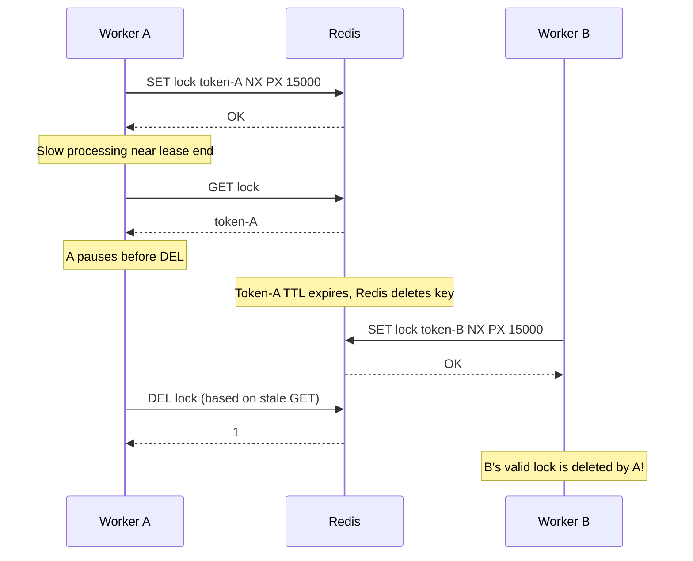
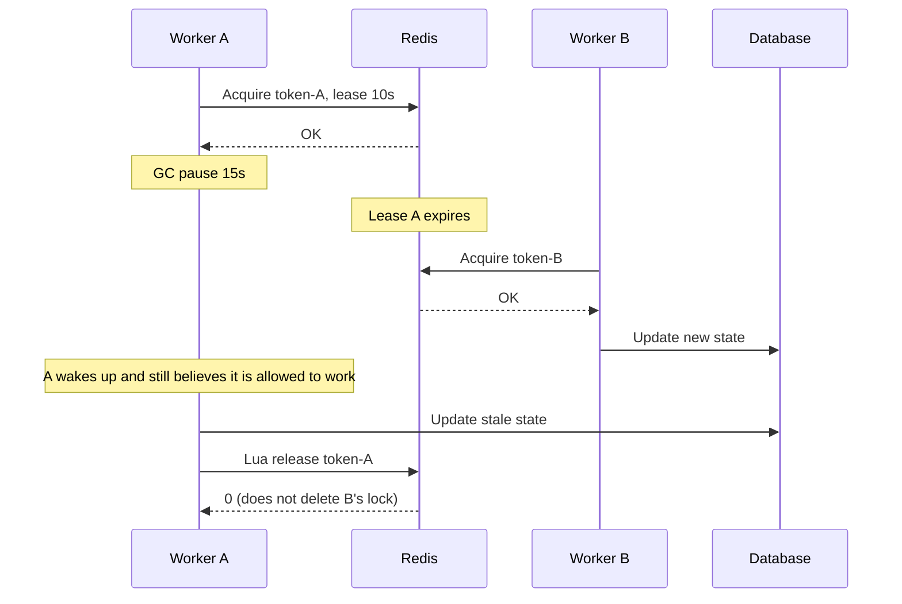

# Releasing Locks with Ownership Tokens and Atomic Operations in Spring Data Redis

## 1. Context: Why Is a Conditional Unlock Mechanism Needed?

In a Spring Boot application running across multiple instances, certain tasks may require **only one worker to execute at a time**, such as:

- A scheduler processing overdue orders.
- A worker generating heavy per-customer reports.
- A service recomputing an aggregated cache for a specific resource.
- A process executing partitioned migrations or data synchronization.
- An API preventing two concurrent requests from updating the same temporary state.

A common approach is to use Redis to hold a **lease-based distributed lock**: a worker writes a key using `SET key value NX PX milliseconds`. If Redis returns `OK`, the worker has just acquired the lock; otherwise, the lock may already belong to another worker.

However, **safely acquiring the lock is not enough**. Releasing the lock must ensure a worker only deletes the lock **created by its own acquisition**.

Failure scenario:

1. Worker A acquires the lock `lock:order:42` with a 10-second TTL.
2. A pauses due to GC, network stall, or a slow task lasting longer than 10 seconds.
3. Redis automatically removes the lock whose TTL expired.
4. Worker B acquires the same lock key and begins work.
5. A resumes and calls `DEL lock:order:42`.
6. B's lock is mistakenly deleted; worker C can now also acquire the lock.

Therefore, a direct `DEL` command is **unsafe** in a time-bounded lock design.

> Rule: **Each acquisition generates its own ownership token. On release, Redis must verify the current value still equals that token before deleting — within the same atomic operation.**

Spring Data Redis can implement this pattern using `StringRedisTemplate`, `SET ... NX PX`, and a Lua script performing `GET` + `DEL` on the Redis side.

## 2. Distinguishing Key, Token, Lease, and Ownership

A Redis lock used for mutual exclusion has four components:

| Component | Example | Purpose |
|---|---|---|
| **Lock key** | `lock:order:42` | Identifies the resource to protect |
| **Owner token** | `c6ef...` (random UUID) | Identifies **one specific acquisition attempt** |
| **Lease/TTL** | 15 seconds | Bounds lifetime if the worker crashes |
| **Operation context** | Processing order 42 | Identifies which operation is being protected |

The key name stays the same across acquisitions; **the token must be different**.

Example:

```text
t0: Redis key lock:order:42 = "token-A" ; TTL=15s
t1: Worker A is processing
t2: Redis deletes lock because TTL expired
t3: Worker B SET NX succeeds
    lock:order:42 = "token-B" ; TTL=15s
t4: A calls unlock with token-A
    -> must not delete value token-B
```

Do not use a fixed token such as `"my-service"` for all acquisitions. If both A and B use the same token, the comparison can no longer distinguish the new owner from the old owner.

### 2.1. How Should Tokens Be Generated?

For the simple lock pattern, use a value that is **sufficiently random and collision-resistant** for **each acquisition**. `UUID.randomUUID()` is a practical choice when no specialized token protocol is required.

Do not use:

- Thread name (`Thread.currentThread().getName()`).
- Container ID or hostname reused across multiple lock acquisitions.
- User ID or resource ID.
- A token variable created once and reused across all lock commands.
- Plain millisecond timestamps that can collide when multiple workers run simultaneously.

The token is not a login session; however, it is **proof of permission to release** the lock. Therefore, do not log full tokens in public logs, include tokens in unnecessary messages, or grant unrelated applications access to modify lock keys.

## 3. Acquire: Use a Single SET NX Command with TTL

Redis supports the command:

```redis
SET lock:order:42 token-A NX PX 15000
```

Explanation:

- `SET`: sets the key value.
- `NX`: writes only if the key **does not exist**.
- `PX 15000`: sets a 15,000-millisecond TTL on the key in the same write operation.

If successful:

```text
OK
```

If the key already exists, Redis does not overwrite it and returns a result indicating the `NX` condition was not met (Redis CLI typically displays nil/null).

### 3.1. Why Must the TTL Be Inside SET?

This is the approach **to avoid**:

```redis
SETNX lock:order:42 token-A
EXPIRE lock:order:42 15
```

Two separate commands create a failure window:

```text
SETNX succeeds
       |
       X worker crashes, times out, or loses connection
       |
EXPIRE is never sent
       |
       v
Lock may persist without a TTL
```

A lock without a TTL can survive indefinitely until manually deleted or server data is lost. Other workers could be blocked forever.

Using `SET key token NX PX ttl` eliminates the gap between **creating the lock** and **setting its expiration**, because Redis executes both in a single command.

### 3.2. When the Resource Lock Already Exists

When `SET NX` fails, the application should not automatically execute:

```redis
DEL lock:order:42
```

because the key may belong to a legitimately running worker.

Instead, choose a policy:

- Return a **busy/conflict** result to the caller.
- Put the work back into a bounded queue.
- Retry with backoff and jitter, using a clear deadline.
- Read task state from the primary data store to avoid reprocessing if the work is already complete.

**Do not spin continuously** with thousands of `SET NX` commands per second. Contending workers can generate massive Redis command load without improving business throughput.

## 4. Classic Bug: GET Then DEL Are Two Non-Atomic Operations

An initial idea:

```java
String current = redis.opsForValue().get(lockKey);

if (token.equals(current)) {
    redis.delete(lockKey);
}
```

The check looks right, but it is **unsafe in a distributed system**. After `GET` and before `DEL`, Redis can still process commands from other clients, and TTL continues counting down.

### 4.1. Time-Based Race Condition



The problem is that the decision "I own the lock" is made at **the time of GET**, while the DEL action happens later. The time between the two steps can change the key's state.

Using Java `synchronized`, `ReentrantLock`, or an in-process mutex does not solve **different processes** accessing Redis concurrently. A Java local lock only protects threads inside one JVM.

### 4.2. Do Transactions or Pipelines Automatically Fix This?

- **Pipeline:** sending `GET` and `DEL` back-to-back does not let the application inspect the GET result and conditionally DEL in one atomic operation; a pipeline is not a transaction.
- **MULTI/EXEC:** commands inside `EXEC` run sequentially, but there is no if/else branching based on a GET result inside the batch in the way the example requires. `WATCH` can implement an optimistic check with multiple network round trips and retries, but that is overly complex for a simple release.
- **Lua script:** Redis executes the compare + delete logic in one atomic script execution; ideal for this compare-and-delete operation.

Therefore, the standard solution is **server-side compare-and-delete**.

## 5. Releasing the Lock with a Lua Script

Redis script:

```lua
if redis.call('GET', KEYS[1]) == ARGV[1] then
    return redis.call('DEL', KEYS[1])
end

return 0
```

Arguments:

- `KEYS[1]`: lock key passed by the client.
- `ARGV[1]`: owner token of the **acquisition** the client wants to release.
- If the current value equals the token: `DEL` and return 1.
- If the key does not exist or the value differs from the token: **do not delete** and return 0.

This is atomic at the Redis command/script execution level: between `GET` and `DEL` inside the script, no other client command can interleave to modify the key.

### 5.1. Behavior by Redis State

| Key state when script starts | Token requesting release | Result | Meaning |
|---|---|---|---|
| Key has value `token-A` | `token-A` | `1` | Deleted lock owned by that token |
| Key has value `token-B` | `token-A` | `0` | Different owner; **not deleted** |
| Key does not exist | `token-A` | `0` | Lock expired/deleted/absent |
| Key has value `token-B` | `token-B` | `1` | Worker B releases its own lock |
| Key has any value | Wrong token | `0` | Not permitted to release lock |

`0` **does not uniquely prove** "another worker took the lock." It could also mean the key expired or was previously deleted. The application should record `not owner or absent` rather than jumping to a specific conclusion without additional evidence.

### 5.2. Testing with redis-cli on an Isolated Key

Example using a test-only namespace:

```redis
DEL demo:lock:release:42

SET demo:lock:release:42 token-A NX PX 120000
# OK

EVAL "if redis.call('GET', KEYS[1]) == ARGV[1] then return redis.call('DEL', KEYS[1]) else return 0 end" 1 demo:lock:release:42 token-B
# (integer) 0

GET demo:lock:release:42
# "token-A"

EVAL "if redis.call('GET', KEYS[1]) == ARGV[1] then return redis.call('DEL', KEYS[1]) else return 0 end" 1 demo:lock:release:42 token-A
# (integer) 1

EXISTS demo:lock:release:42
# (integer) 0
```

`120000` is used to reduce the risk of TTL expiration during manual testing. If you wait too long before the final `EVAL`, the result may be 0 because the key expired; that is still safe behavior.

### 5.3. Why Must the Script Receive Keys via KEYS?

Redis Lua scripts are recommended to receive accessed keys via `KEYS[]`, and other data via `ARGV[]`. Especially in Redis Cluster, keys used by a script must be declared and obey hash slot constraints.

Do not concatenate key names and tokens into the Lua source so that every release generates a different script. Using **one fixed script** and passing data via arguments simplifies script caching, logging, and access permissions.

## 6. Complete Example with Spring Data Redis and StringRedisTemplate

### 6.1. Dependency and Connection

Example using Spring Boot with default Redis support:

```groovy
dependencies {
    implementation 'org.springframework.boot:spring-boot-starter-data-redis'
}
```

```yaml
spring:
  data:
    redis:
      host: localhost
      port: 6379
      connect-timeout: 2s
      timeout: 3s
```

Authentication and TLS must be configured for real deployment environments. Credentials must not be placed directly in documentation or source code.

Spring Data Redis provides both `RedisTemplate` and `StringRedisTemplate`. The pattern below intentionally uses **StringRedisTemplate** so that:

- The lock key is a String.
- The token is stored as a String.
- `GET` in Lua reads the exact byte value produced by the String serializer.
- `ARGV[1]` is consistently serialized as a String.
- Token comparison mismatches caused by generic `RedisTemplate` using JDK/JSON serializers are avoided.

### 6.2. The OwnedRedisLock Class

```java
package com.example.redis.lock;

import java.time.Duration;
import java.util.Collections;
import java.util.Optional;
import java.util.UUID;

import org.springframework.data.redis.core.StringRedisTemplate;
import org.springframework.data.redis.core.script.DefaultRedisScript;
import org.springframework.stereotype.Component;

@Component
public class OwnedRedisLock {

    private static final String KEY_PREFIX = "lock:job:";

    private static final DefaultRedisScript<Long> RELEASE_SCRIPT =
            createReleaseScript();

    private final StringRedisTemplate redis;

    public OwnedRedisLock(StringRedisTemplate redis) {
        this.redis = redis;
    }

    private static DefaultRedisScript<Long> createReleaseScript() {
        DefaultRedisScript<Long> script = new DefaultRedisScript<>();

        script.setScriptText("""
                if redis.call('GET', KEYS[1]) == ARGV[1] then
                    return redis.call('DEL', KEYS[1])
                end
                return 0
                """);

        script.setResultType(Long.class);
        return script;
    }

    /**
     * Each successful acquisition must generate its own token.
     * Resource characters are restricted to avoid key collisions and
     * prevent arbitrary strings from entering the lock namespace.
     */
    public Optional<LockHandle> tryAcquire(
            String resource, Duration lease) {

        if (resource == null
                || !resource.matches("[A-Za-z0-9_-]{1,80}")) {
            throw new IllegalArgumentException("Invalid resource");
        }

        if (lease == null
                || lease.isZero()
                || lease.isNegative()
                || lease.toMillis() <= 0) {
            throw new IllegalArgumentException("Invalid lease");
        }

        String key = KEY_PREFIX + resource;
        String token = UUID.randomUUID().toString();

        Boolean acquired =
                redis.opsForValue().setIfAbsent(key, token, lease);

        if (Boolean.TRUE.equals(acquired)) {
            return Optional.of(new LockHandle(key, token));
        }

        if (Boolean.FALSE.equals(acquired)) {
            return Optional.empty(); // Another worker holds the lock.
        }

        // Spring Data Redis may return null in a pipeline/transaction.
        // Do not treat null as definitive proof that acquisition failed.
        throw new IllegalStateException(
                "No confirmed response for Redis lock acquisition"
        );
    }

    /**
     * Only delete when the Redis key contains the handle's exact token.
     */
    public boolean release(LockHandle handle) {
        if (handle == null) {
            throw new IllegalArgumentException("handle is required");
        }

        Long removed = redis.execute(
                RELEASE_SCRIPT,
                Collections.singletonList(handle.key()),
                handle.token()
        );

        if (removed == null) {
            throw new IllegalStateException(
                    "No confirmed response for Redis lock release"
            );
        }

        return removed == 1L;
    }

    public record LockHandle(String key, String token) {}
}
```

This code requires Java 17+ because it uses `record` and Java text blocks (`"""..."""`). On older Java versions, replace `record` with an immutable class and declare the script using concatenated strings.

**Class contract:**

- `tryAcquire(...)` returns `Optional.of(handle)` if a successful acquisition confirmation is received.
- Returns `Optional.empty()` when Redis confirms `SET NX` could not acquire the lock.
- Network/driver failures may throw exceptions; do not treat them as "busy".
- `release(handle)` returns `true` when the script confirms deletion by the matching owner.
- Returns `false` when the key does not exist or has another owner.
- If no script result is received, throws an exception so the caller **does not assert release succeeded**.

### 6.3. Why Return a Handle Instead of Just Boolean?

If you only had:

```java
boolean locked = acquire("order-42");
```

then the caller would have no token to prove release permission. You could store the token in a `ThreadLocal`, but that breaks easily with:

- Async execution / `CompletableFuture`.
- Reactive pipelines and thread switching.
- Worker pools reusing threads.
- One method holding multiple locks.
- Code invoked across different service layers and callbacks.

An immutable `LockHandle(key, token)` passes ownership explicitly for that exact acquisition. It also avoids acquiring lock A and accidentally releasing it with a different global token.

**Do not serialize or persist a handle long-term just so another process can unlock it arbitrarily.** For workflows requiring ownership transfer between processes, design a dedicated ownership transfer/lease protocol.

## 7. Using the Lock in a Spring Service

Example processing a task by ID:

```java
package com.example.redis.lock;

import java.time.Duration;
import java.util.Optional;

import org.slf4j.Logger;
import org.slf4j.LoggerFactory;
import org.springframework.stereotype.Service;

@Service
public class InvoiceRebuildService {

    private static final Logger log =
            LoggerFactory.getLogger(InvoiceRebuildService.class);

    private final OwnedRedisLock lock;
    private final InvoiceRebuildWorker worker;

    public InvoiceRebuildService(
            OwnedRedisLock lock,
            InvoiceRebuildWorker worker) {
        this.lock = lock;
        this.worker = worker;
    }

    public boolean rebuild(String invoiceId) {
        Optional<OwnedRedisLock.LockHandle> acquired =
                lock.tryAcquire(
                        invoiceId, Duration.ofSeconds(30)
                );

        if (acquired.isEmpty()) {
            return false; // Another worker holds the lease.
        }

        var handle = acquired.get();

        try {
            worker.rebuildInvoice(invoiceId);
            return true;
        } finally {
            try {
                boolean released = lock.release(handle);

                if (!released) {
                    log.warn(
                            "Lock no longer owned during release: invoiceId={}",
                            invoiceId
                    );
                }
            } catch (RuntimeException releaseError) {
                log.error(
                        "Redis lock release was not confirmed: invoiceId={}",
                        invoiceId,
                        releaseError
                );
            }
        }
    }

    public interface InvoiceRebuildWorker {
        void rebuildInvoice(String invoiceId);
    }
}
```

The example uses `finally` to attempt release even if the task throws an exception. It **does not guarantee** Redis will always be reachable inside `finally`, and **does not guarantee the task still owns the lease at the end**.

Here the `catch` block merely logs that release was unconfirmed and lets any exception from the main work propagate untouched. That is an API choice; production systems must decide how to report warnings, metrics, and recovery. In particular, returning `true` from `rebuild` only means the worker code finished running; it **does not prove the lock remained valid throughout the entire execution**.

### 7.1. Why Does `finally` Still Need the Token?

If a worker loses its lease mid-flight, `release(handle)` returns 0 and does not delete another worker's new lock. This is the exact benefit of the token.

However, never see `release=false` and then manually call:

```java
redis.delete(handle.key()); // Wrong: deletes a lock without ownership!
```

A forced deletion can break the very protection mechanism you just designed.

### 7.2. Returning 0 Is Not an Error to Fix with DEL

Suppose A releases and receives 0:

- The TTL expired and the key no longer exists.
- B acquired the key with a new token.
- A legitimate operational action deleted the key.
- The key changed due to misconfiguration or another client.

If A tries to "clean up the key" with `DEL`, it can break B's lock. The correct response is to **record loss of ownership**, without interfering with the current lock.

## 8. Lease Limitations: Safe Release Does Not Mean Safe Processing

Lua compare-and-delete solves one specific bug: **an old owner cannot delete a new lock**. It does not solve all mutual exclusion challenges in distributed systems.

### 8.1. A Worker Can Keep Working After Its Lease Expires



In this example, Lua release works **completely correctly**, yet A can still overwrite B's data in the database. This hazard happens before A ever calls release.

Therefore, TTL-based locks must be paired with other mechanisms if the business logic has strong invariants:

- Tasks have expected duration bounds and deadlines.
- Check lease/ownership before committing risky side effects.
- Write data using version numbers or conditional updates.
- Idempotency to prevent duplicate processing.
- **Fencing tokens** checked by the target resource if stale-owner operations must be rejected.
- Or use transactions/locks in the database acting as the primary source of truth when strict correctness is needed.

**Checking `GET key == token` right before writing to the database still does not create atomicity between Redis and the database**: the lease can expire immediately after the GET and before the DB commit.

### 8.2. Fencing Tokens Differ from Random Owner Tokens

An **owner token** (random UUID) answers: "Is this exact acquisition still holding the key at release time?"

A **fencing token** (monotonically increasing number, e.g. 101, 102, 103) answers: "Is this operation newer than operations already accepted by the target resource?"

Example:

```text
A acquires -> fence = 101
B acquires -> fence = 102 (after A's lease expires)

B writes database with fence 102 -> succeeds
A wakes up, sends write with fence 101 -> database rejects
```

The condition at the database/storage must be able to reject writes carrying an older fencing number than the already-accepted value:

```sql
-- Illustrative pattern for version control at the target resource.
UPDATE invoice_projection
SET payload = :payload,
    last_fence = :fence
WHERE invoice_id = :invoice_id
  AND last_fence < :fence;
```

This SQL sample assumes the row already exists and the `last_fence` column is initialized/managed; in a real system you must handle inserts/upserts, transactions, ordering guarantees, and updated row counts.

A fencing token **cannot just be a UUID**: the target resource needs to compare monotonic order. Even when using `INCR` to issue fences, you must design generation binding with acquisition, counter durability across failovers, and validation at the target resource. A Redis counter can lose unreplicated increments on failover; **do not assume a counter on a single Redis primary with asynchronous replication produces fencing tokens with absolute guarantees**.

### 8.3. A Lease Is Only a Time Window

When choosing `Duration.ofSeconds(30)`:

- If the task normally takes 100 ms, a 30-second lease may have plenty of headroom, but it slows recovery when a worker crashes.
- If the task has a p99 of 45 seconds, a 30-second lease is too short and easily loses ownership mid-work.
- If maximum runtime is unknown, a fixed lease cannot guarantee only one worker executes throughout the task.

Measure execution duration, GC pause intervals, network stalls, and dependency latency. Do not set an overly long TTL just to avoid expiration, because a crashed worker will leave the lock held longer than necessary.

## 9. Renewing a Lease: Only the Current Owner May Extend TTL

For long jobs, periodic **lease renewal** may be needed. However, renewing with two commands:

```redis
GET lock:job:invoice-42
PEXPIRE lock:job:invoice-42 30000
```

suffers the same race condition as GET+DEL: the lease can expire and another worker can acquire it between GET and PEXPIRE. The old owner could extend the new owner's lock TTL.

Use an atomic script:

```lua
if redis.call('GET', KEYS[1]) == ARGV[1] then
    return redis.call('PEXPIRE', KEYS[1], ARGV[2])
end

return 0
```

`ARGV[1]` is the owner token; `ARGV[2]` is the new TTL in positive milliseconds.

If the value does not match the token or the key is gone, the script does not extend and returns 0.

### 9.1. Integrating into OwnedRedisLock

Add the script and method if business logic needs renewal:

```java
private static DefaultRedisScript<Long> createRenewScript() {
    DefaultRedisScript<Long> script = new DefaultRedisScript<>();

    script.setScriptText("""
            if redis.call('GET', KEYS[1]) == ARGV[1] then
                return redis.call('PEXPIRE', KEYS[1], ARGV[2])
            end
            return 0
            """);

    script.setResultType(Long.class);
    return script;
}

private static final DefaultRedisScript<Long> RENEW_SCRIPT =
        createRenewScript();

public boolean renew(
        LockHandle handle, Duration newLease) {

    if (handle == null
            || newLease == null
            || newLease.toMillis() <= 0) {
        throw new IllegalArgumentException("Invalid renewal");
    }

    Long renewed = redis.execute(
            RENEW_SCRIPT,
            Collections.singletonList(handle.key()),
            handle.token(),
            Long.toString(newLease.toMillis())
    );

    if (renewed == null) {
        throw new IllegalStateException(
                "No confirmed response for lease renewal"
        );
    }

    return renewed == 1L;
}
```

This snippet is **added to** the `OwnedRedisLock` class from the previous section and reuses its already-declared imports and fields. It is not a standalone complete Java class.

A `renew=false` result must be treated as a signal of **lost ownership**; never call `SET` to "fix" the lease by overwriting another owner.

### 9.2. Renewal Does Not Eliminate All Risks

A renewal loop typically needs to:

- Run well before the TTL is close to expiring.
- Have a deadline and a bounded number of retries.
- Stop renewing once work finishes.
- Detect `renew=false` results.
- Handle timeouts: it is unknown whether Redis executed the renewal or not.
- Cancel or block side effects when evidence of holding the lease is lost, as far as feasible.

If a thread pauses for a long time, the renewal task may miss its schedule. If a Redis failover causes the key to be lost or altered, renewal cannot prevent another owner from acquiring it. Therefore, fencing or conditional writes at the target resource are still needed where high correctness is required.

## 10. Disconnections and Uncertain Outcomes

Not every Redis exception can be classified as "lock not acquired" or "lock not deleted."

### 10.1. Timeout During Acquisition

Client sends:

```redis
SET lock:job:invoice-42 token-A NX PX 30000
```

Redis may have executed the command and created the lock, while the `OK` reply was lost when the connection dropped. The application receives a timeout, so it has no definitive proof it owns the lock, even though the key may hold `token-A`.

Do not assume:

```text
Timeout on SET -> lock was definitely not created.
```

Safe strategy:

1. Keep the token generated for this **acquisition attempt** in the error-handling context.
2. Do not start side effects without valid confirmation.
3. You may reconcile by reading lock state, though a single `GET` matching the token only confirms state at one instant.
4. If safety cannot be confirmed, let the TTL reclaim the lock and apply bounded retry/backoff.
5. Never `DEL` the key without confirmed ownership.

The sample `tryAcquire` throws an exception on transport errors so callers do not confuse a timeout with `Optional.empty()` or with a definitively successful acquisition.

### 10.2. Timeout During Release

A sends the compare-and-delete script with `token-A`; Redis may have:

- Received and deleted A's lock, but the reply was lost.
- Never received or executed the command.
- Received the command after the lock expired or changed owner, returning 0, with the reply lost.

If the client receives no response, the result is an **unknown outcome**. You can safely retry the **same compare-and-delete script with the same token**, because the script will not delete a lock with a different token:

- If the previous attempt already deleted it, the next returns 0 because the key does not exist.
- If the previous attempt did not delete it and the key still holds `token-A`, the next attempt can delete it.
- If B has claimed the lock, the script returns 0 and leaves B untouched.

However, a `0` after retry does not distinguish whether the first attempt deleted it or the TTL expired; it only proves that on the latest run no key with `token-A` was deleted. Never replace the conditional script with a bare `DEL` to "clean up for sure."

### 10.3. Do Not Let Auto-Retry Duplicate Side Effects

`SET NX PX` and Lua compare-and-delete have distinct semantics. For acquisition, retrying with a **new token** after a timeout may collide with the lock created by the old token; thus the retry layer needs to track attempt IDs and verification policies. For release, retrying the same script/token is safe with respect to **deletion rights**, though the caller may not know which attempt actually deleted it.

Do not wrap both Redis operations and payment/email/database business logic inside a blanket `catch (Exception e) { runAllAgain(); }` retry loop, as external side effects may not be idempotent.

## 11. Redis Cluster, Sentinel, and Failover

### 11.1. Single-Key Lua Compare-and-Delete in Cluster

The sample release script accesses **one key**, making it straightforward to deploy on Redis Cluster when the client routes the key to the node owning its slot. The script does not create a multi-node transaction; it is atomic on the server handling that key.

If you extend the script to check a lock key, increment a fencing counter, and write other data, all keys in the script must obey Redis Cluster hash slot constraints. For example, keys sharing a hash tag:

```text
lock:{invoice-42}:owner
lock:{invoice-42}:fence
```

Sharing `{invoice-42}` causes Redis Cluster to route them to the same slot. However, **sharing a slot does not give a script rollback**, nor does it solve target resources residing in another database.

### 11.2. Asynchronous Replication Can Create Two Owners

Scenario:

```text
1. Client A SET NX PX succeeds on Redis primary P.
2. P has not yet replicated the lock key to replica R.
3. P fails; R is promoted to the new primary.
4. R does not have A's lock.
5. Client B SET NX PX succeeds on R.
6. Both A and B believe they acquired a valid lock.
```

Redis replication and Sentinel failover typically have an asynchronous component. Therefore, **a lock on a Redis primary** does not automatically become an unconditionally safe mutual exclusion mechanism across all failovers.

Lua scripts guarantee atomic compare-and-delete **on the server executing them**, but cannot undo lost writes or duplicate ownership caused by failover.

If very high correctness is required:

- Consider locks/transactions in the database storing the primary data.
- Apply fencing tokens validated by the target resource.
- Design idempotency and optimistic concurrency.
- Evaluate multi-node distributed lock algorithms against your specific requirements and assumptions; do not treat Redis Sentinel as equivalent to Redlock or a consensus lock service.
- Clearly define the acceptable risk level for the business domain.

### 11.3. Locking to Reduce Duplicate Work vs. Locking for Correctness

If a lock only prevents **recomputing a cache twice**, one duplicate computation after a failover may be acceptable.

If a lock is used to "guarantee inventory is deducted only once" or "guarantee a payment executes only once," invariants must be enforced at the primary data store. **A Redis lock token is only a coordination layer, not a replacement for business transactions and idempotency.**

## 12. Comparing Unlock Patterns

| Unlock Approach | Checks Owner? | Atomic? | Safe When A's TTL Expires and B Acquires? |
|---|---|---|---|
| `DEL lockKey` | No | DEL is a single atomic command, but performs no check | **No** |
| Java `GET` then `DEL` | Yes, but check is separate | **Not atomic** across the whole flow | **No** |
| Java `GET`, compare, local JVM lock, `DEL` | Checks locally only; Redis still has other clients | Not atomic in Redis | **No** |
| `WATCH` + `MULTI/EXEC` with proper retries | Possible | Conditional at Redis transaction level | Possible, but overly complex for a simple operation |
| Lua compare token + `DEL` | Yes | **Yes**, on the server executing the script | **Yes**, with respect to not deleting B's lock |
| Extending TTL without token check | No | Depends on command; wrong semantics | **No** |
| Lua compare token + `PEXPIRE` | Yes | **Yes** | Does not extend the new owner's lease |

"Safe" in the table refers only to **unlock/renew rights on the Redis key**. It does not mean the entire work inside `try-finally` is protected for the full runtime if the lease can expire.

## 13. Retry and Backoff Flow When the Lock Is Busy

Not every application needs to wait. There are two groups:

- **Online APIs:** if the lock cannot be acquired, return an "in progress" status or inspect the current result instead of blocking the request too long.
- **Background workers:** may retry after a delay, but must cap attempts and avoid flooding Redis from all workers every few milliseconds.

Bounded retry model:

```text
deadline = now + maxWait
attempt = 0

while now < deadline:
    result = tryAcquire(resource, lease)

    if acquired:
        return lockHandle

    attempt++
    sleep(backoffWithJitter(attempt))

return busy
```

A real implementation should use a monotonic clock for the wait deadline, respect interrupts/cancellation, and cap the backoff. Never block a reactive event loop with `Thread.sleep`.

When the lock is busy, if the business task has already completed for that `operationId`, retrying to acquire the lock may be unnecessary. Checking idempotency/result state at the primary data source avoids redundant work.

### 13.1. Do Not Renew TTL When Not Holding the Owner Token

An anti-pattern:

```java
if (Boolean.FALSE.equals(
        redis.opsForValue().setIfAbsent(key, "fixed", lease))) {
    redis.expire(key, lease); // Wrong: may extend someone else's lock.
}
```

If the client failed to acquire the lock, it **has no right** to alter the lock key's TTL. Do not run `EXPIRE` or `PERSIST` on another owner's key. Renewal must only be done via token matching inside Lua.

## 14. RedisTemplate, Serializers, and Script Data Types

### 14.1. Why Is StringRedisTemplate a Convenient Choice?

`StringRedisTemplate` uses string-oriented serialization for keys and values. In Lua:

```lua
redis.call('GET', KEYS[1]) == ARGV[1]
```

requires the stored value bytes and the passed token bytes to have the exact same representation.

With `RedisTemplate<String, Object>` configured with JDK serialization or a JSON serializer, the token value in the key may differ from the `ARGV[1]` string, causing a mismatch even when Java `token.equals(token)` would be true.

When using another template, configure serializers consistently for both `SET` and `execute(script, keys, args)`. For simple lock keys, a dedicated `StringRedisTemplate` reduces complexity.

### 14.2. How Does Spring Data Redis Execute Scripts?

`DefaultRedisScript<Long>` holds the Lua source and expected result type. When calling `redis.execute(script, keys, args...)`, Spring Data Redis works with the driver to send the script to Redis. The framework may use `EVALSHA` and fall back to `EVAL` when the script is not yet cached, depending on implementation/version.

Consequently, ACL permissions for the lock client may require appropriate command/script permissions. Do not blindly grant `+@all`; verify the exact commands used by your driver, the Redis server's script policy, and least-privilege requirements.

Notes:

- A fixed script can be reused across calls.
- `Long.class` matches Redis's 0/1 integer replies.
- Do not invoke a script whose decision is needed immediately inside a pipeline if the caller needs the business result right away.
- Do not treat a Java `null` caused by a transaction/pipeline or adapter issue as "the script definitely did not delete."
- A Redis Lua script executes atomically, but if a complex script errors **after write commands**, Redis does not automatically roll back earlier side effects. The short release script above avoids this with one condition and one `DEL`.

## 15. Releasing Locks in Reactive and Async Applications

In reactive (Project Reactor) or async code, using `ThreadLocal` to store the token breaks easily because steps can run on different threads.

Principles:

1. The token belongs to **one acquisition**, not to a thread.
2. Pass the token in the workflow context/handle.
3. Release when the stream completes, errors, or is cancelled using the appropriate operator/lifecycle hook.
4. Do not block the event loop with `StringRedisTemplate` or `Thread.sleep` in a reactive runtime.
5. If using `ReactiveRedisTemplate`, use the corresponding reactive script API so compare-and-delete still runs in a single server-side operation.

Mental model:

```text
acquire(resource)
    -> handle(key, token)
    -> doWork(handle)
    -> release(handle) on completion/error/cancel
```

Use operators such as `usingWhen` in Reactor when coordinating asynchronous lifecycles. Still, understand that cancellation and release failures can occur; a cancelled stream also does not imply side effects were rolled back.

## 16. Practical Scenario: Only One Worker Synchronizes Data by orderId

Suppose Kafka/Redis Streams or a scheduler can trigger the same command:

```text
Rebuild invoice projection for invoice-42
```

Two Spring instances may receive the same work item almost simultaneously.

A multi-layered design:

1. **Idempotency:** store processed task IDs or versions in the source database.
2. **Redis lease lock:** reduce the chance of two workers computing the same projection simultaneously.
3. **Unique operation token:** only the current owner can release/renew the lock.
4. **Conditional database update:** check version/fencing if the projection must resist stale-worker overwrites.
5. **Retry/queue:** acknowledge the work item only after the side effect completes according to contract.
6. **Recovery:** when Redis fails, the job can rerun without creating incorrect side effects.

Normal flow:

```text
Worker A:
  SET lock:job:invoice-42 token-A NX PX 30000 -> OK
  load invoice
  calculate projection
  update projection with version check
  Lua GET==token-A ? DEL : no-op -> 1

Worker B:
  SET lock:job:invoice-42 token-B NX PX 30000 -> nil
  log/busy/backoff, do not execute task concurrently
```

Lease-loss flow:

```text
Worker A:
  acquire -> succeeds
  processing runs longer than TTL

Worker B:
  acquire -> succeeds with token-B
  updates projection if version is valid

Worker A:
  attempts to update projection -> rejected by version/fencing if properly designed
  release token-A -> 0, does not delete B's lock
```

Here, the **database version check** protects the data, while the Lua release protects the lock key.

## 17. Operational Scenarios to Observe

### 17.1. Suggested Metrics

| Metric | Question |
|---|---|
| `redis_lock_acquire_success_total` | How many lock acquisitions succeeded? |
| `redis_lock_acquire_busy_total` | How many times was the resource already held? |
| `redis_lock_acquire_errors_total` | How many Redis/driver errors occurred during acquire? |
| `redis_lock_release_deleted_total` | How many releases actually deleted the key with matching token? |
| `redis_lock_release_not_owner_total` | How many releases returned 0 (key gone or owner changed)? |
| `redis_lock_release_unknown_total` | How many releases received no confirmation? |
| `redis_lock_renew_failure_total` | How many renewals failed? |
| `redis_lock_work_duration_seconds` | How long did the task run compared to the lease? |
| `redis_lock_acquire_wait_seconds` | How long did workers wait for the lock? |
| `redis_lock_lock_expired_while_working_total` | Is there evidence/alerts of lease expiring before work finished? |

Metric names are application-level examples, not metrics automatically generated by Spring Data Redis. Avoid using per-job `resourceId` or tokens as labels if cardinality is high; group by resource/workflow type.

### 17.2. Is Logging Useful?

Minimal structured log examples:

```text
event=lock_acquired, resourceType=invoice, leaseMs=30000
event=lock_release, result=not_owner_or_absent
event=lock_acquire_failed, category=redis_timeout
event=lock_renew_failed, action=stop_work
```

There is no need to log raw tokens. When correlation is needed, use a separate trace/operation ID or a token hash under appropriate security policies. Clearly distinguish `busy`, `not_owner`, and `unknown`; they do not mean the same thing.

### 17.3. When Release Fails

If Redis returns 0:

- Do not call a forced DEL.
- Investigate whether the task ran longer than the TTL.
- Check pauses, overload, retry volume, and latency.
- Check whether another worker is processing the same resource.
- For critical data, reconcile written results against business invariants.

If Redis times out:

- Keep the release outcome status as unknown.
- You may retry compare-and-delete with the same token under a bounded policy.
- If it cannot be confirmed, TTL bounds how long the lock remains held, though it does not prove task correctness.

## 18. Common Implementation Mistakes

| Mistake | Why It Is Wrong | Fix |
|---|---|---|
| `SETNX` then `EXPIRE` | Two commands create a window for a lock without TTL | `SET ... NX PX` |
| Storing fixed value `"locked"` | Cannot identify a specific acquisition attempt | New UUID token per acquisition |
| `DEL` in `finally` | Old owner can delete new owner's lock | Lua compare-and-delete |
| Java `GET` → `DEL` | Race condition between two round trips | Move check into Lua |
| `GET` → `PEXPIRE` | Old owner can renew the new lock | Lua compare-and-expire |
| Treating `release=false` as an error needing `DEL` | A valid owner B may hold the lock | Do not delete; record lost ownership |
| Running work after acquire timeout | No proof the lock is held | Do not run side effects |
| Omitting TTL | Crashed worker can hold lock forever | Finite lease |
| TTL shorter than task duration | Old worker can keep running after B acquires | Adjust lease/renew/fencing |
| Reusing tokens across acquisitions | Loses ability to tell old and new owners apart | Generate token per acquisition |
| Using `ThreadLocal` in async code | Thread switching breaks ownership | Pass handle explicitly |
| Different serializers for key and script | Lua `GET` does not equal `ARGV` | `StringRedisTemplate` or consistent serializers |
| Assuming Redis failover never loses lock writes | Replication can be asynchronous | Fencing, DB constraints, clear SLAs |
| Thinking Redis locks replace DB transactions | Does not protect side effects outside Redis | Versioning/transactions/idempotency |
| Releasing before side effect finishes | Another worker may start early | Hold handle until the proper business boundary |
| Aggressive retry loops when busy | Spikes Redis QPS and CPU | Backoff, jitter, deadline |
| Overwriting value when lock is busy | Breaks ownership | Never issue unconditional `SET` |
| Logging full tokens/credentials | Leaks capability to release the lock | Log only non-sensitive metadata |

## 19. Scenario-Based Behavior Verification

To understand semantics on a test Redis instance, you can reproduce these scenarios one by one:

### 19.1. A Only Releases A's Lock

```text
A acquire -> token-A, OK
A release(token-A) -> 1
GET key -> nil
```

### 19.2. B Cannot Release A's Lock

```text
A acquire -> token-A, OK
B release(token-B) -> 0
GET key -> token-A
```

### 19.3. Old Token After TTL Does Not Delete New Lock

```text
A acquire token-A, very short lease
Redis key expired
B acquire token-B, OK
A release(token-A) -> 0
GET key -> token-B
```

### 19.4. Worker Runs Longer Than Lease

```text
A acquire, starts processing
TTL expires
B acquire, starts processing
A release -> 0
Final data must be protected by version/fencing if business logic requires it
```

### 19.5. Timeout or Failover

```text
Send acquire/release but connection drops
=> outcome may be unknown

Do not assert acquired/released
Do not blindly DEL or execute side effects
Monitor TTL, reconcile, and use bounded retries
```

These scenarios guide **how to reason about consequences** rather than certifying correctness for every Redis topology. Production systems must also verify replication lag, pauses, failovers, and source-of-truth semantics against SLAs.

## 20. When to Use a Lock Library Instead of Writing Your Own?

The `SET NX PX + Lua` pattern is clear enough for many short, idempotent **best-effort mutual exclusion** tasks. When advanced features are required, such as:

- Reentrant locks.
- Automatic watchdog/lease renewal.
- Coordination across multiple Redis instances.
- Read/write locks, semaphores, fair locks, or lock cancellation.
- Complex reactive APIs.
- Integration with diverse synchronization primitives.

you might consider a library such as **Redisson**, provided you understand the exact **guarantees and failure model** of the chosen abstraction. No library can automatically turn changes in an external database into an atomic transaction.

In particular, never assume "the library has a watchdog so the lock can never expire" or "using Redlock gives fencing for every external side effect." When business logic requires preventing stale owners from overwriting data, version/fencing checks must still be enforced at the target resource.

## 21. Summary

Safe distributed lock release in Spring Data Redis requires two paired principles:

1. **Acquire with one atomic command** `SET key token NX PX ttl`, where a **new token is generated for each acquisition**.
2. **Release with an atomic token-checking operation** — most commonly a Lua script: if `GET == ownerToken` then `DEL`, otherwise do not delete.

Together, these two principles prevent an old worker from accidentally deleting a new worker's lock after TTL expiration. `StringRedisTemplate` with `DefaultRedisScript<Long>` makes implementation straightforward, keeps token bytes consistent, and returns numeric 1/0 results from Redis.

Even so, **avoiding accidental deletion is only part of the problem**. Leases can expire while a worker is still running; timeouts leave acquire/release outcomes uncertain; Redis failovers can lose unreplicated writes. For business workflows requiring strong correctness, combine **idempotency, version checks, or fencing at the primary data store**, choose an appropriate TTL, bound retries, and monitor ownership loss. Never use an unconditional `DEL` to compensate for an unlock returning 0.

## References

- [Redis documentation — Distributed locks with Redis](https://redis.io/docs/latest/develop/use/patterns/distributed-locks/)
- [Redis documentation — SET command, NX and PX options](https://redis.io/docs/latest/commands/set/)
- [Redis documentation — EVAL and Lua scripting](https://redis.io/docs/latest/develop/programmability/eval-intro/)
- [Spring Data Redis — Scripting](https://docs.spring.io/spring-data/redis/reference/redis/scripting.html)
- [Spring Data Redis — ValueOperations.setIfAbsent API](https://docs.spring.io/spring-data/redis/docs/current/api/org/springframework/data/redis/core/ValueOperations.html)
- [Spring Data Redis — DefaultRedisScript API](https://docs.spring.io/spring-data/redis/docs/current/api/org/springframework/data/redis/core/script/DefaultRedisScript.html)
