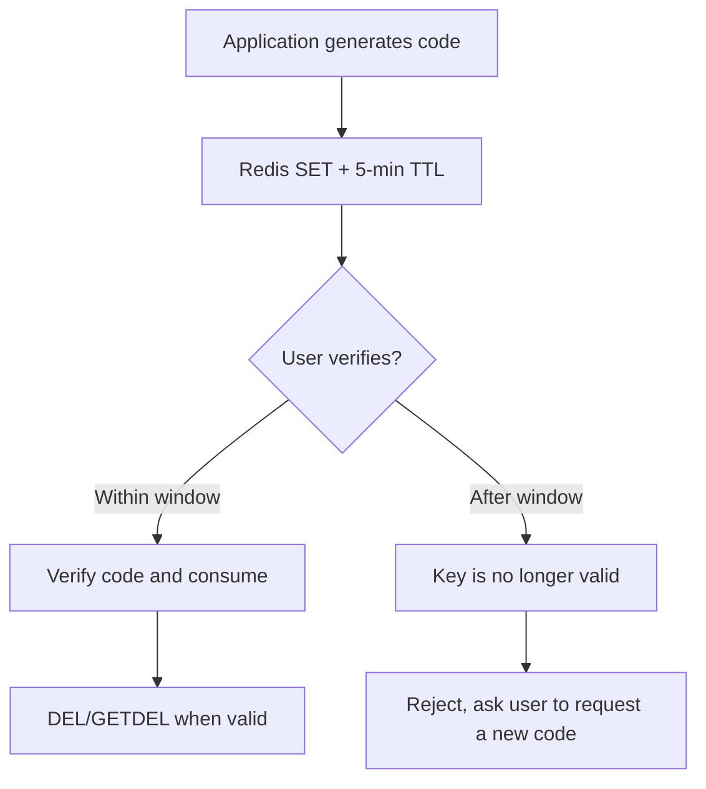
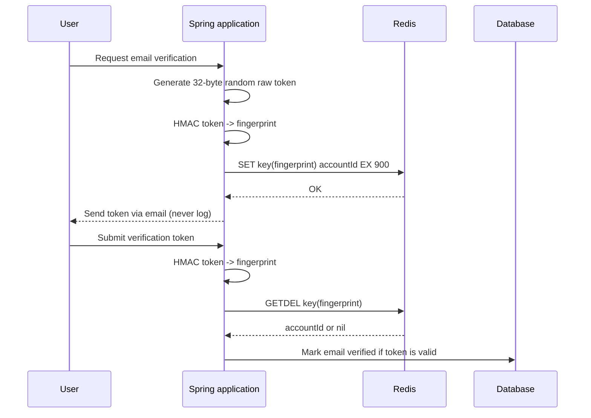

# Storing Verification Codes or Temporary Tokens with TTL in Spring Data Redis

An application often needs to issue a user a **verification code (OTP)** or a **one-time token**: an email address confirmation code, a phone number verification code, a password reset link, an invitation acceptance token, or a confirmation token for a sensitive action. These pieces of data share common traits: **short-lived, clearly scoped, and typically required to lose validity immediately after successful use**.

Redis fits storing such transient state because it provides fast key operations, native **TTL (time to live)** support, and atomic server-side commands/scripts. Spring Data Redis provides `StringRedisTemplate`, `RedisTemplate`, `ReactiveStringRedisTemplate`, and Redis Lua script execution to build an issue–verify–consume flow.

Example business requirement:

> A user requests email verification. The system generates a six-digit code, allows at most five wrong attempts within five minutes, and accepts it only once. After successful verification or expiration, the code can no longer be used.

Another model:

> A user receives a password reset link containing a high-entropy random token. The token exists for fifteen minutes and, once consumed, cannot be reused.

The two problems look similar yet have **different threat models**. A six-digit OTP only has one million possibilities, so it must resist guessing and limit attempts. A token generated from 32 random bytes has a vastly larger search space, yet still must be protected against URL leakage, logging, replay, and inconsistencies between Redis and the database.

This lesson builds two application patterns with **Spring Data Redis + TTL**: a **one-time random token** pattern using `GETDEL`, and a **short OTP with failed-attempt limits** using Redis Hash and Lua. It also explains TTL behavior, atomicity, security, error handling, testing, and production deployment in detail.

## 1. Requirements Before Choosing a Redis Structure

Do not start with the question “should I store the OTP in a String or a Hash?”. First, agree on the business contract.

| Question | Example Choice |
|---|---|
| **Purpose** | Email verification, OTP login, password reset, transaction confirmation |
| **Subject** | Internal user ID, account ID, verification session, challenge ID |
| **Secret format** | 6-digit OTP or 32-byte random token |
| **Lifetime** | 3–10 minutes for OTP; 10–30 minutes for token, per policy |
| **Usage count** | Once, or multiple times within the TTL if business rules allow |
| **Wrong attempts** | For example, maximum 5 attempts for an OTP |
| **Re-issuance** | Wait for cooldown, reject while old code is active, or replace code per policy |
| **When Redis fails** | Reject verification and allow retry; never silently skip checking |
| **When post-verification logic fails** | Was the token already consumed or is there a separate recovery mechanism? |
| **When the subject is deleted/locked** | Should an old token still be accepted? |

TTL handles state cleanup over time, but **TTL does not replace checking purpose, user identity, attempt count, and one-time validity**.

### 1.1. Distinguishing OTPs from Random Tokens

| Aspect | Short OTP | High-Entropy Random Token |
|---|---|---|
| Example | `042781` | Base64URL string of ~43 chars from 32 bytes |
| Manual entry | Good | Unsuitable |
| Search space | 1,000,000 possibilities for 6 digits | Around 2^256 possibilities if generated securely from 32 bytes |
| Brute-force defense | Requires strict attempt limit and rate limiting | Still requires rate limiting and abuse detection |
| Preferred storage | HMAC of the code, attempts counter, and TTL | Token fingerprint/HMAC as Redis key, TTL |
| Typical usage | SMS/email code | Verification or password reset link |
| Atomic consumption | Lua check + delete | `GETDEL` or Lua |

Both OTPs and tokens are **temporary credentials**. They must not appear in plaintext in logs, metric labels, analytics URLs, or Redis keys.

## 2. What Does TTL Actually Do?

TTL is the duration Redis allows a key to exist before expiring.

Example:

```redis
SET demo:verification:42 pending EX 300
```

`EX 300` sets a lifetime of 300 seconds, equal to five minutes. After expiration, the key is no longer returned as a valid key.

Variants:

```redis
SET demo:verification:42 pending EX 300
SET demo:verification:42 pending PX 300000
EXPIRE demo:verification:42 300
PEXPIRE demo:verification:42 300000
```

In Spring Data Redis:

```java
stringRedisTemplate.opsForValue().set(
        "demo:verification:42",
        "pending",
        Duration.ofMinutes(5));
```

The `set(key, value, Duration)` method issues a write with expiration through the appropriate Redis/Spring Data Redis mechanism. This is generally far preferable to writing first and then calling `expire`.

### 2.1. Why Set TTL Atomically with the Write?

An unsafe lifecycle example:

```java
redis.opsForValue().set(key, value);
redis.expire(key, Duration.ofMinutes(5));
```

Between those two commands, the application could crash or the Redis connection could fail. The key could then exist **without a TTL**, leaving a verification code alive far longer than intended.

For Redis Strings, prefer:

```java
redis.opsForValue().set(key, value, Duration.ofMinutes(5));
```

If data must be stored as a Redis Hash with multiple fields and a TTL, you can use **a Lua script** to run `HSET` and `PEXPIRE` within a single atomic execution on the Redis server.

### 2.2. TTL Is Tracked by Redis, Not a JVM Timer

TTL does not need a separate Java thread calling `sleep(300000)` to delete the key. Redis maintains expiration on the server.

Diagram:



With this model, multiple Spring instances can share a single Redis without sharing Java state or running independent timers.

### 2.3. TTL Is Not an Exact On-Time Event Scheduler

Redis uses both passive and active expiration. An expired key will no longer be treated as valid upon access, but `expired` notifications (if enabled) **are not guaranteed to fire at the exact millisecond TTL reaches 0**.

For token verification, **rely on the key still being valid in Redis when executing the command**, not on whether a listener has received an `expired` notification. Cleanup and observing expired events are separate concerns.

## 3. Understanding TTL, PTTL, and Special Values

Redis provides:

```redis
TTL demo:verification:42
PTTL demo:verification:42
```

| Result | Meaning |
|---|---|
| Positive integer or `0` | Remaining lifetime, in seconds for `TTL` or milliseconds for `PTTL` |
| `-1` | The key exists but has **no expiration** |
| `-2` | The key does not exist, including when it has expired |

Observation example:

```redis
SET demo:ttl:code sample EX 60
TTL demo:ttl:code
PTTL demo:ttl:code
GET demo:ttl:code
```

A positive TTL value does not prove a verification code is still allowed for business use: it may already be invalidated by account status, purpose, attempt limit, or additional validation rules.

### 3.1. Overwriting a Key Can Drop Its TTL

Example:

```redis
SET demo:ttl:code old EX 60
SET demo:ttl:code new
TTL demo:ttl:code
```

A plain `SET` command without an option to preserve TTL **replaces the value and clears the old expiration**. This is a serious bug if code “updates the OTP” and forgets to supply a new TTL.

When re-issuing, enforce a clear policy and attach the TTL alongside the write. With a Redis Hash, updating a field via `HSET` does not clear an existing key's TTL the way `SET` overwrites a String, but **creating a new Hash and forgetting `EXPIRE` remains dangerous**.

### 3.2. Do Not Treat TTL as a Durability Guarantee

Redis can lose a key before its TTL expires due to:

- Explicit `DEL`/`UNLINK`.
- Redis eviction under memory pressure, depending on `maxmemory-policy`.
- Restart/failover with insufficient persistence.
- Flushing the database or administrative actions.
- The application issuing a new code that replaces or revokes the old one.

Therefore, TTL expresses an **upper bound on state lifetime while Redis holds it**, not a promise that Redis will retain the key until the final second.

## 4. General Security Rules for Verification Codes

When designing the service, treat OTPs/tokens as secrets capable of authorizing account state changes.

1. **Generate secrets with a CSPRNG.** In Java use `SecureRandom`, never `Random` or timestamp calculations.
2. **Do not store raw OTPs/tokens** unnecessarily. For low-entropy OTPs, use an HMAC with a secret key stored outside Redis to reduce guessing risk from a dump.
3. **Bind an explicit purpose**, such as `EMAIL_VERIFY` or `PASSWORD_RESET`. A token issued for one purpose must never work for another.
4. **Bind the exact subject**, such as an internal account ID or challenge ID; never blindly trust an unauthenticated user ID sent by the caller.
5. **Enforce a short TTL** and check validity upon consumption.
6. **Consume once** using an atomic Redis command or a sufficiently strong state protocol.
7. **Limit wrong attempts and issuance frequency**, especially for 4–8 digit OTPs.
8. **Avoid leaking account existence** through differing error messages between existing and non-existing emails when unnecessary.
9. **Never return the code from a public endpoint.** Only pass the code to an approved delivery channel such as verified email/SMS pipelines.
10. **Never log codes in logs/traces/analytics**, even when the Redis TTL is very short.

### 4.1. Why Not Use a Timestamp as the Code?

Wrong:

```java
String code = Long.toString(System.currentTimeMillis())
        .substring(7);
```

The code has a predictable structure. Anyone knowing roughly when the code was requested can drastically shrink the search space.

Right for a six-digit code:

```java
SecureRandom random = new SecureRandom();
String code = String.format(
        Locale.ROOT,
        "%06d",
        random.nextInt(1_000_000));
```

Every code from `000000` to `999999` is generated with nearly uniform probability when using a CSPRNG this way.

### 4.2. Why Not Use a UUID as a Manually Typed OTP?

A UUID v4 may be fine for identifying a challenge if securely generated, but it is far too long for a user to type manually. When a link with a token is needed, use a high-entropy random string; when a short code is needed, use easily typed digits **protected by an attempt cap + rate limiting**.

## 5. Two Suitable Redis Data Schemas

### 5.1. Random Token: Token Fingerprint as the Redis Key

The producer generates random token `rawToken`, then computes an HMAC/fingerprint:

```text
rawToken (sent only to the user)
        |
        v
HMAC-SHA256(serverSecret, purpose || rawToken)
        |
        v
Redis key: verify:token:v1:password-reset:<digest>
Redis value: opaqueAccountId
Redis TTL: 15 minutes
```

Benefits:

- Redis never stores the raw token.
- The Redis key can be looked up directly from the token submitted by the user.
- `GETDEL` can **atomically read and delete in one step**.
- The digest is namespaced by purpose/version.

Because the token has high entropy, a fingerprint like SHA-256 can also be reasonable. Using an HMAC with an application-side secret further separates the credential surface and prevents precomputing fingerprints from tokens across other environments.

### 5.2. Short OTP: Redis Hash with Digest and Attempts

For a six-digit code:

```text
Redis key: verify:otp:v1:email:<opaque-or-digested-account-id>
Redis type: Hash
    digest   = HMAC-SHA256(secret, purpose + accountId + code)
    attempts = 0
TTL: 5 minutes
```

When the user submits a code, the server computes the digest and runs Lua to:

1. Read the current digest and attempts.
2. If the key does not exist, reject.
3. If the code matches and is not locked out, delete the key and accept.
4. If wrong, increment attempts.
5. If the threshold is reached, delete the key or mark it locked.

Checking + updating + consuming must run **atomically** so two requests cannot both spend the same OTP.

## 6. Initializing Spring Data Redis

With Spring Boot 3.x, the standard Maven dependency is:

```xml
<dependency>
    <groupId>org.springframework.boot</groupId>
    <artifactId>spring-boot-starter-data-redis</artifactId>
</dependency>
```

Gradle:

```gradle
implementation("org.springframework.boot:spring-boot-starter-data-redis")
```

Example connection configuration:

```yaml
spring:
  data:
    redis:
      host: localhost
      port: 6379
      timeout: 3s
```

This is only for local development. In production, you need TLS, ACLs, network restrictions, secret management, availability/failover, and timeouts tuned to real infrastructure.

### 6.1. Why Use StringRedisTemplate?

`StringRedisTemplate` typically uses `StringRedisSerializer` for keys and values, making everything explicit:

- Redis keys are namespaced strings.
- Values are account IDs or string Hash fields.
- Digests are stored as hex strings.
- There is no hard-to-control Java object serializer at the credential layer.

If using `RedisTemplate<String, Object>` with another serializer, inspect the actual byte format and keys. For temporary tokens, a simple, consistent string format is usually easier to operate.

## 7. Application Pattern A: One-Time Token with GETDEL

Suppose a user receives an email containing a verification link. The token is a Base64URL string from **32 SecureRandom bytes**, stored in Redis for 15 minutes, and must be consumed once.

Flow:



`GETDEL` retrieves the value and deletes the key **in a single atomic Redis command**. Two concurrent verification requests carrying the same token cannot both receive the account ID from the same entry.

### 7.1. Generating a Random Token Securely

```java
import java.security.SecureRandom;
import java.util.Base64;

public final class TokenGenerator {
    private static final SecureRandom RANDOM = new SecureRandom();

    private TokenGenerator() {}

    public static String generate() {
        byte[] bytes = new byte[32];
        RANDOM.nextBytes(bytes);
        return Base64.getUrlEncoder()
                .withoutPadding()
                .encodeToString(bytes);
    }
}
```

The output is a Base64URL string, safer in URLs than standard Base64 because it omits `+` and `/`, and drops padding. This string is still a **secret**; URL-safe does not mean safe to log or expose.

### 7.2. Computing HMAC-SHA256 with a Server Secret

A reusable utility for both tokens and OTPs:

```java
package com.example.verification;

import java.nio.charset.StandardCharsets;
import java.security.GeneralSecurityException;
import java.util.Base64;
import java.util.HexFormat;

import javax.crypto.Mac;
import javax.crypto.spec.SecretKeySpec;

public final class VerificationHmac {

    private final byte[] secret;

    public VerificationHmac(String base64Secret) {
        byte[] decoded = Base64.getDecoder().decode(base64Secret);
        if (decoded.length < 32) {
            throw new IllegalArgumentException(
                    "Verification HMAC secret must contain at least 32 bytes");
        }
        this.secret = decoded.clone();
    }

    public String hexDigest(String data) {
        try {
            Mac mac = Mac.getInstance("HmacSHA256");
            mac.init(new SecretKeySpec(secret, "HmacSHA256"));

            byte[] result = mac.doFinal(
                    data.getBytes(StandardCharsets.UTF_8));

            return HexFormat.of().formatHex(result);
        } catch (GeneralSecurityException error) {
            throw new IllegalStateException(
                    "Cannot calculate verification HMAC", error);
        }
    }
}
```

In production, this secret must come from a secret manager or protected environment variable, never hardcoded in Git. Verifying instances must share compatible key configuration; if the secret is rotated abruptly, still-valid tokens may no longer be found in Redis.

`Mac` is instantiated **per call**, rather than sharing a mutable `Mac` instance across threads.

### 7.3. Implementing TokenService with StringRedisTemplate

Self-contained example:

```java
package com.example.verification;

import java.time.Duration;
import java.util.Optional;

import org.springframework.beans.factory.annotation.Value;
import org.springframework.data.redis.core.StringRedisTemplate;
import org.springframework.stereotype.Service;

@Service
public class OneTimeVerificationTokenService {

    private static final Duration TOKEN_TTL =
            Duration.ofMinutes(15);

    private static final String PURPOSE = "email-verify";
    private static final String PREFIX =
            "verify:token:v1:" + PURPOSE + ":";

    private final StringRedisTemplate redis;
    private final VerificationHmac hmac;

    public OneTimeVerificationTokenService(
            StringRedisTemplate redis,
            @Value("${security.verification.hmac-secret-base64}")
            String secretBase64) {
        this.redis = redis;
        this.hmac = new VerificationHmac(secretBase64);
    }

    public String issue(String accountId) {
        if (accountId == null || accountId.isBlank()) {
            throw new IllegalArgumentException("Invalid accountId");
        }

        String rawToken = TokenGenerator.generate();
        String key = redisKey(rawToken);

        // Store opaque account ID, NEVER store the raw token.
        // TTL is attached immediately on SET.
        redis.opsForValue().set(key, accountId, TOKEN_TTL);

        // Return raw token ONLY to the secure delivery component;
        // never return directly from the request-code endpoint.
        return rawToken;
    }

    public Optional<String> consume(String rawToken) {
        if (rawToken == null
                || !rawToken.matches("[A-Za-z0-9_-]{43}")) {
            return Optional.empty();
        }

        String key = redisKey(rawToken);

        // Maps to Redis GETDEL, requiring server support.
        String accountId = redis.opsForValue().getAndDelete(key);
        return Optional.ofNullable(accountId);
    }

    private String redisKey(String rawToken) {
        String digest = hmac.hexDigest(
                "token:v1:" + PURPOSE + ":" + rawToken);
        return PREFIX + digest;
    }
}
```

A 32-byte token encoded in unpadded Base64URL is **43 characters** long. The regex in the example matches that generator's exact format; if you later change the token format, update both the parser and the key version consistently.

### 7.4. Contract of issue()

`issue(accountId)` creates the Redis key with TTL and then **returns the token to the email-sending layer**. An orchestration example:

```java
public void requestEmailVerification(
        AuthenticatedAccount account) {

    String token = tokenService.issue(account.id());

    emailDelivery.sendVerificationLink(
            account.email(),
            token);
}
```

`AuthenticatedAccount` and `emailDelivery` are illustrative domain components. The API path calling `requestEmailVerification` must not return `token` in the HTTP response, must not log parameters, and must not send the token into telemetry.

If sending the email fails after Redis has stored the token, the key remains until its TTL expires unless the app explicitly revokes it. This is a **non-atomic gap between Redis and the email service**; it is usually acceptable as long as the token is not leaked and is only sent on valid retries, though a resend/cooldown policy is still needed.

### 7.5. Contract of consume()

`consume(rawToken)` returns:

- `Optional.of(accountId)` if the Redis key still existed and this first request retrieved/deleted it.
- `Optional.empty()` if the token is wrong, expired, already consumed, or missing.
- An exception if Redis is unavailable or hits a serious infrastructure error; **never silently turn a Redis error into “invalid token.”**

This behavior avoids leaking details about why a token failed through the return value. For internal diagnostics, use metrics that do not expose tokens.

### 7.6. Redis GETDEL Requires a Compatible Server Version

The Redis command:

```redis
GETDEL verify:token:v1:email-verify:<digest>
```

is supported starting in **Redis 6.2**. Modern versions of Spring Data Redis expose the corresponding `ValueOperations.getAndDelete(key)` API, but verify both your deployed Redis server and library version.

If an older Redis lacks `GETDEL`, use Lua to execute `GET` and `DEL` atomically in a single script. Never replace it with two separate Java calls and assume one-time guarantees remain intact.

## 8. Why Is GET Followed by DEL Not Enough?

The naive approach suffers from a race condition:

```java
String accountId = redis.opsForValue().get(key);

if (accountId != null) {
    redis.delete(key);
    markEmailVerified(accountId);
}
```

Two concurrent requests:

| Time | Request A | Request B |
|---|---|---|
| T1 | `GET token` -> account 42 | |
| T2 | | `GET token` -> account 42 |
| T3 | `DEL token` | |
| T4 | | `DEL token`, key already gone |
| T5 | Both have accountId | Both have accountId |

If the logic only checks the account ID read at T1/T2, both requests can execute the business side effect. **A subsequent delete does not make the earlier GET atomic.**

`GETDEL` merges fetching and consuming into one step:

```text
Request A -> GETDEL token -> accountId
Request B -> GETDEL token -> nil
```

This guarantees atomicity for **one Redis key**. It does not automatically guarantee a database side effect occurs only once if other code paths bypass the protocol.

## 9. GETDEL and Business Transactions Are Separate Boundaries

Suppose a password-reset token is consumed, and then the application updates the password in PostgreSQL:

```text
Redis GETDEL -> returns accountId, token is deleted
DB UPDATE password -> may succeed or fail
```

If `DB UPDATE` fails, the token **has already been consumed**, and the user may have to request a new token.

This is the **consume-before-action** choice. It blocks replaying the same token, at the UX cost of needing a new token when downstream fails.

Another option is reading the token and deleting it only after DB commit, which opens a replay window unless paired with a locking/claim protocol or optimistic locking in the DB.

You cannot get a single ACID transaction spanning Redis `GETDEL` and a relational database just by putting `@Transactional` on the method.

### 9.1. A Safer Pattern for Critical Actions

For sensitive changes:

1. Issue the token for a specific purpose and specific subject.
2. Upon receiving the token, execute a time-bounded **claim** step with an operation ID.
3. Have the database verify business state, store the operation ID or enforce a unique constraint so the side effect is idempotent.
4. Upon success, finalize token state; on failure, enforce an explicit retry policy.

If the operation is merely email verification and the DB update is idempotent (“already verified” stays verified), calling `GETDEL` before the DB update is usually an easy-to-operate trade-off.

If the operation is transferring money or another non-repeatable action, **do not rely solely on a one-time Redis token**. Enforce locks, unique constraints, or transactions in the authoritative system protecting the side effect.

### 9.2. Never Allow One Token to Authorize Beyond Its Purpose

An email verification token must never act as a password reset token. Purpose must be enforced across namespace, HMAC input, stored record, and execution path.

Example:

```text
verify:token:v1:email-verify:<digest>
verify:token:v1:password-reset:<digest>
verify:token:v1:invitation:<digest>
```

Each endpoint looks only within its own namespace. If sharing an HMAC input pattern across purposes, explicitly verify purpose so you do not accidentally create a multi-purpose credential.

## 10. Application Pattern B: Six-Digit OTP with TTL and Attempt Limit

A short OTP can be typed manually by users, but its **search space is small**:

```text
000000
000001
...
999999
```

If unlimited guesses are allowed for five minutes, an attacker can brute-force it automatically. Therefore, an OTP pattern requires all of:

- A CSPRNG to generate the code.
- An HMAC digest instead of the raw code in Redis.
- A short TTL.
- An **atomic** wrong-attempt cap.
- Endpoint/identity/IP/device rate limiting.
- Resend and cooldown rules.
- Exact account/purpose verification.
- Immediate key deletion once accepted.

### 10.1. Redis Hash Representing an OTP Challenge

Example:

```text
Key: verify:otp:v1:email:<opaque-id-digest>
Type: Redis Hash
Fields:
    digest   = <HMAC-SHA256 hex>
    attempts = 0
TTL: 300 seconds
```

Never put the real OTP in the key. The key name also does not need to contain raw email addresses or phone numbers.

**Note:** Using HMAC for OTPs matters greatly if an attacker only obtains a Redis dump: an unsalted/unkeyed SHA-256 hash of a six-digit code can be brute-forced offline across all one million values. HMAC with a secret outside Redis blocks that offline guessing while the secret remains uncompromised.

## 11. Generating OTPs Properly and Normalizing Input

Java:

```java
import java.security.SecureRandom;
import java.util.Locale;

public final class OtpGenerator {
    private static final SecureRandom RANDOM = new SecureRandom();

    private OtpGenerator() {}

    public static String generateSixDigits() {
        return String.format(
                Locale.ROOT,
                "%06d",
                RANDOM.nextInt(1_000_000));
    }
}
```

**An OTP is a String, not an Integer.** If the code is `004271`, converting it to an integer and formatting improperly can strip the two leading zeros.

When receiving input:

```java
if (code == null || !code.matches("[0-9]{6}")) {
    return false;
}
```

This regex accepts exactly six ASCII digits. If UX permits spaces or dashes between digit groups, apply an **explicit normalization rule before verification**, rather than blindly stripping all non-digits if doing so creates ambiguous matching paths.

Never compute an HMAC over a code whose leading zeros were stripped by a parser.

## 12. Pitfall: HSET Followed by EXPIRE Are Two Separate Commands

A pattern lacking TTL guarantees:

```java
Map<String, String> fields = Map.of(
        "digest", codeDigest,
        "attempts", "0");

redis.opsForHash().putAll(key, fields);
redis.expire(key, Duration.ofMinutes(5));
```

If the process fails between `HSET` and `EXPIRE`, the Hash can end up without a TTL. For sensitive auth state, enforce the invariant that **no pending state ever exists without an expiration**.

A Redis Lua script executes both commands on the server in a single pass:

```lua
-- KEYS[1] = OTP hash key
-- ARGV[1] = HMAC digest of code
-- ARGV[2] = TTL milliseconds

local ttl = tonumber(ARGV[2])
if not ttl or ttl <= 0 then
    return redis.error_reply('TTL must be positive')
end

-- NX semantics: do not recreate if challenge already exists.
if redis.call('EXISTS', KEYS[1]) == 1 then
    return 0
end

redis.call('HSET', KEYS[1],
    'digest', ARGV[1],
    'attempts', '0')

redis.call('PEXPIRE', KEYS[1], ttl)
return 1
```

Results:

- `1`: a new challenge was created with TTL.
- `0`: a challenge already exists, so issuance is rejected under the policy of **one active OTP per account/purpose**.

This script prevents two concurrent issuance requests for the same account from both succeeding, provided **every issuance path uses the same key and script**.

### 12.1. Why Check EXISTS Inside the Script Instead of a Java if?

If separated:

```java
if (!Boolean.TRUE.equals(redis.hasKey(key))) {
    redis.opsForHash().putAll(key, fields);
    redis.expire(key, ttl);
}
```

two requests can both see the key absent and both create the Hash. One request can overwrite the other's digest and alter the TTL. The script keeps check–write–set-expiry as one atomic unit on Redis.

### 12.2. Do Not Send the OTP If Saving to Redis Fails

The issuance order should be:

```text
Generate code in memory
    |
    v
Compute HMAC digest
    |
    v
Redis create challenge + TTL
    |
    +-- Failure -> do not send code, return controlled error
    |
    +-- Success -> send code via email/SMS
```

If you send first and the Redis write fails, the user receives a code that **cannot be verified**. Saving first and then sending is the more practical choice, even though delivery failure after creating the key still remains possible.

## 13. Verifying OTPs and Limiting Attempts Atomically

Requirements:

- Accept the right code strictly once.
- Increment the counter on a wrong code.
- After the fifth failure, delete the challenge.
- Do not reset TTL on failed guesses.
- Concurrent requests cannot both consume the OTP.

Lua script:

```lua
-- KEYS[1] = OTP hash key
-- ARGV[1] = digest of the user-submitted code
-- ARGV[2] = failure limit, e.g. 5
--
-- Return:
--   1 = success, challenge deleted
--   0 = wrong or no challenge found
--  -1 = limit exceeded, challenge deleted

local maxAttempts = tonumber(ARGV[2])
if not maxAttempts or maxAttempts < 1 then
    return redis.error_reply('Invalid attempt limit')
end

local expected = redis.call('HGET', KEYS[1], 'digest')
if not expected then
    return 0
end

local attempts = tonumber(
    redis.call('HGET', KEYS[1], 'attempts') or '0')

if not attempts then
    return redis.error_reply('Invalid attempts field')
end

if attempts >= maxAttempts then
    redis.call('DEL', KEYS[1])
    return -1
end

if expected == ARGV[1] then
    redis.call('DEL', KEYS[1])
    return 1
end

attempts = redis.call('HINCRBY', KEYS[1], 'attempts', 1)
if attempts >= maxAttempts then
    redis.call('DEL', KEYS[1])
    return -1
end

return 0
```

State progression example:

| Submission | Submitted Code | Prior Redis Attempts | Result |
|---|---|---:|---|
| 1 | Wrong | 0 | attempts = 1, returns `0` |
| 2 | Wrong | 1 | attempts = 2, returns `0` |
| 3 | Right | 2 | `DEL` challenge, returns `1` |
| 4 | Retry right code | Key already gone | Returns `0` |

If a user enters wrong codes five times in a row, the script deletes the key and returns `-1`. Subsequent requests can no longer reuse that challenge.

### 13.1. Why Is Lua Appropriate Here?

Redis executes a script as a single execution unit on the server across the permitted keys within a node/cluster scope. Another request cannot interleave a `GET`/`DEL` between commands of the same script on the server.

Do not do this in Java:

```java
String expected = (String) redis.opsForHash().get(key, "digest");

if (expected != null && expected.equals(inputDigest)) {
    redis.delete(key);
    return true;
}
```

Because two concurrent requests can both read `expected` before either deletes the key.

### 13.2. Lua Comparison and Constant-Time Semantics

Comparing `expected == ARGV[1]` in Lua **does not guarantee cryptographic constant-time comparison**. Here, the compared value is an HMAC digest rather than the raw OTP; rate limiting, attempt caps, and Redis access controls provide key defense layers.

If your threat model demands strict constant-time secret verification in Java, design another protocol (for example, `MessageDigest.isEqual` after fetching the digest combined with a versioned/fenced compare-and-delete primitive) while carefully evaluating races between steps. Never label a plain Lua string equality check as constant-time without justification.

## 14. Configuring RedisScript<Long> in Spring Data Redis

Spring Data Redis provides `DefaultRedisScript<T>` and `RedisScript<T>`. Both scripts can be declared as reusable beans.

Example configuration for the OTP scripts:

```java
package com.example.verification;

import org.springframework.context.annotation.Bean;
import org.springframework.context.annotation.Configuration;
import org.springframework.data.redis.core.script.DefaultRedisScript;
import org.springframework.data.redis.core.script.RedisScript;

@Configuration
public class OtpScriptConfig {

    @Bean("issueOtpScript")
    RedisScript<Long> issueOtpScript() {
        DefaultRedisScript<Long> script = new DefaultRedisScript<>();
        script.setScriptText("""
                local ttl = tonumber(ARGV[2])
                if not ttl or ttl <= 0 then
                    return redis.error_reply('TTL must be positive')
                end
                if redis.call('EXISTS', KEYS[1]) == 1 then
                    return 0
                end
                redis.call('HSET', KEYS[1],
                    'digest', ARGV[1],
                    'attempts', '0')
                redis.call('PEXPIRE', KEYS[1], ttl)
                return 1
                """);
        script.setResultType(Long.class);
        return script;
    }

    @Bean("verifyOtpScript")
    RedisScript<Long> verifyOtpScript() {
        DefaultRedisScript<Long> script = new DefaultRedisScript<>();
        script.setScriptText("""
                local maxAttempts = tonumber(ARGV[2])
                if not maxAttempts or maxAttempts < 1 then
                    return redis.error_reply('Invalid attempt limit')
                end
                local expected = redis.call(
                    'HGET', KEYS[1], 'digest')
                if not expected then return 0 end

                local attempts = tonumber(
                    redis.call('HGET', KEYS[1], 'attempts') or '0')
                if not attempts then
                    return redis.error_reply('Invalid attempts field')
                end
                if attempts >= maxAttempts then
                    redis.call('DEL', KEYS[1])
                    return -1
                end
                if expected == ARGV[1] then
                    redis.call('DEL', KEYS[1])
                    return 1
                end
                attempts = redis.call(
                    'HINCRBY', KEYS[1], 'attempts', 1)
                if attempts >= maxAttempts then
                    redis.call('DEL', KEYS[1])
                    return -1
                end
                return 0
                """);
        script.setResultType(Long.class);
        return script;
    }
}
```

`RedisScript<Long>` is invoked via `StringRedisTemplate.execute(...)`. Spring Data Redis handles executing scripts on Redis, typically using `EVALSHA` where appropriate and falling back per framework behavior if the script is not yet cached on Redis.

Since both beans share the same generic type `RedisScript<Long>`, the service should use `@Qualifier` during injection.

## 15. OTP Service with TTL, HMAC, and Attempts

Example email verification service for an **account already identified and authenticated by the caller layer**. This component does not handle user authentication or email delivery itself; it manages issuing challenges and checking OTPs.

```java
package com.example.verification;

import java.security.SecureRandom;
import java.time.Duration;
import java.util.List;
import java.util.Locale;
import java.util.Optional;

import org.springframework.beans.factory.annotation.Qualifier;
import org.springframework.beans.factory.annotation.Value;
import org.springframework.data.redis.core.StringRedisTemplate;
import org.springframework.data.redis.core.script.RedisScript;
import org.springframework.stereotype.Service;

@Service
public class EmailOtpService {

    private static final String PURPOSE = "email-verify";
    private static final Duration OTP_TTL =
            Duration.ofMinutes(5);
    private static final int MAX_ATTEMPTS = 5;

    private final SecureRandom random = new SecureRandom();
    private final StringRedisTemplate redis;
    private final RedisScript<Long> issueScript;
    private final RedisScript<Long> verifyScript;
    private final VerificationHmac hmac;

    public EmailOtpService(
            StringRedisTemplate redis,
            @Qualifier("issueOtpScript")
            RedisScript<Long> issueScript,
            @Qualifier("verifyOtpScript")
            RedisScript<Long> verifyScript,
            @Value("${security.verification.hmac-secret-base64}")
            String secretBase64) {

        this.redis = redis;
        this.issueScript = issueScript;
        this.verifyScript = verifyScript;
        this.hmac = new VerificationHmac(secretBase64);
    }

    // Call ONLY after authenticating accountId and applying rate limits.
    // The returned OTP string is ONLY for the email/SMS delivery component.
    public Optional<String> issue(String accountId) {
        requireAccountId(accountId);

        String code = String.format(
                Locale.ROOT,
                "%06d",
                random.nextInt(1_000_000));

        String key = otpKey(accountId);
        String digest = otpDigest(accountId, code);

        Long created = redis.execute(
                issueScript,
                List.of(key),
                digest,
                Long.toString(OTP_TTL.toMillis()));

        if (Long.valueOf(1L).equals(created)) {
            return Optional.of(code);
        }

        // An active challenge already exists.
        return Optional.empty();
    }

    public boolean verify(String accountId, String code) {
        requireAccountId(accountId);

        // Invalid format must never count as a valid OTP.
        // The endpoint must apply rate limits even to malformed inputs.
        if (code == null || !code.matches("[0-9]{6}")) {
            return false;
        }

        Long result = redis.execute(
                verifyScript,
                List.of(otpKey(accountId)),
                otpDigest(accountId, code),
                Integer.toString(MAX_ATTEMPTS));

        return Long.valueOf(1L).equals(result);
    }

    private String otpKey(String accountId) {
        String accountFingerprint = hmac.hexDigest(
                "otp-key:v1:" + PURPOSE + ":" + accountId);

        return "verify:otp:v1:" + PURPOSE + ":"
                + accountFingerprint;
    }

    private String otpDigest(String accountId, String code) {
        return hmac.hexDigest(
                "otp-code:v1:" + PURPOSE + ":"
                        + accountId + ":" + code);
    }

    private static void requireAccountId(String accountId) {
        if (accountId == null
                || !accountId.matches("[A-Za-z0-9_-]{1,80}")) {
            throw new IllegalArgumentException(
                    "Invalid opaque accountId");
        }
    }
}
```

This service serves two design goals:

- The Redis key does not contain the plaintext account email; it uses an HMAC fingerprint of an opaque account ID instead.
- The Redis value does not contain the plaintext OTP; it stores only the HMAC digest and attempts.

**Mandatory assumption:** `accountId` is resolved by a trusted layer from an authenticated user, not merely a self-declared parameter in a JSON request. If an endpoint lets arbitrary callers pass any account ID, they can probe/block challenges or cause denial-of-service against other users.

### 15.1. Why Only One Challenge per Account/Purpose?

The issuance script uses `EXISTS` to reject creating a new challenge while the key still exists. This policy prevents two concurrent requests from accidentally swapping the code or extending the TTL.

On the other hand, if a user hasn't received the email yet, they must wait for the TTL or use a controlled **resend flow**. Can the delivery adapter resend the same code without recovering the raw code? Because the system stores only an HMAC, it **cannot read the old code back** from Redis. That is an intentional consequence of not storing plaintext.

Resend design must choose one of these approaches:

1. Reject re-issuance until the old challenge expires; show a clear cooldown timer.
2. Revoke the old challenge and generate a new code with a fresh TTL via an atomic protocol.
3. Use a distinct challenge ID/version, allowing multiple active challenges while capping total active count.

If revoking the old code and issuing a new one, the older email may arrive after the newer email. The UI must clearly indicate which code is newest and define unambiguous verification rules.

### 15.2. Why Not Store the Code in Redis Just for Resends?

If the system keeps the raw OTP just to make resending convenient, exposure risk in case of a Redis snapshot/log leak or compromised Redis account rises sharply. Six-digit codes have low entropy. It is usually better to issue a new code after a cooldown, or hold outbound messages within a secured delivery system with its own lifecycle, rather than turning Redis into a plaintext OTP store by default.

## 16. Avoid Returning Overly Detailed Statuses

Lua verification can return:

```text
1  -> Valid OTP, consumed successfully
0  -> Wrong or challenge not found
-1 -> Too many attempts, challenge deleted
```

Internally, the application can use these outcomes for metrics. However, the public API does not need to expose specifics:

```json
{"message":"Invalid or expired verification code"}
```

If responses distinguish “account exists,” “almost right,” “only one attempt left,” or “challenge exists,” attackers can exploit those signals to optimize guesses.

A user-friendly UI may still show remaining attempts **inside an authenticated flow**, depending on the threat model. That choice should align with security and rate-limiting policies rather than merely swapping HTTP status codes.

### 16.1. Should Malformed Codes Count as an Attempt?

In the Java example, strings that are not six digits are rejected before Lua and do not increment `attempts` in the Hash. That is an **input validation decision**, yet an attacker could send huge volumes of malformed requests to cause load.

Therefore, beyond per-challenge attempt counts on well-formed codes, the endpoint still needs **rate limiting across all verification requests**, including malformed ones. If requirements demand that every submission consume attempt budget, move format/counting rules into unified logic.

## 17. Rate Limiting: TTL and Five Attempts Are Not Enough

Suppose each challenge allows only five wrong guesses. An attacker can repeatedly request new challenges or spray guesses across multiple accounts, IPs, and devices.

At least two rate-limiting scopes are needed:

**Code issuance:**

- Limit requests per account ID.
- Limit by IP/device/session where appropriate.
- Cooldown between email/SMS dispatches.
- Daily cap per destination to prevent spam and SMS cost abuse.

**Code verification:**

- Attempts per challenge.
- Request rate per account/IP/session.
- Monitoring for credential/account-spraying behavior across accounts.
- Progressive delays or temporary blocks upon abuse signals.

### 17.1. A Simple Fixed-Window Pattern

Redis counter with TTL:

```text
rate:otp-issue:v1:<accountFingerprint>:<timeWindow>
    -> issuance count within window
Short TTL tied to the window
```

If written as:

```java
Long count = redis.opsForValue().increment(rateKey);
redis.expire(rateKey, Duration.ofMinutes(15));
```

those two separate commands leave a failure window; TTL might get extended on every call or omitted entirely if the request crashes. When rate limits matter, use a carefully designed Redis script/transaction to **increment the counter and set TTL on initial creation** in one atomic operation.

Basic Lua example:

```lua
-- KEYS[1] = rate key for one window
-- ARGV[1] = TTL milliseconds
-- ARGV[2] = max requests

local ttl = tonumber(ARGV[1])
local limit = tonumber(ARGV[2])
if not ttl or ttl <= 0 or not limit or limit < 1 then
    return redis.error_reply('Invalid limit or TTL')
end

local count = redis.call('INCR', KEYS[1])
if count == 1 then
    redis.call('PEXPIRE', KEYS[1], ttl)
end

if count > limit then
    return 0
end
return 1
```

This is a minimal fixed-window counter, not a full anti-abuse architecture. To mitigate boundary bursts, use sliding-window or token-bucket algorithms as needed. Do not rely solely on IP since legitimate users may share NAT; conversely, do not ignore IP/device when a single account is under high-volume attack.

### 17.2. Never Lock Accounts Permanently Over a Wrong OTP

If an attacker can request a code for someone else's email and intentionally fail five times, **permanently locking the account** creates an easy denial-of-service vector. The challenge can be revoked and the account placed on a reasonable cooldown with appropriate re-verification options, without granting unauthenticated callers the power to lock accounts long-term through bad requests.

## 18. When a Token Expires, What Should Users See?

Scenario:

```text
T0  -> token created, 15-minute TTL
T5  -> user opens email without clicking
T15 -> key expires
T16 -> user submits token
```

With `GETDEL`, Redis returns `nil` because the key is no longer valid. `consume(...)` returns `Optional.empty()`.

The API can respond with a safe message:

```json
{
  "message": "The link is invalid or has expired. Please request a new link."
}
```

Do not differentiate between a used token and a nonexistent token for untrusted clients.

### 18.1. Do Not Extend TTL on Failed Verification

If every failed guess called `EXPIRE key 300`, an attacker could keep a challenge alive indefinitely by sending periodic requests. In the OTP pattern, the script only calls `HINCRBY attempts`, **without extending TTL**.

If a business flow truly requires sliding expiration, that is a separate design decision; for security OTPs/tokens, a **fixed deadline from issuance** is usually easier to reason about and control.

### 18.2. Keep Token TTL and UI Timers Aligned

If the backend uses a 5-minute TTL while the frontend displays a 10-minute countdown, users may submit a valid code after it has already expired. Ensure UX reflects server policy while accounting for email/SMS delivery delays and network latency.

Never let the frontend determine validity via a JavaScript clock; **the server/Redis is the final authority**.

## 19. Power Outages, Redis Restarts, and Early Key Loss

A Redis token may vanish before its TTL due to infrastructure faults, eviction, or administration. For normal verification flows, the system can let users **request a new code** instead of trying to recover lost tokens.

Policy:

- If Redis loses the key: treat the code as invalid and provide a re-issuance path.
- If the Redis connection fails: never skip verification; return a transient error or retry prompt.
- If Redis uses replicas/failover: account for asynchronous replication.
- If running multiple app instances: keep key naming, HMAC secrets, and Redis configuration consistent across environments.

Never put “if Redis errors, accept the OTP” into an authentication path.

### 19.1. Fail Closed vs. Fail Open

For **credential verification steps**, fail closed means **rejecting** when verification cannot be performed. This is standard safe policy.

For some **non-sensitive read caches**, fail open may be reasonable: when Redis cache errors, fall back to the DB. Here, however, Redis is not merely a speed cache—it holds the **authoritative state proving the token is valid and unused**. Turning a Redis failure into “valid code” is a severe security bug.

### 19.2. Redis Persistence Does Not Replace Business Audits

A temporary token may not need long-term durability, yet the **successful verification action** often must be recorded in the DB:

```text
account.emailVerifiedAt
account.passwordChangedAt
securityAudit.operationId
```

Expired Redis keys are not a durable audit trail proving when a user verified. For auditing needs, persist state/audit events in an authoritative store.

## 20. Redis Cluster and Single-Key Lua Scripts

In Redis Cluster, each key maps to a hash slot. The OTP scripts above operate on **a single Redis key**, `KEYS[1]`, avoiding cross-slot issues.

If you want to combine:

```text
otp challenge key
rate limit key
account cooldown key
```

within **one atomic Lua script**, all keys must satisfy Redis Cluster's same-hash-slot constraint.

Example hash tag using a safely encoded account ID:

```text
verify:{acct-42}:otp
verify:{acct-42}:attempts
verify:{acct-42}:rate
```

Keys sharing `{acct-42}` hash to the same slot.

**Never** place every challenge under a static hash tag like `{all-verifications}` because it creates a hot slot that overloads a single primary. Hash tags should only group keys needing atomicity within a single aggregate.

### 20.1. Scripts Do Not Replace Database Transactions

Lua makes OTP checks/deletions atomic on Redis, but it does not bring DB updates, email delivery, or HTTP responses into that Redis transaction. To ensure a business action executes only once, enforce constraints in the database or authoritative processing system.

## 21. Token Validity vs. Data Versioning

Example:

```text
T0: User requests a password reset.
T1: Token A is created and stored in Redis.
T2: User changes password via another channel.
T3: Token A's TTL has not yet expired.
```

Should Token A still allow resetting the password again?

Policies vary, yet many systems require old tokens to **become invalid once the password has changed**. TTL alone cannot express that rule.

Ways to strengthen binding:

- Store `credentialVersion` or `passwordChangedAt` at issuance and compare against DB state at consumption.
- Revoke tokens by purpose/account whenever credentials change.
- Maintain a generation counter at the authoritative source; tokens are valid only if the current generation matches.

Caveats across systems:

- DB state can change between reading and updating.
- For strong consistency, enforce the version check inside the **same DB transaction** updating the password.
- Do not rely solely on deleting Redis keys during password change, as invalidation can fail or race.

A token with remaining TTL does not automatically mean the user still holds all permissions granted at issuance.

## 22. Designing Endpoints Without Leaking Accounts

Suppose an endpoint is:

```text
POST /password-reset/request
body = {"email": "person@example.com"}
```

If responses return:

```text
Email does not exist -> HTTP 404
Email exists         -> HTTP 200
```

an attacker can probe email lists to enumerate valid accounts. Designs that mitigate enumeration typically return a generic message:

```json
{
  "message": "If a matching account exists, instructions will be sent to the registered address."
}
```

However, a generic response **is not enough** if latency, rate-limit behavior, or secondary error codes still reveal whether the account exists. Consider the whole flow.

### 22.1. Never Return OTPs/Tokens from the Request Endpoint

Wrong example:

```json
{
  "code": "042781",
  "expiresInSeconds": 300
}
```

If this endpoint lets others trigger verification requests, returning the raw code completely defeats email/SMS verification.

Internal pipelines may receive the code to pass to an email adapter, while the public API only acknowledges acceptance per policy. In local testing, if you need to inspect codes, use a dedicated test environment and safe test fixtures—never ship code-returning behavior to production.

### 22.2. Protecting Tokens in URLs

Tokens in query strings can appear in:

- Browser history.
- Reverse proxy/access logs.
- `Referer` headers when navigating away.
- Analytics, APM, and telemetry tools.
- Screenshots or copy/paste.

Mitigations:

- Short TTLs and one-time consumption.
- Never log full URLs containing tokens.
- Use an appropriate `Referrer-Policy`, such as `no-referrer` on the landing page.
- Avoid third-party analytics scripts on verification pages before the token is exchanged.
- Upon receiving the token, exchange it for short-lived session state and strip the token from the URL.
- For sensitive actions, use `POST` and enforce CSRF/origin checks appropriate for the auth model.

Base64URL makes a token safe to place in a URL; **it does not encrypt or hide the token from anyone viewing that URL**.

## 23. HMAC Secrets and Rotation Plans

Example configuration:

```yaml
security:
  verification:
    hmac-secret-base64: ${VERIFICATION_HMAC_SECRET_BASE64}
```

The value must be a **sufficiently long random** secret (e.g., at least 32 bytes before Base64 encoding), securely managed and distributed.

Never use:

```yaml
hmac-secret-base64: "password123"
```

as that is not a secure random Base64 key.

### 23.1. What Happens When Rotating the Key?

An issued token maps to a Redis key derived from the old HMAC secret. If you change the key, newly computed digests will no longer match old keys.

Options:

1. Accept that all old tokens become invalid during an emergency rotation.
2. Keep a versioned key ring during a transition window and verify using permitted key versions.
3. Keep TTLs short enough to perform rotation after older challenges naturally expire.

Never leave versioned secrets around indefinitely without a retirement policy.

### 23.2. HMAC Secrets Do Not Replace Redis ACLs

HMAC helps protect OTP values in certain Redis data-exposure scenarios, but it will not save you if an attacker obtains Redis data, the application secret, and arbitrary endpoint access. You still must enforce:

- Network isolation.
- Redis ACLs and TLS.
- Application secret management.
- Rate limiting.
- Logging/redaction.
- Access controls over staging and production environments.

## 24. Alternative Data Layouts and Trade-Offs

### 24.1. Redis String with Raw Code — Easy, Not Preferred

```redis
SET otp:email:account42 042781 EX 300
```

Easy to implement, yet anyone able to read Redis keys/values gains valid active codes. For verification data, use HMAC digests and avoid direct identifiers in key names.

### 24.2. Redis Strings with Separate Digest and Counter

```text
otp:v1:account42:digest
otp:v1:account42:attempts
```

Having two keys complicates keeping TTLs in sync and achieving atomicity; in Redis Cluster, both keys must share a hash slot for a multi-key script.

### 24.3. Redis Hash with Digest + Attempts

```text
otp:v1:<accountFingerprint>
    digest=...
    attempts=...
```

One key, convenient for a single script. TTL applies to the whole Hash rather than individual fields. Well-suited to a short-lived challenge.

### 24.4. Token Using a Fingerprint-Based Redis Key

```text
verify:token:v1:<digest> -> accountId
```

One String key per token, TTL via `SET EX/PX`, and consumption via `GETDEL`. Best suited for high-entropy tokens that do not need per-record attempts.

### 24.5. Storing State in the Database

For workflows requiring strong auditability or complex rollback/recovery, store `challenge`/`usedAt`/`expiryAt` in a transactional database. Redis can act as a supporting cache or rate limiter. Choosing a relational database here is not a failure of Redis—it is choosing the right authoritative source for business requirements.

## 25. Fixed Expiration vs. Sliding TTL

For verification codes, you usually want:

```text
issuedAt = T0
expiresAt = T0 + 5 minutes
```

Do not add another 5 minutes every time a user enters a wrong guess.

In the OTP pattern:

- `PEXPIRE` runs only at issuance.
- `HINCRBY attempts` on failure does not extend the TTL.
- `DEL` runs on match or upon exhausting attempts.

If the frontend needs a countdown clock, return the **maximum duration** or an expiration timestamp in the issuance response, while keeping the server as final authority. Never trust the client clock to accept a code.

### 25.1. Concurrent Requests Near Expiration

Suppose the user hits verify just as the TTL is about to expire:

```text
T0 + 299.9s: Client starts HTTP request
T0 + 300.1s: Redis receives request
```

If Redis already considers the key expired, verification is rejected. That is expected behavior when policy dictates arrival before deadline. UX should provide clear messaging and a way to request a new code.

Never accept a browser-supplied timestamp as proof that “the user clicked before expiration” without a trusted protocol recording that timestamp server-side.

## 26. Caching and Verification State Are Not the Same

Spring Cache `@Cacheable` is meant for speeding up queries:

```java
@Cacheable(cacheNames = "productById", key = "#id")
public ProductDto find(String id) { ... }
```

Whereas OTPs/tokens are **authentication state with distinct lifecycle and consumption semantics**.

Avoid defaulting to:

```java
@Cacheable(cacheNames = "otp", key = "#accountId")
public String generateOtp(...) { ... }
```

because cache annotations can:

- Return an old cached value instead of issuing a new code per policy.
- Fail to express atomic attempts or one-time consumption.
- Fail to guarantee proper TTL if the cache manager isn't explicitly configured.
- Apply null serialization or cache key prefixes that make verification hard to reason about.

For OTPs, using `StringRedisTemplate` or a dedicated service built on Redis primitives/scripts is typically **far clearer** than shoehorning a security workflow into `@Cacheable`.

## 27. Do Not Rely on Keyspace Expired Notifications to Reject Codes

Some applications subscribe to:

```text
__keyevent@0__:expired
```

and only reject codes after receiving that event. That approach is flawed for security:

- Redis expiration notifications are best-effort Pub/Sub.
- Listeners can go offline and miss messages.
- Events are not guaranteed to fire at the exact moment TTL hits 0.
- An event only reports key removal; it cannot replace atomic checks at verification time.

The verification path must run `GETDEL` or Lua directly against the live key in Redis. **If the key is gone, the outcome must be invalid** even if the application has received no notification.

Expired events can still help gather metrics or clean up auxiliary resources, but never treat them as the source of truth for token validity.

## 28. Resend Behavior

Resending is trickier than “overwriting a Redis key.”

Example:

```text
T0   OTP A created, email A begins sending
T1   User clicks resend
T2   OTP B created, email B delivers successfully
T3   Email A arrives later than email B
T4   User enters OTP A
```

If policy allows only one active OTP, OTP A must be rejected once OTP B replaces it. Users may still get confused when the delayed email arrives afterward.

Policies:

| Policy | Pros | Cons |
|---|---|---|
| One active OTP, no resend before TTL | Simple, fewer races | Poor UX if email is delayed |
| Each resend revokes old code and issues new one | Only one valid code at a time | Out-of-order emails confuse users |
| Separate challenge ID per issuance | Easy to correlate code and request | More keys; must cap active challenges |
| Resend same OTP | Reduces old/new code confusion | Requires storing or managing raw OTP in delivery pipeline |

Never extend TTL endlessly when a user taps resend repeatedly. Cap total duration, enforce cooldowns, and limit total dispatches.

### 28.1. Replacing an Old Code Requires an Atomic Boundary

A naive approach:

```java
redis.delete(otpKey);
createNewOtp(otpKey);
```

leaves a gap between deletion and creation where two resend requests can race. A script can replace the digest, reset attempts, and reset TTL atomically, paired with rate limits and cooldowns per policy.

The pattern in this lesson intentionally **rejects re-issuance while a challenge still exists** to keep the baseline example simple and easy to follow.

## 29. Observability and Error Handling

Recommended metrics:

| Metric | Meaning |
|---|---|
| `verification_issue_success_total` | Challenges successfully persisted to Redis |
| `verification_issue_throttled_total` | Requests blocked by cooldown/rate limits |
| `verification_verify_success_total` | Successful verifications |
| `verification_verify_rejected_total` | Rejected verifications |
| `verification_verify_locked_total` | Challenges that exhausted their attempt budget |
| `verification_redis_error_total` | Redis errors during issue/verify |
| `verification_delivery_failure_total` | Email/SMS delivery failures |
| Latency p95/p99 | Issuance and verification latency |

**Never use raw tokens, OTPs, emails, or account IDs as metric labels.** Putting sensitive or high-cardinality values into metric labels both leaks data and overloads monitoring infrastructure.

### 29.1. What to Log on Verification Failure?

Safe log fields:

```text
operation=otp_verify
purpose=email_verify
outcome=rejected
requestId=<opaque-id>
errorCategory=invalid_or_expired
```

Never log:

```text
userSubmittedCode=042781
rawToken=...
HMAC secret=...
passwordResetUrl=https://...?...token=...
```

Even fingerprints/digests do not belong in routine logs unless required for a specific investigation.

## 30. Cross-System Failure Scenarios

### 30.1. Redis Saved Code, Email Delivery Failed

The Redis key stays alive until TTL expires unless explicitly deleted. The service should report a controlled delivery failure and allow retry after a cooldown. Do not let the frontend claim “email sent” when the delivery adapter reported an error.

### 30.2. Email Sent Successfully, HTTP Response Timed Out

The user may retry and generate another request. If the `EXISTS` script rejects a new challenge, the server avoids blasting consecutive replacement codes. The UI/messaging should explain that a code was sent recently.

### 30.3. Redis GETDEL Succeeded, DB Update Failed

The token has already been consumed; the user may need to request a new token. For critical workflows, consider claim/finalize designs and database idempotency.

### 30.4. Redis Connection Timed Out When Issuing Token

The client cannot tell whether Redis persisted the write. Do not send the raw token unless storage is confirmed or a safe lookup mechanism exists; if the client retries, a new token may be generated. Define clear uncertainty handling and frequency limits.

### 30.5. Redis Connection Timed Out When Consuming Token

`GETDEL` may have deleted the key while the response was lost. Retrying with the same token will find nothing. For critical workflows, use an idempotent operation ID or durable claim state to disambiguate.

### 30.6. Redis Failover Lost Keys

Users may see “code expired or invalid” before TTL actually elapsed. Provide a re-issuance path and matching operational SLOs—never bypass verification.

### 30.7. HMAC Key Mismatch Between Instances

Instance A issued the OTP with secret X, while instance B verifies using secret Y. Digests will not match. Distribute secrets consistently and plan versioning/rotation.

### 30.8. Account Locked After Code Was Issued

TTL remains valid, yet the user must not complete restricted workflows. After Redis verification succeeds, the DB must verify **current account permission state** within an appropriate transaction.

## 31. Testing TTL with Redis CLI

In a test environment, try a String key:

```redis
SET test:verify:code abc EX 10
GET test:verify:code
TTL test:verify:code
PTTL test:verify:code
```

Wait until expiration passes, then run:

```redis
GET test:verify:code
TTL test:verify:code
```

At this point `GET` returns `nil` and `TTL` returns `-2`.

Test `GETDEL`:

```redis
SET test:verify:once account-42 EX 60
GETDEL test:verify:once
GETDEL test:verify:once
```

The first call returns `account-42`, the second returns `nil`. That demonstrates one-time consumption at the Redis key scope.

Test TTL being dropped when `SET` overwrites:

```redis
SET test:verify:overwrite old EX 60
SET test:verify:overwrite new
TTL test:verify:overwrite
```

The last command returns `-1`. This example shows why every update path must explicitly account for expiration.

## 32. Integration Testing the Java Service

When writing integration tests, use a dedicated test Redis instance or Redis Testcontainers to avoid touching real data. Key test cases:

| Test | Expected Behavior |
|---|---|
| Create token | Fingerprint key written with positive TTL |
| Consume token once | First `consume` returns account ID; second returns empty |
| Malformed token | Rejected without parser exceptions |
| Expired token | Not accepted |
| Concurrent consumption of same token | Only one request receives the account ID |
| Create OTP | Redis Hash holds digest/attempts with TTL |
| Correct OTP | Verification succeeds and challenge is deleted |
| Wrong OTP 1–4 times | Fails, attempts increments, TTL is not extended |
| Wrong OTP 5th time | Challenge deleted/locked per policy |
| Verify after success | Cannot be reused |
| Concurrent correct verifications | Both cannot succeed |
| Issue while challenge exists | Rejected or follows resend policy |
| Redis unreachable | Does not skip credential verification |
| Instances with mismatched HMAC secrets | System surfaces/clarifies misconfiguration |

### 32.1. Testing Race Conditions

A test can run two concurrent tasks:

```java
ExecutorService executor = Executors.newFixedThreadPool(2);
CountDownLatch start = new CountDownLatch(1);

Callable<Boolean> task = () -> {
    start.await();
    return otpService.verify(accountId, correctOtp);
};

Future<Boolean> a = executor.submit(task);
Future<Boolean> b = executor.submit(task);

start.countDown();

boolean resultA = a.get();
boolean resultB = b.get();

assertEquals(1,
        (resultA ? 1 : 0) + (resultB ? 1 : 0));

executor.shutdown();
```

This snippet illustrates testing after issuing a valid OTP for `accountId`. Add appropriate Java concurrency and assertion imports. In a complete test, ensure the fixture creates exactly one challenge before releasing the latch, set timeouts on `Future.get` to avoid hangs, and shut down the executor in `finally`.

**The goal of the test** is verifying atomicity at the Redis layer—not proving that database side effects participate in the Lua script's transaction.

### 32.2. Avoid Overly Rigid Timing Assertions

Do not write tests asserting:

```text
After exactly 5,000 milliseconds, the expired event must have arrived.
```

Expiration callbacks can lag, and Redis runs outside the JVM. Instead of relying on callbacks, use a short TTL, wait with a safety margin, and verify **Redis no longer accepts the key**.

### 32.3. Never Use Real Codes in Shared Fixtures

Test OTPs must be dummy data. Never pull production tokens or secrets into test logs, CI artifacts, or screenshots.

## 33. Using ReactiveStringRedisTemplate

In Spring WebFlux, tokens can be stored via:

```java
Mono<Boolean> saved = reactiveRedis.opsForValue()
        .set(key, value, Duration.ofMinutes(15));
```

The publisher's result indicates the write command status under the reactive API, not a raw token to return immediately. For consumption, the reactive API provides `getAndDelete(key)` in supported Spring Data Redis versions, completing empty when the key is missing.

Conceptual example:

```java
Mono<String> accountId = reactiveRedis.opsForValue()
        .getAndDelete(tokenKey);
```

Never call `block()` on a WebFlux event-loop thread just to extract the account ID. Compose the entire flow as a `Mono` and handle empty signals and exceptions using appropriate reactive operators.

### 33.1. Mono.empty Is Not “Null Token”

When a key does not exist, a reactive Redis `GET`/`GETDEL` completes empty:

```text
onComplete()
```

There is no `onNext(null)`. This follows Reactor/Reactive Streams conventions. You can use `switchIfEmpty(...)` to return an “invalid or expired token” error, but **never misuse `onErrorResume` to turn a Redis outage into a token miss**.

### 33.2. Redis Lua and Reactive

Spring Data Redis reactive supports script execution according to your framework version's API. The rules remain identical:

- Keys must share a hash slot if a Cluster script uses multiple keys.
- TTL and attempt counting run atomically on Redis.
- Treat verification as successful only when the script returns the expected success code.
- Never treat an error signal from a Redis timeout as a valid OTP.

## 34. Extended Pattern: Purpose- and Subject-Scoped Tokens

An application may need tokens across multiple workflows:

```text
EMAIL_VERIFY
PHONE_VERIFY
PASSWORD_RESET
INVITATION_ACCEPT
DEVICE_CONFIRM
```

A token issued for `EMAIL_VERIFY` must never work in `PASSWORD_RESET`.

A structured record might look like:

```json
{
  "subjectId": "account-42",
  "purpose": "PASSWORD_RESET",
  "issuedAt": "2026-11-13T03:00:00Z",
  "credentialVersion": 7
}
```

The record can be serialized as JSON under a managed schema, while the Redis key should still be the token's fingerprint rather than the raw token. On consumption:

1. Compute the fingerprint from the raw token and the purpose permitted by the endpoint.
2. Fetch/delete the live entry atomically using the appropriate primitive.
3. Validate the record's purpose, subject, and schema.
4. Reconcile against current DB state.
5. Apply business changes inside a transaction with idempotency/version checks.

### 34.1. Is issuedAt Necessary When TTL Already Exists?

Not always, since Redis enforces expiration itself. Still, `issuedAt` and `expiresAt` can assist auditing, UX, and migrations. They must never replace checking that the Redis key is still alive upon consumption.

When timestamps rely on clocks across instances, consider clock skew. In typical flows, Redis-enforced TTL is a more convenient operational source of deadline enforcement.

## 35. Common Mistakes

### Mistake 1 — Storing Plaintext OTPs in Redis for Multiple Services to Read

```redis
SET verify:email:user@example.com 042781 EX 300
```

Exposes both email in the key and OTP in the value. Use opaque IDs/fingerprints and HMAC digests.

### Mistake 2 — Using java.util.Random to Generate Verification Codes

Unsuitable for credentials. Use `SecureRandom`.

### Mistake 3 — Representing OTPs as Integers

Strips leading zeros and breaks codes like `004271`. Use a six-digit string.

### Mistake 4 — Running SET Followed by EXPIRE as Two Independent Commands

The application can crash between them, leaving keys without TTL. Use `set(key, value, Duration)` for Strings; use Lua or an atomic primitive for Hashes.

### Mistake 5 — Using GET Followed by DEL for One-Time Tokens

Two concurrent requests can both `GET` the data. Use `GETDEL` or an atomic script.

### Mistake 6 — Not Limiting Failed Attempts

Short OTPs can be brute-forced. Track per-challenge attempts and enforce endpoint rate limiting.

### Mistake 7 — Resetting TTL on Every Failed Attempt

Keeps codes alive indefinitely. Set TTL only at issuance; never extend it on failed verification.

### Mistake 8 — Returning Raw Codes in HTTP Responses

Bypasses the email/SMS channel being verified. Public request endpoints must never reveal the code.

### Mistake 9 — Putting Tokens in URLs and Logging Full Requests

Tokens leak via proxy logs, browser history, `Referer` headers, and analytics. Redact logs and enforce one-time consumption.

### Mistake 10 — Treating Redis Errors as Valid Tokens

Connection failure is not successful verification. Fail closed whenever validation cannot run.

### Mistake 11 — Quietly Treating Redis Errors as Missing Tokens

Hides outages and misleads users. Distinguish Redis failures from invalid/expired tokens for operations.

### Mistake 12 — Relying on Expired Notifications for Security Decisions

Pub/Sub notifications are non-durable and can lag. Check the live key in Redis during verification.

### Mistake 13 — Allowing Unlimited Active OTP Issuance

Attackers can spam requests or confuse users with out-of-order emails. Enforce resend/cooldown rules.

### Mistake 14 — Reusing One Code Across Multiple Purposes

An email-verify code must not authorize password resets. Separate namespaces and HMAC contexts.

### Mistake 15 — Rotating HMAC Secrets Without Considering Active Challenges

New digests won't match old keys. Align rotation/versioning policies with TTLs.

### Mistake 16 — Assuming Lua Covers Database Transactions

Lua only executes atomically within Redis's permitted key scope; it does not guarantee DB updates succeed.

### Mistake 17 — Rate Limiting Only by IP

NAT shares IPs among legitimate users, while attackers can rotate IPs. Combine account/session/device limits per security needs.

### Mistake 18 — Using Account Emails as Redis Keys

Increases PII leakage via monitoring/logs and breaks if emails change. Use opaque IDs or namespaced digests.

### Mistake 19 — Assuming TTL Guarantees Keys Never Disappear Early

Redis eviction/failover can drop entries. Always support safe re-issuance.

### Mistake 20 — Assuming Remaining TTL Still Grants Modification Rights

Account state and permissions can change after issuance. The DB must still verify current conditions.

## 36. Pre-Production Design Checklist

When building a verification flow, explicitly decide:

| Item | Decision Needed |
|---|---|
| Credential type | Manually typed OTP vs. high-entropy link token |
| Random generation | `SecureRandom`, byte length/entropy, format |
| Purpose | Separate purpose and endpoint scopes |
| Subject | Opaque account ID/challenge ID, trusted mapping |
| Redis key | Namespace/version, no plaintext secrets |
| Redis value | HMAC digest/required metadata |
| TTL | Attached atomically on write, bounded lifetime |
| Attempt limit | Per challenge, updated atomically |
| Rate limit | On issue/verify across account/IP/session/device |
| One-time | `GETDEL` or atomic Lua compare-and-delete |
| Resend | Cooldown, replace/reject, out-of-order email handling |
| Error handling | Fail closed, safe error responses |
| Database side effects | Transactions, version/unique constraints, idempotency |
| Secret management | TLS/ACL/HMAC secret, rotation |
| Audit and logging | No leaked tokens/OTPs/PII; record outcomes only |
| Tests | TTL, races, expiry, retries, Redis outages |

This is not a documentation QA checklist; these are **architectural decisions** the application team must lock down before shipping a verification workflow to production.

## 37. Practice Exercises

### Exercise 1 — Creating a Random Token with TTL

Write a method that generates 32 bytes with `SecureRandom`, encodes them as Base64URL, computes an HMAC fingerprint, and writes to Redis:

```text
verify:token:v1:email-verify:<digest> -> accountId
TTL = 15 minutes
```

Explain why the raw token is not stored directly as the Redis key.

### Exercise 2 — Proving GETDEL Consumes Strictly Once

In Redis CLI:

```redis
SET test:token:one account-42 EX 60
GETDEL test:token:one
GETDEL test:token:one
```

Record the responses of both `GETDEL` calls. Contrast this with two separate Java `GET` and `DEL` calls.

### Exercise 3 — Measuring TTL

```redis
SET test:otp:value example EX 30
TTL test:otp:value
PTTL test:otp:value
```

Explain the meaning of `-1` and `-2`. Run a `SET` without expiration to observe how TTL can be accidentally dropped.

### Exercise 4 — Creating an OTP Hash with Lua

Write a script that checks `EXISTS`, stores `digest` and `attempts=0` via `HSET`, and calls `PEXPIRE`. Requirement: if a challenge already exists, do not overwrite it.

Explain why a single script is better than separate `HSET` and `EXPIRE` calls.

### Exercise 5 — Blocking Brute Force

Assume `maxAttempts = 5`. Write a script that checks the code, runs `HINCRBY` on mismatch, and runs `DEL` upon reaching five failures. Prove that failed attempts do not extend TTL.

### Exercise 6 — Testing Concurrent Verification

Issue a valid OTP and use two concurrent threads calling `verify` with the same code. Assert that only one thread succeeds.

### Exercise 7 — Password Reset After Password Already Changed

A token was issued at `credentialVersion = 7`. The user changes their password via another channel, bumping the DB version to `8`. Explain why remaining TTL does not automatically permit resetting again, and how to enforce the version check inside a DB transaction.

### Exercise 8 — Designing Resends

Two OTP emails arrive out of order. Propose a resend policy (reject, replace, or challenge ID) and detail how you handle races, cooldowns, TTLs, and users submitting the older code.

### Exercise 9 — Redis Cluster and Multi-Key Scripts

You want to atomically check an OTP and update a rate limiter. Design two key names sharing an account hash tag to avoid `CROSSSLOT`, without putting all accounts under one static tag.

### Exercise 10 — Redis Outage During Verification

During verification, Redis times out. Describe:

1. Why token verification cannot be skipped.
2. Why returning “token is definitely wrong” is also undesirable.
3. How to emit metrics/logs safely.
4. How users can request a new token once infrastructure recovers.

## 38. Quick Reference Table

| Question | Short Answer |
|---|---|
| What is TTL used for? | Limiting how long a key exists |
| How to set TTL when storing a String? | `set(key, value, Duration)` or Redis `SET EX/PX` |
| Why avoid separate SET then EXPIRE? | Leaves a failure window for keys without TTL |
| How to generate a 6-digit OTP? | `SecureRandom`, formatted preserving leading zeros |
| Should plaintext OTPs be stored? | Generally no; use an HMAC digest with an external secret |
| How can high-entropy tokens be stored? | HMAC fingerprint as key, metadata/subject as value, TTL |
| How to consume a token once? | Redis `GETDEL` or atomic Lua |
| Which Redis version supports GETDEL? | Redis 6.2 and above |
| Can two requests both GET before DEL? | Yes; that is the two-command race |
| How are OTP attempts managed? | Per-challenge counter updated atomically via Lua |
| Should failed attempts extend TTL? | No, if policy requires a fixed deadline |
| Do Redis Hash fields have per-field TTL? | TTL here applies to the entire Hash key |
| Is rate limiting needed beyond attempts? | Yes, on both issuance and verification |
| Should verification succeed on Redis errors? | No; fail closed |
| What if TTL expires before the app gets an event? | Redis still rejects the expired key |
| Does Lua commit together with PostgreSQL? | No |
| What do multi-key scripts need in Cluster? | Keys must map to the same hash slot |
| Where should successful verification be recorded? | Authoritative business/audit data store |
| What is needed when rotating HMAC secrets? | Rotation/versioning accounting for active TTLs |
| Should Spring Cache @Cacheable manage OTPs? | Generally no; attempt state and consumption differ |

**Conclusion:** Redis TTL is a fitting tool for **verification codes and temporary tokens**, yet a secure design takes more than `SET key code EX 300`. For **high-entropy random tokens**, store an HMAC/fingerprint as the Redis key and consume via `GETDEL`. For **short OTPs**, store an HMAC digest, set TTL atomically, cap attempts, and use Lua to prevent races between check–increment–delete.

At the application layer, combine **SecureRandom, secret management, rate limiting, one-time consumption, purpose/subject checks, resend policies, and fail-closed error handling**. Remember that Redis TTL and Lua only enforce invariants inside Redis; business actions in databases, email/SMS delivery, and auditing still need their own protocols to achieve the correctness and reliability your system demands.

### References

- [Spring Data Redis — Redis Templates](https://docs.spring.io/spring-data/redis/reference/redis/template.html)
- [Spring Data Redis — Scripting](https://docs.spring.io/spring-data/redis/reference/redis/scripting.html)
- [Spring Data Redis — ValueOperations API](https://docs.spring.io/spring-data/redis/reference/api/java/org/springframework/data/redis/core/ValueOperations.html)
- [Spring Data Redis — RedisTemplate API](https://docs.spring.io/spring-data/redis/reference/api/java/org/springframework/data/redis/core/RedisTemplate.html)
- [Redis — SET](https://redis.io/docs/latest/commands/set/)
- [Redis — GETDEL](https://redis.io/docs/latest/commands/getdel/)
- [Redis — EXPIRE](https://redis.io/docs/latest/commands/expire/)
- [Redis — TTL](https://redis.io/docs/latest/commands/ttl/)
- [Redis — PTTL](https://redis.io/docs/latest/commands/pttl/)
- [Redis — HSET](https://redis.io/docs/latest/commands/hset/)
- [Redis — HINCRBY](https://redis.io/docs/latest/commands/hincrby/)
- [Redis — EVAL](https://redis.io/docs/latest/commands/eval/)
- [Redis — Redis Cluster specification](https://redis.io/docs/latest/operate/oss_and_stack/reference/cluster-spec/)
- [OWASP — Authentication Cheat Sheet](https://cheatsheetseries.owasp.org/cheatsheets/Authentication_Cheat_Sheet.html)
- [OWASP — Forgot Password Cheat Sheet](https://cheatsheetseries.owasp.org/cheatsheets/Forgot_Password_Cheat_Sheet.html)
