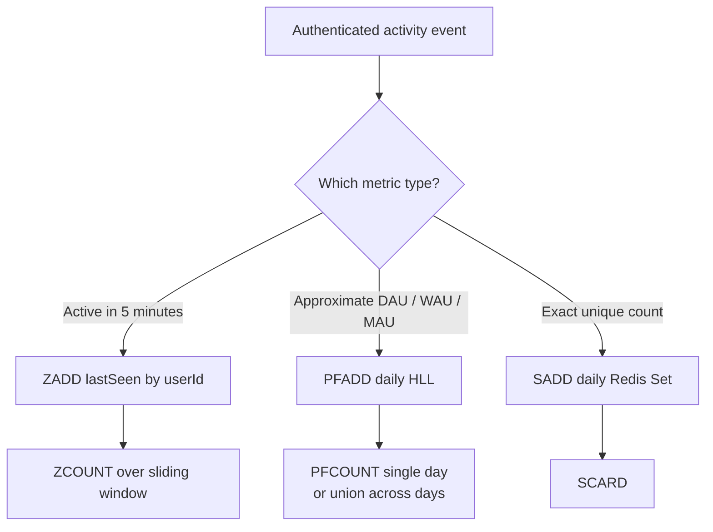
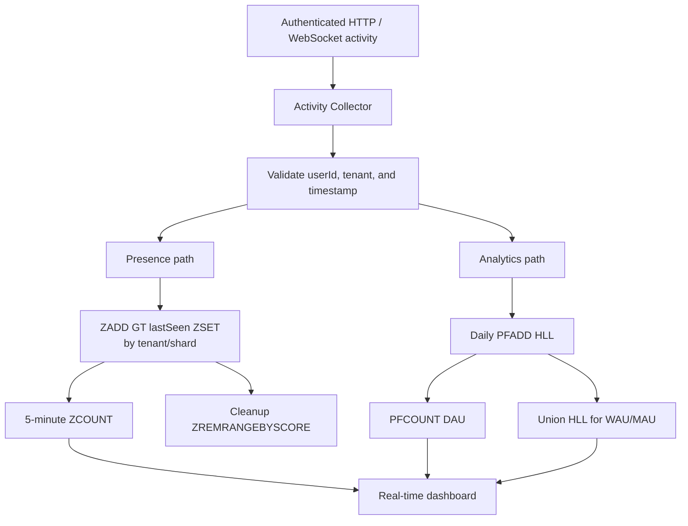

# Counting Active Users and Approximate Analytics

In a multi-user application, dashboards often display metrics such as **“active in the last 5 minutes”**, **DAU** (*Daily Active Users*), **WAU** (*Weekly Active Users*), or **MAU** (*Monthly Active Users*). These metrics sound similar, yet they have **different time definitions, accuracy guarantees, and storage costs**.

With **Spring Data Redis**, you can build two primary models:

- **Sorted Set (ZSET)** storing each user's `lastSeen` timestamp to count identifiers active within a **sliding window**. The result is an **exact count of recorded identifiers** inside the window, provided data and update timestamps are properly managed.
- **HyperLogLog (HLL)** storing a probabilistic *sketch* to **estimate unique users** per day, week, or month. Memory stays tiny and virtually flat regardless of user count, though results carry **statistical error**, cannot list individual users, and cannot remove individual members like a Redis Set.

Never label all of these numbers as “online users” in the sense that a user definitely has the application open right now. Each metric is only as true as the chosen **activity signal definition**: heartbeats, authenticated requests, page views, interaction events, and so on.

## 1. First Define “Active”

Suppose an application has 100,000 accounts, of which only a subset send requests on a given day. You might measure:

| Metric | Illustrative Definition | Need Individual User IDs? |
| --- | --- | --- |
| **Connection-based online** | User currently holds at least one verified live WebSocket/session | Usually yes if managing sessions/connections |
| **Active in 5 minutes** | User had a heartbeat/request within the past 5 minutes | Can use a ZSET ordered by `lastSeen` |
| **DAU** | Count of unique `userId` values generating at least one qualifying event in **one calendar day** | Not necessarily if an estimate suffices |
| **WAU** | Count of unique users active across **7 defined days** | Requires unioning daily user sets or HLLs |
| **MAU** | Count of unique users active over **30 rolling days** or a **calendar month**, per contract | Must explicitly standardize the interval type |
| **Total requests** | Number of requests/events received | Different from unique users |

For instance, user `u-101` sends 500 requests in a day yet counts as **one** user for DAU. Meanwhile, `u-101` visiting 10 times today and 10 times tomorrow appears in the DAU of **two days**; the weekly WAU still counts that user only once.

Three decisions to lock down before writing code:

1. **Which signal counts as activity?** Any HTTP request, authenticated request, application heartbeat, meaningful transaction, or specific user action?
2. **Which time frame of reference applies?** UTC or a fixed business time zone? A calendar day differs from a rolling 24-hour window.
3. **What level of accuracy is acceptable?** Operational dashboards tolerating low error can use HyperLogLog; quota caps, seat counts, billing, or permission grants **must never rely on approximate numbers**.

### 1.1. Illustrating Multiple Requests from One User

```text
10:00:00  u-101 -> GET /home
10:00:30  u-101 -> GET /products
10:01:00  u-102 -> POST /search
10:03:00  u-101 -> heartbeat

Total observed requests/heartbeats = 4
Unique userIds in interval = 2
```

Counting requests with `INCR` gives 4; counting unique users requires deduplicating by identifier. That is the single most important distinction between **event count** and **unique user count**.

## 2. Choosing a Redis Structure by Requirement

| Structure | Data Model | Good Fit | Limitations |
| --- | --- | --- | --- |
| `String` counter | `INCR metrics:requests` | Total requests/operations | Does not deduplicate users |
| `Set` | `SADD dau:date userId` | **Exact unique user count**, membership checks | Memory grows linearly with user count |
| `Sorted Set` | `ZADD presence score userId` | Last-seen tracking, sliding-window active counts, recent activity queries | Memory grows with retained users |
| **HyperLogLog** | `PFADD hll:date userId` | **Approximate unique user count** with tiny memory footprint | Cannot list users, cannot remove members |
| Bitmap | `SETBIT key numericUserId 1` | Dense, stable, non-negative integer IDs | Very sparse large offsets inflate bitmap size |

No single structure is optimal for every metric. A practical system often pairs **ZSET** for multi-minute presence with **HLL** for DAU/WAU/MAU, while core business records remain in a separate database.



## 3. Counting Recently Active Users with Sorted Sets

A Redis Sorted Set stores **member/score** pairs. For active-user tracking:

- **Member** is a stable user identifier, e.g., `u-101`.
- **Score** is the timestamp of the latest recorded activity, e.g., Unix epoch **milliseconds**.
- **Key** represents the metric scope, e.g., `presence:{shop}:last-seen`.

Redis CLI example:

```redis
ZADD presence:{shop}:last-seen 1763000000000 u-101
ZADD presence:{shop}:last-seen 1763000020000 u-102
ZADD presence:{shop}:last-seen 1763000030000 u-101
```

Each `member` has **only one score** in a ZSET, so `u-101` is not double-counted when another heartbeat arrives. The last `ZADD` updates `u-101`'s score from its previous timestamp to the newer one.

Inspection:

```redis
ZRANGE presence:{shop}:last-seen 0 -1 WITHSCORES
ZSCORE presence:{shop}:last-seen u-101
ZCARD presence:{shop}:last-seen
```

`ZCARD` returns the total number of members **currently retained in the ZSET**; it does not automatically know who was active in the last 5 minutes. If stale records remain in the ZSET, `ZCARD` will exceed the true active count.

### 3.1. Computing a 5-Minute Sliding Window

Let `nowMs` be the current timestamp in milliseconds and the activity window be **300,000 ms**:

```text
cutoffMs = nowMs - 300000
active if lastSeenMs > cutoffMs
```

Two counting approaches:

**Approach A — no immediate deletion of stale entries needed:**

```redis
ZCOUNT presence:{shop}:last-seen (1762999700000 +inf
```

The `(` prefix before the score means **exclusive lower bound**. The command above uses an illustrative cutoff; in code, compute the cutoff dynamically from the current time.

**Approach B — prune stale entries first, then count:**

```redis
ZREMRANGEBYSCORE presence:{shop}:last-seen -inf 1762999700000
ZCARD presence:{shop}:last-seen
```

These are two separate commands. If heartbeats continuously arrive concurrently, reading `ZCARD` after cleanup does not yield an atomic snapshot of the cleanup instant. For many dashboards this is acceptable; if you need an exact point-in-time count, define an appropriate atomic read protocol.

### 3.2. When to Use `ZCOUNT` vs. `ZCARD`

| Need | Approach |
| --- | --- |
| Count users in a 5-minute window **without depending on cleanup** | `ZCOUNT` with scores in the time range |
| Count all members after the ZSET has been strictly pruned | `ZCARD` |
| Fetch recently active users | `ZRANGEBYSCORE`/range-by-score API with result limits |
| Find a single user's latest activity | `ZSCORE` |
| Reclaim memory from expired members | `ZREMRANGEBYSCORE` |

`ZCOUNT` operates directly on scores without pulling all user IDs into the JVM to count them. With a ZSET's balanced backing structures, score-range counting is much cheaper than fetching every member and filtering in Java.

## 4. Spring Data Redis Example: Recording Heartbeats and Counting Active Users

Using Spring Boot 3.x and `StringRedisTemplate`.

```groovy
// build.gradle
dependencies {
    implementation 'org.springframework.boot:spring-boot-starter-data-redis'
}
```

```yaml
# src/main/resources/application.yml
spring:
  data:
    redis:
      host: localhost
      port: 6379
```

A basic service:

```java
package com.example.analytics;

import java.time.Clock;
import java.time.Duration;
import org.springframework.data.redis.core.StringRedisTemplate;
import org.springframework.stereotype.Service;

@Service
public class ActiveUserService {

    private static final String KEY = "presence:{shop}:last-seen";
    private static final Duration WINDOW = Duration.ofMinutes(5);

    private final StringRedisTemplate redis;
    private final Clock clock;

    public ActiveUserService(
            StringRedisTemplate redis, Clock clock) {
        this.redis = redis;
        this.clock = clock;
    }

    public void heartbeat(String userId) {
        requireUserId(userId);
        long nowMs = clock.millis();

        redis.opsForZSet()
                .add(KEY, userId, (double) nowMs);
    }

    public long countActiveUsers() {
        long cutoffMs = clock.millis() - WINDOW.toMillis();
        // Score stored as integer milliseconds; +1 excludes the cutoff.
        Long count = redis.opsForZSet()
                .count(KEY, (double) cutoffMs + 1,
                        Double.POSITIVE_INFINITY);

        if (count == null) {
            throw new IllegalStateException(
                    "Redis count unavailable in current context");
        }
        return count;
    }

    public long removeInactiveUsers() {
        long cutoffMs = clock.millis() - WINDOW.toMillis();
        Long removed = redis.opsForZSet()
                .removeRangeByScore(
                        KEY,
                        Double.NEGATIVE_INFINITY,
                        (double) cutoffMs);
        if (removed == null) {
            throw new IllegalStateException(
                    "Redis cleanup result unavailable");
        }
        return removed;
    }

    private static void requireUserId(String userId) {
        if (userId == null || userId.isBlank()) {
            throw new IllegalArgumentException("userId is required");
        }
    }
}
```

To inject `Clock`, declare a bean:

```java
package com.example.analytics;

import java.time.Clock;
import org.springframework.context.annotation.Bean;
import org.springframework.context.annotation.Configuration;

@Configuration
public class TimeConfiguration {

    @Bean
    Clock clock() {
        return Clock.systemUTC();
    }
}
```

`Clock` decouples time from Redis logic, making it easy to simulate timestamps in tests and avoiding scattering `System.currentTimeMillis()` throughout the codebase.

### 4.1. Using the Service

```java
activeUserService.heartbeat("u-101");
activeUserService.heartbeat("u-102");
activeUserService.heartbeat("u-101");

long active = activeUserService.countActiveUsers();
System.out.println("Observed active users: " + active);
```

Assuming both IDs were recorded within the 5-minute window and no other IDs exist, the result is `2`, not `3`.

**Accuracy scope note:** The ZSET counts **the exact number of user IDs whose score satisfies the range**, not proof that those people remain connected at query time. If a user abruptly closes the browser without triggering a logout event, their ID continues to be counted until the window elapses.

### 4.2. Why Store Timestamps as `double`?

Redis sorted sets store scores as 64-bit floating-point numbers. Modern Unix epoch millisecond timestamps fit cleanly within the exact integer range of IEEE 754 `double` (up to `2^53`), making them suitable for `lastSeen` today.

Do not pack huge arbitrary 64-bit identifiers into scores expecting exact integer precision. Keep **IDs** in members and **timestamps** or sortable metrics in scores.

## 5. Preventing Stale Heartbeats from Overwriting Newer Ones

Suppose two requests are processed out of order:

```text
Request A records timestamp = 10:00:05 but gets delayed
Request B records timestamp = 10:00:08 and writes ZADD first
Request A finally executes ZADD with timestamp 10:00:05
```

With a plain `ZADD`, the user's score can **move backward from 10:00:08 to 10:00:05**. When the window is short, the user might be marked inactive prematurely.

Redis `ZADD` supports the **`GT`** option on supported server versions, updating the score only when the new value is **greater than the current score**:

```redis
ZADD presence:{shop}:last-seen GT 1763000030000 u-101
```

For members that do not yet exist, `ZADD GT` still inserts them. However, `ZADD`'s default return count tracks **newly added members** rather than updated ones; do not use it as a count of received heartbeats.

Expressing monotonic update logic via Lua:

```lua
-- KEYS[1]: lastSeen ZSET
-- ARGV[1]: userId
-- ARGV[2]: numeric millisecond timestamp
local now = tonumber(ARGV[2])
if not now then
    return redis.error_reply('invalid timestamp')
end

local previous = redis.call('ZSCORE', KEYS[1], ARGV[1])
if not previous or now > tonumber(previous) then
    redis.call('ZADD', KEYS[1], now, ARGV[1])
    return 1
end
return 0
```

The script combines reading the score and updating it into **one execution on Redis**, eliminating the race between check and write. In large applications, share a single script and bound execution overhead. Never issue separate `ZSCORE` then `ZADD` calls across two independent requests when monotonic progress must be preserved.

**Important:** Monotonic updates do not fix **clock skew across instances**. A host whose clock is minutes ahead can write future scores and keep users counted as active for too long. To minimize drift, synchronize system clocks or use Redis server time (such as `TIME`) when designing heartbeat ingestion. If pairing Redis `TIME` with an update, choose an atomic mechanism so you do not open a race window between steps.

## 6. Pruning Stale Data to Avoid Unbounded Memory Growth

If every user who ever visited remains in the ZSET, `ZCOUNT` still returns valid active numbers, yet **memory never shrinks**. Over months, the ZSET can accumulate millions of inactive users.

A cleanup task:

```java
import org.springframework.scheduling.annotation.Scheduled;

// Placed in a Spring bean with ActiveUserService injected.
@Scheduled(fixedDelay = 60_000)
public void cleanupPresence() {
    long removed = activeUserService.removeInactiveUsers();
    // Emit removed metric if needed; never log sensitive userIds.
}
```

To use `@Scheduled`, enable scheduling in application configuration:

```java
import org.springframework.context.annotation.Configuration;
import org.springframework.scheduling.annotation.EnableScheduling;

@Configuration
@EnableScheduling
public class SchedulingConfiguration {
}
```

The cleanup method removes all members whose score is **less than or equal to the cutoff**. If a fresh heartbeat writes before Redis runs cleanup, its newer score falls outside the deleted range. If cleanup runs first, the incoming heartbeat re-adds/updates the member.

In multi-instance deployments, **every instance does not need to run cleanup every minute**. You can configure a dedicated maintenance job or distribute cleanup across tenant/shard keys to cut redundant commands. Never wipe the whole ZSET with a short `EXPIRE` while active users still reside inside it.

### 6.1. ZSET TTL Is Not a Per-User TTL

```redis
EXPIRE presence:{shop}:last-seen 300
```

That command sets a TTL on the **entire ZSET key**, not per member. When the key expires, **every user** disappears at once. A presence model needs **per-user scores and score-based pruning**, not `EXPIRE` to expire individual members.

If you only need counts, `ZCOUNT` suffices; cleanup manages memory optimization. A system can retain records longer than 5 minutes (e.g., 24 hours) for other metrics while querying `ZCOUNT` over the exact range needed per metric.

## 7. Defining “Online” When a User Has Multiple Devices

A single user might open the same account across three devices:

```text
user u-101
  +--- mobile session s-1
  +--- browser session s-2
  +--- tablet session s-3
```

If the ZSET uses **`userId` as member**, all three devices update **one entry**, keeping the active user count at `1`.

If you use `sessionId` as member, the ZSET counts **sessions**, not users. To show online users across multiple sessions, you must aggregate back to `userId` or maintain a user–session mapping with appropriate cleanup logic.

Explicit logout/disconnect can delete the score:

```redis
ZREM presence:{shop}:last-seen u-101
```

Yet immediately deleting `userId` when **one** device logs out can be wrong if another device remains active. Therefore, if business rules require connection-based presence, track individual sessions or connections first and derive online user status from them. If you only measure “active in the last 5 minutes,” updating a single `userId` in a ZSET is simpler and more appropriate.

### 7.1. Avoid Unstable Identifiers

Do not use IP addresses as unique user identifiers: multiple users share NAT/IPs, while one user's IP can change. Cookies or anonymous device IDs also do not equate to real people and can be cleared or rotated. When presenting metrics, explicitly document the **counting unit**: account ID, authenticated user ID, session ID, or anonymous device ID.

Store only necessary identifiers; avoid embedding raw emails, phone numbers, or sensitive attributes in Redis keys or members without good reason. Use internal IDs or normalized tokens conforming to data protection policies.

## 8. Exact DAU with Redis Sets

If you want to **count unique users in a day strictly according to recorded events**, a Redis Set is the direct choice:

```redis
SADD metrics:{shop}:dau:2030-05-01 u-101
SADD metrics:{shop}:dau:2030-05-01 u-102
SADD metrics:{shop}:dau:2030-05-01 u-101

SCARD metrics:{shop}:dau:2030-05-01
# 2
```

`SADD` does not duplicate an existing member. `SCARD` returns the exact cardinality of the Set with zero statistical error.

With Spring Data Redis:

```java
import org.springframework.data.redis.core.StringRedisTemplate;

String key = "metrics:{shop}:dau:2030-05-01";

redis.opsForSet().add(key, "u-101");
redis.opsForSet().add(key, "u-102");
redis.opsForSet().add(key, "u-101");

Long exact = redis.opsForSet().size(key);
System.out.println("DAU exact: " + exact);
```

**Trade-off:** A Set's memory grows proportionally with daily unique users. With millions of users per day, retaining IDs across many consecutive days consumes substantial RAM. Sets fit best when you need **exact counts**, membership lookups, or occasional inspection of members during investigations.

If you only need dashboard statistics and can tolerate a small error margin, **HyperLogLog** cuts memory dramatically.

## 9. HyperLogLog: Approximate Unique User Counting

**Redis HyperLogLog** is a probabilistic data structure that estimates **cardinality**—the number of distinct elements added. It does not store the full list of user IDs like a Redis Set.

Key commands:

| Command | Meaning |
| --- | --- |
| `PFADD key userId ...` | Adds elements to the HLL; duplicates generally do not inflate the estimate linearly |
| `PFCOUNT key` | Estimates the unique element count of one HLL |
| `PFCOUNT key1 key2 ...` | Estimates the unique element count of the **union** of multiple HLLs |
| `PFMERGE destination source1 source2 ...` | Merges multiple HLLs into a destination key |

Example:

```redis
PFADD metrics:{shop}:dau:2030-05-01 u-101 u-102 u-101
PFCOUNT metrics:{shop}:dau:2030-05-01
# Typically near 2; this is an estimate, not an exact guarantee
```

A Redis HLL uses roughly **12 KB** in its dense representation at high cardinality, and less memory in sparse form for small sets. The relative standard error is commonly cited around **0.81%** for Redis's HLL implementation.

**Standard error is not a hard error cap.** Individual observations can deviate by more than 0.81%, especially when evaluating probabilistic tails or small counts. Use HLL for trends, dashboards, and marketing analytics; never use it to generate billable invoice quantities or enforce strict quota access denials.

### 9.1. What Does PFADD Return?

Redis `PFADD`'s return value indicates whether the HLL's **internal representation changed**. It is **not a reliable boolean proving a new user was never seen before**. HLL does not support exact `contains(userId)` queries.

Avoid doing this:

```java
// Do not interpret PFADD's return value as "unique new user".
var changed = redis.opsForHyperLogLog().add(key, "u-101");
// changed != 0 does NOT prove u-101 was absent from the set.
```

If you need to check whether a user was recorded today, use a Redis Set or an exact-membership data store. HLL provides **cardinality estimation only**.

### 9.2. You Cannot Remove a User from an HLL

Redis HLL does not support:

```redis
PFREM key u-101
```

That is **not** a valid Redis command. Once an HLL ingests data, there is no way to delete an individual member. Adjusting a dataset generally requires rebuilding the HLL from a source list of valid IDs, or writing into fresh buckets and letting old buckets expire.

Nor can HLL enumerate all users. If requirements demand excluding a specific account from reports or recomputing exact numbers, retain source events and a rebuild pipeline.

## 10. Using Spring Data Redis HyperLogLogOperations

`StringRedisTemplate` exposes `opsForHyperLogLog()`. Example DAU tracking service:

```java
package com.example.analytics;

import java.time.Clock;
import java.time.LocalDate;
import java.time.ZoneId;
import org.springframework.data.redis.core.StringRedisTemplate;
import org.springframework.stereotype.Service;

@Service
public class DailyActiveUserService {

    // Example standardizing daily reporting on UTC system-wide.
    private static final ZoneId REPORTING_ZONE = ZoneId.of("UTC");
    private static final String PREFIX = "metrics:{shop}:dau:";

    private final StringRedisTemplate redis;
    private final Clock clock;

    public DailyActiveUserService(
            StringRedisTemplate redis, Clock clock) {
        this.redis = redis;
        this.clock = clock;
    }

    public void recordActivity(String userId) {
        if (userId == null || userId.isBlank()) {
            throw new IllegalArgumentException("userId is required");
        }

        LocalDate date = LocalDate.now(clock.withZone(REPORTING_ZONE));
        String key = PREFIX + date;

        redis.opsForHyperLogLog().add(key, userId);
    }

    public long estimateDau(LocalDate date) {
        Long value = redis.opsForHyperLogLog()
                .size(PREFIX + date);

        if (value == null) {
            throw new IllegalStateException(
                    "HyperLogLog count unavailable");
        }
        return value;
    }
}
```

Example invocation:

```java
dailyActiveUserService.recordActivity("u-101");
dailyActiveUserService.recordActivity("u-102");
dailyActiveUserService.recordActivity("u-101");

long estimate = dailyActiveUserService.estimateDau(
        java.time.LocalDate.now(java.time.ZoneOffset.UTC));

System.out.println("Estimated DAU: " + estimate);
```

Each `recordActivity` call executes `PFADD`, yet adding the same user ID repeatedly does not inflate cardinality linearly with request volume.

**Operational note:** The sample calls `PFADD` on every activity event, which can generate heavy load under massive event traffic. Define which events truly belong in the HLL (e.g., once per valid session/interval) and consider batching, pipelining, or a dedicated analytics queue. Even though duplicates don't skew cardinality like counters, every Redis call still consumes network and CPU.

## 11. Never Sum DAU to Estimate WAU and MAU

Suppose:

```text
Monday:  u-101, u-102    -> DAU = 2
Tuesday: u-101, u-103    -> DAU = 2
```

**Never compute** two-day unique users as `2 + 2 = 4`. The union of the two sets is `{u-101, u-102, u-103}`, so **unique users = 3**.

With HyperLogLog, you must **merge sketches** across days or call `PFCOUNT` across multiple HLLs:

```redis
PFCOUNT metrics:{shop}:dau:2030-05-01 metrics:{shop}:dau:2030-05-02
```

Redis estimates the cardinality of the **union**, not the sum of daily estimates.

### 11.1. Example Computing Rolling 7-Day WAU

```java
package com.example.analytics;

import java.time.LocalDate;
import java.util.stream.IntStream;
import org.springframework.data.redis.core.StringRedisTemplate;
import org.springframework.stereotype.Service;

@Service
public class RollingDistinctUsersService {

    private static final String PREFIX = "metrics:{shop}:dau:";

    private final StringRedisTemplate redis;

    public RollingDistinctUsersService(StringRedisTemplate redis) {
        this.redis = redis;
    }

    public long estimateLast7CalendarDays(LocalDate lastDay) {
        String[] keys = IntStream.range(0, 7)
                .mapToObj(i -> PREFIX + lastDay.minusDays(i))
                .toArray(String[]::new);

        Long result = redis.opsForHyperLogLog().size(keys);
        if (result == null) {
            throw new IllegalStateException("HLL result unavailable");
        }
        return result;
    }
}
```

This snippet counts unique users across **7 calendar days** ending on `lastDay`. It does not mean **an exact 168-hour window** measured backward from mid-day. If the product defines WAU by ISO weeks (Monday through Sunday), select the exact week's dates rather than always taking the past 7 days.

Similarly:

- **30-day active users**: union the HLLs of 30 calendar days per convention.
- **Calendar-month MAU**: union the HLLs from the first to last day of the target month.
- **Calendar-week WAU**: union the HLLs for that product-timezone week.

Never keep one monolithic HLL for “everyone ever online” and expect to compute DAU/WAU from it: HLL has no way to evict expired users from a rolling window.

### 11.2. PFMERGE When Retaining Union Results

```redis
PFMERGE metrics:{shop}:wau:2030-W18 metrics:{shop}:dau:2030-05-01 metrics:{shop}:dau:2030-05-02
PFCOUNT metrics:{shop}:wau:2030-W18
```

`PFMERGE` creates/writes the union into a destination key. When maintaining a weekly key, decide how it gets refreshed if late events update a source day. **Keeping a merged WAU HLL does not automatically update it when subsequent events arrive in the source keys**; you must re-merge or feed the weekly HLL concurrently.

For periodic dashboard views, calling multi-key `PFCOUNT` directly avoids storing merged weekly copies. When key counts grow large or reads repeat frequently, cache the estimate or rebuild scheduled merged sketches with clear freshness rules.

## 12. Redis Cluster: Multi-Day HLLs Must Share a Hash Slot

Redis Cluster restricts **multi-key** commands to **the same hash slot**. Multi-key `PFCOUNT key1 key2` and `PFMERGE destination source1 ...` obey this rule.

That is why the illustrative key names use a hash tag:

```text
metrics:{shop}:dau:2030-05-01
metrics:{shop}:dau:2030-05-02
metrics:{shop}:wau:2030-W18
```

All keys share `{shop}`, so they map to the same slot and can participate in HLL unions.

```redis
CLUSTER KEYSLOT metrics:{shop}:dau:2030-05-01
CLUSTER KEYSLOT metrics:{shop}:dau:2030-05-02
```

If two HLLs sit on different slots, a multi-key `PFCOUNT` or `PFMERGE` fails with `CROSSSLOT`. Cluster-aware drivers do not automatically execute distributed HyperLogLog unions across multiple primaries.

**Trade-off:** Every HLL key for `{shop}` concentrates on a single slot. For a very large single tenant with heavy `PFADD` volume, this can create a **hot slot**. You can split by tenant:

```text
metrics:{tenant-1}:dau:2030-05-01
metrics:{tenant-2}:dau:2030-05-01
```

to spread tenants out, though a cross-tenant union can no longer run as one single-slot `PFCOUNT`. You will need application-level aggregation or a dedicated analytics service—**never sum HLL estimates across shards** and call it global unique users if the same user can appear in multiple shards.

If you shard deterministically by **hash(userId)**, one user always lands in the same shard, limiting cross-shard duplicates when summing per-shard uniques. Even then, changing shard counts, migrating tenants, or tracking multiple identifiers still requires migration planning and error analysis. For true cluster-wide approximate unions, combine the **sketches** themselves rather than arbitrarily adding per-shard estimates.

## 13. TTL and Retention for Analytics Buckets

If daily HLLs are retained forever, key counts grow endlessly. Enforce a retention policy—for instance, keeping 90 days to calculate MAU and compare recent months:

```text
metrics:{shop}:dau:2030-05-01
metrics:{shop}:dau:2030-05-02
...
```

Running `EXPIRE` on an HLL sets a TTL for **that entire day's key**:

```redis
EXPIRE metrics:{shop}:dau:2030-05-01 7776000
```

While `7,776,000` seconds equals 90 days, re-running `EXPIRE` on every activity keeps pushing the deadline forward. For consistent calendar-day retention, set an **absolute expiration timestamp** N days past the reporting date using `EXPIREAT` or its Spring Data Redis equivalent.

```java
import java.time.Instant;
import java.time.LocalDate;
import java.time.ZoneOffset;
import java.util.Date;

LocalDate bucketDay = LocalDate.of(2030, 5, 1);
Instant expireAt = bucketDay.plusDays(91)
        .atStartOfDay(ZoneOffset.UTC)
        .toInstant();

redis.expireAt(
        "metrics:{shop}:dau:" + bucketDay,
        Date.from(expireAt));
```

This snippet illustrates computing an absolute deadline. If `PFADD` succeeds while setting the expiration fails, the bucket can end up without a TTL; a maintenance job should audit keys missing expirations or carrying abnormal TTLs. When multiple producers write concurrently, apply non-conflicting expiration logic so keys are never dropped early.

**Late-bucket warning:** A delayed event may target a past day's bucket. If that bucket has already expired, the system needs an explicit decision: drop it, reconstruct from event logs, or backfill historical reports via a defined pipeline. Never blindly toss late events into today's bucket, as that distorts event-date DAU.

## 14. Event Time vs. Ingestion Time

Suppose a user performs an action at `23:59:58`, but the request reaches the server at `00:00:03` due to network lag. Using server ingestion time counts the event on the next day. Using client `occurredAt` puts it on the earlier day, though you must account for client clock skew and forged timestamps.

| Time Source | Pros | Risks |
| --- | --- | --- |
| Server processing time | Trustworthy, simple | Delayed events can drift across day boundaries |
| Trusted source event timestamp | Reflects true business occurrence | Requires late-event handling, versioning, and time zone care |
| Client timestamp | Close to user action on device | Clock skew, spoofing, offline sync |
| Redis server time | Consistent across app instances hitting the same Redis | Requires careful command design; doesn't fix delayed event business dates |

For general DAU dashboards, **UTC ingestion day** is fine if clearly documented. For rigorous product analytics, prefer **trusted event time**, accepting *data freshness* lag and supporting historical bucket updates.

### 14.1. Time Zones and Daylight Saving Time

When reporting in a business time zone, one **calendar day** is not always 24 hours in regions observing DST. Avoid bucketing by dividing epoch milliseconds by a fixed `86_400_000` if reports must align with a specific zone's `LocalDate`.

Example:

```java
ZoneId zone = ZoneId.of("Asia/Ho_Chi_Minh");
LocalDate date = eventTime.atZone(zone).toLocalDate();
```

Here, `eventTime` is a trusted `Instant`. Producers, consumers, and dashboards must all agree on the time zone; changing time-zone policy later requires deciding whether historical numbers must be recomputed.

## 15. HyperLogLog Error Estimation

For Redis HLL, a relative standard error around **0.81%** is commonly cited from the algorithm design. Simple illustration:

| True Unique Count | Reference 0.81% Deviation |
| ---: | ---: |
| 1,000 | ~8 |
| 100,000 | ~810 |
| 1,000,000 | ~8,100 |
| 10,000,000 | ~81,000 |

This table is **not a guarantee that results always stay within those bounds**. It merely illustrates the scale of standard error; error distributions and confidence intervals must be evaluated when statistical precision requirements apply.

Dashboard example:

```text
Estimated DAU today:       1,005,300
Estimated DAU yesterday:     999,700
Estimated difference:          5,600
```

If the difference sits inside potential statistical noise, **do not definitively claim growth** from two HLL readings alone. Analyze error bounds, time windows, event completeness, and validate against exact user sets on sampled data if needed.

### 15.1. Never Use HLL to Enforce Hard Limits

```text
If unique users > 1,000 -> charge extra fee
```

Never use `PFCOUNT` as an exact billing cutoff around 1,000: estimation error can overcharge or undercharge customers. Such requirements belong in Sets, transactions, or databases offering exact guarantees.

HLL is suited to questions like “Roughly what was today's DAU?” or “What is the monthly active account trend?”.

## 16. Architectural Comparison at Higher Scale

Suppose the system sees millions of activities per minute across many instances and tenants. A single ZSET key for all users can become a **hot key**.

### 16.1. Sharding the Presence ZSET

If you shard using a stable hash of `userId`:

```text
presence:{shop-0}:last-seen
presence:{shop-1}:last-seen
presence:{shop-2}:last-seen
presence:{shop-3}:last-seen
```

Each user maps to **exactly one shard**, and all heartbeats for that user route there. To read total active users, query `ZCOUNT` across each shard and sum the results:

```text
activeTotal =
    ZCOUNT(shard0, cutoff, +inf)
  + ZCOUNT(shard1, cutoff, +inf)
  + ZCOUNT(shard2, cutoff, +inf)
  + ZCOUNT(shard3, cutoff, +inf)
```

Summing is valid **only if each user can appear in at most one shard** at the time of counting. Changing shard counts or the hash function without migration leaves a user in an old shard while writing to a new one, causing double counting.

In Redis Cluster, distinct hash tags spread load across slots and primaries. This involves a trade-off: querying total active users gathers multiple counts, adding latency and no longer yielding a single cross-node atomic snapshot.

### 16.2. Sharded HLLs and the Merging Problem

A similar scheme can split HLLs by tenant/shard:

```text
metrics:{shop-0}:dau:2030-05-01
metrics:{shop-1}:dau:2030-05-01
```

If the same user can appear in both shards (e.g., sharding by request rather than user), **never add two `PFCOUNT` results** for a global unique total. You need sketch merging or stable user-based routing to avoid cross-shard overlap.

Even when sharded cleanly by user with zero overlap, adding individual per-shard HLL estimates differs from running HLL on the union and carries different error properties; validate the combined error characteristics before publishing dashboards.

For massive analytics workloads, prefer streaming into an event pipeline or data warehouse capable of multi-partition distinct counts rather than forcing Redis Cluster to perform unsupported cross-slot HLL unions.

## 17. Write Throughput, Noise Reduction, and Metric Freshness

**Every heartbeat does not need to trigger a Redis command.** If a user interacts rapidly, calling `ZADD` on every HTTP request creates needless load.

Load-reduction strategies:

- Record heartbeats at reasonable intervals, such as every 30–60 seconds instead of every request.
- Count only authenticated actions explicitly classified as activity.
- Batch or pipeline latency-tolerant analytics updates where error handling policies permit.
- Shard by tenant/user when one key becomes too hot.
- Run cleanup in scheduled batches rather than wiping stale entries during dashboard reads.
- Briefly cache `PFCOUNT` outputs when dashboards experience heavy read concurrency.

Remember that throttling writes alters metric semantics. If heartbeats fire every 60 seconds while the active window is 30 seconds, an active user will appear inactive between ticks. Heartbeat intervals must be **shorter with margin** than the active window.

### 17.1. Impact of Redis Outages and Dropped Events

A `ZADD` or `PFADD` can fail during Redis disconnects, client timeouts, or upstream event drops. HLL cannot reconstruct users the producer never reported.

Therefore:

```text
Total error = HLL statistical error
            + dropped/duplicated/mis-bucketed events
            + user identity churn
            + timing and topology effects
```

The 0.81% figure describes **the HLL algorithm given the received inputs**, not end-to-end data quality in production.

If metrics drive contractual reports or billing, persist source events in a durable store so you can **recompute** after incidents rather than relying exclusively on Redis HLL keys.

## 18. Per-Minute Active Counts and Sliding-Window HLL Trade-Offs

HyperLogLog can be bucketed by minute:

```text
hll:{shop}:minute:2030-05-01T10:00
hll:{shop}:minute:2030-05-01T10:01
hll:{shop}:minute:2030-05-01T10:02
```

Unioning the last 5 minute buckets gives an **approximate distinct user count over the union of those buckets**. However, this aligns to **minute boundaries**, not a strict **rolling 300,000 ms window**. Nor can HLL remove a user from a partially expired edge bucket.

Comparison:

| Approach | Pros | Cons |
| --- | --- | --- |
| Millisecond `lastSeen` ZSET | Exact count of members within the rolling window | Memory scales with users; requires pruning |
| Minute-bucketed HLL union | Tiny memory per bucket even at huge cardinality | HLL error + bucket boundary rounding; lacks exact millisecond precision |
| Daily HLL | Simple for calendar DAU/WAU/MAU | Unsuitable for exact real-time presence |

Choose **ZSET** when you need to know who is active or fetch lists/`lastSeen` timestamps. Choose **HLL** when bucketed approximate cardinality suffices and per-member queries are unnecessary.

## 19. Common Misconceptions to Avoid

### 19.1. “ZCARD Always Equals Currently Online Users”

No. `ZCARD` counts every stored member. Until stale users are pruned, it counts departed users too. Use `ZCOUNT` with a proper cutoff, or prune before calling `ZCARD`.

### 19.2. “EXPIRE on the ZSET Logs Out Individual Users”

No. `EXPIRE` applies to the entire key. Evict individual users by score via `ZREMRANGEBYSCORE` or a dedicated session model.

### 19.3. “INCR per Request Equals DAU”

No. `INCR` counts events; DAU counts unique user IDs. One user making 100 requests still counts as one user in DAU.

### 19.4. “PFADD Returning 1 Means the User Was Never Seen Before”

No. It indicates Redis's internal HLL structure changed, not an exact membership check.

### 19.5. “PFCOUNT Is Always Exact”

No. `PFCOUNT` is an estimate. Its ~0.81% standard error is not a strict worst-case bound for every dataset.

### 19.6. “WAU Equals the Sum of Seven Daily DAUs”

No. Users active on multiple days get counted repeatedly. Union Sets or run `PFCOUNT`/`PFMERGE` over the HLLs.

### 19.7. “You Can Subtract Yesterday's HLL from Today's HLL”

No. HyperLogLog supports no exact member or cardinality subtraction for sliding windows. Use finer buckets and union them, or pick another data model.

### 19.8. “The Same userId Across Two Tenants Is Still One Person”

Depends on definition. Per-tenant reporting counts a user once within each tenant. System-wide reporting requires a global ID and deduplication across tenants/shards.

### 19.9. “Closing a Tab Lets Us Remove the User Immediately”

Do not assume this in a heartbeat model. Browsers may fail to send logout requests on abrupt closes, and one user may have multiple devices open. Heartbeat windows infer activity rather than proving live socket state.

### 19.10. “Adding More Hash Tags Lets Redis Cluster Merge HLLs Automatically”

No. Multi-key `PFCOUNT` and `PFMERGE` still obey same-slot constraints. Distinct hash tags do not enable cross-slot distributed unions.

### 19.11. “One ZSET Scales to Any Workload”

No. A single hot key can saturate one primary node. At high scale, shard by user/tenant or offload metrics to a dedicated analytics pipeline.

### 19.12. “Approximate Metrics Don't Need Reliable Input Data”

No. HLL estimates the unique count of values **actually received**; dropped events, wrong buckets, duplicate IDs, or bot traffic will still skew metrics away from real activity.

## 20. Observability and Operations

A dashboard should separate three layers:

| Layer | Metrics to Track | Meaning |
| --- | --- | --- |
| Tracking ingestion | Events received, events dropped, Redis errors, ingestion lag | Input completeness |
| Redis presence | ZSET cardinality, active `ZCOUNT`, pruned members, `ZADD` rate | Memory footprint and windowed active counts |
| Redis unique estimates | Bucket `PFCOUNT`, HLL key count, bucket age, memory | Approximate DAU/WAU/MAU |

Additional items to monitor:

- Per-node Redis CPU, memory, network, and command latency.
- Timeout/reconnect error rates and operations with uncertain write outcomes.
- Presence ZSET memory over time; alert if cleanup stalls.
- Drift between Redis numbers and exact counts sampled from source-of-truth logs.
- Rate of events missing `userId`, carrying wrong time zones, or arriving late.
- Execution frequency of multi-key `PFCOUNT` and dashboard latency.
- Hot keys/hot slots when heavy traffic concentrates on one tenant.

Never log full user lists to verify dashboards. When investigating anomalies, sample records and mask or tokenize identifiers per data protection rules.

## 21. Composite Architecture Example

An application can separate **presence** and **analytics** paths like this:



### 21.1. Example Recording Rules

Suppose:

- Only authenticated users are counted.
- Presence uses a 5-minute window; heartbeats arrive at least every 30 seconds while active.
- DAU uses UTC calendar days.
- WAU is the union of the past 7 calendar days, never the sum of 7 DAU values.
- HLLs are retained for 90 days; the presence ZSET is pruned every minute.
- A `userId` counts once per tenant/bucket.

When a valid request arrives:

```text
1. Authenticate the request and resolve tenantId and userId.
2. Record the user's lastSeen in the tenant's ZSET.
3. Add userId to the UTC daily HLL bucket.
4. Serve the business response.
5. Dashboards poll ZCOUNT and PFCOUNT on a schedule.
```

This is a straightforward **best-effort** analytics setup. There is no cross-transaction between ZSET/HLL and business databases here: if Redis briefly errors, some events may be missed in metrics. When reliable recomputation is mandatory, write raw events to a retained log/queue and reprocess them via a separate pipeline.

### 21.2. Quick Selection Table

| Product Question | Suggested Structure / Command |
| --- | --- |
| “How many accounts sent requests in the past 5 minutes?” | `lastSeen` ZSET + `ZCOUNT` |
| “Who was active recently?” | ZSET + paginated score-range query |
| “Exact count of unique accounts today?” | Set + `SADD`/`SCARD` |
| “Approximate DAU across 10 million accounts?” | HLL + `PFADD`/`PFCOUNT` |
| “Unique users over seven days?” | Union of 7 exact Sets or 7 approximate HLLs |
| “Was user X in today's DAU?” | Redis Set or source data, **not HLL** |
| “Who currently holds an open WebSocket?” | Dedicated connection/session liveness registry; distinct from DAU |
| “Hard limit of 1,000 paid seats?” | Exact count in transactional business storage |

## 22. Summary

**Counting active users** and **estimating unique users** are related problems, not identical ones.

With **Spring Data Redis**:

1. Use a **Sorted Set** storing `lastSeen` by `userId` for sliding-window active counts; use `ZCOUNT` for windowed queries and `ZREMRANGEBYSCORE` to prune stale users.
2. Use a **Redis Set** when you need an **exact** daily unique user set and can afford per-member memory overhead.
3. Use **HyperLogLog** for **approximate** DAU/WAU/MAU at large cardinality: `PFADD` to record user IDs, `PFCOUNT` to estimate, and `PFMERGE` to merge buckets.
4. **Never add DAUs to derive WAU/MAU**; union Sets or HLLs to deduplicate users active across multiple days.
5. Standardize definitions for activity signals, identifiers, time zones, windows, retention policies, and late-event handling.
6. Account for HLL estimation error and input data quality; never use approximate sketches to enforce strict quotas or billing limits.
7. For multi-tenant or Redis Cluster deployments, evaluate **hash slots, hot keys, fan-out overhead, and multi-key constraints** before sharding or merging metrics.

A good dashboard does more than display a number. It clearly states **who is counted**, **over what window**, **from which signal**, and **whether the figure is exact over recorded events or an approximation with error bounds**.

### References

- [Redis — Sorted Sets](https://redis.io/docs/latest/develop/data-types/sorted-sets/): member/score model, score-range queries, and updates.
- [Redis — ZADD](https://redis.io/docs/latest/commands/zadd/): adding/updating members and the `GT` option.
- [Redis — ZCOUNT](https://redis.io/docs/latest/commands/zcount/): counting members within a score range.
- [Redis — ZREMRANGEBYSCORE](https://redis.io/docs/latest/commands/zremrangebyscore/): removing members with scores outside the retained window.
- [Redis — HyperLogLog](https://redis.io/docs/latest/develop/data-types/probabilistic/hyperloglogs/): cardinality estimation mechanics and memory/error characteristics.
- [Redis — PFADD](https://redis.io/docs/latest/commands/pfadd/): adding elements to a HyperLogLog.
- [Redis — PFCOUNT](https://redis.io/docs/latest/commands/pfcount/): estimating unique counts for one or multiple HLLs.
- [Redis — PFMERGE](https://redis.io/docs/latest/commands/pfmerge/): merging multiple HyperLogLog sketches.
- [Spring Data Redis — RedisTemplate](https://docs.spring.io/spring-data/redis/reference/redis/template.html): `StringRedisTemplate`, `opsForZSet`, `opsForSet`, and `opsForHyperLogLog`.
- [Spring Data Redis — HyperLogLogOperations API](https://docs.spring.io/spring-data/redis/reference/api/java/org/springframework/data/redis/core/HyperLogLogOperations.html): `add`, `size`, and `union` APIs.
