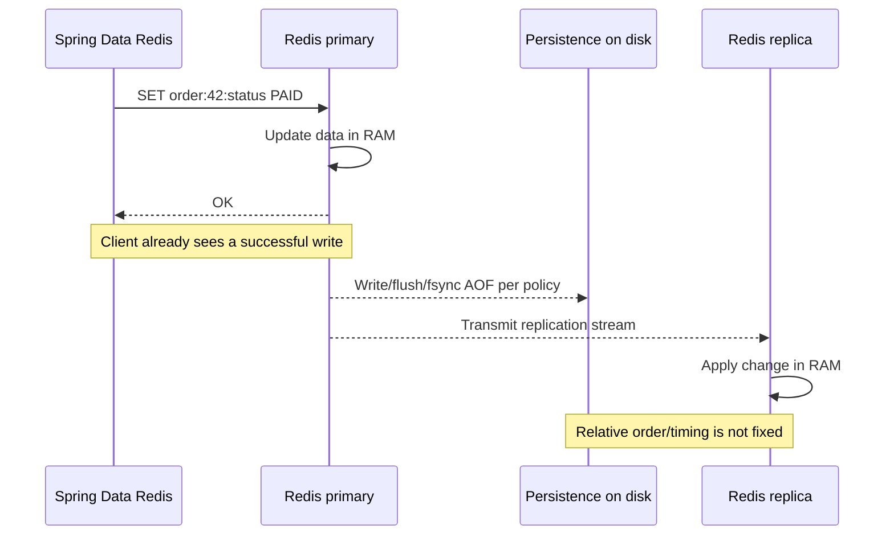
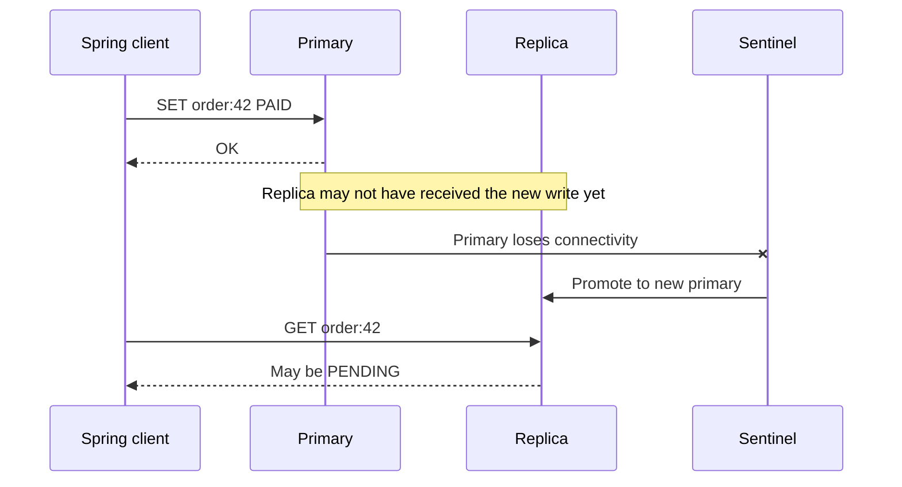

# Distinguishing In-Memory Data from Durable Copies in Spring Data Redis

## 1. Does a successful `SET` command mean the data is safe after a Redis restart?

Redis is a database that prioritizes operations on **data residing in memory (RAM)** to serve reads and writes with low latency. When a Spring Data Redis application calls:

```java
stringRedisTemplate.opsForValue()
        .set("order:42:status", "PAID");
```

Redis can update the dataset in RAM and return a success response. However, a success response **does not automatically prove that the change has been durably written to disk, received by a replica, or included in a restorable backup**.

To understand the level of data safety, you must distinguish between:

- **In-memory data state:** the set of keys/values Redis currently uses to answer `GET`, `HGETALL`, `ZRANGE`, and similar commands. When the Redis process terminates or the machine loses power, RAM is not a default recovery store.
- **RDB snapshot:** a point-in-time snapshot of the dataset saved to a file so Redis can reload it on startup.
- **AOF (Append Only File):** a log of changes that can be used to reconstruct the dataset after a restart; durability depends on how flush/fsync is configured and the health of the storage.
- **Replication:** one or more replicas holding copies of the primary's data and following the change stream; this does not automatically equate to data being durably persisted.
- **Independent backup:** a copy stored, protected, and tested for recovery in the event of a major outage, accidental deletion, or data corruption.

The same key may exist in the primary's RAM, not yet be in the latest RDB snapshot, sit in an un-fsynced AOF buffer, have or have not reached a replica, and not be in any backup at all. Therefore, the question "Has Redis saved the key?" must specify **which layer has saved it**.

## 2. Two important concepts: availability and durability

In Redis operations, three situations differ:

1. **Redis is still running:** a written key can be read from RAM almost immediately after the primary processes the command.
2. **The Redis process or host restarts:** Redis can only recover data that an enabled persistence mechanism and the storage system have retained.
3. **The machine, volume, or deployment zone is lost:** even RDB/AOF files on the same volume may disappear; you need a copy in a different failure domain or the ability to recover from the authoritative data source.

| Need | Commonly used mechanism | What must not be assumed |
| --- | --- | --- |
| Fast request serving | Dataset in RAM | Data has been fsynced to disk |
| Recovery after restart | RDB/AOF | Latest writes are never lost |
| Serving when primary fails | Replication, Sentinel, or Cluster failover | Replicas definitely have every write acknowledged by the primary |
| Recovery after accidental deletion, logic bugs, or volume loss | Backups with multi-version retention | A replica or an RDB file on the same machine counts as a backup |
| Ensuring business operations are not lost | Durable source of truth, outbox, idempotency, reconciliation workflows | `RedisTemplate` returning success means end-to-end exactly-once |

**Durability** is the ability of committed changes to survive a specific class of failure. **Availability** is the ability of the system to continue accepting and serving requests. A topology with multiple replicas can increase availability, yet still fail to achieve zero data loss when replication is asynchronous.

## 3. Timeline of a write operation

Do not conflate "Redis processed the command", "the client received OK", "AOF has fsynced", and "the replica has synchronized" into the same moment in time.

Example conceptual flow when Redis enables AOF with periodic fsync and has one replica:



In practice, Redis may buffer data and write logs during command processing; the diagram **does not depict the exact internal ordering of individual syscalls**. What matters is that the client acknowledgment point is not a guarantee that every disk, replica, and backup layer is already safe.

If Redis or the host fails immediately after the app receives `OK`, the recovery outcome depends on:

- Whether Redis has RDB/AOF enabled?
- When was the most recent snapshot taken?
- How far has the AOF been written and fsynced?
- Are persistence files located on a volume that is preserved?
- Which replica received the change and is elected as the new primary if failover occurs?
- Is a backup stored outside the failed machine/volume?

## 4. When Redis has no persistence: the dataset exists only in RAM

A Redis instance can run with both RDB snapshots and AOF disabled. While the process is running, the application still executes `SET`, `GET`, and `INCR` normally and receives success responses.

Example of **configuration intent**:

```conf
save ""
appendonly no
```

- `save ""`: disables automatic RDB snapshot rules based on save conditions.
- `appendonly no`: disables AOF change logging.

This configuration should only be applied when **you intentionally accept losing the dataset on restart/crash**, such as a Redis cache that can be completely rebuilt. Do not copy this into production if data must be retained.

Sequence of events:

```text
09:00 Redis starts with an empty dataset
09:01 SET cache:product:42 "..."
09:02 GET cache:product:42 -> returns value
09:03 Redis process is completely lost
09:04 Redis restarts
09:05 GET cache:product:42 -> usually no value remains
```

RAM is very fast, but **the RAM of a Redis process is not a durable copy**. Another replica's RAM can help maintain service when the primary fails, but if the entire topology has no persistence or the replica is also lost, there is still no durable data source to reload from.

### When an in-memory-only model makes sense

- Caches that can be rebuilt from a database or source API.
- Temporary computed data where regeneration after an outage is acceptable.
- Short-lived state that business requirements do not need to preserve across restarts.
- Test environments containing no data that needs protection.

Even when using Redis purely as a cache, you must plan for **cache cold start**: after a Redis restart, a flood of requests can miss simultaneously and overwhelm the database. You may need rate limiting, prewarming, a circuit breaker, TTL jitter, or cache stampede protection.

## 5. RDB snapshot: a dataset snapshot at a point in time

**RDB (Redis Database)** is how Redis saves a point-in-time snapshot of the dataset into a binary file. When Redis restarts, a valid RDB file can be used to reload the keys/values that existed at the snapshot point.

An illustrative configuration:

```conf
save 900 1
save 300 10
save 60 10000
dbfilename dump.rdb
```

Each `save seconds changes` line is a condition: if enough changes occur within the corresponding time window, Redis may automatically trigger a snapshot. **Actual thresholds depend on the configuration and Redis version**, so those three lines should not be treated as universal defaults for every Redis deployment.

Example:

```text
09:00 BGSAVE succeeds -> dump.rdb contains state at snapshot
09:01 SET order:42 PAID  -> present in primary RAM
09:03 SET order:43 PAID  -> present in primary RAM
09:04 Host suddenly loses power, no new snapshot
09:05 Redis loads dump.rdb on restart
Result: the writes at 09:01 and 09:03 may be gone.
```

That is the **data-loss window** of RDB: changes after the last snapshot are not guaranteed to be recovered.

### `BGSAVE` vs. `SAVE`

Redis provides these commands:

```redis
BGSAVE
LASTSAVE
```

- `BGSAVE` requests a background snapshot, using a fork/child process mechanism on supported platforms and configurations, allowing Redis to continue serving most operations.
- `SAVE` creates a snapshot synchronously and can block request processing while running; avoid using it arbitrarily on production Redis.

The `BGSAVE` command returns when the request is accepted/initiated; **it does not prove that the new snapshot file has completed and is safe**. You must check completion status in `INFO persistence` and verify the outcome of the operation.

Common metrics:

```redis
INFO persistence
LASTSAVE
```

Pay attention to fields such as `rdb_bgsave_in_progress`, `rdb_last_bgsave_status`, and `rdb_last_save_time`. Field names may vary by Redis version. `LASTSAVE` reports the timestamp of the most recent successful snapshot according to Redis, **not the time when the latest `SET` command was durably persisted**.

### Does snapshotting affect RAM?

When Redis forks for a snapshot, the parent continues processing writes while the child needs to see the data at a consistent point in time. Writes during that period can cause copy-on-write to increase system memory usage. Therefore, even though RDB writes a file to disk, the snapshotting process can still increase memory footprint and I/O.

You need to monitor:

- `BGSAVE` duration.
- `rdb_last_bgsave_status` and I/O errors.
- RSS / copy-on-write memory, especially with large datasets and high write traffic.
- Disk space and filesystem health.
- Time intervals between successful snapshots.

### When is RDB appropriate?

RDB is useful when you need a relatively compact snapshot to restore a dataset or serve as a starting point for backups. It fits when the application **can tolerate losing changes made since the most recent snapshot** during an incident.

RDB is not a "continuously updated private copy on every `SET`". An RDB file successfully created at 09:00 does not automatically contain a `SET` command that happened at 09:01.

## 6. AOF: a change log for reconstructing the dataset

**AOF (Append Only File)** records a stream of data-mutating operations as a log so that on restart Redis can replay it and rebuild the state.

Illustrative configuration:

```conf
appendonly yes
appendfsync everysec
```

Conceptual mechanism:

```text
Redis RAM:
  order:42 = PAID
  counter:visits = 15

AOF:
  ... SET order:42 PAID
  ... INCR counter:visits
  ... (other relevant mutations)

On restart:
  Redis reads/replays valid AOF
  -> reconstructs the dataset from the operation sequence
```

AOF recovers state closer to recent writes than periodic RDB configurations, but **durability still depends on the fsync policy and disk condition**.

### Three `appendfsync` modes

| Configuration | How to understand it | Main trade-off |
| --- | --- | --- |
| `appendfsync always` | Requests AOF disk synchronization very frequently, essentially after writes per Redis mechanics | Reduces crash data-loss window, but incurs heavy I/O and can increase latency |
| `appendfsync everysec` | Redis attempts to fsync approximately once per second | Balances performance and durability; recent writes may still be lost on crash, not a strict 1-second SLA |
| `appendfsync no` | Redis does not proactively request periodic fsync for AOF, relying largely on the OS | May be fast in some environments, but data loss on OS/host failure is harder to predict |

Three layers must be distinguished:

1. **Redis has processed the command and updated RAM.**
2. **AOF data has passed into the OS write path**, possibly still in the page cache.
3. **Data has been fsynced according to policy**, moving closer to being recoverable after a crash.

When an application calls `set(...)` and receives a result, it does not inherently force `fsync` to complete before the Java method returns under every configuration.

Even `appendfsync always` is not an absolute guarantee against every failure type: hardware, filesystem, volume/network storage, misconfiguration, and failover still matter.

### Example of a data-loss window with `everysec`

```text
10:00:00.000  AOF has fsynced up to a certain point
10:00:00.250  SET order:42 PAID -> Redis returns OK
10:00:00.400  Host loses power before the next fsync

After restart:
  If the new write segment was not yet durable,
  the value of order:42 may revert to the older version.
```

This illustrates a risk, not a claim that every crash at that moment loses the command. Depending on timing, OS, filesystem, and AOF state, the new data might already have been saved.

## 7. AOF rewrite: shrinking the log, not deleting data

If AOF kept every operation forever, the file could grow huge:

```redis
SET counter 1
SET counter 2
SET counter 3
SET counter 4
```

To restore the current dataset, it is unnecessary to preserve the entire historical sequence above. Redis provides **AOF rewrite** to produce a more compact representation of the current data state while preserving changes that occur during the rewrite.

Observation/control commands:

```redis
INFO persistence
BGREWRITEAOF
```

`BGREWRITEAOF` requests a background rewrite. Do not call it repeatedly in production without checking disk load, memory, and whether a rewrite is already running. During a rewrite, Redis must handle concurrent writes so that the current state is not lost.

### AOF structure depends on Redis version

In Redis 7 and later, AOF can consist of multiple files via multipart AOF, such as a base AOF/RDB, incremental AOF files, and a manifest describing which files are currently active. In older versions/configurations, storage may be a single AOF file.

This leads to operational precautions:

- Do not assume that simply copying a single file named `appendonly.aof` from a running Redis gives you a consistent backup.
- Do not arbitrarily delete older files in the AOF directory; you must understand the rewrite mechanism and its corresponding manifest.
- When backing up, use a snapshot/backup mechanism supported by Redis and the storage infrastructure to guarantee a consistent file set.
- Perform a **real restore test** into a test Redis instance to verify that the copy is usable.

AOF rewrite is a storage-size and recovery-time optimization; it does not replace an independent backup process.

## 8. When both RDB and AOF are enabled

Redis can enable RDB and AOF simultaneously:

```conf
save 300 10
appendonly yes
appendfsync everysec
```

In this situation:

- RDB creates snapshots according to configured schedules/conditions.
- AOF logs the sequence of mutations in append mode.
- On startup when a valid AOF is enabled, Redis typically prioritizes recovering from AOF because it may contain newer data than RDB.

**Do not assume Redis merges the two datasets together.** During recovery, Redis loads data according to the configured and present persistence format; you must inspect startup logs and data state.

RDB and AOF have different strengths:

| Factor | RDB | AOF |
| --- | --- | --- |
| Model | Dataset snapshot | Mutation log / recovery representation |
| Persistence frequency | Schedule, conditions, or BGSAVE | Write path and fsync policy |
| Crash data-loss window | Can be long since the latest snapshot | Usually shorter with appropriate fsync, though not zero in all configurations |
| Size | Snapshot files are usually compact | Can grow large; rewrite helps shrink it |
| Resource load | Fork/COW, snapshot I/O | Continuous logging, fsync, and rewrite I/O |
| Recovery | Load snapshot | Replay/load AOF base and incremental parts |
| Backup suitability | Easy to manage consistent snapshots when created properly | Requires managing file/manifest state and consistency when copying |

If both mechanisms are enabled on the same volume and that volume is lost, both can be gone. Data durability is not just choosing a format, but also **where files are stored and the infrastructure's recoverability**.

## 9. Risk matrix: which failure loses which data?

Suppose the application received OK for a `SET` command, and a failure occurs right afterward.

| Configuration/State | Redis process crash | Host power loss | Complete disk/volume loss |
| --- | --- | --- | --- |
| RAM-only, no RDB/AOF | Dataset may be lost after restart | Dataset may be lost | No local copy to recover from |
| Scheduled RDB | Restores to latest successful snapshot | May lose writes since latest snapshot | Local RDB file is also lost if on that volume |
| AOF `everysec` | May lose latest writes not yet durable | May lose un-fsynced writes | Local AOF is lost if volume is lost |
| AOF `always` | Window of un-fsynced write loss reduced significantly, not absolute | Still depends on storage/OS/hardware | Still lost if volume is lost |
| Replicas present, no backup | Can fail over serving to replica if alive | Replica in another failure domain may help | If replica has not synced or is also lost, data remains at risk |
| Independent backup tested for restore | Has separate recovery source as of backup point | Has separate recovery source as of backup point | Can restore from independent storage, still has RPO per backup point |

The table intentionally uses "may": data loss is the result of configuration, I/O progress, incident timing, and infrastructure protection. There is no universal rule like "Redis with AOF always loses exactly 1 second" or "having replicas means no writes are lost".

## 10. Replication is a live RAM copy, not automatically persistence

A primary and replica can hold the exact same dataset at a given moment:

```text
Redis primary RAM:  order:42 = PAID
Redis replica RAM:  order:42 = PAID
```

Yet both nodes might **not have fsynced** that change yet. Replication primarily streams changes so a replica keeps up with the primary; it does not automatically ensure a disk file has been written for every command.

Example:



If a replica is promoted before receiving the last write, the new primary can be missing changes already acknowledged by the old primary.

### What does Redis `WAIT` help with?

In certain cases, an application can use:

```redis
SET order:42 PAID
WAIT 1 1000
```

When called on the same appropriate client connection, `WAIT 1 1000` asks to wait up to about 1000 ms for one replica to acknowledge replication progress of prior writes. The return value is the number of replicas that met the condition.

However:

- `WAIT` does not turn replication into a consensus system guaranteeing zero data loss.
- A replica that received/applied data may not have fsynced its copy to disk.
- Calling `WAIT` on a different connection than the write command cannot be assumed to wait on the same write history.
- If a timeout occurs or fewer replicas respond than requested, the application must decide how to handle it; the preceding write command may already have succeeded.

**Replication increases availability and resilience when a node fails, whereas persistence and backups serve different goals.**

## 11. Replicas also have their own persistence configuration

Each Redis process has its own RAM, RDB/AOF configuration, and filesystem. A replica may or may not have AOF/RDB enabled depending on deployment.

Do not infer:

- "Primary has AOF enabled, so every replica also has AOF enabled."
- "Replica has all the keys, which means it has written its AOF file."
- "Two replicas on the same host/volume are two independent copies against infrastructure failure."

If data must remain recoverable after a host failure, pay attention to replica placement, synchronization lag, per-node persistence settings, and failover topology.

In particular, if a replica serves read traffic, it usually presents **eventually consistent** data state. A `GET` on a replica may return stale data even when the primary wrote successfully; this is a read-consistency issue distinct from whether data is recoverable from disk after a crash.

## 12. TTL and eviction: data can vanish even when persistence works properly

A Redis key does not necessarily exist indefinitely. Example:

```java
stringRedisTemplate.opsForValue().set(
        "session:42:token",
        "token-for-demo",
        Duration.ofMinutes(15)
);
```

After the TTL expires, Redis removes the key according to its expiration mechanism. Having RDB/AOF enabled does not mean expired keys will be "resurrected" after a restart.

Distinguish between:

- **TTL expiration:** the key expires per time policy, which is valid expected behavior.
- **Eviction:** Redis actively removes keys according to `maxmemory-policy` to free memory.
- **Explicit delete:** the application issues `DEL` or an equivalent operation.
- **Crash data loss:** un-persisted changes are lost when the system recovers.

Two examples:

```redis
SET demo:temp:1 VALUE EX 30
TTL demo:temp:1

CONFIG GET maxmemory-policy
INFO memory
```

A key missing after a restart might simply have expired logically or been evicted, rather than indicating an AOF/RDB failure. When diagnosing, you need to know when the key last existed, its TTL, the memory policy, and startup logs.

### How is TTL stored with the dataset?

RDB/AOF stores the metadata Redis needs to preserve expiration semantics upon recovery. In RDB, expiration is stored as an expiration timestamp; on reload, Redis can discard keys that are already expired according to system time. AOF reconstructs expiring state from recorded operations and the appropriate persistence representation.

This creates a requirement for accurate system clocks: severe host clock skew can cause TTL/expiration to behave unexpectedly. Do not use persistence recovery as a way to bypass policies and extend expired tokens.

## 13. How do eviction and persistence relate?

Redis enforces a memory limit via `maxmemory` and a policy via `maxmemory-policy`, for example:

```conf
maxmemory 2gb
maxmemory-policy allkeys-lru
```

When memory needs to be freed, Redis may evict keys per the chosen policy. Data changes caused by eviction are valid mutations in the dataset, and replication/persistence reflect that state according to their respective semantics.

Therefore, **RDB/AOF is not a mechanism to stop Redis from deleting keys when running low on RAM**.

For Redis used strictly as a cache, eviction is usually part of normal design. For Redis holding important data, choose an appropriate memory policy and RAM capacity; `noeviction` may reject some write commands when the limit is exceeded, but it **does not by itself guarantee durability** and does not replace memory capacity planning.

Metrics to monitor:

```redis
INFO memory
INFO stats
INFO persistence
```

Note that RSS memory can be higher than the logical dataset in RAM due to fragmentation, allocator overhead, buffers, copy-on-write during forks, and other factors. Do not rely solely on `used_memory` to conclude the machine definitely has enough RAM for `BGSAVE`/AOF rewrite.

## 14. Spring Data Redis: template classes do not configure server durability

A sample service:

```java
import java.time.Duration;

import org.springframework.data.redis.core.StringRedisTemplate;
import org.springframework.stereotype.Service;

@Service
public class OrderStatusCache {

    private final StringRedisTemplate redis;

    public OrderStatusCache(StringRedisTemplate redis) {
        this.redis = redis;
    }

    public void storeStatus(String orderId, String status) {
        String key = "orders:" + orderId + ":status";

        redis.opsForValue().set(
                key, status, Duration.ofMinutes(20));
    }

    public String findStatus(String orderId) {
        return redis.opsForValue().get(
                "orders:" + orderId + ":status");
    }
}
```

When `storeStatus(...)` returns normally, the application knows the Redis call was processed per the client's contract. However, the Java method **does not issue a Redis fsync call** and does not control RDB/AOF policy. Durability depends on the Redis server and infrastructure.

A `RedisTemplate` can talk to a Redis instance configured as:

- RAM-only.
- RDB.
- AOF.
- RDB + AOF.
- Managed Redis with persistence/backups per service agreement.

The exact same Java code will exhibit **different crash-recovery characteristics** depending on the backend.

### Do not confuse `@Transactional` with durable persistence

Spring transactions primarily manage a commit/rollback scope via a transaction manager and participating resources. Even when using a Spring-managed Redis transaction with `MULTI/EXEC`, it **does not automatically enable AOF/RDB or trigger an fsync**.

A batch of Redis commands executed via `EXEC` does not mean every command has reached a durable file or been replicated to multiple replicas before the client receives the result. Operation atomicity and post-crash durability are two different properties.

### Redis Repositories are also subject to Redis server persistence settings

Saving an entity with `CrudRepository.save(...)` in Spring Data Redis may write a Hash, secondary indexes, and a TTL in Redis. Those structures still live in the same Redis dataset and follow the same persistence policy.

`@RedisHash(timeToLive = ...)` can set an entity's expiration, but an entity's TTL is not a durability guarantee. An entity with a long TTL can still lose its latest writes if Redis crashes before persistence writes the corresponding changes.

## 15. Redis Cache: when is preserving data across restarts unnecessary?

For many applications, Redis is a **cache**, while a SQL database or another business system is the *source of truth*:

```text
Database:
  order 42 = PAID   (primary data source)

Redis Cache RAM:
  order:42:status = PAID

When Redis loses its dataset:
  cache miss -> query database -> repopulate cache
```

If the cache can be rebuilt, AOF/RDB does not have to match the durability level of the source database. However, massive cache misses after a restart can still spike backend load. You need a plan for:

- Prioritized warm-up of hot keys.
- Cache stampede protection.
- Limiting requests hitting the database.
- TTL aligned with business correctness.
- Accepting a temporary performance degradation during cache cold start.

Conversely, if an application stores **non-reproducible data** solely in Redis while configuring Redis as a RAM cache, that is a mismatch with durability requirements.

### Classification of some data types

| Data | Acceptable to lose after restart? | Directional recommendation |
| --- | --- | --- |
| Product catalog cache from database | Usually yes, if a rebuild path exists | Redis can be cache-only; control misses and stampedes |
| Expensive query result cache | Depends on performance and rebuild cost | Consider persistence to reduce cold start or rebuild on demand |
| User sessions | Depends on login/logout and security policies | Define behavior when Redis is lost or fails over |
| Non-critical statistical counters | Possible, if inaccuracy is acceptable | Redis is a good fit within the stated limits |
| Payment balances or transactions | Usually no | Do not rely on Redis RAM or async replicas as the sole source |
| Job state requiring retries | Usually no | Use durable logs/queues, idempotency, and ACKs |
| Short-lived expiration tokens | Depends on security risk | Proper TTL and controlled state-loss policy |

This decision is not merely a Redis server setting. It is a **business contract**: how much data loss is acceptable at most, under what conditions, how long recovery takes, and who owns reconciliation.

## 16. RPO and RTO: translating business requirements into configuration

Two key metrics:

- **RPO — Recovery Point Objective:** the maximum amount of data loss a system can tolerate during an incident.
- **RTO — Recovery Time Objective:** the maximum desired time for the service to become operational again.

Example:

```text
RPO = 5 minutes
  Accepts restoring to a state within 5 minutes before the failure.

RTO = 10 minutes
  Aims to restore service within about 10 minutes.
```

Understand that RPO/RTO are **design targets**, not automatic guarantees achieved by adding a single line to Redis configuration.

| Requirement | How to think about it |
| --- | --- |
| Cache can be lost entirely, but API must stay available | Focus on fallback and rebuild speed |
| Can tolerate losing a few minutes of writes | Scheduled RDB can be part of the solution if snapshots succeed frequently enough |
| Want to reduce risk of losing recent writes | Appropriate AOF fsync, potentially with replication and stronger persistence |
| Cannot afford to lose acknowledged transactions | Evaluate a source system with stronger commit guarantees or an end-to-end business design |
| Loss of an entire host or deployment zone | Replicas in a different failure domain and independent backups |
| Accidental bulk key deletion | Backups with retention/versioning, a restore procedure, and safe access controls |

A system with a strict RPO must not deduce from `appendfsync everysec` that at most exactly one second will be lost: test failure scenarios, measure real conditions, and add necessary safeguards.

## 17. Persistence files must reside on retained storage

For Redis running in a container or Kubernetes, a configuration like:

```conf
appendonly yes
appendfsync everysec
dir /data
```

only helps recovery if the `/data` directory is mounted to storage that **actually survives when the Redis container is replaced or the host fails**.

Example:

```text
Redis process
    |
    v
/data inside container
    |
    +-- Without persistent volume:
    |     files may be lost when the container is recreated
    |
    +-- With retained volume:
          files have a chance to survive process/container restart
          but host, disk, PVC failures, and backups must still be accounted for
```

RDB/AOF settings are **Redis-level persistence**, whereas media durability is a **storage contract**. If the underlying disk/volume is ephemeral, files can be lost when infrastructure changes.

In production, verify:

- Redis writes files into the exact mounted directory.
- Filesystem write permissions, capacity, IOPS, and quotas.
- Volume retention policies when deployments restart/recreate.
- Risk of volume loss if a node or availability zone fails.
- Backups of the volume or persistence files stored in a different failure domain.
- The restore procedure and actual dataset load time.
- Encryption at rest and access permissions for backup files.

Do not conclude "having `dump.rdb` on disk means we are safe" when that file sits on the same host or volume that could fail together with Redis.

## 18. Backups differ from in-place persistence

**Persistence** answers: *Can Redis reload its state from the files it maintains?*

**Backup** answers: *When in-place data is deleted, written incorrectly, corrupted, or lost, do we have an independent prior copy to restore from?*

Example:

```text
12:00 A buggy script runs DEL on 100,000 keys.
12:01 The DEL changes are processed by the primary.
12:02 AOF records the delete operations.
12:03 Replicas sync the state where keys are gone.

At this point:
  - Primary RAM: data is deleted
  - Replica RAM: data is deleted
  - Current AOF: reflects the deletion
  - RDB created after 12:00: may also lack the data

If an independent backup exists from 11:00:
  you can restore pre-error state, then reconcile valid subsequent changes.
```

A replica is not a backup against replicated logic errors. A single in-place AOF/RDB is also not a time-retained backup.

A backup policy must define:

1. Backup frequency and acceptable data age on restore.
2. Storage independent of the primary, replicas, and production volumes.
3. Multiple versions/retention to restore prior to accidental deletion.
4. Checksum verification, access controls, and encryption.
5. Periodic restore testing into an isolated environment.
6. Procedure for transitioning the application safely into recovery mode.
7. Reconciliation of data modified after the backup point.

Do not arbitrarily copy an AOF file undergoing rewrite and assume it is a consistent backup. For RDB, confirm the snapshot completed successfully before taking the file; for AOF, understand the multipart/manifest layout and version-appropriate backup procedure.

## 19. Observing persistence status with Redis CLI

On a test Redis instance or an endpoint with inspection permissions:

```redis
INFO persistence
INFO memory
INFO replication
CONFIG GET save
CONFIG GET appendonly
CONFIG GET appendfsync
CONFIG GET dir
CONFIG GET dbfilename
LASTSAVE
```

Not every managed Redis allows application accounts to call `CONFIG GET`, and settings may be managed externally by the provider. When receiving `NOPERM`, inspect via the dashboard/configuration provided by operations rather than arbitrarily elevating runtime privileges.

Key signals to watch:

| Signal | What it tells you | Limitation |
| --- | --- | --- |
| `rdb_last_save_time` | Timestamp of the most recent successful snapshot | Does not confirm writes after that timestamp are durable |
| `rdb_bgsave_in_progress` | Whether a snapshot is currently running | Does not tell whether that snapshot succeeded |
| `rdb_last_bgsave_status` | Result of the latest snapshot | Does not show how far AOF has fsynced |
| `aof_enabled` | Whether AOF is enabled | Enabling AOF does not mean files/volumes are safe |
| `aof_last_write_status` | Status of recent AOF writes | Does not prove all writes have an independent backup |
| `aof_last_bgrewrite_status` | Result of the latest rewrite | Not the status of every fsync |
| `aof_pending_bio_fsync` | Pending fsync operations depending on Redis version | Must be read alongside fsync policy and I/O lag |
| `used_memory` | Memory Redis uses for dataset/overhead | Differs from RSS and COW memory during snapshots |
| Replication link/offset | How far the replica has synchronized | Offset is not an on-disk fsync point |

A good dashboard tracks **recovery file availability and last successful backup timestamps** from the operations layer, not just RAM/Redis command metrics.

## 20. What should the application do when Redis returns persistence errors?

Some error cases:

- Full disk or I/O error prevents Redis from writing AOF.
- `BGSAVE` fails due to insufficient memory/disk or filesystem permissions.
- RDB save fails and Redis configured with `stop-writes-on-bgsave-error yes` may reject some write operations with snapshot-related errors.
- AOF rewrite or persistence loading fails.
- Volume is mounted read-only.
- Redis restarts with missing/corrupted files or an incomplete manifest.

Distinguish between **command errors** and **durability degradation risks**. For instance, the application might see `GET` operations succeed even while snapshots keep failing; a server alive in RAM does not mean data is safe across restarts.

In Spring Data Redis:

```java
try {
    stringRedisTemplate.opsForValue()
            .set("app:status", "READY");
} catch (DataAccessException ex) {
    // Record metric/error; do not assume the command definitely did not execute.
    // Decide whether to retry based on idempotency and data type.
    throw ex;
}
```

Import `org.springframework.dao.DataAccessException`. When a timeout or connection drop occurs after a write command, the client may not know whether Redis executed the command. Retrying a non-idempotent operation like `INCR` can double the effect.

If the application requires writes to be accepted only when persistence is healthy, you must design health gates, write-halting mechanisms, and explicit durability checks; a single successful `SET` alone is not enough.

## 21. Lab: distinguishing RAM, RDB, and AOF on a test Redis

This lab **uses only a dedicated test Redis instance or container**, containing no work or production data. Do not run `FLUSHALL` or shut down a Redis instance serving real users.

### 21.1. Prepare three test profiles

Create three separate Redis environments with distinct data directories and ports:

| Profile | RDB | AOF | What to observe |
| --- | --- | --- | --- |
| `lab-memory` | Auto-snapshot disabled | Disabled | RAM-only data can be lost after a clean restart if no file is saved |
| `lab-rdb` | Scheduled save enabled | Disabled | Restores from the latest successful snapshot |
| `lab-aof` | RDB can be disabled for easier observation | Enabled with `everysec` | Restores from valid AOF with risk for un-fsynced tail |

Example **lab-only** configurations:

```conf
# lab-memory.conf
port 6381
dir /tmp/redis-lab-memory
save ""
appendonly no
```

```conf
# lab-rdb.conf
port 6382
dir /tmp/redis-lab-rdb
save 60 1
appendonly no
```

```conf
# lab-aof.conf
port 6383
dir /tmp/redis-lab-aof
save ""
appendonly yes
appendfsync everysec
```

The directories must exist and Redis must have write permissions. `/tmp/...` paths are Unix examples for labs only and are unsuitable for production data because they may be purged. Use corresponding paths on Windows or in containers.

### 21.2. Write data and observe RAM

On each test instance:

```redis
SET demo:persistence:order PAID
GET demo:persistence:order
INFO persistence
```

All three may return `PAID` while running. Therefore, **observing `GET` return a value does not distinguish RAM-only, RDB, and AOF setups**.

### 21.3. Verify RDB snapshot

In `lab-rdb`:

```redis
BGSAVE
INFO persistence
LASTSAVE
```

Wait for `rdb_bgsave_in_progress` to transition to completion and confirm `rdb_last_bgsave_status` indicates success. Inspect the RDB file in the test directory.

Then add a new key **after the snapshot** and note that the just-created RDB file does not automatically include the new key. Just because `GET` returns a key does not mean RDB contains it.

### 21.4. Verify AOF is in use

In `lab-aof`:

```redis
CONFIG GET appendonly
CONFIG GET appendfsync
INFO persistence
```

Observe `aof_enabled` and write/rewrite status fields. Once the environment initializes under the AOF configuration, verify the presence of the AOF file or multipart AOF directory.

Do not manually edit active AOF files. To test restore capability, stop/restart the **test instance** following the appropriate procedure, using the exact same persistent directory, and then read the keys back.

### 21.5. Why you cannot use a clean shutdown to measure crash loss

A controlled Redis shutdown may perform persistence saves/writes according to configuration, and the OS may flush buffers. Thus, results from a **clean shutdown** do not reliably represent **an abrupt process kill, host power loss, or disk failure**.

To experiment with real RPO limits, use an isolated lab, controlled fault injection, and a clear understanding of how the storage stack handles fsync/caches. Never perform destructive actions on production Redis to "test durability".

## 22. Recovery after restart: which file does Redis load?

Conceptual process:

```text
Redis process starts
        |
        v
Reads persistence configuration
        |
        +-- AOF enabled and AOF data valid?
        |       |
        |       +--> Load/replay AOF in supported format
        |
        +-- AOF not used, valid RDB present?
        |       |
        |       +--> Load RDB snapshot
        |
        +-- No valid persistence data?
                |
                +--> Dataset may start empty
                     or startup errors depending on scenario
```

This is a conceptual flowchart and does not cover every edge case involving corrupted files, AOF truncation, modules, format versions, or managed Redis recovery modes.

When Redis fails to start due to corrupted persistence, do not delete RDB/AOF files just to "get the server back up first" and hope the data returns on its own. Save a copy of the corrupted files for investigation, consult the official recovery procedure for your Redis version, and test on a copy/staging setup before touching the primary data source.

If Redis is a rebuildable cache, starting with an empty dataset can be an intentional strategy. If Redis holds critical state, discarding persistence files can cause irreversible data loss.

## 23. Common misconceptions about data durability in Redis

**"Redis is in-memory, meaning it cannot persist to disk."**  
Incorrect. Redis has RDB and AOF; the issue is whether they are enabled, properly configured, and backed by suitable storage.

**"If `SET` returns OK, the latest RDB file already contains the value."**  
No. An RDB snapshot is a point-in-time image, not regenerated on every `SET`.

**"AOF `everysec` guarantees losing at most exactly one second."**  
No. It is a periodic fsync policy, not an absolute SLA across all OS, filesystem, and infrastructure failures.

**"Having two replicas means having two durable backups."**  
No. Replicas sync mutations, may not have fsynced yet, and also receive accidental deletes or bad updates.

**"Sentinel failover means the last write cannot be lost."**  
No. Failover may promote a replica that has not caught up with the primary.

**"`WAIT` forces every replica to write to disk."**  
No. `WAIT` handles conditional replication acknowledgment; it does not replace fsync policies or backups.

**"When RDB and AOF are both enabled, losing one file is harmless."**  
Do not conclude this. Recovery depends on which file is valid, which holds the latest data, where files are stored, and startup behavior; test recovery explicitly.

**"The container has AOF enabled, so recreating the pod will not lose data."**  
Not necessarily. If `/data` resides on the container's ephemeral filesystem, AOF files can still be lost.

**"If a key is gone after a restart, Redis definitely lost data."**  
Not necessarily. The key could have expired by TTL, been evicted, or been explicitly deleted. Identify the root cause first.

**"`@Transactional` in Spring causes Redis data to be fsynced immediately."**  
No. Spring transactions do not replace server-side Redis persistence configuration.

**"Having the latest snapshot means having a backup."**  
Not enough. A snapshot on the same disk can be lost with the node; accidental deletions can be captured in a newer snapshot. Backups require independence and retention policies.

**"I have RDB/AOF, so I do not need restore tests."**  
No. Only by actually restoring and verifying real data does the operations team have proof that files, manifests, paths, and Redis versions match the recovery plan.

## 24. Decision guide for Spring Data Redis projects

Before configuring persistence, answer:

1. Is Redis a **cache** or a **source of truth**? If Redis loses all keys, can the data be rebuilt?
2. What **RPO/RTO** targets are acceptable?
3. Do you need protection against process crashes, host loss, availability zone loss, or accidental application deletions?
4. Does Redis run with RDB, AOF, or both? Are fsync/snapshot statuses monitored?
5. Where are persistence files stored? Do they survive container/host replacement?
6. Which failure domains hold the replicas? Is there a backup outside the topology?
7. After failover, can the Spring client read stale data or miss the latest writes?
8. Are disk/persistence errors alerted before a major incident occurs?
9. Is there a periodic restore drill covering dataset and TTL verification?
10. When a Redis command times out, how does business logic handle retries and ambiguous commit outcomes?

Suggested directions by need:

| Scenario | Design direction |
| --- | --- |
| Rebuildable cache, prioritizing simplicity | RAM-only Redis or snapshots to reduce cold start; have a rebuild plan |
| Need to reduce recent data loss | Consider appropriate AOF fsync, monitor I/O and replication |
| Need restart recovery while tolerating loss of some recent changes | RDB snapshots may suffice in some cases |
| Need HA when primary fails | Replication and Sentinel/Cluster, while accepting/controlling async limits |
| Need protection against accidental deletion, corruption, or volume loss | Independent backups with retention and restore testing |
| Cannot afford to lose any acknowledged transaction | Store data in a system with an appropriate durability contract; design end-to-end rather than relying solely on Redis |

There is no single "best overall configuration" for every application. A hot cache can tolerate losing its dataset to prioritize speed; a retryable job-state system may require far stronger durability and recovery workflows.

## 25. Self-check questions

1. Why does `GET key` returning the right value right after `SET key value` not prove the data can be recovered after a crash?
2. How does the in-memory dataset differ from the RDB file in terms of update timing?
3. Writes from which time window can an RDB snapshot lose when a host loses power?
4. What does `appendfsync everysec` mean, and why must it not be treated as a strict data-loss bound?
5. Does `appendfsync always` eliminate all risk of data loss if the entire volume fails?
6. Can Redis enable RDB and AOF at the same time? When AOF is enabled and valid, which source does Redis typically prefer on reload?
7. How does AOF rewrite reduce size, and why is it not a backup?
8. If two replicas both contain a key, does that prove persistence files on a node are safe?
9. What does `WAIT` assist with, and what can it not guarantee?
10. In Kubernetes, why might `appendonly yes` still fail to protect data when a pod/container is replaced?
11. If a token with a TTL has already expired, should RDB/AOF restore that token as valid again?
12. Why is eviction under `maxmemory-policy` different from crash-induced data loss?
13. Do `@Transactional`/`MULTI/EXEC` replace `fsync` or backups?
14. When Redis is a rebuildable cache, why is a cold-start plan still important?
15. What is the difference between local persistence and a backup with retention?
16. If Redis returns a timeout error after an `INCR`, why can blind retrying cause a double increment?
17. How do RPO and RTO describe two different recovery objectives?
18. Why must you test a real restore instead of merely checking that `dump.rdb` exists?

**Takeaway:** Redis processes data primarily in **RAM**, while **RDB** is a point-in-time snapshot and **AOF** is a recovery log with configurable fsync levels. **A successful write in Redis is not automatically durable on disk**, and **replication does not equal backup**. In Spring Data Redis, whether your application uses `RedisTemplate`, Redis Repositories, or Spring Cache does not determine durability on its own. Keeping data safe requires designing persistence, storage, replication, backups, RPO/RTO, and recovery testing together.

## References

- [Redis — Persistence](https://redis.io/docs/latest/operate/oss_and_stack/management/persistence/): RDB, AOF, fsync policies, rewrite, and operational guidance.
- [Redis — Replication](https://redis.io/docs/latest/operate/oss_and_stack/management/replication/): asynchronous replication and data limits during failover.
- [Redis — WAIT](https://redis.io/docs/latest/commands/wait/): replication progress acknowledgment and limitations.
- [Redis — INFO](https://redis.io/docs/latest/commands/info/): persistence, memory, and replication status.
- [Redis — BGSAVE](https://redis.io/docs/latest/commands/bgsave/): creating background snapshots.
- [Redis — BGREWRITEAOF](https://redis.io/docs/latest/commands/bgrewriteaof/): rewriting a more compact AOF representation.
- [Redis — Key Expiration](https://redis.io/docs/latest/develop/use/keyspace/): TTL, expiration, and key lifecycle management.
- [Spring Data Redis — RedisTemplate](https://docs.spring.io/spring-data/redis/reference/redis/template.html): Redis operation APIs, connections, and serialization.
- [Spring Data Redis — Redis Cache](https://docs.spring.io/spring-data/redis/reference/redis/redis-cache.html): using Redis as a cache and configuring entry expiration.
