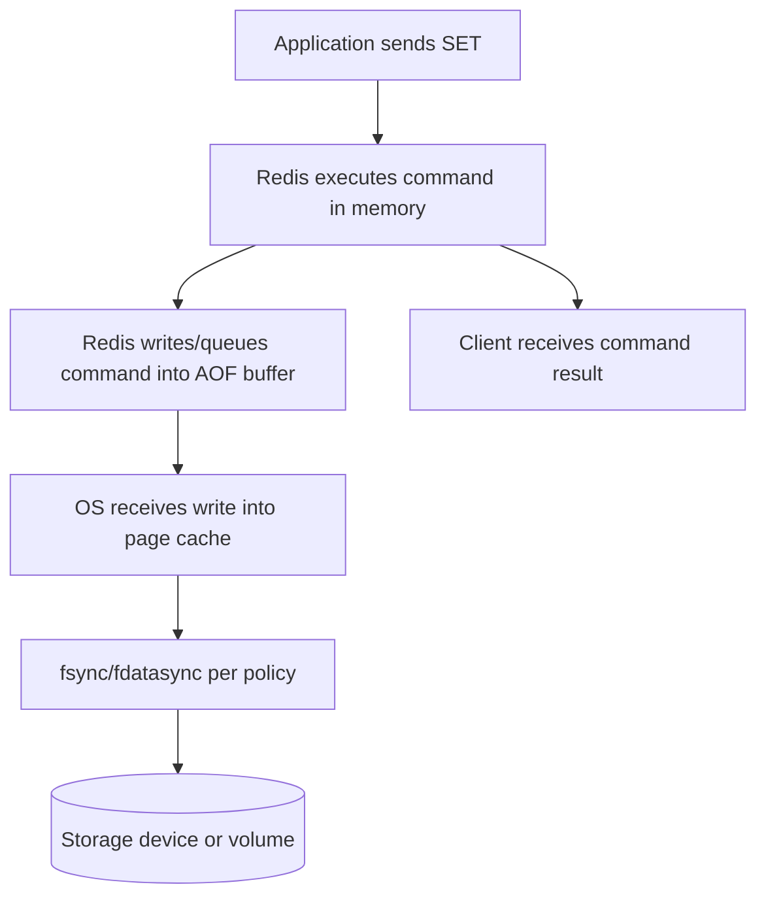
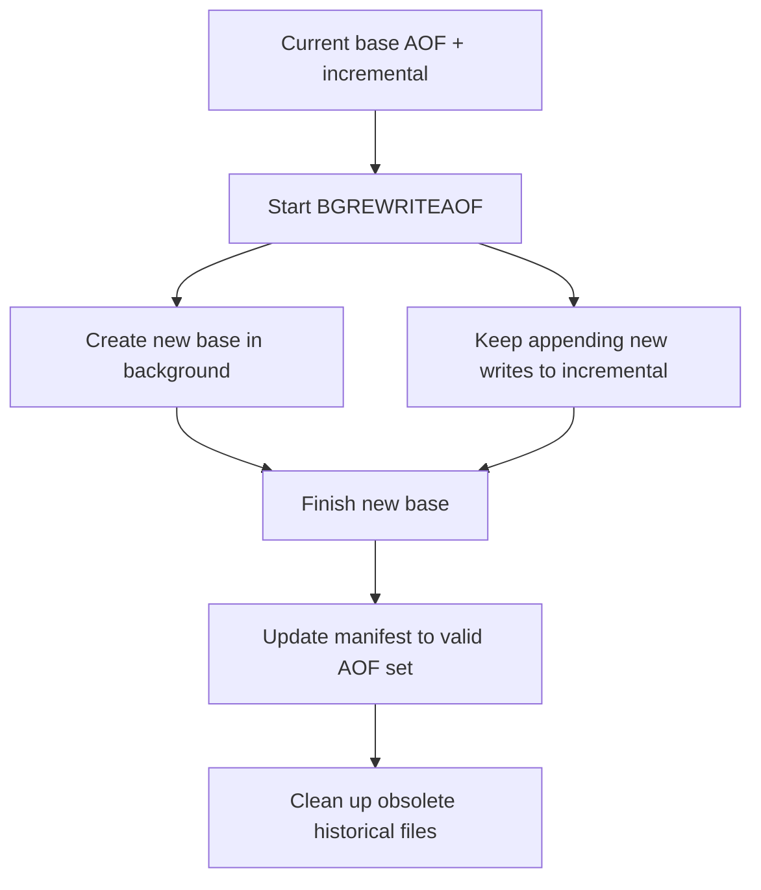
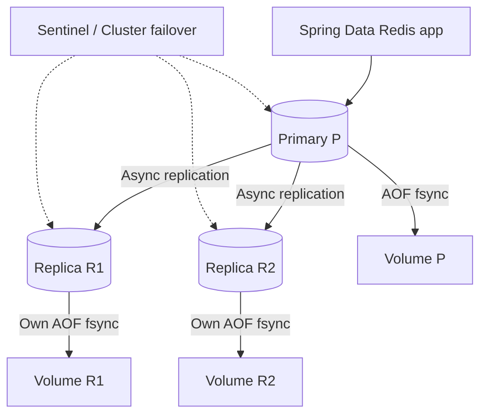
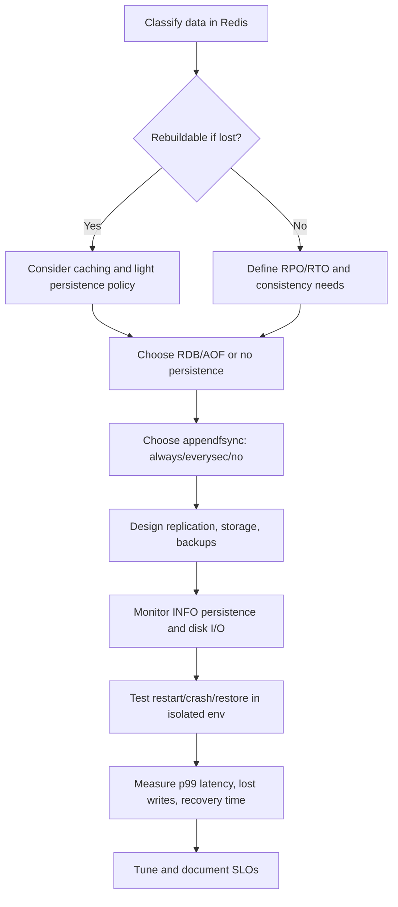

# AOF and Disk Synchronization Policies in Spring Data Redis

## 1. Does a successful SET command mean data is safe on disk?

Suppose a Spring Boot application uses Redis to store order processing status:

```java
stringRedisTemplate.opsForValue().set(
    "order:o-101:status",
    "PAID"
);
```

Redis returns success, and the application continues processing and notifies the user. Immediately afterward, the Redis server loses power or the process is abruptly terminated. When Redis restarts, will the value `PAID` still be there?

The answer **cannot be deduced solely from `SET` succeeding**. It depends on the *persistence* configuration, the disk synchronization policy, the operating system, the storage device, how Redis is deployed, and the type of failure.

If **Append Only File (AOF)** is enabled, Redis writes a representation of data-mutating operations to a log file so it can reconstruct state after a restart. Even with AOF enabled, there remain critical distinctions among:

- The command having been processed in **Redis memory**.
- AOF data having been sent to the **operating system's buffer**.
- The operating system having been instructed to **sync data down to the storage device** via `fsync` or an equivalent mechanism.
- The storage device actually preserving the data across a power or hardware failure as promised.

```text
Spring application
      |
      | SET order:o-101:status PAID
      v
Redis executes command in RAM
      |
      +-----> OK to client
      |
      v
AOF append / operating system buffer
      |
      | fsync per policy
      v
Disk / storage system
      |
      v
Recovery after restart: read AOF to rebuild data
```

For most applications, choosing an AOF policy is a **trade-off between data durability, latency, throughput, and I/O cost**. No single value fits every system.

After this lesson, you can:

1. Explain what AOF stores and how it differs from RDB.
2. Distinguish `appendfsync always`, `everysec`, and `no`.
3. Understand why writing to the OS page cache does not guarantee safety across power loss.
4. Understand how AOF rewrite, multipart AOF, and the AOF manifest work.
5. Configure Redis for Spring Data Redis applications without confusing client configuration with server configuration.
6. Read `INFO persistence` and identify synchronization delays and write errors.
7. Distinguish `WAIT`, `WAITAOF`, replication, failover, and persistence guarantees.
8. Plan backup, restart, and crash recovery tests in an isolated environment.

## 2. Redis is an in-memory database, yet it has persistence mechanisms

Redis optimizes most data operations in memory. Depending on configuration, Redis can persist state to disk to recover after process or server restarts.

Two traditional persistence mechanisms:

| Mechanism | Primary stored data | Recovery method |
|---|---|---|
| **RDB snapshot** | Point-in-time snapshot of dataset state | Load snapshot to recreate data |
| **AOF** | Log representing data mutations; newer versions may combine a base snapshot with incremental parts | Load base and replay required incremental changes |

Redis can:

- Enable RDB only.
- Enable AOF only.
- Enable both RDB and AOF.
- Disable both if the data can genuinely be lost and regenerated.

When both AOF and RDB are enabled, Redis typically prioritizes loading AOF at restart because AOF can reflect newer state than the RDB snapshot. Even so, check your Redis version and actual file status rather than assuming every AOF file is valid.

### 2.1. RDB is like a photograph; AOF is like a progression log

Example for one key:

```redis
SET cart:42:total 100
INCRBY cart:42:total 50
SET cart:42:status CHECKOUT
```

An RDB snapshot can describe the state at a point in time:

```text
cart:42:total  = 150
cart:42:status = CHECKOUT
```

AOF can represent the mutating operations leading to that state:

```text
SET cart:42:total 100
INCRBY cart:42:total 50
SET cart:42:status CHECKOUT
```

This is a **logical** illustration for learning, not a claim that the actual AOF bytes are always that exact sequence of commands. Redis uses the Redis protocol format for logging, may transform certain commands for deterministic replay, and AOF rewrite can replace long histories with a more compact state representation.

### 2.2. AOF is not a business event log

AOF is managed by Redis to recover Redis's own data. It is **not equivalent** to an application event store or a transaction audit log with business-defined schemas, permissions, and retention periods.

Do not read AOF as an official event source to reconstruct business flows or use AOF in place of Kafka, Redis Streams, or a transactional outbox. Redis can rewrite AOF, alter command representations, and discard history unnecessary for rebuilding the final state.

## 3. The append-only file mechanism

When configured with:

```conf
appendonly yes
```

Redis enables AOF persistence. When data-mutating operations occur, Redis feeds the necessary information into the AOF write path. After a restart, Redis uses the appropriate AOF to reconstruct the dataset.

Example:

```redis
SET user:42:name Linh
HSET user:42:profile tier GOLD points 125
DEL temp:expired-job
```

Mutations can be recorded to restore key/value pairs, Hashes, and key deletions accordingly.

**Distinctions to keep in mind:**

- AOF runs on the **Redis server**. A `RedisTemplate` or `ReactiveRedisTemplate` does not decide whether data is fsynced immediately.
- AOF does not guarantee that a command returning success was received by all replicas or exists on a new primary after failover.
- AOF is optimized to restore **Redis state**, not to preserve every command as an immutable audit log.
- Not all ephemeral Redis state is recovered the same way as key/value data; for example, client connections and live subscription state are not dataset entries to replay.

### 3.1. How does AOF handle TTL?

Suppose:

```redis
SET session:s-42 active EX 300
```

During recovery, Redis must preserve appropriate expiration information, rather than simply creating a session with a fresh 300-second TTL counted from the restart time in all situations.

AOF and replay include expiration handling so that data does not arbitrarily come back to life merely because of recovery. In practice, if a key has already expired when Redis restarts, it is not treated as a still-valid session solely due to the restart.

**Do not use restart experiments to prolong session TTLs.** Data lifetimes must rely on Redis's expiration contract and real wall-clock time.

## 4. From a Redis command to disk: layers to understand

A write command can pass through several steps:



This diagram is a conceptual model; Redis's execution path includes optimizations, buffering, and response ordering per implementation. The key takeaway is that **client acknowledgment** and **disk synchronization** are two events that must not be assumed simultaneous.

### 4.1. Operating system page cache

When a program performs a standard file write, the operating system can buffer the data in memory and decide when to flush it to the device. A write syscall returning success does not mean every byte is physically persisted.

That delivers high performance because many small writes can be coalesced, but creates a risk window if power fails or the kernel crashes before data reaches the physical device.

### 4.2. fsync and what it promises

`fsync` asks the operating system to synchronize the required file modifications down to the storage device per OS/filesystem semantics. `fdatasync` is related, focusing on data and essential metadata depending on the platform.

This is the critical step for *durability*. However:

- `fsync` can stall when storage is overloaded.
- I/O errors, full disks, or detached volumes can occur.
- Physical hardware, virtualization, and cloud storage must honor flush semantics faithfully; dishonest disk caches or power-unprotected write caches can break expectations.
- An fsynced file does not guarantee that another replica or a failover node holds the corresponding data.

Therefore, `appendfsync always` is a stronger local sync policy, yet **must not be described as a guarantee that data can never be lost in any disaster**.

## 5. Three `appendfsync` policies

Redis provides three main values:

```conf
appendfsync always
appendfsync everysec
appendfsync no
```

Select **only one** value in the running server configuration.

| Policy | Sync intent | Pros | Trade-offs |
|---|---|---|---|
| `always` | Requests fsync after write operations per execution policy | Lower risk of losing local writes due to missed fsync | Increases disk I/O and latency; throughput can drop markedly |
| `everysec` | Requests fsync roughly every second | Common balance between performance and durability | Leaves an un-fsynced window; recent writes may be lost in a crash |
| `no` | Redis does not proactively trigger frequent AOF fsync; leaves it to the OS | Reduces active fsync overhead | Data-loss window is harder to predict, depending on OS and storage |

### 5.1. `appendfsync always`

Example:

```conf
appendonly yes
appendfsync always
```

Redis requests AOF synchronization very frequently, tied closely to the write path, to minimize data remaining un-persisted in buffers.

Consider when:

- Write volume is moderate or disk sync cost is acceptable.
- Every single write outweighs raw throughput.
- Underlying storage has stable, monitored fsync latency.

Limitations:

- When storage slows down, Redis command p95/p99 latency can spike.
- Under write bursts, I/O queues and CPU can pressure the whole server.
- Does not prevent write loss during failover to a replica lacking the data.
- Does not replace backups, replication, or a transactional database with strong consistency guarantees.

### 5.2. `appendfsync everysec`

Example:

```conf
appendonly yes
appendfsync everysec
```

This is a **very common** choice when you want more durable AOF than un-synced setups while preserving good performance. Redis issues sync requests roughly once per second through its I/O management.

The trade-off is often described as risking roughly one second of writes in a severe crash, **not an absolute SLA guaranteeing at most 1,000 ms can ever be lost**.

Why not promise an exact one-second bound?

- Storage devices or the OS can stall.
- A prior fsync may not have finished, delaying subsequent steps.
- Redis or the host may face heavy load or I/O errors.
- A crash can hit right while data awaits flushing.
- Cloud storage persistence layers have their own semantics.

At design time, measure real fsync times and test crash recovery. Never deduce system RPO from a single config line.

### 5.3. `appendfsync no`

Example:

```conf
appendonly yes
appendfsync no
```

Redis still writes to the AOF path, but does not proactively sync to disk frequently; the OS decides when to flush per system policy.

This can reduce sync overhead, yet makes how long data lingers only in memory buffers **much harder to control**. Do not mistake `no` for "AOF disabled": AOF is still used when `appendonly yes`.

### 5.4. Distinguishing `appendonly no` from `appendfsync no`

These two settings are completely different:

```conf
appendonly no
```

means **AOF is disabled** (RDB may still be enabled).

Whereas:

```conf
appendonly yes
appendfsync no
```

means **AOF is enabled, but Redis does not proactively fsync frequently** per Redis policy.

Confusing these two values can leave an application without the AOF recovery path it expected.

## 6. Comparing risk across failure types

Not all failures affect AOF in the same way.

| Failure | Data in Redis RAM | OS page cache | Fsynced AOF |
|---|---|---|---|
| Redis process crashes, OS stays up | Lost with process | Likely preserved | Likely preserved |
| Container/process killed, host healthy | Lost with process | Likely preserved if volume/host survives | Likely preserved |
| Kernel panic / host power loss | Lost | At risk of loss | Depends on filesystem/storage honoring flush |
| Volume/storage corrupted or destroyed | May linger briefly while process lives | Unreliable | May be lost or file corrupted |
| Redis primary dies and replica is promoted | Local primary data does not decide everything | Does not transfer on failover | Helps recover old node only; new primary may lack write |

**Never use a single `kill -9` test as proof of power-loss behavior.** Killing a process usually leaves OS buffers and volume contents intact, whereas abrupt power loss can drop un-flushed buffers.

Actual RPO also depends on which failure modes you intend to survive. A system only needing recovery from process restarts has different goals from one needing survival across host outages, storage failures, or losing an entire availability zone.

## 7. Configuring Redis AOF in redis.conf

An illustrative example for modern Redis OSS:

```conf
# Enable AOF persistence.
appendonly yes

# Balance durability and performance.
appendfsync everysec

# Consider rewrite based on AOF size growth.
auto-aof-rewrite-percentage 100
auto-aof-rewrite-min-size 64mb

# Keep normal fsync active while AOF rewrite runs.
no-appendfsync-on-rewrite no

# Meaningful only on versions that support it.
aof-use-rdb-preamble yes
```

Meaning:

- `appendonly yes`: enables the AOF mechanism.
- `appendfsync everysec`: requests synchronization roughly every second.
- `auto-aof-rewrite-percentage`: relative growth threshold to consider a rewrite.
- `auto-aof-rewrite-min-size`: minimum size before auto-triggering a rewrite.
- `no-appendfsync-on-rewrite no`: continues the fsync policy rather than skipping fsync during rewrites.
- `aof-use-rdb-preamble yes`: when supported, allows an RDB snapshot preamble for new base AOF files.

Verify exact option names against your Redis version and packaging. With managed Redis, many parameters are configured via parameter groups or control planes rather than editing `redis.conf` directly.

### 7.1. Checking effective runtime configuration

In a test environment, use:

```redis
CONFIG GET appendonly
CONFIG GET appendfsync
CONFIG GET no-appendfsync-on-rewrite
CONFIG GET auto-aof-rewrite-percentage
CONFIG GET auto-aof-rewrite-min-size
```

Read **what the running server actually returns**, not just what an operator assumes was loaded from a config file.

On managed Redis services, `CONFIG GET` or `CONFIG SET` may be restricted by ACLs or the provider. Use the appropriate infrastructure management console in that case.

### 7.2. Spring Boot does not enable AOF by default

Spring configuration:

```yaml
spring:
  data:
    redis:
      host: redis.internal
      port: 6379
```

only tells the **Spring Data Redis client** how to connect to Redis. It **does not enable AOF on the server**.

Similarly, `RedisTemplate` can send `SET` successfully without having any authority or responsibility over whether the server uses `appendfsync everysec` or `always`.

Choosing the AOF policy belongs to Redis server/cluster configuration or the Redis management layer. The Spring application needs to know the persistence contract to design SLAs, retries, and business state recording.

## 8. AOF rewrite: why not keep all old commands forever?

If Redis records:

```redis
SET counter 1
INCR counter
INCR counter
INCR counter
INCR counter
```

the final state is `counter = 5`. Keeping the entire history of every `INCR` in AOF forever causes the file to grow unboundedly even when only one key remains.

**AOF rewrite** builds a compact representation of existing data capable of restoring equivalent state, instead of keeping every historical command.

```text
Old AOF:
  SET counter 1
  INCR counter
  INCR counter
  INCR counter
  INCR counter
      |
      | AOF rewrite
      v
New base AOF representing:
  counter = 5
```

This is a logical model: Redis can write the base part using an RDB preamble rather than writing `SET counter 5` as plain text.

### 8.1. Rewrite differs from deleting data

Rewrite reduces log size and improves load characteristics. When working properly, it **is not intended to delete retained keys** or alter business values.

However, it consumes resources:

- CPU to build the base representation.
- Extra memory via background child process / copy-on-write.
- Disk I/O to write the new base file.
- Disk space for both old and new files during the transition.

With large datasets, rewrites can raise memory usage, latency, and volume pressure on Redis or the host.

### 8.2. BGREWRITEAOF

Redis provides the command:

```redis
BGREWRITEAOF
```

to request a background AOF rewrite when conditions permit. This is a resource-intensive admin operation; **do not run it arbitrarily in production** just to "clean up files" or experiment.

Avoid repeatedly calling `BGREWRITEAOF` if Redis is already rewriting, running low on disk space, or under memory pressure.

### 8.3. Automatic rewrite

Redis can trigger rewrites based on AOF size growth percentage over the base and a minimum threshold:

```conf
auto-aof-rewrite-percentage 100
auto-aof-rewrite-min-size 64mb
```

Conceptually: once the AOF grows substantially relative to its last baseline size and exceeds the minimum size, Redis can schedule a rewrite.

Do not misread `100` as "rewrite after 100 commands" or "every 100 seconds". It is a **percentage growth threshold**.

## 9. Multi-part AOF since Redis 7

Redis 7 introduced **multi-part AOF**: instead of always maintaining a single monolithic AOF file, Redis can manage multiple components:

1. **Base AOF**: baseline dataset state, optionally using an RDB preamble.
2. **Incremental AOF**: mutations appended during normal operation.
3. **Manifest**: metadata identifying valid AOF files and recovery order.

```text
appendonlydir/
    |
    +-- appendonly.aof.manifest
    |
    +-- appendonly.aof.<sequence>.base.rdb
    |
    +-- appendonly.aof.<sequence>.incr.aof
```

The filenames above illustrate a **pattern**. Exact names, extensions, and sequence numbers depend on version and configuration.

### 9.1. Role of the manifest

During a rewrite, Redis creates a new base, keeps writing new mutations to incremental AOF files, and then atomically switches to the valid file set via the manifest.

Concept:



The goal is giving Redis a consistent file set for recovery while continuing to accept write traffic during rewrites. Never manually edit the manifest, delete old base files, or rename incremental files by guesswork.

**With Redis 7+, a single `appendonly.aof` file may no longer represent all data needed for backup.** Backup and restore must account for the entire AOF directory and manifest according to your Redis version.

### 9.2. Configuring the AOF directory

Redis provides the option:

```conf
appenddirname appendonlydir
```

on versions supporting multi-part AOF. This directory sits inside the Redis data path configured on the server.

When running Redis in a container, ensure the corresponding data directory is mounted on a **persistent volume** if data must survive container/pod replacement. Never enable AOF in config while leaving the data directory inside the container's ephemeral filesystem.

## 10. Does AOF rewrite block application writes?

Redis designs rewrites so most work runs in the background. Meanwhile, the server continues processing commands and recording new mutations.

That **does not mean rewrites are free**. Depending on the OS and dataset scale:

- Forking the background process can cause a brief pause.
- Copy-on-write increases memory consumption under heavy writes.
- Writing the base file competes for I/O with ongoing AOF activity.
- Storage bandwidth can become a bottleneck.

If Redis sits on a slow volume, concurrent rewrites and fsyncs can increase latency or delayed fsync counts.

### 10.1. `no-appendfsync-on-rewrite`

The option:

```conf
no-appendfsync-on-rewrite yes
```

allows Redis to avoid actively fsyncing the AOF per normal policy during certain background save/rewrite phases to reduce I/O contention.

This can stabilize latency on slow disks, **yet widens the un-persisted data window** during rewrites. If high durability is required, setting `yes` must be evaluated carefully.

Example configuration leaning toward stronger durability:

```conf
appendonly yes
appendfsync everysec
no-appendfsync-on-rewrite no
```

If choosing `yes` solely for prettier benchmark latencies, document the RPO impact during background rewrites alongside your backup and failover plan.

## 11. When AOF is long or corrupted: recovery behavior

### 11.1. Restart after clean shutdown

If Redis shuts down cleanly and persistence files are valid, Redis can load the AOF on startup to restore the dataset. Load duration depends on base/incremental AOF size, storage throughput, and CPU.

Do not treat a `PONG` response as proof that the application has finished all business recovery across related systems. Cache warming, connection states, or pending tasks in other components may still require their own recovery steps.

### 11.2. AOF truncated at the end of the file

If Redis or the server crashes mid-write of an AOF record, the tail of the file can be incomplete. Redis has behavior to handle truncated AOF files depending on config and version, for example:

```conf
aof-load-truncated yes
```

This option helps Redis handle certain tail-truncation cases to recover valid preceding data, but **is not a guarantee that every kind of corruption is auto-repaired or every write survives**.

If corruption occurs mid-file or the manifest/volume is damaged, Redis may refuse to start and require operational intervention.

### 11.3. The redis-check-aof utility

Redis includes a tool to inspect and repair certain invalid AOF states, typically invoked as:

```text
redis-check-aof
```

**Never run repair modes such as `--fix` on your only production dataset without first taking a safe copy.** Depending on the corruption, repair may truncate everything after the invalid offset and drop nearby records.

With multi-part AOF, follow the exact guidance for your Redis version and manifest structure. Do not apply Redis 6 single-file habits to a Redis 7 AOF directory or delete files by intuition.

### 11.4. Recovery does not replace backups

AOF is a local recovery mechanism. If a disk dies, a volume is deleted, ransomware alters files, or a data center fails, an AOF inside that same failure domain cannot save you.

Systems require an independent backup plan:

- Scheduled copies with proper retention.
- Off-machine / cross-zone storage when required.
- Encryption and access control for backups.
- Real restore verification, not just checking that files exist.
- Measurable RPO/RTO planning.

## 12. Distinguishing AOF from replication

**AOF persistence** and **Redis replication** solve related yet distinct problems:

| Aspect | AOF | Primary–replica replication |
|---|---|---|
| Goal | Recover data on a single Redis server after restart | Maintain copies on other nodes |
| Location | Node's files/volume | Across Redis nodes over the network |
| Progress unit | File writes and fsync per policy | Replication offset and replica acknowledgments |
| Primary risk | Un-fsynced data lost on host crash | Replica has not received write yet; can be stale or missing after failover |
| Depends on Sentinel/Cluster? | Not necessarily | Often paired with them for failover |
| Guarantees strong consistency? | No | No with default asynchronous replication |

### 12.1. If the primary has AOF, is failover to a replica always safe?

No. Example:

```text
T0: Primary P receives SET balance:u-42 900
T1: P writes AOF and fsyncs locally
T2: P returns OK
T3: Replica R has not yet applied that write
T4: P loses connectivity, system promotes R
T5: Application reads new primary R, sees old balance
```

Because P's AOF does not automatically sync onto R's disk, **P having fsynced** does not guarantee **R has the write**.

This is why enabling `appendfsync always` on the primary alone does not turn Redis Sentinel/Cluster into a quorum-synchronous write system.

### 12.2. Replicas can also use AOF

A replica can enable its own persistence per configuration. It receives data over replication and applies its own AOF policy.

However, replication lag and fsync lag are **two separate windows**:

```text
Write on primary
   |
   +--> Primary AOF fsync
   |
   +--> Replica receives/applies write
                  |
                  +--> Replica AOF fsync
```

A metric stating only "replica received write" does not prove the replica has fsynced that write to its AOF.

## 13. WAIT: confirming replication progress, not fsync

Redis provides:

```redis
SET payment:p-101:status AUTHORIZED
WAIT 1 1000
```

Both commands must execute on the **same Redis client connection** if `WAIT` is to track that client's preceding writes.

`WAIT 1 1000` asks to wait for at least one replica to acknowledge the corresponding replication offset within up to 1,000 ms. The command returns the number of replicas that acknowledged.

Limitations:

- Replica acknowledgment does not mean the replica's AOF has fsynced.
- On timeout, prior writes are not automatically rolled back.
- A promoted replica might not be the one that just ACKed.
- It does not guarantee subsequent reads on every replica see the new value.

Thus, `WAIT` helps **reduce one class of replication risk** without replacing `appendfsync` policies.

## 14. WAITAOF: conditional waiting for AOF persistence

Redis **7.2+** introduces `WAITAOF`, allowing a client to wait for specified AOF persistence levels for prior writes on the same connection.

Syntax:

```text
WAITAOF numlocal numreplicas timeout
```

Where:

- `numlocal`: requires local primary AOF persistence confirmation, typically `0` or `1` per command constraints.
- `numreplicas`: desired number of replicas confirming corresponding AOF persistence.
- `timeout`: wait duration in milliseconds; verify `0` semantics in official documentation when implementing.

Example on a single Redis connection:

```redis
SET payment:p-101:status AUTHORIZED
WAITAOF 1 1 2000
```

Intent: wait for local AOF and at least one replica to satisfy AOF persistence for prior client writes, timing out after 2,000 ms.

The response reports how many local/replica conditions actually succeeded per Redis's contract. The application must **inspect and compare the returned counts against its target**, never assuming any non-error reply suffices.

### 14.1. Requirements for using WAITAOF

- Redis server version supports the command.
- AOF must be enabled on all nodes expected to participate.
- The client must preserve connection context after the write being awaited.
- Timeout must align with application SLAs.
- Do not assume every driver/Spring Data Redis version exposes a high-level wrapper API for `WAITAOF`.

If the driver lacks a direct method, use an appropriate low-level command invocation mechanism suited to your version and topology, or use supported server/client flows. Never fabricate non-existent Java APIs in code.

### 14.2. WAITAOF is still not a consensus commit

Even when local and some replicas have durably written to AOF, that still does not provide:

- A consensus protocol guaranteeing every acknowledged write survives any partition.
- Distributed transactions between Redis and another database.
- Exactly-once side effects for retried requests.
- A guarantee that a promoted replica is always one that just reported fsync.

**`WAITAOF` is stronger than `WAIT` in verifying disk persistence**, yet must not be treated as a replacement for an authoritative strong-consistency system.

### 14.3. Do not insert blocking wait commands arbitrarily onto event loops

A Spring WebFlux app may emit `Mono<Boolean>` after `SET` completes. If a developer then calls a blocking fsync-wait API on the event loop, latency spikes and threads stall.

When using `WAIT`/`WAITAOF` in reactive paths, verify:

1. The driver supports the command and routes to the proper node.
2. Write and wait commands share the **required connection semantics**.
3. The API is non-blocking or returns an appropriate Publisher.
4. Timeouts, cancellations, and partial outcomes (write succeeded, wait fell short) are handled explicitly.

Never automatically re-run a counter increment merely because `WAITAOF` failed to reach enough replicas before the deadline: the write may already have executed.

## 15. AOF and the commitment levels an application observes

An application can distinguish these levels:

| Level | Observed | Not yet guaranteed |
|---|---|---|
| `SET` returns `OK` | Primary processed request per Redis semantics | AOF fsync, replica receipt |
| `WAIT` meets target | Required replicas confirmed replication offset | Replicas have fsynced |
| `WAITAOF` meets target | Requested AOF persistence conditions confirmed per command | Consensus across all nodes or external DB commit |
| Redis restarts and recovers key | Data existed in the appropriate persistence files | Off-domain backup or survival of all other writes |
| Backup restore succeeds | Can recover from a tested backup | RPO = 0 if backups are scheduled |

For each business domain, define **when success can be returned to the user**, and what that success promises.

For example, updating an email-sent status might tolerate small delays, whereas confirming payment may require a transactional database as the source of truth, with Redis holding only cache or auxiliary state.

## 16. Configuring Redis for a Spring Boot application

Spring Boot connects to an AOF-enabled Redis normally:

```yaml
spring:
  data:
    redis:
      host: redis.internal
      port: 6379
      timeout: 3s
```

`RedisConnectionFactory` and `RedisTemplate` do not need to know where AOF files reside to run Redis commands.

Example:

```java
package com.example.orders;

import java.time.Duration;

import org.springframework.data.redis.core.StringRedisTemplate;
import org.springframework.stereotype.Service;

@Service
public class OrderStateStore {

    private final StringRedisTemplate redis;

    public OrderStateStore(StringRedisTemplate redis) {
        this.redis = redis;
    }

    public void markPaid(String orderId) {
        redis.opsForValue().set(
            "order:" + orderId + ":status",
            "PAID",
            Duration.ofDays(7)
        );
    }

    public String findStatus(String orderId) {
        return redis.opsForValue()
            .get("order:" + orderId + ":status");
    }
}
```

In this snippet:

- `set(...)` sends a Redis command and handles the response via Spring's API.
- The 7-day TTL describes key lifetime, **not how long Redis retains AOF backups**.
- Key survival across a Redis process crash depends on Redis persistence and storage.
- Nothing in this Java code configures `appendfsync always/everysec/no`.

### 16.1. Separating application config from server config

| Property | Which layer owns it? |
|---|---|
| `spring.data.redis.host` | Spring Boot client |
| `spring.data.redis.timeout` | Spring Boot / client |
| `RedisTemplate` serializer | Spring Data Redis |
| `appendonly yes` | Redis server |
| `appendfsync everysec` | Redis server |
| `auto-aof-rewrite-percentage` | Redis server |
| Redis persistent volume | Infrastructure / deployment |
| Backup retention and offsite copies | Infrastructure / ops policy |

This distinction is fundamental when investigating "we wrote to Redis but lost data after pod restart": the bug often lies in volume mounts or server config, not in `opsForValue().set(...)`.

## 17. ReactiveRedisTemplate does not change fsync guarantees either

A WebFlux application may use:

```java
import java.time.Duration;

import org.springframework.data.redis.core.ReactiveStringRedisTemplate;
import org.springframework.stereotype.Service;

import reactor.core.publisher.Mono;

@Service
public class ReactiveOrderStateStore {

    private final ReactiveStringRedisTemplate redis;

    public ReactiveOrderStateStore(ReactiveStringRedisTemplate redis) {
        this.redis = redis;
    }

    public Mono<Boolean> markPaid(String orderId) {
        return redis.opsForValue()
            .set(
                "order:" + orderId + ":status",
                "PAID",
                Duration.ofDays(7)
            );
    }
}
```

When a subscriber receives `Boolean.TRUE`, the command succeeded per Redis's reply. That **does not mean server `fsync` has completed** if the policy allows deferral.

Reactive APIs change how the application schedules I/O, not server-side AOF semantics.

### 17.1. Do not use delays as a durability guarantee

Anti-pattern:

```java
return redis.opsForValue().set(key, value)
    .delayElement(Duration.ofSeconds(2));
```

Waiting two extra seconds on the client **does not prove** a specific fsync succeeded. If storage is failing or `appendfsync no` is active, a fixed delay is no substitute for durability acknowledgment.

If replication or AOF confirmation is truly required, use Redis-supported primitives with accurate semantics rather than assuming elapsed time implies persistence.

## 18. Observing AOF via INFO persistence

Redis provides:

```redis
INFO persistence
```

Useful fields depending on version:

```text
aof_enabled:1
aof_rewrite_in_progress:0
aof_rewrite_scheduled:0
aof_last_bgrewrite_status:ok
aof_last_write_status:ok
aof_current_size:...
aof_base_size:...
aof_pending_bio_fsync:...
aof_delayed_fsync:...
rdb_bgsave_in_progress:0
rdb_last_bgsave_status:ok
```

The ellipses represent **illustrative placeholders**, not metrics captured from a live Redis instance.

### 18.1. Interpreting common AOF metrics

| Metric | What to watch |
|---|---|
| `aof_enabled` | Whether AOF is enabled |
| `aof_rewrite_in_progress` | Is a rewrite currently running? |
| `aof_rewrite_scheduled` | Is a rewrite scheduled? |
| `aof_last_bgrewrite_status` | Did the latest background rewrite succeed? |
| `aof_last_write_status` | Latest AOF write status per Redis |
| `aof_current_size` | Current AOF size as reported by Redis |
| `aof_base_size` | Baseline size used for rewrite trigger calculations |
| `aof_pending_bio_fsync` | Number of fsync jobs pending in background I/O |
| `aof_delayed_fsync` | Count of delayed fsync occurrences per Redis metrics |

If `aof_delayed_fsync` climbs rapidly under load, investigate storage latency, rewrites, and workload rather than simply raising client timeouts.

`INFO persistence` metrics are **per Redis node**. In Sentinel or Cluster setups with multiple nodes, inspect each primary and replica individually to see which replicas run AOF, which node is rewriting, and which node hits I/O errors.

### 18.2. Redis logs matter just as much as INFO

When AOF writes error or rewrites fail, Redis logs reveal root causes such as:

- Out of disk space.
- Incorrect file/directory permissions.
- Filesystem remounted read-only.
- Background rewrite process fork failure.
- Storage I/O errors.

Monitoring should combine logs, `INFO persistence`, volume capacity, disk latency, filesystem metrics, and Redis command latency—not just counting `SET` OKs.

## 19. AOF write errors and how the application should respond

Suppose a volume fills up. Redis may continue serving some commands or return persistence-related errors depending on state, config, and version. Never rely on a single behavior across all cases.

Operational safeguards:

1. Alert before disk fills up; do not wait until AOF writes fail.
2. Monitor background rewrite results and write status.
3. Maintain cleanup policies for old backups, expand capacity, or replace volumes appropriately.
4. Never manually delete active AOF files managed by Redis to free space.
5. Verify Redis readiness and traffic-shifting/failover plans.
6. For critical data, re-evaluate write success against defined durability SLAs.

### 19.1. Successful Redis commands do not prove volume health

Under `everysec` or `no`, a gap exists between command acknowledgment and disk sync. When storage failures occur, the application may not immediately receive an error on a specific write.

Therefore, never replace persistence monitoring with:

```redis
PING
```

`PONG` only shows Redis can answer pings at that moment, not that AOF persistence is healthy.

## 20. AOF and write performance

Factors influencing throughput and latency:

```text
Application sends writes
    |
    +-- Redis commands/second
    |
    +-- AOF bytes generated
    |
    +-- filesystem write() cost
    |
    +-- fsync cost per policy
    |
    +-- contention with AOF rewrite / RDB save
    |
    +-- disk IOPS / bandwidth / latency
    |
    +-- CPU, memory, network, and Redis event loop
```

With `appendfsync always`, fsync latency can become a major component of write duration.

With `everysec`, fsyncs occur less often, improving throughput at the cost of a risk window. With `no`, active fsync overhead drops, leaving persistence timing to OS and filesystem load.

### 20.1. Does batching/pipelining remove the need for fsync?

Spring Data Redis supports Redis pipelining to reduce network round trips across multiple commands:

```java
stringRedisTemplate.executePipelined((RedisCallback<Object>) connection -> {
    // Send multiple operations in one pipeline.
    return null;
});
```

Pipelining primarily optimizes **network round-trip cost between client and Redis**; it does not eliminate AOF mutations and does not turn independent writes into a durable transaction.

Similarly, `MULTI/EXEC` groups execution inside Redis, without implying a distributed fsync guarantee across nodes.

### 20.2. Comparing under realistic load

When benchmarking AOF policies, keep constant:

- Same Redis version.
- Same dataset and command mix.
- Same connection count, concurrency, and payload sizes.
- Same volume and disk performance.
- Same replication and backup workload.
- Same container/VM CPU and RAM limits.

Measure p50/p95/p99 latencies, throughput, fsync delays, Redis CPU, disk write latency, and file growth. A 10-second average-only benchmark cannot characterize RPO or long-running rewrite costs.

## 21. RDB + AOF: when should both be enabled?

RDB snapshots are convenient for backups and copying consistent point-in-time state. AOF narrows the data-loss window relative to periodic snapshots alone, depending on fsync policy.

A combined configuration:

```conf
appendonly yes
appendfsync everysec

# Example automatic RDB snapshot conditions on supported versions.
save 900 1
save 300 10
save 60 10000
```

These `save` rules are illustrative examples for versions supporting that syntax; do not assume they are fixed defaults in every Redis distribution.

Trade-offs:

- Introduces both RDB background jobs and AOF rewrites, requiring RAM/I/O management.
- Requires backup and cleanup policies.
- Requires testing which file Redis loads on startup and under which conditions.
- Turning on both options does not replace a restore test.

### 21.1. An RDB preamble in AOF is not "AOF disabled"

With:

```conf
aof-use-rdb-preamble yes
```

Redis can use an RDB-style representation for the base part of an AOF rewrite, making baseline loading faster in many scenarios.

Redis still logs incremental changes via AOF and applies the configured `appendfsync` on the write path. Never assume AOF is disabled merely because the base file has an `.rdb` extension.

## 22. Redis on Docker/Kubernetes: AOF is enabled, yet data still vanishes?

A classic scenario:

```text
Redis container:
  appendonly yes
  appendfsync everysec
  Data directory sits on ephemeral container layer

Pod is deleted and recreated on another node
  -> Volume is not preserved
  -> Old AOF files are gone
```

Here, fsync settings cannot fix **the lack of persistent storage**.

Container deployments require:

- Mounting the Redis data directory onto a persistent volume.
- Verifying permissions so Redis can write and rewrite.
- Ensuring adequate disk capacity and IOPS.
- Understanding volume reclaim and retention policies.
- Designing off-volume backups when required.
- Testing recovery across pod rescheduling and node failures.

### 22.1. Restarting a container vs. deleting a pod are different tests

Restarting the same container or pod may keep the old volume or filesystem depending on orchestration. A passing restart test does not prove data survives pod rescheduling to another node or volume loss.

Always define the **failure model** under test: process crash, pod restart, node outage, volume loss, AZ outage, or full cluster replacement.

## 23. AOF during Redis Sentinel or Cluster failover

A Redis deployment may simultaneously use:

- AOF on each Redis node.
- Network replication to replicas.
- Sentinel or Redis Cluster to promote another node when a primary fails.



### 23.1. Questions that must be answered independently

1. Does the current primary have AOF enabled?
2. Do the replicas have AOF enabled?
3. Which replicas received the write, and have they fsynced it?
4. Which node gets elected after failover?
5. Has the Redis client refreshed topology and connected to the new primary?
6. Are writes acknowledged before failover still present on the new primary?
7. When the old primary returns, how is divergent local data handled?

Never inspect `aof_enabled:1` on the primary and assume all replicas or post-failover primaries share identical guarantees.

### 23.2. Stronger AOF does not eliminate stale reads

Even when primary and replicas all use `appendfsync always`, a replica can still lag behind the primary at read time. **Disk durability and replication freshness are two different concerns.**

For requests needing fresh data, design read routing and consistency explicitly; fsync policy does not determine whether `GET` hits the primary or a replica.

## 24. Lab 1: determining whether AOF is enabled or disabled

Practice on a dedicated test Redis instance.

### Step 1 — Check configuration

```redis
CONFIG GET appendonly
CONFIG GET appendfsync
INFO persistence
```

Record:

```text
appendonly = yes/no
appendfsync = always/everysec/no
aof_enabled = 1/0
aof_last_write_status = ...
```

If `appendonly no`, do not conclude Redis will never recover data: RDB may still be enabled. Check snapshot settings too.

### Step 2 — Write test keys

```redis
SET demo:aof:status started
SET demo:aof:counter 10
INCR demo:aof:counter
GET demo:aof:counter
```

Expect `11` when commands execute normally.

### Step 3 — Clean restart

Restart Redis using your test environment's supported process without intentionally cutting power. Once the server is back:

```redis
GET demo:aof:status
GET demo:aof:counter
INFO persistence
```

Observe whether keys recover based on **actual enabled persistence and intact volume files**.

### Step 4 — Read startup logs

Redis logs typically indicate RDB/AOF loading and related warnings. If Redis fails to start due to a corrupted AOF, do not delete the file immediately; back up the current state first for investigation and recovery.

## 25. Lab 2: comparing fsync policies

Use **three test Redis instances with matching versions and equivalent storage**, differing in:

```text
Test A: appendonly yes, appendfsync always
Test B: appendonly yes, appendfsync everysec
Test C: appendonly yes, appendfsync no
```

### 25.1. Metrics to collect

| Metric | Purpose |
|---|---|
| Writes/sec | Compare throughput |
| p50, p95, p99 latency of SET/HSET | Observe tail latency |
| Redis CPU | Measure workload overhead |
| Disk write IOPS and bandwidth | Measure volume pressure |
| fsync latency / delayed AOF fsync | Observe synchronization impact |
| AOF size after run | Evaluate rewrite/retention |
| Restart/load duration | Evaluate RTO |
| Writes recovered after failure injection | Estimate RPO for that failure model |

### 25.2. Measurement principles

- Write identical counts and payload sizes.
- Do not compare fast SSD storage in Test A against slow disk in Test B.
- Repeat runs; avoid noisy short samples.
- Distinguish clean restarts from power loss / host crashes.
- Monitor disk/OS to catch fsync stalls.
- Never benchmark against production Redis.

### 25.3. Which results are trustworthy?

For instance, if `always` shows higher p99 latency in your workload, that is a valid observation of fsync cost on that storage. Yet it **is not enough to conclude** `everysec` is always better for every application.

Weigh latency results alongside **acceptable data loss** and the business cost of recovering lost state.

## 26. Lab 3: observing AOF rewrite

On a test Redis with AOF enabled:

```redis
INFO persistence
BGREWRITEAOF
INFO persistence
```

Inspect:

```text
aof_rewrite_in_progress
aof_last_bgrewrite_status
aof_current_size
aof_base_size
```

Once the background rewrite completes, re-check `INFO persistence` and saved business key values.

**Do not assume the AOF file always shrinks immediately in every test.** With small datasets and few duplicate overwrites, base/manifest sizes and overhead can make differences negligible.

If Redis 7 uses multi-part AOF, inspect the directory, manifest, and base/incremental files **via OS tools in the test environment** without editing files. This lab aims to build understanding of layout and status, not to touch production data.

## 27. Lab 4: verifying WAIT and WAITAOF

Requires a test Redis setup with replication and a supporting version. When testing:

### Step 1 — Identify primary/replica

```redis
ROLE
INFO replication
INFO persistence
```

On both primary and replica, verify role, replication status, and AOF settings.

### Step 2 — Write and wait for replication

In a **single `redis-cli` session connected to the primary**:

```redis
SET demo:durability:version v2
WAIT 1 1000
```

Read the acknowledged replica count and record timing.

### Step 3 — Wait for AOF persistence (Redis 7.2+)

Only when AOF is enabled and the version supports it:

```redis
SET demo:durability:version v3
WAITAOF 1 1 2000
```

Inspect the actual response structure and check whether local and replica conditions were satisfied. Do not assume a generic response proves all replicas fsynced.

### Step 4 — Observe failure cases

When too few replicas are available or AOF hits errors, wait targets can fall short before timeout. Record the outcome and **never blindly retry side-effecting `SET`/`INCR` commands** simply because the wait did not meet its target.

Experiments with critical writes need dedicated idempotency logic. Never induce network partitions or kill replicas in production to test this.

## 28. Handling retries for critical data

A common mistake:

```text
SET/INCR -> timeout error
Application retries the entire operation
```

If Redis executed the command but the response was lost, `INCR` can apply twice. Neither AOF nor `appendfsync always` tells the application whether the first write already occurred.

For an operation with side effects:

```redis
INCR payment:p-101:attempts
```

blind retrying after a timeout can over-increment the counter. Fixes belong in business semantics:

- Attach request IDs and enforce idempotency.
- Use conditional sets or Lua scripts where appropriate.
- Persist processing state in an authoritative data store.
- Query current state before deciding to retry.
- Reconcile uncertain outcomes.

### 28.1. Fsync does not replace atomicity

Suppose two keys must be updated together:

```redis
DECRBY balance:u-42 100
INCRBY balance:merchant-7 100
```

`appendfsync always` only concerns syncing data Redis has written to file. It **does not turn two separate commands into an atomic business transaction**.

You may need `MULTI/EXEC`, Lua, conditional updates, or better yet a transactional database as the source of truth for financial data. Atomicity and durability are distinct architectural dimensions.

## 29. Security risks of AOF

If an application writes tokens or sensitive data to Redis, that data can persist in AOF/backups even after keys are deleted from live state.

Example:

```text
SET session:token-42 <sensitive-data>
DEL session:token-42
```

Before AOF rewrites occur, representations of those operations can remain on disk for some time. Older backups may also retain sensitive data per retention rules.

Therefore:

- Avoid storing secrets in Redis unnecessarily.
- Encrypt volumes and backups as required.
- Restrict read access to AOF and backup files.
- Enforce retention and deletion policies on backups.
- Never share real-data AOF files externally just for debugging.
- Do not treat `DEL` as a secure erase of every byte across all storage layers.

AOF is a persistence component, not an encryption mechanism.

## 30. Common misconceptions

### "Redis returned OK, so fsync finished"

Not true by default. Check `appendfsync` and actual persistence conditions.

### "appendfsync everysec guarantees losing at most 1,000 ms"

No. That is a target sync cadence, not an absolute SLA across storage stalls and crashes.

### "appendfsync no means Redis does not write AOF"

No. If `appendonly yes`, Redis still uses AOF; `appendfsync no` only changes proactive fsync scheduling.

### "appendonly yes is enough to preserve data when a pod is deleted"

Not if the AOF directory lacks a persistent volume or the volume is not retained.

### "AOF rewrite deletes old keys from Redis"

Rewrite produces a more compact log representation. Removing keys from the dataset is a separate data operation.

### "AOF is an audit log that can replace an event store"

No. Redis manages and rewrites AOF to rebuild state; its format and rewrites do not offer an application audit contract.

### "Redis 7+ AOF is always a single appendonly.aof file"

No. Redis 7 uses multi-part AOF with a manifest, base, and incremental files.

### "BGREWRITEAOF has no performance impact"

No. It consumes CPU, memory, copy-on-write, disk I/O, and temporary disk space.

### "WAIT 1 means a replica has fsynced AOF"

No. `WAIT` waits for replication acknowledgment, not disk persistence acknowledgment.

### "WAITAOF is a strong consensus commit"

No. It checks AOF persistence conditions per command; it does not provide full consensus or distributed transaction semantics.

### "AOF on the primary guarantees a newly promoted primary has every write"

No. Replication can lag; the new primary might lack writes fsynced on the old primary.

### "Changing appendfsync in application.yml changes the Redis server"

No. AOF policy is a Redis server/infrastructure setting, not a Spring Data Redis client property.

### "Caches with TTL never need backups"

TTL describes key lifetime. If data must be recovered, you need proper persistence/backups; if it is purely rebuildable cache, assess whether AOF is even needed.

### "Turning on always everywhere is always better"

Not every application needs the latency and I/O cost of `always`. Choose based on RPO/RTO and the cost of handling lost data.

## 31. Choosing a policy by business need

| Data type | Common goal | Policy to consider |
|---|---|---|
| Completely rebuildable cache | Optimize throughput, tolerate cache loss | May skip AOF; RDB or no persistence per design |
| Sessions recoverable by re-login | Balance performance and recovery | AOF `everysec` or another policy per SLA |
| Intermediate job state needing continuation across restarts | Reduce lost progress | AOF + backups/replication + idempotent recovery |
| Redis Streams holding critical events | Keep backlog for reprocessing | AOF policy with clear RPO, proper retention, ACKs, and backups |
| Rarely modified yet important config | Prioritize durability on rare writes | Consider stronger fsync and backups |
| Authoritative balances or financial transactions | Strict strong consistency and durability | Prefer transactional source of truth; Redis supports only with clear architecture |

A decisive question:

**"If writes acknowledged by Redis in the last few seconds are lost, can the application rebuild or reconcile them accurately?"**

If "yes" and the data is a cache, a lighter policy may suffice. If "no", revisit Redis's role, fsync policy, replication, backups, and even the underlying storage tier.

## 32. Design and verification workflow for durability



Pre-production checklist:

1. Know whether each keyspace is a cache or critical business state.
2. Define acceptable RPO and RTO.
3. Verify `CONFIG GET appendonly/appendfsync` on every node.
4. Configure persistent volumes with suitable capacity, latency, and retention.
5. Reserve disk headroom for AOF rewrites and backups.
6. Monitor `aof_last_write_status`, `aof_delayed_fsync`, rewrite status, and disk errors.
7. Ensure `WAIT` and `WAITAOF` share the same connection as relevant writes when used.
8. Distinguish disk persistence from replication and failover.
9. Maintain an AOF corruption runbook that backs up files before attempting repairs.
10. Test restores from independent backups, not just Redis process restarts.
11. Implement idempotency for side-effecting operations upon request timeout.
12. Enforce security controls on AOF/backup files containing sensitive data.

## 33. Conclusion

**Append Only File** is Redis's mechanism for logging mutations needed to reconstruct data after restarts. Durability does not stop at setting `appendonly yes`: the **`appendfsync` policy governs how frequently Redis instructs the OS to sync AOF to storage**.

Three options to remember:

- **`always`**: minimizes the un-fsynced data window at the cost of latency and I/O.
- **`everysec`**: common balance of performance and durability, yet retains a risk window and is not a strict one-second loss SLA across all failures.
- **`no`**: hands most flush responsibility to the OS, suitable only when an unpredictable risk window is acceptable.

Redis 7+ also uses **multi-part AOF** with base, incremental files, and a manifest; **AOF rewrite** compacts representations at a resource cost. Alongside Sentinel/Cluster, local AOF neither replaces replication nor guarantees writes fsynced on a primary exist on a new primary.

In Spring Data Redis, `RedisTemplate` and `ReactiveRedisTemplate` execute Redis commands normally; **AOF policy is a Redis server and storage configuration**, not an inherent property of `Mono`, `Flux`, or templates. Choosing the right policy means clearly defining **what data can be lost, how much loss is acceptable, and how recovery actually works**.

## References

- [Redis Documentation — Redis persistence](https://redis.io/docs/latest/operate/oss_and_stack/management/persistence/)
- [Redis Documentation — Configuration](https://redis.io/docs/latest/operate/oss_and_stack/management/config/)
- [Redis Documentation — INFO](https://redis.io/docs/latest/commands/info/)
- [Redis Documentation — BGREWRITEAOF](https://redis.io/docs/latest/commands/bgrewriteaof/)
- [Redis Documentation — CONFIG GET](https://redis.io/docs/latest/commands/config-get/)
- [Redis Documentation — WAIT](https://redis.io/docs/latest/commands/wait/)
- [Redis Documentation — WAITAOF](https://redis.io/docs/latest/commands/waitaof/)
- [Redis Documentation — Replication](https://redis.io/docs/latest/operate/oss_and_stack/management/replication/)
- [Redis Documentation — Sentinel](https://redis.io/docs/latest/operate/oss_and_stack/management/sentinel/)
- [Redis Documentation — Redis Cluster specification](https://redis.io/docs/latest/operate/oss_and_stack/reference/cluster-spec/)
- [Spring Data Redis Reference — Redis Connections](https://docs.spring.io/spring-data/redis/reference/redis/drivers.html)
- [Spring Data Redis Reference — RedisTemplate](https://docs.spring.io/spring-data/redis/reference/redis/template.html)
- [Spring Data Redis Reference — Reactive Redis Support](https://docs.spring.io/spring-data/redis/reference/redis/reactive.html)
