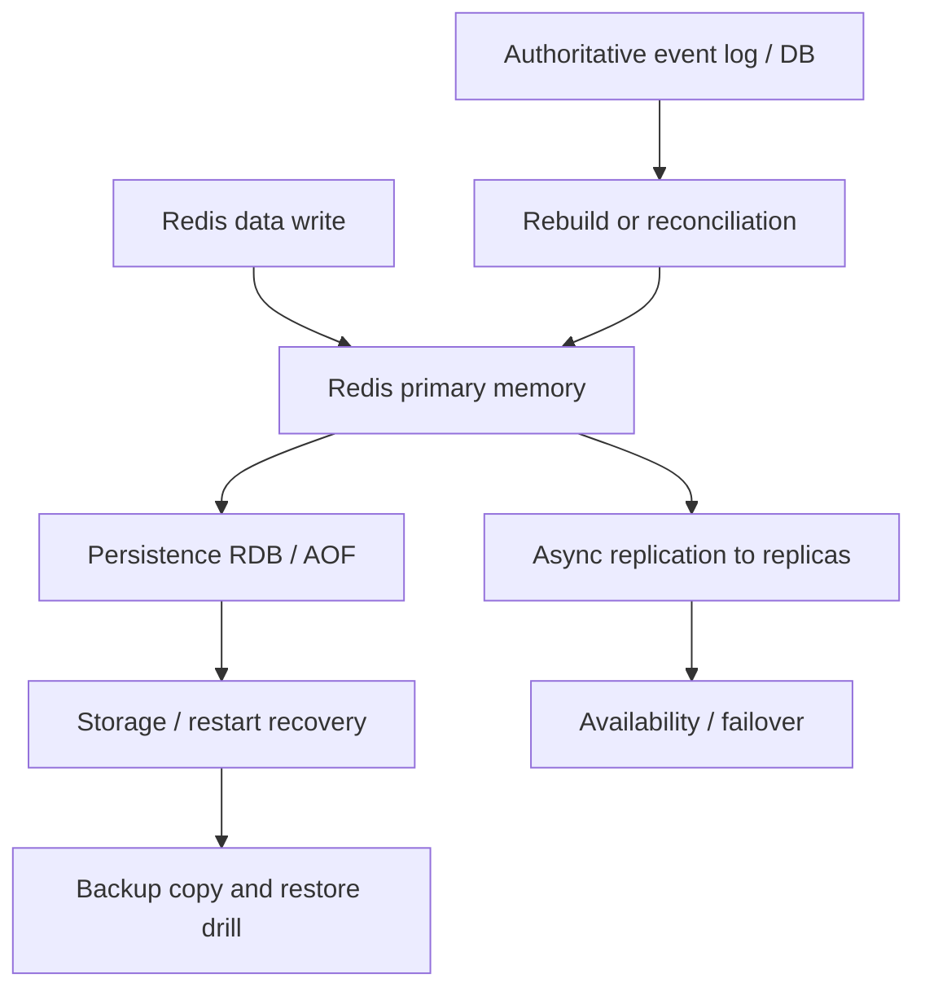
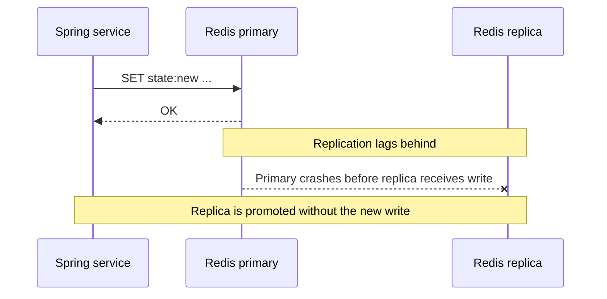
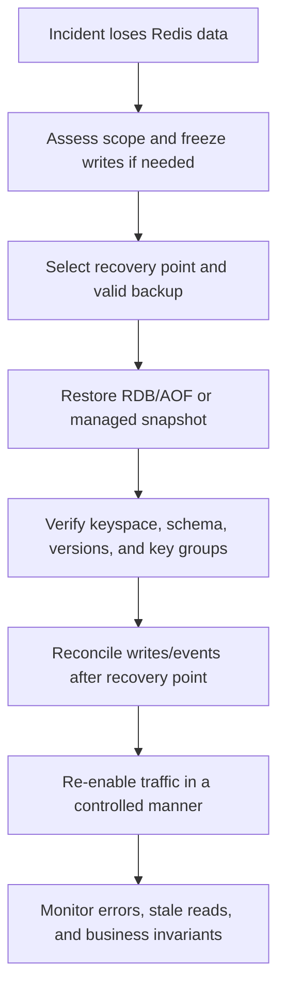
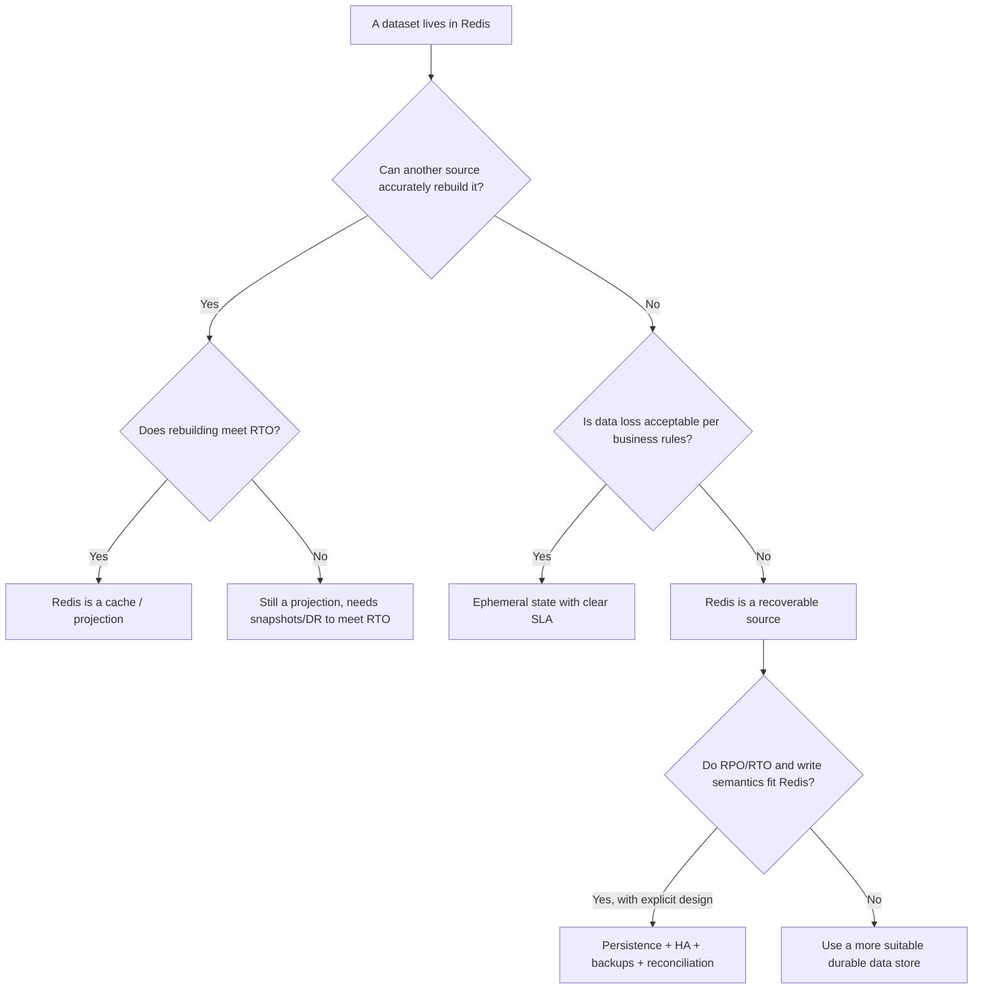

# Determining Whether Redis Is a Cache or a Recoverable Data Source in Spring Data Redis

## 1. The question to answer before configuring durability

Redis is an in-memory database, yet that **does not mean Redis is always just a cache**. Redis can serve data rebuildable from another source, and it can also hold data for which the system has no complete copy elsewhere. These two roles create completely different requirements for storage, replication, backups, failover, and error handling.

In Spring Data Redis, both kinds of applications may invoke the exact same API:

```java
stringRedisTemplate.opsForValue().set("key", "value");
```

Looking solely at the `SET` call **cannot tell you** whether this is a cache or recoverable data. The meaning lies in the **business contract**:

- If this key is deleted, can the application retrieve it accurately from a database, API, or another trusted system?
- If Redis and all its replicas are lost, must the old value be restored?
- Did changes written to Redis already exist somewhere else first?
- When multiple systems update data, which system decides **the true value**?
- Is missing data a "cache miss", "no data yet", or a **data-loss incident**?

> **Redis is a cache when data can be discarded and rebuilt from an authoritative source. Redis is a recoverable data source when losing Redis data loses business information that cannot be fully reconstructed elsewhere.**

This classification follows data responsibility, **not** the client library, Redis data type, or whether AOF/RDB is enabled.

## 2. A simple litmus test: what if Redis were completely empty?

Imagine that after an incident, the application starts up against a fresh Redis instance with **zero keys**.

### Case A: Redis is only a cache

```text
PostgreSQL: product_id=P100, name="Product 100", price=120000
     |
     v
Spring service -> Redis cache: productSummary::P100
```

Redis loses all data:

1. The next request looks up `productSummary::P100` and finds no entry.
2. Spring Cache invokes the method loading the product from PostgreSQL.
3. Redis is repopulated with the read result.
4. Authoritative product data remains intact; the system may temporarily slow down, yet **loses no product information**.

Key condition: PostgreSQL truly holds the canonical data and the application has a valid rebuild path. If the cached entry contains extra computed details produced once and saved nowhere else, it may **no longer be a pure cache**.

### Case B: Redis is the sole place recording mutations

```text
Application -> Redis: INCR game:42:score
No other database or event log records this mutation.
```

Redis loses all data:

1. The latest score vanishes.
2. The application has no source of truth to recompute it.
3. You cannot "cache miss and reload" because there is nowhere to reload from.
4. The system needs backups/persistence, a restore runbook, and an explicit data-loss tolerance policy.

Here, Redis is a **recoverable data source**, even though it only stores a String counter and does not use Redis Repositories.

### Case C: data is rebuildable, yet rebuilding is very expensive

```text
Redis: leaderboard computed from one year of event logs
Original event log: still completely intact
```

For correctness, Redis holds **derived** data and can be rebuilt. However, if rebuilding takes many hours, the system may still need snapshots/backups to satisfy its **Recovery Time Objective (RTO)**. Thus, "rebuildable" does not automatically mean "needs no operational protection".

## 3. Classifying data by real-world role

A single application can use Redis for multiple roles on the same deployment. Do not apply one blanket durability policy to every key if the consequences of data loss differ.

| Data type | Typical Redis role | If Redis is lost | Starting policy |
|---|---|---|---|
| Product detail cache from database | Pure cache | Re-query database | TTL/invalidation, cache warmup, origin protection |
| Expensive recomputable aggregate queries | Materialized/derived cache | Recompute, potentially slowly | RTO and rebuild cost dictate whether backups are needed |
| Login sessions stored only in Redis | Stateful session store | Users logged out; valid sessions may be lost | Assess impact, TTL, HA, and recovery policy |
| One-time tokens / OTPs | Security-sensitive ephemeral state | Users must request new token or verification interrupts | Proper TTL and security; old tokens usually should not be restored |
| Rate-limit counters | Temporary throttling state | Limits may reset, exposing abuse risk | Define fail-open/fail-closed behavior, HA |
| Scores/usage counts stored only in Redis | Primary data source | Irrecoverable lost updates | Persistence, backups, RPO/RTO, reconciliation |
| Redis Streams with unprocessed jobs and no other source | Queue/event source | Unprocessed jobs lost | Retention, durability, recovery, idempotency |
| Pub/Sub notifications | Real-time signals | Events emitted while offline can be lost | Never treat as a durable event source |
| Distributed locks / leases | Temporary coordination state | Locks vanish, duplicate work can run | TTL, fencing/idempotency; never blindly restore stale locks |
| Rebuildable Redis Repository indexes | Derived data | Index queries return incomplete results until rebuilt | Repair/reindex, TTL events, and consistency |
| Shopping carts living solely in Redis | Potentially recoverable business data | Users lose carts | Define SLA, retention, and recovery behavior |

**Classify by business impact, not by key name.** A key prefixed `cache:` can still be non-reproducible data if a service accidentally writes only to Redis without updating the canonical store.

### 3.1. Redis as the primary source while another system is only a replica

Some architectures keep the latest state in Redis while an asynchronous job exports data to a database. During the gap between the Redis write and the database write, Redis is the **sole authoritative record**. If Redis is lost before the job runs, the database copy is insufficient.

Define clearly when a change counts as "committed" to the business:

```text
Redis SET succeeds
       |
       v
Async queue / relay
       |
       v
Database or data lake updated later
```

Never call Redis a "cache" simply because a database exists somewhere in the system: that database might always lag behind Redis and lack recent mutations.

## 4. Source of truth is a contract over data authority

A **source of truth** is the system holding enough authoritative information to decide the true state of an entity or event. It can be PostgreSQL, Redis, a durable event log, a partner system, or a combination governed by explicit rules.

Examples:

- **Product pricing:** the pricing database is the source of truth; Redis holds a fast read copy.
- **Order status:** the transactional database is the source of truth; Redis cache is merely a projection.
- **Online presence:** Redis may hold current state, yet the data can be deemed *ephemeral*; restoring stale presence after an outage is usually undesirable.
- **Points recorded nowhere else:** Redis is the source of truth; losing the latest snapshot means losing data.
- **Events fully persisted in Kafka:** Redis Streams may act as a temporary processing pipeline; the durable event log suffices for replay.

An authoritative source must define:

1. **Write owner:** who has authority to change state?
2. **Update ordering:** do late or early updates win under concurrent writes?
3. **History:** is an event history needed for recomputation?
4. **Retention:** how long must data be kept?
5. **Recovery:** after a failure, where does the system restore state from?
6. **Confidence level:** what durability does a successful response actually guarantee?

Avoid designing "two systems both acting as source of truth" without synchronization rules, conflict resolution, and missing-event detection. Writing to Redis and a database in two separate operations **does not automatically form a distributed transaction**.

## 5. RPO and RTO: turning decisions into measurable requirements

When Redis is purely a cache, losing data is usually tolerated, though cold-cache latency can still hurt user experience. When Redis holds recoverable data, define at least two targets:

- **RPO (Recovery Point Objective):** the maximum amount/duration of recent updates acceptable to lose after an incident.
- **RTO (Recovery Time Objective):** the maximum acceptable time to restore required service or data.

Example requirements:

| System | Example RPO | Example RTO | Design implication |
|---|---|---|---|
| Avatar cache | Cache retention not required | 10 minutes | Can wipe Redis and warm from origin |
| Expensive aggregated cache | Rebuildable | 30 minutes | Snapshots may help shorten rebuild |
| Critical shopping carts | At most a few minutes of changes | 5 minutes | Persistence, replication, restore drills |
| Payment-affecting counters | Near-zero loss tolerance | Strict per SLA | Assess whether Redis fits or a transactional store is needed |
| Business event queue | Must not lose acknowledged events per contract | 15 minutes | Durable writes, replay, ack/idempotency, backups |

Numbers in the table are **goal-setting examples**, not default SLAs provided by Redis or Spring Data Redis.

### 5.1. Questions to capture in the design document

- When the service returns HTTP 200 after a Redis command, what has actually been committed?
- How many seconds of recent writes can be lost?
- If the primary fails and a replica is promoted, can un-replicated writes be lost?
- How old can the latest snapshot be relative to current time?
- Will restoring a large Redis file exceed RTO?
- If cache is wiped, can the database handle the resulting traffic spike?
- If partial data is lost, how do we detect what is missing to reconcile?

You cannot choose AOF, RDB, or replication merely from "turn it on to be safe" without answering these questions.

## 6. Redis data-protection layers do not substitute for one another

Four layers are commonly confused:

| Layer | Function | What it does NOT guarantee |
|---|---|---|
| **Persistence** (RDB/AOF) | Writes state/commands to storage for restarts | Does not protect against accidental deletes or total storage loss |
| **Replication** | Copies data to replicas for failover/read scaling | Not strictly synchronous by default; logic bugs/deletes propagate to replicas |
| **Backups** | Independent retained copies for restoring another point in time | Does not inherently deliver low RTO; recovery takes time and testing |
| **Reconciliation/replay** | Rebuilds or repairs data from another source | Impossible if the original source did not retain enough info |



Distinctions to keep straight:

- Replicas help the app keep serving sooner when a node fails, yet **are not backups against accidental deletions**.
- RDB/AOF help recover a node, yet if files sit on the failed storage, nothing remains to recover.
- Backups may remain complete, yet restoring them may be too slow for RTO.
- A cache may rebuild cleanly, yet the origin gets crushed when every cached key misses at once.

## 7. RDB snapshots: suited to bounded recovery windows

**RDB** creates a point-in-time dataset snapshot. Redis can run snapshots automatically via `save` rules or manually via `BGSAVE`.

Example self-managed Redis config:

```conf
save 900 1
save 300 10
save 60 10000
dir /var/lib/redis
dbfilename dump.rdb
```

These lines are **illustrative trigger patterns**, not recommendations for every workload. Verify `save` policies for your Redis version and operational environment.

Advantages:

- Compact snapshot files, easy to back up or transfer as a dataset.
- Recovery can be straightforward from a snapshot.
- Fits when losing changes since the latest snapshot is acceptable.

Limitations:

- If a failure occurs between snapshots, writes after the last snapshot can be lost.
- Snapshots use copy-on-write and consume memory/I/O while running.
- Large datasets lengthen write and startup load times.
- If snapshots are not copied to independent storage, storage failures still destroy them.
- Nothing stops an erroneous `FLUSHALL` or `DEL` from being captured in a later snapshot.

### 7.1. Never deduce RPO solely from save rules

`save 60 10000` does not mean "guaranteed backup every minute". It tells Redis when to consider taking a snapshot given elapsed time and mutation count. Actual load, I/O errors, and snapshot duration still apply.

To claim an RPO target is met, track **actual successful snapshot completion metrics** and rehearse real snapshot restores.

## 8. AOF: command history still leaves a data-loss window

**Append Only File (AOF)** logs dataset-mutating operations so Redis can rebuild state on restart. Newer Redis versions use multi-part AOF with a base file, incremental files, and a manifest in corresponding scenarios.

Example self-managed config:

```conf
appendonly yes
appendfsync everysec
```

Common fsync options:

| Value | General meaning | Trade-off |
|---|---|---|
| `always` | Attempts to sync to storage after write operations per AOF mechanics | Higher I/O and latency cost; still not immune to all storage failures |
| `everysec` | Syncs periodically roughly once per second | Balances performance and durability; still risks losing latest writes |
| `no` | Lets the OS manage data syncing | Un-fsynced window can be large and unpredictable |

**Enabling AOF does not mean every successful reply is durably on disk at every instant.** With `everysec`, roughly the last second of writes can be lost on failure, and system stalls/conditions can stretch the actual window beyond one strict second.

AOF rewrite manages log growth by creating a compact representation of current state. It does not turn AOF into a full versioned audit history; AOF exists to restore Redis state, not replace event sourcing or versioned backups.

### 8.1. Using both RDB and AOF

Both RDB and AOF can be enabled to meet multiple operational goals. When both are configured, Redis follows version-specific startup selection logic (typically prioritizing AOF as newer when valid).

However, never assume "enabling both" guarantees RPO=0 or prevents write loss on failover. Design filesystems, write permissions, backups, persistence health checks, restores, and alerts for snapshot/AOF failures.

### 8.2. Observing persistence

Useful commands where permissions allow:

```redis
INFO persistence
INFO memory
CONFIG GET appendonly
CONFIG GET appendfsync
CONFIG GET save
```

On managed Redis, `CONFIG GET` may be blocked or expose only a subset. Inspect settings via the provider control plane/metrics rather than giving the application admin privileges.

Alertworthy signals include AOF write errors, age of the last successful RDB save, `rdb_last_bgsave_status`, `aof_last_write_status` (where supported), disk I/O spikes, and low storage capacity.

**Never treat `PONG` as a persistence check.** Redis can respond fine to `PING` while persistence files are failing or backups have stalled.

## 9. Replication, Sentinel, and Redis Cluster do not automatically make writes "unlosable"

Redis replication is normally **asynchronous**. A master can acknowledge a write to the client before replicas receive or apply that change.



Risks:

- **Failover loses writes acknowledged by the primary but not yet replicated.**
- Replicas can temporarily serve stale reads if the application reads from replicas.
- Network partitions can leave an old primary briefly accepting writes during role transitions depending on topology and clients.
- Sentinel and Cluster provide discovery and failover per their protocols, not distributed transactions or consensus logs per application write.
- If an accidental deletion replicated, failing over to a replica **does not recover the valid data**.

### 9.1. Do WAIT and WAITAOF solve this completely?

Redis's `WAIT` command lets a client wait up to a timeout for a number of replicas to confirm receipt of prior writes on that connection:

```redis
WAIT 1 1000
```

The return value is how many replicas acknowledged within the wait. This mitigates async replication risk, **without making Redis a strictly synchronous transactional system** or guaranteeing writes survive every failover.

In supporting Redis versions, `WAITAOF` lets clients wait for local/replica AOF syncing per command arguments. It improves visibility into durable writes where supported, provided you verify version, AOF config, topology, and returned counts. It does not replace backups or incident recovery.

Spring Data Redis offers connection/driver-level APIs for many commands, yet calling `WAIT` or `WAITAOF` requires strict attention to **same-connection scope, command ordering, and transaction contracts**. Never drop in a wait command and claim the app now has exactly-once or RPO=0.

### 9.2. min-replicas-to-write

Redis supports settings like `min-replicas-to-write` and `min-replicas-max-lag` to reject writes when too few replicas meet lag thresholds. This reduces the risk of an isolated master blindly accepting un-replicated writes, yet still **does not convert replication into synchronous commit**.

The trade-off is availability: when replicas drop below threshold, writes are rejected even while the primary stays up. Align this choice with RPO/RTO and partition behavior.

## 10. TTL and eviction: dangerous if misapplied to a primary source

Caches normally carry TTLs; expired entries simply reload. However, if a key is the sole business record, TTL is no longer a "cache refresh policy"—it is **automated self-deletion**.

### 10.1. Distinguishing expiration from eviction

- **Expiration:** Redis removes a key per TTL set via `EXPIRE`, `SET ... EX/PX`, or equivalent APIs.
- **Eviction:** Redis selects keys to remove under `maxmemory` using an eviction policy to relieve memory pressure.

Example:

```redis
SET cache:product:P100 "{...}" EX 300
SET user:preferences:42 "{...}"
```

`cache:product:P100` has a 300-second TTL; `user:preferences:42` has no TTL here. Still, if the Redis instance uses `allkeys-lru` or `allkeys-lfu`, the preferences key **can still be evicted** under memory pressure.

For data that cannot be lost, evaluate policies carefully—often avoiding uncontrolled eviction:

```conf
maxmemory-policy noeviction
```

Yet `noeviction` does not give Redis infinite memory. Once full, write commands return OOM errors per Redis semantics; the application must handle out-of-capacity errors and alert early.

### 10.2. Never mix disposable caches and sources of truth in one instance carelessly

If one Redis instance shares:

```text
cache:*                 # Rebuildable data
authoritative:*         # Data with no other copy
```

setting `allkeys-lru` for the cache risks evicting `authoritative:*`. Setting `noeviction` to protect authoritative data lets cache growth cause Redis to reject critical business writes.

**Separating deployments—or at least operational boundaries—** is worth considering when two datasets have different durability, memory-policy, backup, and SLA needs. In typical setups, Redis logical database indexes 0 and 1 on the same instance **do not isolate memory limits or durability**.

### 10.3. Redis Repositories and @TimeToLive

Spring Data Redis Repositories can persist entities with `@RedisHash`, `@Id`, and `@TimeToLive`. When putting a TTL on an entity carrying recoverable business data, confirm expiration is genuinely permitted deletion behavior.

An entry expiring by TTL is not the same as a lost backup: Redis intentionally treats it as expired. Never use short TTLs to auto-clean records the business still needs for auditing or recovery. You can hold current entity state in Redis while keeping business history in another durable store.

## 11. Spring Cache with Redis: designing for total cache loss

Spring Cache abstractions generally fit when Redis serves as an **annotation-level cache-aside / read-through layer**.

### 11.1. Dependencies

```groovy
dependencies {
    implementation 'org.springframework.boot:spring-boot-starter-cache'
    implementation 'org.springframework.boot:spring-boot-starter-data-redis'
    // Add JPA/JDBC starters if source data lives in a database.
}
```

Example Spring Boot configuration:

```yaml
spring:
  cache:
    type: redis
    redis:
      time-to-live: 10m
      cache-null-values: false
  data:
    redis:
      host: localhost
      port: 6379
```

Enable caching:

```java
@Configuration
@EnableCaching
public class CacheConfiguration {
}
```

### 11.2. Source data in the database

Suppose `ProductReader` reads canonical data from PostgreSQL:

```java
package com.example.catalog;

import org.springframework.cache.annotation.Cacheable;
import org.springframework.stereotype.Service;

@Service
public class ProductQueryService {

    private final ProductReader productReader;

    public ProductQueryService(ProductReader productReader) {
        this.productReader = productReader;
    }

    @Cacheable(
            cacheNames = "productSummary",
            key = "#p0",
            condition = "#p0 != null && !#p0.isBlank()",
            unless = "#result == null"
    )
    public ProductSummary findSummary(String productId) {
        return productReader.getSummary(productId);
    }
}
```

`ProductReader` and `ProductSummary` are application types. The source of truth resides in the database behind `ProductReader`, while Redis entries can be wiped and rebuilt.

A sound cache policy defines:

- **Cache miss:** call origin and repopulate.
- **Redis unavailable:** apply bounded fallbacks, bulkheads, and rate limits without crushing the origin.
- **Cold start:** selectively warm hot keys without unbounded full scans/loads.
- **Cache invalidation:** expire stale entries after database updates or deletes.
- **Staleness budget:** align TTL and invalidation timing with freshness requirements.
- **Key versioning:** handle old cache entries when changing schemas or serializers.

### 11.3. A cache error can break the system even when source data is intact

`@Cacheable` does not automatically guarantee "if Redis dies, the method always falls back". When `RedisCacheManager` throws an exception reading cache, Spring Cache interceptor behavior depends on `CacheErrorHandler` and configuration; requests may fail instead of falling back to the database.

When caching is strictly an optimization, you can design **bounded fail-open behavior at the cache layer**. Yet fail-open carries the risk of **a cache outage cascading into database overload**. Use concurrency caps, circuit breakers, read timeouts, and degradation policies.

Never swallow all cache exceptions globally on a Redis instance also holding authoritative data: masking Redis errors can make the app behave as if keys never existed and corrupt state.

## 12. RedisTemplate as a data store: what changes?

`RedisTemplate` and `StringRedisTemplate` do not determine durability. When using them for authoritative data, developers must manage far more than serialization and TTLs.

Example service storing UI preferences where **Redis is the sole store of the latest state**:

```java
package com.example.settings;

import org.springframework.data.redis.core.StringRedisTemplate;
import org.springframework.stereotype.Service;

@Service
public class PreferenceStore {

    private final StringRedisTemplate redis;

    public PreferenceStore(StringRedisTemplate redis) {
        this.redis = redis;
    }

    public void saveTheme(String userId, String theme) {
        if (userId == null || userId.isBlank()) {
            throw new IllegalArgumentException("userId required");
        }
        if (!"light".equals(theme) && !"dark".equals(theme)) {
            throw new IllegalArgumentException("unsupported theme");
        }

        // No TTL set; this is user data that must be retained.
        redis.opsForValue().set(
                "user:prefs:v1:" + userId + ":theme",
                theme
        );
    }

    public String loadTheme(String userId) {
        return redis.opsForValue().get(
                "user:prefs:v1:" + userId + ":theme"
        );
    }
}
```

This is only a minimal read/write path. To serve truly as an authoritative store, Redis requires:

1. **Persistence** sufficient for RPO.
2. **Replication/failover** for availability, with async-loss limits understood.
3. **Backups outside Redis's failure domain** plus restore drills.
4. **No unintended eviction**, paired with capacity alerts.
5. **Schema and serializer versioning** so data remains readable across deploys.
6. **Authorization and ACLs**, because data is no longer harmless cache.
7. **Handling write errors and uncertain outcomes** after timeouts.
8. **Monitoring** of RDB/AOF/replication/storage/backups.
9. **Repair or reconciliation procedures** after restoring to an older point.

### 12.1. Null from GET does not always mean "user has no preference"

If Redis recovers from an older snapshot, a key may be missing because newer data was lost. On timeout, the client throws an exception. If TTL or eviction was misconfigured, keys vanish too.

Never blindly replace `null` with a default and overwrite Redis without distinguishing:

- Record never existed.
- Record was intentionally deleted.
- Data lost in an outage.
- Data not yet restored.
- Key namespace/schema changed.

When Redis is the primary store, **key absence** is a business state that must be defined explicitly.

### 12.2. Multi-key updates and atomicity

Redis executes individual commands atomically on the server, yet two separate `SET` calls do not form a transaction. `MULTI/EXEC` executes a command queue without interleaving from other clients, yet **does not roll back prior successful writes if one command hits a runtime error**.

When a business invariant requires checking and updating multiple keys, choose appropriate primitives/transactions/scripts and validate preconditions before mutating state. Lua scripts and Redis Functions also do not auto-roll back side effects performed before a runtime error. Across multiple systems, use outbox, idempotency, and compensation rather than assuming a Redis transaction covers everything.

## 13. When PostgreSQL is the source of truth and Redis is cache: what update order?

A common flow:

```text
User updates information
      |
      v
Database COMMIT
      |
      v
Invalidate Redis cache
      |
      v
Subsequent request reads DB and repopulates Redis
```

Advantage: the database decides canonical truth. Race conditions still exist:

- Process dies **after DB commit, before eviction** → cache stays stale until TTL expires.
- Client reads old DB while writer updates, then writes cache late → can store stale data.
- A concurrent cache-miss reader from before commit can populate stale data right after the updater evicted the cache.

### 13.1. Example update and evict

```java
package com.example.catalog;

import org.springframework.cache.annotation.CacheEvict;
import org.springframework.stereotype.Service;

@Service
public class ProductCommandService {

    private final ProductWriter productWriter;

    public ProductCommandService(ProductWriter productWriter) {
        this.productWriter = productWriter;
    }

    @CacheEvict(cacheNames = "productSummary", key = "#p0")
    public void rename(String productId, String newName) {
        productWriter.renameInDatabase(productId, newName);
    }
}
```

This is a minimal pattern without wrapping complex database transactions. When combined with `@Transactional`, pay close attention to **when eviction runs relative to real commit**: a method returning does not guarantee an outer transaction has committed.

`@TransactionalEventListener(phase = AFTER_COMMIT)` can trigger invalidation after commit. Still, if the app dies right after commit before the callback runs, the in-memory event is lost. Stricter consistency needs a durable event/outbox with retries.

### 13.2. Transactional outbox: when invalidation cannot be lost

Within the same database transaction:

```text
BEGIN
  UPDATE product ...
  INSERT outbox_event(type='ProductChanged', product_id='P100', id='evt-42')
COMMIT
```

A relay then reads the outbox and emits events to a cache-clearing consumer. If the relay retries, the consumer can receive duplicates; key eviction is generally idempotent regarding final state, though you still need version/sequence checks or sensible TTLs to guard against stale-load races.

**An outbox does not turn Redis into the source of truth**: the database stays authoritative, and Redis remains a projection refreshed or invalidated by events.

## 14. Redis Streams: durable log or intermediate buffer?

Redis Streams differ from Pub/Sub because entries are retained in the Stream and consumers can re-read them; still, that **does not automatically make a Stream a permanent event log**.

A Redis Stream must be treated as recoverable data if it holds:

- Jobs submitted by producers but not yet processed.
- Events not yet durably persisted downstream elsewhere.
- Pending entries workers must reprocess after crashes.
- History with no other archive.

Conversely, if all events are already stored in another authoritative system and the Stream holds only a short replayable processing window, it can be treated as a **derived delivery layer**.

### 14.1. Retention and pending entries

Example:

```redis
XADD jobs:emails * eventId evt-42 recipientRef user-42
XGROUP CREATE jobs:emails email-workers 0-0 MKSTREAM
XREADGROUP GROUP email-workers worker-a STREAMS jobs:emails >
```

When a worker reads an entry, it enters the Pending Entries List (PEL) until `XACK`.

- `XACK` marks the entry processed for that group; **it does not necessarily delete the entry from the Stream**.
- `XTRIM MAXLEN ...` or `XADD ... MAXLEN ...` can remove entries even before consumers finish, depending on version and trimming policy.
- Newer Redis versions introduce trimming options such as `KEEPREF/DELREF/ACKED` under supported syntax; never assume identical command behavior across all versions.
- Pending payloads lost to trimming cannot be resurrected by `XAUTOCLAIM`.

**If unprocessed data has no external replay source, that Stream is recoverable data.** Base retention on processing rates and RPO/RTO, not tidy memory graphs.

### 14.2. Pub/Sub is not a recoverable data source

Redis Pub/Sub delivers only to currently connected subscribers. Dropped messages have no backlog for replay. When a business event must be processed reliably, publish from a durable event log/outbox/queue and treat Pub/Sub solely as an optional real-time hint.

## 15. Network failures: a write timeout does not prove the write failed

Example:

```text
Spring -> Redis: INCR score:user42
Redis increments score from 99 to 100
Redis -> Spring: reply lost due to connection reset
Spring receives Redis timeout
```

If the application blindly retries `INCR`, score can reach 101.

Distinguish clearly:

| Situation | Evidence | Action |
|---|---|---|
| Validation error before sending command | Definitely not sent | Fix input and send |
| Redis returns specific command error | Command rejected per error | Handle cause; do not infer all commands failed |
| Redis returns success reply | Redis processed per command semantics | Factor in durability/failover if authoritative |
| Connection timeout sending/awaiting reply | Uncertain whether server executed it | Do not retry blindly; verify/use idempotency |
| Redis restarts missing recent writes | Restored state lacks writes | Reconcile from other source, or accept loss within RPO |
| Promoted replica holds older state | Async replication lagged | Verify RPO, reconcile missing writes |

For important sources, attach an **operation ID** or idempotency/verification mechanism to each mutation. A raw counter cannot tell you whether a specific operation already incremented it; business exactly-once requires storing operation identity and side effects within an appropriate update boundary.

Never treat calling `INCR` twice as "repair". In many domains, uncertain errors should transition an operation to **NEEDS_RECONCILIATION**.

## 16. Backups and restores: practice them, do not just flip a config flag

A recoverable Redis system cannot merely claim "AOF/RDB is on". It needs operational processes:

### 16.1. Required backup components

- Snapshots/backups created on a defined cadence.
- Copies stored outside the instance/cluster's failure domain.
- Retention policies aligned with recovery and compliance needs.
- Encryption, ACLs, access controls, and backup audits.
- Verified integrity and engine/format version compatibility.
- Restore plans capable of reloading large datasets within RTO.
- Reconciliation workflows for writes after the backup timestamp if another log/record exists.
- Protection against accidental deletion, ransomware, or misconfiguration.

### 16.2. A typical restore workflow



What not to do: reopen full write traffic before identifying what data was lost. Letting the app write atop stale state complicates reconciliation or overwrites updates still preserved in other systems.

### 16.3. Incident drills by data class

For **pure caches**:

1. Flush a test cache or point the test app at an empty Redis.
2. Monitor origin QPS, error rate, and p95/p99 latency.
3. Measure warmup duration and verify whether the origin handles the load.
4. Confirm zero business data loss.
5. Add rate limiting / single-flight if cold caches trigger thundering herds.

For **authoritative Redis**:

1. Create a test dataset with clear change markers.
2. Take a backup per policy.
3. Apply additional writes after that point.
4. Restore into an isolated instance.
5. Check key counts, payloads, TTLs, IDs/offsets, and invariants.
6. Measure real RPO/RTO.
7. Verify client/serializer/schema compatibility on current app versions.
8. Test replica promotion impact, not just single-node restarts.

Never run drills using `FLUSHALL` in production. Use isolated test environments or approved DR procedures.

## 17. Managed Redis: who is responsible for what?

Managed Redis services typically offer features such as backups/snapshots, replication, failover, storage management, or alerts depending on tier and engine. **Not every tier offers identical capabilities**, and providers do not know which application keys are caches vs. sources of truth.

Separate responsibilities clearly:

| Responsibility | Platform / provider | Application |
|---|---|---|
| Node infrastructure, networking, patching per service | Usually provider/platform | Verify SLA and edition support |
| Persistence config, backups, retention | Platform/provider supported | Define RPO/RTO and restore requirements |
| Replication and failover | Platform | Application handles reconnects, errors, stale reads |
| Choosing which keys get TTLs | Application | **Application** owns correctness |
| Choosing eviction policy and maxmemory | Platform | Application supplies data classification and capacity needs |
| Serialization/schema | Application | **Application** |
| Idempotency, business consistency | Application | **Application** |
| DR drills and business reconciliation | Shared | Application verifies data correctness |
| Declaring which data needs recovery | Application | **Application** decides |

Never assume managed Redis permits `CONFIG SET` or direct `appendonly` edits on the data plane. Use provider APIs, consoles, parameter groups, or IaC, and verify actual deployed behavior.

Even when a provider advertises "high availability", ask: can a client-acknowledged write be lost during failover? Are backups cross-zone/cross-region? Can we restore to the needed point within RTO? Those answers determine whether Redis fits as a primary source for that workload.

## 18. Decision matrix by consequence of data loss

| Case | What should Redis be? | Suggested design |
|---|---|---|
| Product lookup backed by PostgreSQL | Cache | Spring Cache + TTL + eviction/invalidation + origin fallback |
| Dashboard aggregates recomputable from events | Derived cache | TTL or refresh-ahead; consider snapshots if rebuild exceeds RTO |
| Live leaderboard with full event history elsewhere | Projection | Rebuild from event log, monitor rebuild progress |
| Shopping carts living solely in Redis | Recoverable source | Assess persistence/HA/backups or persist in durable DB |
| Feature flags configured solely in Redis | Recoverable source | Backups, revisions, ACLs; consider dedicated config store |
| One-time sessions allowing forced re-login | Ephemeral state with explicit SLA | TTL/HA; evaluate user tolerance for lost sessions |
| Distributed locks | Ephemeral coordination | Never restore stale locks; TTL/fencing/revalidation |
| Email jobs living solely in Redis Streams | Queue needing durability | Persistence, pending recovery, retention, idempotency |
| Email jobs backed by PostgreSQL outbox | Rebuildable stream | Outbox relay/replay, still plan recovery for Redis outages |
| Payments / ledgers | Strict-durability transactional source | Use transactional DB and audit logs; never pick Redis for speed alone |
| Anti-abuse rate limits | Ephemeral security-impacting state | Fail-open/fail-closed policy, monitoring, not just TTL |
| Cached authorization data | Security-sensitive cache | Properly scoped keys, TTL/invalidation, check permissions on critical paths |

### 18.1. Decision tree



The crucial insight of the decision tree is that "can it be rebuilt?" and "can it be lost?" are **two distinct questions**. Ephemeral state might not be rebuildable, yet the system intentionally lets it go—like online presence after a restart. Do not blindly recover every transient key.

## 19. Common misconceptions

**"Redis is in-memory, so it must never be used as a database."** Incorrect regarding technical capability. Redis supports persistence and replication, though you must verify RPO/RTO, persistence, failover, backups, consistency, and business needs before making it an authoritative source.

**"Once AOF is enabled, a successful SET can never be lost."** No. Fsync mode, storage, replication lag, failover, and backups govern actual outcomes.

**"Having replicas means having backups."** No. Accidental deletes, overwrites, and app bugs replicate; replicas provide HA, not point-in-time recovery.

**"Sentinel/Cluster guarantees zero lost writes."** No. Standard Redis replication is asynchronous and failover can drop writes not yet replicated to the promoted node.

**"Redis has TTL, so every key must have a TTL."** No. TTL fits caches and finite-lifetime data; putting TTLs on primary records without a retention rule risks data loss.

**"A key without TTL will never disappear."** No. Eviction policies, deletes, failovers, missing persistence, and storage failures can still remove keys.

**"noeviction means every write is safe."** No. It makes Redis reject writes once memory fills; monitor capacity and OOM errors.

**"If Redis dies, @Cacheable automatically skips Redis and calls the DB."** Not guaranteed. Depending on `CacheErrorHandler` and configuration, Redis errors can fail requests.

**"AOF rewrite is an event history for replaying business actions."** No. AOF exists to restore Redis state, not replace business event logs with schemas and retention.

**"Spring @Transactional commits Redis and the database as a distributed transaction."** No. Without dedicated coordination mechanisms, never assume cross-system atomicity.

**"WAIT returning enough replicas means data can never be lost."** No. That is command-scoped replication acknowledgment, not a whole-system durability SLA.

**"High cache hit rate means Redis needs no backups."** Hit rate says nothing about rebuildability. However, if Redis truly is a pure cache, backups may be unnecessary if cold starts meet RTO.

## 20. Architecture decision record template for a keyspace

When adding Redis to a system, document a concise table in the design doc:

| Field | Example |
|---|---|
| Dataset/keyspace | `cache:product:summary:*` |
| Business owner | Product Catalog |
| Source of truth | PostgreSQL `products` table |
| Redis role | Derived cache |
| Consequence of losing entire keyspace | Higher DB load, no lost products |
| RPO | No retention required for cache entries |
| RTO | 10 minutes to restore normal latency post-warmup |
| TTL | 5 minutes |
| Eviction policy | Eviction allowed per cache capacity |
| Redis backups | Not required for this dataset |
| Rebuild method | `@Cacheable` miss -> load PostgreSQL |
| Invalidation method | `ProductChanged` event + TTL fallback |
| When Redis is unavailable | Rate-limited / circuit-broken fallback |
| Signals to monitor | Cache hit/miss, origin QPS, Redis latency |
| DR test | Start with empty Redis and measure origin load |

For an authoritative dataset, the summary differs sharply in critical areas:

```text
Dataset: user:prefs:v1:*
Source of truth: Redis
Data loss acceptable: per approved RPO
TTL: none, unless business requires
Eviction: no data loss via eviction allowed
Persistence: AOF/RDB per RPO
Replication: HA, async replication window measured and accepted
Backup: stored independently, retained, and restore-drilled
Recovery: restore + reconcile + controlled write re-enable
Unknown write outcome: operation ID / verification / idempotency
```

This is not a mandatory default config for all apps; it is a clear way to write down the **recovery contract** before choosing Redis deployments and client APIs.

## 21. Summary

In Spring Data Redis, **"is Redis a cache or a recoverable data source?"** is answered by **rebuildability and business loss tolerance**, not by whether the code calls `@Cacheable` or `RedisTemplate`.

If Redis is a **cache**, the authoritative source must be able to rebuild entries, while operations focus on TTLs, invalidation, stampede protection, and surviving an empty Redis. If Redis holds **non-reproducible data**, it must be engineered as a recoverable data source: explicit RPO/RTO, RDB/AOF persistence, replication/failover, independent backups, memory/eviction rules, ambiguous-write handling, and restore drills. For **derived data that is expensive to recompute** or **ephemeral state**, define explicit SLAs instead of forcing an oversimplified binary choice.

Most importantly: **the ability for Redis to restart does not prove business data was recovered accurately**. A true durability design knows what can be lost, under what bounds, how to detect it, and how to recover—verified through operations and testing.

## References

- [Redis — Persistence](https://redis.io/docs/latest/operate/oss_and_stack/management/persistence/)
- [Redis — Replication](https://redis.io/docs/latest/operate/oss_and_stack/management/replication/)
- [Redis — Eviction](https://redis.io/docs/latest/develop/reference/eviction/)
- [Redis — WAIT](https://redis.io/docs/latest/commands/wait/)
- [Redis — WAITAOF](https://redis.io/docs/latest/commands/waitaof/)
- [Spring Data Redis — Cache](https://docs.spring.io/spring-data/redis/reference/redis/redis-cache.html)
- [Spring Data Redis — RedisTemplate](https://docs.spring.io/spring-data/redis/reference/redis/template.html)
- [Spring Data Redis — Redis Streams](https://docs.spring.io/spring-data/redis/reference/redis/redis-streams.html)
