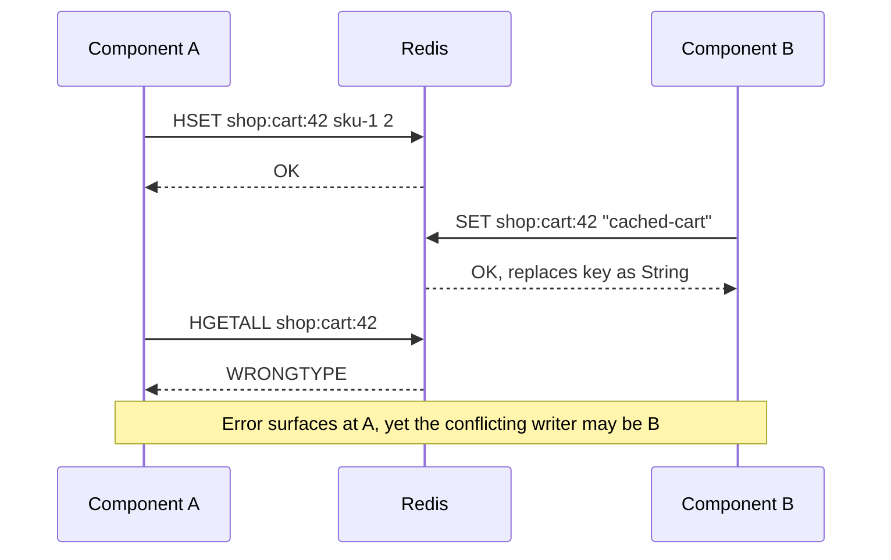
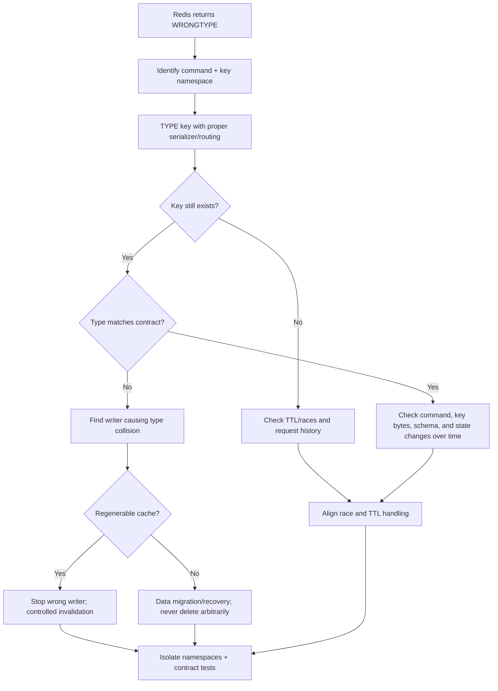

# WRONGTYPE Errors and Data-Type Contract Validation

In **Spring Data Redis**, a key name can be used for String, Hash, List, Set, Sorted Set, Stream, or Redis-module data types. Redis distinguishes these structures by the **actual data type of the key on the server**, not by generic types declared in Java.

When an application sends a command incompatible with the data type currently stored at a key, Redis typically returns:

```text
WRONGTYPE Operation against a key holding the wrong kind of value
```

For example, calling `opsForHash().get(...)` to read a key previously stored with `opsForValue().set(...)` triggers `WRONGTYPE`. This error often appears in systems mixing `RedisTemplate`, Spring Cache, Redis Repositories, and direct Redis operations, especially when **two components accidentally share a key name while expecting different data types**.

This lesson focuses on finding the real cause, checking a namespace's **data-type contract**, avoiding reckless data deletion as a "fix," and building safe write paths in Spring Data Redis.

## 1. What Is a Data-Type Contract?

A data-type contract defines up front:

1. **Who owns the key or namespace?** For example, `CartRedisStore`, Spring Cache, or Redis Repository.
2. **What is the key naming convention?** For example, `shop:cart:v2:<cartId>`.
3. **What is the logical Redis type?** String, Hash, Set, ZSET, List, Stream, etc.
4. **What is the payload structure?** Hash fields, String value type, JSON schema, versioning scheme.
5. **Which serializer/encoding is used?** UTF-8, JSON, Java serialization, etc.
6. **Who may update, delete, or extend TTL?** If multiple writers touch the key, the contract must align.
7. **What is the key lifecycle?** Creation, update, expiration, deletion, migration, and error recovery.

Example contract table:

| Key Pattern | Owner | Redis Type | Payload | TTL |
| --- | --- | --- | --- | --- |
| `shop:cart:v2:<cartId>` | Cart service | `hash` | `sku -> quantity` as integer strings | 30 minutes |
| `shop:session:v1:<sessionId>` | Session service | `string` | Scoped session JSON | 15 minutes |
| `shop:inventory:v1:<sku>` | Inventory service | `string` | Non-negative integer | No default expiry |
| `shop:online:v1` | Presence service | `zset` | Member=user ID, score=lastSeen epoch ms | Cleaned by score |
| `shop:events:orders:v1` | Event producer | `stream` | Field/value per event schema | Stream retention |
| `shop:users:v1` | Repository infrastructure | May be keyspace metadata `set` | Aggregate ID list | Per Repository mechanism |

**Rule:** do not pick names purely for business readability. Key names must also clearly separate **format version**, **Redis type**, and **owning component**.

## 2. Which Data Types Does Redis Have?

The Redis `TYPE key` command reports the **logical type** stored at a key:

```redis
TYPE shop:cart:v2:42
# hash
```

Common types:

| `TYPE` Result | Typical Commands | Model |
| --- | --- | --- |
| `none` | — | Key does not exist at check time |
| `string` | `GET`, `SET`, `INCRBY` | Byte string, sometimes holding numbers or binary data |
| `hash` | `HSET`, `HGET`, `HGETALL` | Collection of field/value pairs |
| `list` | `LPUSH`, `RPUSH`, `LRANGE` | Ordered list |
| `set` | `SADD`, `SISMEMBER`, `SMEMBERS` | Collection of unique members |
| `zset` | `ZADD`, `ZSCORE`, `ZRANGE` | Sorted Set, members with scores |
| `stream` | `XADD`, `XRANGE`, `XREAD` | Append log of entries with IDs and fields |

Redis also has specialized models:

- **Bitmap** is backed by bits of a Redis String; `TYPE` is still `string`.
- **HyperLogLog** is stored using an internal String-based encoding; `TYPE` is `string`, which does not mean an arbitrary String is valid for `PFCOUNT`.
- **Modules** such as RedisJSON can add custom types; `TYPE` output depends on the module and version.

Therefore, `TYPE` is only the **first layer** of inspection, not a complete schema validator.

### 2.1. Redis Type Differs from Java Object Type

Example:

```java
String json = "{\"id\":\"42\",\"total\":150000}";
stringRedisTemplate.opsForValue()
        .set("shop:orders:json:42", json);
```

Redis sees `shop:orders:json:42` as a **String**, even though its content is JSON. `HGETALL shop:orders:json:42` is still a type error.

Conversely:

```java
stringRedisTemplate.opsForHash()
        .put("shop:orders:hash:42", "total", "150000");
```

Redis sees the second key as a **Hash**, even if a field value holds `"150000"` or JSON. Serialization inside a field does not change the Redis key's type.

## 3. Reproducing WRONGTYPE with Redis CLI

On a learning Redis instance:

```redis
SET lesson:cart:42 "{\"items\":[]}"
TYPE lesson:cart:42
# string
```

Then run a Hash command:

```redis
HGETALL lesson:cart:42
# (error) WRONGTYPE Operation against a key holding the wrong kind of value
```

Because the key is a String, Redis cannot treat the entire JSON string as a Hash.

The reverse scenario:

```redis
HSET lesson:profile:42 name "An" city "Da Nang"
TYPE lesson:profile:42
# hash

GET lesson:profile:42
# (error) WRONGTYPE Operation against a key holding the wrong kind of value
```

To read a Hash, use `HGET` or `HGETALL`:

```redis
HGET lesson:profile:42 name
HGETALL lesson:profile:42
```

**Note:** `WRONGTYPE` does not mean Redis data is corrupted. It usually means **a client sent the wrong command for the existing structure** or **another writer hijacked the namespace**.

## 4. Worse Than WRONGTYPE: Overwrite Commands Changing Key Type

Not every contract violation triggers `WRONGTYPE`.

Example:

```redis
HSET lesson:profile:42 name "An"
TYPE lesson:profile:42
# hash

SET lesson:profile:42 "disabled"
TYPE lesson:profile:42
# string
```

A plain `SET` can **replace the existing value regardless of its prior type**, wiping out the previous Hash. Another component later calling `HGETALL` will see `WRONGTYPE`, yet the root cause was the earlier `SET`.



An overwriting `SET` also clears any prior TTL unless an option preserving TTL is used. Thus, trying to "fix" the issue with `SET` or `DEL` without verifying the data source can simultaneously break schema, data, and key lifecycle.

Other commands capable of replacing or colliding structures include `RENAME` onto an existing destination, restoring/overwriting a key, custom scripts, or migrations lacking separate namespaces.

## 5. WRONGTYPE in Spring Data Redis

Spring Data Redis separates APIs by structure:

| API | Expected Redis Type |
| --- | --- |
| `opsForValue()` | String |
| `opsForHash()` | Hash |
| `opsForList()` | List |
| `opsForSet()` | Set |
| `opsForZSet()` | Sorted Set |
| `opsForStream()` | Stream |
| `opsForHyperLogLog()` | Valid HyperLogLog on internal String structure |

Example violating the contract with `StringRedisTemplate`:

```java
package com.example.redis;

import org.springframework.data.redis.core.StringRedisTemplate;
import org.springframework.stereotype.Service;

@Service
public class WrongTypeDemo {

    private final StringRedisTemplate redis;

    public WrongTypeDemo(StringRedisTemplate redis) {
        this.redis = redis;
    }

    public void createString() {
        redis.opsForValue()
                .set("lesson:cart:42", "{\"items\":[]}");
    }

    public Object readAsHash() {
        // Key is already a String; this access path is wrong.
        return redis.opsForHash()
                .entries("lesson:cart:42");
    }
}
```

`createString()` creates a Redis String, while `readAsHash()` invokes the Hash API. Redis returns `WRONGTYPE`; Spring Data Redis/the driver translates it into a Java exception, typically in Spring's `DataAccessException` hierarchy, with the exact class depending on driver version and context.

**Do not depend entirely on one specific exception subclass name to detect `WRONGTYPE`** across all Spring Data Redis versions. When diagnosing, inspect the underlying Redis error message, command, key/namespace, and current type. Never assume every `DataAccessException` is a type mismatch.

## 6. Checking Type with `TYPE` in Spring Data Redis

`RedisTemplate` provides:

```java
DataType type(K key)
```

With `StringRedisTemplate`:

```java
import org.springframework.data.redis.connection.DataType;
import org.springframework.data.redis.core.StringRedisTemplate;

String key = "shop:cart:v2:42";
DataType actual = stringRedisTemplate.type(key);

if (actual == DataType.HASH) {
    System.out.println("Key holds a Redis Hash");
} else if (actual == DataType.NONE) {
    System.out.println("Key does not exist yet");
} else {
    System.out.println("Unexpected type: " + actual);
}
```

`DataType.NONE` corresponds to Redis `TYPE` returning `none`: the key does not exist at check time. Inside a pipeline or transaction, some methods may not return results immediately; the example assumes a normal synchronous call.

### 6.1. Service Validating the Contract Before Writing

Suppose shopping carts are stored as a Hash: each field is an SKU and each value is a quantity. We want the key to have type **`hash` if it exists**, or **`none` if the cart has not been created yet**.

```java
package com.example.cart;

import org.springframework.data.redis.connection.DataType;
import org.springframework.data.redis.core.HashOperations;
import org.springframework.data.redis.core.StringRedisTemplate;
import org.springframework.stereotype.Service;

@Service
public class CartRedisStore {

    private static final String KEY_PREFIX = "shop:cart:v2:";

    private final StringRedisTemplate redis;

    public CartRedisStore(StringRedisTemplate redis) {
        this.redis = redis;
    }

    public void putQuantity(String cartId, String sku, long quantity) {
        if (cartId == null || !cartId.matches("[A-Za-z0-9_-]{1,64}")) {
            throw new IllegalArgumentException("Invalid cartId");
        }
        if (sku == null || !sku.matches("[A-Za-z0-9_-]{1,64}")) {
            throw new IllegalArgumentException("Invalid sku");
        }
        if (quantity < 0) {
            throw new IllegalArgumentException("Invalid quantity");
        }

        String key = KEY_PREFIX + cartId;
        DataType type = redis.type(key);

        if (type == null) {
            throw new IllegalStateException(
                    "TYPE result unavailable in this execution context");
        }
        if (type != DataType.NONE && type != DataType.HASH) {
            throw new IllegalStateException(
                    "Redis key contract violation. Expected hash or none; "
                            + "actual=" + type);
        }

        HashOperations<String, String, String> hashes =
                redis.opsForHash();
        hashes.put(key, sku, Long.toString(quantity));
    }
}
```

Conditions:

```text
TYPE == hash  -> HSET can be called
TYPE == none  -> HSET creates a new Hash
TYPE == string/list/set/zset/stream -> stop and report contract violation
```

This example **detects contract violations earlier and reports them more clearly** instead of letting an obscure `HSET` exception bubble up.

However, checking `TYPE` before acting **does not prevent race conditions**. After reading `TYPE`, another writer can alter the key before `HSET`. This is the *time-of-check to time-of-use* (TOCTOU) problem:

```text
Client A: TYPE key -> hash
Client B: SET key "unexpected-string"
Client A: HSET key field value -> WRONGTYPE
```

Therefore, treat the service snippet above as an **early diagnostic / contract-detection path**, not a concurrency lock. If checking and writing must happen atomically together, use a type-safe command or a properly designed Lua script.

## 7. A Type-Specific Command Can Already Act as an Atomic Check

Redis enforces each command's type contract. If you run:

```redis
HSET shop:cart:v2:42 sku-1 2
```

there are two normal outcomes:

1. Key does not exist: Redis creates a Hash and writes the field.
2. Key is already a Hash: Redis writes/updates the field.

If the key holds an incompatible String/List/Set/..., Redis returns `WRONGTYPE` and **does not coerce the String into a Hash**.

Thus, when the goal is simply "write a field into a Hash and never overwrite another structure," calling `HSET` directly is inherently safer than calling `SET` to overwrite the entire key.

A sensible handling rule:

```text
HSET succeeds        -> Hash created/updated
HSET returns WRONGTYPE -> Do not delete key; record contract violation
HSET times out       -> Outcome may be uncertain; do not assume not written
```

Only when business rules must also validate schema, version, or TTL in the same write do you need a more complex atomic mechanism.

## 8. Checking `TYPE` and Writing Inside the Same Lua Script

A Lua script running on Redis can check the type and write without commands from other clients interleaving between steps.

Example: allow only `none` or `hash`, validate field/value, and set initial TTL on creation:

```lua
-- KEYS[1] = shop:cart:v2:42
-- ARGV[1] = SKU field
-- ARGV[2] = integer quantity as string
-- ARGV[3] = TTL in seconds, e.g. 1800

local field = ARGV[1]
local quantity = tonumber(ARGV[2])
local ttl = tonumber(ARGV[3])

if not field or field == '' then
    return redis.error_reply('field required')
end
if not quantity or quantity < 0 or quantity % 1 ~= 0 then
    return redis.error_reply('invalid quantity')
end
if not ttl or ttl <= 0 or ttl % 1 ~= 0 then
    return redis.error_reply('invalid TTL')
end

local actual = redis.call('TYPE', KEYS[1]).ok
if actual ~= 'none' and actual ~= 'hash' then
    return redis.error_reply(
            'TYPE_CONTRACT_VIOLATION expected hash; actual ' .. actual)
end

local isNew = actual == 'none'
local updated = redis.call('HSET', KEYS[1], field, ARGV[2])

if isNew then
    redis.call('EXPIRE', KEYS[1], ttl)
end

return updated
```

**Meaning:**

- `TYPE` and `HSET` happen inside the same script, so no other writer can interleave between the two steps.
- On a disallowed type, the script returns an error and **does not try to change the key's type**.
- `HSET` writes the field into the Hash; if the key does not exist, it creates the Hash.
- For new keys, `EXPIRE` sets the initial TTL. For existing Hashes, the script **does not extend the TTL**.
- 1,800 seconds TTL is illustrative; tie the policy to your actual cart contract.

**Important limitation:** Lua does not guarantee rollback of operations already executed before a runtime error occurs. This example validates predictable arguments before writing, yet production code must still control field types, payload sizes, Redis integer limits, permissions, memory, and other error paths.

In Redis Cluster, multi-key scripts must obey same-hash-slot rules. Because this script operates on a single key, it does not require co-locating other keys.

### 8.1. Calling the Script from Spring Data Redis

```java
import java.util.List;
import org.springframework.data.redis.core.StringRedisTemplate;
import org.springframework.data.redis.core.script.DefaultRedisScript;

String lua = """
        local actual = redis.call('TYPE', KEYS[1]).ok
        if actual ~= 'none' and actual ~= 'hash' then
            return redis.error_reply('Expected hash')
        end
        local quantity = tonumber(ARGV[2])
        local ttl = tonumber(ARGV[3])
        if not quantity or quantity < 0 or quantity % 1 ~= 0 then
            return redis.error_reply('Invalid quantity')
        end
        if not ttl or ttl <= 0 or ttl % 1 ~= 0 then
            return redis.error_reply('Invalid TTL')
        end
        local created = actual == 'none'
        local result = redis.call('HSET', KEYS[1], ARGV[1], ARGV[2])
        if created then
            redis.call('EXPIRE', KEYS[1], ttl)
        end
        return result
        """;

DefaultRedisScript<Long> script =
        new DefaultRedisScript<>(lua, Long.class);

Long changed = stringRedisTemplate.execute(
        script,
        List.of("shop:cart:v2:42"),
        "sku-1", "2", "1800");
```

The `HSET` return value is typically the number of newly added fields, not "cart updated exactly once in business terms." If duplicate processing after timeouts must be prevented, add an operation ID / idempotency per your requirements.

The Java snippet illustrates invocation; in real applications, store scripts as separate resources, version them, and never build dynamic scripts from user input.

## 9. Production WRONGTYPE Triage Workflow

When logs show:

```text
WRONGTYPE Operation against a key holding the wrong kind of value
```

do not start with `DEL` or `FLUSHDB`. Identify **which key**, **which command**, and **who wrote that key**.

### Step 1: Identify the Operation and Key

Example:

```text
service=cart-service
operation=HGETALL
keyPattern=shop:cart:v2:<cartId>
correlationId=req-72b
```

If logs lack the key pattern, add safe logging at the service layer where keys are constructed; never log credentials or full sensitive cart contents.

### Step 2: Check the Current Type

```redis
TYPE shop:cart:v2:42
```

If the result is `string` when the contract expects `hash`, you have confirmed a **mismatch at inspection time**.

With Redis Cluster, use a slot-routing client or:

```sh
redis-cli -c -h redis-host -p 6379 TYPE 'shop:cart:v2:42'
```

`-c` lets `redis-cli` follow redirects on Cluster connections. However, `TYPE` returning `none` right now **does not prove** the key was absent when the command failed: it could have been deleted or expired in the meantime.

### Step 3: Inspect TTL and Structural Properties

```redis
PTTL shop:cart:v2:42
MEMORY USAGE shop:cart:v2:42
```

`PTTL` typically returns:

| Result | Meaning |
| --- | --- |
| Non-negative value | Remaining milliseconds |
| `-1` | Key exists without a TTL |
| `-2` | Key does not exist |

Do not use `MEMORY USAGE` to infer Redis type: it estimates memory footprint, not whether a key is a Hash or String.

`OBJECT ENCODING key` can reveal **internal representations** such as `embstr`, `raw`, `listpack`, or `hashtable` depending on structure and Redis version. This is **not** a substitute for `TYPE`; a Hash changes internal encoding as it grows/shrinks while remaining type `hash`.

### Step 4: Read Only with Commands Matching the Actual Type

| Actual `TYPE` | Safe Way to Sample Data |
| --- | --- |
| `string` | `GET key` once confirmed non-sensitive and not huge |
| `hash` | `HSCAN key 0 COUNT 10` or `HGET key field` |
| `list` | `LRANGE key 0 9` |
| `set` | `SSCAN key 0 COUNT 10` |
| `zset` | `ZSCAN key 0 COUNT 10` |
| `stream` | `XREVRANGE key + - COUNT 5` |

Never run `HGETALL` on a multi-million-field Hash or `SMEMBERS` on a huge Set just for quick diagnosis. Prefer bounded reads to avoid adding production load.

### Step 5: Trace the Conflicting Writer

From the namespace/key, trace back:

- Which component calls `opsForValue().set(key, ...)`?
- Which component calls `opsForHash().put(key, ...)`?
- Did a migration switch from JSON String to Hash while keeping the same key name?
- Is `@RedisHash`, `RedisCacheManager`, or a script writing under the same prefix?
- Is a job running `RENAME`, `RESTORE REPLACE`, `DEL`, cache warm-up, or data imports?
- Are older application instances still running and writing under the old schema?

Seeing `WRONGTYPE` at the **current reader** does not mean the reader is at fault. Another writer may have overwritten the key earlier.

### Step 6: Fix Only After Identifying the Source of Data

If Redis is purely a regenerable cache, plan selective invalidation after stopping the wrong writer and assessing impact. If the key is the sole business data source, **do not delete or overwrite it to "restore" the type**; perform a formal migration and backup.

## 10. Distinguishing WRONGTYPE from Serializer and Schema Errors

Three error categories are often conflated:

| Error Group | Example | Nature |
| --- | --- | --- |
| **Wrong Redis type** | `HGETALL` on a `string` | Redis returns `WRONGTYPE` because command does not match type |
| **Wrong serializer/encoding** | Java reads key/value with JDK serializer while written with UTF-8/JSON | Key not found or decoding failure |
| **Wrong schema inside same type** | Hash has field `quantity="two"` while code expects integer | Redis type is right (`hash`), application parse/validation fails |

### 10.1. JSON String Is Not a Redis Hash

```redis
SET shop:order:42 '{"id":"42","status":"PAID"}'
TYPE shop:order:42
# string
```

Even though the JSON contains properties, `HGET shop:order:42 status` is still a wrong-type operation. To use `HGET`, store it as a Hash via `HSET`; to store raw JSON strings, use `GET` and parse JSON in Java.

The RedisJSON module provides `JSON.GET`/`JSON.SET` with its own module data type. Do not treat RedisJSON, JSON-in-String, and Redis Hash as three names for the same type.

### 10.2. HyperLogLog Is a Case Where TYPE Is Insufficient

```redis
SET lesson:not-hll "hello"
TYPE lesson:not-hll
# string

PFCOUNT lesson:not-hll
# May report data is not a valid HyperLogLog
```

A HyperLogLog is represented on top of an internal String structure, yet an arbitrary String is **not** a valid HLL. Therefore, `TYPE key == string` is **not sufficient** to permit `PFADD`, `PFCOUNT`, or business-meaningful bitmap operations.

Contracts must specify the **purpose and format** of a key, not just its `TYPE` value.

### 10.3. Integers in Strings Still Need Value Validation

```redis
SET stock:sku-42 "unknown"
TYPE stock:sku-42
# string

INCRBY stock:sku-42 1
# (error) ERR value is not an integer or out of range
```

This is a **value format** error, not necessarily `WRONGTYPE`: the Redis String type is right, but its content is not a valid integer.

For numeric keys, enforce number formatting, value bounds, and update paths so no other writer stores arbitrary text.

## 11. RedisTemplate Serializers and Actual Key Names

`StringRedisTemplate` is convenient because string keys and values are encoded using String-friendly serializers. With a custom `RedisTemplate<K, V>`, multiple serializers may be configured:

```java
import org.springframework.data.redis.core.RedisTemplate;
import org.springframework.data.redis.serializer.StringRedisSerializer;
import org.springframework.data.redis.serializer.GenericJackson2JsonRedisSerializer;

RedisTemplate<String, Object> template = new RedisTemplate<>();
template.setConnectionFactory(connectionFactory);
template.setKeySerializer(new StringRedisSerializer());
template.setHashKeySerializer(new StringRedisSerializer());
template.setValueSerializer(
        new GenericJackson2JsonRedisSerializer());
template.setHashValueSerializer(
        new GenericJackson2JsonRedisSerializer());
template.afterPropertiesSet();
```

This illustrates configuring a template with specific serializers; in a Spring app, configure it as a bean and govern multiple templates carefully. JSON serializers also introduce type-metadata, allowlist, and version-compatibility concerns that must be managed separately.

### 11.1. If Key Bytes Do Not Match, It Is Not the Same Key

If one template uses `StringRedisSerializer` and another uses a binary serializer for **keys**, two Java calls passing `"shop:cart:v2:42"` create **two distinct byte-level keys** in Redis.

Consequences:

- `redis-cli TYPE shop:cart:v2:42` returns `none` even though the app sees another key stored under the binary serializer's bytes.
- One template cannot find the key written by another template.
- During a serializer migration, old data does not automatically map to the new key bytes.

Thus, during diagnosis, inspect the **key serializer** before concluding Redis lost data. This is a key-encoding error, distinct from `WRONGTYPE` on **the same byte-level key**.

### 11.2. Hash Field Serializers Are Also Part of the Contract

Even when the key is already a `hash`, an `HGET` for field `"status"` can miss data if a writer encoded the field name into different bytes. `TYPE` is still `hash`, yet `HGET` returns `null`.

Similarly, if `hashValueSerializer` changes, reading a field does not guarantee deserializing its value. Manage **Redis type**, **hash key serializer**, **hash value serializer**, and **schema** together.

## 12. Collisions Between Spring Cache and Manual Operations

Spring Cache uses `RedisCacheManager` to store regenerable data under keys generated by cache configuration. With default settings, key names typically include the cache name and prefix, such as:

```text
products::42
```

Suppose:

```java
@Cacheable(cacheNames = "products", key = "#id")
public Product find(String id) {
    return productRepository.findById(id).orElseThrow();
}
```

Meanwhile, another developer writes:

```java
stringRedisTemplate.opsForHash()
        .put("products::42", "stock", "17");
```

If the cache already stored a result as a Redis String, the Hash call can return `WRONGTYPE`. If the Hash write runs first, Spring Cache may encounter errors or overwrite the type depending on the command and cache writer implementation.

**Lesson:** cache namespaces **must be isolated** from Redis data namespaces manipulated manually by the application.

```text
cache:products:v1::42         -> Owned by Spring Cache
domain:products:v1:42         -> Owned by manual Hash operations
repository:products:v1:42     -> Owned by Redis Repository
```

The names above are a suggested convention; `RedisCacheConfiguration.computePrefixWith(...)` can customize Spring Cache prefixes. Do not allow business services to directly touch internal keys generated by the cache manager.

### 12.1. Cache Value Serializer Differs from Redis Type

A Spring Cache entry may be a Redis `string` holding a **serialized byte array**. Code calling `GET` can fetch the bytes yet fail to deserialize under the active serializer. That is a **serializer/schema** error, not `WRONGTYPE`.

Calling `HGETALL` merely because the cached Java object is a POJO with several fields is what triggers a **Redis type** error: a Java POJO does not automatically imply a Cache entry is a Redis Hash.

## 13. Collisions with Redis Repository and `@RedisHash`

Spring Data Redis Repository can map an entity:

```java
import org.springframework.data.annotation.Id;
import org.springframework.data.redis.core.RedisHash;
import org.springframework.data.redis.core.index.Indexed;

@RedisHash("users")
public class UserDocument {

    @Id
    private String id;

    @Indexed
    private String email;

    // Constructor, getters, setters...
}
```

The repository can create multiple Redis structures:

```text
users:42            -> Entity Hash
users               -> Keyspace ID metadata Set
users:email:...     -> Secondary index auxiliary Set
```

These illustrate Repository naming conventions. Do not manually write a `SET` to `users:42` or run `HSET` on `users` when the repository uses `users` as an ID Set.

A common pitfall:

```redis
SADD users 42
TYPE users
# set

HSET users name "An"
# WRONGTYPE
```

If a component does not know `users` is a Redis Repository **metadata Set**, it might assume `users` is a Hash of user fields and cause a collision.

The impact can extend beyond one failed command:

- `repository.findById(...)` cannot read the hash if another writer turned the key into a String.
- `repository.findAll()` or indexed queries can break if metadata/index Sets are overwritten.
- Repository TTLs, shadow copies, and index cleanup can break if key lifecycles are altered externally.
- When an entity updates an indexed field, the repository maintains secondary structures; manual writes bypass those rules.

**Never assume a Redis Repository manages only a single key per entity.** Protect Repository namespaces from incompatible manual writers and Spring Cache.

## 14. WRONGTYPE in Redis Cluster

Redis Cluster routes keys by hash slot. `WRONGTYPE` is still about **a single key's data type**, not directly a routing error.

Distinguish:

| Error / Reply | Common Meaning |
| --- | --- |
| `WRONGTYPE` | Command incompatible with the key's stored data type |
| `CROSSSLOT` | Multi-key command requires keys in the same slot, but they span different slots |
| `MOVED` / `ASK` | Need to route to the appropriate node/slot in the Cluster |
| `READONLY` | Write command sent to a node not accepting writes, e.g., a replica |
| Timeout/network failure | Uncertain whether Redis processed the command |

Example:

```redis
TYPE shop:cart:v2:42
# hash

CLUSTER KEYSLOT shop:cart:v2:42
# Returns a slot in 0..16383 on the Cluster
```

If the application gets `WRONGTYPE`, increasing max redirects in Lettuce **will not fix the key type**. Conversely, `CROSSSLOT` does not mean a key is a Hash instead of a String.

With multiple writers across services, a key moving during resharding does not change the key's type contract. Inspect all services touching the namespace and verify whether older versions are still writing under an old schema.

## 15. Race Conditions and Atomicity Across Multiple Workers

Suppose two services run side by side during a rollout:

```text
Service A (v1): SET session:42 JSON
Service B (v2): HSET session:42 status ACTIVE
```

If v2 runs first and creates a Hash, v1 calling `SET` overwrites the Hash with a String. If v1 runs first, v2 gets `WRONGTYPE`. No `TYPE` check in v2 can stop v1 from overwriting under the old contract.

**The primary fix lies in ownership and migration**, not simply adding retries.

If the exact same key must change type, you need a phase where old writers stop writing or an explicit versioned transition protocol. Using a separate `v2` key is usually far easier to manage than letting two application versions write two formats to the same key.

### 15.1. Transactions Are Not Type-Coercion Mechanisms

```redis
MULTI
HSET lesson:cart:42 sku-1 2
EXPIRE lesson:cart:42 1800
EXEC
```

If `lesson:cart:42` is actually a String, `HSET` returns an execution error during `EXEC`, while other commands in the transaction can still execute per Redis semantics. Redis transactions do not roll back all executed commands when one command fails at runtime.

Never use `MULTI` expecting `WRONGTYPE` to automatically roll back earlier/later changes like an SQL transaction.

## 16. Migration Plan from String JSON to Hash

Suppose the old version stored:

```text
shop:cart:v1:42 -> Redis String containing JSON
```

The new version wants:

```text
shop:cart:v2:42 -> Redis Hash mapping sku -> quantity
```

A safer plan than mutating the old key in place:

1. **Define the v2 schema**: key name, type `hash`, allowed fields, TTL, serializer, owner.
2. **Create new v2 keys** rather than reusing `shop:cart:v1:42`.
3. **Read and parse v1 data** via the String path; validate before converting.
4. **Write v2** via the Hash API with proper TTL/lifecycle rules.
5. **Use controlled dual-read**: prefer v2, fall back to v1 only during migration with reconciliation.
6. **Stop v1 writers from writing back** once ownership switches; use feature flags or version cutovers.
7. **Monitor errors** and remaining old-schema key counts during transition.
8. **Delete v1 keys on schedule** only once rollback/recovery needs and retention windows have passed.

Example reading legacy data:

```java
String legacyJson = stringRedisTemplate.opsForValue()
        .get("shop:cart:v1:42");

// Use Jackson to parse into a schema-validated DTO.
// Then convert the DTO into Map<String, String> and HSET on the v2 key.
```

TTL migration must be calculated explicitly:

```redis
PTTL shop:cart:v1:42
```

If 300,000 ms remain, the v2 key should not automatically receive a fresh 30-minute TTL without an explicit business decision. `-1` and `-2` also require separate handling: a key with no expiry and a non-existent key are distinct states.

A backfill running concurrently with old writers needs versioning or guards so an old snapshot does not overwrite newer data. Otherwise, migration can cause **lost updates** even without `WRONGTYPE`.

## 17. Operations You Should NOT Use to Fix Errors

### 17.1. Running `DEL` on Every Key Reporting WRONGTYPE

```redis
DEL shop:cart:v2:42
```

`DEL` deletes the key regardless of type. If the data is not regenerable, this causes **data loss**. Delete only after identifying the owner, source of truth, recoverability, and impact on other writers.

### 17.2. `FLUSHDB`/`FLUSHALL` to "Clean Up"

These wipe broad datasets and are completely inappropriate for fixing a mismatch on a few keys.

### 17.3. Continuously Retrying a Wrong-Type Command

```java
// Do not do this:
for (;;) {
    redis.opsForHash().put(key, field, value);
}
```

If the key remains a String, retrying will never make `HSET` valid. Retry loops only burn CPU and spam logs. Retries belong to transient errors under bounded policies, not structural contract violations.

### 17.4. Catching DataAccessException and Returning a Default Value

```java
// Do not do this:
try {
    return redis.opsForHash().entries(key);
} catch (org.springframework.dao.DataAccessException ex) {
    return java.util.Map.of();
}
```

A type mismatch gets turned into an "empty cart," risking lost orders or bad updates. Distinguish an absent key (which may represent an empty cart per contract) from **a key holding an incompatible type**.

### 17.5. Randomly Swapping Serializers to Experiment

Changing `valueSerializer` does not turn a Redis String into a Hash, and it can render existing data undecodable. Change serializers only after confirming the bug is in encoding rather than `WRONGTYPE`.

## 18. Error Handling in Services: Do Not Hide WRONGTYPE

One design pattern keeps namespace responsibility in the service and throws contextual errors without deleting keys:

```java
package com.example.cart;

import org.springframework.dao.DataAccessException;
import org.springframework.data.redis.core.StringRedisTemplate;
import org.springframework.stereotype.Service;

@Service
public class SafeCartReader {

    private final StringRedisTemplate redis;

    public SafeCartReader(StringRedisTemplate redis) {
        this.redis = redis;
    }

    public java.util.Map<Object, Object> read(String cartId) {
        if (cartId == null || !cartId.matches("[A-Za-z0-9_-]{1,64}")) {
            throw new IllegalArgumentException("Invalid cartId");
        }

        String key = "shop:cart:v2:" + cartId;

        try {
            return redis.opsForHash().entries(key);
        } catch (DataAccessException cause) {
            // Do not convert into an empty cart; do not delete the key.
            // Logging/observability can attach correlation ID
            // and namespace name (without logging sensitive payloads).
            throw new IllegalStateException(
                    "Cannot read cart from Redis hash namespace", cause);
        }
    }
}
```

This example uses `DataAccessException` to preserve the underlying cause, without labeling every such exception as `WRONGTYPE`. Network errors, timeouts, and transaction issues require distinct handling paths.

If the API needs specific error codes, introduce a dedicated `KeyTypeContractViolationException` after verifying the failure category while keeping the original exception as `cause`. Avoid branching critical business flows solely on string comparisons of Redis error messages that could change.

## 19. Recommended Data-Type Contract Tests

For each critical namespace, include integration tests covering:

| Scenario | Expectation |
| --- | --- |
| Key does not exist yet | Create method uses the expected Redis type |
| Key already has the right type | Reads/writes succeed per contract |
| Key pre-populated with wrong type | Clear failure raised; no arbitrary deletion/overwrite |
| Same key has legacy v1 writer | Conflict detected with cutover mechanism |
| Key expires between `TYPE` and write | Temporary state does not cause uncontrolled data deletion |
| Concurrent updates from two writers | No silent type switching unless contract allows |
| Serializer/key prefix changes | Old/new data isolated by namespace or migrated cleanly |
| Redis Cluster resharding | Driver routes properly; do not conflate `MOVED` and `WRONGTYPE` |
| Command times out after sending | Do not assume not written; use idempotency if business requires |

An illustrative test case:

```java
// Integration test pseudocode using a dedicated test Redis:
String key = "test:cart:v2:42";

redis.opsForValue().set(key, "legacy-json");

// The Hash path must not overwrite the legacy String.
assertThrows(
        DataAccessException.class,
        () -> redis.opsForHash().put(key, "sku-1", "2"));

assertEquals(DataType.STRING, redis.type(key));
```

`assertThrows` and `assertEquals` are JUnit assertions; `redis` here is a `StringRedisTemplate` pointing to a test environment. Never run mutating tests directly against production keys.

The test ensures **the new writer does not silently destroy the old writer's data**. Other test cases should use isolated keys to avoid order dependencies.

## 20. Production Observability and Alerting

A multi-module application should track:

| Signal | Diagnostic Value |
| --- | --- |
| `redis_wrongtype_errors_total` | How many type errors occur by service/namespace |
| Failing command name | `HGETALL`, `HSET`, `GET`, `PFCOUNT`, etc. |
| Observed Redis type | `string`, `hash`, `set`, `zset`, `none`, ... |
| Expected contract type | Distinguishes client bugs from conflicting writers |
| Application version | Spots instances running old schemas |
| Serializer/key prefix | Spots key-naming or decoding changes |
| Key TTL/age | Hints at new keys, legacy keys, or abnormal lifecycles |
| `SET`/`HSET` rate per namespace | Locates writers likely overwriting keys |
| Retry count | Spots hot retry loops on non-recoverable errors |

Example useful log without leaking payloads:

```text
event=REDIS_KEY_TYPE_CONTRACT_VIOLATION
service=cart-api
operation=HGETALL
namespace=shop:cart:v2
expected=hash
actual=string
release=2026.11.13
correlationId=req-72b
```

Record `actual` only after obtaining a `TYPE` check at diagnosis time; if the key has already expired and returns `none`, reflect that rather than claiming certainty about the original type. Avoid logging raw user IDs, tokens, passwords, or cart contents.

If `WRONGTYPE` rates spike immediately after a deployment, check key prefix configs, serializers, schema migrations, and whether old and new instances are writing to the same namespace.

### 20.1. Should You Use Redis MONITOR?

`MONITOR` shows incoming commands on Redis, but it incurs heavy overhead and exposes sensitive data. **Do not enable MONITOR indiscriminately in production.** Prefer structured service logging, metrics, tracing with redacted fields, and approved observability tools.

## 21. Decision Flowchart for WRONGTYPE



The workflow prioritizes **diagnosis and owner identification** before touching data. A `WRONGTYPE` error may signal an uncoordinated schema change rather than a "junk" key to delete immediately.

## 22. Prevention Rules

1. **One clear owner per namespace.** Prevent Spring Cache, Repositories, and manual `RedisTemplate` code from writing uncontrolled to the same prefix.
2. **Document Redis types in the contract.** Specify not just JSON/Java DTOs, but Redis `string`, `hash`, `set`, `stream`, etc.
3. **Include schema versions in key names when needed.** E.g., `cart:v1` as String, `cart:v2` as Hash.
4. **Use the matching data-structure API.** `opsForHash` for Hashes, `opsForZSet` for Sorted Sets; do not guess Redis types from Java classes.
5. **Create and update consistently.** `HSET` creates a Hash if missing; avoid `SET` overwriting a Hash unless performing an intentional migration.
6. **Do not treat `TYPE` as a concurrency lock.** Check-then-act races; when needed, use a single command or Lua script to check and write atomically.
7. **Manage serializers and TTLs.** Two keys of the same type can still differ in schema/encoding and lifecycle.
8. **Do not infinitely retry WRONGTYPE.** It is typically a contract violation, not a transient network glitch.
9. **Do not delete before reconciling.** Regenerable cache data differs from irrecoverable business data.
10. **Have migration and rollback plans.** Especially when multiple application versions run concurrently.
11. **Monitor error types and writers.** Log expected/actual types, commands, namespaces, and application versions.
12. **Test against real Redis.** Data types are a server-enforced contract; mocked unit tests do not faithfully simulate `WRONGTYPE`.

## 23. Summary

**`WRONGTYPE` is a Redis error triggered when a command does not match the actual data type of a key.** In Spring Data Redis, common sources include mixing up `opsForValue`/`opsForHash`/`opsForSet`, two components overwriting the same key name, or changing schemas from String to Hash without migration.

The **`TYPE key`** command and **`RedisTemplate.type(key)`** API verify logical types. However, `TYPE` does not validate serializers, intra-type schemas, or prevent changes after the check. When concurrency safety is required, use type-enforcing commands or Lua scripts with explicit preconditions.

Sustainable prevention comes from **namespace contracts**: every key group has a declared owner, Redis type, payload structure, serializer, TTL, and version. When errors happen, identify the conflicting writer first, **never automatically `DEL`**, never mask errors with empty values, and never retry infinitely. For format changes, separating a `v2` key and performing controlled migration is far safer than letting two versions write to the same key.

### References

- [Redis — TYPE](https://redis.io/docs/latest/commands/type/): determine the logical data type of a key.
- [Redis — Data Types](https://redis.io/docs/latest/develop/data-types/): String, Hash, List, Set, Sorted Set, Stream, and other structures.
- [Redis — HSET](https://redis.io/docs/latest/commands/hset/): write Hash fields, creating a Hash if the key does not exist.
- [Redis — SET](https://redis.io/docs/latest/commands/set/): overwrite String values and implications for TTL/data types.
- [Redis — PTTL](https://redis.io/docs/latest/commands/pttl/): check remaining key expiration.
- [Redis — Scripting with Lua](https://redis.io/docs/latest/develop/programmability/eval-intro/): script atomicity scope and rollback limitations.
- [Spring Data Redis — RedisTemplate](https://docs.spring.io/spring-data/redis/reference/redis/template.html): data-type operations, serializers, and templates.
- [Spring Data Redis — Redis Repositories](https://docs.spring.io/spring-data/redis/reference/redis/redis-repositories.html): keyspaces, aggregate storage, and auxiliary keys.
- [Spring Data Redis — Redis Cache](https://docs.spring.io/spring-data/redis/reference/redis/redis-cache.html): cache key naming conventions, serializers, and `CacheManager` configuration.
