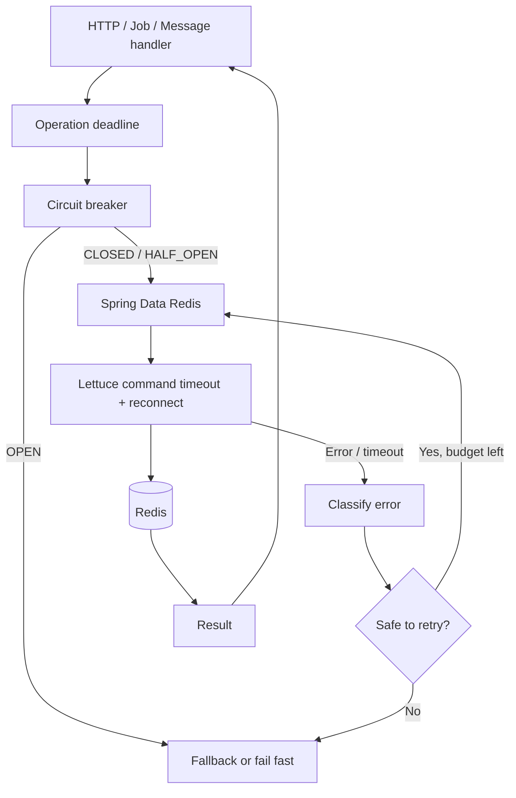
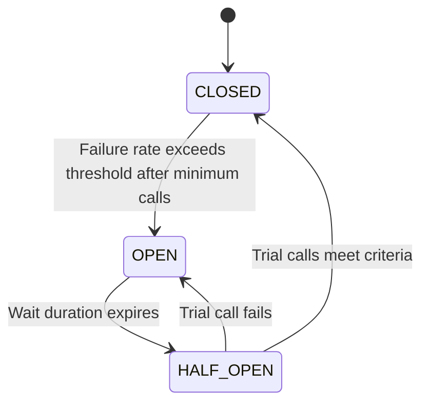
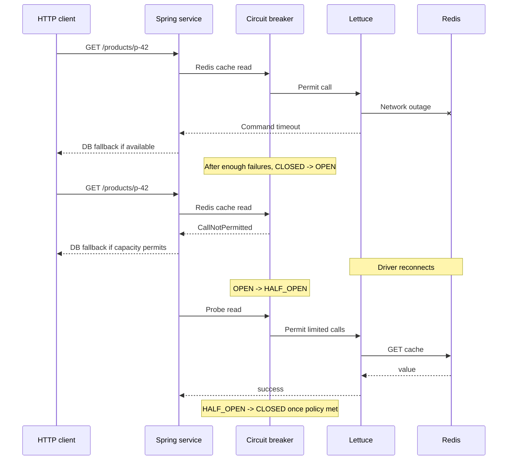
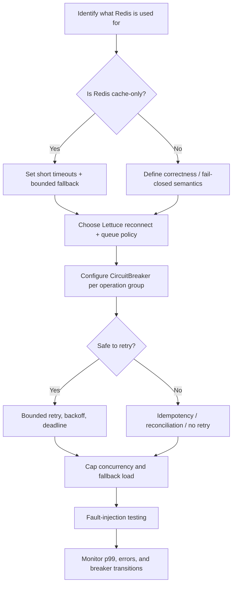

# Coordinating Timeouts, Reconnects, and Circuit Breakers in Spring Data Redis

## 1. The Problem: Slow or Disconnected Redis Slows Down the Entire Application

Suppose a Spring Boot service uses Redis as a cache for a product lookup API:

```java
@Service
public class ProductCache {

    private final StringRedisTemplate redis;

    public ProductCache(StringRedisTemplate redis) {
        this.redis = redis;
    }

    public String getName(String productId) {
        return redis.opsForValue()
            .get("product:name:" + productId);
    }
}
```

When Redis is healthy, `GET` is very fast. Yet what happens if:

- Redis briefly loses connectivity for a few seconds?
- A Redis node fails over and the client still holds a connection to the old node?
- The network is not completely down, yet latency spikes?
- Redis is overloaded, command queues grow long, and many concurrent requests wait?
- The application retries aggressively, turning a small blip into a request storm?

If you only configure a huge timeout, every HTTP request gets held up; as traffic grows, waiting threads or subscriptions pile up. If you only enable reconnect, timed-out commands do not automatically become safe to re-execute. If you only add a circuit breaker, the application can still stall before commands hit deadlines or when too many concurrent calls are in flight.

A reliable solution requires **coordinating multiple layers**:

```text
HTTP request deadline
    |
    +-- Redis connect timeout
    |
    +-- Redis command timeout
    |
    +-- Reactor/application operation timeout
    |
    +-- Lettuce reconnect + command queue
    |
    +-- Circuit breaker: CLOSED / OPEN / HALF_OPEN
    |
    +-- Bounded retry, only when safe
    |
    +-- Fallback + bulkhead + monitoring
```

These mechanisms serve **different purposes**. This lesson integrates them into a cohesive error-handling policy for Spring Data Redis, whether the application uses `RedisTemplate` or `ReactiveRedisTemplate`.

After this lesson, you will be able to:

1. Distinguish connect timeouts, command timeouts, and request deadlines.
2. Understand Lettuce reconnect, command queues, and connection states.
3. Scope circuit breakers properly for Redis caches versus critical Redis workloads.
4. Combine Reactor `timeout` with Resilience4j `CircuitBreaker`.
5. Choose retries based on **idempotency** and uncertain outcomes.
6. Design fallbacks, bulkheads, health/metrics, and incident test scenarios.

## 2. Separating the Axes: Timeout, Reconnect, and Circuit Breaker

| Mechanism | Question It Solves | What It Does Not Solve Alone |
|---|---|---|
| **Timeout** | How long is an operation allowed to wait? | Restoring connectivity and limiting new requests |
| **Reconnect** | What does the client do when the Redis socket drops? | Telling whether an old command ran; guaranteeing safe retries |
| **Circuit breaker** | Should we keep calling Redis when failure rates are too high? | Stopping an already-hanging call without a timeout; replacing retries/queues |
| **Retry** | When should a recoverable failure be attempted again? | Safety of non-idempotent operations |
| **Fallback** | What does the app do when Redis yields no result? | Ensuring the backup source can absorb full traffic |
| **Bulkhead** | How much concurrency may Redis consume at once? | Recovering Redis or fixing business logic |

Overall flow:



The ordering reflects logical responsibility. On reactive paths, operator placement determines whether the circuit breaker observes a timeout, and whether a fallback gets miscounted as a fake Redis success.

## 3. Timeout Layers in Spring Data Redis

### 3.1. Connection Timeout

**Connect timeout** limits how long establishing a connection to the Redis server may take. It applies to cases such as:

- Host is unreachable.
- TCP handshake is slow or stalls.
- New Redis address after failover is unreachable.
- Connection stalls during initialization.

In Spring Boot 3.x, you can declare:

```yaml
spring:
  data:
    redis:
      host: redis.internal
      port: 6379
      connect-timeout: 500ms
```

500 ms is illustrative. Over high-RTT networks or TLS handshakes, measure and pick an appropriate threshold.

**Connect timeout is not the timeout of each `GET` command.** An already-established connection can still send a command and wait too long for Redis's reply even when connect timeout is tiny.

### 3.2. Command Timeout

**Command timeout** limits how long to wait for a Redis command to complete at the client/driver layer. Example:

```yaml
spring:
  data:
    redis:
      timeout: 300ms
```

In Spring Boot 3.x, `spring.data.redis.timeout` configures the command timeout on standard client paths. Exact details, when the timer starts, and the resulting exception depend on Lettuce/Spring Data Redis versions and command types.

A pending `GET` can time out because:

- Redis itself is slow.
- Network lag or packet loss.
- Client is reconnecting/disconnected.
- Command sat in a queue unsent or awaiting reply.
- Redis Cluster is redirecting or failing over.

**Command timeout does not guarantee the server did not execute the command.** If the reply drops after Redis applied a write, the client still receives a timeout.

### 3.3. Reactor Operation Timeout

A reactive application can bound a Publisher directly:

```java
Mono<String> cachedName =
    reactiveRedis.opsForValue()
        .get("product:name:p-42")
        .timeout(Duration.ofMillis(350));
```

`timeout(...)` bounds how long the Publisher may take to emit a signal and errors if exceeded. It is very effective for keeping application latency bounded.

However:

- A Reactor timeout does not mean the Redis server cancelled the command.
- Cancellation cannot undo a write already sent to Redis.
- If timeout wraps only part of a pipeline, upstream or downstream stages still consume time.
- Reactor timeouts and Lettuce timeouts can surface with different exception classes/causes.

### 3.4. HTTP / Request Deadline

A single application request may execute:

```text
Auth check -> Redis cache GET -> Database fallback -> Build response
```

If the overall HTTP SLA is 800 ms, letting a Redis `GET` wait 2 seconds makes no sense. Redis must occupy **only a slice** of the time budget, leaving headroom for the backup source.

An initial illustrative allocation:

| Stage | Illustrative Threshold |
|---|---:|
| Redis connect timeout | 500 ms when opening a new connection |
| Redis command timeout | 250 ms |
| Redis cache read deadline in Reactor | 320 ms |
| Database fallback budget | ~400 ms remaining, depending on start time |
| Total request budget | 900 ms |

**Do not mechanically add numbers** to assume every request finishes under 900 ms: connect and command timeouts can overlap or occur in different phases; schedulers, queues, retries, and downstream handlers add overhead. Instead of relying solely on static tables, enforce an **overall deadline** and measure actual elapsed time.

## 4. Practical Timeout Selection

A strategy:

1. Measure healthy Redis latency at p50, p95, and p99 under normal traffic.
2. Determine the request deadline from the API's SLO.
3. Reserve budget for the database or authoritative source if Redis fails.
4. Pick a Redis timeout wide enough for normal variance yet tight enough not to sink requests.
5. Keep any retries inside the remaining budget.
6. Measure timeout rates and false timeouts under real load.

For example, Redis p99 is normally 8 ms with occasional 50 ms network blips. Setting a 10 ms timeout causes false failures and trips circuit breakers needlessly. Conversely, setting 5 seconds on a cache `GET` inside a 500 ms API defeats the value of falling back.

### 4.1. Overly Short Timeouts Also Cause Incidents

```text
Timeout too short
    -> valid commands time out
    -> client retries
    -> Redis receives more traffic
    -> latency rises
    -> even more timeouts
```

This is a positive feedback loop. When Redis struggles, the system must shed load and recover steadily, not multiply command volume.

### 4.2. Timeouts for Blocking Redis Commands

Commands such as `BLPOP`, `XREAD BLOCK`, or Pub/Sub subscriptions wait for data differently from `GET`.

If the client command timeout is shorter than the time Redis was asked to block, the app gets unintended timeouts even though Redis is healthy.

Illustrative command:

```redis
XREAD BLOCK 5000 STREAMS events $
```

This command can wait up to 5 seconds for a new entry. Applying the same 300 ms command timeout ignores the business semantics of blocking reads.

Use dedicated timeout configurations or listener/receiver APIs designed for polling and clean cancellation instead of forcing every Redis command onto one short threshold.

## 5. How Does Lettuce Auto-Reconnect Work?

Spring Data Redis commonly uses **Lettuce** in Spring Boot applications. Lettuce supports asynchronous connections and **auto-reconnect**.

Overview:

```text
CONNECTED
   |
   | network/socket failure
   v
DISCONNECTED
   |
   | autoReconnect
   v
RECONNECTING
   |
   +-- failure -> keep trying per policy
   |
   +-- success -> CONNECTED
```

Reconnecting restores **future ability to send commands**; it is not a transaction recovery protocol for commands whose replies were lost.

### 5.1. Reconnect Does Not Mean Retrying Every Command

Distinct scenarios:

- Command unsent, waiting in the client queue.
- Command sent, not yet executed by Redis.
- Command executed, response has not reached the client.
- Command received a successful response.

During a disconnect, the client cannot cleanly distinguish all of these cases. Reconnect re-establishes communication, yet **does not make non-idempotent writes safe**.

### 5.2. Client State and Queued Commands

Lettuce defines policies for handling commands while disconnected. Depending on configuration, commands may:

1. Be rejected immediately while disconnected.
2. Be buffered in a queue to send after reconnection.
3. Wait and time out before connectivity recovers.

Which policy fits best depends on the workload:

- For cache `GET`, **fail fast** is often better than stalling thousands of requests waiting for Redis.
- For a batch task backed by its own durable queue, bounded waiting may be acceptable.
- For financially impactful commands, queueing and executing late can trigger side effects past the request deadline; design carefully.

Never treat `autoReconnect` as a guarantee that "every waiting command is safe and will eventually run."

## 6. Configuring Lettuce ClientOptions and Queues

Example creating a `LettuceConnectionFactory` for standalone Redis with explicit reconnect and bounded queue:

```java
package com.example.redis.config;

import java.time.Duration;

import io.lettuce.core.ClientOptions;
import io.lettuce.core.SocketOptions;

import org.springframework.context.annotation.Bean;
import org.springframework.context.annotation.Configuration;
import org.springframework.data.redis.connection.RedisStandaloneConfiguration;
import org.springframework.data.redis.connection.lettuce.LettuceClientConfiguration;
import org.springframework.data.redis.connection.lettuce.LettuceConnectionFactory;

@Configuration
public class RedisClientConfig {

    @Bean
    LettuceConnectionFactory redisConnectionFactory() {
        RedisStandaloneConfiguration server =
            new RedisStandaloneConfiguration("redis.internal", 6379);

        SocketOptions socketOptions = SocketOptions.builder()
            .connectTimeout(Duration.ofMillis(500))
            .build();

        ClientOptions options = ClientOptions.builder()
            .autoReconnect(true)
            .disconnectedBehavior(
                ClientOptions.DisconnectedBehavior.REJECT_COMMANDS
            )
            .requestQueueSize(1_000)
            .socketOptions(socketOptions)
            .build();

        LettuceClientConfiguration client =
            LettuceClientConfiguration.builder()
                .commandTimeout(Duration.ofMillis(300))
                .clientOptions(options)
                .build();

        return new LettuceConnectionFactory(server, client);
    }
}
```

Meaning:

- `autoReconnect(true)`: allows Lettuce to attempt reconnecting.
- `REJECT_COMMANDS`: rejects new commands when the connection is unavailable instead of queueing them while disconnected.
- `requestQueueSize(1_000)`: bounds the client queue per driver support to prevent unbounded accumulation.
- `connectTimeout(500 ms)`: timeout for establishing the socket connection.
- `commandTimeout(300 ms)`: timeout for Redis commands.

These values are **an illustrative fail-fast cache design**, not defaults or optimal for every workload.

**This configuration replaces** Spring Boot's Redis connection auto-configuration. If your project already has a `RedisConnectionFactory` or uses Sentinel/Cluster, choose the matching configuration class rather than pasting standalone configs into an HA deployment.

### 6.1. Queues Must Be Bounded, Yet Never Look at Only One Number

Suppose an HTTP server handles 5,000 requests/s and Redis drops for 10 seconds. If every request queues a `GET`, queues balloon rapidly. Even when Redis reconnects, it gets hit by a huge **burst** of stale commands whose original HTTP requests already timed out.

Bounding queues and rejecting commands while disconnected curbs this risk. Still verify:

- Exactly which commands the driver queue holds.
- Whether timeouts immediately release request resources.
- Redis connection counts and in-flight request limits.
- Whether additional queues sit at the HTTP server, schedulers, or connection pools.

**Lettuce reconnect backoff and `requestQueueSize` do not replace application-layer bulkheads.** Every layer must bound its own resources.

### 6.2. Do Not Enable REJECT_COMMANDS Mechanically

Some workloads prefer riding out brief blips to process commands in order once reconnected. There, keeping a **bounded queue with clear deadlines** can beat immediate rejection.

Conversely, optional cache reads should generally fail fast to preserve capacity for database fallback. Align the policy with Redis's role in the system.

## 7. Reconnect and Redis Sentinel

When Redis runs with Sentinel, clients must locate the active primary and reconnect if the primary changes after failover:

```yaml
spring:
  data:
    redis:
      sentinel:
        master: mymaster
        nodes:
          - 10.0.0.11:26379
          - 10.0.0.12:26379
          - 10.0.0.13:26379
      connect-timeout: 500ms
      timeout: 300ms
```

In this topology:

1. The old primary may stop responding.
2. Sentinel coordinates promoting a new primary.
3. The driver discovers the new primary, reconnects, and resumes sending commands.
4. Requests in flight during the failover window may time out or see connection errors.

Never treat a successful client reconnect as proof that **every write ACKed on the old primary exists on the new primary**. Redis replication is normally asynchronous; a promoted replica may lack writes made right before the primary failed.

A circuit breaker helps **reduce Redis calls during failover**, yet does not improve data consistency on the new primary.

### 7.1. Cache Behavior vs. Source-of-Truth Behavior

When Redis is only a cache, reading from the authoritative database during a failover window is a sensible fallback.

When Redis stores sessions or acts as a lock coordinator, losing connectivity may leave the app **without enough evidence to proceed safely**. Never fall back by fabricating successful sessions or locks.

## 8. Reconnect and Redis Cluster

Redis Cluster uses hash slots across multiple primaries. When slot ownership shifts due to resharding or failover, Lettuce may handle:

- `MOVED`: redirect to the node owning the slot under the new topology.
- `ASK`: temporary redirect during slot migration.
- `TRYAGAIN`: temporary inability to execute, e.g., multi-key command during slot migration.
- `CLUSTERDOWN`: cluster unable to serve in its current state.
- Connection timeout reaching a new node.

With Lettuce Cluster, configure topology refresh:

```java
import java.time.Duration;

import io.lettuce.core.cluster.ClusterClientOptions;
import io.lettuce.core.cluster.ClusterTopologyRefreshOptions;

ClusterTopologyRefreshOptions refresh =
    ClusterTopologyRefreshOptions.builder()
        .enablePeriodicRefresh(Duration.ofSeconds(30))
        .enableAllAdaptiveRefreshTriggers()
        .build();

ClusterClientOptions options = ClusterClientOptions.builder()
    .topologyRefreshOptions(refresh)
    .build();
```

This configures a **Redis Cluster client**, not standalone `ClientOptions`.

**Reconnect and topology refresh are related yet distinct:**

- Reconnect re-establishes network connections.
- Refresh updates the node/slot/role map the driver uses for routing.

If Redis nodes advertise addresses unreachable from the application (such as internal pod IPs), neither reconnect nor refresh fixes it. Fix endpoints, DNS, TLS, networking, or cluster announce addresses.

## 9. What Problem Does a Circuit Breaker Solve?

A circuit breaker monitors outcomes of calls to a dependency. When failures exceed configured thresholds, the breaker transitions to **OPEN** and rejects some or all new calls for a cooldown period rather than waiting on a broken dependency.

Common states:

| State | Behavior | Goal |
|---|---|---|
| `CLOSED` | Permits calls to Redis; tracks success/failure rate | Normal operation |
| `OPEN` | Fast-fails new calls passing through the breaker | Avoid hammering degraded Redis and free app resources |
| `HALF_OPEN` | Permits a limited number of trial calls to probe recovery | Transition to `CLOSED` if healthy or back to `OPEN` if failing |



A circuit breaker prevents **continuing to add load once Redis is known to be failing**. It does not reconnect sockets; that remains Lettuce's job.

### 9.1. An Open Circuit Does Not Mean Redis Is Totally Disconnected

A breaker can open due to:

- Frequent command timeouts.
- Connection failures.
- Temporary Redis server errors.
- Timeouts set too tight, triggering false failures.

Thus, an `OPEN` breaker reflects a protective policy triggered by application telemetry, **not an absolute operational diagnosis of the Redis server**.

### 9.2. Do Not Use One Breaker for Everything

Suppose the same Redis serves:

- Product cache, which can fall back to the database.
- Login sessions, which cannot simply be skipped.
- Distributed locks, where failures can violate safety.
- Redis Streams consumers, which must manage pending/ACK state.

A single shared breaker can let failing cache reads block Redis locks, or vice versa. Separate breakers by **dependency and business policy**, for example:

```text
redis-cache-read-breaker
redis-session-breaker
redis-lock-breaker
redis-stream-worker-breaker
```

You do not need a separate breaker per key or per method. Group operations sharing failure modes, fallback rules, and SLOs.

## 10. Resilience4j as a Circuit Breaker Option for Spring

Spring Data Redis does not attach a circuit breaker to Redis commands out of the box. You can integrate **Resilience4j** at the service layer.

Example Gradle dependencies for Spring Boot 3.x, with Resilience4j versions managed by your project's BOM or dependency management:

```groovy
dependencies {
    implementation 'org.springframework.boot:spring-boot-starter-data-redis-reactive'
    implementation 'io.github.resilience4j:resilience4j-circuitbreaker'
    implementation 'io.github.resilience4j:resilience4j-reactor'
}
```

If no dependency management provides matching versions, declare explicit versions rather than assuming Gradle picks them automatically. This lesson illustrates core Resilience4j APIs; different Spring Boot/Resilience4j versions may require specific starters or BOMs.

### 10.1. Creating a CircuitBreaker with Observable Thresholds

```java
package com.example.redis.resilience;

import java.time.Duration;
import java.util.concurrent.TimeoutException;

import io.github.resilience4j.circuitbreaker.CircuitBreaker;
import io.github.resilience4j.circuitbreaker.CircuitBreakerConfig;

import org.springframework.context.annotation.Bean;
import org.springframework.context.annotation.Configuration;
import org.springframework.data.redis.RedisConnectionFailureException;

@Configuration
public class RedisResilienceConfig {

    @Bean
    CircuitBreaker redisCacheReadBreaker() {
        CircuitBreakerConfig config =
            CircuitBreakerConfig.custom()
                .failureRateThreshold(50f)
                .slidingWindowSize(20)
                .minimumNumberOfCalls(10)
                .waitDurationInOpenState(Duration.ofSeconds(10))
                .permittedNumberOfCallsInHalfOpenState(3)
                .recordExceptions(
                    RedisConnectionFailureException.class,
                    TimeoutException.class
                )
                .build();

        return CircuitBreaker.of("redis-cache-read", config);
    }
}
```

Meaning of these illustrative numbers:

- `slidingWindowSize(20)`: computes statistics over a 20-call window in default count-based mode.
- `minimumNumberOfCalls(10)`: evaluates opening conditions only after at least 10 recorded calls.
- `failureRateThreshold(50f)`: 50% failure threshold.
- `waitDurationInOpenState(10s)`: cooldown before allowing recovery probes per breaker mechanics.
- `permittedNumberOfCallsInHalfOpenState(3)`: trial calls allowed in `HALF_OPEN`.

**Exception recording rules must fit reality.** A Lettuce timeout may arrive wrapped in another exception, whereas a Redis serialization error is usually a data/config bug rather than a Redis availability outage. In operations, inspect full exception chains in your exact versions so real outages aren't missed and code bugs don't trip breakers.

## 11. Combining Reactor Timeout and CircuitBreakerOperator

Example using Redis as a **cache** for product names, falling back to an authoritative source when unavailable:

```java
package com.example.redis.resilience;

import java.time.Duration;
import java.util.concurrent.TimeoutException;

import io.github.resilience4j.circuitbreaker.CallNotPermittedException;
import io.github.resilience4j.circuitbreaker.CircuitBreaker;
import io.github.resilience4j.reactor.circuitbreaker.operator.CircuitBreakerOperator;

import org.springframework.data.redis.RedisConnectionFailureException;
import org.springframework.data.redis.core.ReactiveStringRedisTemplate;
import org.springframework.stereotype.Service;

import reactor.core.publisher.Mono;

@Service
public class ProductNameLookup {

    private final ReactiveStringRedisTemplate redis;
    private final AuthoritativeProductSource source;
    private final CircuitBreaker cacheBreaker;

    public ProductNameLookup(
            ReactiveStringRedisTemplate redis,
            AuthoritativeProductSource source,
            CircuitBreaker redisCacheReadBreaker) {
        this.redis = redis;
        this.source = source;
        this.cacheBreaker = redisCacheReadBreaker;
    }

    public Mono<String> findName(String productId) {
        String key = "product:name:" + productId;

        return Mono.defer(() -> redis.opsForValue().get(key))
            .timeout(Duration.ofMillis(320))
            .transformDeferred(
                CircuitBreakerOperator.of(cacheBreaker)
            )
            .onErrorResume(error -> {
                if (isAvailabilityFailure(error)) {
                    return Mono.empty();
                }
                return Mono.error(error);
            })
            .switchIfEmpty(
                Mono.defer(() -> source.findName(productId))
            );
    }

    private boolean isAvailabilityFailure(Throwable error) {
        return error instanceof CallNotPermittedException
            || error instanceof TimeoutException
            || error instanceof RedisConnectionFailureException;
    }
}
```

The authoritative source can be modeled with a small interface:

```java
import reactor.core.publisher.Mono;

public interface AuthoritativeProductSource {
    Mono<String> findName(String productId);
}
```

Key points:

1. `Mono.defer(...)` ensures work is created fresh for each subscription.
2. `timeout(320ms)` turns missing responses past deadline into error signals.
3. `CircuitBreakerOperator` wraps the timed lookup so the breaker observes Reactor timeouts.
4. `onErrorResume(...)` converts only **selected availability failures** into empty signals.
5. `switchIfEmpty(...)` consults the primary source when the key is absent **or** cache fallback is permitted.
6. Other errors, such as wrong data types or logic bugs, **are not swallowed by default**.

**This is a cache-read fail-open example.** For sessions, authorization, distributed locks, or Redis-only data, casually returning `Mono.empty()` can be dangerous.

### 11.1. Operator Ordering Governs Breaker Behavior

If you place fallback **before** the circuit breaker:

```java
redis.opsForValue().get(key)
    .onErrorResume(error -> Mono.empty())
    .transformDeferred(CircuitBreakerOperator.of(cacheBreaker));
```

the breaker sees only successful completions because the fallback hid the Redis errors. The breaker never learns the dependency is failing.

Likewise, if `timeout` sits **after** `CircuitBreakerOperator`, the breaker may not record timeouts as expected when downstream cancels the subscription. In the main example, timeout sits inside the breaker's observation scope.

**Rule:** place timeouts and error classification so the breaker observes the **true dependency outcome**, and apply fallback afterward.

### 11.2. Do Not Turn Every Error into a Cache Miss

For instance, a misconfigured JSON serializer emits `SerializationException`. If you write:

```java
.onErrorResume(error -> Mono.empty())
```

for all exceptions, the app can mask a broken deployment for days. Classify failures:

- Key missing: normal `Mono.empty()`.
- Redis connection/command timeout: fallback permitted if cache is optional.
- Circuit breaker `OPEN`: fall back immediately.
- Wrong serializer or corrupt cache data: report error, record metrics, recover per key ownership.
- Business validation errors: do not count as Redis availability failures.

## 12. Never Let Fallback Crash the Database

Suppose normally:

```text
100,000 GET/s -> Redis cache
      |
      +-- ~2,000 req/s cache misses -> Database
```

Redis fails and the circuit breaker opens. If every request immediately falls back to the database:

```text
100,000 req/s -> Database
```

the database collapses even though the Redis breaker protected Redis.

Fallback is safe only when the backup source **can handle the load** or is shielded via:

- Bulkheads / concurrency limits.
- Gateway/service rate limits.
- Short-TTL local caching for less sensitive data.
- Stale-but-safe responses per business policy.
- Admission control or explicit errors during overload.

Never treat fallback as a magic converter turning Redis outages into free HTTP 200s.

## 13. Bulkhead: Limiting Concurrent Resource Consumption

A circuit breaker tracks failure rates. It **does not strictly cap total in-flight Redis operations** while a dependency is merely slow without hitting error thresholds yet.

A bulkhead caps concurrent executions—for instance allowing at most 50 concurrent cache lookups per instance.

```text
Incoming requests
      |
      v
Bulkhead capacity = 50
      |
      +-- Permit available -> Redis
      |
      +-- No permit -> fail fast / fallback / 429-503 per policy
```

With Resilience4j, use `Bulkhead` or `BulkheadOperator` on Reactor pipelines. In imperative apps, use semaphores or bounded thread pools. This is a **dedicated resource-isolation layer**, not a substitute for client request queues or connection pools.

Guidelines:

- Lightweight Redis `GET` with fallback: prefer failing fast over queueing deeply.
- Redis Streams consumers: tune concurrency alongside pending/ACK handling rather than blindly dropping messages.
- Critical sessions/locks: when permits exhaust, fail safely rather than bypassing checks.

## 14. Retry: When Is It Safe and When Is It Dangerous?

This is the easiest area to introduce business bugs when coordinating timeouts and reconnects.

### 14.1. Read Commands Are Usually Safe to Retry

Examples:

```redis
GET product:name:p-42
HGET user:u-42 displayName
TTL session:s-42
```

Retrying a read normally creates no direct business mutation. However:

- Results may change between attempts due to concurrent writes.
- Replica reads may return older data.
- Each retry adds load to Redis.
- Total time must fit within the request deadline.

### 14.2. Write Commands May Be Unsafe to Retry After Timeout

Examples:

```redis
INCR orders:counter
LPUSH queue:orders order-101
XADD orders.events * type CREATED orderId o-101
```

Suppose Redis **already executed** `INCR`, yet the reply dropped on the way back. The client sees a timeout, retries `INCR`, and the counter increments **twice**.

Likewise, retrying `LPUSH` or `XADD *` can append duplicate items/events.

| Command | Retry Safety | Notes |
|---|---|---|
| `GET`, `HGET` | Usually side-effect safe | May read newer/different value |
| `SET key fixedValue` | Conditionally idempotent on value | `EX/PX` resets TTL; `NX/XX` flags change semantics |
| `DEL key` | Usually idempotent on final absence | Return count can differ on retry |
| `INCR`, `DECR` | **Not** idempotent | Retries can modify counter again |
| `LPUSH`, `RPUSH` | **Not** idempotent | Can insert duplicate items |
| `XADD ... *` | **Not** idempotent | Redis issues a fresh ID every time |
| `SETNX` / `SET ... NX` | Conditional | Retry can return false even when first attempt succeeded |
| Lua script with side effects | Depends on script logic | Needs request ID / idempotency if retryable |

**Never assume an operation is safe merely because the Redis reply timed out or the circuit breaker recorded a failure.** The command may have already succeeded on the server.

## 15. Bounded Retry with Reactor

Example retry for a **cache `GET`** on transient connection failures:

```java
import java.time.Duration;

import org.springframework.data.redis.RedisConnectionFailureException;

import reactor.core.publisher.Mono;
import reactor.util.retry.Retry;

public Mono<String> readWithBoundedRetry(String key) {
    return redis.opsForValue()
        .get(key)
        .retryWhen(
            Retry.backoff(2, Duration.ofMillis(40))
                .maxBackoff(Duration.ofMillis(120))
                .filter(
                    ex -> ex instanceof RedisConnectionFailureException
                )
        )
        .timeout(Duration.ofMillis(350));
}
```

Here:

- At most two additional retry attempts are allowed per config.
- Retries use backoff rather than tight looping.
- Only selected errors trigger retries.
- An outer 350 ms deadline bounds the entire chain.

Because `timeout` wraps `retryWhen`, it caps the duration **of the initial call plus all retries**. Putting a timeout only inside each attempt without an outer deadline lets total latency blow past the request SLO.

### 15.1. Never Retry Simultaneously at Every Layer

If:

```text
HTTP client retries: 3 times
Spring service retries: 3 times
Redis wrapper retries: 3 times
Driver reconnect/queue: adds extra waiting
```

a single user action can multiply backend requests dramatically. This is **retry amplification**.

Designate one layer to own retries with an explicit policy, capped attempts, and an overall deadline. Other layers should report errors cleanly rather than adding hidden retries.

### 15.2. Jitter Prevents Synchronized Fleet Stampedes

When Redis recovers, thousands of JVMs retrying at exact 100 ms, 200 ms, 400 ms intervals create a "thundering herd."

Retry backoff with **jitter** spreads out attempts. A `HALF_OPEN` breaker limiting trial probes also softens recovery load. Still monitor fleet-wide contention; one per-JVM breaker does not enforce a cluster-wide limit.

## 16. Coordinating Retry and CircuitBreaker: Which Order Is Right?

There is no single order for every workload; it depends on whether the breaker should learn from **each attempt** or **one operation encompassing all retries**.

### 16.1. Breaker Wrapping All Retries

```text
CircuitBreaker
    -> Retry
        -> Redis attempt 1
        -> Redis attempt 2
```

The breaker records one success if the final retry succeeds. Advantage: measures the user-facing operation outcome; drawback: inner failed attempts are hidden from the breaker's failure rate.

### 16.2. Retry Wrapping the Breaker

```text
Retry
    -> CircuitBreaker
        -> Redis attempt
```

The breaker observes every failed attempt. If the breaker trips open mid-retry, subsequent retries must not keep hammering an `OPEN` circuit.

**Design rule:** decide explicitly what unit the breaker measures rather than stacking operators blindly. For short-deadline cache `GET`s, you rarely need many retries; one backed-off retry plus bounded fallback is often plenty.

### 16.3. Never Retry `CallNotPermittedException`

When a circuit breaker is `OPEN`, Resilience4j emits `CallNotPermittedException`. Retrying that exception merely repeats a rejected call and wastes budget.

Route it straight to fallback or fast failure without retrying.

## 17. Fallbacks Must Differ by Business Semantics

### 17.1. Cache-Aside Reads

If Redis is only a cache:

```text
GET cache
   |
   +-- HIT -> return value
   |
   +-- MISS -> read database
   |
   +-- Redis availability error -> read database if capacity permits
```

This is typically a **conditional fail-open** strategy. If the DB becomes overloaded, the gateway may have to shed traffic instead of running every request.

### 17.2. Sessions and Authentication

If Redis is the authoritative session store at that moment, never return "valid session" when Redis fails.

Safer choice:

```text
Redis session check fails
   -> insufficient proof of authentication
   -> return temporary error or require re-auth per policy
```

**Never turn any Redis exception into `true` or a default user session.** In security, availability must not bypass authorization checks.

### 17.3. Distributed Locks

If acquiring a lock fails due to a Redis error, **never treat the lock as granted**. If acquiring timed out, the client may not know whether it owns the lock.

Required safeguards:

- Unique token/owner ID.
- TTL and conditional release.
- Idempotency or fencing tokens when downstream resources require it.
- Fail-closed policy when ownership cannot be proven.

Keep lock circuit breakers separate from cache circuit breakers.

### 17.4. Redis Streams Consumers

If a consumer applied side effects yet `XACK` timed out, the message may remain pending and be redelivered upon recovery.

Therefore, implement idempotency, PEL management, and claim/retry workflows. Never discard messages from durable storage merely because a circuit breaker or connection errored.

## 18. Circuit Breakers Do Not Replace Connection Pools

With Lettuce, many ordinary Redis operations share a single native multiplexed connection per Spring Data Redis configuration; blocking or transactional operations use separate connection handling.

Some applications enable pooling:

```yaml
spring:
  data:
    redis:
      lettuce:
        pool:
          max-active: 16
          max-idle: 8
          min-idle: 2
          max-wait: 200ms
```

Pool properties require appropriate pooling dependencies and configuration (typically `commons-pool2`) and apply only to connection paths that actually use the pool.

**Do not assume adding a pool automatically speeds up all Redis commands.** For Lettuce, a shared multiplexed connection fits many workloads; pools are used when connection isolation, blocking/transactions, or custom requirements demand them.

### 18.1. Pool Wait Differs from Redis Command Timeout

If all pooled connections are busy, a request may wait to borrow a connection **before** the Redis command begins, depending on the API.

Then:

```text
Wait for connection
    +
Redis command execution
    +
Fallback/retry time
    =
End-to-end operation time
```

Do not set a Redis command timeout and assume the whole operation stays under that number. Measure pool wait and total deadlines.

## 19. Classify Errors Before Recording Them in the Breaker

In Spring Data Redis/Lettuce, errors can pass through Spring's `DataAccessException` or driver wrappers.

| Error Category | Example Symptoms | Typical Appropriate Handling |
|---|---|---|
| Connection lost | `RedisConnectionFailureException`, connect refused | Breaker/reconnect, fallback or fail fast |
| Command timeout | Lettuce `RedisCommandTimeoutException`, Reactor `TimeoutException` | Count toward availability metrics if appropriate |
| Redis unavailable during failover | reconnects, read-only role errors, topology errors | Refresh/reconnect, bounded retry if safe |
| Wrong Redis data type | `WRONGTYPE` | Fix code/keyspace, do not retry |
| Deserialization error | `SerializationException` | Investigate data/schema, do not treat as outage |
| Lua script error | Redis script command exception | Fix logic or input data |
| Unauthorized | `NOAUTH` / `NOPERM` | Fix config/ACL, do not keep retrying |
| Business error | Validation, bad key, missing data | Do not count as Redis outage |
| Circuit `OPEN` | `CallNotPermittedException` | Fallback/fail fast, do not retry |

Watch out for wrapped exceptions: a command timeout may arrive as `RedisSystemException` wrapping a Lettuce cause. A predicate checking only `ex instanceof TimeoutException` can miss real timeouts.

In production, log **exception class and root cause** (sanitized) and tune breaker recording rules accordingly. Do not lump all exceptions into one "Redis down" metric.

## 20. Configuring Breakers per Command Group

Illustrative matrix:

| Group | Reference Deadline | Retry | Breaker | Fallback |
|---|---|---|---|---|
| Cache `GET` | Short, per API SLO | 0–1 when safe | Yes | DB / local cache if capacity permits |
| Cache `SET` | Short | Careful; `SET` resets TTL | Separate | Skip cache write cleanly |
| Session `GET` | Per login/auth SLO | Bounded | Yes | Fail closed / 503 per policy |
| Rate-limit counter | Short | Do not blindly retry `INCR` | Yes | Fail-open/closed per security policy |
| Distributed lock | Strict | Protocol-based with owner token | Isolated | Never grant fake locks |
| Redis Streams `XACK` | Per worker deadline | Controlled idempotency | Isolated | Keep pending and recover |
| Blocking `XREAD` | Sized to `BLOCK`/poll timeout | Per consumer lifecycle | Optional | Do not equate empty data with failure |

Measure concrete deadlines per application. The goal of this table is **never applying a cache-GET policy across commands with completely different correctness rules**.

## 21. What Happens When the Circuit Is OPEN Yet Redis Already Recovered?

Suppose Redis failed for 5 seconds and the breaker opened with a 20-second wait duration. Redis recovers at second 6, yet the breaker remains `OPEN` until its probe timer expires.

This is expected behavior: the breaker enforces a cooldown to prevent premature traffic spikes. If `OPEN` lasts too long, the app keeps falling back even after Redis is healthy.

Tune:

- `waitDurationInOpenState` around typical outage durations and fallback costs.
- `HALF_OPEN` trial call count.
- Failure thresholds and minimum calls so isolated blips do not trip the breaker.
- Monitoring of state transitions and post-recovery latency.

In `HALF_OPEN`, permit only limited probe requests; if every instance blasts full traffic on recovery, recovery stalls.

## 22. Network Outage Scenario and Recovery Flow

A scenario:



During an outage, observe at minimum:

1. Redis connection/reconnect errors.
2. Redis command timeouts.
3. Circuit breaker state and rejected call counts.
4. Requests routed to fallback.
5. Fallback database latency and queue depth.
6. HTTP error rate and p99 latency.
7. Time for Redis to recover and time for the breaker to close.

If Redis reconnects quickly while the breaker stays `OPEN`, that is not necessarily a bug; check the cooldown duration and `HALF_OPEN` rules.

## 23. Testing Policies with a Test Redis and Fault Injection

To verify these mechanisms, use a **dedicated test Redis**—never drop production connections.

### 23.1. Healthy Redis Test

Goal:

```text
Redis OK:
  cache HIT -> returns data
  fallback does not run
  breaker CLOSED
  near-zero command timeouts
```

Verify:

- Data and key serializers match.
- Normal latency is well below timeout.
- No false circuit `OPEN` transitions.

### 23.2. Stopped Redis Test

In an isolated environment, stop the test Redis using proper container/process controls.

Observe:

- Connect/command failures.
- Breaker opens after minimum calls.
- Fallback operates within budgeted time.
- Client queues do not grow unboundedly.
- Application responds within deadline or fails fast.

**Stopping the Redis process differs from a network partition.** To test half-open sockets or dropped packets, use a network fault injector/test harness rather than only `docker stop`.

### 23.3. Redis Recovery Test

Restart the test Redis. Verify:

- Lettuce establishes new connections.
- Circuit breaker transitions `OPEN -> HALF_OPEN -> CLOSED` per policy.
- No massive retry burst overwhelms Redis.
- Cached or session data recovers per actual persistence rules.
- No backlog of expired-deadline commands triggers late side effects.

### 23.4. Slow-Yet-Connected Redis Test

This scenario is more critical than simple process crashes. When Redis slows down:

- Connect timeout does not trigger because the socket stays open.
- Command timeout or Reactor timeout must enforce the time limit.
- Holding too many in-flight requests grows queues, threads, and memory.
- The circuit breaker must record timeouts as failures.

Use a latency-injecting network harness or test Redis fault injection—never stress production Redis arbitrarily.

## 24. Testing That Retries Do Not Duplicate Side Effects

A proper test simulates:

```text
Client sends INCR counter
Redis executes INCR
Response is lost
Client sees timeout
Does client retry?
```

Desired outcome depends on business contracts. If the counter may increment only once per request ID, use strong deduplication.

### 24.1. Request-ID Idempotency Key Example

Instead of retrying a bare `INCR`, use a Lua script on **an appropriate Redis node/slot** to check the request ID before mutating:

```lua
-- KEYS[1] = counter key
-- KEYS[2] = processed request ID key (same slot if Redis Cluster)
-- ARGV[1] = marker TTL in seconds

if redis.call('EXISTS', KEYS[2]) == 1 then
    return redis.call('GET', KEYS[1])
end

local value = redis.call('INCR', KEYS[1])
redis.call('SET', KEYS[2], '1', 'EX', ARGV[1])
return value
```

The script executes inside one atomic Redis step. If the same ID is resent while the marker exists, the script does not increment again.

**Limitations to remember:**

- The marker has a TTL, so idempotency lasts only within that window.
- If Redis loses marker state after failover/persistence failure, duplicate protection can be lost.
- In Redis Cluster, counter and marker must share the same hash slot.
- Two distinct request IDs still both increment the counter—that is the point of unique request IDs.
- Systems needing strict correctness must persist idempotency in the authoritative datastore or use reconciliation.

Nor does this script mean client timeouts imply "not executed"; it only makes **retrying with the same request ID** safer within the marker's guarantees.

## 25. Distinguishing Redis Retries from Retrying an Entire Business Transaction

Suppose the workflow is:

```text
1. Write Order to PostgreSQL
2. Increment Redis counter
3. Send HTTP notification
```

Retrying the whole method when step 2 times out can:

- Create duplicate Orders if step 1 is not idempotent.
- Increment the counter multiple times if Redis already processed it.
- Send duplicate notifications.

A Redis circuit breaker sees only Redis call status; it knows nothing about PostgreSQL or HTTP dependency state.

For cross-system transactions, consider transactional outboxes, idempotency keys, and sagas/reconciliation. Never slap `@Retry` onto a composite method assuming the whole workflow is safe.

## 26. Caveats When Using Spring Cache Annotations

A method:

```java
@Cacheable(cacheNames = "products", key = "#p0")
public ProductDto findById(String id) {
    return repository.findById(id);
}
```

can throw exceptions before the target method executes when Redis cache fails. Having `@Cacheable` **does not automatically convert cache errors into cache misses**.

Spring Cache offers `CacheErrorHandler` to customize error handling for lookup/put/evict, yet you must distinguish:

- Cache `GET` error: sometimes safe to treat as miss and call source.
- Cache `PUT` error: safe to ignore if Redis is cache-only, while recording metrics.
- Cache `EVICT` error: ignoring can keep serving stale data—dangerous when strict invalidation is required.
- Redis backing sessions/locks: optional-cache policies do not apply.

### 26.1. Do Not Swallow Every Redis Error in CacheErrorHandler

A handler like:

```java
public void handleCacheGetError(
        RuntimeException exception,
        Cache cache,
        Object key) {
    // Deliberately ignore all errors.
}
```

hides broken serializers, wrong Redis keyspaces, and data corruption.

When choosing fail-open for cache `GET`, explicitly filter permitted error types, record metrics, and alert. Cache writes and evicts often demand very different policies.

### 26.2. A Reactive Return Type Does Not Guarantee Non-Blocking Cache I/O

A method returning `Mono<T>` via Spring Cache annotations in supported versions can cache the Mono's emitted value, yet true non-blocking Redis access depends on `Cache.retrieve(...)` and the cache provider.

Therefore, for end-to-end non-blocking pipelines, do not assume `@Cacheable` composes identically with Reactor timeouts/circuit breakers on Redis I/O. Verify the exact path; explicit cache-aside via `ReactiveRedisTemplate` is often clearer.

## 27. Logging and Metrics Must Separate Root Causes

Good logs do not merely say "Redis error":

```text
redis.operation=GET
redis.logical_role=cache-read
redis.result=timeout
redis.deadline_ms=320
redis.client_state=reconnecting
circuit_breaker=redis-cache-read
circuit_state=OPEN
fallback=authoritative-db
request_id=<redacted-or-safe-id>
```

Never log passwords, tokens, PII payloads, or full Redis keys carrying sensitive identifiers.

### 27.1. Metrics to Monitor

| Metric | Question Answered |
|---|---|
| Redis command latency p50/p95/p99 | Which commands are slow? |
| Redis command timeout count | Which commands/routes are timing out? |
| Connection failures / reconnect attempts | Is there a network blip or failover? |
| Queue length / in-flight commands | Are commands backing up inside the client? |
| CircuitBreaker state / transitions | How long `OPEN`, are `HALF_OPEN` probes succeeding? |
| CircuitBreaker not-permitted calls | How many requests failed fast? |
| Retry attempt count | Are retries amplifying load? |
| Fallback rate and latency | Is the backup source overloading? |
| HTTP p95/p99 / error rate | Are users still receiving responses within SLO? |
| Redis CPU / memory / connected clients | Is the Redis node overloaded? |
| Redis Cluster redirects / role changes | Is topology shifting? |

With Spring Boot Actuator/Micrometer and Resilience4j metrics, you can export meters to Prometheus/Grafana. Exact meter names depend on versions and enabled integrations; never hardcode dashboards to unverified metric names.

## 28. Inspecting the Redis Server Alongside the Client

In `redis-cli` on an authorized environment:

```redis
PING
INFO stats
INFO clients
INFO memory
INFO replication
SLOWLOG GET 10
LATENCY LATEST
```

Purpose:

- `PING` checks responsiveness at that moment.
- `INFO stats` reveals command counters and general stats.
- `INFO clients` shows connected clients and connection metrics.
- `INFO memory` helps diagnose memory pressure.
- `INFO replication` helps when errors accompany replica lag/failover.
- `SLOWLOG` reveals slow server-side commands.
- `LATENCY LATEST` inspects enabled Redis latency events.

**No single command proves the entire path application→network→client queue→Redis is healthy.**

For example, an empty `SLOWLOG` while the app times out can indicate network delays, connect/pool waits, or client queue congestion. Conversely, a succeeding `PING` does not mean a slow Lua script or blocking command has an appropriate timeout.

### 28.1. Never Use Redis Errors as an Excuse to Raise Timeouts Infinitely

If `INFO clients` shows high client counts and the app is waiting on connection pools, raising command timeouts simply traps more requests in queues longer.

Pinpoint the bottleneck:

```text
DNS/connect?
    |
    +-- Network?
    |
    +-- Client pool/queue?
    |
    +-- Redis command execution?
    |
    +-- Replica/failover/topology?
    |
    +-- Application downstream?
```

Evidence-based diagnosis prevents misconfigurations that widen an outage.

## 29. Testing Matrix for Timeouts, Reconnects, and Breakers

An integration test suite should cover:

| Scenario | Expected Verification |
|---|---|
| Healthy Redis, key exists | `GET` returns value, breaker `CLOSED` |
| Healthy Redis, key missing | Returns normal cache miss, not counted as failure |
| Redis unreachable | Connect timeout/fast-fail, breaker `OPEN` after minimum calls |
| Redis slow yet connected | Command or operation timeout triggers properly |
| Redis recovers after outage | Lettuce reconnects, breaker `HALF_OPEN` then `CLOSED` |
| High concurrency during Redis error | Bounded queues/bulkheads prevent mass HTTP hangs |
| Redis key wrong type | Reports `WRONGTYPE`, no infinite retries |
| JSON serializer error | Not silently turned into cache miss |
| `GET` command timeout | Bounded retry within deadline if policy permits |
| `INCR` command reply lost | No duplicate increment on retry |
| Redis Cluster `MOVED`/`ASK` | Cluster-aware driver refreshes/redirects cleanly |
| Redis Sentinel failover | Reconnects to new primary; data/timeout behavior verified |
| Breaker `OPEN` | Redis call rejected fast; fallback runs per policy |
| Fallback DB overloaded | Admission control prevents DB collapse |
| Client cancels request | Never assumes Redis command rolled back |

### 29.1. Tests Must Verify Observable Deadlines

If an API has a 900 ms SLA, tests should assert:

```text
Redis disconnected for 10 seconds
HTTP request must NOT wait 10 seconds
    -> falls back or errors within budgeted deadline
```

Not every request must return 200. For critical operations, failing fast and explicitly is safer than fabricating data.

### 29.2. Never Simulate Outages on Production

Never restart production Redis, alter ACLs, or drop live cluster networks merely to test a circuit breaker. Use dedicated test Redis instances, Testcontainers, latency proxies, or isolated fault-injection harnesses.

Test distinct failure modes separately: process crash, socket reset, packet drop, Redis CPU saturation, failover, and `WRONGTYPE`. Each drives different exceptions and recovery behaviors.

## 30. Production Incident Action Plan

When Redis latency and error rates climb:

1. **Confirm scope:** only cache `GET`s, all commands, one Cluster node, or all of Redis?
2. **Inspect deadlines and queues:** are requests waiting in the Redis client, pool, or business fallback?
3. **Check breaker state:** is `OPEN` shedding load, or flapping open/closed?
4. **Check reconnects:** is Lettuce repeatedly opening connections and getting rejected?
5. **Inspect Redis server:** memory, clients, slowlog, replication, and topology.
6. **Curb retry amplification:** temporarily adjust retry policy/traffic per incident runbook if retries are amplifying load.
7. **Protect fallback targets:** verify the database or backup service is not suffering a traffic cascade.
8. **Controlled recovery:** allow `HALF_OPEN` probes and watch success rates and tail latency.
9. **Verify correctness:** especially writes with timed-out replies, locks, and uncertain ACKs.
10. **Post-incident:** reconcile request IDs, fix root-cause configs, and add regression tests.

A system can return to "healthy" connectivity while still holding **outstanding ambiguous writes** needing reconciliation. Never declare all transactions sound just because Redis answers `PONG`.

## 31. Common Misconceptions

### "Enabling autoReconnect prevents Redis timeouts"

False. Reconnecting takes time and can fail; in-flight or queued commands can still time out.

### "A command timeout means Redis did not run the command"

False. Redis may have run it and lost the reply—especially dangerous for `INCR`, `LPUSH`, and `XADD`.

### "A circuit breaker fixes the network itself"

False. It conditionally blocks or permits calls; Lettuce and infrastructure must restore connectivity.

### "An OPEN breaker proves Redis is definitely down"

False. Breakers can trip from overly tight timeouts or misclassified application bugs.

### "Falling back to the DB always boosts availability"

False if the DB cannot sustain full cache-bypass traffic.

### "One timeout setting in application.yml is enough"

False. Connect timeout, command timeout, pool wait, blocking reads, and request deadlines play distinct roles.

### "Infinite `GET` retries are harmless"

False. They inflate Redis load, eat up request deadlines, and prolong outages.

### "Retrying `SET` is always idempotent"

Not completely. `SET` with TTL extends lifetimes on retry, and `NX/XX` flags alter return semantics.

### "CircuitBreakerOperator placement in Reactor doesn't matter"

False. Placing `onErrorResume` before the breaker hides failures; placing timeout outside the breaker can skip recording timeouts.

### "Once Redis reconnects, all prior writes are safe"

False. Replication/failover can drop unreplicated writes, and timed-out replies do not tell whether prior writes ran.

### "A bounded Lettuce request queue alone prevents overload"

False. HTTP concurrency, connection pools, schedulers, and database fallbacks each maintain their own queues and budgets.

### "@Cacheable returning Mono<T> guarantees non-blocking Redis I/O"

False. A reactive return type and a cache provider's async retrieval support are separate concerns.

### "Ignoring session or lock errors keeps the app online"

Doing so can break authentication or concurrency safety. Use fail-closed behavior or a formally verified fallback protocol.

## 32. Policy Selection Workflow



Pre-deployment checklist:

1. Optional caches are separated from authoritative Redis state/locks/sessions.
2. Connect timeout, command timeout, and overall deadlines are measured and tuned.
3. Reconnect and disconnected command-queue policies are bounded.
4. Cluster/Sentinel topology refresh is configured when applicable.
5. Circuit breakers record only intended availability failure types.
6. Reactor timeouts sit inside the breaker's monitored scope.
7. Retries cap attempts, backoff, and total duration.
8. Side-effecting commands are never blindly retried when outcomes are uncertain.
9. Fallbacks enforce capacity protection/bulkheads or fail safely.
10. Cache breakers cannot disrupt session/lock paths.
11. Metrics cover reconnects, command timeouts, queues, breakers, fallbacks, and HTTP latency.
12. Outage and recovery tests—including slow-yet-connected Redis—pass against test Redis.

## 33. Conclusion

When Spring Data Redis encounters trouble, **timeouts**, **reconnects**, and **circuit breakers** reinforce one another without replacing one another:

- **Timeouts** keep a Redis operation from consuming time past its allowed budget.
- **Reconnects** let Lettuce restore connectivity when sockets or servers shift.
- **Circuit breakers** stop flooding a failing dependency and probe recovery safely.

For these three to genuinely stabilize a system, pair them with **bounded retries, idempotency, bulkheads, business-aligned fallbacks, and observability**. Cache `GET`s may fail open to the database within capacity limits, whereas sessions, locks, and Redis Streams ACKs require far stricter correctness rules.

Most importantly: **a client timeout does not prove Redis did not execute a write**. When outcomes are uncertain, retrying non-idempotent operations corrupts data even after Redis reconnects cleanly.

Good architecture does more than reconnect fast—it answers which requests ran, which may retry, which must fail fast, and what users experience throughout the lifecycle of an incident.

## References

- [Spring Data Redis Reference — Redis Drivers](https://docs.spring.io/spring-data/redis/reference/redis/drivers.html)
- [Spring Data Redis Reference — Redis Connections](https://docs.spring.io/spring-data/redis/reference/redis/connection-modes.html)
- [Spring Data Redis Reference — Reactive Redis Support](https://docs.spring.io/spring-data/redis/reference/redis/reactive.html)
- [Spring Data Redis Reference — RedisTemplate](https://docs.spring.io/spring-data/redis/reference/redis/template.html)
- [Spring Framework Reference — Cache Error Handling](https://docs.spring.io/spring-framework/reference/integration/cache/annotations.html)
- [Spring Boot Reference — Connecting to Redis](https://docs.spring.io/spring-boot/reference/data/nosql.html)
- [Lettuce Reference — Client Options](https://redis.github.io/lettuce/advanced-usage/#client-options)
- [Lettuce Reference — Redis Cluster](https://redis.github.io/lettuce/advanced-usage/#cluster)
- [Resilience4j Documentation — CircuitBreaker](https://resilience4j.readme.io/docs/circuitbreaker)
- [Resilience4j Documentation — Retry](https://resilience4j.readme.io/docs/retry)
- [Resilience4j Documentation — Reactor](https://resilience4j.readme.io/docs/examples-1)
- [Project Reactor — Reference Guide](https://projectreactor.io/docs/core/release/reference/)
- [Redis Documentation — LATENCY](https://redis.io/docs/latest/commands/latency-latest/)
- [Redis Documentation — SLOWLOG](https://redis.io/docs/latest/commands/slowlog/)
- [Redis Documentation — Redis Replication](https://redis.io/docs/latest/operate/oss_and_stack/management/replication/)
