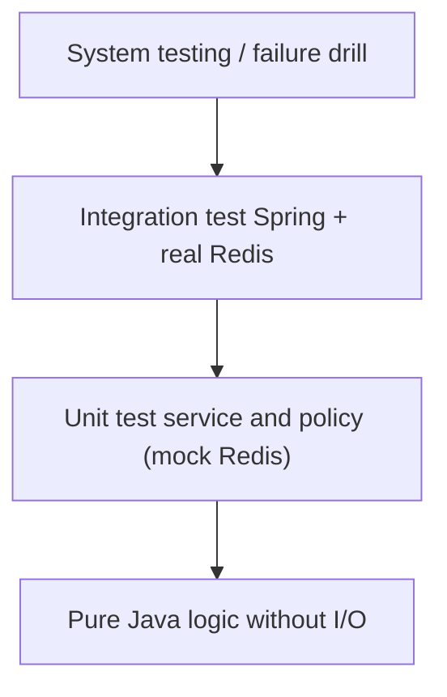
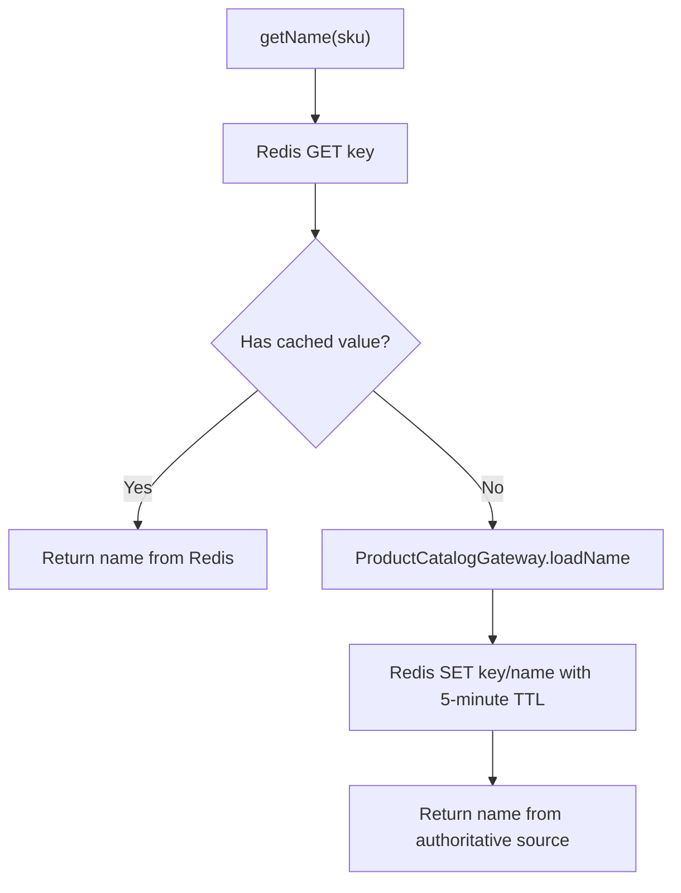

# Distinguishing Unit Tests from Redis Integration Tests in Spring Data Redis

## 1. Lesson Objectives

A Spring Boot application using Spring Data Redis might contain very little Redis-related code yet still depend on many real-world behaviors: how keys are serialized, whether TTL is set properly, whether a Lua script executes atomically, whether a Redis Repository maintains secondary indexes, or whether a Stream consumer reads and acknowledges records following the proper workflow.

Therefore, asking **“are there tests for the service that uses Redis?”** is not enough. You need to know whether those tests verify **Java logic with a simulated Redis** or **integration with a real Redis server**.

Two important levels:

- **Unit test:** verifies the behavior of a unit of code, usually replacing Redis or the Redis communication layer with a mock, stub, or fake. Tests are fast, isolated, and cover many business branches; however, they do not prove that a real Redis instance will behave correctly.
- **Integration test:** uses a real Redis server, typically run with Testcontainers or a dedicated test environment, to verify commands, serializers, keyspace, TTL, transactions, repositories, and connection lifecycle against actual Redis behavior. These tests provide higher confidence in the integration, at the cost of resources and environment management.

The goal is not to pick one type over the other. Good design usually needs **many unit tests for logic** and **selective integration tests for Redis contracts**.

After this lesson, you will be able to:

1. Classify whether a test is a unit test or an integration test based on **which system boundary is actually executed**.
2. Use JUnit 5 and Mockito to test a service that uses `StringRedisTemplate` without needing Redis.
3. Use Spring Boot, JUnit 5, and Testcontainers to test against a real Redis server.
4. Know which behaviors mocks cannot verify: TTL, serializers, transactions, Lua, secondary indexes, Streams, Pub/Sub, and failover.
5. Design tests with independent state, no leftover garbage data, and minimal flakiness.
6. Allocate tests across a CI pipeline and determine how to interpret results when they fail.

---

## 2. Defining Unit Tests in the Context of Spring Data Redis

A **unit test** verifies the logic of a specific unit, such as `ProductCacheService`, without starting the entire underlying infrastructure.

Example of a cache-aside service:

```text
ProductService
   |
   +--> Redis cache
   |
   +--> ProductCatalog (authoritative data source)
```

When unit testing `ProductService`, both the Redis cache and `ProductCatalog` can be replaced with mocks. The test only checks the service's decisions:

- Cache hit → use the value from cache and do not call the data source.
- Cache miss → read from the authoritative source and request writing to the cache with the desired TTL.
- Data source error → throw an error or return a fallback according to policy.
- Redis error → handle fail-open/fail-closed according to defined rules.

Unit tests do not need to start Redis, open sockets, or run Docker. Most tests also do not need to spin up a Spring `ApplicationContext` if dependencies are passed via constructors.

### A Practical Definition

A test with `@SpringBootTest` that mocks all of Redis may be testing Spring wiring or the HTTP layer, **not necessarily an integration test with Redis**. Conversely, a test that does not start Spring but talks to a real Redis instance through a client is already an integration test at the Redis boundary.

Therefore, do not classify solely by annotation names. Ask: **Are a real Redis server and real communication mechanism being used?**

## 3. Defining Integration Tests with Redis

A **Redis integration test** executes operations against a real Redis server and verifies the observable outcome at the integration boundary.

Example:

```text
JUnit test
  |
  v
Spring Boot / RedisTemplate
  |
  v
RedisConnectionFactory + Redis driver
  |
  v
Redis server (container)
  |
  v
Actual key/TTL/hash/stream state
```

The test can catch bugs that unit tests cannot see:

- The serializer uses JDK serialization when the system expects JSON.
- The key prefix is concatenated incorrectly with `RedisCacheManager`.
- TTL is not set, gets reset, or expires differently than expected.
- A Lua script has a syntax error or calls the wrong Redis command.
- `WRONGTYPE` errors when multiple components share a key with different data types.
- `@Indexed` is not indexed properly due to Redis Repository configuration.
- `MULTI/EXEC`, pipelining, or Redis Stream consumer groups are misused.
- Redis ACL permissions, Pub/Sub configuration, or the Cluster environment do not support the used feature.

An integration test still does not equate to testing load capacity, failover, or RPO/RTO for the entire deployment. A single-node Redis container cannot prove the behavior of a multi-node Sentinel/Cluster setup.

---

## 4. Comparison Across Key Criteria

| Criterion | Unit test | Integration test with Redis |
|---|---|---|
| Real Redis server | Not needed | Yes |
| Spring ApplicationContext | Usually no | May or may not, depending on boundary |
| Execution speed | Usually very fast | Usually slower, includes connection/container startup |
| Docker/network dependency | No | Yes, if using Testcontainers/Docker |
| Testing business branching | Very suitable | Possible, but more expensive |
| Testing real Redis commands | No | Yes |
| Testing serialization/deserialization | Only if using the real serializer in unit test | Yes, with real Redis flow |
| Testing real TTL | No | Yes |
| Testing Lua scripts | Can only verify invocations/mapping | Runs the script on real Redis |
| Testing Repository/indexes | Mocks are insufficient | Can verify |
| Testing timeout/failover | Can simulate exceptions | Needs suitable integration environment and scenarios |
| Risk of test flakiness | Usually low | Higher if dependent on timing, environment, shared data |
| Fault diagnosis capability | Focused on one unit | Includes Spring wiring, driver, Redis server, configuration |
| Suitable place in CI | Run frequently on every change | Run in CI with proper environment and time management |

**Both are needed:** unit tests answer “how will my code decide if Redis returns X?”, while integration tests answer “does real Redis with my configuration return X and store state as expected?”.

## 5. Place in a Multi-Layered Testing Strategy

You can organize a pragmatic model:



The base consists of many fast tests for mapping, policies, null/exception handling, and edge cases. The integration layer has fewer tests, targeting the contracts most likely to break when changing Redis version, changing serializers, modifying Spring configuration, or altering key storage layouts.

Each layer has its own role:

| Layer | Examples |
|---|---|
| Pure unit | Key namespace builder function, retry delay calculation, choosing fail-open/fail-closed |
| Unit with Mockito | Cache hit/miss, source method called the exact number of times, `SET` command with right TTL |
| Redis integration | Key is actually created, positive TTL, right hash/index, Lua returns result and updates state |
| Spring integration | `RedisCacheManager` bean is used, `@CacheEvict` annotation actually deletes the entry |
| System/resilience test | Redis restart, connection loss, replica failover, performance after cache cold start |

Do not require every business scenario to run with real Redis. And do not rely solely on Mockito for features that depend entirely on Redis server semantics.

---

## 6. Preparing an Example: A Cache-Aside Service

Suppose the application has an authoritative data source providing product names:

**`ProductCatalogGateway.java`**

```java
package com.example.catalog;

public interface ProductCatalogGateway {
    String loadName(String sku);
}
```

This is an application interface, **not a built-in Spring Data Redis class**.

Service using Redis as a cache:

**`ProductNameService.java`**

```java
package com.example.catalog;

import java.time.Duration;

import org.springframework.data.redis.core.StringRedisTemplate;
import org.springframework.stereotype.Service;

@Service
public class ProductNameService {

    private static final Duration CACHE_TTL =
            Duration.ofMinutes(5);

    private final StringRedisTemplate redis;
    private final ProductCatalogGateway catalog;

    public ProductNameService(
            StringRedisTemplate redis,
            ProductCatalogGateway catalog
    ) {
        this.redis = redis;
        this.catalog = catalog;
    }

    public String getName(String sku) {
        String key = "catalog:v1:name:" + sku;

        String cached = redis.opsForValue().get(key);
        if (cached != null) {
            return cached;
        }

        String name = catalog.loadName(sku);
        redis.opsForValue().set(key, name, CACHE_TTL);

        return name;
    }
}
```

The example assumes `catalog.loadName(...)` returns a non-null string or throws an error if the product does not exist. If a product can be missing, a real service needs a not-found handling policy and must avoid writing null with `StringRedisTemplate`.

Control flow:



In unit tests we verify these branches. In integration tests we verify how real Redis stores and expires the key.

## 7. Writing Unit Tests with Mockito and JUnit 5

With Gradle on Spring Boot:

```kotlin
dependencies {
    implementation("org.springframework.boot:spring-boot-starter-data-redis")
    testImplementation("org.springframework.boot:spring-boot-starter-test")
}

tasks.test {
    useJUnitPlatform()
}
```

`spring-boot-starter-test` typically provides JUnit Jupiter, AssertJ, and Mockito according to the Spring Boot BOM.

### 7.1. Mocking the Necessary Dependencies

**`ProductNameServiceTest.java`**

```java
package com.example.catalog;

import static org.assertj.core.api.Assertions.assertThat;
import static org.mockito.Mockito.never;
import static org.mockito.Mockito.verify;
import static org.mockito.Mockito.verifyNoInteractions;
import static org.mockito.Mockito.when;

import java.time.Duration;

import org.junit.jupiter.api.Test;
import org.junit.jupiter.api.extension.ExtendWith;
import org.mockito.InjectMocks;
import org.mockito.Mock;
import org.mockito.junit.jupiter.MockitoExtension;
import org.springframework.data.redis.core.StringRedisTemplate;
import org.springframework.data.redis.core.ValueOperations;

@ExtendWith(MockitoExtension.class)
class ProductNameServiceTest {

    @Mock
    StringRedisTemplate redis;

    @Mock
    ValueOperations<String, String> values;

    @Mock
    ProductCatalogGateway catalog;

    @InjectMocks
    ProductNameService service;

    @Test
    void cacheHitSkipsDatabase() {
        when(redis.opsForValue()).thenReturn(values);
        when(values.get("catalog:v1:name:SKU-1001"))
                .thenReturn("Fountain pen");

        String name = service.getName("SKU-1001");

        assertThat(name).isEqualTo("Fountain pen");
        verifyNoInteractions(catalog);
        verify(values, never()).set(
                "catalog:v1:name:SKU-1001",
                "Fountain pen",
                Duration.ofMinutes(5)
        );
    }

    @Test
    void cacheMissLoadsSourceAndCachesWithTtl() {
        when(redis.opsForValue()).thenReturn(values);
        when(values.get("catalog:v1:name:SKU-1002"))
                .thenReturn(null);
        when(catalog.loadName("SKU-1002"))
                .thenReturn("Notebook");

        String name = service.getName("SKU-1002");

        assertThat(name).isEqualTo("Notebook");
        verify(catalog).loadName("SKU-1002");
        verify(values).set(
                "catalog:v1:name:SKU-1002",
                "Notebook",
                Duration.ofMinutes(5)
        );
    }
}
```

What is each test proving?

- `cacheHitSkipsDatabase`: business logic does not query the authoritative source when the cache has data.
- `cacheMissLoadsSourceAndCachesWithTtl`: logic calls the authoritative source and **requests** writing to the cache with a 5-minute TTL.

Neither test **proves** that real Redis stores the key with that TTL. Mockito only records the call to `set(key, value, Duration)`.

### 7.2. Testing Authoritative Source Failures

A unit test can verify that the cache is not written when the primary source fails:

```java
import static org.assertj.core.api.Assertions.assertThatThrownBy;
import static org.mockito.Mockito.verifyNoInteractions;
import static org.mockito.Mockito.when;

// Inside the same ProductNameServiceTest class
@Test
void sourceFailureDoesNotPopulateCache() {
    when(redis.opsForValue()).thenReturn(values);
    when(values.get("catalog:v1:name:SKU-X"))
            .thenReturn(null);
    when(catalog.loadName("SKU-X"))
            .thenThrow(new IllegalStateException("Catalog unavailable"));

    assertThatThrownBy(() -> service.getName("SKU-X"))
            .isInstanceOf(IllegalStateException.class);

    // In this test we want to verify no write command occurs;
    // verify on the ValueOperations mock, not on a Redis server.
    org.mockito.Mockito.verify(
            values,
            org.mockito.Mockito.never()
    ).set(
            org.mockito.ArgumentMatchers.anyString(),
            org.mockito.ArgumentMatchers.anyString(),
            org.mockito.ArgumentMatchers.any(Duration.class)
    );
}
```

Because the service accepts Redis and the source as constructor-injected dependencies, the test does not need `@SpringBootTest`. This is a major advantage of **explicit dependency injection**.

### 7.3. Mockito Checks Invocations, Not Redis Semantics

If a developer changes the service to:

```java
redis.opsForValue().set(key, name, Duration.ofMinutes(5));
```

Mockito can verify the exact arguments. However, if Redis is configured with a different serializer, the key shares a namespace with a hash, or the command fails on the server, the unit test will not detect it.

Similarly, mocking `RedisTemplate` does not understand `MULTI/EXEC`, Redis transactions, cluster hash slots, TTL countdowns, or keyspace notifications.

---

## 8. Unit Testing Redis Error Policies

Suppose business rules decide:

- If reading from the Redis cache fails, fall back to the authoritative source.
- If the authoritative source fails, do not fabricate data.
- If writing to the Redis cache fails but the authoritative source returned a valid result, still return the result.

Use another service with clearly defined error handling:

**`ResilientProductNameService.java`**

```java
package com.example.catalog;

import java.time.Duration;

import org.springframework.dao.DataAccessException;
import org.springframework.data.redis.core.StringRedisTemplate;

public class ResilientProductNameService {

    private final StringRedisTemplate redis;
    private final ProductCatalogGateway catalog;

    public ResilientProductNameService(
            StringRedisTemplate redis,
            ProductCatalogGateway catalog
    ) {
        this.redis = redis;
        this.catalog = catalog;
    }

    public String getName(String sku) {
        String key = "catalog:v1:name:" + sku;

        try {
            String cached = redis.opsForValue().get(key);
            if (cached != null) {
                return cached;
            }
        } catch (DataAccessException ex) {
            // Redis is an optional cache, so read errors can be ignored.
            // A real application needs appropriate metrics and logging.
        }

        String name = catalog.loadName(sku);

        try {
            redis.opsForValue().set(
                    key,
                    name,
                    Duration.ofMinutes(5)
            );
        } catch (DataAccessException ex) {
            // The authoritative source already returned a valid result.
            // Errors from the primary data source must not be ignored.
        }

        return name;
    }
}
```

A test without Redis can simulate the failure:

```java
import static org.assertj.core.api.Assertions.assertThat;
import static org.mockito.Mockito.when;

import org.junit.jupiter.api.Test;
import org.mockito.Mockito;
import org.springframework.dao.DataAccessResourceFailureException;

@Test
void redisReadFailureFallsBackToSource() {
    StringRedisTemplate redis =
            Mockito.mock(StringRedisTemplate.class);

    @SuppressWarnings("unchecked")
    ValueOperations<String, String> values =
            Mockito.mock(ValueOperations.class);

    ProductCatalogGateway catalog =
            Mockito.mock(ProductCatalogGateway.class);

    when(redis.opsForValue()).thenReturn(values);

    when(values.get("catalog:v1:name:SKU-1003"))
            .thenThrow(
                    new DataAccessResourceFailureException(
                            "Redis is unavailable"
                    )
            );

    when(catalog.loadName("SKU-1003"))
            .thenReturn("Sticky notes");

    ResilientProductNameService service =
            new ResilientProductNameService(redis, catalog);

    assertThat(service.getName("SKU-1003"))
            .isEqualTo("Sticky notes");
}
```

This test proves **the service's fallback branch works when the dependency throws an exception**. It does not prove that real Redis returns the exact exception type across all connection failures, or that the authoritative source has enough capacity to handle the load when Redis is down.

### Distinguishing Cache Errors by Operation

For `@Cacheable`/`@CacheEvict`, an application can install a `CacheErrorHandler`. Unit test the handler separately to verify the policy:

- `get` errors for an optional cache may be ignored.
- `put` errors may not block returning the result.
- `evict` errors must be reported because stale data may remain.
- `clear` errors may only clear partially, not guaranteeing complete eviction.

When using `CacheErrorHandler`, unit tests verify the Java callbacks, while integration tests verify that the handler is actually invoked by the Spring Cache interceptor on real beans.

---

## 9. When Is Mocking Redis Enough?

Mocking is appropriate when what needs verification is **logic owned by the service**, for example:

| Case | Conclusion |
|---|---|
| Cache hit does not call database | Unit test is enough to verify branching logic |
| Cache miss calls database with the right SKU | Unit test is very suitable |
| TTL argument passed to `set` is 5 minutes | Unit test verifies the call; real Redis requires integration if TTL matters |
| Redis error falls back according to policy | Unit test simulating exceptions |
| Key name built from tenant/user/policy rules | Pure unit or unit test with mocks |
| Choosing which cache to use per request type | Unit test |
| Rule not to cache null values | Unit test for the code branch; integration if checking serializer/cache manager |
| Number of calls to source service on cache hit/miss | Unit test |
| Business rules after Redis cache returns data | Unit test |
| Returning `429` when rate limiter decides to reject | Unit test of controller/filter |

Things that can be tested with mocks do not necessarily need a Redis server in every test, because doing so increases execution time and makes failure analysis harder.

However, **no amount of unit tests can compensate for an unverified Redis contract**.

---

## 10. When Must You Use Integration Tests with Real Redis?

| Behavior to Guarantee | Why Mocks Are Insufficient |
|---|---|
| `SET` with TTL / `EXPIRE` / `PTTL` | Lifetime and actual semantics are enforced by the Redis server |
| Key/value/hash serializers | Mocks do not pass through real bytes and network conversion |
| Redis Hash, Set, ZSET, and data types | Mocks do not verify `WRONGTYPE` or specific Redis commands |
| Lua scripts and Redis Functions | Require the Redis parser/runtime, atomicity, and real state |
| `MULTI/EXEC` and queued return values | Mocks do not know connection transaction boundaries |
| Spring Cache annotations + `RedisCacheManager` | Require real Spring interceptor, cache manager, and Redis writer |
| Redis Repository `@Indexed` | Requires real index write/delete and query behavior |
| Redis Stream offsets, pending/ack | Require Redis Stream semantics |
| Redis Pub/Sub notifications | Require real subscriptions/channels and server configuration |
| Redis Cluster hash slots and routing | Require appropriate topology |
| Redis driver/version compatibility | Must run against target Redis/driver |

Do not try to write a fake Redis implementing all of these semantics yourself. As your fake becomes more like Redis, you end up maintaining a second Redis without being sure it matches the real server.

---

## 11. Creating a Real Redis for Integration Tests with Testcontainers

**Testcontainers** lets you spin up a Redis container within the test lifecycle, with relatively isolated data that works in CI. It requires Docker or a compatible container runtime accessible to the test environment.

The example uses:

- JUnit Jupiter.
- Spring Boot test.
- Testcontainers.
- A Redis image selected for the project's version matrix.

### 11.1. Gradle Dependencies

```kotlin
dependencies {
    implementation("org.springframework.boot:spring-boot-starter-data-redis")

    testImplementation("org.springframework.boot:spring-boot-starter-test")
    testImplementation("org.testcontainers:junit-jupiter")
    testImplementation("org.testcontainers:testcontainers")
}

tasks.test {
    useJUnitPlatform()
}
```

If using the Spring Boot BOM or project dependency management, starter/test versions are managed accordingly. If no BOM manages Testcontainers, declare compatible versions explicitly in the build instead of leaving dependencies unversioned.

### 11.2. Maven Dependencies

```xml
<dependencies>
    <dependency>
        <groupId>org.springframework.boot</groupId>
        <artifactId>spring-boot-starter-data-redis</artifactId>
    </dependency>

    <dependency>
        <groupId>org.springframework.boot</groupId>
        <artifactId>spring-boot-starter-test</artifactId>
        <scope>test</scope>
    </dependency>

    <dependency>
        <groupId>org.testcontainers</groupId>
        <artifactId>junit-jupiter</artifactId>
        <scope>test</scope>
    </dependency>
</dependencies>
```

The Maven example assumes the project already manages dependency versions; in a real system, add the appropriate version/BOM and avoid pulling conflicting Testcontainers versions.

### 11.3. Why Use Dynamic Ports?

If two CI jobs both run Redis on host port 6379, they can contend for the port and cause random test failures. Testcontainers can map container port `6379` to **a random host port**:

```text
Redis container port: 6379
Host mapped port    : 49153 (example)
```

Tests must retrieve the port from `getMappedPort(6379)` instead of hardcoding `localhost:6379`.

### 11.4. Complete Integration Test Example

**`RedisStringIntegrationTest.java`**

```java
package com.example.catalog;

import static org.assertj.core.api.Assertions.assertThat;

import java.time.Duration;
import java.util.UUID;
import java.util.concurrent.TimeUnit;

import org.junit.jupiter.api.BeforeEach;
import org.junit.jupiter.api.Test;
import org.springframework.beans.factory.annotation.Autowired;
import org.springframework.boot.SpringBootConfiguration;
import org.springframework.boot.autoconfigure.EnableAutoConfiguration;
import org.springframework.boot.test.context.SpringBootTest;
import org.springframework.data.redis.core.StringRedisTemplate;
import org.springframework.test.context.DynamicPropertyRegistry;
import org.springframework.test.context.DynamicPropertySource;
import org.testcontainers.containers.GenericContainer;
import org.testcontainers.junit.jupiter.Container;
import org.testcontainers.junit.jupiter.Testcontainers;
import org.testcontainers.utility.DockerImageName;

@Testcontainers
@SpringBootTest(
        classes = RedisStringIntegrationTest.TestApplication.class
)
class RedisStringIntegrationTest {

    private static final int REDIS_PORT = 6379;

    @Container
    static final GenericContainer<?> REDIS =
            new GenericContainer<>(
                    DockerImageName.parse("redis:7.4-alpine")
            ).withExposedPorts(REDIS_PORT);

    @DynamicPropertySource
    static void redisProperties(DynamicPropertyRegistry registry) {
        registry.add(
                "spring.data.redis.host",
                REDIS::getHost
        );
        registry.add(
                "spring.data.redis.port",
                () -> REDIS.getMappedPort(REDIS_PORT)
        );
    }

    @SpringBootConfiguration
    @EnableAutoConfiguration
    static class TestApplication {
    }

    @Autowired
    StringRedisTemplate redis;

    private String key;

    @BeforeEach
    void createIsolatedKey() {
        key = "it:product-name:" + UUID.randomUUID();
    }

    @Test
    void writesReadsAndDeletesRealRedisKey() {
        redis.opsForValue().set(key, "Fountain pen");

        assertThat(redis.opsForValue().get(key))
                .isEqualTo("Fountain pen");

        assertThat(redis.hasKey(key))
                .isTrue();

        redis.delete(key);

        assertThat(redis.opsForValue().get(key))
                .isNull();
    }

    @Test
    void setsActualRedisTtl() {
        redis.opsForValue().set(
                key,
                "Notebook",
                Duration.ofSeconds(30)
        );

        Long ttl = redis.getExpire(key, TimeUnit.SECONDS);

        assertThat(ttl)
                .isNotNull()
                .isPositive()
                .isLessThanOrEqualTo(30L);

        redis.delete(key);
    }
}
```

Key takeaways:

- `@Testcontainers` and `@Container` manage the container lifecycle.
- `@DynamicPropertySource` passes the actual host and port into Spring Boot configuration.
- `@SpringBootTest` initializes Spring Data Redis beans via auto-configuration.
- `StringRedisTemplate` actually sends commands to Redis.
- A UUID in the key name reduces collisions between tests.
- When verifying TTL, we assert Redis set an expiration and TTL is positive; we do not wait the full 30 seconds to prove it.

**How to run the example:** the application uses Spring Boot 3.x, JUnit 5, and a Java version matching the chosen Spring Boot release; Docker must be available. The image name/version in the example is a sample choice: projects should pin and manage Redis versions according to the system's compatibility matrix.

### 11.5. `@SpringBootTest` Is Not Required for Every Integration Test

You can test real Redis using a `LettuceConnectionFactory` or Redis client created in the test without starting Spring Boot. That is still an integration test against Redis, though it does not test Spring wiring.

Conversely, a `@SpringBootTest` that runs but mocks the entire `StringRedisTemplate` only proves wiring and application logic, **not Redis server commands**.

Choose the minimum boundary needed for verification instead of always booting the entire system.

---

## 12. Testing Serializers: What Mocks Easily Miss

Redis stores bytes, not Java objects directly. `RedisTemplate<K,V>` must serialize keys and values before sending and deserialize them after reading.

For example, an application configures `RedisTemplate` to store JSON. When changing the serializer from string to JDK serialization or having two services use different formats, keys may become incompatible.

A mocked unit test:

```java
when(redis.opsForValue().get("user:1"))
        .thenReturn(new UserView(...));
```

does not go through the serializer. It will not detect:

- A JSON field being renamed or removed.
- An object needing a constructor/mapping that the serializer does not support.
- Different key serializers causing two services to generate different key bytes.
- An old value becoming unreadable after a new deployment rolls out.
- Incompatible date/time, enum, null, or polymorphic type fields.

### How to Integration-Test Serialization

1. Instantiate the **exact `RedisTemplate` bean** used by the application.
2. Write a sample object to real Redis.
3. Read it back with the same template.
4. Verify the fields that must be preserved.
5. If multiple services/versions exist in the system, read using the other supported templates/versions.
6. If a Redis data contract is required, inspect the raw bytes/value through an appropriate serializer.

For data shared across multiple applications, test **format stability**, not just a round-trip write/read with the same serializer. Symmetric bugs in a serializer can sometimes pass a round-trip test yet violate cross-service contracts.

---

## 13. Testing TTL: Verify Real Behavior, Avoid Brittle Clock Assertions

TTL is very easy to test poorly.

### How to Check Initial TTL

When writing with `Duration.ofSeconds(30)`, verify:

```java
Long ttlMs = redis.getExpire(
        key,
        TimeUnit.MILLISECONDS
);

assertThat(ttlMs)
        .isNotNull()
        .isGreaterThan(0L)
        .isLessThanOrEqualTo(30_000L);
```

Redis `TTL`/`PTTL` have special return values:

- `-2`: key does not exist.
- `-1`: key exists but has no expiration.
- Non-negative value: remaining TTL, in the command's unit.

Do not write a rigid assertion like `ttl == 30_000`; some time has elapsed between the `SET` command and reading the TTL.

### Testing Actual Key Expiration

If you need to verify expiration, set a short TTL and use bounded polling with a timeout:

```java
redis.opsForValue().set(
        key,
        "temporary",
        Duration.ofSeconds(1)
);

// Example with Awaitility (if test dependencies include this library):
org.awaitility.Awaitility.await()
        .atMost(Duration.ofSeconds(5))
        .untilAsserted(() ->
                assertThat(redis.hasKey(key)).isFalse()
        );
```

This condition checks **key state**, without requiring a keyspace notification to arrive at the exact 1-second mark.

Using Awaitility requires the corresponding dependency in the test runtime. If you do not use this library, you can write time-bounded polling with JUnit/a custom helper.

### Why Avoid Rigid `Thread.sleep`?

Calling `Thread.sleep(1000)` after setting a 1-second TTL is both slow and prone to flakiness due to thread scheduling, GC, CI load, and command latency. Polling with a deadline and state assertions is generally more stable.

TTL should be tested with real Redis whenever lifetime affects business behavior such as sessions, cache invalidation, locks, or rate limiters.

---

## 14. Testing Spring Cache Annotations with Real Redis

The application uses:

```java
@Cacheable(cacheNames = "products", key = "#p0")
public ProductView get(String sku) {
    return productGateway.load(sku);
}
```

A unit test calling the `get` method directly will **not test interception** of `@Cacheable`. Caching annotations are normally activated when calls pass through a Spring proxy.

Therefore, testing real caching annotations requires an integration test with:

1. `@EnableCaching`.
2. A real `CacheManager`, such as `RedisCacheManager`.
3. The service as a Spring bean invoked via its proxy.
4. A real Redis server or real cache backend matching the goal.
5. A mocked source with an invocation counter to verify call counts, if you do not want to depend on a database.

### Expected Test Flow

```text
Call 1: get("SKU-1")
    Redis miss
    ProductGateway.load("SKU-1") is called
    Redis receives cache entry

Call 2: get("SKU-1")
    Redis hit
    ProductGateway is not called again

Evict cache key "SKU-1"
    Redis key is deleted

Call 3: get("SKU-1")
    Redis miss
    ProductGateway is called again
```

Example assertions:

```java
ProductView first = service.get("SKU-1");
ProductView second = service.get("SKU-1");

assertThat(second).isEqualTo(first);
verify(productGateway, times(1)).load("SKU-1");

service.evict("SKU-1"); // Must be a call through the Spring proxy.
service.get("SKU-1");

verify(productGateway, times(2)).load("SKU-1");
```

This snippet illustrates the idea; you need properly configured service/`ProductGateway` beans and an `evict` method annotated with `@CacheEvict`.

### Common Mistakes in Spring Cache Tests

- Calling `this.get(...)` from the same bean, bypassing proxy caching.
- Testing an object created directly with `new` instead of through Spring.
- Having multiple `CacheManager` beans where the test selects a different one than production.
- Using a mock cache instead of real Redis and concluding prefixes/TTL are right.
- Two tests sharing the same cache name/key, creating execution-order dependencies.
- Cache retaining stale data from a previous run if pointed accidentally at a Redis instance outside the test environment.

Testing annotations sits at the **Spring AOP + CacheManager + Redis** boundary; it is an important integration contract.

---

## 15. Testing Redis Repositories and Secondary Indexes

When using a Redis Repository:

```java
@RedisHash("accounts")
public class Account {

    @Id
    private String id;

    @Indexed
    private String status;

    // Constructors, getters, setters...
}
```

and:

```java
public interface AccountRepository
        extends CrudRepository<Account, String> {

    Iterable<Account> findByStatus(String status);
}
```

A unit test can mock `AccountRepository`:

```java
when(repository.findByStatus("ACTIVE"))
        .thenReturn(List.of(account));
```

This is a reasonable test if you want to verify how a service handles repository results. However, it **does not prove** that the Redis repository actually creates the secondary index for `status`.

A more appropriate integration test:

1. Save an entity with `status="ACTIVE"`.
2. Query `findByStatus("ACTIVE")` → entity is found.
3. Change status to `"SUSPENDED"` and `save`.
4. Query `"ACTIVE"` again → entity is gone.
5. Query `"SUSPENDED"` → entity is found.
6. Delete the entity via the repository.
7. Verify that index queries no longer return the entity.

These steps must run against a real Redis server, serializer, and repository configuration. If the entity has a TTL, expiration events and index cleanup must be considered; TTL tests may have non-deterministic wait times.

**Note:** Redis Repositories do not share the same query model as JPA/SQL. Do not assume every derived query method is supported as in `JpaRepository`. Only test queries/indexes actually supported by Spring Data Redis Repositories.

---

## 16. Testing Redis Transactions and Lua Scripts

### 16.1. Unit Tests Do Not Prove Atomicity

Suppose a service uses `RedisTemplate` to send:

```java
redis.opsForValue().set("a", "1");
redis.opsForValue().set("b", "2");
```

A Mockito test can `verify` both calls, but it does not prove that **no other client interleaved**, does not prove `MULTI/EXEC`, and does not test how Redis responds when one command inside a transaction fails.

When using `setEnableTransactionSupport(true)` and `@Transactional`, an integration test needs:

- An appropriate transaction manager.
- Spring transactions actually active via interceptors.
- A template with transaction support enabled.
- A real Redis server.
- Observation before/after commit, rollback behavior, and read limitations inside a transaction.

Do not confuse `@Transactional` with a guarantee of atomic Redis and SQL commits.

### 16.2. Lua Scripts Need to Run on Real Redis

Example script to conditionally increment a counter:

```lua
local current = tonumber(redis.call('GET', KEYS[1]) or '0')
local limit = tonumber(ARGV[1])

if current >= limit then
    return 0
end

redis.call('INCR', KEYS[1])
return 1
```

In Java, you can use `DefaultRedisScript<Long>`:

```java
DefaultRedisScript<Long> script = new DefaultRedisScript<>();
script.setScriptText(
        "local n=tonumber(redis.call('GET',KEYS[1]) or '0') " +
        "if n>=tonumber(ARGV[1]) then return 0 end " +
        "redis.call('INCR',KEYS[1]) return 1"
);
script.setResultType(Long.class);

Long result = redis.execute(
        script,
        List.of(testKey),
        "3"
);
```

An integration test should verify:

- Initial requests are accepted until the limit is reached.
- Subsequent requests are rejected.
- The real Redis counter holds the expected value.
- Multiple concurrent clients do not exceed the limit.
- The script handles non-existent keys and mismatched key types according to the designed contract.

Lua executing atomically on Redis does not mean previously executed writes are rolled back if the script hits a runtime error mid-execution. Tests should cover script logic and constraints rather than just checking the return value for a single input.

### 16.3. Unit Tests for Script Wrappers Remain Valuable

In unit tests, mock `redis.execute(...)` to verify:

- The service passes the right key names and arguments.
- `Long 0/1` results are mapped correctly to `allow/deny`.
- Redis errors are translated into the appropriate HTTP policy.
- Java-layer retry/idempotency decisions are correct.

Integration tests use real Redis to prove the commands and state are right. The two types complement each other.

---

## 17. Testing Redis Streams and Pub/Sub

A service using Redis Streams may contain pure Java logic to process events:

```java
public void onOrderEvent(OrderEvent event) {
    // Check event type, validate, update state...
}
```

Unit testing this processing logic with simulated events is useful. However, Stream semantics require integration tests:

- `XADD` creates real IDs and entries.
- `XRANGE`/`XREAD` read the right ID boundaries.
- `XREAD BLOCK` waits for new records and exits on timeout.
- Consumer groups receive new entries using the right offset.
- `XACK` updates pending state.
- Disconnected consumers retain pending entries requiring a reclaim mechanism.
- `XTRIM` can remove records according to retention.

### Example Consumer Group Test Goals

```text
1. XGROUP CREATE stream group 0-0 MKSTREAM.
2. XADD a message.
3. Consumer A XREADGROUP receives the message.
4. XPENDING confirms a pending entry exists.
5. Consumer A XACKs the message.
6. XPENDING confirms the entry is no longer pending.
```

All of this requires a real Redis server to verify PEL and ACK semantics.

### Pub/Sub Differs from Streams

Redis Pub/Sub does not retain messages for replay when a subscriber is absent. Unit testing a listener can invoke the callback manually, but it does not prove:

- The subscription was actually established.
- The topic pattern is correct.
- The connection receives messages.
- Messages arrive on the expected channel.
- Error/reconnect behavior in a real environment.

Pub/Sub integration tests should **wait until the subscription is ready** before publishing; otherwise the test can lose messages due to a race condition. Use synchronization/latches with a finite deadline instead of arbitrary `Thread.sleep`.

Still, one successful Pub/Sub delivery test does not prove durable delivery guarantees; Pub/Sub by nature has no replay.

---

## 18. Defining the Integration Test Boundary: Not Everything at Once

There are multiple levels of integration:

| Boundary | What the Test Proves |
|---|---|
| Redis client + Redis server | Basic commands/serializers/timeouts |
| Spring Data Redis template + Redis server | Template mapping and real commands |
| Spring Cache + Redis | Annotations, `CacheManager`, writer, prefix/TTL |
| Redis Repository + Redis | Entity mapping, indexes, repository TTL |
| Spring service + Redis + test database | Cache-aside flow and authoritative source interaction |
| Full HTTP app + Redis + DB | End-to-end API behavior |
| Multiple Redis nodes + failover | Fault tolerance across topology |

You do not need the entire stack to prove a basic `SET/GET` case. Conversely, if a bug lies in the `@Cacheable` proxy or Redis/SQL commit ordering, a test calling only `StringRedisTemplate` is insufficient.

**A good integration test has a clear boundary:** real enough to observe what needs verification, without adding unrelated infrastructure.

---

## 19. Data Isolation Between Tests

Redis is a stateful store that persists across tests. Without isolation, two tests can easily interfere with each other.

Bad example:

```java
@Test
void testA() {
    redis.opsForValue().set("product:1", "A");
}

@Test
void testB() {
    assertThat(redis.opsForValue().get("product:1"))
            .isNull();
}
```

Test B's outcome depends on whether test A runs before or after it.

### 19.1. Use Dedicated Key Namespaces

A simple approach:

```java
String testPrefix = "it:" + UUID.randomUUID() + ":";
String key = testPrefix + "product:1";
```

Each test gets its own prefix, avoiding data overwrites. When a test uses many keys, track the created keys to delete them in `@AfterEach`.

### 19.2. Safe Cleanup

Example:

```java
private final List<String> createdKeys = new ArrayList<>();

private String nextKey(String suffix) {
    String key = testPrefix + suffix;
    createdKeys.add(key);
    return key;
}

@AfterEach
void cleanup() {
    if (!createdKeys.isEmpty()) {
        redis.delete(createdKeys);
    }
}
```

If an entire test class uses a dedicated container solely for itself, a different cleanup policy can be used. But if Redis is shared across multiple tests or jobs, **do not run `FLUSHALL` arbitrarily** because it wipes data outside the test's scope.

In particular, never let a test accidentally connect to production Redis and run `FLUSHDB`.

### 19.3. Avoid `KEYS prefix:*` When Unnecessary

`KEYS` can be expensive on large keyspaces. In a dedicated integration test environment with tiny datasets, the cost may be acceptable; however, good test design usually tracks the exact keys it created and deletes them directly.

If prefix-based cleanup is needed, consider bounded `SCAN`; do not write cleanup logic that accidentally deletes keys belonging to other tests.

### 19.4. Separate Database Indexes Are Not an Absolute Guarantee

On standalone Redis, you can select a logical DB, such as DB 1 for tests. However:

- Multiple tests on the same DB can still collide on keys.
- Redis Cluster primarily uses DB 0.
- DB indexes do not protect against `FLUSHALL`.
- Some configurations/managed services have restrictions.

Therefore, **an isolated container or isolated namespace** is usually easier to control than relying solely on `SELECT 1`.

---

## 20. Why `@Transactional` Does Not Automatically Roll Back Redis Test State

In JPA tests, many teams are used to:

```java
@Transactional
@Test
void testSomething() {
    repository.save(entity);
    // Transaction rolls back when the test finishes.
}
```

With JPA and an appropriate transaction manager, this can isolate database state. However, **do not assume the same for Redis**.

Redis has specific characteristics:

- `RedisTemplate` disables transaction support by default.
- Redis `MULTI/EXEC` transactions do not roll back previously succeeded commands when a later command fails at runtime.
- Spring's transaction manager can synchronize Redis with the transaction lifecycle, but it does not turn Redis into a SQL-style rollbackable JPA database.
- Redis operations executed outside the transaction scope are not automatically undone by the test annotation.
- Pub/Sub messages, calls to external services, and emitted events are not automatically retracted when a test rolls back.

Therefore, Redis integration tests should **manage their own state and cleanup**, rather than relying on `@Transactional` as the sole isolation mechanism.

### With Spring Cache

If an integration test calls a `@Cacheable` method, the cache entry may remain after the test even if a database transaction rolls back. You must explicitly delete the key/cache or use an isolated Redis container/namespace.

---

## 21. Time-Dependent Tests: Avoiding Flaky Tests

Redis features easily affected by timing:

- TTL and expiration.
- Token bucket/refill.
- Redis Stream blocking reads.
- Keyspace notifications.
- Lock expiration.
- Retry/backoff.
- Failover and reconnect.

### Do Not Assert Absolute Timestamps Too Tightly

Bad example:

```java
redis.opsForValue().set(key, value, Duration.ofSeconds(1));
Thread.sleep(1000);
assertThat(redis.hasKey(key)).isFalse();
```

Sleeping for exactly 1 second may not align with when Redis received the command, thread scheduling, GC, and network latency. Replace with bounded polling:

```text
Deadline = 5 seconds
Within deadline:
  read state
  if condition is met → test passes
  if not yet met → retry after a short interval
Deadline exceeded → test fails
```

### Do Not Rely on Keyspace Notifications to Measure Exact TTL Timing

Redis emits `expired` when it processes expiration, not necessarily at the exact instant TTL hits 0. Test state with `EXISTS` when verifying key expiration; only test notifications if receiving notifications is an explicit application requirement.

### Inject a `Clock` in Unit Tests

For Java logic computing deadlines/quotas, inject a `Clock` instead of calling `System.currentTimeMillis()` directly:

```java
public class DeadlinePolicy {

    private final Clock clock;

    public DeadlinePolicy(Clock clock) {
        this.clock = clock;
    }

    public boolean expired(Instant expiresAt) {
        return !Instant.now(clock).isBefore(expiresAt);
    }
}
```

Unit tests can use:

```java
Clock fixed = Clock.fixed(
        Instant.parse("2030-01-01T00:00:00Z"),
        ZoneOffset.UTC
);
```

This is a pure Java unit test requiring no Redis. However, when the Redis server itself computes TTL, a fake `Clock` in the JVM **does not advance Redis's clock**; you still need an integration test for real TTL behavior.

---

## 22. Testing Concurrency and Atomicity

Unit tests can simulate command results, but they cannot prove that a sequence of multiple commands is race-free on a real Redis server.

Example of a rate limiter:

```text
1 unit of quota remaining.
Two concurrent requests check.
Only one request may proceed.
```

If using `GET → if → SET` in Java, both requests can read the same stale state. If moved to an atomic Lua script, an integration test should spawn multiple concurrent callers and count the results.

Test idea:

1. Delete the test's dedicated limiter key.
2. Set quota = 1.
3. Launch 20 workers at nearly the same instant using a `CountDownLatch`.
4. Each worker executes the real script.
5. Wait for all to finish with a finite timeout.
6. Assert only **one** result is ALLOW.
7. Assert the final Redis state does not exceed the limit.

This is an integration/concurrency test; a mock returning `ALLOW` for one call and `DENY` for another only proves result mapping was tested, not atomicity.

### Be Careful with CI Schedulers

A concurrency test may run on a CI machine with fewer CPUs than a local environment. Do not depend on thread execution order or ultra-short wait times. Use barriers, bounded generous timeouts, and check the **final invariant**, not which thread always wins.

Even when an integration test proves a contention case, it does not replace stress testing or production capacity evaluation.

---

## 23. When Is a Real Sentinel or Redis Cluster Environment Needed?

A standalone Redis container is suitable for verifying commands and basic mapping. However, topology-dependent features need a test environment closer to the real deployment.

For example:

| Feature | Is standalone Redis enough? |
|---|---|
| `SET`/`GET`, TTL, serializers | Usually enough |
| Single-key Lua scripts | Usually enough |
| Basic Redis Repositories | Usually enough |
| Single-node keyspace notifications | Can be enough for basic semantics |
| Cluster hash slots and `CROSSSLOT` | No |
| Multi-key scripts across different slots | No |
| Sentinel failover | No |
| Replica promotion and replication lag | No |
| Multi-node Cluster Pub/Sub | No |
| Cross-node/zone RPO/RTO | No |

If production uses Redis Cluster, at least one group of tests must run on a Cluster topology when changing multi-key operations, cache clearing, Pub/Sub, or multi-key Streams.

Do not make every unit test depend on a multi-node cluster. Topology tests can run in a separate pipeline or before major releases, depending on risk.

### What to Note in Test Reports

```text
Redis version:
Driver: Lettuce/Jedis + version
Topology: standalone/Sentinel/Cluster
TLS/ACL: enabled/disabled
Persistence: RDB/AOF settings
Data size:
Test scope: unit / Redis integration / failover drill
```

A passing test on standalone Redis is not a promise that it will pass on Redis Cluster or a managed service with different ACL/configurations.

---

## 24. Testcontainers and Spring Test Context: Optimizing Execution Time

`@SpringBootTest` can be slow due to initializing many beans. A Redis container also takes time to start. You can optimize while keeping tests reliable:

1. **Unit tests do not boot a Spring context** when wiring verification is unnecessary.
2. **Integration tests share one Redis container per appropriate test group**, while always isolating keys/data.
3. **Avoid starting a new container for every assertion** unnecessarily.
4. **Use minimal Spring test configuration** to instantiate only Redis-related beans.
5. **Do not invoke Docker in every unit test module**; separate integration tests.
6. **Pin the Redis image version** for CI reproducibility; upgrade versions intentionally on schedule.
7. **Distinguish environment errors from functional bugs** when Docker/ports/networks are unavailable.

### Context Caching

Spring Test can cache `ApplicationContext` instances across tests with identical configurations. This saves time, but if state is stored in singleton beans or a shared Redis, tests can still affect one another.

Do not treat context caching as isolation. Redis data must be cleaned independently of context lifecycle.

### Testcontainers Reuse

Some environments support container reuse to speed up local development. Reuse must be managed carefully and should not make CI depend on leftover state from prior runs. In CI, the standard practice is using containers with an explicit lifecycle per job/test suite.

---

## 25. Testing Real-World Redis Configurations

Many production incidents come from configuration rather than service code:

- Spring Boot points to the wrong host/port/database.
- Redis requires a password/TLS, but tests only use unauthenticated local Redis.
- A different serializer bean is injected than the one expected by the service.
- Multiple `RedisTemplate` or `CacheManager` beans exist and the wrong one is chosen.
- Redis Cluster keyspace/slots differ from standalone.
- Managed Redis forbids `CONFIG SET`, causing listener startup to fail.
- Configured timeouts are too short for blocking reads.

Mockito unit tests do not pass through bean configuration or connection factories, so they will not catch these errors.

Integration tests with a Spring context verify **the test configuration being used**. However, a test container running Redis without TLS and with an empty password does not prove production TLS/ACL configurations work. When risk is high, staging/compatibility test environments configured close to production are needed.

### Do Not Hardcode a Developer's Redis Endpoint

Do not let tests read `localhost:6379` from `application.yml` and accidentally point to a personal Redis instance running locally.

Use property injection from the container or a dedicated integration profile, with an assertion guarding that the test endpoint is not a production address. Container configuration should take precedence over uncontrolled environment settings.

---

## 26. Naming and Grouping Tests

Test names should reflect **behavior** and **level**:

```text
ProductNameServiceTest
  - cacheHitSkipsDatabase
  - cacheMissLoadsSourceAndCachesWithTtl

RedisStringIntegrationTest
  - writesReadsAndDeletesRealRedisKey
  - setsActualRedisTtl

RedisCacheIntegrationTest
  - cacheableUsesConfiguredKeyPrefix
  - evictRemovesRedisEntry

AccountRepositoryIntegrationTest
  - indexedQueryChangesAfterUpdate
  - deleteRemovesEntityFromIndex

RateLimiterConcurrencyIntegrationTest
  - exactlyOneRequestUsesLastAvailableToken
```

Not every project must append the `IT` suffix, but there should be a convention so CI can distinguish unit and integration tests.

### Example Splitting Gradle Test Tasks by Project Setup

A project can use a separate `integrationTest` source set or JUnit tags. With JUnit 5:

```java
import org.junit.jupiter.api.Tag;

@Tag("integration")
class RedisStringIntegrationTest {
    // ...
}
```

Gradle configuration can exclude the `integration` tag from the unit test task:

```kotlin
tasks.test {
    useJUnitPlatform {
        excludeTags("integration")
    }
}
```

To run integration tests, the project needs another task configured to include the `integration` tag or a dedicated source set. Do not exclude the tag and then forget to set up a job that actually runs the integration group.

In CI, you can organize:

```text
Pull request:
  compile
  unit tests
  Redis integration tests (Testcontainers)
  static analysis

Main/release:
  unit + integration
  contract tests across dependency versions
  optional Redis Cluster/ACL/TLS compatibility
  planned performance/resilience
```

Actual scope depends on time and risk; critical Redis integration tests should not be dropped completely just because they are slower.

---

## 27. Choosing Tests When Modifying a Feature

A single change may require tests at multiple levels.

| Change | Unit Tests to Have | Integration Tests to Have |
|---|---|---|
| Changing key format from `user:<id>` to `app:v2:user:<id>` | Key built according to rules | Compatible Redis key/serializer, no namespace collision |
| Adding TTL to cache | Service passes correct `Duration` | Real key has TTL and expires as expected |
| Changing Redis error fallback logic | Mock exception and verify branch | Optionally test real timeout/connection if risk is high |
| Adding `@Cacheable` | Source logic and DTO | Spring proxy, `CacheManager`, Redis hit/miss |
| Adding `@Indexed` field | Service uses repository properly | Index query across save-update-delete |
| Updating Lua rate limiter | Policy/argument mapping | Redis script and concurrent atomicity |
| Adding consumer group | Business handler per event | `XREADGROUP`, pending, ack, retry |
| Switching Jedis to Lettuce | Service logic unchanged | Driver connection, serialization, streaming, topology |
| Enabling TLS/ACL | Mapping configuration | Integration/staging with matching security |
| Moving Redis standalone to Cluster | Key naming and partitioning | Hash slots, routing, multi-key commands, failover |

A change that does not touch Redis behavior may only need unit tests; a small change in a serializer or key prefix should immediately have integration tests because of its wide blast radius.

---

## 28. What Redis Mocks Must Not Pretend to Guarantee

Mocks are very useful when **the contract under test is Java code invocations and decisions**. However, do not write tests like:

```java
when(redis.opsForValue().get("k")).thenReturn("v");

assertThat(service.get("k")).isEqualTo("v");

// Wrong conclusion:
// "Proved data is written, read, and expired properly on Redis."
```

The only accurate conclusion is:

> When the dependency returns `"v"`, the service returns `"v"` according to the designed logic.

Likewise:

- Mocking `RedisScript` to return `1` does not prove the script syntax is valid.
- Mocking `StreamOperations` to return records does not prove offsets/PEL work.
- Mocking `CacheManager` does not prove annotation proxies run or keys are stored properly.
- Mocking `RedisConnectionFactory` does not prove failover/reconnect works.
- An in-memory fake does not prove Redis Cluster routing.
- Mocking `SET` does not prove Redis key type, TTL, or serializer correctness.

The level of evidence must match the level of behavior executed.

---

## 29. Are Real Redis Failure Tests More Realistic Than Mocks?

Distinguish two goals:

**Goal A: exception handling logic**

Can be unit tested with:

```java
when(cache.read(key))
        .thenThrow(new CacheUnavailableException());
```

Very fast, easy to reproduce every branch.

**Goal B: how the application actually behaves when Redis stops or the network drops**

Requires integration/resilience tests:

1. Start a Redis container and boot the application.
2. Verify normal reads/writes.
3. Inject controlled connection errors in the test environment.
4. Send requests and measure timeouts, fallbacks, or HTTP statuses.
5. Restart/reconnect Redis.
6. Verify the application recovers and does not get stuck with dead connections.
7. Reconcile the impact of writes that may have executed before the timeout.

Do not mock a `RedisConnectionFailureException` and claim “Redis reconnect is tested” — that mock only verifies how the service handles a simulated exception type.

### Caution on Write Retries

A timeout can happen **after Redis has already executed a write but before the client receives the response**. Retrying `INCR` or `XADD` can produce duplicate side effects. A resilience integration test must observe final state and require idempotency, not just check HTTP status codes.

---

## 30. Common Pitfalls When Using Testcontainers

| Symptom | Possible Cause | Resolution |
|---|---|---|
| Passes locally but fails in CI | CI lacks Docker/compatible container runtime | Configure CI runner or separate integration job |
| Cannot connect to Redis container | Hardcoded `localhost:6379` or wrong mapped port | Use `getHost()` and `getMappedPort(6379)` |
| Test points to developer's real Redis | Properties not overridden | Use `@DynamicPropertySource`/dedicated profile |
| Failures when running multiple tests together | Key collisions or uncleaned state | UUID namespaces, delete owned keys |
| TTL test fails randomly | Exact millisecond assertion or rigid sleep | Range assertion, polling with deadline |
| Container startup per test is too slow | Container scope too narrow | Reuse per class/suite with isolated state |
| Integration context missing Redis bean | Missing starter/auto-configuration or overly narrow test config | Check test application and bean imports |
| Spring Cache test does not cache | `@EnableCaching` missing or self-invocation | Use Spring proxies properly |
| Test connects fine but reads wrong data | Serializer mismatch | Use the exact template, inspect raw format |
| Test uses newer Redis than production | Image unpinned/wrong version | Version matrix and controlled updates |
| Redis ACL/TLS not tested | Default container has no security requirements | Use staging/contract tests with matching security |
| Integration tests depend on run order | Shared state or container not reset | Unique namespaces and cleanup |
| Passes on standalone, fails in Cluster | Hash slots/topology untested | Add Cluster tests when changing related commands |
| Mock returns data impossible in real Redis | Test only verifies self-made assumptions | Add Redis integration tests for key contracts |

---

## 31. Designing Tests with Minimal State Leakage and Low Flakiness

A stable strategy combines these principles:

### 31.1. Independent Tests

One test must not depend on another test's outcome, JUnit execution order, or assume an empty Redis unless a dedicated container is created with an explicit lifecycle.

### 31.2. Minimal Seed Data

Create only the keys needed for the test. Do not load a huge dataset just to verify `SET/GET` or a simple secondary index query.

### 31.3. Scoped Cleanup

Delete the test keys you created, not the entire shared Redis. If a test creates multiple keys via repositories or a cache manager, isolate them with a unique prefix and clean up that group in a controlled way.

### 31.4. No Arbitrary Sleeps

Use signals/latches and deadlines for Pub/Sub/Streams, and bounded polling for TTL.

### 31.5. No Unnecessary External Services

If only Redis is needed, do not boot Kafka, PostgreSQL, S3, and an HTTP mock server in the same test. Every added piece of infrastructure adds unrelated failure modes.

### 31.6. Clear Failure Messages

When an assertion fails, it should show the key, expected state, actual state, or operation performed, while avoiding logging values containing secrets.

Example:

```java
assertThat(redis.opsForValue().get(testKey))
        .as("Value read back from test Redis key")
        .isEqualTo("Notebook");
```

### 31.7. Bounded Wait Times

Every integration test must have wait limits. A test blocking forever on `XREAD BLOCK 0` or `SUBSCRIBE` can stall an entire CI job.

---

## 32. Practice Questions

### Question 1: Does unit testing `StringRedisTemplate` with Mockito prove Redis set the TTL properly?

No. It proves Java called the method with the right TTL argument. To verify server-side TTL, you need an integration test reading `TTL` or `PTTL` from real Redis.

### Question 2: Does `@SpringBootTest` automatically make a test a Redis integration test?

No. If Redis beans are mocked and no commands are sent to a real Redis server, the test does not verify the Redis contract.

### Question 3: Why should cache-aside tests have both unit and integration tests?

Unit tests are fast and verify hit/miss/fallback branches. Integration tests verify that real Redis keys, serializers, TTL, and cache configuration work. They serve two different goals.

### Question 4: Is testing `@Cacheable` by calling `new ProductService(...)` and invoking the method twice enough?

No, if the goal is testing annotation caching. Calls on a plain Java object will not be intercepted by Spring Cache; you need to test the Spring bean/proxy and `CacheManager`.

### Question 5: When should you use a Redis container instead of a pre-installed Redis server on a developer's machine?

When you need isolation, version/configuration reproducibility, and want to avoid port/data collisions with local machines. A dedicated Redis server can work in a test environment, but requires equivalent lifecycle/isolation management.

### Question 6: What is the risk if two integration tests both use key `product:1`?

They can read or overwrite each other's state, causing order-dependent results and random failures when run in parallel. Use unique namespaces/UUIDs and scoped cleanup.

### Question 7: Does testing a Redis Repository with Mockito prove `@Indexed` works after updates and deletes?

No. Mocking a repository does not run Spring Data Redis secondary indexing. You need an integration test with real Redis and real repository configuration.

### Question 8: Does putting `@Transactional` on an integration test automatically roll back all Redis keys afterward?

No. Redis has no SQL-style rollback across all commands; `RedisTemplate` does not participate in Spring transactions by default. Separate state cleanup/isolation is required.

### Question 9: Does a single-node Redis test prove multi-key operations work on Redis Cluster?

No. Redis Cluster has hash slots and routing; some multi-key operations are restricted. Test on a production-matching topology if that behavior matters.

### Question 10: Why shouldn't a 1-second TTL test rely solely on `Thread.sleep(1000)`?

Because command execution, network latency, and thread scheduling are not exact. Poll with a deadline and check the actual state.

### Question 11: When should an in-memory fake Redis be used?

When a fake enables fast testing of a simple adapter or business logic contract; however, you must understand it cannot replace real Redis for serializers, Lua, transactions, expiration, and cluster semantics.

### Question 12: If real Redis runs a Lua script in an integration test, is that enough to prove a rate limiter works under concurrent requests?

Not necessarily. You must test contention scenarios and final invariants, such as ensuring a single remaining quota unit is granted to only one caller. Single-threaded integration tests do not cover concurrency.

### Question 13: Can a Redis Pub/Sub integration test prove messages are never lost?

No. Pub/Sub does not retain messages for absent subscribers. The test only proves the publish/subscribe flow works under the tested conditions.

### Question 14: If CI lacks Docker, should all Redis integration tests be replaced with Mockito?

Do not treat the two as equivalent. You can configure a runner that supports Testcontainers, use a Redis service container in CI, or run a dedicated integration job in a managed test environment; unit tests still run independently.

---

## 33. Checklist for Choosing Test Levels When Implementing a Feature

When adding a feature that uses Spring Data Redis, use these questions:

1. **Does the feature have business branching?** Write unit tests for conditional logic, error branches, and fallbacks.
2. **Does it have a key schema/serializer?** Write integration tests for the real format.
3. **Does it have TTL or expiration?** Write integration tests against real Redis with bounded polling.
4. **Does it use Spring caching annotations?** Test via Spring proxies and `CacheManager`.
5. **Does it use Lua/transactions/multi-key atomicity?** Execute commands on real Redis, and test concurrency if applicable.
6. **Does it use Redis Repositories and indexes?** Test save/update/delete and real index queries.
7. **Does it use Streams/consumer groups?** Test offsets, pending entries, acks, and retention on the server.
8. **Does it use Pub/Sub?** Test subscribe/publish and startup ordering, understanding message-loss limits.
9. **Does production use Cluster/Sentinel/TLS/ACL?** Add integration/compatibility tests matching topology and security.
10. **Are there fault-tolerance requirements?** Use dedicated resilience drills/tests, not just mocked exceptions.
11. **Are tests stateful?** Isolate keys and perform safe cleanup.
12. **Do tests depend on time?** Bound wait durations and avoid absolute sleeps.
13. **Do the tests actually run in CI?** Ensure CI jobs and Docker/runtime support exist, not just local runs.

This checklist helps **select testing tools**, not replace logic reviews and business requirement evaluations.

---

## 34. Conclusion

**Unit tests** and **Redis integration tests** answer two different questions:

- Unit test: *“Given simulated Redis results or exceptions, does my Java service make the right decisions?”*
- Integration test: *“Using Spring Data Redis, the driver, serializers, configuration, and a real Redis server, do the data and commands satisfy the contract?”*

Unit tests should be used broadly for cache-aside logic, mapping, fallbacks, key construction, and policies. Integration tests are needed for parts that truly depend on Redis: TTL, serializers, `RedisCacheManager`, Redis Repositories/indexes, Lua, transactions, Streams, Pub/Sub, and topology.

A reliable test suite typically has **many fast tests with Mockito**, **a group of isolated Redis integration tests using Testcontainers**, and **a few system/failover tests** for risks a single-node Redis container cannot represent.

Most importantly, do not misinterpret test results: **passing mocks does not prove real Redis works**, and **passing Redis integration tests does not replace business logic, load, durability, or cluster-wide failure testing**.

### References

- [Spring Data Redis — Reference Documentation](https://docs.spring.io/spring-data/redis/reference/)
- [Spring Data Redis — RedisTemplate](https://docs.spring.io/spring-data/redis/reference/redis/template.html)
- [Spring Data Redis — Redis Cache](https://docs.spring.io/spring-data/redis/reference/redis/redis-cache.html)
- [Spring Data Redis — Redis Repositories](https://docs.spring.io/spring-data/redis/reference/redis/redis-repositories.html)
- [Spring Data Redis — Redis Scripting](https://docs.spring.io/spring-data/redis/reference/redis/scripting.html)
- [Spring Data Redis — Redis Streams](https://docs.spring.io/spring-data/redis/reference/redis/redis-streams.html)
- [Spring Boot — Testing](https://docs.spring.io/spring-boot/reference/testing/index.html)
- [Spring Framework — Testing](https://docs.spring.io/spring-framework/reference/testing.html)
- [Testcontainers for Java](https://java.testcontainers.org/)
- [JUnit 5 User Guide](https://junit.org/junit5/docs/current/user-guide/)
- [Mockito](https://site.mockito.org/)
- [Redis — EXPIRE](https://redis.io/docs/latest/commands/expire/)
- [Redis — MULTI](https://redis.io/docs/latest/commands/multi/)
