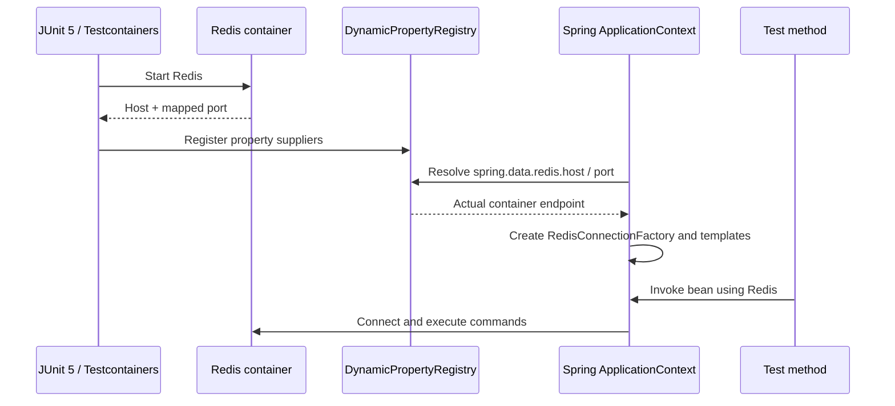
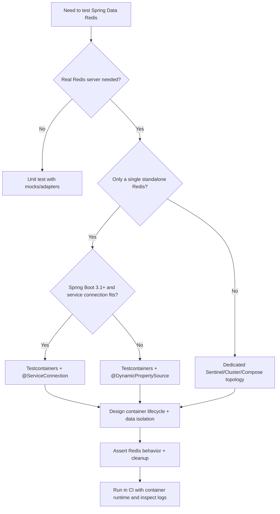

# Dynamic Redis Configuration in Spring Boot Tests

## 1. Why Must Integration Test Redis Configuration Be Initialized Dynamically?

A Spring Data Redis integration test must connect to **real Redis or a suitably behaving Redis test instance**, not just successfully boot a Spring context. During local development, a fixed configuration like `localhost:6379` looks convenient:

```yaml
spring:
  data:
    redis:
      host: localhost
      port: 6379
```

However, it introduces several risks when running tests on other machines or in CI:

- The developer machine has no Redis running on port 6379.
- Port 6379 is already occupied by another application.
- Two test suites run in parallel and accidentally write to the same Redis database.
- CI pipelines have different Docker or network setups than local machines.
- A Redis container is assigned a **random host port** on each run.
- Password, TLS, database index, or Redis configuration for tests differs from defaults.
- Tests accidentally connect to a shared Redis or even a production endpoint via exported environment variables.

**Dynamic configuration** provides Spring Boot with Redis connection properties **after the test resource has started and its real endpoint is known, yet before Spring creates the beans that need to connect**.

For example, with Testcontainers, Redis inside the container still listens on port `6379`, but the external host port might be `49173` on this run and `49218` on the next. Spring must receive the newly mapped port rather than assuming 6379 on the host.

> Dynamic Redis configuration in tests does not mean the application can switch connections dynamically at runtime. It primarily solves **discovery and property binding when initializing the test `ApplicationContext`**.

## 2. Boundary Between Unit Tests and Integration Tests

Not every Redis-related test needs Testcontainers.

| Test Type | Real Redis? | What to Verify | How to Configure |
|---|---|---|---|
| Pure business logic unit test | No | Branching and domain rules | Mock interfaces/adapters |
| Unit test of a service using Redis | Usually no | How the service handles results and exceptions | Mock repository or template |
| Spring Redis slice test | Yes, if executing real Redis commands | Mapping, repositories, serializers, Redis operations | `@DataRedisTest` + dynamic endpoint |
| Full integration test | Yes | Full bean wiring, cache/template, and real Redis | `@SpringBootTest` + Redis test resource |
| Sentinel/Cluster/failover test | Yes, multiple nodes and real topology | Authentication, routing, failover, consistency | Dedicated topology tests with dynamic config |
| Multi-service end-to-end test | Yes | Application flows across network, Redis, and other stores | Docker Compose/Testcontainers/test infra |

If the goal is simply testing calculation functions that do not use Redis, starting a container slows down tests and complicates diagnostics. Conversely, mocking `StringRedisTemplate` cannot prove serialization, key prefixes, TTL, or real Redis connectivity work.

### 2.1. What Mocks Usually Miss

When mocking Redis operations, tests can miss:

- Redis serializers incompatible with stored data.
- Wrong prefix or database index.
- Wrong key type: Hash commands on a String key fail with `WRONGTYPE`.
- TTL not set or expiring prematurely.
- Atomic operations like `SET NX EX` or `INCR` behaving differently from assumptions.
- Spring Boot failing to build the right `RedisConnectionFactory`.
- Redis auth/network errors while tests still return mocked normal responses.

Using a Redis test container catches errors at these boundaries; it does not replace production topology tests when Sentinel, Cluster, TLS, or special ACLs are involved.

## 3. Three Core Components of Dynamic Initialization

In modern Spring Boot, a straightforward pattern consists of:

1. **Testcontainers** starts a Redis container using a Docker-compatible runtime.
2. **`@DynamicPropertySource`** registers suppliers providing host, mapped port, and connection settings to the Spring test context.
3. **Spring Boot auto-configuration** uses those properties to build `RedisConnectionFactory`, `StringRedisTemplate`, `RedisTemplate`, or `RedisCacheManager`.



Key logical ordering:

- You cannot call `getMappedPort(6379)` before the container has started.
- Properties must be registered before Spring builds the connection factory.
- Test methods only run after the context builds successfully.
- Container lifecycles and Spring test context reuse across multiple classes must be managed.

## 4. Preparing the Spring Boot Project and Dependencies

Examples use Java 17+, JUnit Jupiter, Spring Boot 3.x (or a version supporting the corresponding APIs), Spring Data Redis, and Testcontainers.

### 4.1. Gradle Groovy DSL

```groovy
dependencies {
    implementation 'org.springframework.boot:spring-boot-starter-data-redis'

    testImplementation 'org.springframework.boot:spring-boot-starter-test'
    testImplementation 'org.testcontainers:testcontainers'
    testImplementation 'org.testcontainers:junit-jupiter'
}
```

If the project uses Spring Boot dependency management/BOM, many dependencies have BOM-managed versions. Without a BOM, declare compatible versions explicitly rather than copying unversioned snippets.

For `@Cacheable` tests, add Spring Cache:

```groovy
dependencies {
    implementation 'org.springframework.boot:spring-boot-starter-cache'
}
```

For `@ServiceConnection` in Spring Boot 3.1+ (covered later), add:

```groovy
dependencies {
    testImplementation 'org.springframework.boot:spring-boot-testcontainers'
}
```

You do not need `spring-boot-testcontainers` if you only use `@DynamicPropertySource` with `GenericContainer`.

### 4.2. Docker or Container Runtime

Testcontainers requires a working Docker-compatible environment **accessible where tests execute**. Before adopting it, check:

- A Docker daemon or compatible runtime is reachable.
- CI runners have permission to create containers and expose ports.
- Redis images can be pulled from a registry or approved mirror.
- Image architecture matches the dev/CI machines.
- Firewalls allow the JVM to connect to the host/port provided by Testcontainers.
- Post-test container cleanup works properly.

You do not need to manually start Redis on host port 6379. Testcontainers assigns an appropriate host port and isolates test resources.

## 5. Complete Example: `@SpringBootTest` + Testcontainers + `@DynamicPropertySource`

This pattern illustrates the most common path: starting Redis in Docker and dynamically registering the endpoint before Spring Boot creates `StringRedisTemplate`.

```java
package com.example.demo;

import static org.assertj.core.api.Assertions.assertThat;

import java.time.Duration;
import java.util.UUID;

import org.junit.jupiter.api.Test;
import org.springframework.beans.factory.annotation.Autowired;
import org.springframework.boot.test.context.SpringBootTest;
import org.springframework.data.redis.core.StringRedisTemplate;
import org.springframework.test.context.DynamicPropertyRegistry;
import org.springframework.test.context.DynamicPropertySource;
import org.testcontainers.containers.GenericContainer;
import org.testcontainers.junit.jupiter.Container;
import org.testcontainers.junit.jupiter.Testcontainers;
import org.testcontainers.utility.DockerImageName;

@SpringBootTest
@Testcontainers
class RedisIntegrationTest {

    private static final int REDIS_PORT = 6379;

    @Container
    static final GenericContainer<?> REDIS =
            new GenericContainer<>(
                    DockerImageName.parse("redis:7.4-alpine"))
                    .withExposedPorts(REDIS_PORT);

    @DynamicPropertySource
    static void redisProperties(DynamicPropertyRegistry registry) {
        registry.add("spring.data.redis.host", REDIS::getHost);

        registry.add(
                "spring.data.redis.port",
                () -> REDIS.getMappedPort(REDIS_PORT)
        );
    }

    @Autowired
    StringRedisTemplate redis;

    @Test
    void shouldRoundTripStringViaRedis() {
        String key = "it:redis:" + UUID.randomUUID();

        try {
            redis.opsForValue().set(
                    key,
                    "hello",
                    Duration.ofSeconds(30)
            );

            assertThat(redis.opsForValue().get(key))
                    .isEqualTo("hello");

            Long ttl = redis.getExpire(key);
            assertThat(ttl).isNotNull();
            assertThat(ttl).isPositive();
        } finally {
            redis.delete(key);
        }
    }
}
```

This is an **illustrative complete Java test file**, assuming the project has a `@SpringBootApplication` discoverable by `@SpringBootTest` package rules. If the test class sits outside the app's package tree, you may need `@SpringBootTest(classes = YourApplication.class)`.

### 5.1. Explaining Each Component

- `@SpringBootTest`: loads the Spring `ApplicationContext` to verify real bean wiring.
- `@Testcontainers`: enables the JUnit Jupiter Testcontainers extension.
- `@Container` on a `static` field: manages the container **per test class**, avoiding restarts per test method.
- `GenericContainer<?>`: a generic container running the specified Redis image.
- `withExposedPorts(6379)`: exposes Redis's port inside the container and maps it to a runtime-assigned host port.
- `REDIS.getHost()`: host address reachable from the JVM; never hardcode `localhost`.
- `REDIS.getMappedPort(6379)`: the newly allocated **host-side port**; not port 6379 inside the container.
- `@DynamicPropertySource`: registers suppliers providing properties when Spring resolves them.
- `StringRedisTemplate`: Spring Data Redis bean using the connection factory auto-configured from properties.
- `UUID` in the key: minimizes key collision risk across tests.
- `finally`: cleans up the test key even if assertions fail.

### 5.2. Why Must `@DynamicPropertySource` Be `static`?

In the mechanism used here, Spring Test looks for a **static** method annotated with `@DynamicPropertySource` and passes a `DynamicPropertyRegistry`. Spring can invoke it during context preparation before instantiating the test class.

Therefore, the method typically has this signature:

```java
@DynamicPropertySource
static void configureProperties(DynamicPropertyRegistry registry) {
    registry.add("spring.data.redis.host", REDIS::getHost);
    registry.add(
            "spring.data.redis.port",
            () -> REDIS.getMappedPort(6379)
    );
}
```

Do not move this into `@BeforeEach` via `System.setProperty`. When `@BeforeEach` runs, the Spring context and `RedisConnectionFactory` are usually already initialized; changing system properties afterward does not make existing beans reconnect.

### 5.3. Suppliers Are Evaluated Lazily When Needed

Calling:

```java
registry.add(
    "spring.data.redis.port",
    () -> REDIS.getMappedPort(6379)
);
```

registers a supplier rather than forcing Spring to read a fixed value at registration time. However, once properties are resolved during bean creation, the connection factory normally retains the resolved configuration. If the container later changes ports, the existing Spring context **does not auto-refresh**.

Do not create a new Redis container inside a supplier callback per property resolution. The container must have a stable lifecycle and start at the right phase.

## 6. Dynamic Host Port Is Not the Container Port

This is a frequent mistake when getting started with Testcontainers.

```text
Test JVM (host / CI runner)
   |
   | TCP to REDIS.getHost():REDIS.getMappedPort(6379)
   v
Container runtime published port, e.g. 49173
   |
   v
Redis inside container listening on 6379
```

Three distinct values:

| Component | Example | Where to Get It |
|---|---|---|
| Internal Redis port | `6379` | Server port inside the image |
| Host port | `49173` | `getMappedPort(6379)` |
| Container runtime host address | `localhost` or remote host | `getHost()` |

**Wrong:**

```java
registry.add("spring.data.redis.port", () -> 6379);
```

When the Redis container is actually published on a random host port, this points to the wrong port.

**Wrong in some remote Docker setups:**

```java
registry.add("spring.data.redis.host", () -> "localhost");
```

`localhost` only works when the JVM can reach container published ports on the local host. When the Docker daemon runs on another host, let Testcontainers supply the right address.

**Right:**

```java
registry.add("spring.data.redis.host", REDIS::getHost);
registry.add(
        "spring.data.redis.port",
        () -> REDIS.getMappedPort(6379)
);
```

## 7. How Property Precedence Works

Spring layers multiple `PropertySource`s such as YAML configs, environment variables, command-line arguments, `@TestPropertySource`, and dynamic properties. In Spring Test, properties registered via `@DynamicPropertySource` have **higher precedence** than many common test sources, including `@TestPropertySource`, environment variables, and system properties per the Spring Framework contract.

Example:

```yaml
# src/test/resources/application-test.yml
spring:
  data:
    redis:
      host: localhost
      port: 6379
```

and:

```java
@DynamicPropertySource
static void dynamicRedis(DynamicPropertyRegistry registry) {
    registry.add("spring.data.redis.host", REDIS::getHost);
    registry.add(
            "spring.data.redis.port",
            () -> REDIS.getMappedPort(6379)
    );
}
```

The dynamic values for the **same property keys** will be used in that test context. Still, keeping both static and dynamic settings without a clear purpose complicates troubleshooting; remove fixed host/port settings from test profiles if containers always supply the endpoint.

### 7.1. Spring Boot 2.x and Spring Boot 3.x

Property prefixes must match your Boot version:

| Spring Boot Line | Common Redis Prefixes |
|---|---|
| Spring Boot 2.x | `spring.redis.host`, `spring.redis.port`, `spring.redis.password` |
| Spring Boot 3.x | `spring.data.redis.host`, `spring.data.redis.port`, `spring.data.redis.password` |

Never copy a test file from Boot 2 to Boot 3 keeping old properties without checking compatibility. Unbound properties can leave `RedisConnectionFactory` silently pointing to `localhost:6379`.

Example when **the project actually runs Boot 2.x**:

```java
@DynamicPropertySource
static void redisProperties(DynamicPropertyRegistry registry) {
    registry.add("spring.redis.host", REDIS::getHost);
    registry.add(
            "spring.redis.port",
            () -> REDIS.getMappedPort(6379)
    );
}
```

Authentication, Sentinel, and SSL properties may also differ in naming across versions; keep one consistent property set.

### 7.2. Avoid Mixing Redis URL with Dynamic Host/Port

If both are configured:

```yaml
spring:
  data:
    redis:
      url: redis://some-redis.internal:6379
```

and `@DynamicPropertySource` only overrides `host` and `port`, the URL may take precedence for connection details depending on your Boot version. As a result, tests still connect to the unwanted endpoint.

A test using a Redis container should choose **one clear endpoint specification**, usually host + mapped port. Remove or override `spring.data.redis.url` if it exists in base configuration. For tests with real network access, always guard against accidentally inheriting production Redis URLs or passwords.

## 8. Dynamically Configuring Passwords, Database Indexes, and Other Properties

Dynamic configuration is not limited to host and port.

### 8.1. Test Redis with `requirepass`

To test password-only authentication:

```java
@Testcontainers
@SpringBootTest
class PasswordProtectedRedisTest {

    private static final int PORT = 6379;

    private static final String TEST_PASSWORD =
            "only-for-local-integration-tests";

    @Container
    static final GenericContainer<?> REDIS =
            new GenericContainer<>(
                    DockerImageName.parse("redis:7.4-alpine"))
                    .withExposedPorts(PORT)
                    .withCommand(
                            "redis-server",
                            "--requirepass",
                            TEST_PASSWORD
                    );

    @DynamicPropertySource
    static void redisProps(DynamicPropertyRegistry registry) {
        registry.add("spring.data.redis.host", REDIS::getHost);
        registry.add(
                "spring.data.redis.port",
                () -> REDIS.getMappedPort(PORT)
        );
        registry.add(
                "spring.data.redis.password",
                () -> TEST_PASSWORD
        );
    }
}
```

This snippet demonstrates the **configuration part** without a test method; add assertions executing Redis commands to form a real integration test. The password in the example is **not a production secret**; in CI, sensitive credentials must come from a secret store.

Do not add `spring.data.redis.username` with an arbitrary ACL username when the Redis container only sets `requirepass`. For Redis ACLs, create the user/password on the server and supply **both matching username and password**.

### 8.2. Selecting a Redis Database for Tests

If you need a database index:

```java
registry.add("spring.data.redis.database", () -> 0);
```

Setting database 0 or 1 does not replace isolation between tests if they still hit the **same Redis instance**. Database index configuration in Redis Cluster is also not equivalent to standalone Redis; Redis Cluster typically supports only database 0.

More reliable isolation comes from per-scope containers or unique key prefixes with cleanup. Do not assume the number of database indexes is unlimited.

### 8.3. Dynamic Properties for Timeouts

```java
registry.add("spring.data.redis.connect-timeout", () -> "2s");
registry.add("spring.data.redis.timeout", () -> "3s");
```

These settings prevent tests from hanging too long on connection failures, without setting them so low that tests flake on busy CI runners. Timeouts only limit wait duration; they do not fix unstarted containers or wrong endpoints.

## 9. Using `@DataRedisTest` Instead of `@SpringBootTest` When Appropriate

`@SpringBootTest` loads the broad application context. If the goal is only verifying Redis mapping, serializers, or Repositories, Spring Boot provides `@DataRedisTest` to load just Redis-related configuration.

Example:

```java
package com.example.demo.repository;

import static org.assertj.core.api.Assertions.assertThat;

import java.util.UUID;
import org.junit.jupiter.api.Test;
import org.springframework.beans.factory.annotation.Autowired;
import org.springframework.boot.test.autoconfigure.data.redis.DataRedisTest;
import org.springframework.data.redis.core.StringRedisTemplate;
import org.springframework.test.context.DynamicPropertyRegistry;
import org.springframework.test.context.DynamicPropertySource;
import org.testcontainers.containers.GenericContainer;
import org.testcontainers.junit.jupiter.Container;
import org.testcontainers.junit.jupiter.Testcontainers;
import org.testcontainers.utility.DockerImageName;

@DataRedisTest
@Testcontainers
class RedisSliceTest {

    @Container
    static final GenericContainer<?> REDIS =
            new GenericContainer<>(
                    DockerImageName.parse("redis:7.4-alpine"))
                    .withExposedPorts(6379);

    @DynamicPropertySource
    static void properties(DynamicPropertyRegistry registry) {
        registry.add("spring.data.redis.host", REDIS::getHost);
        registry.add(
                "spring.data.redis.port",
                () -> REDIS.getMappedPort(6379)
        );
    }

    @Autowired
    StringRedisTemplate redis;

    @Test
    void shouldSaveString() {
        String key = "it:slice:" + UUID.randomUUID();
        try {
            redis.opsForValue().set(key, "value");
            assertThat(redis.opsForValue().get(key))
                    .isEqualTo("value");
        } finally {
            redis.delete(key);
        }
    }
}
```

Characteristics:

- `@DataRedisTest` does not load all services/controllers like a full `@SpringBootTest`.
- The Redis connection is still a real connection to the container.
- If a service under test is excluded from default slice scanning, you can add `@Import(YourService.class)` when appropriate.
- Slice tests still require Docker/containers and do not conjure a Redis server if container setup is missing.
- With custom `RedisConnectionFactory`/serializers, verify the slice includes the exact beans under test.

Choose slice tests for faster, more isolated verification of data access; do not use slice tests to claim full web/security/cache routing coverage.

## 10. `@ServiceConnection`: The Simpler Path in Spring Boot 3.1+

Spring Boot 3.1 and above include **Testcontainers service connections**. Instead of registering host/port manually, `@ServiceConnection` creates connection details for a known service.

With `GenericContainer`, tell Boot which service type the container represents. For Redis:

```groovy
dependencies {
    testImplementation 'org.springframework.boot:spring-boot-starter-test'
    testImplementation 'org.springframework.boot:spring-boot-testcontainers'
    testImplementation 'org.testcontainers:junit-jupiter'
    testImplementation 'org.testcontainers:testcontainers'
}
```

```java
package com.example.demo;

import static org.assertj.core.api.Assertions.assertThat;

import java.util.UUID;
import org.junit.jupiter.api.Test;
import org.springframework.beans.factory.annotation.Autowired;
import org.springframework.boot.test.context.SpringBootTest;
import org.springframework.boot.testcontainers.service.connection.ServiceConnection;
import org.springframework.data.redis.core.StringRedisTemplate;
import org.testcontainers.containers.GenericContainer;
import org.testcontainers.junit.jupiter.Container;
import org.testcontainers.junit.jupiter.Testcontainers;
import org.testcontainers.utility.DockerImageName;

@SpringBootTest
@Testcontainers
class RedisServiceConnectionTest {

    @Container
    @ServiceConnection(name = "redis")
    static final GenericContainer<?> REDIS =
            new GenericContainer<>(
                    DockerImageName.parse("redis:7.4-alpine"))
                    .withExposedPorts(6379);

    @Autowired
    StringRedisTemplate redis;

    @Test
    void shouldConnectThroughServiceConnection() {
        String key = "it:service-connection:" + UUID.randomUUID();

        try {
            redis.opsForValue().set(key, "connected");
            assertThat(redis.opsForValue().get(key))
                    .isEqualTo("connected");
        } finally {
            redis.delete(key);
        }
    }
}
```

Here:

- `@ServiceConnection(name = "redis")` tells Spring Boot to recognize `GenericContainer` as a Redis service.
- Boot creates `RedisConnectionDetails` from the container, and Redis auto-configuration consumes those details.
- You do not need to call `registry.add("spring.data.redis.host", ...)` and `registry.add("spring.data.redis.port", ...)` for the same connection.
- `spring-boot-testcontainers` provides this integration; the JUnit Jupiter extension still manages container lifecycle.

### 10.1. When to Still Choose `@DynamicPropertySource`?

`@DynamicPropertySource` fits when:

- The project is not yet on Spring Boot 3.1+ or lacks a matching service connection factory.
- You have **custom application properties**, such as `app.redis.external-host`.
- Multiple endpoints/ports come from multiple containers.
- You need to map details for a less common service not recognized by `@ServiceConnection`.
- You want explicit control over which properties enter the context.

`@ServiceConnection` fits when:

- Using a Spring Boot version that supports it.
- The connection is covered by an appropriate service connection factory.
- You want to avoid managing host/port/password property names manually.
- Test configuration only needs standard connection details.

**Do not mix both approaches for the same connection unintentionally**, since service connection details and properties follow distinct precedence rules. If tests still hit the wrong endpoint, check for custom `RedisConnectionFactory` beans or competing URL/host properties from other sources.

## 11. Container Startup and Spring Context Lifecycles Must Align

### 11.1. Per-Class Container

In the `@Testcontainers` + `@Container static` example, the container is scoped to the JUnit test class.

```text
Test class begins
    -> JUnit extension starts container
    -> Spring creates ApplicationContext
    -> Test methods run
    -> JUnit extension stops container
Test class ends
```

This works well when each class has its own context/container. Problems arise when Spring **caches and reuses `ApplicationContext` instances** across test classes, while the container was stopped at the end of the first class.

Example:

```text
Class A:
  Redis mapped port = 49173
  Spring cached context -> connection factory port 49173
  Class A finishes -> container A stops

Class B:
  Redis mapped port = 49251
  Spring reuses context from A (under an identical test configuration)
  Connection factory still points to 49173 -> connection refused
```

Not every test suite hits this: whether a context is reused depends on Spring Test's cache key and how dynamic properties are registered. However, it is a real failure mode to guard against when a shared base class holds `@DynamicPropertySource`.

### 11.2. Shared Container Across Multiple Test Classes

If multiple classes need the same Redis and you want Spring context reuse, create a test base class that starts the container once for the entire test JVM process:

```java
package com.example.demo.testinfra;

import org.springframework.test.context.DynamicPropertyRegistry;
import org.springframework.test.context.DynamicPropertySource;
import org.testcontainers.containers.GenericContainer;
import org.testcontainers.utility.DockerImageName;

public abstract class SharedRedisTestBase {

    protected static final GenericContainer<?> REDIS =
            new GenericContainer<>(
                    DockerImageName.parse("redis:7.4-alpine"))
                    .withExposedPorts(6379);

    static {
        REDIS.start();
    }

    @DynamicPropertySource
    static void registerRedis(DynamicPropertyRegistry registry) {
        registry.add("spring.data.redis.host", REDIS::getHost);
        registry.add(
                "spring.data.redis.port",
                () -> REDIS.getMappedPort(6379)
        );
    }
}
```

Subclassing test:

```java
@SpringBootTest
class ProductCacheIntegrationTest extends SharedRedisTestBase {

    @Autowired
    StringRedisTemplate redis;

    @Test
    void canStoreValue() {
        String key = "it:product:" + UUID.randomUUID();
        try {
            redis.opsForValue().set(key, "ready");
            assertThat(redis.opsForValue().get(key))
                    .isEqualTo("ready");
        } finally {
            redis.delete(key);
        }
    }
}
```

In this pattern:

- The container starts in the base class static initializer.
- It is not annotated with JUnit's `@Container`, preventing the extension from stopping it after each test class.
- Testcontainers still cleans up the container via its runtime shutdown mechanism when the test process exits normally.
- Classes share the same Redis endpoint, allowing context reuse when other configuration attributes match.

**Trade-off:** sharing Redis across classes allows test data to interfere. Use unique namespaces, scoped cleanup, and avoid `FLUSHALL`/`FLUSHDB` in parallel runs.

### 11.3. Different Containers per Subclass

If a base class defines `@DynamicPropertySource` while each subclass uses a different container, Spring might reuse a previous context even though dynamic values changed, because the test context cache does not evaluate supplier values on every lookup.

One option is using:

```java
@DirtiesContext(classMode = DirtiesContext.ClassMode.AFTER_CLASS)
```

on classes that must avoid context reuse, or structuring test configs so each class yields a distinct context cache key. `@DirtiesContext` forces Spring to close/rebuild contexts and increases test runtime, so avoid applying it indiscriminately when one stable shared container works.

## 12. Isolating Data Between Tests

Having a dynamic Redis endpoint does not automatically make tests **data-independent**. Two methods can still write to the same key.

### 12.1. Use Dedicated Keys per Test

```java
String key = "it:cart:" + UUID.randomUUID();
```

Pros: near-zero collision probability, suitable for many independent read/write tests. Clean up in `finally` or `@AfterEach` using the test's owned key list.

### 12.2. Do Not Run `FLUSHDB` on a Redis Shared Across Tests

```java
redis.getConnectionFactory()
        .getConnection()
        .serverCommands()
        .flushDb();
```

This command can wipe **the entire Redis database used by that connection**, including keys from other test classes running in parallel. Never use it as default cleanup on a shared Redis container.

If a truly empty database is required to verify keyspace-wide behavior, give that test class its own dedicated container rather than sharing it with other tests.

### 12.3. Key Prefixes Are Not Always Enough for Global Redis Commands

For simple `GET`/`SET`/`DEL` tests, unique prefixes isolate well. However, some commands act beyond a single prefix:

- `FLUSHDB`/`FLUSHALL` erase broad datasets.
- `CONFIG SET` mutates the Redis instance.
- `SCRIPT FLUSH` affects the script cache.
- `CLIENT KILL` can affect other connections.
- Pub/Sub notifications broadcast at the node/channel level.
- Redis Stream consumer groups with identical names/keys touch the same pending state.

Tests using these should get their own containers or run sequentially in an isolated environment with an explicit reset strategy.

### 12.4. Do Not Rely on `@Transactional` Rollback to Undo Redis Writes

A `@Transactional` test may roll back a JDBC transaction after the test, but Redis operations via `StringRedisTemplate` do not automatically become part of a JDBC transaction. Even when Spring Data Redis enables transaction support, coordinating a database and Redis does not automatically provide distributed atomicity.

**Redis cleanup must be designed independently**, never assuming JUnit/Spring rolls back Redis like a Hibernate `EntityManager`.

## 13. Testing Real Redis Caching with `@SpringBootTest`

Dynamic configuration can be used to verify `RedisCacheManager` and Spring Cache annotations.

Example:

```java
package com.example.demo;

import static org.assertj.core.api.Assertions.assertThat;

import java.util.UUID;
import org.junit.jupiter.api.Test;
import org.springframework.beans.factory.annotation.Autowired;
import org.springframework.boot.test.context.SpringBootTest;
import org.springframework.cache.Cache;
import org.springframework.cache.CacheManager;
import org.springframework.test.context.DynamicPropertyRegistry;
import org.springframework.test.context.DynamicPropertySource;
import org.testcontainers.containers.GenericContainer;
import org.testcontainers.junit.jupiter.Container;
import org.testcontainers.junit.jupiter.Testcontainers;
import org.testcontainers.utility.DockerImageName;

@SpringBootTest(properties = "spring.cache.type=redis")
@Testcontainers
class RedisCacheManagerIntegrationTest {

    @Container
    static final GenericContainer<?> REDIS =
            new GenericContainer<>(
                    DockerImageName.parse("redis:7.4-alpine"))
                    .withExposedPorts(6379);

    @DynamicPropertySource
    static void redisProps(DynamicPropertyRegistry registry) {
        registry.add("spring.data.redis.host", REDIS::getHost);
        registry.add(
                "spring.data.redis.port",
                () -> REDIS.getMappedPort(6379)
        );
    }

    @Autowired
    CacheManager cacheManager;

    @Test
    void shouldPutAndReadFromRedisCache() {
        Cache cache = cacheManager.getCache("itProductCache");
        assertThat(cache).isNotNull();

        String key = "product-" + UUID.randomUUID();

        try {
            cache.put(key, "summary");
            assertThat(cache.get(key, String.class))
                    .isEqualTo("summary");
        } finally {
            cache.evict(key);
        }
    }
}
```

To run this example, the project needs `spring-boot-starter-cache` and Spring Boot must create an appropriate `RedisCacheManager`, without another cache manager replacing it. The example mainly proves **the Spring Cache region actually writes and reads via the test Redis connection**.

If the goal is testing `@Cacheable` on a service, the test must invoke the method via a Spring-managed proxy, not directly on the same instance. You can use a spy or invocation counter in a test source to distinguish hits/misses, paying attention to how `@MockBean`/`@MockitoBean` interacts with cache proxies in your Spring Boot version.

## 14. Testing TTL: Avoid Timing Conditions That Cause Flakiness

In Redis integration tests, TTL is one of the most critical attributes. A relatively stable check is reading the TTL right after setting it:

```java
@Test
void shouldSetPositiveTtl() {
    String key = "it:ttl:" + UUID.randomUUID();

    try {
        redis.opsForValue().set(
                key, "value", Duration.ofSeconds(30));

        Long ttl = redis.getExpire(key);

        assertThat(ttl).isNotNull();
        assertThat(ttl).isBetween(1L, 30L);
    } finally {
        redis.delete(key);
    }
}
```

Do not write:

```java
Thread.sleep(1000);
assertThat(redis.hasKey(key)).isFalse();
```

with an exact 1-second TTL and assume it will be stable on every runner. Scheduling, CI latency, and Redis expiration timing can make the assertion flip via a race condition.

If you need to verify **the key actually disappears**, use a bounded wait and polling, such as Awaitility (if added as a dependency) or a sensible wait loop. Never use infinite timeouts or overly short fixed sleeps.

When testing keyspace notifications, remember expired events use Pub/Sub and fire only when Redis actually deletes the expired key. Such tests need the listener ready before setting the TTL and should not expect event delivery to the millisecond.

## 15. Testing Redis Repositories, Serializers, and Schemas

A Redis test container does more than test connectivity—it verifies actual data representation.

### 15.1. Choosing the API Matching the Goal

| Test Target | Spring Data Redis API | What to Verify |
|---|---|---|
| String key/value | `StringRedisTemplate` | Round-trip, TTL |
| Domain object serialization | `RedisTemplate<K,V>` | Key/value/hash serializers and schema version |
| Redis Repository | Repository interface, `@RedisHash` | ID, Hash mapping, TTL, secondary indexes |
| Spring Cache | `CacheManager`/`@Cacheable` | Cache prefix, serializer, miss/hit, eviction |
| Streams | `opsForStream()` | Record fields, consumer groups, ack/pending |
| Transactions | `execute(SessionCallback)` with `MULTI/EXEC` | Isolation and errors, no automatic runtime rollback |

### 15.2. Do Not Swap the Test Serializer Away from Production When Verifying Compatibility

For example, production uses a custom JSON serializer in `RedisTemplate`, yet the test injects `StringRedisTemplate` and only checks Strings. The test can pass while production fails to deserialize objects.

To verify the real schema, load the real bean configuration and use the exact serializer/mapper. When refactoring object models, consider existing cache entries, type metadata, and compatibility across app versions.

### 15.3. Redis Image Version Affects Behavior

Certain Redis Streams, ACL, Pub/Sub, JSON module, or Redis Cluster commands differ by version/edition. Pinning the Redis image like:

```java
DockerImageName.parse("redis:7.4-alpine")
```

gives tests a more stable environment than `redis:latest`. Still, if production runs a different version, tests will miss those differences. Pick an image version aligned with production and plan migration tests when upgrading the Redis/Valkey engine.

If the app uses Redis Stack modules, a plain Redis OSS image will lack those modules. Use the corresponding container image and startup readiness check.

## 16. Dynamic Properties for Sentinel or Redis Cluster

In a simple integration test, a standalone Redis `GenericContainer` only verifies a single-node connection. It **does not fully simulate**:

- Sentinel master discovery/failover.
- Redis Cluster hash-slot routing and `MOVED`/`ASK`.
- Replication lag or read-from-replica behavior.
- Managed Redis TLS/ACL setups.
- Master address changes after failover.

You can still use `@DynamicPropertySource` when building multi-container Sentinel/Cluster setups, provided you supply the **right properties and endpoints**.

Conceptual Sentinel configuration for Spring Boot 3.x:

```java
registry.add(
    "spring.data.redis.sentinel.master",
    () -> "mymaster"
);

registry.add(
    "spring.data.redis.sentinel.nodes",
    () -> sentinelEndpointsCsv
);
```

Here, `sentinelEndpointsCsv` is a `host:port` list built from the containers using endpoints reachable **from the test JVM**. Do not simply swap standalone host/port for a single Sentinel port and hope everything works.

Containerized Sentinel/Cluster topologies pose extra challenges:

- Redis/Sentinel may **advertise** internal IPs unreachable from the host JVM.
- Every Redis/Sentinel container must be able to reach peers over the Docker network.
- Clients must connect to the endpoints returned by Sentinel/Cluster, not only seed endpoints.
- Startup order, quorum, replica sync, and health readiness are more complex.
- Credentials for Sentinel and Redis data nodes may be independent.
- Proper teardown/cleanup is needed when tests simulate failover.

In many systems, a dedicated topology test resource or staging environment is better suited for these scenarios; never use a standalone Redis test as proof that Sentinel/Cluster is verified.

## 17. Testcontainers vs. Docker Compose: Choosing by Test Scope

### 17.1. Direct Testcontainers

Pros:

- Test code manages resources directly.
- Endpoints are retrieved via container objects.
- Containers can be scoped per class.
- Easy to pin images and supply dynamic properties.

Best for standalone Redis tests or a small set of relatively independent dependencies.

### 17.2. Test-Managed Docker Compose

When an application depends on Redis, PostgreSQL, and supporting services, Docker Compose describes networking and healthchecks cleanly. You can combine Spring Boot's Docker Compose support or Testcontainers' Compose container depending on versions.

However, do not assume a running Compose file automatically gives every test the right Redis configuration. Know:

- Who starts and stops the Compose stack.
- Which host published ports the JVM connects through.
- Whether Boot provides service connection details or requires manual registration.
- Whether test profiles and namespaces are isolated from local development.
- Whether CI runners support Docker Compose and required network permissions.

Whichever option you choose, the key rule remains: **Redis configuration must derive from the real endpoint of the test resource**, never hardcoded to an address that only works on one developer's laptop.

## 18. CI: Running Integration Tests in Reproducible Environments

A CI pipeline should verify:

1. A Docker-compatible runtime is available.
2. Permissions exist to pull Redis images, or images are cached/mirrored.
3. The JVM can connect to the host/port published by Testcontainers.
4. Container startup time fits runner limits.
5. No production Redis credentials are used.
6. Test cleanup/teardown runs even when assertions fail.
7. Logs never record secrets or sensitive data.
8. Container-heavy integration tests are separated from unit tests when startup cost is high.

### 18.1. Distinguishing Test Failures from Skipped Tests

If CI is required to run Redis integration tests, **never silently skip** them just because Docker is absent. Intentional skipping can be configured for developer environments lacking Docker, but release-gating pipelines must run them for real and fail if containers cannot start.

Example:

```text
Unit tests:
  - No Redis or Docker needed
  - Fast, runs on every change

Redis integration tests:
  - Docker-compatible runtime available
  - Starts Redis Testcontainers
  - Registers @DynamicPropertySource / @ServiceConnection
  - Tests real Redis commands
  - Fails if Redis is unavailable

Topology tests:
  - Redis Sentinel/Cluster/ACL/TLS
  - Can run in a separate stage due to higher cost
```

This separation prevents turning a Docker environment glitch into a "business logic unit test failure," while ensuring parts requiring real Redis remain verified in the pipeline.

### 18.2. Startup Readiness

`withExposedPorts(6379)` uses Testcontainers' default wait behavior, which fits ordinary cases; however, when swapping images, custom commands, init scripts, or enabling TLS/auth, pay attention to readiness.

```text
Container running != Redis server ready for AUTH/PING
Redis PING succeeds != schema/index/module initialization complete
```

With custom images or topologies, configure an appropriate wait strategy, such as port listening or startup logs. Avoid `Thread.sleep(5000)` as the sole synchronization mechanism. The wait strategy must reflect real application readiness with a sensible timeout.

## 19. Common Errors and Troubleshooting

| Symptom | Possible Cause | Resolution |
|---|---|---|
| `Connection refused: localhost:6379` | Test still uses fixed config | Check dynamic property keys, test profiles, Redis URL, Boot version |
| `getMappedPort(...)` reports container not started | Mapped port read too early | Ensure container starts before supplier resolves; fix lifecycle |
| Passes locally, fails in CI | Docker unavailable or different networking | Check container runtime, `getHost()`, logs |
| Connects to wrong port despite running container | Uses internal port 6379 instead of mapped host port | Register `getMappedPort(6379)` |
| Boot 3.x ignores `spring.redis.host` | Different Boot property prefix | Use `spring.data.redis.host/port` |
| Boot 2.x ignores `spring.data.redis.*` | Using newer prefix on older app | Match Boot version and prefix |
| `@DynamicPropertySource` does not run | Method not static, missing annotation, or outside loaded context | Check signature and Spring Test bootstrap |
| `NOAUTH` / `WRONGPASS` | Container enables password, app misconfigured | Register matching client password/username |
| `WRONGTYPE` or deserialization error | Leftover data/different serializer | Check serializer, key namespace, cleanup |
| First test passes, second gets connection refused | Per-class container stopped while cached `ApplicationContext` persisted | Use shared container or scope context rebuild |
| Parallel tests fail randomly | Shared keys or `FLUSHDB` | Dedicated keys, cleanup, isolate destructive tests |
| Flaky TTL test | Asserting right on expiration boundary | Read TTL range or poll with timeout |
| `@ServiceConnection` fails to configure Redis | Missing Boot dependency or `GenericContainer` missing service name | Add `spring-boot-testcontainers`, `@ServiceConnection(name="redis")` |
| `@ServiceConnection` present but app uses another endpoint | Custom factory or competing config takes precedence | Inspect `RedisConnectionFactory` bean and connection details |
| Docker image pull fails | Registry/network/rate limit | Use approved mirror/image cache |
| Standalone Sentinel test passes, production fails | Test lacked Sentinel/Cluster topology | Add topology-level integration tests |
| Test stalls on Spring context start | Redis not ready, auth/TLS mismatch, or connect timeout | Check root exception and container logs |
| Test passes yet Redis retains data afterward | Missing cleanup or shared context/container | Delete owned keys and use dedicated prefixes |
| Redis cache test does not use Redis | Another `CacheManager` auto-configured or custom bean | Check `spring.cache.type=redis` and actual `CacheManager` |

### 19.1. Do Not Read Only the Outer Exception

For instance, `Failed to load ApplicationContext` can hide the root cause underneath:

```text
Failed to load ApplicationContext
  BeanCreationException
    RedisConnectionFailureException
      ConnectException: Connection refused
```

Proper troubleshooting steps:

1. Find the root cause.
2. Check whether the container started successfully.
3. Inspect registered host/port without printing credentials.
4. Check for a Redis URL or custom factory override.
5. Verify the test context was not reused from an already-stopped container.

Never alter Spring service business logic just to mask a test infrastructure bootstrap error.

## 20. Organizing Test Configuration for Maintainability

Large projects should avoid copy-pasting `@Container` + `@DynamicPropertySource` blocks into hundreds of classes. Choose one of these patterns:

| Pattern | Best When | Trade-Offs |
|---|---|---|
| Per-class container declaration | Independent tests, few classes | Slower startup |
| Base class with shared static container | Many classes use the same Redis | Easier state leakage across classes |
| `@ServiceConnection` field with test container | Boot 3.1+ and supported services | Follows Boot conventions |
| Dedicated test configuration / custom extension | Many dependencies, special wiring | Must manage context cache and lifecycle |
| Docker Compose test environment | Multiple interconnected services | More complex startup and mapping |
| Dedicated staging topology | Sentinel/Cluster/failover under realistic constraints | Higher cost and orchestration |

### 20.1. Principle of Order Independence

A good Redis integration test should:

- Create all data it needs before asserting.
- Not assume another test already ran and created keys.
- Not assume an empty database index if sharing Redis.
- Not require another test to have registered consumer groups or scripts.
- Clean up the exact keys it owns.
- Not depend on millisecond-exact TTL timing.
- Not mutate global Redis instance configs used by other tests.

When testing globally mutating operations, use a dedicated resource to ensure isolation.

### 20.2. A Shared Base Class Should Have an Explicit Contract

If using `SharedRedisTestBase`, document clearly:

```text
- Spring Boot version and property prefix
- Redis image version
- Container lifecycle (per JVM vs. per class)
- Spring test contexts allowed to be reused
- Key namespace conventions for tests
- Cleanup and parallel test policy
- Whether password or TLS is enabled
- Which Redis commands are tested vs. untested
```

This prevents one test class from modifying the shared container or config and causing mysterious failures in unrelated classes.

## 21. Decision Workflow



A practical rollout order:

1. **Identify the test type** and Redis behavior to verify.
2. **Provision an isolated Redis resource** via Testcontainers or suitable test topology.
3. **Register endpoints dynamically** before Spring context creation via `@DynamicPropertySource` or `@ServiceConnection`.
4. **Keep the right property prefixes** for your Spring Boot version.
5. **Verify beans actually connect to test Redis**, not a leftover static host.
6. **Isolate test data** with key namespaces/UUIDs and bounded cleanup.
7. **Align container lifecycle and context reuse** across multiple classes.
8. **Run in CI with Docker**, never silently skipping integration tests on release pipelines.
9. **Expand to Sentinel/Cluster/ACL/TLS** when business needs depend on those behaviors.

## 22. Summary

**Dynamic Redis configuration in Spring Boot tests** bridges the gap between real Redis endpoints provisioned dynamically by the test environment and the connection properties Spring Data Redis requires when building `ApplicationContext`.

With Testcontainers, the common solution is starting a Redis container, obtaining `getHost()` and `getMappedPort(6379)`, and registering `spring.data.redis.host/port` via `@DynamicPropertySource`. Spring Boot 3.1+ also offers `@ServiceConnection(name="redis")` to auto-generate Redis connection details, reducing manual configuration.

Dynamic configuration is only the **foundation** of integration testing. Reliable tests must also manage container lifecycles, Spring context caching, data isolation, serializers, TTL, permissions, and Docker/CI environments. Passing a standalone Redis test does not prove Sentinel, Cluster, or failover works; and passing a mocked test does not prove a real Redis server is configured properly.

By keeping these boundaries clear, Spring Data Redis applications can verify real Redis commands and mappings in an environment that is **reproducible, independent, and free from hardcoded ports on developer machines**.

## References

- [Spring Framework — DynamicPropertySource](https://docs.spring.io/spring-framework/reference/testing/annotations/integration-spring/annotation-dynamicpropertysource.html)
- [Spring Framework — Context caching](https://docs.spring.io/spring-framework/reference/testing/testcontext-framework/ctx-management/caching.html)
- [Spring Boot — Testcontainers](https://docs.spring.io/spring-boot/reference/testing/testcontainers.html)
- [Spring Boot — Service connections](https://docs.spring.io/spring-boot/reference/testing/testcontainers.html#testing.testcontainers.service-connections)
- [Testcontainers — JUnit 5](https://java.testcontainers.org/test_framework_integration/junit_5/)
- [Testcontainers — Networking and exposing ports](https://java.testcontainers.org/features/networking/)
- [Spring Boot — Redis auto-configuration properties](https://docs.spring.io/spring-boot/appendix/application-properties/)
- [Spring Data Redis — RedisTemplate](https://docs.spring.io/spring-data/redis/reference/redis/template.html)
